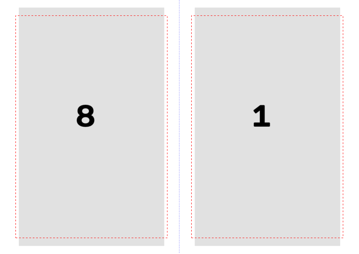
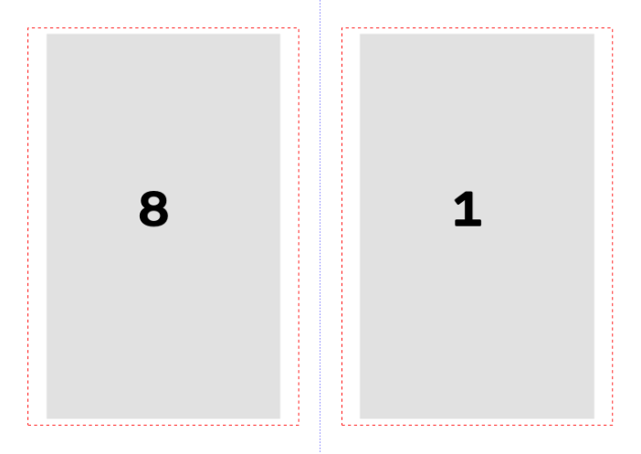
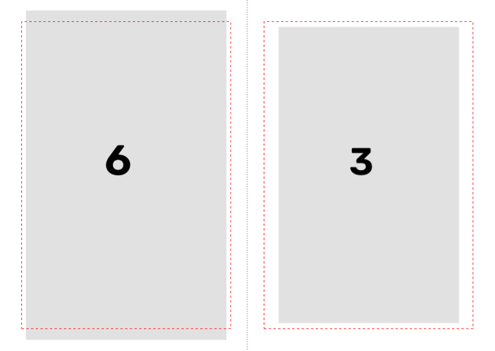

# Fase de impressão dentro do programa: como fazer

Pesquisa para a gerente, 19 e 20/10/2026. Ramo `pesquisa-impressao-2026-10-19`.
Pedido do Samuel (14/10): todas as opções da janela de imprimir do UPDF dentro do programa, mais o livreto
automático "como o embaralhador antigo (o primeiro que fizemos)". Texto dele em
`relatorios/conferencia-samuel-2026-10-14/explicacao-da-impressao.md`; decisões `g10`, `g11` e `g12` no Registro
do plano (13 e 14/10).

Ao longo do texto, **[lido]** quer dizer que eu li na fonte (código, foto, página da internet) e **[dedução]**
quer dizer que é conclusão minha, ainda não conferida.

## A resposta em cinco frases

1. O "embaralhador antigo" é o primeiro programa, o `imposicao_cadernos.py`, e a conta dele já está no programa
   de hoje (`core/cadernos.py`), testada e com a conferência da dobra. Essa parte se aproveita inteira.
2. O que falta é a **montagem da folha**: hoje cada folha sai com o dobro da largura da página, sem papel A4,
   sem margem e sem escala. Com o PyMuPDF, que o programa já usa, dá para pôr cada página na metade de uma A4
   deitada com as margens de 1,3 cm e 1 cm, a escala de cada lado e o aviso de margem. Uma prova pequena,
   fora do programa, funcionou.
3. Quase todas as opções do UPDF se fazem no próprio arquivo PDF, sem biblioteca nova (Tamanho, Livreto,
   Múltiplo, Pôster, papel, orientação, girar, centralizar, cinza, inverter a ordem, intervalo). Cópias,
   "Agrupar" e escolher a impressora só existem se o programa mandar direto para a impressora. O PySide6 tem
   isso pronto, mas é decisão do Samuel.
4. Achei um defeito que veio do embaralhador antigo: o último caderno sai sempre do tamanho cheio. Num livro
   de 23 páginas em cadernos de 20, saem 17 páginas em branco, 3 folhas inteiras vazias. Corrigir isso é
   decisão do Samuel.
5. Dá para fazer em livros de 300 a 1000 páginas e no notebook do Kaique. A memória cresce com o tamanho do
   arquivo final, como já acontece hoje ao gravar o PDF. Ficam seis perguntas para o Samuel (seção 9).

## Tabela: cada opção, o que faz, como fazer, dificuldade

| Opção (nome no UPDF) | O que faz | Como fazer no programa | Dificuldade |
|---|---|---|---|
| **Livreto** (frente e verso, encadernação esquerda) | Duas páginas por folha deitada, na ordem da dobra | Ordem: `core/cadernos.py` (já existe). Folha: `show_pdf_page` em cada metade de uma A4 deitada | Média (a ordem está pronta; falta a folha A4, as margens e a escala) |
| Livreto em **cadernos de N folhas** | Vários cadernos em vez de um só (o UPDF e o Acrobat fazem um só) | Já existe (`paginas_por_caderno`, 8 a 40) | Pronto |
| Livreto: **Folhas de / até** | Imprime só algumas folhas (ex.: refazer uma folha que enroscou) | Monta a ordem inteira e grava só os lados do intervalo | Fácil |
| Livreto: **Frente e verso / só frente / só verso** | Para impressora sem frente e verso automático | Grava só os lados ímpares ou só os pares | Fácil |
| Livreto: **Encadernação esquerda / direita** | Direita é para livro que abre ao contrário | Trocar a página da esquerda pela da direita em cada lado | Fácil |
| **Ajustar** | Aumenta ou diminui cada página até caber no papel | Conta da escala `min(largura, altura)` e `show_pdf_page` com proporção mantida | Fácil |
| **Tamanho real** | 100%, sem escala; o que passar do papel é cortado | `show_pdf_page` com o tamanho da página em pontos, centrado, e `clip` | Fácil (depende do DPI declarado do scan, ver Riscos) |
| **Escala personalizada (%)** | Escala fixa escolhida pelo usuário | Multiplica o tamanho real pela % | Fácil |
| **Reduzir páginas muito grandes** | Só diminui as páginas maiores que o papel; as menores ficam em 100% | `escala = min(1, ajustar)` | Fácil |
| **Escala só da esquerda / só da direita / das duas** (pedido do Samuel) | Diminuir as páginas pares, as ímpares ou todas | Uma escala para cada lado da folha, valendo para o livro, com exceção por folha | Média (o difícil é a tela, não a conta) |
| **Margens** 1,3 cm fora / 1 cm na costura (`g11`) | Garantir a margem da encadernação clássica | Área de cada metade descontada das margens; a costura fica sempre no meio da A4 | Fácil |
| **Aviso de margem abaixo de 1 cm** | Avisar quando a tinta chegar perto demais da beirada | Caixa da tinta de cada página (4 números) e a conta da margem depois da escala | Média |
| **Pôster** | Divide uma página grande em várias folhas, com sobreposição para colar | Uma página nova por pedaço, `show_pdf_page(..., clip=pedaço)`; marcas de corte com `draw_line` | Média |
| **Múltiplo** | Várias páginas numa folha (2, 4, 6, 9, 16), em grade | Grade de células, `show_pdf_page` em cada uma; moldura com `draw_rect` | Fácil |
| **Tamanho do papel** (A4, Carta, Ofício...) | Muda a folha de saída | Tabela de tamanhos em cm (a do UPDF, ver seção 2) | Fácil |
| **Orientação** Retrato / Paisagem | Folha em pé ou deitada | Trocar largura e altura da folha | Fácil |
| **Rotação automática** | Gira a página que está "deitada" num papel "em pé" (e o contrário) | `show_pdf_page(..., rotate=90)` quando a orientação não bate | Fácil |
| **Centralizar automático** | Centra a página no papel; desligado, ela fica no canto | Posição do retângulo | Fácil |
| **Escala de cinza** | Tira a cor | Melhor na hora de gravar a página (o programa já tem a imagem na mão); depois só refazendo a imagem | Fácil se for na gravação |
| **Imprimir como imagem** | Manda a folha como uma foto inteira, não como desenho do PDF | As páginas do programa já são imagens. "Achatar" a folha inteira é possível, mas deixa o arquivo maior e mais lento | Fácil, mas pouco útil (ver seção 3) |
| **Reverter páginas** | Imprime da última para a primeira | Inverter a ordem das **folhas**, sem separar frente e verso de cada uma | Fácil, com teste na impressora |
| **Intervalo de páginas** / Todas | Imprime só parte do livro | Escolher as páginas antes de montar | Fácil |
| **Cópias / Agrupar**, **impressora**, **Predefinição** | Coisas da impressora | Só se o programa imprimir direto (PySide6 `QPrinter`: cópias, agrupar, frente e verso pela borda curta) | Média |
| A folha muito maior (`g9`) | Tabela dobrável | Quatro caminhos na seção 6 | Média |

## 1. O embaralhador antigo

**Onde está [lido]:** é o `imposicao_cadernos.py`, feito no chat que deu origem ao projeto, guardado inteiro em
`historico/genesis-conversa-imposicao-cadernos.md` (linhas 80 a 620). Não achei o arquivo solto no disco. Procurei
em `D:\programas`, `velhos/`, `EditorImpressao-arquivos`, Área de Trabalho, Downloads e Documentos. O git
começa no programa novo (`94d3459`); os ramos antigos não têm nada antes disso.

**Como ele montava o caderno [lido]:**

- **Primeira versão** (Python, biblioteca PyPDF2): para um caderno de N páginas, a folha `i` (contando do 0)
  leva na frente `[N − 2i] [1 + 2i]` e no verso `[2 + 2i] [N − 1 − 2i]`. Exemplo do próprio chat, 20 páginas:
  folha 1 = 20|1 e 2|19; folha 5 (miolo) = 12|9 e 10|11. Os cadernos seguem em blocos de N páginas. O que
  passa do fim vira página em branco **no fim do último caderno**, que é sempre do tamanho cheio. O arquivo saía
  só com as páginas na nova ordem, e o Kaique tinha de imprimir "2 por folha".
- **Segunda versão** (página da internet, a que o Samuel aprovou): o arquivo já saía com as duas páginas lado a
  lado numa folha deitada. Cada página era **reduzida até caber na metade e centrada** (o
  `criar_pagina_dupla` da primeira versão já fazia essa conta). Teste no chat: "232 páginas → 120 folhas
  landscape". Ele dizia para imprimir em "Ajustar" ou "Tamanho real", frente e verso pela borda curta.
- Depois disso, o mesmo chat virou o "Editor e Programador de Impressão" (v3 a v5.2: filtros, endireitar),
  que é o avô do programa de hoje.

**O que existe hoje no programa [lido]:** `core/cadernos.py` tem a **mesma conta** (`ordem_do_caderno`,
`montar_ordem`), mais duas coisas que o antigo não tinha: `conferir_sequencia` (simula a dobra e confere que a
leitura sai 1, 2, 3…, sem página faltando nem repetida) e `instrucoes_de_impressao`. Tem testes
(`tests/test_cadernos.py`). A caixa "Montar cadernos para impressão" fica em `ui/tela_opcoes.py`, com 8 a 40 páginas
por caderno (padrão 20), e há um "caminho rápido, só cadernos" que não refaz as imagens (`core/pipeline.py`).

**Diferença importante [lido]:** o `impor_pdf` de hoje faz a folha com **o dobro da largura da maior página** e
põe as páginas em 100%, sem papel A4, sem margem e sem escala. As provas antigas em
`EditorImpressao-arquivos\testes-cadernos-gradus-primus\` saem com 29,8 x 21,0 cm porque a página do Gradus
já é quase A5. Num livro de página maior (Opus Majus, 14,6 x 23,5 cm), a folha sairia com 29,2 x 23,5 cm, que
não é A4. Quem acerta o tamanho hoje é a janela do UPDF ("Escala personalizada" de 75% e 83% nas fotos).

**Dá para reaproveitar? [dedução]** Sim. A ordem e a conferência ficam como estão. O que muda é só a parte de pôr
cada página na folha (`impor_pdf` / `_colocar`): passa a receber o papel, as margens e a escala de cada lado.
A conta do "reduzir e centrar na metade" da segunda versão é a mesma do "Ajustar" da seção 3.

**O defeito herdado [lido no código, conferido rodando]:** com 23 páginas em cadernos de 20, `montar_ordem` faz
dois cadernos de 20: o segundo leva as páginas 21 a 23 e **17 páginas em branco**, com as folhas 3, 4 e 5 do
caderno **inteiramente vazias** (a conferência diz "sobram 17 páginas em branco no fim do último caderno"). Num
livro de 250 páginas, o último caderno (241 a 250) sai com metade de cada folha em branco. O antigo fazia o
mesmo. Ver a pergunta 4 da seção 9.

## 2. O que as fotos mostram

**[lido nas fotos]**

- Impressora **EPSON WF-C5890 Series**. "Predefinição: Última configuração". Caixa de cima: "Documento, Comentário,
  Campos de formulários".
- Fotos 1 e 2: um PDF de **250 páginas**, A4, **Paisagem**, "Centralizar Automático" marcado, "Rotação
  Automática" desmarcada, aba **Tamanho** em **Escala personalizada 75%** (foto 1) e **83%** (foto 2).
  "Imprimir como imagem" marcado, "Agrupar" marcado, 1 cópia, intervalo 1 a 250.
- Foto 3: outro PDF, de **486 páginas** (o Balzac), aberta a lista de papéis (A4; Carta 216 x 279; Ofício 9
  215 x 315; 8,5 x 13 pol. 216 x 330; México-Ofício 216 x 341; Ofício 216 x 356; Executivo 184 x 267; Envelope
  #10 105 x 241; 8 x 10 pol. 203 x 254; 5 x 7 pol. 127 x 178; a lista continua). Aba **Livreto**: "Ordem de
  páginas: Frente e verso", "Folhas de 1 – 244" (em cinza), "Encadernação: Esquerda". A prévia mostra 244 folhas.
- Fotos 4 e 5: a capa do Balzac em **Ajustar**: **69%** em paisagem (a capa em pé numa folha deitada) e **97%**
  em retrato. A escala personalizada guardada é 70.
- As abas **Pôster** e **Múltiplo** não aparecem abertas em nenhuma foto.

**[dedução]**

- No fundo das fotos 1 e 2 aparecem os números de página **40** e **21** lado a lado. Isso é a frente da folha
  de fora do 2º caderno de 20 páginas (40|21), a ordem do embaralhador. Então o PDF de 250 páginas é **um livro
  de ~500 páginas já embaralhado**, e o Kaique o imprime com "Escala personalizada" para criar margem. Isso
  explica os 75% e 83%.
- Diminuir a folha inteira, centrada, como nas fotos, **aproxima as duas páginas do meio**. A margem da costura
  encolhe na mesma proporção, e a de fora cresce. A escala por página (seção 5) não tem esse efeito.
- No Livreto do UPDF, "Folhas 1 – 244" para 486 páginas é igual a 488 ÷ 2. Então o UPDF conta **lados de
  folha**, não folhas de papel (seriam 122). O Acrobat conta folhas de papel: "um PDF de 16 páginas dá folhas de
  1 a 4" [lido, guia de Syracuse/Adobe].
- A janela do UPDF tem os mesmos nomes e a mesma arrumação da janela do Adobe Acrobat ("Tamanho / Pôster /
  Múltiplo / Livreto", "Reduzir páginas muito grandes"). Por isso usei a documentação da Adobe onde a do UPDF
  não diz nada.

## 3. Cada opção em detalhe

Fonte das definições: a documentação da Adobe para as opções iguais. O guia do UPDF só lista os nomes, e a
explicação que ele dá da escala de cinza ("imprimir as cores opostas de fundo e frente") parece engano do texto;
não a uso.

**Tamanho (aba).** [lido, Adobe] *Ajustar* "reduz ou aumenta cada página até caber na área imprimível do papel";
*Tamanho real* "imprime sem escala; o que não cabe é cortado"; *Reduzir páginas muito grandes* "diminui as páginas
grandes até caber, mas não aumenta as pequenas"; *Escala personalizada* é a %. **No PyMuPDF [lido, documentação
do `show_pdf_page`]:** cria-se uma página do tamanho do papel e põe-se a página do livro com
`folha.show_pdf_page(retângulo, livro, número)`. A página entra como desenho do PDF, **sem refazer a imagem**: os
pixels do livro ficam intactos e a conta é rápida. O retângulo é a única coisa que muda entre as quatro opções:

- Ajustar: `f = min(largura_área / largura_pág, altura_área / altura_pág)`;
- Tamanho real: `f = 1`, e o `clip` corta o que passar;
- Reduzir muito grandes: `f = min(1, ajustar)`;
- Escala personalizada: `f = %/100`.

A "área imprimível" do UPDF é a da impressora (os ~3 mm que o Samuel citou). No programa, a área é o papel menos
esses 3 mm, ou o papel menos as margens de 1,3/1 cm (ver a pergunta 2).

**Rotação automática e Centralizar automático.** [lido, Adobe] a rotação automática gira cada página para o
melhor encaixe. [dedução] Desligada a centralização, a página encosta num canto (não achei qual na
documentação). No PyMuPDF: `show_pdf_page(..., rotate=90)` e a posição do retângulo.

**Múltiplo.** [lido, PDF Reader Pro e Adobe] várias páginas por folha ("n-up": 2, 4, 6, 9, 16 ou sob medida), em
ordem horizontal ou vertical (e as duas invertidas), com moldura opcional. No PyMuPDF: divide-se a folha em
grade e cada célula recebe um `show_pdf_page`. **Para o livro, o uso real é pouco [dedução]**: "2 por folha" sem
embaralhar é o que a primeira versão do embaralhador pedia ao Kaique, e o Livreto já faz melhor.

**Pôster.** [lido, Adobe/docuslice] divide uma página grande em várias folhas. "Escala do bloco" (% do tamanho),
"Sobreposição" (faixa repetida na beirada de cada pedaço para colar; sugestão de ~1 cm), "Marcas de corte",
"Rótulos" (nome do arquivo e número do pedaço) e "Só páginas grandes" (as que cabem num papel saem inteiras).
No PyMuPDF: para cada pedaço, uma página nova e `show_pdf_page(folha.rect, livro, n, clip=pedaço)`; as marcas
com `draw_line` e o rótulo com `insert_text`. Serve para a tabela dobrável (seção 6).

**Livreto (aba).** [lido, Adobe] "Subconjunto: os dois lados / só frente / só verso" (o UPDF chama de "Ordem de
páginas: Frente e verso"); "Folhas de / até"; "Encadernação: Esquerda, Direita, Esquerda alta, Direita alta".
**O Acrobat trata o PDF inteiro como um caderno só e completa com brancos no fim até múltiplo de 4** [lido,
Adobe e o chat de origem: "o Acrobat não tem nativamente a opção de dividir em múltiplos cadernos"]. O programa
já faz melhor, com cadernos de N páginas. A encadernação "alta" (dobra em cima) não serve para estes livros
[dedução]. "Direita" é só trocar os lados.

**Escala de cinza.** Tira a cor. [dedução] As páginas do programa são imagens. O jeito barato é converter na hora
de gravar cada página (o `EscritorPDF` já recebe a imagem); fazer isso depois obriga a abrir e refazer cada
imagem. No filtro "Preto e branco" já é cinza (1 bit), então a opção só muda algo no "Original", "Melhorar" e
"Mágico pro".

**Imprimir como imagem.** [lido, guia UPDF] "manda o pedido como uma imagem simples em vez do documento".
Serve quando a impressora desenha mal o PDF (fontes, transparências). [dedução] O PDF do programa já é feito de
imagens, sem fonte nenhuma. "Achatar" cada folha numa imagem só (`get_pixmap` a 300 ou 600 DPI e gravar de
novo) é possível, mas deixa o arquivo maior e a gravação mais lenta. No Preto e branco pode até amaciar a letra,
se o DPI ficar abaixo do original. Recomendo não ter de fábrica e perguntar por que estava marcada (pergunta 6).

**Reverter páginas.** [lido, guia UPDF] imprime da última para a primeira, para impressora que solta a folha
virada para cima. [dedução] No livreto frente e verso **não se pode inverter página a página**: separaria a frente
do verso de cada folha. Tem de inverter a ordem das **folhas**, mantendo o par frente/verso. Precisa de um teste
na Epson antes de entregar.

**Intervalo de páginas.** Simples no arquivo. [dedução] No livreto há duas leituras: (a) um trecho do livro vira
o seu próprio livreto (o Acrobat faz assim); (b) "Folhas de/até" reimprime folhas já montadas. As duas servem.
A (b) é a que salva papel quando uma folha enrosca.

**Tamanhos de papel e orientação.** Uma tabela fixa (a da foto 3) e a troca de largura com altura. O
`core/folha.py` já tem A4, A5 e Carta. No livreto, cada metade do papel deitado é uma página.

**Cópias, Agrupar, impressora, Predefinição.** Não existem num arquivo PDF. Dois caminhos [dedução]:

- (A) o programa grava o PDF pronto e o Kaique imprime no UPDF **em "Tamanho real"**. Se imprimir em "Ajustar",
  o UPDF encolhe de novo e as margens mudam; isso tem de estar escrito na tela final.
- (B) o programa imprime direto. O PySide6 que já está no projeto tem `QtPrintSupport`, com escolha de
  impressora, cópias, agrupar e frente e verso pela borda curta (`QPrinter.DuplexShortSide`) [lido: o módulo
  importa neste PC e lista as impressoras].

O caminho B rende cada folha como imagem para a impressora (uma por vez, sem pesar na memória). Recomendo
começar pelo A e deixar o B como segundo passo (pergunta 5).

## 4. Livreto A4 deitada com duas A5: a ordem

A ordem é a do `core/cadernos.py` (seção 1). Exemplo com cadernos de 8 páginas (2 folhas), conferido rodando:

| Folha | Frente (esquerda · direita) | Verso (esquerda · direita) |
|---|---|---|
| 1 (de fora) | 8 · 1 | 2 · 7 |
| 2 (miolo) | 6 · 3 | 4 · 5 |

O caderno seguinte começa na página 9, com a mesma conta somando 8. Com 20 páginas por caderno (o padrão), a
folha 1 é 20·1 / 2·19 e a do miolo é 12·9 / 10·11, igual ao chat de origem.

**A costura fica sempre no meio da A4 [lido na conta, conferido]:** a página da esquerda de cada lado é sempre par
e a da direita sempre ímpar. Isso bate com a regra do Samuel: "página par → direita, página ímpar → esquerda"
(par tem a costura à direita, ímpar à esquerda). Logo, a margem de costura é sempre a do meio da folha, e a de
fora é sempre a da beirada do papel. Não depende de qual página caiu onde.

**Quando o número de páginas não fecha o caderno (opções) [dedução, para o Samuel escolher]:**

1. **Como hoje (e como o embaralhador antigo):** último caderno do tamanho cheio, brancos no fim. Num livro de
   23 páginas em cadernos de 20, saem 3 folhas inteiras em branco.
2. **Último caderno menor:** só as folhas necessárias, com no máximo 3 páginas em branco (23 páginas = 1 caderno
   de 20 + 1 de 4).
3. **Cadernos equilibrados:** reparte as páginas para todos ficarem parecidos (ex.: 250 páginas em 13 cadernos de
   20 ou 16). É mais bonito na encadernação, mas muda o tamanho que o Kaique escolheu.

Em todos os casos, os brancos podem ir no fim do livro (o usual, e o que o Acrobat faz) ou antes da última folha
(guarda). A conferência da dobra (`conferir_sequencia`) continua valendo e precisa de um teste para cada caso.

**Instrução de imprimir (já existe):** frente e verso virando pela borda curta; separar em grupos de N÷4 folhas;
dobrar. A Epson WF-C5890 tem frente e verso automático [lido, fichas de revenda; não achei a ficha da Epson].

## 5. Margens, escala por lado e o aviso

**As medidas [lido no plano]:** contadas na A5; 1 cm a partir de onde a impressora imprime = **1,3 cm da beirada
do papel** em cima, embaixo e do lado de fora; **1 cm na costura** (`g11`). Numa A4 deitada, cada metade tem
14,85 x 21,0 cm, e a área garantida fica com **12,55 x 18,4 cm**.

**A escala por lado [lido no plano, `g12`]:** "Em todas, e dá para mudar uma folha só". [dedução] "Lado esquerdo"
= as páginas que caem à esquerda da folha (as pares); "lado direito" = as ímpares. Faz sentido quando o scan das
páginas pares e das ímpares saiu de tamanhos diferentes. Na prova: uma escala para a esquerda, outra para a
direita, e uma lista de exceções `{folha: (esquerda, direita)}`.

**Onde fica a página reduzida [dedução]:** na prova, centrada na sua metade. Assim a margem da costura e a de fora
crescem juntas, ao contrário do que acontece hoje ao reduzir a folha inteira no UPDF (seção 2). Outra opção
seria encostar na costura e deixar a sobra toda para fora. Fica para o Samuel.

**O aviso [dedução, testado na prova]:** o programa guarda, para cada página, o retângulo onde há tinta
(4 números). Na hora de montar, calcula onde esse retângulo cai na folha e mede as quatro distâncias até a
beirada da metade. Avisa se fora, cima ou baixo der menos de 1,3 cm, ou a costura menos de 1,0 cm, e diz quanto
falta e que escala resolve. O melhor é medir a tinta **durante o processamento**, quando a imagem já está na
memória, e não reler o livro na hora de imprimir (seção 7).

**A prova (rascunho, fora do programa; script em `prova_livreto.py.txt`):** livro falso de 23 páginas de
14,6 x 23,5 cm (o tamanho do Opus Majus) com a tinta a 0,4 cm da beirada, como depois de um corte justo.

| Montagem | Páginas com aviso |
|---|---|
| Ajustar na metade da A4 (só tirando os 3 mm da impressora) | 23 de 23 (cima e baixo com 0,67 cm) |
| A mesma, com escala 95% | 23 (1,16 cm, ainda abaixo de 1,3) |
| A mesma, com escala 90% / 85% / 80% | 0 |
| Ajustar dentro das margens (1,3 / 1,0 cm) | 0 |
| Direita 90%, esquerda 100%, folha 1 com exceção de 80% | 10 (só as páginas da esquerda) |

A linha vermelha tracejada é a margem mínima e a azul é a dobra. As duas aparecem só na prévia, nunca no arquivo
de imprimir.

## 6. A folha muito maior (tabela dobrável, pergunta `g9-folha-maior-impressao`)

Medidas [lido, resumo de 14/10]: tabela do Opus Majus 20,8 x 17,6 cm; página comum 14,6 x 23,5 cm. Contas minhas
com as áreas da seção 5:

| Opção | Como se faz | Tamanho que sai |
|---|---|---|
| **Ajustar** (gira de pé e reduz até caber na A5) | `rotate=90` e a conta do Ajustar na vaga dela no caderno | 83% dentro da A5 menos 3 mm; **71%** dentro das margens (a página comum fica com 87% e 78%) |
| **Tamanho real numa A4 à parte** | Uma página A4 deitada a 100%, num arquivo separado ou no fim; na vaga dela no caderno, uma página em branco ou a tabela reduzida | 100% (cabe: 20,8 x 17,6 numa A4 deitada, mesmo com 1,3 cm de margem). Dobra-se e cola-se à mão |
| **Pôster** | Pedaços com sobreposição, para colar | Só faz sentido para tabela **maior que uma A4**; esta não precisa |
| **Dividir em duas** | Metade esquerda numa página, metade direita na seguinte (`clip` em cada metade) | **100%**: cada metade (10,4 x 17,6) cabe numa A5 até dentro das margens; a tabela fica aberta em duas páginas, cortada pela dobra |

(A página de escolhas fala em ~73% e ~81%. A diferença vem da área usada na conta; os números acima usam as
margens de `g11`.)

**Cuidado com a paridade [dedução]:** tirar a tabela do caderno ou dividi-la em duas muda o número de páginas.
Se mudar em número ímpar, **todas as páginas seguintes trocam de lado** (a ímpar vai para a esquerda, a costura vai
para o lado errado). Para não acontecer: ao tirar, tira-se também o verso em branco dela (se existir) ou fica uma
página em branco na vaga; ao dividir, a primeira metade tem de cair numa página par (lado esquerdo do livro
aberto). Se não cair, o programa põe uma branca antes. Isso tem de ter teste.

## 7. Riscos

- **Memória [lido rodando, prova no PC do Samuel com outros agentes ligados]:** livro falso de 120 páginas e
  178 MB, imagem pouco compressível: livreto montado em **2,3 s**, memória de 85 MB para **pico de 360 MB**,
  arquivo de 178 MB. [dedução] O pico acompanha o tamanho do arquivo final, porque o PyMuPDF guarda o PDF novo na
  memória até gravar. O programa **já faz isso hoje** ao gravar (o `EscritorPDF` também só grava no fim). A regra
  "uma página por vez" continua valendo: nenhuma página aberta em pixels fica guardada. Um livro de 1000 páginas
  e 600 MB deve passar de 1 GB de pico. O notebook do Kaique (32 GB) aguenta, mas tem de ser medido na Fase 5.
- **Velocidade [dedução]:** o `show_pdf_page` não refaz imagem nenhuma, então montar é rápido. O que pesa é medir
  a tinta para o aviso relendo o livro (na prova, a 30 DPI). Em 1000 páginas, isso pode levar dezenas de segundos.
  Por isso a recomendação de medir durante o processamento. "Escala de cinza" e "Imprimir como imagem" feitas
  depois obrigam a refazer cada imagem (lento); a cinza deve ir na gravação.
- **Qualidade e fontes [lido no código]:** o PDF do programa é feito só de imagens (`EscritorPDF.escrever_imagem`),
  então não há fonte para dar problema. O "caminho rápido, só cadernos" copia o PDF original, e o `show_pdf_page`
  mantém o texto e as fontes dele. A escala não estraga pixel no arquivo: quem reduz na hora é a impressora.
- **Tamanho real depende do DPI declarado [dedução]:** o tamanho físico de cada página vem dos pontos do PDF de
  entrada. Se o scan declarou o DPI errado, "Tamanho real" sai errado. O "Ajustar" não tem esse problema.
- **Imprimir o PDF pronto em "Ajustar" no UPDF desfaz as margens [dedução]:** a tela final tem de mandar imprimir em
  "Tamanho real" (ou o programa imprime direto).
- **Inverter a ordem e frente e verso:** testar na Epson (seção 3).
- **A impressora do PC do Samuel é outra:** a lista do Windows aqui mostra uma EPSON ET-3750, não a WF-C5890 [lido].
  O teste de papel tem de ser feito onde está a WF-C5890.
- **Notebook do Kaique:** nada aqui usa placa de vídeo; é PyMuPDF e conta simples [dedução].

## 8. Licenças

Nada novo. PyMuPDF (AGPL; liberado pela decisão de 17/09) e PySide6 com `QtPrintSupport` (LGPL), os dois já no
projeto. O embaralhador antigo usava PyPDF2 (BSD), que não é preciso trazer: a mesma conta já está no
`core/cadernos.py`.

## 9. Em aberto e perguntas exatas para o Samuel (via gerente)

**Em aberto, não deu para confirmar:**

- O que há nas abas **Pôster** e **Múltiplo** do UPDF (nenhuma foto mostra); usei as do Acrobat.
- Se o UPDF conta "Folhas" em lados (a dedução da seção 2).
- O código da segunda versão do embaralhador (a página da internet) não está no disco, só a descrição no chat.
- A margem que a WF-C5890 não imprime: usei os 3 mm do Samuel; não achei a ficha da Epson.
- A pergunta `g9-folha-maior-impressao` continua aberta na página de escolhas (seção 6 tem as contas).

**Perguntas (texto para colar):**

1. "Na escala por lado, quando você diz 'dá para mudar uma folha só', a folha é a A4 inteira (as duas páginas
   que saem nela) ou uma página só do livro?"
2. "No livreto, o 'Ajustar' de fábrica deve: (a) encher a metade da A4, tirando só os 3 mm da impressora, e o
   programa avisa onde a margem ficar abaixo de 1 cm, para você diminuir a escala; ou (b) já pôr cada página
   dentro das margens (1,3 cm da beirada e 1 cm na costura), e o aviso quase nunca aparece, com a letra um pouco
   menor?"
3. "Quando uma página é diminuída, ela fica: (a) no meio da sua metade da folha, com a margem crescendo dos
   quatro lados; ou (b) encostada na costura, com a sobra toda do lado de fora?"
4. "Quando as páginas não fecham o último caderno: (a) como hoje e como o embaralhador antigo, o último caderno
   sai do tamanho cheio com brancos no fim (num livro de 23 páginas em cadernos de 20, saem 3 folhas inteiras em
   branco); (b) o último caderno sai menor, só com as folhas necessárias; ou (c) o programa reparte as páginas
   para os cadernos ficarem parecidos?"
5. "O programa deve só gravar o PDF pronto, para o Kaique imprimir no UPDF em 'Tamanho real', ou também mandar
   direto para a impressora, escolhendo a impressora, as cópias e o frente e verso, como a janela do UPDF?"
6. "Nas cinco fotos, 'Imprimir como imagem' está marcado. A impressora precisa disso (sai algo errado sem ela)
   ou estava marcado por costume? E pode mandar uma foto das abas 'Pôster' e 'Múltiplo' da mesma janela?"

## 10. Fontes consultadas (19 e 20/10/2026)

- Projeto: `historico/genesis-conversa-imposicao-cadernos.md`; `core/cadernos.py`, `core/pdf_io.py`,
  `core/folha.py`, `core/pipeline.py`, `ui/tela_opcoes.py`, `ui/tela_final.py`;
  `relatorios/conferencia-samuel-2026-10-14/` (texto e cinco fotos); `docs/plano/PLANO-DEFINITIVO.md`.
- UPDF, guia do Windows, "Print a PDF on Windows": https://updf.com/updf-windows-user-guide-1/print-pdf/
- UPDF, "Print PDF as booklet": https://updf.com/print-pdf/print-pdf-as-booklet/
- UPDF, "How to print a large PDF on multiple pages": https://updf.com/print-pdf/how-to-print-a-large-pdf-on-multiple-pages/
- Adobe, "Scale or resize printed pages" (Ajustar, Tamanho real, Reduzir): https://helpx.adobe.com/acrobat/kb/scale-or-resize-printed-pages.html
  e https://helpx.adobe.com/acrobat/desktop/print-documents/set-up-and-print-pdfs/page-size.html (lidos pelo
  resumo da busca; a página recusa leitura direta)
- Adobe, livretos: https://helpx.adobe.com/acrobat/kb/print-booklets-acrobat-reader.html (pelo resumo da busca)
- Adobe, pôster: https://helpx.adobe.com/acrobat/kb/print-posters-banners-acrobat-reader.html (pelo resumo da busca)
- Guia de pôster do Acrobat: https://docuslice.com/blog/2026-08-12-How-to-Tile-Print-in-Adobe-Acrobat/
- PDF Reader Pro, pôster, múltiplo e livreto: https://www.pdfreaderpro.com/help/how-to-print-by-poster-multiple-and-booklet
- Syracuse University, "Booklet printing using Acrobat": https://answers.atlassian.syr.edu/wiki/spaces/arch/pages/149568236/Booklet+printing+using+Acrobat
- Fichas de revenda da Epson WF-C5890 (frente e verso automático): https://www.shi.com/Product/45563662
- PyMuPDF 1.28.0 (no `.venv`): documentação de `Page.show_pdf_page` (parâmetros `clip`, `rotate`, `keep_proportion`).
