# Seis perguntas da impressão, para o Samuel decidir

Pesquisador, 20/10/2026. Pedido do Samuel: "me explica melhor esses detalhes da impressão em um relatorio".

Lembrete do que já está decidido (14/10): o programa tem duas fases. Na edição, cada página ocupa a folha inteira. Só na hora de gerar o arquivo para imprimir se decide o formato: livreto (A4 deitada com duas páginas A5, já na ordem da dobra), A4 inteira em pé, ou as outras opções da janela do UPDF. Margens: 1,3 cm da beirada do papel em cima, embaixo e do lado de fora, e 1 cm na costura (a dobra).

As seis perguntas abaixo são o que falta para começar. Cada uma tem os desenhos de cada opção, feitos pelo próprio programa de montar páginas que o Editor usa. A página dos desenhos é a página xi do Opus Majus, cortada rente ao texto. Quando uma opção diz **Sugestão**, é a minha sugestão, não uma decisão. A última opção de todas é sempre "Ainda não entendi".

## 1. Diminuir só um lado, numa folha só: a exceção vale para a folha A4 inteira ou para uma página só?

O que você está escolhendo: o que muda quando o Kaique abre uma exceção numa folha.

Você já decidiu (14/10) que diminuir só a página da esquerda, só a da direita ou as duas vale para o livro todo, e que "dá para mudar uma folha só". Cada folha A4 deitada leva duas páginas do livro, uma de cada lado da dobra. Falta dizer o que é "uma folha só".

Exemplo: no 1º caderno, a frente da folha 2 leva as páginas 18 e 3. O livro está em 100%. Imagine que só a página 3 saiu grande demais no scan. O Kaique põe 85% nessa folha.

Comparação: é como corrigir uma foto num álbum. Você pode trocar a página do álbum inteira (as duas fotos que estão nela) ou só a foto que estava torta.

Nos desenhos, a mesma página do Opus Majus aparece nos dois lados, só para mostrar o tamanho.

### Opção A: A folha A4 inteira (as duas páginas dela)

A exceção diminui as duas páginas que saem naquela folha (aqui, a 18 e a 3). Para o Kaique: um número por folha, mais simples, mas a página que estava boa também diminui.

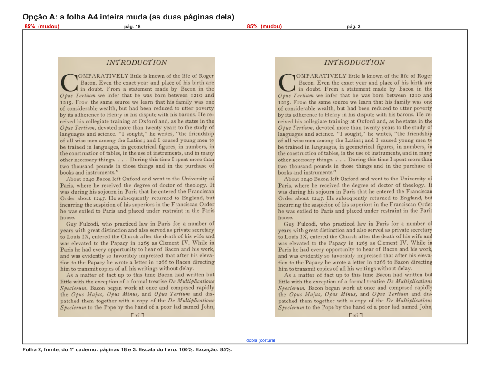

### Opção B: Uma página só

A exceção diminui só a página escolhida (a 3); a do lado continua como o livro. Para o Kaique: ele escolhe a página, não a folha. Se quiser as duas, faz nas duas. **Sugestão:** esta. É a página que sai grande do scan, não a folha; e não estraga a página que estava certa.

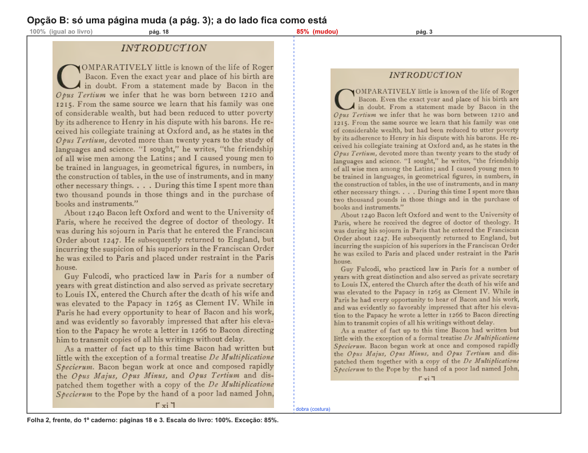

**Opção C: Ainda não entendi.** Diga no comentário o que ficou confuso, e eu explico de outro jeito.

## 2. No livreto, o "Ajustar" de fábrica: a página enche a metade da folha, ou já entra dentro das margens?

O que você está escolhendo: o tamanho com que cada página entra na sua metade da A4 antes de o Kaique mexer em qualquer coisa.

Você já decidiu as margens (14/10): 1,3 cm da beirada do papel em cima, embaixo e do lado de fora (1 cm depois dos 3 mm que a impressora não imprime) e 1 cm na costura. E pediu um aviso quando a margem ficar abaixo disso.

Exemplo: uma página do Opus Majus cortada rente ao texto (10,7 x 17,7 cm). Se ela encher a metade da folha, fica com 0,3 cm em cima e embaixo, e o programa avisa. Se entrar dentro das margens, fica com 1,3 cm, mas a letra sai uns 10% menor (104% em vez de 115% do tamanho do livro).

Comparação: é como pôr uma foto num porta-retrato. Ela pode encostar na moldura, e você corta um pouco depois; ou já vir com o passe-partout branco em volta.

A linha vermelha tracejada é a margem mínima, que aparece só na tela, nunca no papel. As medidas verdes estão boas; as vermelhas estão abaixo do mínimo.

### Opção A: Enche a metade da folha, e o programa avisa

Como o "Ajustar" do UPDF faz hoje. A letra sai o maior possível. Para o Kaique: em livro cortado rente ao texto, o aviso aparece em quase todas as páginas, e ele tem de diminuir a escala (aqui, até uns 90%) antes de imprimir.

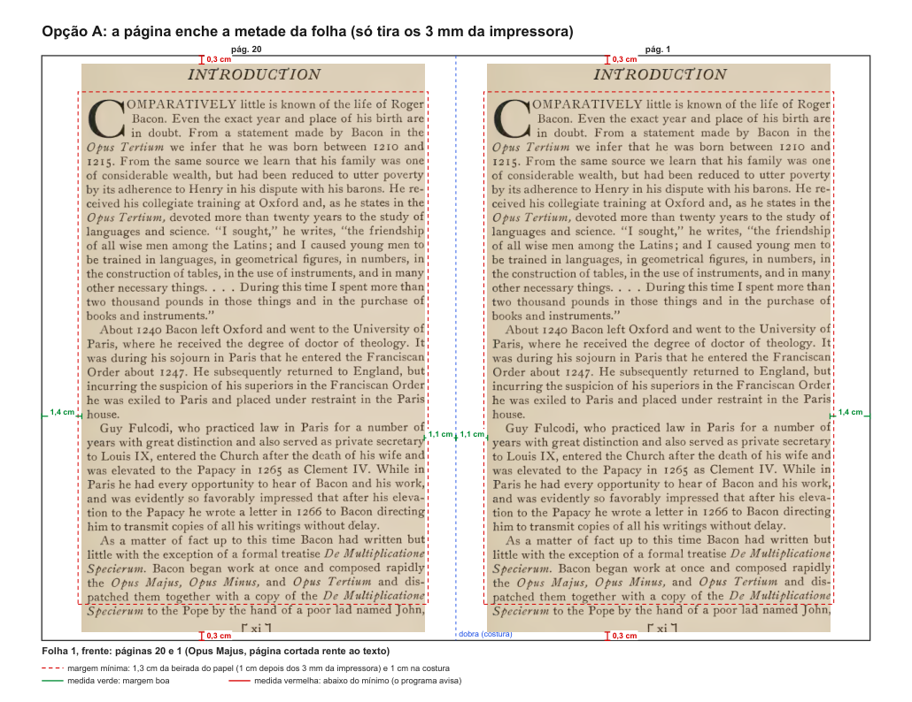

### Opção B: Já entra dentro das margens

Toda página já sai com 1,3 cm e 1 cm, no mínimo. O aviso quase nunca aparece. A letra fica um pouco menor. Para o Kaique: ele não precisa mexer na escala para a encadernação dar certo; se quiser letra maior, aumenta e o aviso volta a vigiar. **Sugestão:** esta. A margem é a regra que não pode falhar, e o livro sai certo sem ninguém ajustar.

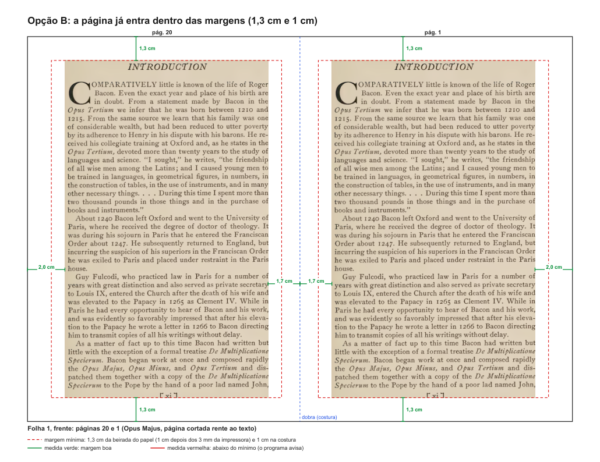

**Opção C: Ainda não entendi.** Diga no comentário o que ficou confuso, e eu explico de outro jeito.

## 3. Quando uma página é diminuída, onde ela fica: no meio da sua metade, ou encostada na costura?

O que você está escolhendo: para onde vai a sobra de papel quando o Kaique diminui uma página.

Exemplo: a mesma página do Opus Majus, as duas a 85%. No meio, a sobra se reparte: 1,8 cm em cima e embaixo, 2,4 cm fora, 2,1 cm na costura. Encostada na costura, a costura fica com o que tinha (1,1 cm) e toda a sobra vai para fora (3,3 cm).

Hoje, quando o Kaique diminui no UPDF (75%, 83%), quem diminui é a folha inteira, e as duas páginas chegam mais perto da dobra. A costura fica menor, não maior. Nas duas opções abaixo isso não acontece.

Comparação: é como pendurar um quadro menor no mesmo prego. Ou fica no meio da parede, ou encostado no canto.

### Opção A: No meio da sua metade

A margem cresce dos quatro lados por igual. Para o Kaique: diminuir sempre afasta o texto da costura, o que ajuda livro grosso, em que a costura come papel. **Sugestão:** esta. É a mais segura para a encadernação e a mais fácil de prever.

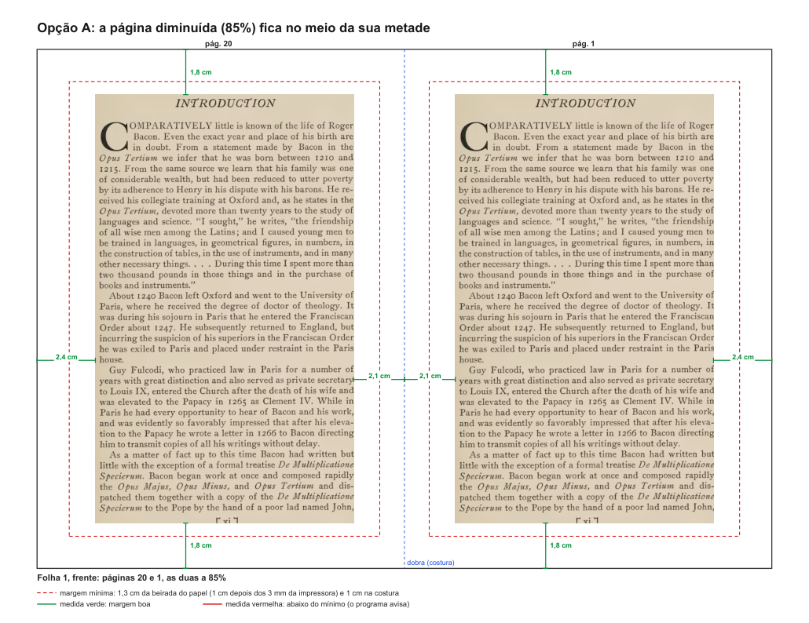

### Opção B: Encostada na costura

A costura fica com a margem que já tinha, e a sobra vai toda para o lado de fora. Fica parecido com os livros antigos, que têm a margem de fora maior. Para o Kaique: num livro grosso a costura pode ficar apertada, e diminuir não resolve.

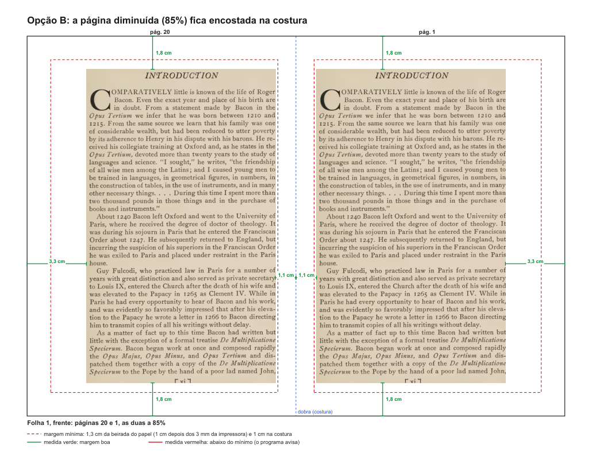

**Opção C: Ainda não entendi.** Diga no comentário o que ficou confuso, e eu explico de outro jeito.

## 4. Quando as páginas não fecham o último caderno, como ele sai?

O que você está escolhendo: o que o programa faz com a sobra no fim do livro.

Cada folha leva 4 páginas. Um caderno de 20 páginas tem 5 folhas. Quando o livro não é múltiplo do caderno, o último sobra incompleto. Hoje (e no embaralhador antigo) o último caderno sai sempre do tamanho cheio, com páginas em branco.

Exemplo pequeno, nos desenhos: um livro de 23 páginas em cadernos de 20. Exemplo real: o Balzac das suas fotos tem 486 páginas. Em cadernos de 20, hoje saem 125 folhas, com 14 páginas em branco e 2 folhas inteiras vazias. Com o último caderno menor, saem 122 folhas e 2 páginas em branco.

Comparação: é como guardar 3 ovos. Dá para usar uma caixa de dúzia (sobra muito espaço) ou uma caixinha de 4.

### Opção A: Último caderno do tamanho cheio (como hoje)

Todos os cadernos do mesmo tamanho. Para o Kaique: no exemplo, imprime 10 folhas, 3 delas inteiras em branco, e tira as vazias à mão ou encaderna com elas.

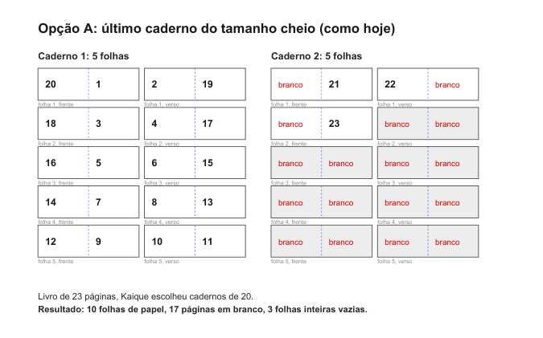

### Opção B: Último caderno menor, só com as folhas necessárias

Os outros cadernos ficam do tamanho que o Kaique escolheu. Só o último encolhe; no máximo 3 páginas em branco. Para o Kaique: separa os grupos como sempre e o último é mais fino; a tela final diz quantas folhas tem cada um. **Sugestão:** esta. Não gasta papel e não muda o que o Kaique escolheu.

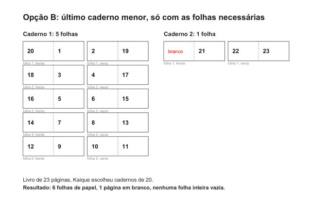

### Opção C: Cadernos parecidos (o programa reparte)

O programa divide as páginas para os cadernos ficarem com tamanhos parecidos. Para o Kaique: os cadernos não ficam do tamanho que ele escolheu (aqui, 2 de 12 páginas em vez de 20 + 4); a lombada fica mais uniforme.

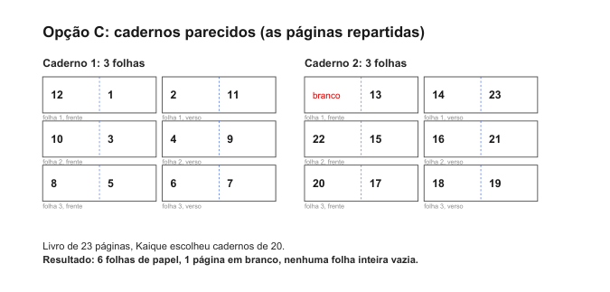

**Opção D: Ainda não entendi.** Diga no comentário o que ficou confuso, e eu explico de outro jeito.

## 5. O programa só grava o arquivo pronto, ou também manda direto para a impressora?

O que você está escolhendo: onde ficam as opções que são da impressora (qual impressora, cópias, "Agrupar", frente e verso).

Quase todas as opções da janela do UPDF dá para pôr dentro do arquivo: livreto, escala, margens, papel, girar, cinza. Mas cópias, agrupar e escolher a impressora não existem dentro de um arquivo. Só existem na hora de mandar imprimir.

Um cuidado: se o arquivo pronto for impresso no UPDF em "Ajustar", o UPDF diminui tudo de novo e as margens mudam. Ele tem de ser impresso em "Tamanho real".

Comparação: é a diferença entre levar o pen drive para a gráfica e imprimir direto do celular.

### Opção A: Só o arquivo; o Kaique imprime no UPDF

O programa grava o PDF com as folhas prontas. Para o Kaique: abre no UPDF e imprime em "Tamanho real" (a tela final avisa), escolhendo impressora, cópias e frente e verso como faz hoje. **Sugestão:** começar por esta, porque já serve, e deixar a outra para depois.

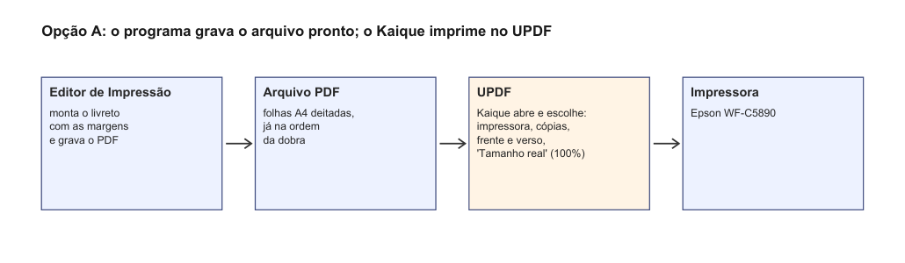

### Opção B: Também manda direto para a impressora

O programa ganha uma janela de imprimir com impressora, cópias, agrupar e frente e verso, e também grava o PDF. Para o Kaique: um passo a menos, sem o risco de imprimir em "Ajustar". Dá mais trabalho para fazer e testar na Epson.

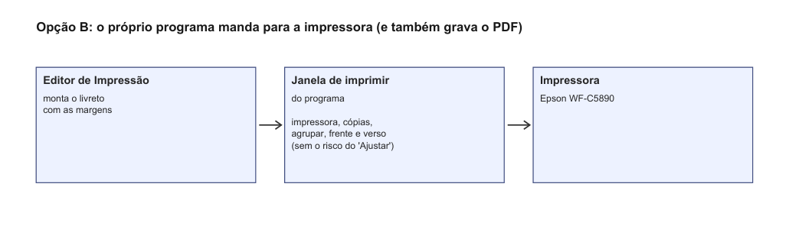

**Opção C: Ainda não entendi.** Diga no comentário o que ficou confuso, e eu explico de outro jeito.

## 6. "Imprimir como imagem" está marcado nas suas fotos: a impressora precisa disso? (e as fotos das abas Pôster e Múltiplo)

O que você está escolhendo: se o programa precisa da opção "Imprimir como imagem".

Nas cinco fotos da janela do UPDF, essa caixa está marcada. Ela transforma cada folha numa imagem só antes de mandar para a impressora. Serve quando a impressora desenha mal o arquivo. As páginas que o programa grava já são imagens do scan, então talvez não precise. Se precisar, o arquivo fica maior e um pouco mais lento.

Um pedido junto: nas fotos não aparecem as abas "Pôster" e "Múltiplo" da janela do UPDF. Pode mandar uma foto de cada uma, abertas? Assim o programa fica com as mesmas opções e os mesmos nomes. Pode pôr no comentário ou no chat.

Comparação: é como saber se o carro precisa mesmo do afogador, ou se era só costume de puxar.

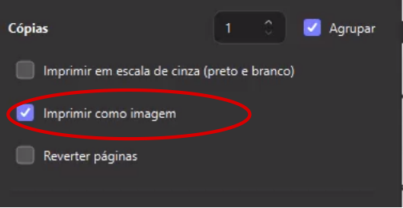

### Opção A: Precisa: sem ela sai algo errado

O programa ganha a caixa "Imprimir como imagem", ligada de fábrica. Para o Kaique: igual a hoje; o arquivo fica maior. Se puder, diga no comentário o que saía errado.

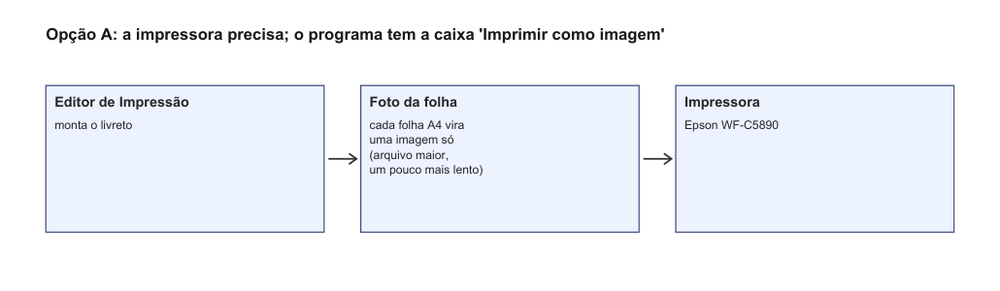

### Opção B: Era costume; pode tirar

O programa manda a folha como ela é (já são imagens). A caixa existe, desligada, para o dia em que a impressora precisar. Para o Kaique: arquivo menor e mais rápido. **Sugestão:** esta, se ninguém lembrar de um motivo; testamos uma folha na Epson antes.

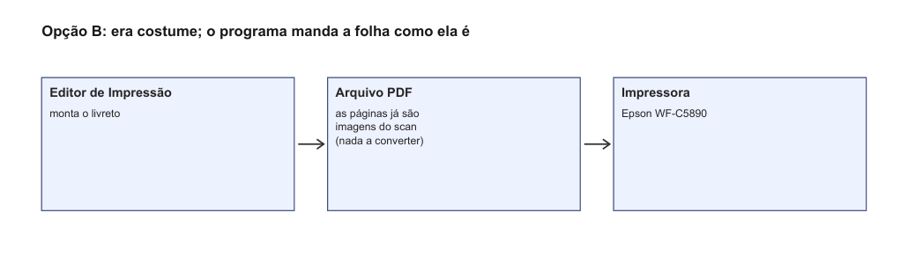

### Opção C: Não sei; vou perguntar ao Kaique

Fica como está até ele responder. Diga no comentário o que ele disser.

**Opção D: Ainda não entendi.** Diga no comentário o que ficou confuso, e eu explico de outro jeito.

## Como os desenhos foram feitos

Com o PyMuPDF, a mesma biblioteca que o programa já usa para montar o PDF, num rascunho fora do programa (`desenhos_perguntas.py.txt`, ao lado deste relatório). A ordem das páginas nos cadernos vem do próprio programa (`core/cadernos.py`). As medidas escritas nos desenhos foram calculadas, não estimadas a olho. O Balzac (486 páginas) é o livro das suas fotos de 14/10; a conta dele também foi feita com a ordem do programa.

O detalhe técnico de tudo está em `fase-impressao.pdf`, na mesma pasta.
