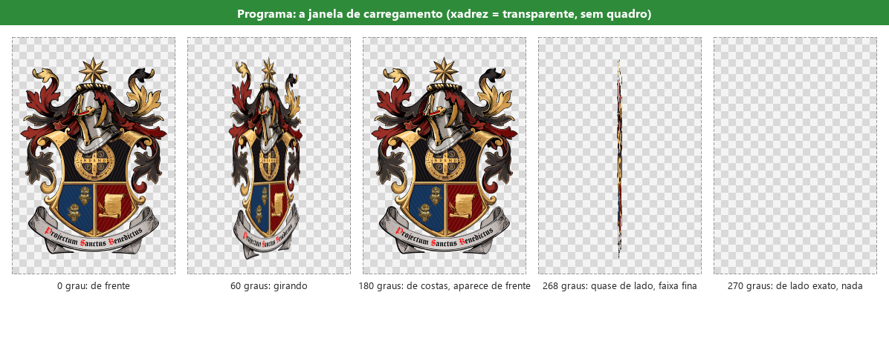
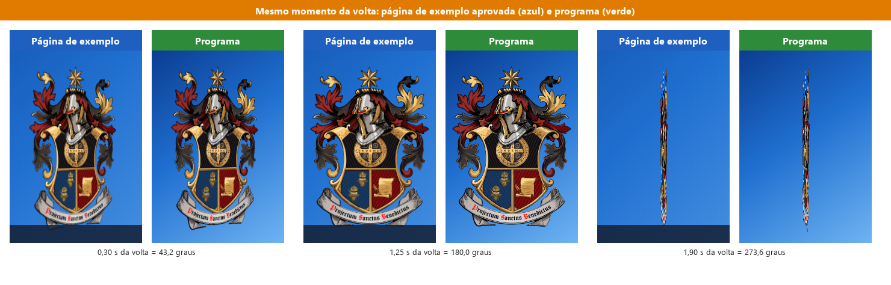
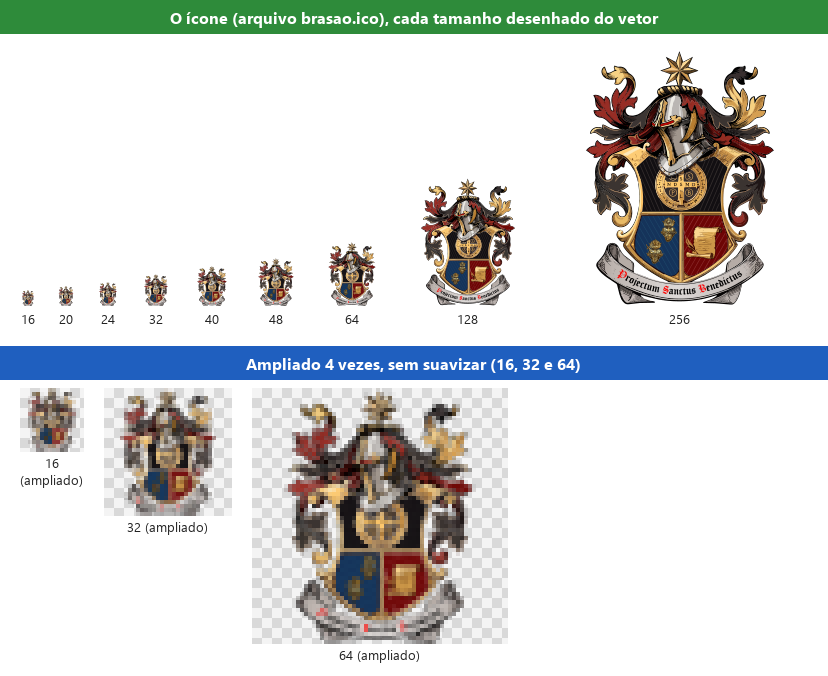
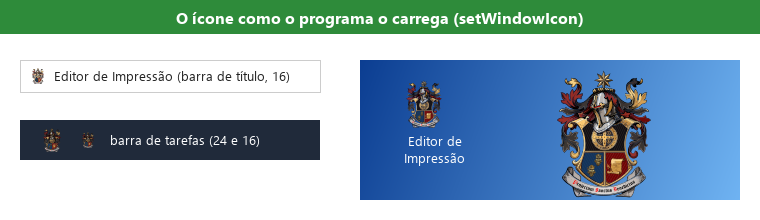

# Brasão girando e ícone do programa — 17/11/2026

**O que é:** quando o programa abre, o brasão do projeto gira no meio da tela até a janela do programa aparecer. O ícone do programa (barra de tarefas, título das janelas, atalho, menu Iniciar, instalador) passa a ser o brasão. Feito como na página de exemplo que o Samuel aprovou (D-744 a D-747).

Situação: na cópia de trabalho `brasao-2026-11-17`, **pronto para conferir**. Ainda não está no programa que o Kaique recebe: o empacotamento é da etapa 5. Teste de máquina (os testes abaixo) e de olho (os prints).

## Como fica para quem usa

1. O Kaique clica no ícone do programa (agora o brasão).
2. Logo aparece o brasão girando no meio da tela: sem quadro e sem fundo, por cima do que estiver aberto. Dá uma volta a cada 2,5 segundos, como uma moeda. De costas aparece de frente outra vez, sem espelhar. De lado vira uma faixa fina.
3. Ele não aparece na barra de tarefas, não pega clique nem foco.
4. Quando a janela do programa aparece, o brasão some.
5. O PDF que sai não muda nada: nenhuma parte do processamento foi tocada.

## Prints (feitos fora da tela, nada abriu na tela do Samuel)

A janela de carregamento em cinco ângulos (o xadrez mostra onde ela é transparente):

O mesmo momento da volta, na página de exemplo aprovada (azul) e no programa (verde), sobre o mesmo fundo:

O ícone em todos os tamanhos, cada um desenhado do vetor (e ampliado 4 vezes, pixel a pixel):

O ícone como o programa o carrega, nos lugares do Windows:

## O que mudou e onde

- `arte/brasao/brasao.ai`: cópia do desenho original (`C:\Users\fotog\Desktop\Brasão 1.ai`), sem acento no caminho. Fica fora de `recursos/` para não ir dentro do programa.
- `brasao.py`: num lugar só, os caminhos e as medidas da página de exemplo (recorte, margem, tamanhos do ícone, 200 px de largura, perspectiva de 900 px, volta de 2,5 s).
- `gerar_brasao.py`: desenha do vetor, no tamanho final, o `recursos/brasao/brasao.ico` (16, 20, 24, 32, 40, 48, 64, 128 e 256) e as imagens do giro `recursos/brasao/giro-100.png` a `giro-300.png` (uma por escala de tela do Windows: 100%, 125%, 150%, 175%, 200%, 225%, 250%, 300%). Nada é desenhado grande para depois diminuir. O resultado está no git.
- `ui/brasao_girando.py`: a janela do brasão e o desenho do giro (a mesma conta do navegador da página de exemplo).
- `ui/tela_de_carregamento.py`: quando o brasão abre e fecha.
- `main.py`: abre o brasão no começo, antes dos imports pesados; fecha quando a janela principal aparece; põe o ícone em todas as janelas.
- `empacotar.py`: o ícone no `.exe` e nos atalhos (PyInstaller `--icon`) e no instalador do Velopack (`vpk --icon`).
- `instalador.iss` (o de reserva): `SetupIconFile` com o mesmo ícone.
- `tests/test_decisoes_brasao.py`: 19 provas novas.

## Por que o brasão roda em outro processo

O programa monta a janela principal na linha principal do Qt. Medido aqui: com o PC já aquecido, 0,4 s para carregar, 1,2 s para montar e 0,4 s para mostrar; na primeira vez depois de ligar, passou de 20 s. Nesse tempo um brasão no mesmo processo ficaria parado. Por isso ele roda num processo a parte (o mesmo programa, com outro argumento), que tem o laço do Qt só para ele e gira liso. O programa fecha esse processo quando a janela aparece; se o programa morrer antes, o brasão percebe sozinho e fecha; e há um limite de 3 minutos.

## Testes (cada arquivo sozinho, fora da tela)

| Arquivo | Resultado |
|---|---|
| `tests/test_decisoes_brasao.py` (novo) | 19 passaram |
| `tests/test_sem_janela_na_tela.py` | 8 passaram |
| `tests/test_promessas.py -k "abrir or janela"` | 22 passaram (249 fora da seleção) |
| `tests/test_empacotar.py` | 41 passaram |
| `tests/test_empacotar_teste_velocidade.py` | 28 passaram |
| `tests/test_decisoes_atualizacao.py` | 38 passaram |
| `tests/test_decisoes_ajudante_da_atualizacao.py` | 37 passaram |
| `tests/test_decisoes_testes_a_distancia.py` | 13 passaram |
| `tests/test_botoes_em_portugues.py` | 5 passaram |
| `tests/test_salva_sozinho.py` | 11 passaram |
| `tests/test_decisoes.py` | 27 passaram |
| `teste_botoes.py` (uma vez, fora da tela) | 372 ações, 0 falhas |

Nenhum teste antigo foi mudado. A suíte inteira no GitHub não foi rodada (pedido sem push).

O que as provas novas cobram: o `.ico` tem os 9 tamanhos e cada um é, pixel por pixel, o vetor desenhado de novo naquele tamanho (e não o 256 diminuído); o brasão inteiro com margem transparente dos lados; o Qt lê os 9 tamanhos; o ícone vai para o `.exe`, o Velopack e o Inno; o giro faz a mesma conta do navegador da página, ponto por ponto; de frente o desenho é o vetor sem mudar um pixel, e fora dele nada (nem fundo nem sombra); de costas o quadro é igual ao de frente e diferente do espelhado; de lado vira faixa fina; a janela é sem moldura, transparente, por cima e fora da barra de tarefas; uma volta a cada 2,5 s; não aparece nos testes nem na conta dos testes à distância; um erro ao abrir nunca impede o programa; e, num `main()` de verdade fora da tela, o brasão está girando enquanto o programa carrega e some quando a janela principal aparece.

## Perguntas para o Samuel

**1. A janelinha "Atualizando o programa" e o brasão aparecem juntos?**
Isso acontece só numa abertura: quando chegou uma versão nova, o Kaique clicou "Depois" e agora abre o programa de novo. Primeiro aparece a janelinha "Atualizando o programa, espere um pouco..." enquanto a troca acontece. Quando o programa reabre, o brasão começa a girar, e a janelinha só some quando a janela do programa aparece. Por alguns segundos os dois ficam no meio da tela, um em cima do outro. Hoje está assim (não juntei os dois sem perguntar).
O que você escolhe:
- (sugiro) Quando o brasão aparece, a janelinha some na hora. Fica uma coisa de cada vez: primeiro a janelinha, depois o brasão.
- Os dois juntos, como está hoje.
- Na abertura da troca, só a janelinha; o brasão não aparece.
Nada do que já funciona muda em nenhuma das três.

## Ressalvas

- Nada foi visto numa tela de verdade: pela regra, nenhuma janela abriu na tela do Samuel. A transparência real no Windows (sem fundo, sem sombra) está provada no desenho, fora da tela; falta o verificador olhar numa tela, ou a etapa 5.
- O programa empacotado (`.exe`) não foi construído (é da etapa 5). Lá é preciso conferir: o `.exe` abre a segunda cópia dele mesmo para o brasão, o ícone aparece no `.exe`, nos atalhos e no instalador do Velopack, e o tempo até o brasão aparecer no notebook do Kaique.
- Pelo código (atalho "(desenvolvimento)"), o Windows pode juntar o programa ao ícone do Python na barra de tarefas; no programa instalado vale o ícone do `.exe`.
- Em 270 graus exatos não se desenha nada (o brasão está de lado), como na página de exemplo.
- O ícone guarda os tamanhos até 128 no formato clássico do Windows e o 256 em PNG, que é o jeito do próprio Windows. O instalador de reserva (Inno) não foi compilado para conferir.
- Numa escala de tela que não está entre as desenhadas (por exemplo 110%), usa-se a mais perto, e o Qt ajusta um pouco.
- Na primeira vez, com o PC frio, o processo do brasão demorou mais para subir (um teste solto não viu ele fechar em 7 s; repetido três vezes, fechou em menos de 0,2 s depois do programa).
