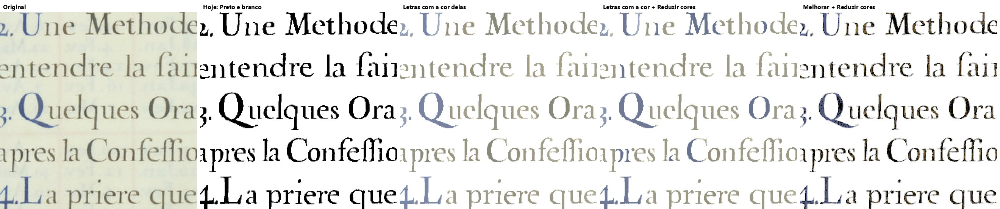
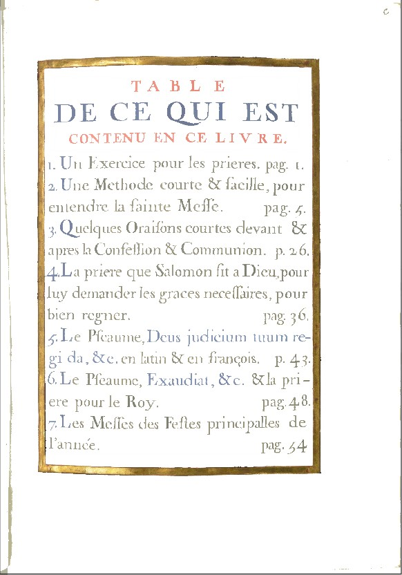
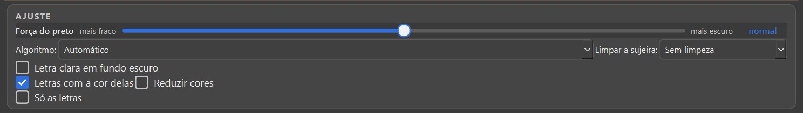
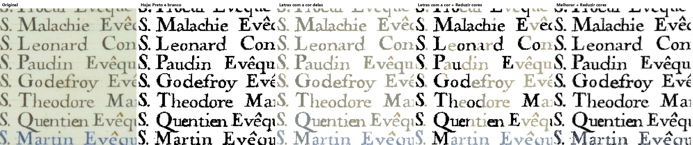
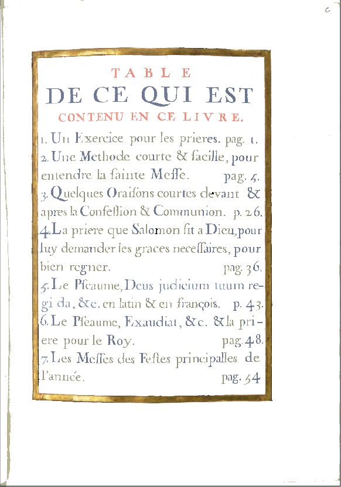
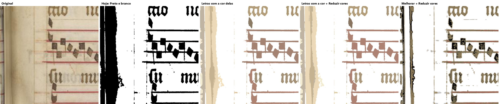
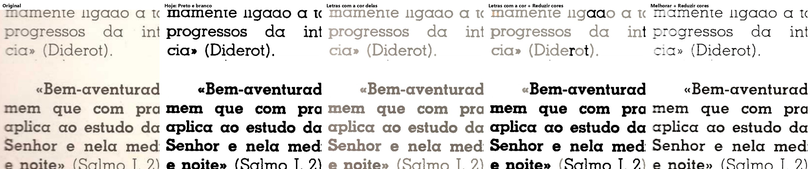
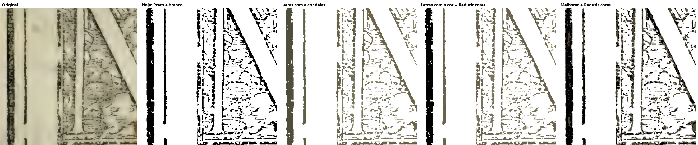
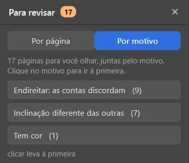
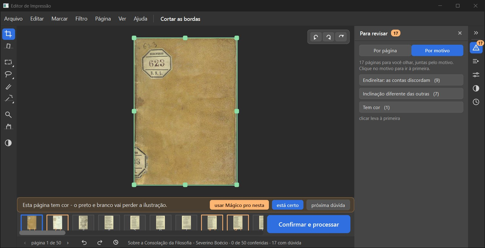

# Itens 2.11 (cores) e 2.15 (páginas diferentes): conferência do verificador (21/10/2026)

Ramo `fase2-scantailor-itens-2026-10-19`, código `839bf1f` (o mais novo; tem também o 2.8, o 2.9, o conserto do erros.log e o dos cartões), contra o `fase-1` `b8e9af7`. Não mudei código; não marco nada como aprovado.

## Veredito

**PRONTO PARA CONFERIR, os dois.** De fábrica a imagem é igual (128 de 128). As contas são as do ScanTailor (números de fábrica e fórmula conferidos no código dele). O 2.15 dá as mesmas páginas na minha recontagem. Os dois consertos que vieram junto (erros.log e cartões) têm teste de reversão que falha no código antigo. Ressalva principal: o aviso do 2.15 soma-se aos outros, e no Boécio o "Para revisar" chega a 17 de 50 páginas.

## O que conferi

| O que | Como | Resultado |
|---|---|---|
| Desligado de fábrica: 32 páginas-gabarito × Original, PB, Melhorar, PB com "Só as letras" (`scripts/somas.py`, uma por processo) | máquina | **128 de 128 iguais** a `b8e9af7` |
| 2.11 igual ao ScanTailor | código | números de fábrica iguais a `BlackWhiteOptions.cpp` (ruído 7, ajustes 0) e `ColorCommonOptions.cpp` (nível 4, sem normalizar, forçar preto e branco); `test_st_ferramentas.py` (somas dos arquivos copiados do ScanTailor): 10 passaram |
| 2.15 igual ao ScanTailor | código | fórmula de `DeviationProvider.h` (média, desvio amostral n−1, `|v−m| > max(coef·desvio, limite%·média)`, mínimo de 3), o ângulo como valor (`deskew/Settings.cpp`) e os ajustes 1,5 e 1% (`ApplicationSettings.cpp`): iguais |
| 2.15: as páginas marcadas | refiz a conta à parte sobre os ângulos que o programa usou (`scripts/contar_215.py`) | Boécio: ScanTailor puro 9, com 1° [8, 11, 15, 16, 34, 46, 48] = o programa; Horas: ScanTailor puro 15, com 1° [5, 7, 9, 75, 77, 152] = o programa. Batem com a tabela do implementador |
| Testes, um arquivo por vez | máquina | cores 7, cores na tela 5, páginas diferentes 12, cartões 5, erros.log 5: todos passam |
| Reversão do conserto do erros.log (`ba5eefe`) | no `ba5eefe^` | 5 falham (nada no log), passam no novo |
| Reversão do conserto dos cartões (`e49463c`, o bug que achei no 2.9) | no `e49463c^` | 4 de 5 falham, passam no novo |
| Janela de verdade | olho | as caixinhas "Letras com a cor delas" e "Reduzir cores" no AJUSTE, com ação no desfazer; o "Ver de perto" mostra as letras coloridas; o Boécio aberto como livro novo mostra "Inclinação diferente das outras (7)" no Para revisar |
| Imagens do implementador (7 páginas, 2.11) | olho | abri os 7 recortes: batem com o que ele escreveu |
| Velocidade | - | não rodei; o filtro do GitHub do 2.11 não tinha passado quando ele parou |

## Ressalvas

- **2.15, quantidade de avisos:** a regra do CLAUDE.md é "menos de 10% das páginas marcadas". Sozinho o aviso novo marca 14% do Boécio (7 de 50) e, somado aos outros, o "Para revisar" fica com 17 de 50 (34%). Horas: 3% (6 de 191).
- **2.11:** com "Letras com a cor delas", as letras pretas comuns saem cinza-amarronzadas, mais fracas que no preto de hoje (Escola 7, Palatino 67). Com "Reduzir cores" junto, a mesma palavra mistura letra preta e cinza (Horas 26).
- O mínimo de 1° do 2.15 é nosso (da gerente), não do ScanTailor.

## Bugs para a Lista de bugs

- nenhum novo.

## Quadro para o Samuel: Letras com a cor delas (Livro de Horas 13)

O que você está escolhendo: se a caixinha "Letras com a cor delas" faz o que você pediu (P10 (a): "Trazer como opção, desligada de fábrica").

Caso real: na tabela do Livro de Horas, o título vermelho sai vermelho, as letras azuis saem azuis e o papel sai branco, no Preto e branco. Hoje elas saem todas pretas. As letras ficam mais claras que no preto de hoje.

Em cada foto ampliada: Original, Preto e branco de hoje, com "Letras com a cor delas", com ela e "Reduzir cores", e Melhorar com "Reduzir cores".

**O que olhar:** As letras azuis e o título vermelho: com a caixinha eles guardam a cor.

Opções: Está bom · Melhorar · Está pior · Ainda não entendi · e um comentário.

*Ampliado: Horas 13, as cinco versões*

*Na janela de verdade, "Ver de perto", Preto e branco com a caixinha*

*As caixinhas no AJUSTE da ferramenta Filtro*

## Quadro para o Samuel: Reduzir cores

O que você está escolhendo: se "Reduzir cores" está bom (junta as cores parecidas em poucas cores chapadas).

Caso real: no Preto e branco ela só vale junto com "Letras com a cor delas". No calendário do Livro de Horas 26, metade das letras fica preta e metade com a cor, misturadas na mesma palavra ("S. Leonard", "Theodore").

Em cada foto ampliada: Original, Preto e branco de hoje, com "Letras com a cor delas", com ela e "Reduzir cores", e Melhorar com "Reduzir cores".

**O que olhar:** "S. Leonard" e "Theodore": letras pretas e cinza na mesma palavra.

Opções: Está bom · Melhorar · Está pior · Ainda não entendi · e um comentário.

*Ampliado: Horas 26*

*Na janela, Horas 13 com as duas caixinhas*

## Quadro para o Samuel: Outras páginas: música, texto comum, gravura

O que você está escolhendo: se o resultado nas páginas sem cor de propósito está aceitável.

No Graduale 221 a faixa da lombada, que no Preto e branco de hoje sai preta, sai bege; as notas saem cor de vinho. Na Escola 7 (texto impresso preto) e no Palatino 67 (gravura) as letras ficam cinza-amarronzadas, mais fracas que no preto de hoje.

Por isso ela vem desligada: é para página de letra colorida.

**O que olhar:** A cor das letras pretas comuns: com a caixinha elas ficam cinza.

Opções: Está bom · Melhorar · Está pior · Ainda não entendi · e um comentário.

*Graduale 221*

*Escola 7*

*Palatino 67*

## Quadro para o Samuel: Página com inclinação diferente das outras

O que você está escolhendo: se o aviso novo "Inclinação diferente das outras" está bom.

Igual ao ScanTailor (ele põe um asterisco na miniatura), a página cujo ângulo se afasta do resto do livro ganha um aviso no "Para revisar". A gerente acrescentou um mínimo: só avisa se a página estiver a pelo menos 1 grau da média do livro.

Caso real: no Boécio (50 páginas) são 7 páginas; no Livro de Horas (191), 6. Contei de novo por conta própria e deu o mesmo. Mas no Boécio o "Para revisar" fica com 17 páginas de 50 (34%), somando os outros avisos.

**O que olhar:** "Inclinação diferente das outras (7)" no painel Para revisar.

Opções: Está bom · Melhorar · Está pior · Ainda não entendi · e um comentário.

*Ampliado: o painel Para revisar do Boécio, por motivo*

*A tela inteira*

## Decisão: Cores (2.11) e páginas diferentes (2.15): o que você decide?

O que você está escolhendo: se estas duas entregas entram no programa.

As duas caixinhas de cor vêm desmarcadas; livro já começado sai igual. O aviso das páginas diferentes vem ligado em livro novo (como no ScanTailor) e não muda nenhuma imagem.

Opções: Aprovado · Melhorar · Ainda não entendi
