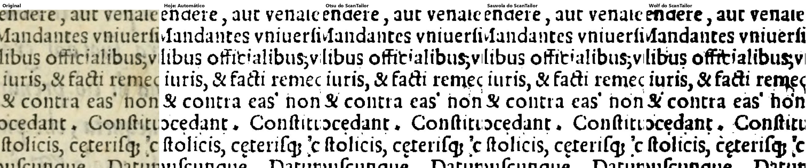
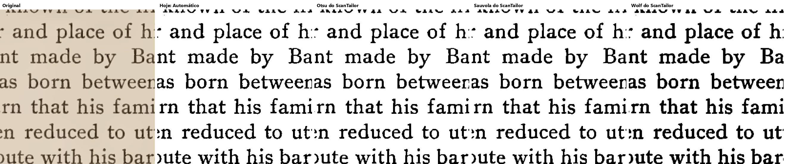
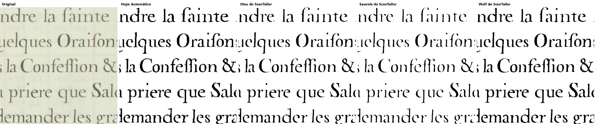
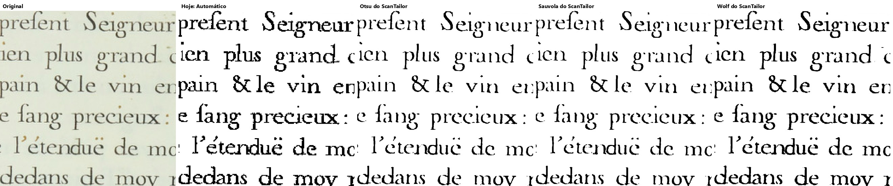
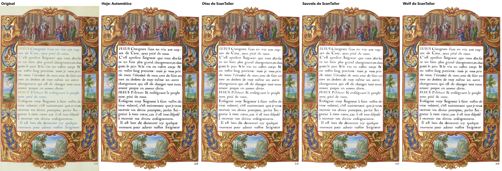
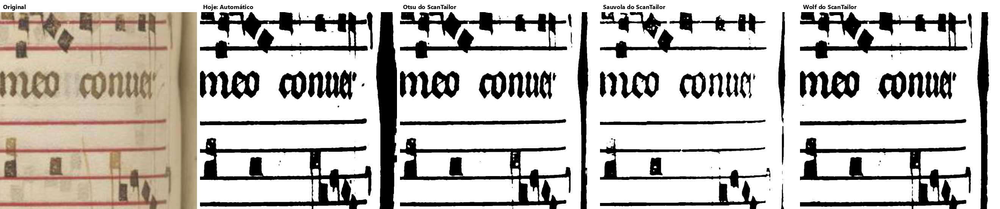
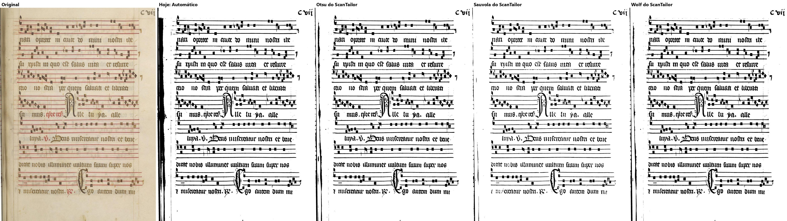
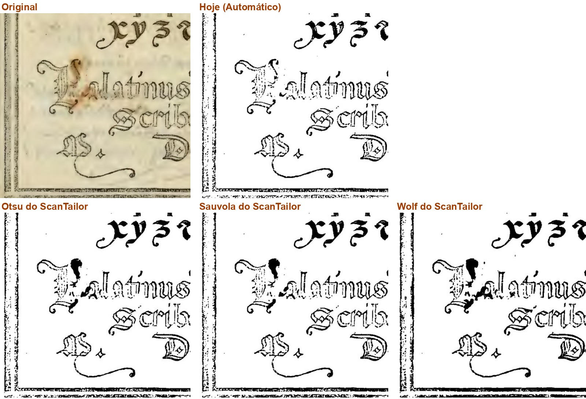
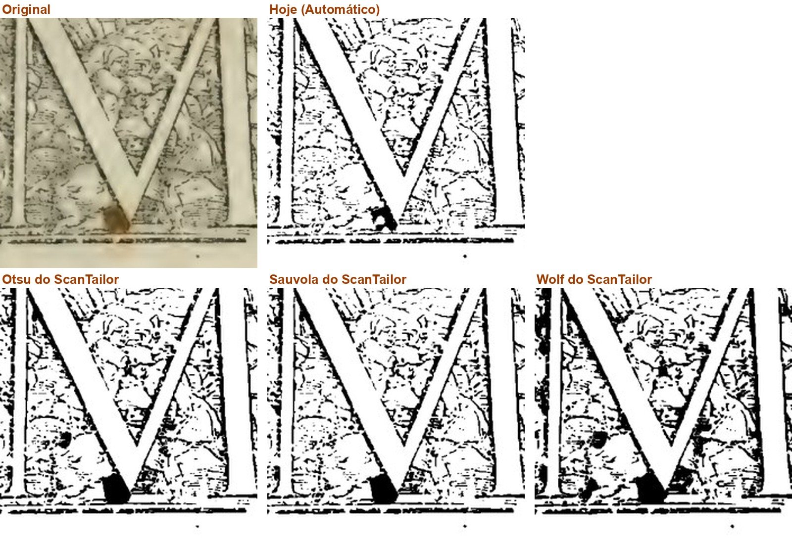

# Item 2.8: os dez preto e branco do ScanTailor - conferência do verificador (20/10/2026)

Ramo `fase2-scantailor-itens-2026-10-19`, commit `34b3d0e`, contra o `fase-1` em `b8e9af7`. Não mudei código; não marco nada como aprovado.

## Veredito

**PRONTO PARA CONFERIR, com uma ressalva:** desligado de fábrica está provado (somas iguais), os 8 trechos copiados do ScanTailor batem e a suíte passou. Mas a falha por memória cai no "Automático" e **não chega ao erros.log** (o aviso vai só para o `logging` do Python, que o programa não grava). Nas fotos, os jeitos do ScanTailor transformam a ferrugem do Palatino em borrão preto, e o Sauvola esvazia as notas do Graduale: bom que venham desligados.

## O que conferi

| O que | Como | Resultado |
|---|---|---|
| 1. Desligado de fábrica: somas das 32 páginas-gabarito em Original, Preto e branco, Melhorar e Preto e branco com "Só as letras", no `b8e9af7` e no `34b3d0e` (script meu, `scripts/somas.py`, uma página por processo) | máquina | **iguais: 128 de 128** |
| 2. Imagens do implementador: 32 páginas inteiras (5 colunas) e 32 recortes ampliados, inclusive os 12 que ele não reabriu | olho | abertas todas (as páginas por 8 folhas de contato, os recortes um a um); ver abaixo |
| 3. Os 8 trechos copiados de `OutputGenerator.cpp` sem mudança | máquina | conferi por conta própria (comparação linha a linha): 8 blocos, 335 linhas, todos iguais; o arquivo de referência não mudou neste ramo. `tests/test_preto_e_branco_scantailor.py`: 31 passaram no PC; `..._na_tela.py`: 4 passaram |
| 4. Falta de memória na DLL | máquina | cai no "Automático" (sai igual, ponto por ponto). **Não vai ao erros.log**: ver ressalva |
| 5. Suíte no Windows do GitHub, rodada 39395632426 (`34b3d0e`) | máquina | passou: 116 arquivos, 2084 passaram, 0 falharam, 72 pulados; botões: 221 ações, 0 falhas |
| Velocidade | - | não rodei (opção a mais e desligada; a gerente dispensou) |
| Janela | - | não pilotei; o controle novo está na lista "Algoritmo" da aba Filtro, a tela de hoje, que o layout vai mudar |

Saída do teste de falta de memória:

```
(a DLL fingida foi chamada)
(a) saiu igual ao Automatico: True
    mensagens emitidas pelo logging: ['st_ferramentas: Faltou memória para o preto e branco desta página. (código 2: std::bad_alloc (fingido pelo verificador))', 'preto e branco do ScanTailor indisponível, usei o Automático: Faltou memória para o preto e branco desta página. (código 2: std::bad_alloc (fingido pelo verificador))']
(b) erros.log existe: False | conteudo: (nenhum)
    handlers no logger raiz alem do meu: []
```

## Os 12 recortes que o implementador não reabriu (uma linha cada)

1. Boécio 8 (itálico): os quatro quase iguais; Wolf um pouco mais grosso.
2. Boécio 22: Otsu e Sauvola parecidos com o de hoje; Wolf traz sujeira do verso entre as linhas.
3. Escola 7 (texto moderno): o de hoje sai em negrito; os três do ScanTailor saem finos, mais parecidos com o original.
4. Escola 35: igual ao 7.
5. Graduale 221: o de hoje deixa uma faixa preta larga na lombada (esquerda); os três do ScanTailor, só um fio. Sauvola esvazia algumas notas.
6. Graduale 223: igual ao 221 (faixa larga no de hoje, fio nos outros; Sauvola falha uma nota).
7. Horas 11 (frontispício pintado): a pintura fica em cor nos quatro; só muda a beirada da esquerda (Sauvola quase limpa).
8. Horas 14 (tabela): Sauvola afina e falha os números; Otsu e Wolf perto do de hoje; os quatro com a faixa preta à direita.
9. Horas 26: Sauvola falha a letra ("Neocefarée"); Otsu deixa uma linha preta na beirada esquerda; Wolf igual ao de hoje.
10. Horas 27: o de hoje deixa faixa preta na beirada esquerda; os três do ScanTailor não. Sauvola mais fino.
11. Horas 47: Otsu e Sauvola mais finos e com falhas ("l'étenduë"); Wolf e o de hoje cheios.
## O que vi nas 32 páginas (os três do ScanTailor contra o de hoje)

- Texto impresso comum (Boécio, Opus Majus, Palatino 7 e 10, Rhetorica, Marial, Escola): parecidos; Wolf engrossa a letra e guarda mais sujeira do verso (Boécio 7 e 22, Marial 7); Otsu e Sauvola afinam. Na Escola o de hoje sai em negrito e os do ScanTailor, finos.
- Letra fina/colorida (Horas 13, 14, 26, 27, 47): Otsu e Sauvola falham a letra fina; Wolf e o de hoje saem cheios.
- Música (Graduale 221, 222, 223): Sauvola esvazia algumas notas; a faixa preta da lombada muda de lugar (no 221 e no 223 o de hoje deixa a mais larga; no 222 é o Otsu).
- Gravura (Boécio 3, Palatino 5 e 9, Opus Majus 20): Otsu e Wolf deixam o selo e a gravura mais escuros e cheios, às vezes melhor que o de hoje (o selo do Boécio 3).
- Ferrugem (Palatino 66 e 67): os três transformam a mancha em borrão preto; o de hoje a apaga (66) ou deixa menor (67).
- Beirada do scanner (Siebmacher 7 e 9): os três deixam faixa preta sólida maior que o de hoje.
- Fotos e pinturas (Escola, Horas 11 e 47, Opus Majus 20): iguais nos quatro (ficam em tons ou em cor).

## Ressalvas

- **A falha da DLL não chega ao erros.log.** `core/preto_e_branco_scantailor._avisar_uma_vez` usa `logging.warning`, e o programa não liga o `logging` a arquivo nenhum (o erros.log só recebe `registro.registrar_erro`). O módulo irmão `core/endireitar_scantailor.py` faz igual, então é um padrão do projeto, mas a página cai no Automático sem deixar rastro. O teste do implementador cobre a queda no Automático, não o log.
- Fotos de três dos dez jeitos (Otsu, Sauvola, Wolf); os outros sete não foram olhados por ninguém.
- Não pilotei a janela: a lista "Algoritmo" é da tela de hoje, que o layout vai mudar.

## Bugs para a Lista de bugs

- 20/10/2026: quando o preto e branco do ScanTailor falha (memória, DLL), a página cai no Automático e o motivo não vai ao erros.log (vai ao `logging`, que não é gravado). Mesmo padrão no endireitar do ScanTailor.

## Quadro para o Samuel: Texto comum (Palatino 7 e Opus Majus 11)

O que você está escolhendo: se os jeitos do ScanTailor, numa página só de texto, servem como opção a mais.

Nas duas páginas as letras saem parecidas nos quatro. O Wolf deixa a letra mais grossa e escura; o Otsu e o Sauvola, mais finas, como o de hoje. É como escolher entre uma caneta fina e uma média.

Cada foto: a página como sai no PDF, Preto e branco de fábrica ("Hoje") e com três dos dez jeitos do ScanTailor, com os ajustes de fábrica dele. Nada disso muda livro já começado: os jeitos novos só valem se alguém escolher.

**O que olhar:** A grossura das letras.

Opções: Está bom · Melhorar · Está pior · Ainda não entendi · e um comentário.



*Ampliado: Palatino 7 - Original, Hoje, Otsu, Sauvola, Wolf*



*Ampliado: Opus Majus 11, na mesma ordem*

## Quadro para o Samuel: Livro de Horas (13 e 47): letra fina e colorida

O que você está escolhendo: se os jeitos do ScanTailor servem como opção nas páginas finas e coloridas do Livro de Horas.

Na Horas 13 (letras azuis e vermelhas finas) o Otsu e o Sauvola afinam a letra, e o Sauvola chega a falhar; o Wolf e o de hoje saem cheios. Na Horas 47 as quatro saem iguais na moldura pintada, que fica em cor.

Cada foto: a página como sai no PDF, Preto e branco de fábrica ("Hoje") e com três dos dez jeitos do ScanTailor, com os ajustes de fábrica dele. Nada disso muda livro já começado: os jeitos novos só valem se alguém escolher.

**O que olhar:** As letras finas "la fainte", "Confeffion": falhas no Otsu e no Sauvola.

Opções: Está bom · Melhorar · Está pior · Ainda não entendi · e um comentário.



*Ampliado: Horas 13 - Original, Hoje, Otsu, Sauvola, Wolf*



*Ampliado: Horas 47, na mesma ordem*



*Horas 47 inteira*

## Quadro para o Samuel: Graduale (221 e 222): música

O que você está escolhendo: se os jeitos do ScanTailor servem como opção nas páginas de música.

Nas pautas, o Sauvola deixa algumas notas vazadas, com buracos. A faixa preta da lombada muda: no 222 o Otsu a deixa grossa; no 221 é o de hoje que deixa a faixa larga e os do ScanTailor só um fio.

Cada foto: a página como sai no PDF, Preto e branco de fábrica ("Hoje") e com três dos dez jeitos do ScanTailor, com os ajustes de fábrica dele. Nada disso muda livro já começado: os jeitos novos só valem se alguém escolher.

**O que olhar:** As notas quadradas (vazadas no Sauvola) e a faixa preta da lombada.

Opções: Está bom · Melhorar · Está pior · Ainda não entendi · e um comentário.



*Ampliado: Graduale 222 - Original, Hoje, Otsu, Sauvola, Wolf*



*Graduale 221 inteira*

## Quadro para o Samuel: Palatino 66 e 67: a mancha de ferrugem

O que você está escolhendo: se aceita que os jeitos do ScanTailor fiquem disponíveis sabendo que pioram a ferrugem.

Na Palatino 66 a mancha de ferrugem ao lado da letra P some no jeito de hoje; nos três do ScanTailor ela vira um borrão preto em cima da letra. Na 67 a ferrugem embaixo do M vira um bloco preto nos três (no de hoje, uma mancha menor).

Por isso eles são opção a mais e não vêm ligados: o de hoje continua o de fábrica. Nada disso muda livro já começado: os jeitos novos só valem se alguém escolher.

**O que olhar:** A mancha marrom do original: some no Hoje, vira preto nos três do ScanTailor.

Opções: Está bom · Melhorar · Está pior · Ainda não entendi · e um comentário.



*Ampliado: Palatino 66, a ferrugem ao lado do P*



*Ampliado: Palatino 67, a ferrugem embaixo do M*

## Decisão: Os dez preto e branco do ScanTailor como opções a mais: o que você decide?

O que você está escolhendo: se esta entrega entra no programa.

Você pediu em 05/10 (P8): "Trazer os dez do ScanTailor como opções a mais". Eles ficam na lista "Algoritmo" da aba Filtro, depois dos três de sempre. Vêm desligados: o "Automático" de hoje continua o de fábrica, e livro já começado sai igual, ponto por ponto.

As fotos mostram três dos dez (Otsu, Sauvola, Wolf) em quatro tipos de página. Não há um vencedor: cada um ganha numa página e perde noutra.

Opções: Aprovado · Melhorar · Ainda não entendi
