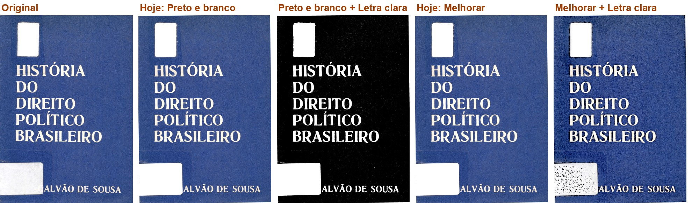
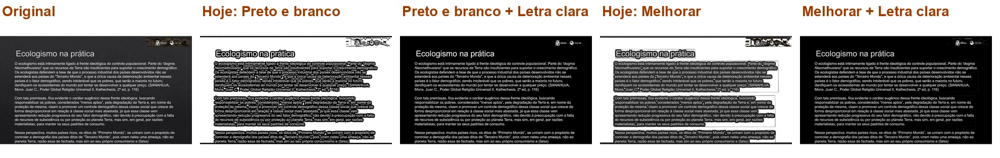
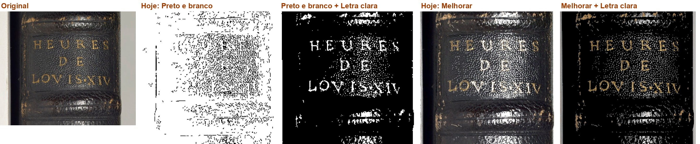
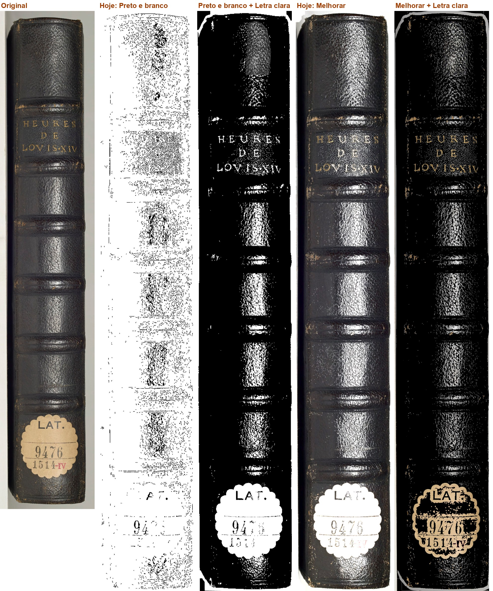
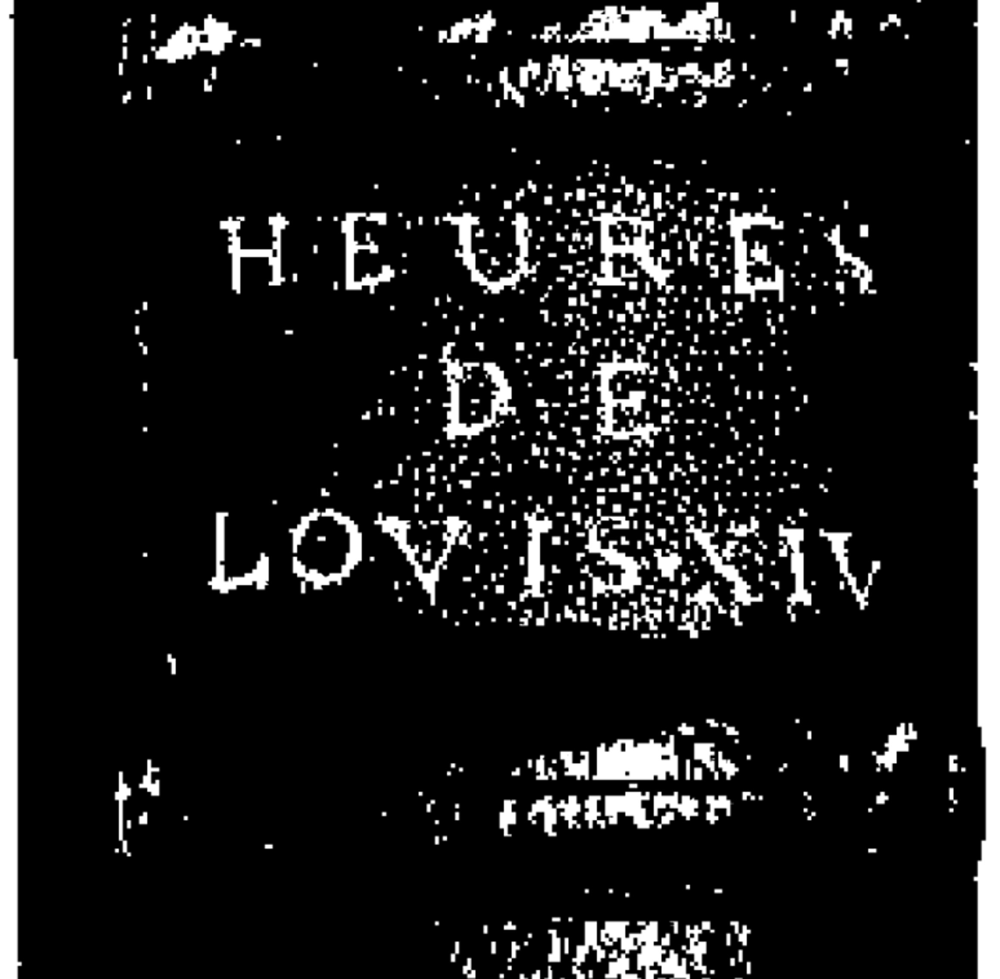
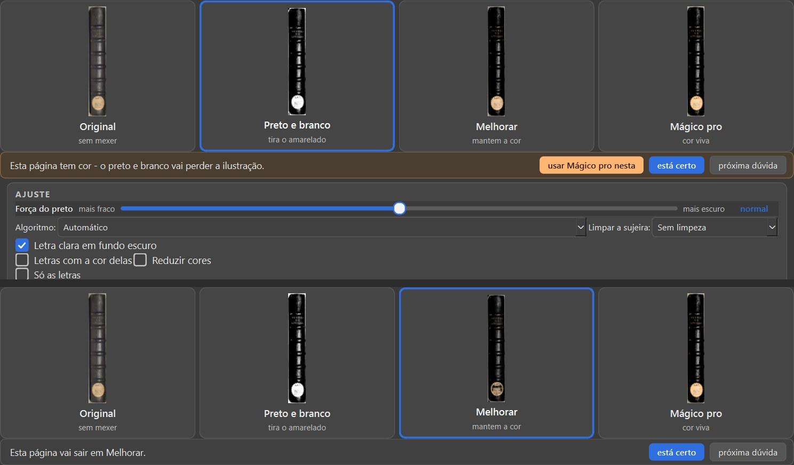
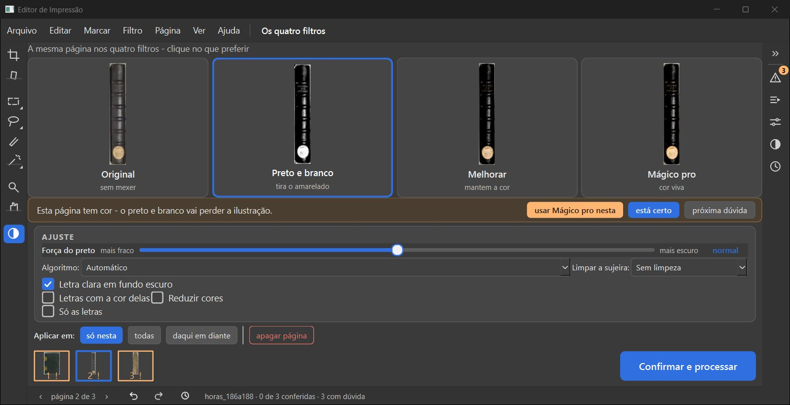

# Item 2.9: letra clara em fundo escuro - conferência do verificador (21/10/2026)

Ramo `fase2-scantailor-itens-2026-10-19`, código `0f4ee58`, contra o `fase-1` em `b8e9af7`. Não mudei código; não marco nada como aprovado.

## Veredito

**PRONTO PARA CONFERIR** (refeito em 21/10 no código `839bf1f`). O defeito de tela achado na primeira conferência - com a caixinha marcada, os cartões dos filtros não escolhidos mostravam a página sem inverter - foi consertado pelo implementador (`e49463c`): o teste de reversão `tests/test_cartoes_seguem_as_caixinhas.py` falha no `e49463c^` (4 de 5) e passa no novo, e na janela os quatro cartões e o filtro escolhido batem (Livro de Horas 187). O resto continua certo: fábrica igual (128 de 128, também no `839bf1f`), a conta igual à do ScanTailor, o PDF sai invertido e o "Ver de perto" compara certo.

## O que conferi

| O que | Como | Resultado |
|---|---|---|
| Desligado de fábrica: somas das 32 páginas-gabarito em Original, Preto e branco, Melhorar e Preto e branco com "Só as letras" (`scripts/somas.py`, uma página por processo; lado antigo = o que medi no 2.8) | máquina | **iguais: 128 de 128** |
| A conta igual à do ScanTailor | código | inverte na entrada e no fim, como `OutputGenerator.cpp` 1245-1249, 1344-1346, 1370-1372, 1497-1499 (conferido no arquivo de referência); Original e "Tirar o fundo" não passam por ela |
| Testes do implementador (`test_claro_no_escuro.py`, `..._na_tela.py`) | máquina | 13 passaram |
| Janela de verdade (Livro de Horas 186-188, tela nova) | olho | a caixinha aparece no AJUSTE (some no Original); marcar grava ação no desfazer; o cartão escolhido inverte; **os outros cartões não**; "Ver de perto" compara certo; o PDF sai com letra branca em fundo preto (12 s, erros.log vazio) |
| Páginas de verdade | procura minha (`scripts/procurar.py`, 320 livros de D:\Livros para editar e das pastas de teste; parei antes do fim) | achei casos melhores que a lombada: a capa do "História do Direito Político Brasileiro" e slides do "O meio ambiente hoje" (texto branco em fundo escuro) |
| Antes/depois | `scripts/antes_depois.py` (caminho do programa, 300 DPI) | três páginas, abertas: ver os quadros |
| Velocidade | - | não rodei (desligada de fábrica) |

## Ressalvas

- A procura do implementador leu só 14 livros e achou só a lombada; a minha achou capas e slides. Nenhuma página do gabarito é deste tipo.
- Na lombada, com a caixinha, o couro brilhante vira manchas brancas: não é defeito da caixinha (a lombada não é texto em fundo uniforme).
- Melhorar com a caixinha deixa uma moldura cinza em volta da lombada (o fundo claro do scanner, invertido).

## Bugs para a Lista de bugs

- 21/10/2026 (já consertado em `e49463c`): com "Letra clara em fundo escuro" marcada, os cartões dos filtros não escolhidos mostravam a página sem inverter.
- 21/10/2026 (pequeno): no Melhorar, o AJUSTE mostra o rótulo "Algoritmo:" sem nada ao lado.

## Quadro para o Samuel: Capa com letra branca em fundo azul

O que você está escolhendo: se a caixinha faz o que você pediu numa capa de letra branca em fundo escuro.

Caso real: a capa do "História do Direito Político Brasileiro". Hoje o Preto e branco não mexe nela (fica igual ao original). Com a caixinha, sai letra branca em fundo preto puro, limpa, como o ScanTailor faz.

Cada foto: a página como sai no PDF, sem a caixinha ("Hoje") e com a caixinha marcada, em Preto e branco e em Melhorar. A caixinha vem desmarcada: livro já começado sai igual.

**O que olhar:** O título: em Preto e branco com a caixinha, branco limpo no fundo preto.

Opções: Está bom · Melhorar · Está pior · Ainda não entendi · e um comentário.

*Original, Hoje (Preto e branco), Preto e branco com a caixinha, Hoje (Melhorar), Melhorar com a caixinha*

## Quadro para o Samuel: Slide com parágrafos brancos em fundo escuro

O que você está escolhendo: se a caixinha resolve as páginas de texto claro em fundo escuro.

Caso real: um slide do "O meio ambiente hoje". Hoje o Preto e branco desenha só o contorno das letras, como letra vazada, com borrões; com a caixinha, o texto sai branco e inteiro no fundo preto.

Cada foto: a página como sai no PDF, sem a caixinha ("Hoje") e com a caixinha marcada, em Preto e branco e em Melhorar. A caixinha vem desmarcada: livro já começado sai igual.

**O que olhar:** As letras: vazadas no "Hoje", inteiras com a caixinha.

Opções: Está bom · Melhorar · Está pior · Ainda não entendi · e um comentário.

*Ampliado: o título e os parágrafos, nas cinco versões*

*O slide inteiro*

## Quadro para o Samuel: Livro de Horas 187: a lombada de couro

O que você está escolhendo: se está bom o resultado na lombada (a página que o implementador achou).

Caso real: o título dourado "HEURES DE LOVIS XIV" na lombada escura. Hoje o Preto e branco vira uma página quase branca, sem título. Com a caixinha o título aparece em branco, mas o couro brilhante vira muitas manchas brancas.

Cada foto: a página como sai no PDF, sem a caixinha ("Hoje") e com a caixinha marcada, em Preto e branco e em Melhorar. A caixinha vem desmarcada: livro já começado sai igual.

**O que olhar:** O título dourado e o brilho do couro.

Opções: Está bom · Melhorar · Está pior · Ainda não entendi · e um comentário.

*Ampliado: o título na lombada*

*A lombada inteira*

*O PDF gerado na janela de verdade, com a caixinha: letra branca no fundo preto*

## Quadro para o Samuel: Os cartões da tela seguem a caixinha (defeito achado e já consertado)

O que você está escolhendo: se os cartões da tela ficaram certos com a caixinha marcada.

Caso real: Livro de Horas 187 com "Letra clara em fundo escuro" marcada. Os quatro cartões ("A mesma página nos quatro filtros") mostram a página já tratada com a caixinha, e escolher um deles dá o mesmo que o cartão mostrava (embaixo: o Melhorar escolhido).

Ressalva: na primeira conferência (0f4ee58) os cartões não seguiam a caixinha: o Melhorar aparecia cinza e, escolhido, a página saía preta. O implementador consertou (e49463c); o teste de reversão falha no código de antes (conferido por mim) e passa no novo.

**O que olhar:** O cartão Melhorar em cima e a página depois de escolhê-lo, embaixo: iguais.

Opções: Está bom · Melhorar · Está pior · Ainda não entendi · e um comentário.

*Em cima: caixinha marcada, os quatro cartões. Embaixo: depois de escolher o Melhorar*

*A tela inteira*

## Decisão: A caixinha "Letra clara em fundo escuro": o que você decide?

O que você está escolhendo: se esta entrega entra no programa.

Você pediu em 05/10 (P9 (a)): "Uma caixinha por página, 'Letra clara em fundo escuro', que o Kaique marca à mão". Ela fica no AJUSTE da ferramenta Filtro, desmarcada. Igual ao ScanTailor: inverte a página, trata como letra escura em papel claro e inverte de novo no fim.

Os cartões da tela, que não seguiam a caixinha, já foram consertados (quadro acima).

Opções: Aprovado · Melhorar · Ainda não entendi
