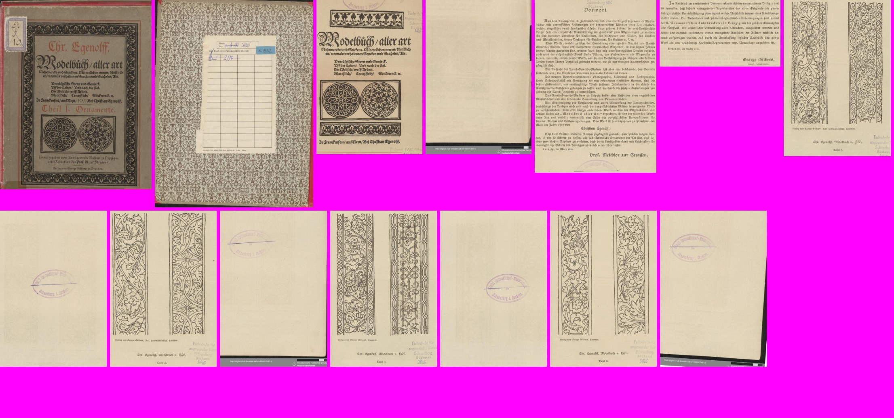
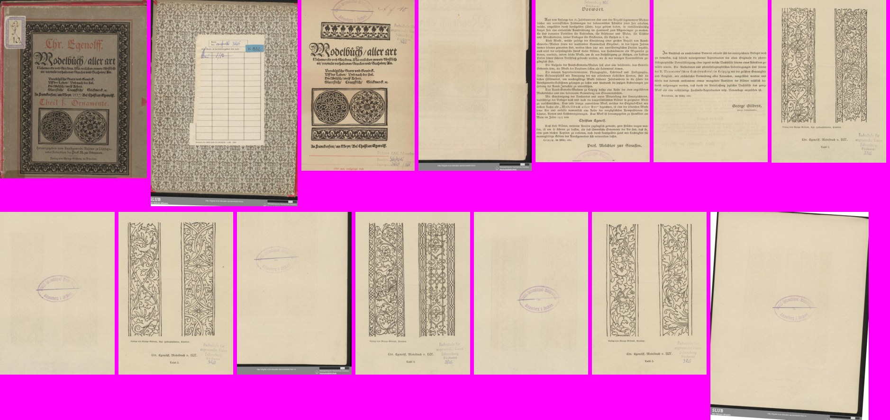

# Caixa do conteúdo (2.5) e borda preta (2.13): conferência do verificador (21/10/2026)

Ramo `fase2-caixa-conteudo`, código `4120c68`, contra o `fase-1` em `31a9253`. Não mudei código; não marco nada como aprovado.

## Veredito

**NÃO ESTÁ PRONTO, por um defeito:** com "Cortar seguindo o conteúdo" E "Achar a página dentro da borda preta" ligadas juntas, o livro gerado perde o tamanho do livro (G9): cada página sai de um tamanho e a página 6 do Egenloff vira uma tira de 253 x 139 mm. O implementador nunca gerou um livro inteiro (ressalva 1 dele); eu gerei na janela. O resto está certo: de fábrica igual (128 de 128), os testes de reversão falham no código antigo, e as imagens dele batem com o que ele escreveu.

## O que conferi

| O que | Como | Resultado |
|---|---|---|
| Desligado de fábrica: somas das 32 páginas-gabarito em Original, PB, Melhorar e PB com "Só as letras" (`scripts/somas.py`, uma página por processo), fase-1 `31a9253` (com o conserto do corte) x `4120c68` | máquina | **iguais: 128 de 128** |
| Testes novos, um arquivo por vez | máquina | corte pelo conteúdo 21, no programa 14, na tela 12, guias 14, borda preta 11, páginas do Samuel 10, caixas do ScanTailor 76 (com as páginas do gabarito ligadas na worktree; sem elas 37 pulam): todos passam |
| Testes de reversão | máquina | cunha branca: falha no `6be46d4` ("a cunha do giro chegou branca"), passa no novo; Pesel 21: falha no `7020734` (79 > 3), passa no novo; "usar em todas" apaga as exceções: o teste dele importa a janela nova (no código antigo falharia por ImportError), então fiz o meu sem a janela (`scripts/test_reversao_usar_em_todas_verificador.py`): falha no fase-1 (a exceção vira o corte da página da vez), passa no novo |
| Imagens do implementador | olho | abri as 98: 41 antes/depois, 14 borda preta, 24 em mm, 19 de folha grande. Batem com o relatório dele |
| Livro inteiro em PDF, na janela de verdade (Egenloff, folhas 1 a 14) | olho + medida do PDF | **só a 2.5:** capas e contracapa muito maiores no tamanho delas; o resto 255 x 363 mm, menos as páginas 3 e 4 (252 x 381). **As duas juntas:** tamanhos de 221 x 323 a 254 x 362, e a página 6 com **253 x 139** (só o bloco de texto; o papel e o lápis "Af 10" somem) |
| Velocidade | - | não rodei (o filtro do GitHub dele deu igual na Parte 1; desligado de fábrica) |

## Ressalvas

- O texto da tela "O que fazer" ("Vou endireitar as tortas e cortar as bordas.") não diz nada das duas opções ligadas.
- Com as duas opções a barra "SLUB" da digitalização entra no corte de algumas páginas (4, 13, 14).
- Não conferi as linhas de apoio (g8-guias) na janela.

## Bugs para a Lista de bugs

- 21/10/2026: com "Cortar seguindo o conteúdo" e "Achar a página dentro da borda preta" (até a moldura) ligadas juntas, o PDF não tem o tamanho do livro; Egenloff folha 6 sai uma tira de 253 x 139 mm.
- 21/10/2026: só com "Cortar seguindo o conteúdo", Egenloff 3 e 4 saem 252 x 381 mm e as outras 255 x 363 mm.

## Quadro para o Samuel: Cortar seguindo o conteúdo: onde fica melhor que hoje

O que você está escolhendo: se o corte que segue o que está impresso está como você pediu (G8: "Trazer como opção, desligada").

Caso real: no calendário do Livro de Horas o corte de hoje pega papel vazio e a lombada; o novo corta rente à moldura. No ljs47 sai a folha vizinha e a borda.

As duas opções vêm desligadas: livro já começado sai igual.

**O que olhar:** Laranja = corte de hoje; verde = o corte novo.

Opções: Está bom · Melhorar · Está pior · Ainda não entendi · e um comentário.

*Horas 26: hoje (laranja) e seguindo o conteúdo (verde)*

*ljs47 46: a folha vizinha e a borda saem*

## Quadro para o Samuel: Quando o corte deixa algo impresso de fora: o aviso

O que você está escolhendo: se o aviso "Corte deixou algo de fora" com o botão "usar o corte alargado" está como você pediu (g8-moldura-tinta-fora: "Só avisa" + mostrar alargado).

Caso real: na tabela do Livro de Horas a moldura dourada e o título "TABLE" ficam de fora; o aviso mostra o pedaço em vermelho e o corte alargado em lilás, que pega tudo.

No Graduale 223 a caixa vai até a beirada da folha e leva a sombra que o corte de hoje tirava.

**O que olhar:** Vermelho = o que ficou de fora; lilás tracejado = o corte alargado.

Opções: Está bom · Melhorar · Está pior · Ainda não entendi · e um comentário.

*Horas 14: o título e a moldura de fora, e o corte alargado*

*Graduale 223: o novo leva a sombra da beirada*

## Quadro para o Samuel: O livro inteiro gerado em PDF (defeito com as duas opções juntas)

O que você está escolhendo: se isto precisa ser consertado antes de aprovar.

Caso real: gerei na janela as 14 primeiras folhas do Egenloff. Só com "Cortar seguindo o conteúdo", as páginas saem quase todas do mesmo tamanho (G9), e as capas, muito maiores, no tamanho delas. Com ela e "Achar a página dentro da borda preta" juntas, o tamanho do livro some: cada página sai de um tamanho, e a página 6 vira uma tira de 25 x 14 cm, só com o texto.

Com só a primeira opção ainda sobram diferenças pequenas: as páginas 3 e 4 saem 2 cm mais altas que as outras.

**O que olhar:** Em cima, as duas opções: a página 6 é a tira larga e baixa. Embaixo, só a primeira: todas do mesmo tamanho.

Opções: Está bom · Melhorar · Está pior · Ainda não entendi · e um comentário.

*As duas opções ligadas: 14 páginas do PDF (fundo rosa = sobra)*

*Só "Cortar seguindo o conteúdo": o mesmo livro*

## Quadro para o Samuel: Achar a página dentro da borda preta: só o preto ou até a moldura

O que você está escolhendo: se os dois jeitos que você pediu (g7-borda-ate-onde, "O Kaique escolhe por livro") estão como você quer.

Caso real: em cada foto, hoje, "só o preto" e "até a moldura". "Só o preto" tira a faixa preta e deixa o papel; "até a moldura" corta rente ao que está impresso (o que sai fica escurecido).

Nas suas páginas-alvo (Antiphon 260, Camões 104, Cursus 3, Matemática 32) a faixa preta sai com os dois jeitos.

**O que olhar:** A faixa preta embaixo do Antiphon 260 e as pontas pretas nos cantos do Camões 104.

Opções: Está bom · Melhorar · Está pior · Ainda não entendi · e um comentário.

*Antiphon 260: hoje, só o preto, até a moldura*

*Camões 104: com "só o preto" ficam pontas nos cantos; com "até a moldura" some tudo*

*Cursus 3*

*Matemática 32*

## Pergunta: O carimbo da biblioteca fora do corte

O que você está escolhendo: o que fazer com o carimbo de biblioteca no corte que segue o conteúdo.

No Opus Majus 3 o carimbo fica fora do corte, sem aviso; no Egenloff ele às vezes dispara o aviso "Corte deixou algo de fora". (pergunta do implementador)

Opções: Está bom assim · Quero o carimbo dentro · Ainda não entendi

*Opus Majus 3: o carimbo do canto fica fora do verde*

## Pergunta: Página quase em branco, só com um carimbo

O que você está escolhendo: onde fica o centro de uma página quase em branco.

No Egenloff 12 (só um carimbo) a página sai do tamanho das outras, mas centrada no carimbo, não no papel. (pergunta do implementador)

Opções: Está bom · Centrar no papel · Ainda não entendi

*Egenloff 12: a caixa (verde) é só o risco do carimbo*

## Pergunta: Página com cartão escuro em volta da gravura (Pesel 21)

O que você está escolhendo: o que o Kaique escolhe num livro assim.

Com "até a moldura", o corte vai até a gravura e o cartão some, junto com o número 3 e parte do título e da legenda. Com "só o preto", a página sai inteira. (pergunta do implementador)

Opções: Só o preto neste livro · Até a moldura, e eu acerto à mão · Ainda não entendi

*Pesel 21: hoje, só o preto, até a moldura*

## Decisão: Caixa do conteúdo e borda preta: o que você decide?

O que você está escolhendo: se as duas opções entram no programa.

Falta consertar o livro inteiro com as duas opções juntas (o quadro do PDF).

Opções: Aprovado · Melhorar · Ainda não entendi
