# Caixa do conteúdo (2.5), borda preta (2.13) e pintar de branco (2.14): conferência do verificador (21/10/2026)

Ramo `fase2-caixa-conteudo`, código `57de8af` (a primeira conferência foi no `4120c68`), contra o `fase-1` em `31a9253`. Não mudei código; não marco nada como aprovado.

## Veredito

**PRONTO PARA CONFERIR** (refeito em 21/10 no código `57de8af`). O defeito achado na primeira conferência (as duas opções juntas perdiam o tamanho do livro; a página 6 do Egenloff virava tira) foi consertado: gerei de novo o Egenloff 1-14 na janela e todas as páginas do miolo saem do mesmo tamanho nos dois jeitos; os 4 testes de reversão falham no `4120c68` e passam no novo. Ressalva nova: com as duas opções, a etiqueta impressa de 1880 do Egenloff 3 sai cortada ao meio e a página não ganha aviso (só com a primeira opção ela fica de fora, mas com aviso).

## O que conferi

| O que | Como | Resultado |
|---|---|---|
| Desligado de fábrica: somas das 32 páginas-gabarito em Original, PB, Melhorar e PB com "Só as letras" (`scripts/somas.py`, uma página por processo), fase-1 `31a9253` (com o conserto do corte) x `4120c68` e x `57de8af` | máquina | **iguais: 128 de 128 nos dois** |
| Testes novos, um arquivo por vez | máquina | corte pelo conteúdo 21, no programa 14, na tela 12, guias 14, borda preta 11, páginas do Samuel 10, caixas do ScanTailor 76 (com as páginas do gabarito ligadas na worktree; sem elas 37 pulam): todos passam |
| Testes de reversão | máquina | cunha branca: falha no `6be46d4` ("a cunha do giro chegou branca"), passa no novo; Pesel 21: falha no `7020734` (79 > 3), passa no novo; "usar em todas" apaga as exceções: o teste dele importa a janela nova (no código antigo falharia por ImportError), então fiz o meu sem a janela (`scripts/test_reversao_usar_em_todas_verificador.py`): falha no fase-1 (a exceção vira o corte da página da vez), passa no novo |
| Imagens do implementador | olho | abri as 98: 41 antes/depois, 14 borda preta, 24 em mm, 19 de folha grande. Batem com o relatório dele |
| Livro inteiro em PDF, na janela de verdade (Egenloff, folhas 1 a 14) | olho + medida do PDF | **só a 2.5:** capas e contracapa muito maiores no tamanho delas; o resto 255 x 363 mm, menos as páginas 3 e 4 (252 x 381). **As duas juntas:** tamanhos de 221 x 323 a 254 x 362, e a página 6 com **253 x 139** (só o bloco de texto; o papel e o lápis "Af 10" somem) |
| Livro inteiro de novo no `57de8af` (Egenloff 1-14, janela de verdade, `gerar_caixa.py` no piloto) | medida do PDF (`scripts/medir_pdf.py`) | **só a 2.5:** miolo 252,5-252,6 x 360,4-360,5 mm (12 páginas), capas 326 x 396 e 326 x 459; **as duas:** miolo 252,5-252,6 x 378,9-379,0 mm, capas 316 x 395 e 330 x 423. Página 6 = 253 x 360 / 379 (antes: 253 x 139). erros.log vazio |
| Reversão do conserto do tamanho (`tests/test_corte_pelo_conteudo_livro.py`) | no `4120c68` | 4 falham (páginas de tamanhos diferentes; capa sem conteúdo do tamanho errado), passam no `57de8af` |
| 2.14 (`831a4ce`) | olho | abri as 7 imagens "cinco jeitos": batem com a tabela do implementador |
| Velocidade | - | não rodei (o filtro do GitHub dele deu igual na Parte 1; desligado de fábrica) |

## Ressalvas

- A frase da tela "O que fazer" agora diz as opções do corte (consertado em `57de8af`).
- Com as duas opções a barra "SLUB" da digitalização entra no corte de algumas páginas (4, 13, 14).
- Não conferi as linhas de apoio (g8-guias) na janela.

## Bugs para a Lista de bugs

- 21/10/2026 (consertados em `57de8af`): o PDF sem o tamanho do livro com as duas opções (tira de 253 x 139 mm) e Egenloff 3 e 4 maiores só com a 2.5.
- 21/10/2026: com as duas opções, a etiqueta impressa de 1880 do Egenloff 3 sai cortada ao meio, sem o aviso "Corte deixou algo de fora".

## Quadro para o Samuel: Cortar seguindo o conteúdo: onde fica melhor que hoje

O que você está escolhendo: se o corte que segue o que está impresso está como você pediu (G8: "Trazer como opção, desligada").

Caso real: no calendário do Livro de Horas o corte de hoje pega papel vazio e a lombada; o novo corta rente à moldura. No ljs47 sai a folha vizinha e a borda.

As duas opções vêm desligadas: livro já começado sai igual.

**O que olhar:** Laranja = corte de hoje; verde = o corte novo.

Opções: Está bom · Melhorar · Está pior · Ainda não entendi · e um comentário.

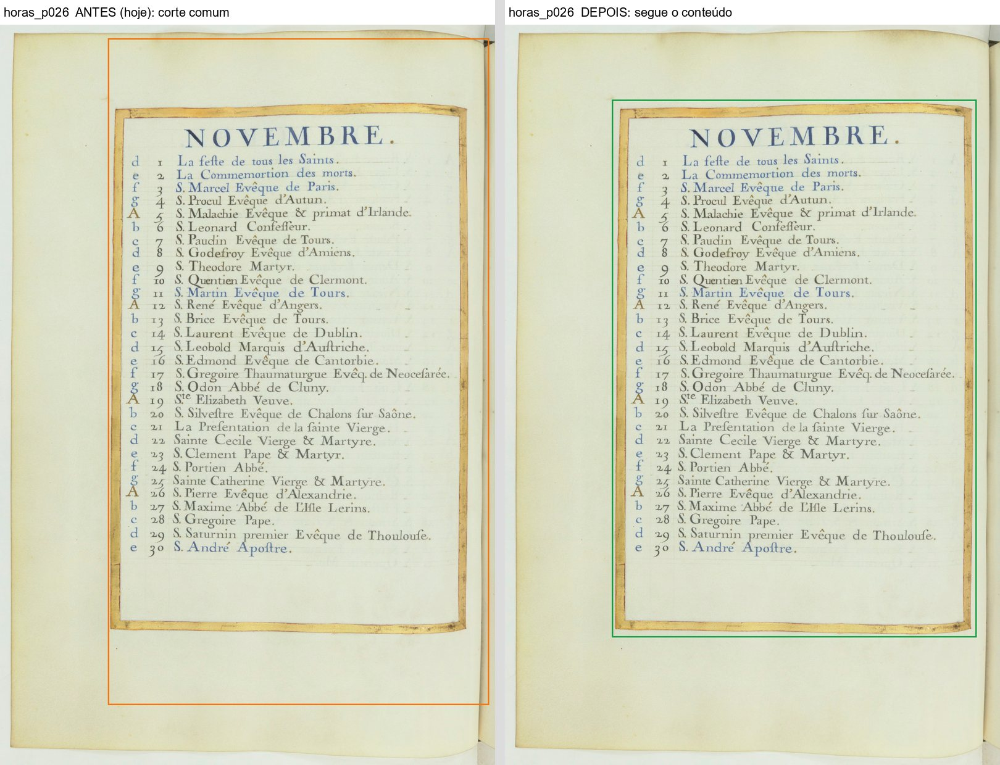

*Horas 26: hoje (laranja) e seguindo o conteúdo (verde)*

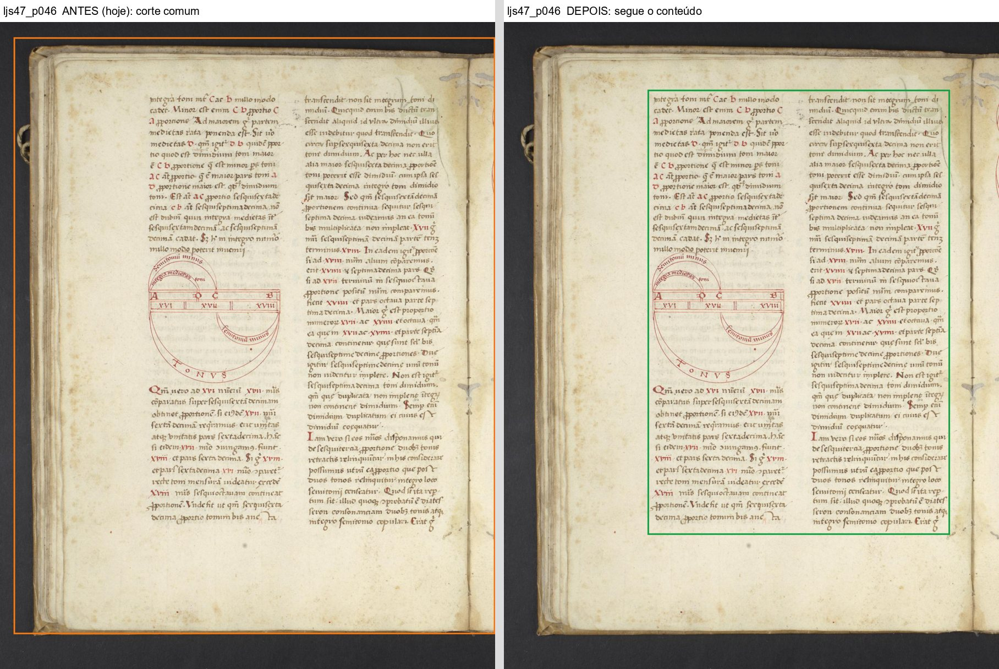

*ljs47 46: a folha vizinha e a borda saem*

## Quadro para o Samuel: Quando o corte deixa algo impresso de fora: o aviso

O que você está escolhendo: se o aviso "Corte deixou algo de fora" com o botão "usar o corte alargado" está como você pediu (g8-moldura-tinta-fora: "Só avisa" + mostrar alargado).

Caso real: na tabela do Livro de Horas a moldura dourada e o título "TABLE" ficam de fora; o aviso mostra o pedaço em vermelho e o corte alargado em lilás, que pega tudo.

No Graduale 223 a caixa vai até a beirada da folha e leva a sombra que o corte de hoje tirava.

**O que olhar:** Vermelho = o que ficou de fora; lilás tracejado = o corte alargado.

Opções: Está bom · Melhorar · Está pior · Ainda não entendi · e um comentário.

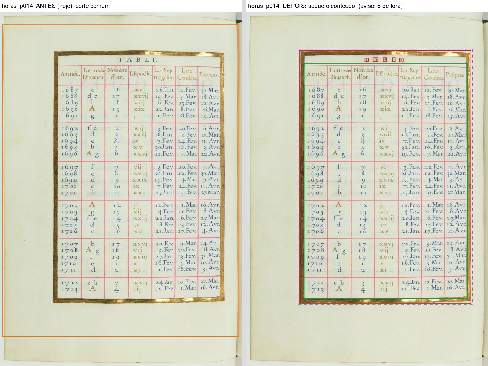

*Horas 14: o título e a moldura de fora, e o corte alargado*

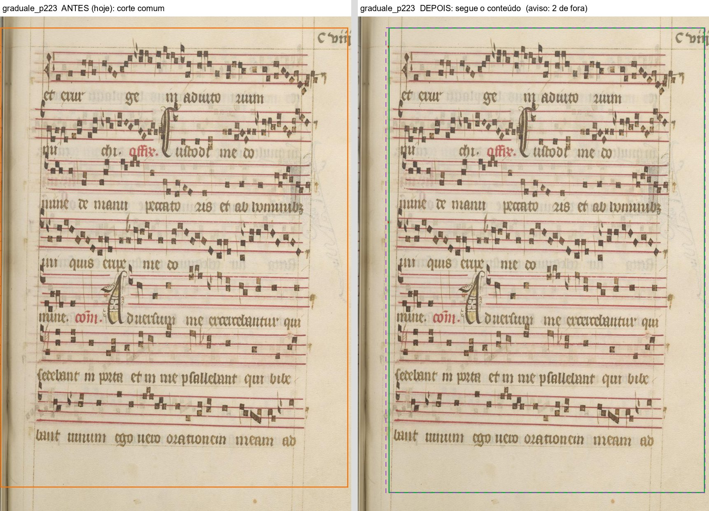

*Graduale 223: o novo leva a sombra da beirada*

## Quadro para o Samuel: O livro inteiro gerado em PDF (defeito achado e já consertado)

O que você está escolhendo: se o livro inteiro sai como você pediu (G9: "Todas as páginas do tamanho da maior: Sim").

Caso real: gerei na janela as 14 primeiras folhas do Egenloff, nos dois jeitos. Só com "Cortar seguindo o conteúdo": as 12 páginas do miolo saem todas com 253 x 360 mm. Com ela e "Achar a página dentro da borda preta": todas com 253 x 379 mm. As duas capas, muito maiores, saem no tamanho delas.

Ressalva: na primeira conferência (4120c68) cada página saía de um tamanho e a página 6 virava uma tira de 25 x 14 cm. O implementador consertou (57de8af); o teste de reversão falha no código de antes (4 testes, conferido por mim). Mudou também um comportamento: a página "muito maior" nunca sai menor que o livro; quem fica menor cresce até o tamanho do livro.

**O que olhar:** Embaixo, as 12 páginas do miolo do mesmo tamanho; as capas maiores.

Opções: Está bom · Melhorar · Está pior · Ainda não entendi · e um comentário.

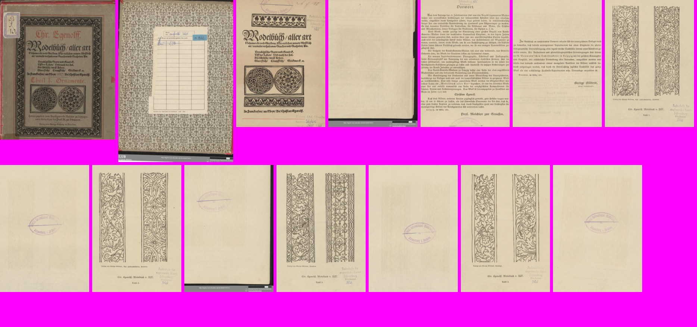

*Só "Cortar seguindo o conteúdo": as 14 páginas do PDF (fundo rosa = sobra)*

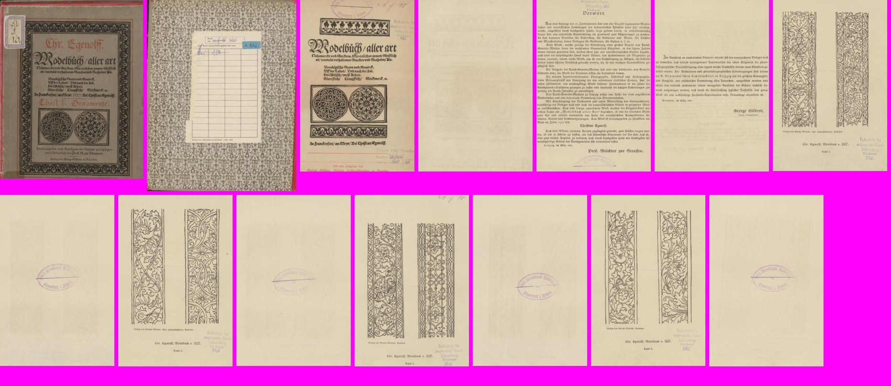

*As duas opções ligadas: as 14 páginas do PDF*

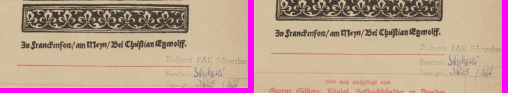

*O pé da página 3: à esquerda só a primeira opção (a etiqueta de 1880 fica de fora, com aviso); à direita as duas (a etiqueta sai cortada ao meio, sem aviso)*

## Quadro para o Samuel: Pintar de branco em vez de cortar (item 2.14)

O que você está escolhendo: se o "pintar de branco" ficou como você pediu (rv5-pag-egenloff-047: "O Kaique escolhe por livro").

Com a borda preta ligada, o livro escolhe entre cortar fora (vem escolhido) e pintar de branco. Pintando, a página fica do tamanho de sempre e o que está fora da página achada ("só o preto") ou fora do impresso ("até a moldura") vira branco. No Egenloff 47, "até a moldura" pintando apaga também a tarja da biblioteca; "só o preto" pintando deixa a tarja (ela é cinza, não preta).

Em cada foto: hoje · só o preto · até a moldura · só o preto pintando · até a moldura pintando.

**O que olhar:** As duas últimas de cada fila: a página do tamanho de sempre, com branco em volta.

Opções: Está bom · Melhorar · Está pior · Ainda não entendi · e um comentário.

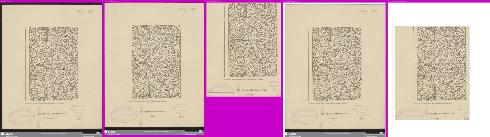

*Egenloff 47*

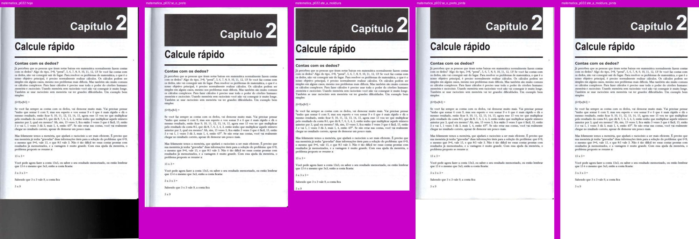

*Matemática 32*

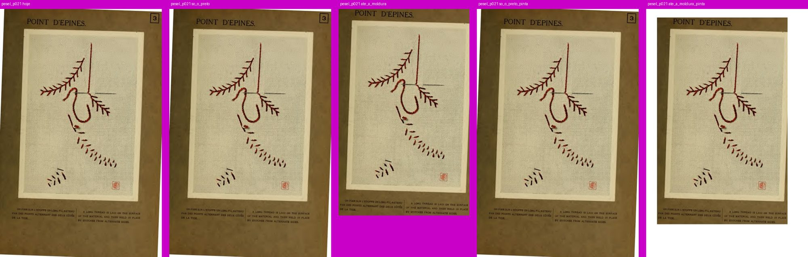

*Pesel 21: "até a moldura" pintando pinta o cartão de branco*

## Quadro para o Samuel: Achar a página dentro da borda preta: só o preto ou até a moldura

O que você está escolhendo: se os dois jeitos que você pediu (g7-borda-ate-onde, "O Kaique escolhe por livro") estão como você quer.

Caso real: em cada foto, hoje, "só o preto" e "até a moldura". "Só o preto" tira a faixa preta e deixa o papel; "até a moldura" corta rente ao que está impresso (o que sai fica escurecido).

Nas suas páginas-alvo (Antiphon 260, Camões 104, Cursus 3, Matemática 32) a faixa preta sai com os dois jeitos.

**O que olhar:** A faixa preta embaixo do Antiphon 260 e as pontas pretas nos cantos do Camões 104.

Opções: Está bom · Melhorar · Está pior · Ainda não entendi · e um comentário.

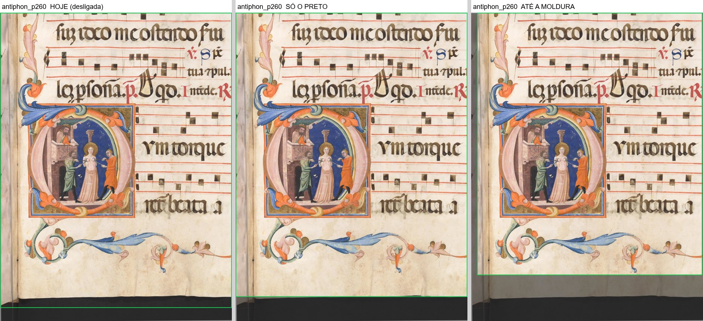

*Antiphon 260: hoje, só o preto, até a moldura*

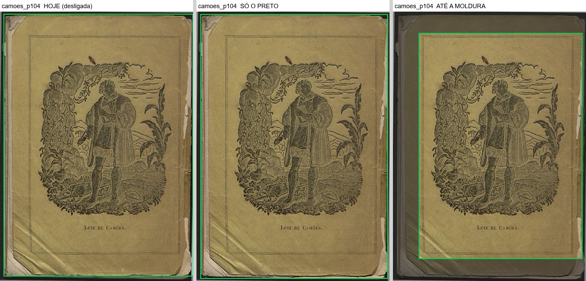

*Camões 104: com "só o preto" ficam pontas nos cantos; com "até a moldura" some tudo*

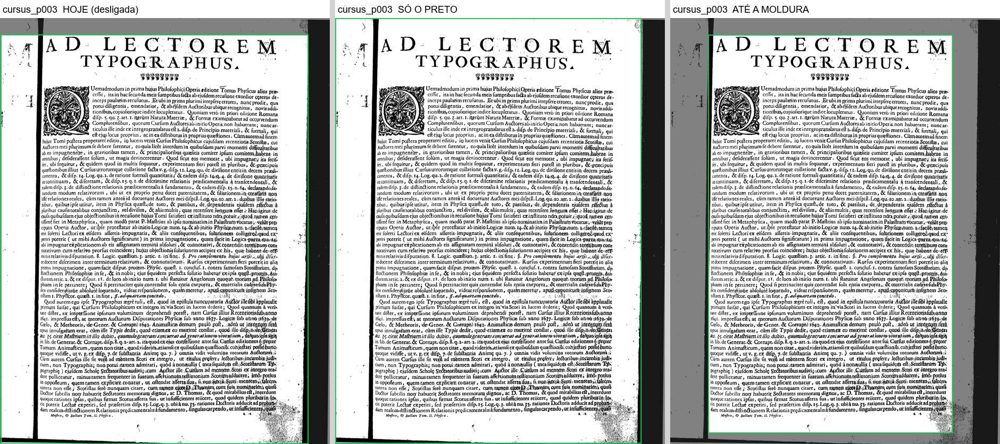

*Cursus 3*

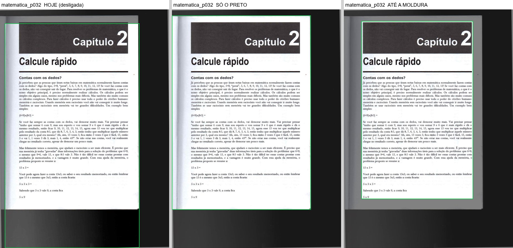

*Matemática 32*

## Pergunta: O carimbo da biblioteca fora do corte

O que você está escolhendo: o que fazer com o carimbo de biblioteca no corte que segue o conteúdo.

No Opus Majus 3 o carimbo fica fora do corte, sem aviso; no Egenloff ele às vezes dispara o aviso "Corte deixou algo de fora". (pergunta do implementador)

Opções: Está bom assim · Quero o carimbo dentro · Ainda não entendi

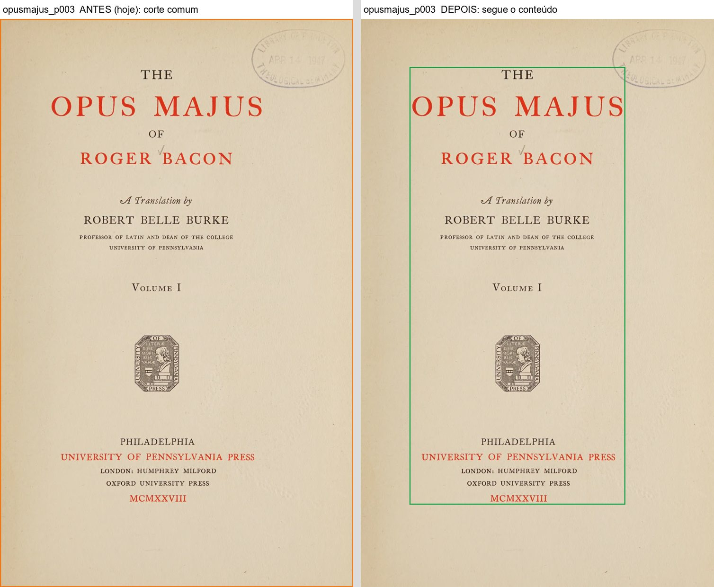

*Opus Majus 3: o carimbo do canto fica fora do verde*

## Pergunta: Página quase em branco, só com um carimbo

O que você está escolhendo: onde fica o centro de uma página quase em branco.

No Egenloff 12 (só um carimbo) a página sai do tamanho das outras, mas centrada no carimbo, não no papel. (pergunta do implementador)

Opções: Está bom · Centrar no papel · Ainda não entendi

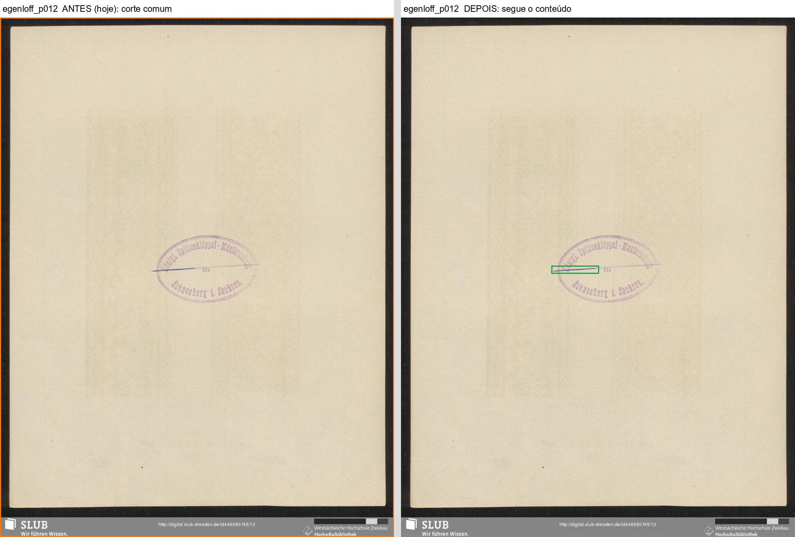

*Egenloff 12: a caixa (verde) é só o risco do carimbo*

## Pergunta: Página com cartão escuro em volta da gravura (Pesel 21)

O que você está escolhendo: o que o Kaique escolhe num livro assim.

Com "até a moldura", o corte vai até a gravura e o cartão some, junto com o número 3 e parte do título e da legenda. Com "só o preto", a página sai inteira. (pergunta do implementador)

Opções: Só o preto neste livro · Até a moldura, e eu acerto à mão · Ainda não entendi

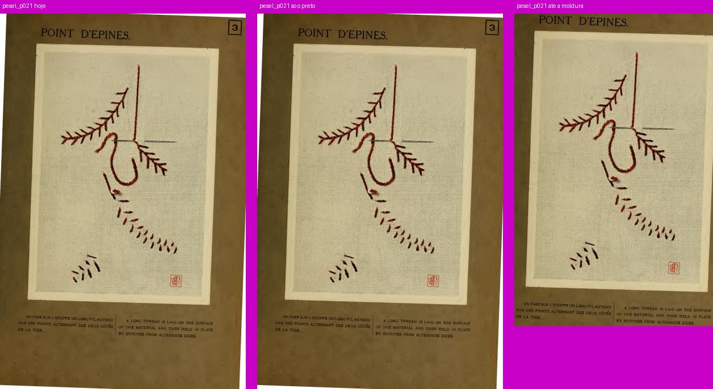

*Pesel 21: hoje, só o preto, até a moldura*

## Decisão: Caixa do conteúdo e borda preta: o que você decide?

O que você está escolhendo: se as duas opções entram no programa.

O livro inteiro com as duas opções juntas, que saía cada página de um tamanho, já foi consertado (quadro do PDF). Vem junto o "pintar de branco" (2.14).

Opções: Aprovado · Melhorar · Ainda não entendi
