# Conserto do corte do livro novo: conferência do verificador (13/10/2026)

Conferi o conserto do implementador (ramo `conserto-corte-g6-2026-10-13`, commit `d97b937`). Não mudei código e **não marco nada como aprovado**: quem aprova é o Samuel.

## Em uma frase

**PRONTO PARA CONFERIR. Na minha opinião o conserto resolve a faixa preta sem estragar o que estava bom; a dúvida que fica é o Pesel 21, que eu preferia como sai hoje.**

Desde 12/10 o programa endireita a página antes de cortar. Em página torta com borda preta do scanner, isso deixava a borda preta dentro da folha: uma faixa preta de até 4 cm, que antes era cortada. Aconteceu em 5 das 89 páginas conferidas.

O conserto ensina o corte a reconhecer a borda preta mesmo depois de a página ser endireitada. Nas cinco páginas a faixa larga sumiu; sobra, no máximo, um fio preto de 1 a 4 mm na beirada. Nada impresso foi cortado em nenhuma delas.

O resto ficou como estava: das 89 páginas, 79 saem idênticas às de hoje, ponto por ponto, entre elas todas as do gabarito e 7 das 8 que tinham melhorado com o endireitar novo. Uma página muda de um jeito que precisa do seu olho: o Pesel 21, um cartão escuro, que passa a sair cortado rente ao que está impresso.

## O que achei

- BOM: nas cinco páginas (Cursus 3, Matemática 32, Antiphon 260, Antiphon 88 e Camões 104) a faixa preta larga sumiu. Olhei as cinco de perto e na página inteira.
- BOM: nada impresso foi cortado nas cinco (Matemática 32, Antiphon 88 e Camões 104, que o implementador não tinha aberto, incluídas).
- BOM: 79 das 89 páginas saem idênticas às de hoje, ponto por ponto; as 34 páginas do gabarito estão entre elas. Medi de novo por minha conta e bateu com o implementador.
- BOM: 7 das 8 páginas que tinham melhorado com o endireitar novo saem idênticas (o número da folha do Graduale 221 e 223 continua inteiro); a oitava, Egenloff 3, muda meio milímetro.
- BOM: livro começado antes do endireitar novo continua igual: 40 de 40 casos saem idênticos, ponto por ponto, com o conserto.
- BOM: os testes de máquina do corte e da ordem do preparo passam no ramo do conserto (70 passaram, 0 falharam).
- BOM (velocidade), com uma ressalva: O conserto não deixou o programa mais lento de um jeito que dê para medir. Abrir o livro de 300 folhas: 57,5 s hoje, 59,0 s com o conserto. Trocar de página: 2,52 s e 2,59 s. Uma medida passou da variação entre rodadas iguais desta tarde: Processar 10 páginas em Preto e branco (+2,0 s). Fui medir direto nessas mesmas 10 páginas: o conserto custa 0,05 s nas dez, somadas. Então essa diferença não vem do conserto: é o PC, que não estava igual em todas as rodadas.
- PARA DECIDIR: Pesel 21 (cartão escuro) passa a sair cortado rente ao conteúdo, com a legenda a 1 ou 2 mm da borda de baixo. Nada impresso se perde, mas eu preferia a folha inteira de hoje.
- RESSALVA: no Cursus 3 sobra um fio preto à direita, de quase nada em cima a uns 4 mm embaixo. Antes do endireitar novo esse fio tinha menos de 1 mm.
- RESSALVA: o conserto só tira o preto que o endireitar novo tinha trazido. O preto que já sobrava antes (embaixo na Matemática 32, em volta nos Antiphon) continua: é outro trabalho, que está no plano.
- RESSALVA: o corte que come os números da margem na Escola 197 (a outra causa, achada na mesma conferência) não é deste conserto e continua igual.
- RESSALVA: são 89 páginas soltas, nenhum livro inteiro, e tudo foi medido sem abrir a janela do programa.
- CORREÇÃO do meu relatório de antes: eu tinha escrito que no Cursus 3 havia também uma faixa preta de 0,6 cm embaixo que a ordem antiga cortava. Medindo direto, embaixo há um fio preto de até 2 ou 3 mm nas três versões; a diferença de verdade é só a faixa da direita.

## O que foi conferido e como

| O que foi conferido | Como | Resultado |
|---|---|---|
| A faixa preta nas cinco páginas | olho + máquina | Sumiu nas cinco. Sobra um fio de 1 a 4 mm (Cursus 3: até 4 mm; Matemática 32: 1 mm; Antiphon 88: 2 mm; Camões 104: meio milímetro; Antiphon 260: volta aos 2 cm de antes). |
| Se algo impresso foi cortado nas cinco | olho | Nada foi cortado. |
| As 89 páginas, hoje contra o conserto | máquina | 79 idênticas ponto por ponto; 10 mudam (as mesmas dez do implementador). |
| As dez que mudam | olho | Cinco melhoram, quatro quase não mudam (menos de 1 mm), uma muda muito (Pesel 21). |
| As páginas do gabarito | máquina + olho | As 34 saem idênticas. Abri as 14 do gabarito do endireitar novo nas três versões. |
| As 8 que tinham melhorado | máquina + olho | 7 idênticas; Egenloff 3 muda meio milímetro embaixo. |
| Livro começado antes | máquina | 40 de 40 idênticos com o conserto. |
| Testes de máquina no ramo | máquina | 70 passaram, 0 falharam (ordem do preparo, folga de 1 mm, corte não come conteúdo, corte da prévia igual ao do PDF; o teste que abre a janela ficou de fora). |
| Velocidade (Marial, 300 folhas) | máquina | O conserto não deixou o programa mais lento de um jeito que dê para medir. Abrir o livro de 300 folhas: 57,5 s hoje, 59,0 s com o conserto. Trocar de página: 2,52 s e 2,59 s. Uma medida passou da variação entre rodadas iguais desta tarde: Processar 10 páginas em Preto e branco (+2,0 s). Fui medir direto nessas mesmas 10 páginas: o conserto custa 0,05 s nas dez, somadas. Então essa diferença não vem do conserto: é o PC, que não estava igual em todas as rodadas. |
| Custo da busca do corte | máquina | 20 milésimos de segundo a mais por página que gira (valor do meio de 43 páginas). |

## As dez páginas que mudam

Tamanho da folha em centímetros. "Escuro na beirada" é a largura do preto encostado no lado que mudou (valor do meio, medido direto na página pronta).

| Página | Folha: antes do endireitar novo → hoje → conserto | Escuro na beirada: antes → hoje → conserto | O que vi |
|---|---|---|---|
| Cursus 3 | 20,1 × 26,8 → 21,2 × 27,9 → 19,8 × 27,8 | direita: 0,4 → 14,9 → 1,5 mm | Faixa sumiu; sobra fio de até 4 mm embaixo. Nenhuma letra cortada. |
| Matemática 32 | 16,5 × 29,7 → 20,9 × 29,0 → 16,7 × 29,0 | direita: 0,2 → 37,7 → 1,0 mm | Faixa sumiu; sobra fio de 1 mm. O preto de baixo (5 cm) está nas três. |
| Antiphon 260 | 46,4 × 59,0 → 46,3 × 61,8 → 46,3 × 59,1 | embaixo: 18,7 → 46,6 → 21,0 mm | A tira de baixo volta ao tamanho de antes. Pintura e letras inteiras. |
| Antiphon 88 | 43,8 × 62,1 → 45,6 × 62,4 → 43,1 × 62,3 | direita: 7,6 → 26,4 → 1,9 mm | Melhor que antes do endireitar novo; o número azul continua inteiro. |
| Camões 104 | 9,3 × 13,2 → 9,5 × 13,1 → 9,3 × 13,1 | esquerda: 0,5 → 2,1 → 0,5 mm | O fio da esquerda sumiu. Moldura inteira. |
| Pesel 21 | 15,7 × 24,1 → 15,7 × 24,1 → 14,5 × 20,6 | não se aplica | PARA DECIDIR: cartão escuro cortado rente; legenda a 1 ou 2 mm da borda de baixo. Nada impresso perdido. |
| Egenloff 3 | 34,6 × 45,4 → 33,8 × 45,4 → 33,8 × 45,4 | não se aplica | Meio milímetro a menos embaixo; é a tarja da biblioteca, não o livro. |
| Camões 66 | 9,1 × 13,1 → 9,2 × 13,0 → 9,2 × 13,0 | em cima: 0,2 → 0,7 → 0,3 mm | Some o fio escuro de cima. |
| Antiphonal 252 | 6,5 × 9,6 → 6,5 × 10,0 → 6,5 × 9,9 | não se aplica | Menos de 1 mm de papel em branco a menos embaixo. |
| Rariora 155 | 13,3 × 14,8 → 13,3 × 11,3 → 13,3 × 11,3 | não se aplica | Menos de meio milímetro a mais em cima. |

## Os quadros

### Cursus 3: a faixa preta da direita

**O que olhar:** A beirada direita da página: a faixa preta larga do meio some na imagem da direita.

A faixa preta de 1,5 cm que aparecia à direita sumiu. No lugar dela sobra um fio preto fino, que vai de quase nada em cima a uns 4 mm embaixo. Nenhuma letra foi cortada.

**Ressalva:** O fio que sobra é maior que antes do endireitar novo (ali era menos de 1 mm). O risco preto em pé perto da beirada esquerda e o fio preto de até 2 mm embaixo existem nas três versões: não são deste conserto.

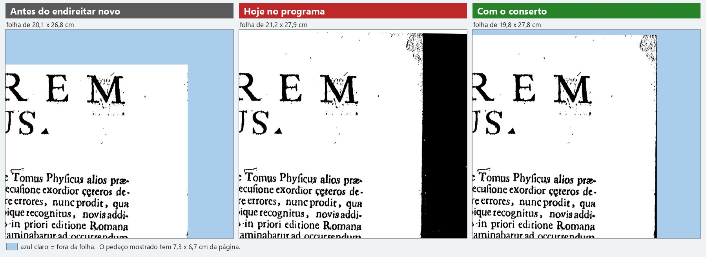

*O canto de cima, à direita, de perto. Sempre nesta ordem: como era antes do endireitar novo, como sai hoje, como sai com o conserto.*

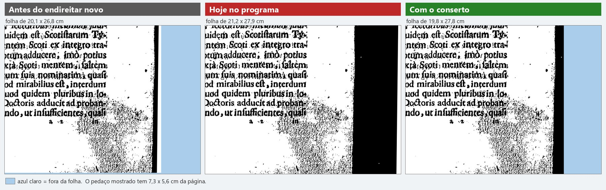

*O canto de baixo, à direita, de perto: é onde o fio que sobra é mais largo (uns 4 mm).*

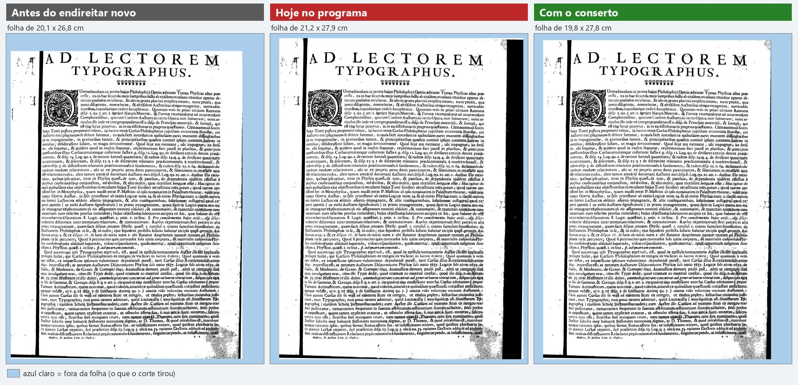

*A página inteira nas três versões.*

### Matemática 32: a faixa preta mais larga

**O que olhar:** O lado direito da folha: hoje há uma faixa preta de quase 4 cm; com o conserto, só o papel.

A faixa preta de quase 4 cm à direita sumiu; sobra um fio de 1 mm. A folha volta a ter a largura do papel (16,7 cm em vez de 20,9 cm). Nada impresso foi cortado.

**Ressalva:** O preto de baixo (uns 5 cm) continua: ele já existia antes do endireitar novo e aparece nas três versões. Em cima fica um fio preto de 1,5 mm (antes do endireitar novo era uma tira de 7 mm).

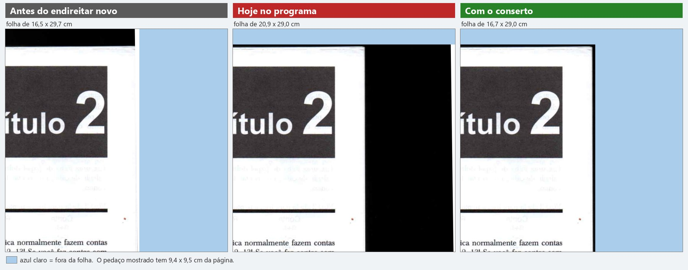

*O canto de cima, à direita, de perto. Sempre nesta ordem: como era antes do endireitar novo, como sai hoje, como sai com o conserto.*

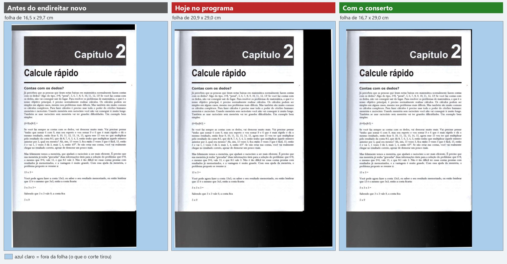

*A página inteira nas três versões: o preto de baixo está nas três.*

### Antiphon 260: o preto de baixo

**O que olhar:** A parte de baixo da folha: a tira preta do meio é bem mais alta que as outras duas.

A tira preta de baixo, que tinha passado para quase 5 cm, volta para 2 cm, como era antes do endireitar novo. A pintura e as letras continuam inteiras.

**Ressalva:** Os 2 cm de preto que sobram embaixo já existiam antes: tirar isso é outro trabalho (seguir a beirada do papel), que está no plano.

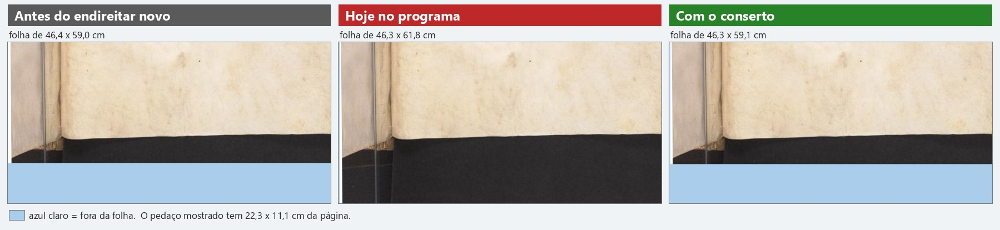

*O canto de baixo, à esquerda, de perto. Sempre nesta ordem: como era antes do endireitar novo, como sai hoje, como sai com o conserto.*

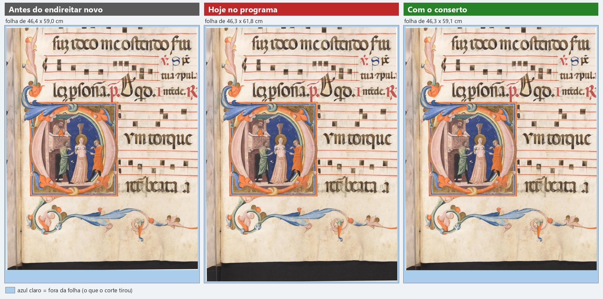

*A página inteira nas três versões.*

### Antiphon 88: o preto da direita

**O que olhar:** A beirada direita, ao lado do número azul "II": quanto preto sobra depois do papel.

O preto da direita, que estava com 2,6 cm, fica com 2 mm. Ficou melhor até do que antes do endireitar novo, quando sobravam quase 8 mm. O número azul continua inteiro.

**Ressalva:** O preto de cima e o de baixo (uns 2,5 cm cada) continuam nas três versões: não são deste conserto.

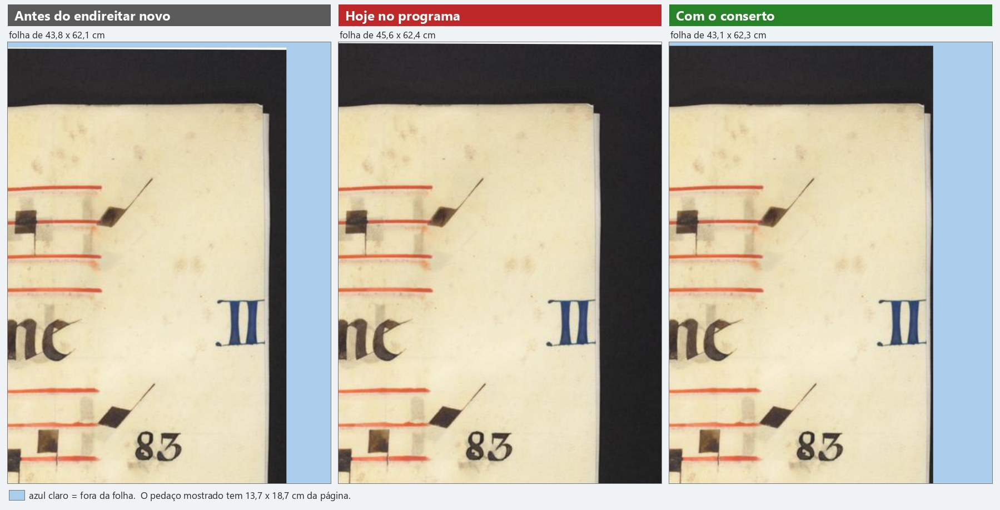

*O canto de cima, à direita, de perto. Sempre nesta ordem: como era antes do endireitar novo, como sai hoje, como sai com o conserto.*

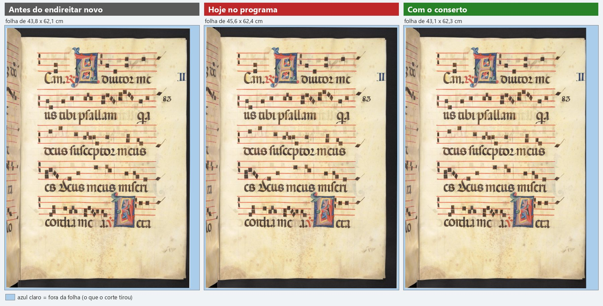

*A página inteira nas três versões.*

### Camões 104: o fio escuro da esquerda

**O que olhar:** A beirada esquerda: na imagem do meio há um fio escuro colado na borda.

O fio escuro de 2 mm que aparecia à esquerda sumiu; fica como era antes do endireitar novo. A moldura do desenho continua inteira.

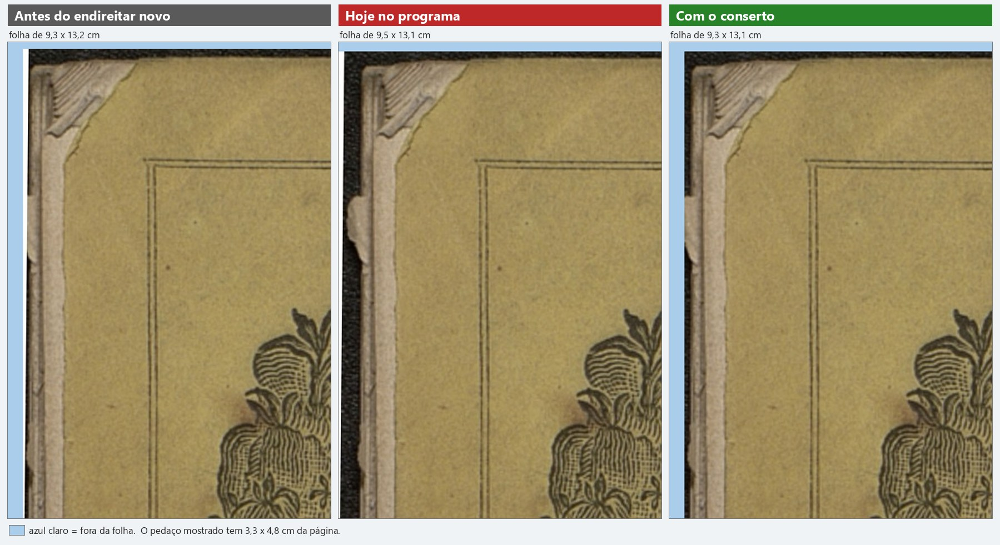

*O canto de cima, à esquerda, de perto. Sempre nesta ordem: como era antes do endireitar novo, como sai hoje, como sai com o conserto.*

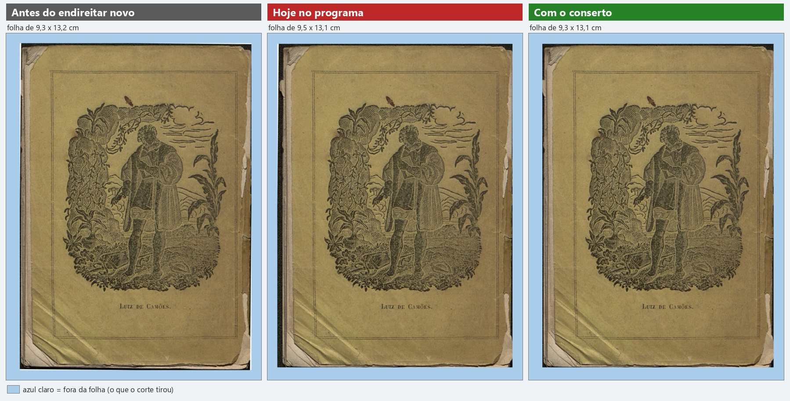

*A página inteira nas três versões.*

### Pesel 21: o cartão escuro passa a sair cortado rente

**O que olhar:** A parte de baixo: com o conserto, a legenda fica quase encostada na borda da folha.

Esta página é um cartão marrom-escuro. Hoje ela sai inteira; com o conserto, o programa corta rente ao que está impresso: tira 1 cm à esquerda e 3 cm embaixo, e a legenda fica a 1 ou 2 mm da borda de baixo. Nada impresso se perde, e as cunhas brancas dos cantos quase somem.

**Ressalva:** Não foi isso que se pediu ao conserto: é efeito de lado. Ele toma o cartão escuro por fundo do scanner. Na minha opinião a folha inteira de hoje era melhor para esta página; a legenda colada na borda é o mesmo tipo de defeito já anotado no plano (título colado na borda). Só há uma página de cartão escuro entre as 89, então não sei como ficam as outras páginas desse livro.

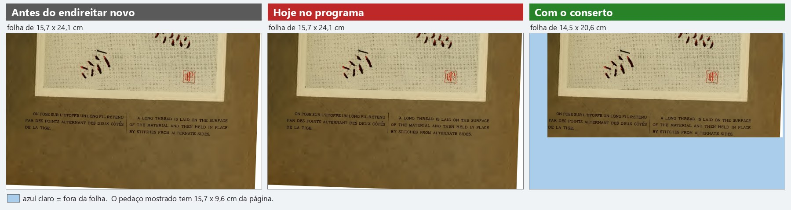

*A parte de baixo, de perto. Sempre nesta ordem: como era antes do endireitar novo, como sai hoje, como sai com o conserto.*

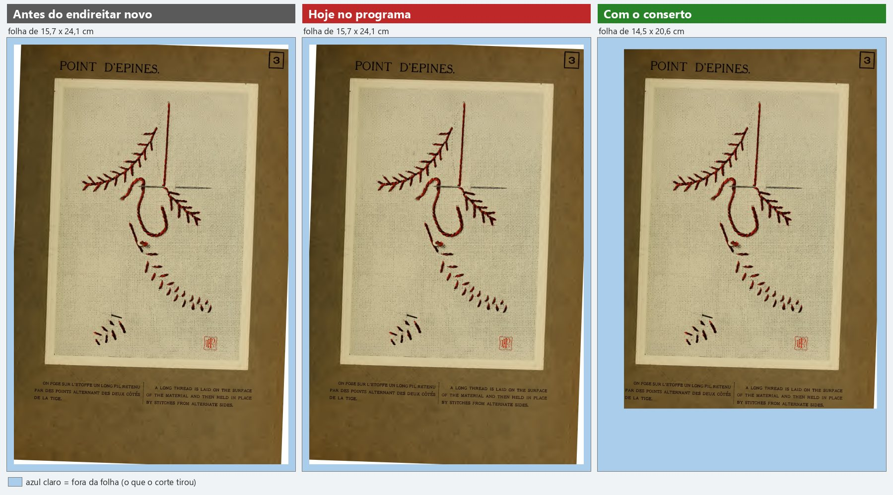

*A página inteira nas três versões: as duas primeiras são iguais.*

### Egenloff 3: meio milímetro a menos embaixo

**O que olhar:** A tarja cinza de baixo, com o nome da biblioteca: a segunda linha de letras miúdas, à direita.

A folha fica meio milímetro mais curta embaixo. O que fica um pouco mais cortado é a tarja cinza que a biblioteca pôs no pé da imagem, não o livro.

**Ressalva:** A tarja da biblioteca já saía cortada nas três versões.

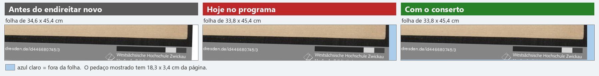

*O pé da página, lado direito, de perto. Sempre nesta ordem: como era antes do endireitar novo, como sai hoje, como sai com o conserto.*

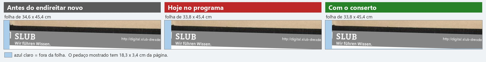

*O pé da página, lado esquerdo.*

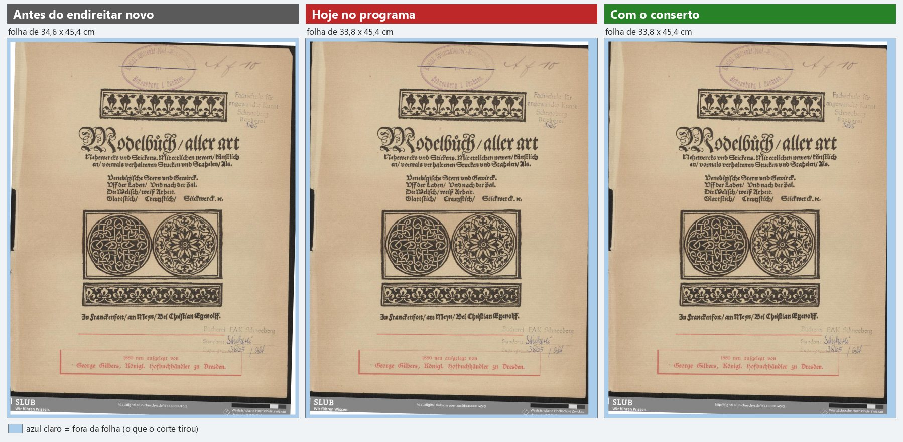

*A página inteira nas três versões.*

### Camões 66, Antiphonal 252 e Rariora 155: menos de 1 mm

**O que olhar:** A beirada de cima do Camões 66: o fio escuro do meio some. Nas outras duas, só papel em branco.

Nestas três o corte anda menos de 1 mm. No Camões 66 some o fio escuro de cima. No Antiphonal 252 sai um pouco de papel em branco embaixo, e no Rariora 155 entra um pouco em cima. Nada impresso muda.

**Ressalva:** No Rariora 155 a folha continua 3,5 cm mais curta do que era antes do endireitar novo (o papel em branco de baixo é cortado). Isso já acontece hoje e o conserto não mexe.

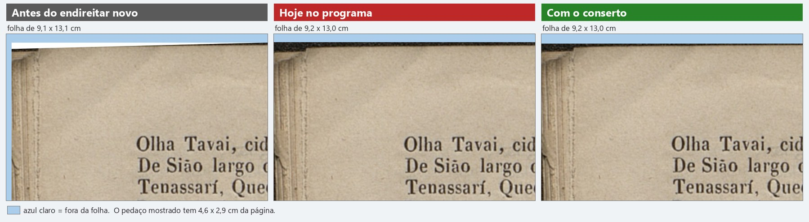

*Camões 66, o canto de cima, à esquerda. Sempre nesta ordem: como era antes do endireitar novo, como sai hoje, como sai com o conserto.*

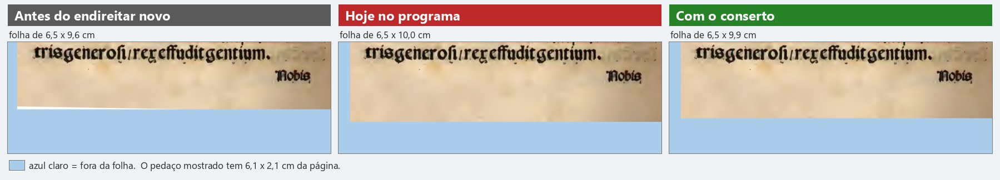

*Antiphonal 252, a parte de baixo.*

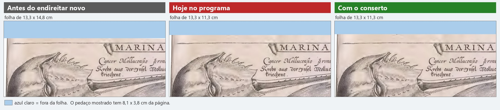

*Rariora 155, a parte de cima.*

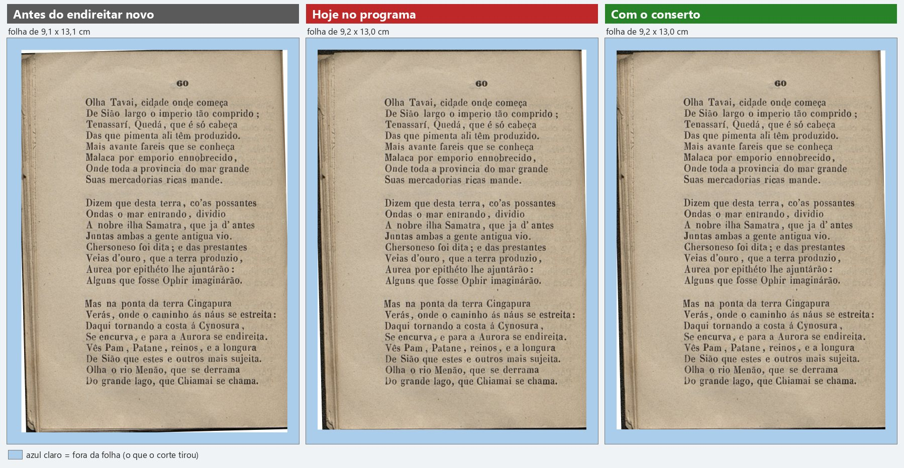

*Camões 66, a página inteira.*

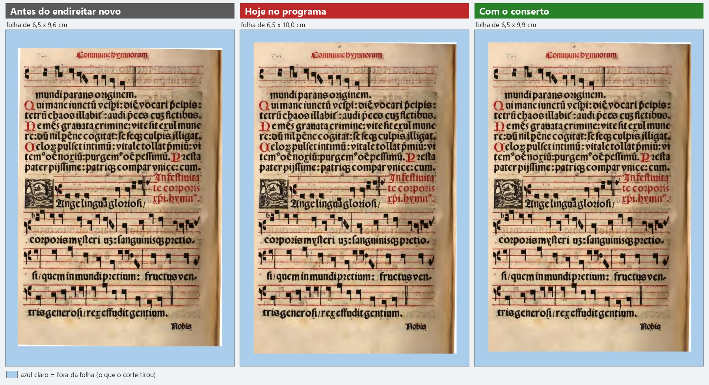

*Antiphonal 252, a página inteira.*

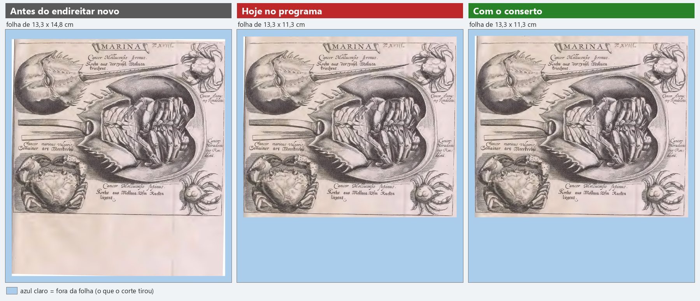

*Rariora 155, a página inteira: a folha mais curta já vem de hoje.*

### Graduale 221: o que tinha melhorado continua bom

**O que olhar:** O número da folha, no alto à direita ("Cvij"): inteiro nas duas imagens da direita.

Com o endireitar novo o número da folha passou a sair inteiro (antes saía cortado). Com o conserto a página sai idêntica à de hoje, ponto por ponto: a melhora foi mantida.

**Ressalva:** O implementador avisa que esta melhora depende de a página estar torta para aquele lado; o conserto foi feito de modo a não desfazê-la, e nas páginas conferidas não desfez.

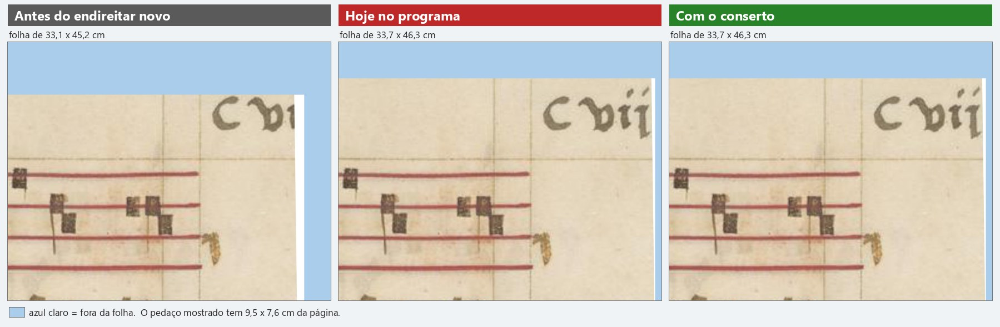

*O canto de cima, à direita, de perto. Sempre nesta ordem: como era antes do endireitar novo, como sai hoje, como sai com o conserto.*

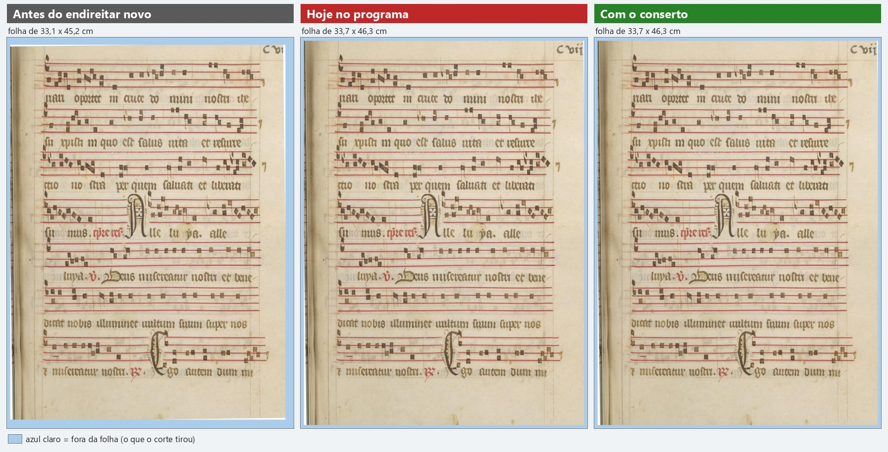

*A página inteira nas três versões: as duas da direita são idênticas.*

### Marial 7: página do gabarito, idêntica

**O que olhar:** As duas imagens da direita: são a mesma, ponto por ponto.

Esta é uma das páginas que você aprovou em 12/10. Com o conserto ela sai idêntica à de hoje, ponto por ponto. O mesmo vale para todas as páginas do gabarito.

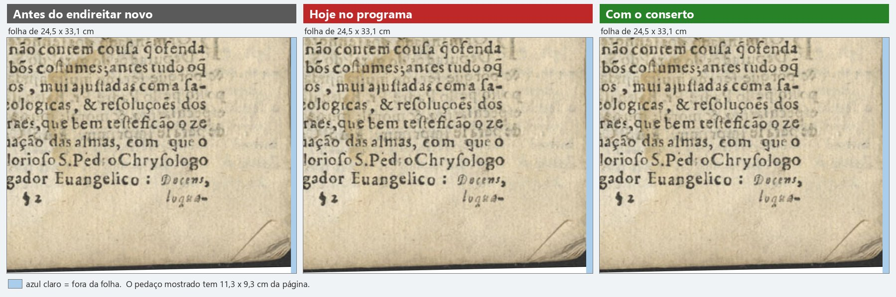

*O canto de baixo, à direita, de perto. Sempre nesta ordem: como era antes do endireitar novo, como sai hoje, como sai com o conserto.*

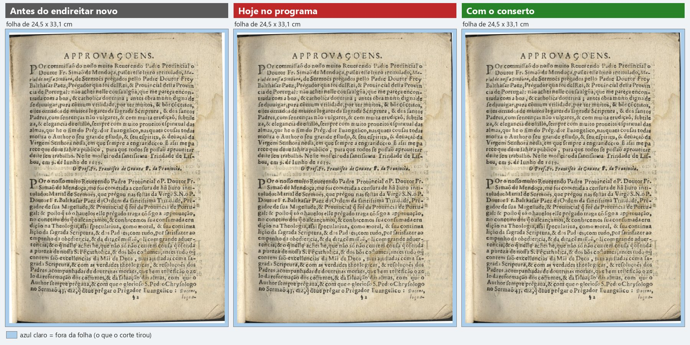

*A página inteira nas três versões.*

## Velocidade

O conserto não deixou o programa mais lento de um jeito que dê para medir. Abrir o livro de 300 folhas: 57,5 s hoje, 59,0 s com o conserto. Trocar de página: 2,52 s e 2,59 s. Uma medida passou da variação entre rodadas iguais desta tarde: Processar 10 páginas em Preto e branco (+2,0 s). Fui medir direto nessas mesmas 10 páginas: o conserto custa 0,05 s nas dez, somadas. Então essa diferença não vem do conserto: é o PC, que não estava igual em todas as rodadas.

Teste de velocidade do programa com o Marial de 300 folhas, o programa de hoje (`fase-1`) contra o ramo do conserto, alternando. Cada rodada repete tudo 3 vezes; o número é o valor do meio.

| Rodada | Programa | Hora | Processador antes | Memória livre antes | Outro agente rodando | Abrir o livro | Trocar de página | Mágico pro, 10 pág. | Preto e branco, 10 pág. | Durou |
|---|---|---|---|---|---|---|---|---|---|---|
| antes-1 | hoje (1d37f8f) | 13:33 | 6% | 5,3 GB | SIM (não entra na conta) | 70,8 s | 2,50 s | 77,5 s | 31,9 s | 14,5 min |
| depois-1 | conserto (d97b937) | 13:58 | 4% | 3,9 GB | não | 57,9 s | 2,54 s | 59,5 s | 29,1 s | 12,8 min |
| antes-2 | hoje (1d37f8f) | 14:11 | 6% | 4,3 GB | não | 60,0 s | 2,64 s | 59,6 s | 27,4 s | 12,8 min |
| depois-2 | conserto (d97b937) | 14:24 | 6% | 4,5 GB | não | 60,0 s | 2,63 s | 60,9 s | 28,9 s | 12,9 min |
| antes-3 | hoje (1d37f8f) | 14:38 | 2% | 6,1 GB | não | 55,0 s | 2,40 s | 56,0 s | 26,6 s | 11,7 min |

A comparação, só com as rodadas em que o outro agente não estava rodando (média dos valores do meio):

| Medida | Hoje | Com o conserto | Diferença | Variação entre rodadas iguais (hoje / conserto) |
|---|---|---|---|---|
| Abrir o livro (300 folhas) | 57,5 s | 59,0 s | +1,5 s (+2,5%) | 5,0 s / 2,1 s |
| Trocar de página (média de 20) | 2,52 s | 2,59 s | +0,07 s (+2,7%) | 0,24 s / 0,09 s |
| Trocar de página (a pior das 20) | 3,71 s | 4,01 s | +0,30 s (+8,2%) | 0,39 s / 0,00 s |
| Processar 10 páginas em Mágico pro | 57,8 s | 60,2 s | +2,4 s (+4,2%) | 3,6 s / 1,4 s |
| Processar 10 páginas em Preto e branco | 27,0 s | 29,0 s | +2,0 s (+7,4%) | 0,7 s / 0,2 s |

Com todas as rodadas, inclusive a atrapalhada: Abrir o livro (300 folhas): 61,9 s e 59,0 s; Trocar de página (média de 20): 2,51 s e 2,59 s; Trocar de página (a pior das 20): 3,74 s e 4,01 s; Processar 10 páginas em Mágico pro: 64,4 s e 60,2 s; Processar 10 páginas em Preto e branco: 28,6 s e 29,0 s.

Como ler: a rodada antes-1 foi atrapalhada (outro agente começou a medir tempo no meio dela; ela saiu com 70,8 s para abrir o livro e 77,5 s no Mágico pro) e não entra na conta; por isso rodei uma terceira do programa de hoje (antes-3). A antes-3 pegou o PC mais folgado (6 GB livres, processador a 2%) e foi a mais rápida em tudo. Só confiro o outro agente no começo e no fim de cada rodada: se ele rodou alguma coisa no meio das outras, eu não vi. Em 12/10, no mesmo teste, rodadas iguais variaram de 4,7 a 6,3 s para abrir o livro, de 0,2 a 0,3 s para trocar de página, de 3,0 a 16,6 s no Mágico pro e de 2,1 a 5,7 s no Preto e branco. Medida direta nas 10 páginas que o teste processa (Marial 146 a 155): 4 delas giram; o conserto soma 0,05 s nas dez e muda o corte de uma só (a 153, 4 pontos mais estreita). O PDF de saída em Mágico pro tem 70,68 MB hoje e 70,69 MB com o conserto.

Medida direta da busca do corte, nas 43 páginas que giram: o conserto custa 20 milésimos de segundo a mais por página (valor do meio; a pior, 74). O implementador mediu 18. É uma vez por página.

## O que não conferi

- Nenhum livro inteiro: são 89 páginas soltas de 19 livros.
- Não abri a janela do programa; tudo por linha de comando, a 300 DPI, sem filtro.
- Só há uma página de cartão escuro (Pesel 21): não sei como ficam as outras páginas desse tipo.
- A regra do conserto que o próprio implementador chama de mais frágil (pedaço grande colado na beirada, limite de 20%) só foi vista nas 43 páginas que giram.
- Não li o código do conserto linha por linha como revisor; conferi o resultado.

## Arquivos

- `conferencia.json`: o resumo e os dez quadros para a página do Samuel.
- `img/cg6-*.jpg`: de perto e página inteira das dez que mudam, do Graduale 221 e do Marial 7; `cg6-identicas-01` a `07`: as 19 páginas do gabarito e das que tinham melhorado, nas três versões.
- `dados-hoje.json`, `dados-conserto.json`: a minha medida das 89 páginas no livro novo, com o md5 da página pronta.
- `escuro-na-beirada-mm.json`: o preto encostado em cada beirada, em milímetros.
- `velocidade/`: `rodar_uma.ps1`, `juntar.py`, `velocidade.json`, `rodadas/`, `custo-da-busca-do-corte.json`.
- `scripts/`: `medir_conserto.py`, `quadros.py`, `regioes.json`, `relatorio_conserto.py`.
