# O corte depois do "endireitar antes de cortar" (G6): onde piorou

Conferência do verificador, 13/10/2026. Investigação: **nada do programa foi mudado.** Quem decide o que fazer é o Samuel.

## Em uma frase

**No livro novo o corte ficou pior em 6 das 89 páginas conferidas: em 4 sobra uma faixa preta larga do scanner que antes era cortada (de 1,6 a 4,4 cm a mais), em 1 o corte come os números dos itens na margem, e em 1 sobra um fio escuro de 2 mm.** As 5 graves estão todas fora das páginas-gabarito, por isso não apareceram na aprovação de 12/10.

Das 89 páginas, 46 saem idênticas nas duas ordens (o programa não gira a página, então a ordem não muda nada). Das 43 que giram: 5 pioraram de verdade, 1 piorou pouco, 1 piorou num ponto já anotado no plano (Escola 7), 8 melhoraram, 1 mudou muito sem perder nada (Rariora 155) e as outras 27 ficaram iguais ou quase iguais.

**Projeto antigo: não tem o defeito.** Em 40 de 40 casos conferidos, o projeto gravado pelo programa de antes do G6 sai, no programa de hoje, idêntico ponto por ponto.

## As páginas em que piorou

"Faixa escura" é quanto da página é mancha escura encostada na beirada (a mesma conta do aviso "Faixa escura na beirada"). "Tinta de fora" é quanto do que está impresso fica fora do corte. Sempre ordem antiga → ordem nova. Tamanho em milímetros.

| Página | Veredito (olho) | O que mudou | Faixa escura | Tinta de fora | Tamanho da folha | No gabarito |
|---|---|---|---|---|---|---|
| Matemática 32 | PIOROU | Faixa preta larga do scanner à direita, que a ordem antiga cortava. A folha fica 4,4 cm mais larga só de preto. (O preto de baixo sobra nas duas ordens.) | 18,4% → 31,5% | 0,01% → 0,01% | 165 × 297 → 209 × 290 | não |
| Cursus 3 | PIOROU | Faixa preta de 1,6 cm à direita e de 0,6 cm embaixo, que a ordem antiga cortava. A linha preta da esquerda fica nas duas. | 0,5% → 7,5% | 0,12% → 0,03% | 201 × 268 → 212 × 279 | não |
| Antiphon 260 | PIOROU | A faixa preta de baixo passa de 2,1 cm para 4,9 cm. | 3,2% → 7,6% | 0,00% → 0,00% | 464 × 590 → 463 × 618 | não |
| Antiphon 88 | PIOROU | A faixa preta da direita passa de 0,9 cm para 2,8 cm. (Há preto em volta nas duas ordens.) | 8,5% → 12,6% | 0,00% → 0,00% | 438 × 621 → 456 × 624 | não |
| Escola 197 | PIOROU | O corte come os números 1, 2 e 3 dos itens, na margem esquerda. Na ordem antiga eles saíam inteiros. | 0,0% → 0,0% | 0,03% → 0,28% | 160 × 243 → 155 × 243 | não |
| Camões 104 | piorou pouco | Aparece um fio escuro de 2 mm à esquerda e de menos de 1 mm à direita, que a ordem antiga não deixava. | 0,5% → 2,7% | 0,01% → 0,01% | 93 × 132 → 95 × 131 | não |
| Escola 7 | piorou (já conhecido) | O título fica a 1 mm da borda de cima (na ordem antiga sobravam 18 mm de papel, com um risco do scanner no alto). Nada impresso se perde. Já está anotado no plano (12/10) como "título colado na borda de cima". | 0,0% → 0,0% | 0,12% → 1,81% | 165 × 264 → 165 × 246 | sim |
| Camões 6 | quase igual | Quase igual. Aparece um fio escuro de 1,3 mm em cima; o da esquerda já existia. | 1,0% → 1,9% | 0,00% → 0,00% | 92 × 130 → 92 × 130 | não |
| Camões 66 | quase igual | Troca: somem as cunhas brancas dos cantos e o fio escuro de baixo; aparece um fio escuro de 1,4 mm à esquerda. | 0,2% → 0,9% | 0,12% → 0,04% | 91 × 131 → 92 × 130 | não |
| Horas 11 | igual (a conta errou) | Ao olho as duas são iguais (na nova somem as cunhas brancas). A conta contou como "faixa" a pintura da moldura, que chega perto da beirada. | 4,8% → 8,2% | 0,07% → 0,07% | 313 × 477 → 311 × 477 | sim |
| Rariora 155 | mudou muito | A folha fica 3,5 cm mais curta: o papel em branco de baixo foi cortado e a moldura da gravura fica a 1 mm da borda. Nada impresso se perde. Para o Samuel olhar. | 0,0% → 0,0% | 0,04% → 0,03% | 133 × 148 → 133 × 113 | não |

Como ler: as seis primeiras linhas são as que pioraram. A Escola 7 já está anotada no plano. Camões 6 e 66 a conta acusou, mas ao olho é troca de um defeito pequeno por outro. Horas 11 a conta errou. Rariora 155 a conta deu "igual", mas a folha mudou muito de tamanho.

## As imagens das que pioraram

Todas sem filtro (só o corte e o giro), a 300 DPI, na mesma escala dos dois lados.

### Matemática 32

**O que olhar:** A faixa preta à direita, que só existe na ordem nova.

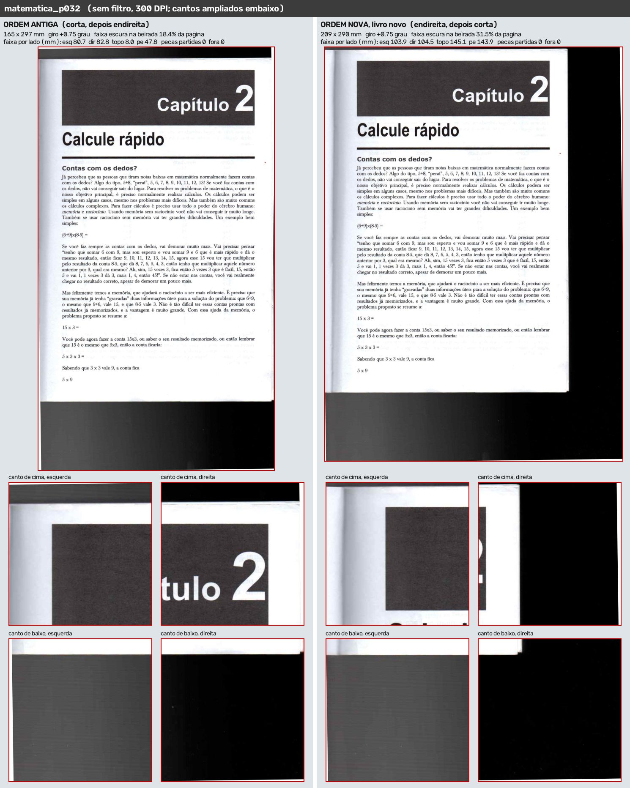

*Matemática 32: ordem antiga à esquerda, ordem nova (livro novo) à direita; embaixo, os quatro cantos ampliados.*

### Cursus 3

**O que olhar:** A faixa preta à direita e a de baixo, que só existem na ordem nova. É a página do achado.

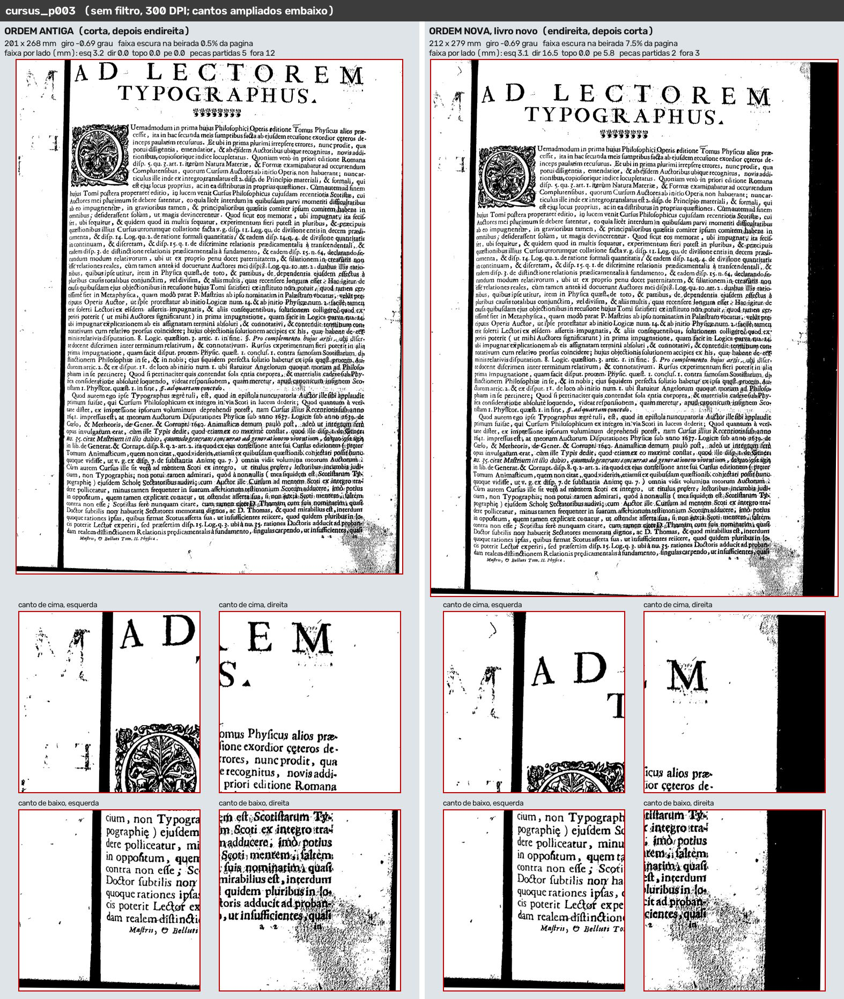

*Cursus 3: ordem antiga à esquerda, ordem nova (livro novo) à direita; embaixo, os quatro cantos ampliados.*

### Antiphon 260

**O que olhar:** A faixa preta de baixo, bem mais alta na ordem nova.

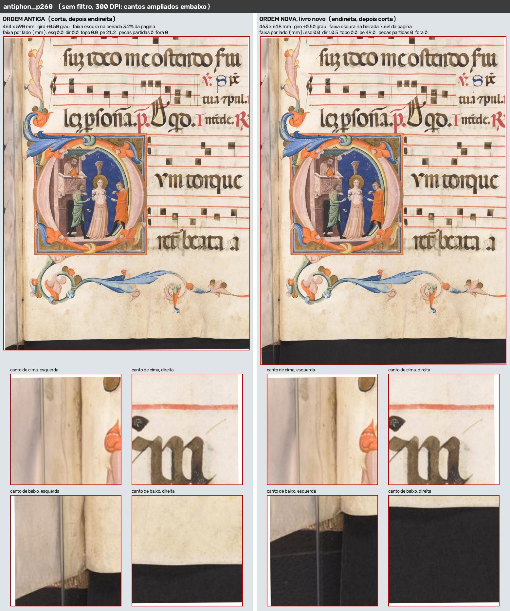

*Antiphon 260: ordem antiga à esquerda, ordem nova (livro novo) à direita; embaixo, os quatro cantos ampliados.*

### Antiphon 88

**O que olhar:** A faixa preta da direita, mais larga na ordem nova.

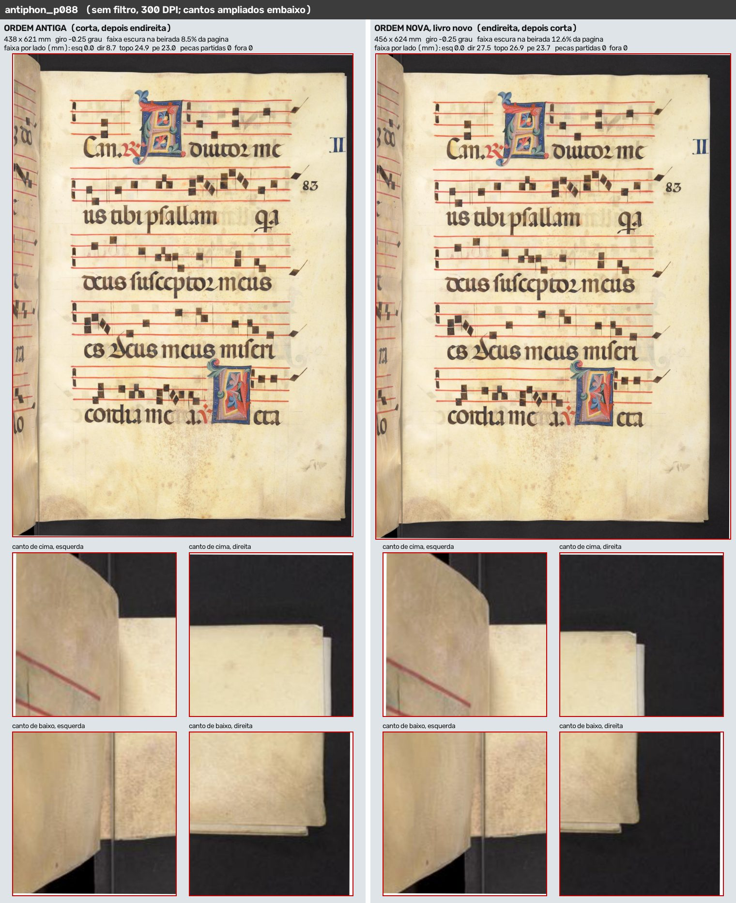

*Antiphon 88: ordem antiga à esquerda, ordem nova (livro novo) à direita; embaixo, os quatro cantos ampliados.*

### Escola 197

**O que olhar:** A margem esquerda: os números 1, 2 e 3 somem na ordem nova (só fica o travessão).

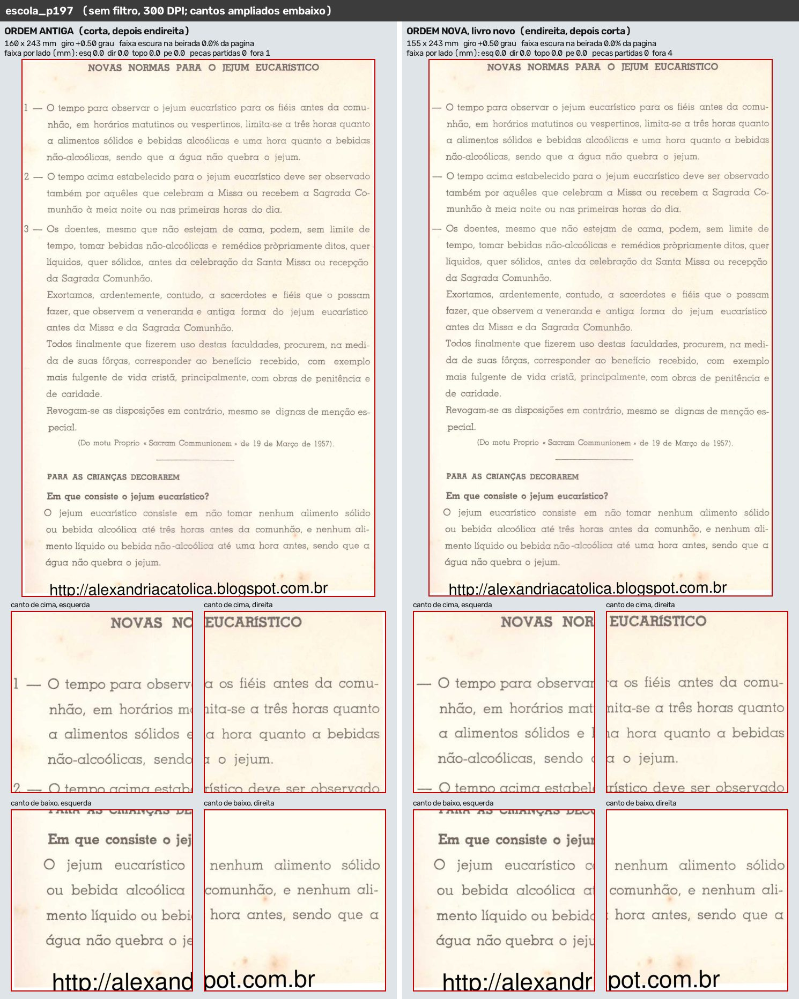

*Escola 197: ordem antiga à esquerda, ordem nova (livro novo) à direita; embaixo, os quatro cantos ampliados.*

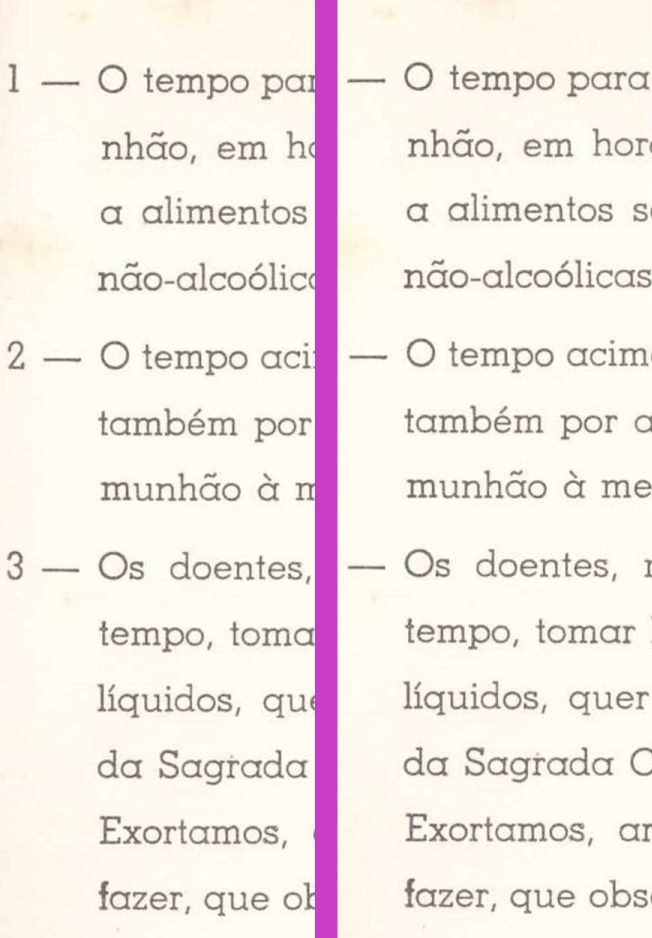

*Escola 197, a margem esquerda de perto. À esquerda a ordem antiga (com os números); à direita a nova (sem eles).*

### Camões 104

**O que olhar:** O fio escuro colado na borda esquerda, só na ordem nova.

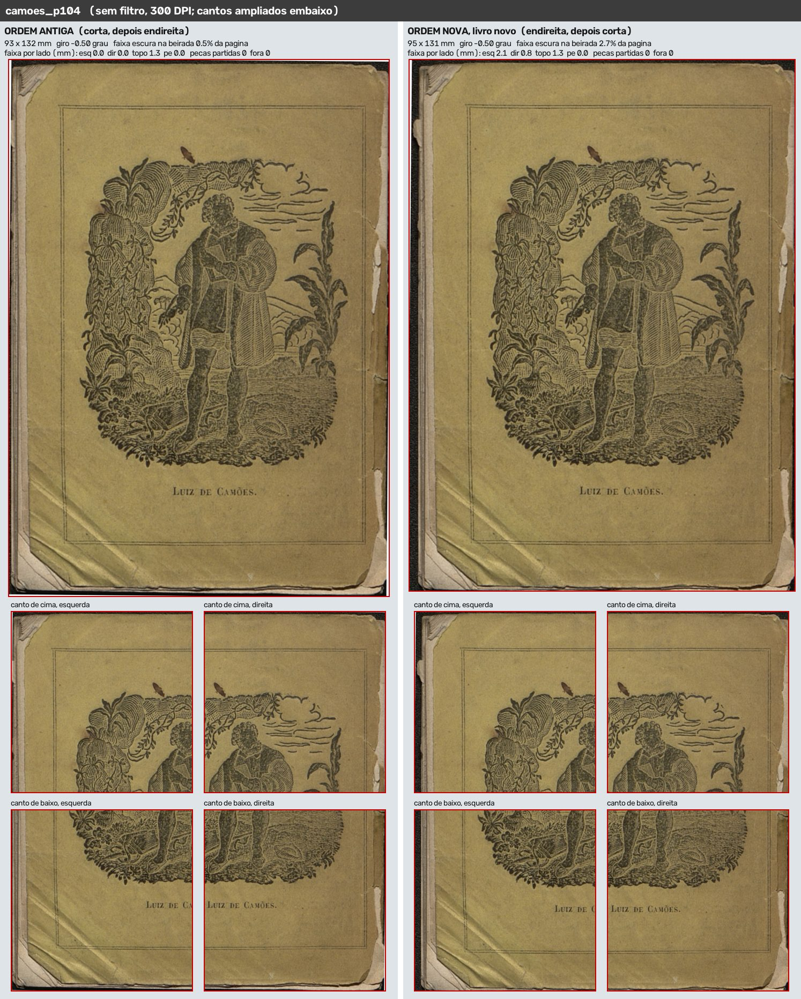

*Camões 104: ordem antiga à esquerda, ordem nova (livro novo) à direita; embaixo, os quatro cantos ampliados.*

## As outras cinco que a conta ou o olho separaram

### Escola 7

**O que olhar:** O título no alto: colado na borda na ordem nova.

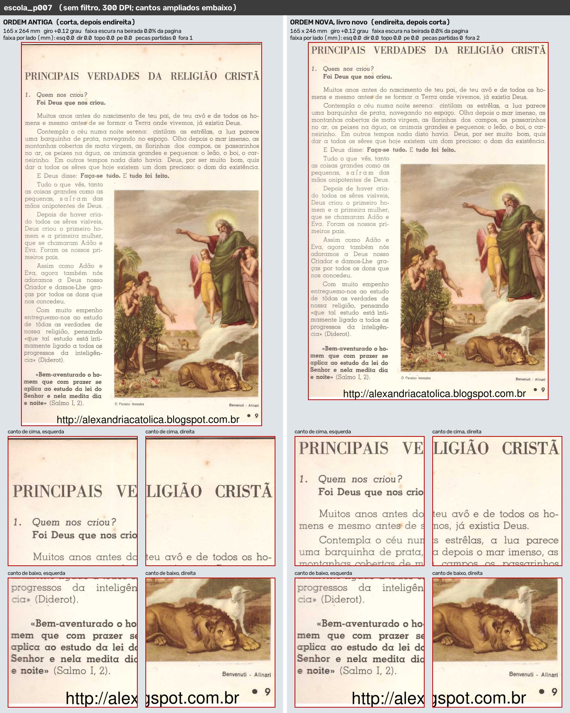

*Escola 7: ordem antiga à esquerda, ordem nova (livro novo) à direita; embaixo, os quatro cantos ampliados.*

### Camões 6

**O que olhar:** O fio escuro no alto, só na ordem nova. O resto é igual.

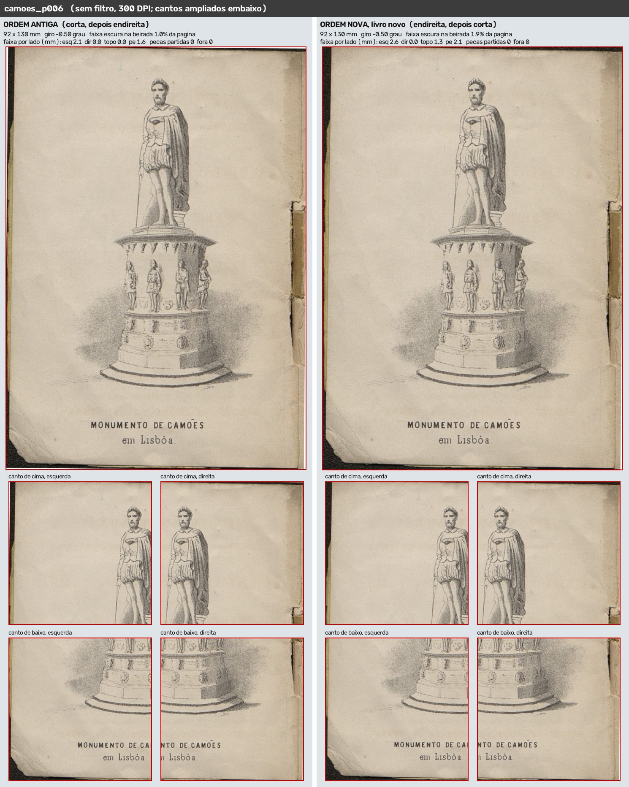

*Camões 6: ordem antiga à esquerda, ordem nova (livro novo) à direita; embaixo, os quatro cantos ampliados.*

### Camões 66

**O que olhar:** Os cantos: cunha branca na antiga, fio escuro à esquerda na nova.

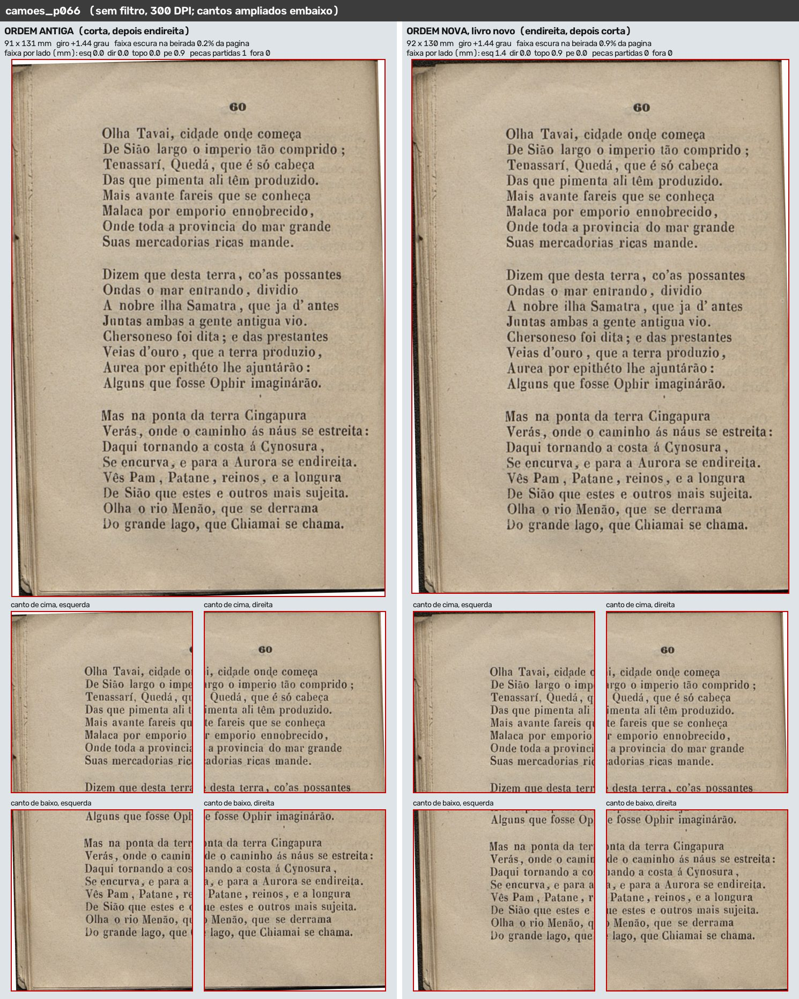

*Camões 66: ordem antiga à esquerda, ordem nova (livro novo) à direita; embaixo, os quatro cantos ampliados.*

### Horas 11

**O que olhar:** As duas são iguais ao olho; a conta errou aqui.

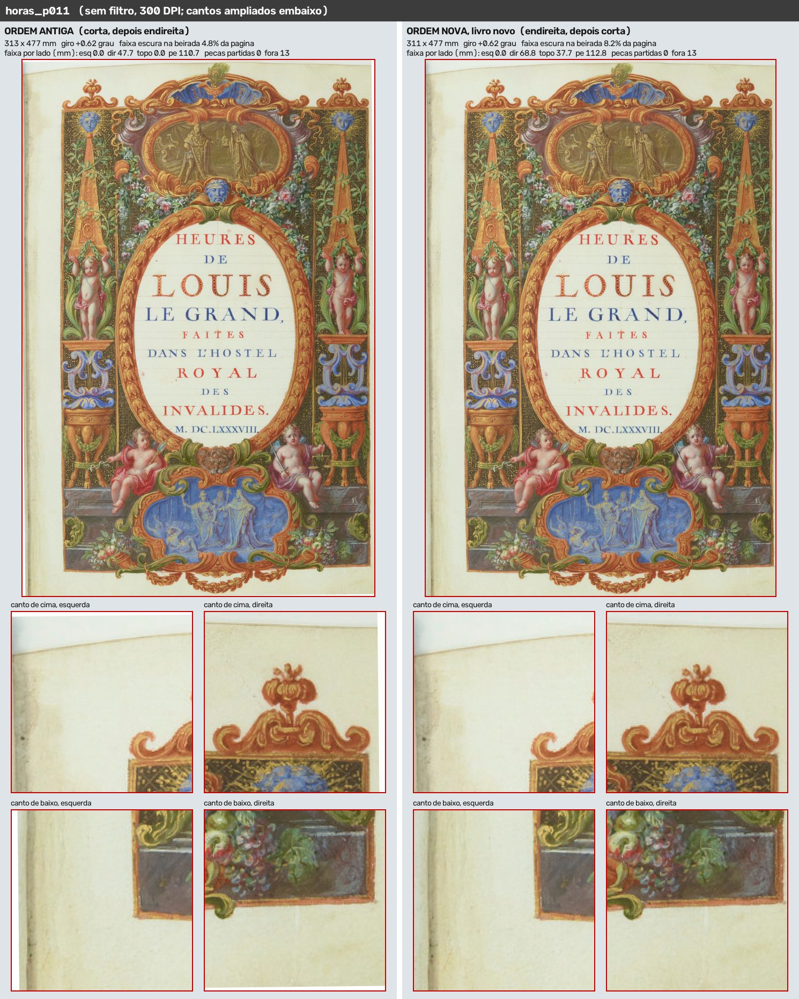

*Horas 11: ordem antiga à esquerda, ordem nova (livro novo) à direita; embaixo, os quatro cantos ampliados.*

### Rariora 155

**O que olhar:** A parte de baixo: na ordem nova o papel em branco foi cortado.

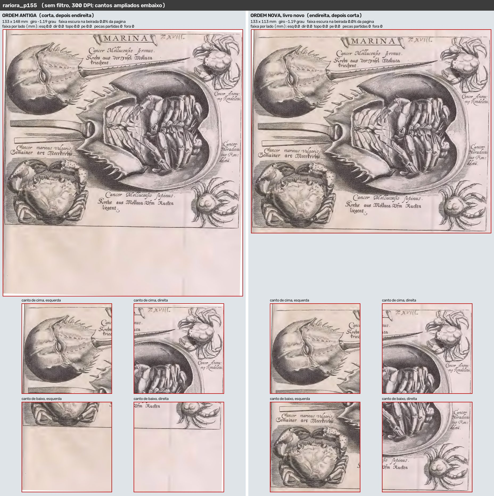

*Rariora 155: ordem antiga à esquerda, ordem nova (livro novo) à direita; embaixo, os quatro cantos ampliados.*

## As que mais melhoraram (para comparar)

| Página | O que melhorou | Tinta de fora | Tamanho da folha |
|---|---|---|---|
| Boécio 22 | O título deixa de ficar colado na borda de cima. | 0,13% → 0,01% | 83 × 118 → 83 × 122 |
| Egenloff 3 | Um pouco menos de preto e de cunha branca à esquerda. Quase igual. | 0,26% → 0,30% | 346 × 454 → 338 × 454 |
| Graduale 221 | O número da folha ("Cvij") sai inteiro; na antiga o giro cortava o fim dele. Somem as cunhas brancas de cima e de baixo. | 0,20% → 0,03% | 331 × 452 → 337 × 463 |
| Graduale 223 | O número da folha ("Cviij") sai inteiro; na antiga saía cortado. | 0,01% → 0,00% | 335 × 445 → 337 × 462 |
| Graduale 588 | Mais margem em volta; os enfeites de pena da inicial saem inteiros. Fica uma cunha branca fina à direita. | 0,24% → 0,12% | 306 × 451 → 312 × 472 |
| Horas 13 | Somem as cunhas brancas; mais papel embaixo. | 0,08% → 0,02% | 352 × 492 → 351 × 501 |
| Rhetorica 73 | O fio da moldura, à esquerda e embaixo, sai inteiro (na antiga saía cortado). | 0,63% → 0,00% | 136 × 197 → 137 × 199 |
| Siebmacher 9 (direita) | Um pouco menos de preto em cima. Fica uma cunha branca fina à direita. | 0,01% → 0,01% | 60 × 106 → 60 × 105 |

### Rhetorica 73

**O que olhar:** O fio da moldura, à esquerda e embaixo, sai inteiro (na antiga saía cortado).

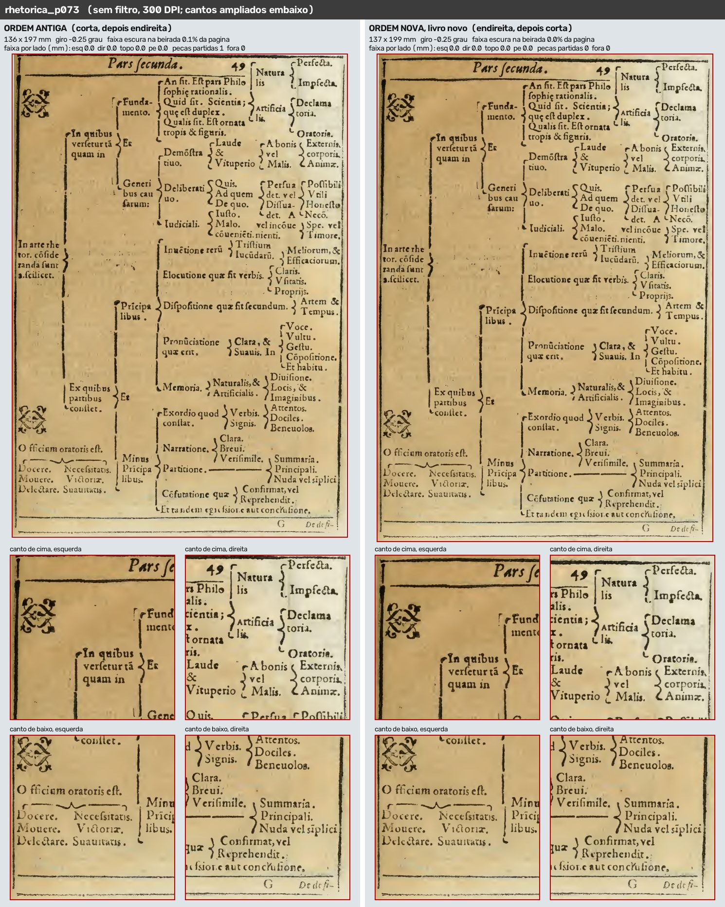

*Rhetorica 73: ordem antiga à esquerda, ordem nova (livro novo) à direita; embaixo, os quatro cantos ampliados.*

### Graduale 221

**O que olhar:** O número da folha ("Cvij") sai inteiro; na antiga o giro cortava o fim dele. Somem as cunhas brancas de cima e de baixo.

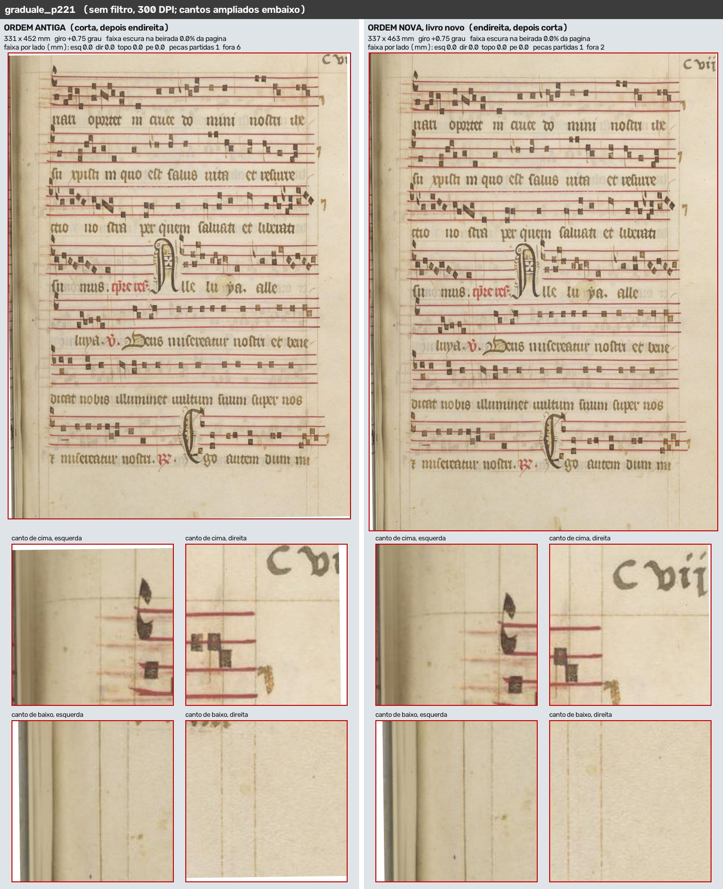

*Graduale 221: ordem antiga à esquerda, ordem nova (livro novo) à direita; embaixo, os quatro cantos ampliados.*

### Graduale 588

**O que olhar:** Mais margem em volta; os enfeites de pena da inicial saem inteiros. Fica uma cunha branca fina à direita.

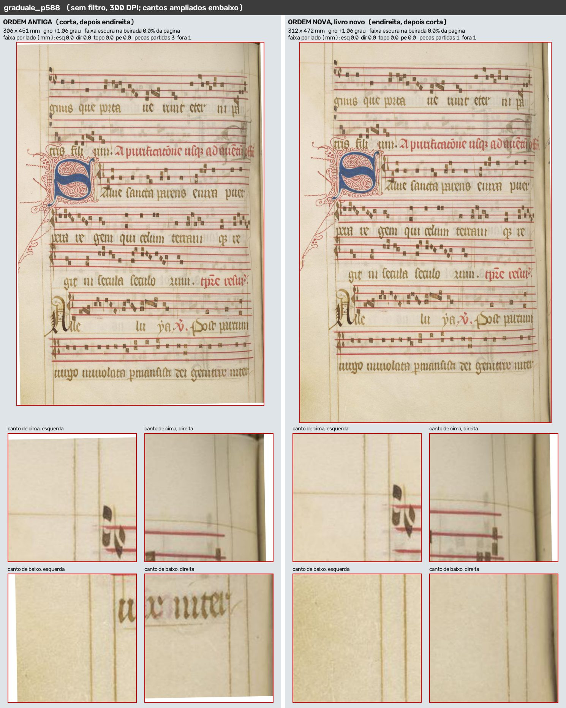

*Graduale 588: ordem antiga à esquerda, ordem nova (livro novo) à direita; embaixo, os quatro cantos ampliados.*

### Boécio 22

**O que olhar:** O título deixa de ficar colado na borda de cima.

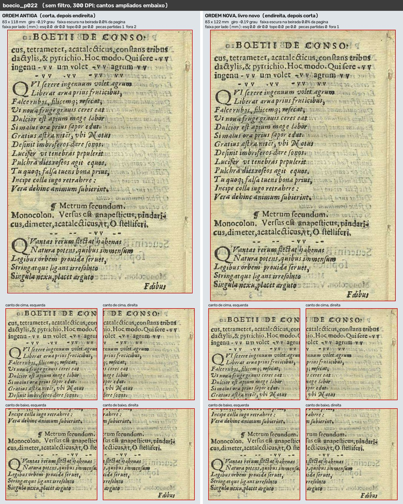

*Boécio 22: ordem antiga à esquerda, ordem nova (livro novo) à direita; embaixo, os quatro cantos ampliados.*

### Siebmacher 9 (direita)

**O que olhar:** Um pouco menos de preto em cima. Fica uma cunha branca fina à direita.

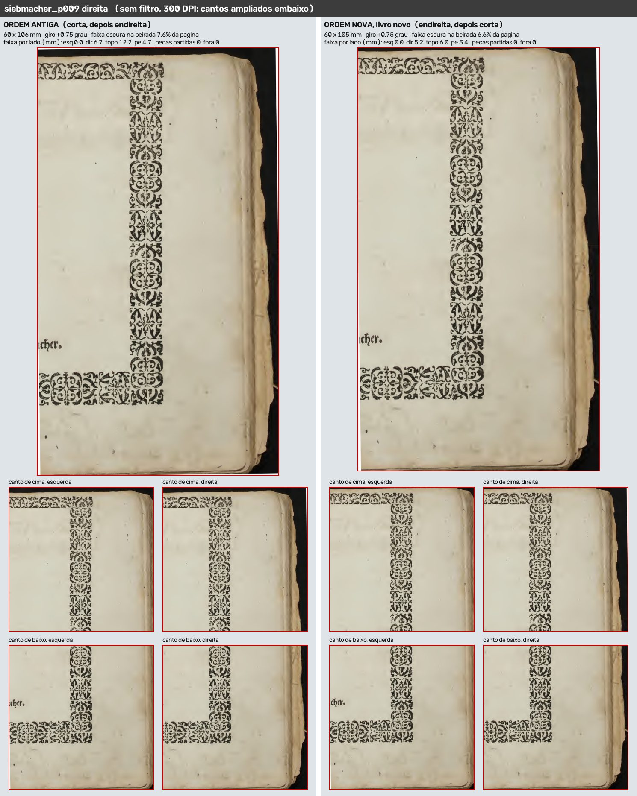

*Siebmacher 9 (direita): ordem antiga à esquerda, ordem nova (livro novo) à direita; embaixo, os quatro cantos ampliados.*

## A causa

São duas causas diferentes. Nenhuma foi consertada.

### Causa 1: o branco do giro esconde a borda preta do scanner (Cursus 3, Matemática 32, Antiphon 88 e 260, Camões 104)

Na ordem nova o programa gira a página inteira e **só depois** procura o corte nela. O giro mantém o tamanho da folha e pinta de **branco** as cunhas que sobram nos cantos e nas beiradas. Esse branco fica entre a beirada da imagem e a borda preta do scanner. A busca do corte foi feita para a borda preta **encostada** na beirada, e deixa de reconhecê-la:

- `core/pipeline.py`, função `_geometria_endireitando_antes`, linhas 759 a 761: `reta = rotacionar(em_cinza(), angulo)` e logo `recorte = detectar_bordas(reta, dpi=dpi).tupla`.
- `core/endireitar.py`, função `rotacionar`, linhas 120 a 134: `borderMode=cv2.BORDER_CONSTANT, borderValue=borda` (branco, 255).
- `core/recortar.py`, função `_apagar_bordas_solidas`, linhas 745 a 779: anda **a partir da coluna de fora** enquanto a coluna for 80% escura ou mais (`while x < limite_x and limpa[:, x].mean() >= FRACAO_BORDA_SOLIDA`). Com a cunha branca, a coluna de fora já não chega a 80% e o laço para na primeira: a faixa preta não é apagada e passa a contar como conteúdo.
- `core/recortar.py`, `_faixa_com_a_tinta`, linhas 198 a 212: onde o fundo preto é liso (Antiphon), a cunha branca em cima do preto cria "tinta" nova bem na beirada, e a caixa do corte vai até o fim da folha.
- Na ordem antiga havia ainda uma trava que a nova não usa: `alargar_para_o_giro` com `_parar_no_escuro` (`core/recortar.py`, linhas 602 e 685), que nunca deixava a folga do giro trazer o fundo escuro.

Os números, medidos na máscara de tinta que o próprio corte usa (`causa.json`):

| Página | Lado | Página como veio | Página já endireitada |
|---|---|---|---|
| Cursus 3 | direita | coluna de fora 100% escura; 45 colunas apagadas como borda | coluna de fora 73%; nenhuma apagada |
| Matemática 32 | direita | coluna de fora 100% escura; 100 colunas apagadas | coluna de fora 71%; nenhuma apagada |
| Camões 104 | esquerda | coluna de fora 89%; 12 colunas apagadas | coluna de fora 76%; nenhuma apagada |
| Antiphon 260 | embaixo | 0% de tinta nas 8 linhas de fora | cerca de 40% de tinta nas 8 linhas de fora |
| Antiphon 88 | direita | 0% de tinta nas 8 colunas de fora | cerca de 40% de tinta nas 8 colunas de fora |

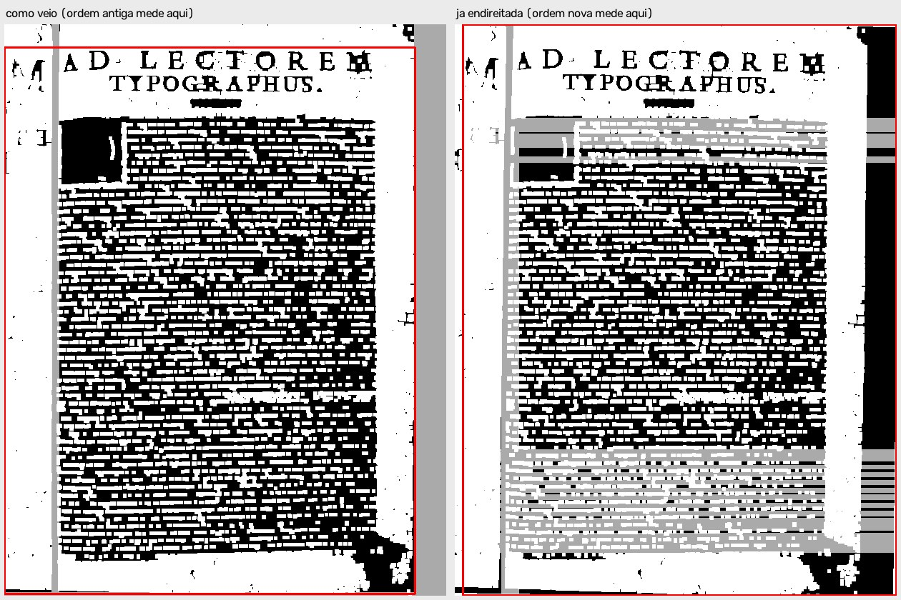

*Cursus 3, o que o corte enxerga. Preto = tinta que conta; cinza = o que ele jogou fora; vermelho = o corte. À esquerda (página como veio) a faixa da direita está cinza, jogada fora. À direita (já endireitada) ela está preta, contando como conteúdo, e o corte vai até a beirada.*

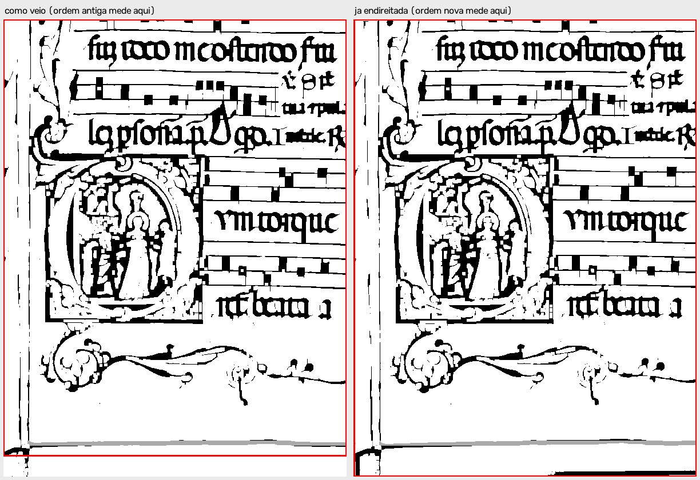

*Antiphon 260. Na página já endireitada aparece um risco de tinta na beirada de baixo (o encontro do preto com a cunha branca), e o corte desce até o fim.*

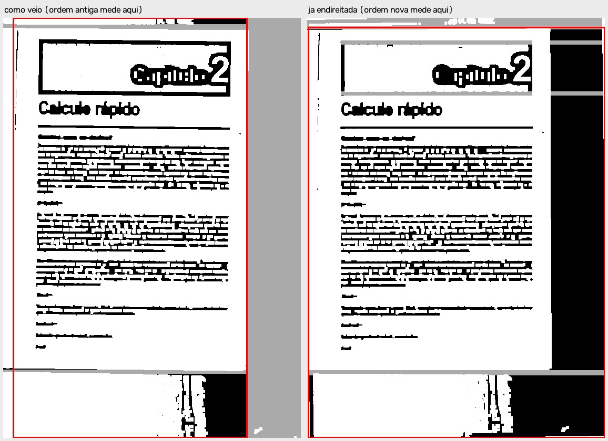

*Matemática 32. A faixa da direita: cinza (jogada fora) na página como veio, preta (conteúdo) na endireitada.*

Achado ao lado, na mesma imagem do Cursus 3: com a faixa preta contando como tinta, várias **linhas de texto** passam a ser apagadas da máscara como se fossem "risca de dobra" (as tiras cinza em cima do texto, à direita). Nesta página isso não mudou o corte, mas é um risco: `_apagar_riscas_de_dobra`, `core/recortar.py`, linhas 782 a 826. Não vi isso cortar texto em nenhuma das páginas conferidas.

**Prova de que a causa é essa (experiência, não é conserto):** medi o corte de novo girando a página com a cunha preenchida pela própria beirada, em vez de branco, só para a medida. A faixa some nas cinco páginas: Cursus 3 de 7,4% para 1,0% (antiga 0,5%); Matemática 32 de 31,5% para 18,7% (antiga 18,4%); Antiphon 260 de 7,6% para 3,5% (antiga 3,2%); Antiphon 88 de 12,6% para 8,7% (antiga 8,5%); Camões 104 de 2,7% para 1,1% (antiga 0,5%). **Mas essa troca simples piora outras páginas** (Camões 66, Boécio 3 e Graduale 221 perdem mais tinta; Egenloff 3 ganha preto; Graduale 222 muda muito de largura), então não serve como está. Números em `experiencia-cunha.json`; não abri imagens dessa experiência.

### Causa 2: a página reta faz o corte jogar fora os números da margem (Escola 197)

Aqui não há borda preta. O corte descarta, de cada lado, os primeiros 0,2% da tinta da página, para a sujeira da margem não segurar o corte (`core/recortar.py`, `SOBRA_DE_TINTA = 0.002`, linha 175, usada em `_faixa_com_a_tinta`, linhas 198 a 212). Os três números ("1", "2", "3") somam **0,197%** da tinta da página, logo abaixo do limite. Na página torta eles se espalham por 8 colunas e o limite cai no meio deles; aí a regra de "não partir peça" (`_nao_partir_pecas`, linha 537) puxa o corte e eles entram. Na página reta eles ficam alinhados em 7 colunas, cabem inteiros nos 0,2% descartados, e a peça que está inteira do lado de fora não puxa o corte. A fraqueza é da regra dos 0,2%, e existe nas duas ordens; a ordem antiga escapava por um triz.

A Escola 7 (título a 1 mm do alto) é parecida: na página reta o risco do scanner do alto é apagado inteiro, e o corte encosta no título com a folga mínima de 1 mm (`FOLGA_MM`).

## Projeto antigo

**Não aparece.** Conferido por máquina de dois jeitos:

1. Rodei o programa de **antes** do G6 (commit `7485e1b`, tirado do git para uma pasta temporária) em 20 páginas, incluindo todas as que pioraram, de duas formas (endireitar pela conta do ScanTailor e pela conta do programa), e gravei cada projeto como aquele programa gravava, sem o campo `ordem_do_preparo`. Abri esses projetos no programa de hoje: a ordem volta "cortar_antes" e a página sai **idêntica ponto por ponto em 40 de 40** (`projeto-antigo.json`).
2. Nas 89 páginas, o preparo antigo (colunas A e B do `dados.json`) não tem a faixa: Cursus 3 fica em 0,5%.

Ressalva: conferi pela conta do programa (`Projeto.de_dicionario` e `renderizar_pagina`), não abrindo o projeto pela janela.

## O que sugiro (sem fazer)

1. **Não desfazer o G6 inteiro.** Ele conserta coisas de verdade (números de folha do Graduale inteiros, cunhas brancas que somem, fio de moldura inteiro). O defeito é só em página torta **com borda preta de scanner**, e num caso de número pequeno na margem.
2. **Passar a causa 1 ao implementador como bug que impede**: livro novo com borda preta sai com faixa preta larga. O conserto é dele; a experiência acima mostra onde está o problema e que a troca mais simples não basta.
3. **Causa 2 (números da margem):** pôr na Lista de bugs. É da regra dos 0,2%, não da ordem; pode ser o caso de esperar a caixa do conteúdo do ScanTailor (itens 2.5 e 2.13), que substitui essa busca.
4. **Teste de máquina que falta:** página torta com borda preta, na ordem nova. Hoje `tests/test_ordem_do_preparo.py` não tem nenhum caso com borda preta.
5. **Gabarito do corte:** as 5 páginas graves estão fora das 32. Sugiro incluir Cursus 3, Matemática 32, Antiphon 260 e Escola 197.
6. **Enquanto não consertar:** o aviso "Faixa escura na beirada" do "Para revisar" pega esses casos (pegou o Cursus 3), e o corte à mão na aba Bordas resolve página a página.

## Como foi conferido

| O quê | Máquina ou olho | Como |
|---|---|---|
| Medidas das 89 páginas nas duas ordens | máquina | O programa de verdade (`renderizar_pagina`), 300 DPI, sem filtro, três preparos: A = antigo (corta antes, conta do programa), B = corta antes com o ângulo do livro novo, C = livro novo. A comparação B → C isola a ordem. |
| Separar em melhorou, igual, piorou | máquina, depois olho | A conta separou 10 pioras e 7 melhoras; o olho corrigiu (ver tabela). |
| Imagens lado a lado | olho | Abri as 23: as 10 que a conta acusou, as 7 que ela deu como melhora e mais 6 que as folhas de contato mostraram diferentes. |
| As 43 páginas que giram, todas | olho | 11 folhas de contato (antiga e nova lado a lado, pequenas): abri todas. |
| Causa | máquina + olho | Passo a passo do corte na página como veio e na endireitada (`causa.py`), em 8 páginas; abri 3 das imagens. |
| Projeto antigo | máquina | Programa de antes do G6 contra o de hoje, 40 casos. |

## O que não conferi

- **Só 89 páginas soltas** (de 1 a 10 por livro, 19 livros). Não rodei nenhum livro inteiro, então não sei em quantas páginas de um livro com borda preta o defeito aparece. Pelo que vi, toda página torta com borda preta larga encostada na beirada está sujeita.
- **Não abri a janela do programa.** Tudo foi por linha de comando, a 300 DPI (a resolução do PDF). A prévia da tela usa o mesmo corte guardado, mas não conferi na tela.
- **Não rodei a suíte de testes nem o teste de velocidade:** não mudei código.
- **Os outros filtros.** Medi sem filtro. A conta "faixa no Preto e branco" do `dados.json` usa o Preto e branco de fábrica direto, sem a marcação de gravura do programa.
- **A conta de "tinta de fora" é minha**, feita na página reduzida a 2000 pontos (erro de uns 0,2 mm). Conta como conteúdo qualquer tinta que não encosta na beirada, inclusive risco de scanner (foi o que fez a Escola 7 parecer perder 1,7%: era o risco do alto, não texto).
- **Rariora 155:** não investiguei por que a ordem antiga guardava o papel em branco de baixo.
- **Diferenças que vêm da conta do ângulo, e não da ordem** (colunas A → C: Horas 16 e Egenloff 3 mudam porque o ScanTailor mede outro ângulo): fora desta tarefa, não olhei.
- **A experiência da cunha** foi medida em cópias JPEG das páginas, só por número.
- Das imagens de causa, abri Cursus 3, Antiphon 260 e Matemática 32; as outras cinco estão na pasta sem eu ter aberto.

## As 43 páginas que giram no livro novo, uma por uma

As outras 46 páginas não giram e saem idênticas. "Conta" é o que a máquina separou; "olho" é o que vi.

| Página | Giro | Conta | Olho | Faixa escura | Tinta de fora | Tamanho (mm) | Gabarito |
|---|---|---|---|---|---|---|---|
| Antiphon 88 | -0,25° | piorou | PIOROU | 8,5% → 12,6% | 0,00% → 0,00% | 438 × 621 → 456 × 624 | não |
| Antiphon 260 | 0,50° | piorou | PIOROU | 3,2% → 7,6% | 0,00% → 0,00% | 464 × 590 → 463 × 618 | não |
| Antiphonal 1547 6 | 0,12° | igual | igual | 0,3% → 0,6% | 0,00% → 0,00% | 65 × 105 → 65 × 106 | não |
| Antiphonal 1547 46 | 1,50° | igual | igual | 0,0% → 0,0% | 0,08% → 0,07% | 63 × 88 → 63 × 91 | não |
| Antiphonal 1547 76 | 0,25° | igual | igual | 0,4% → 0,6% | 0,05% → 0,05% | 64 × 96 → 64 × 96 | não |
| Antiphonal 1547 192 | 0,19° | igual | igual | 0,0% → 0,0% | 0,02% → 0,02% | 74 × 88 → 74 × 89 | não |
| Antiphonal 1547 252 | -1,00° | igual | igual | 0,3% → 0,4% | 0,04% → 0,02% | 65 × 96 → 65 × 100 | não |
| Boécio 3 | 0,75° | igual | igual | 0,0% → 0,0% | 0,05% → 0,05% | 88 × 123 → 88 × 128 | sim |
| Boécio 8 | -1,12° | igual | igual | 0,0% → 0,0% | 0,06% → 0,07% | 88 × 123 → 88 × 124 | sim |
| Boécio 22 | -0,19° | melhorou | melhorou | 0,0% → 0,0% | 0,13% → 0,01% | 83 × 118 → 83 × 122 | sim |
| Camões 6 | -0,50° | piorou | quase igual | 1,0% → 1,9% | 0,00% → 0,00% | 92 × 130 → 92 × 130 | não |
| Camões 9 | 0,38° | igual | igual | 2,7% → 3,0% | 0,01% → 0,01% | 94 × 131 → 94 × 131 | não |
| Camões 66 | 1,44° | piorou | quase igual | 0,2% → 0,9% | 0,12% → 0,04% | 91 × 131 → 92 × 130 | não |
| Camões 104 | -0,50° | piorou | piorou pouco | 0,5% → 2,7% | 0,01% → 0,01% | 93 × 132 → 95 × 131 | não |
| Cursus 3 | -0,69° | piorou | PIOROU | 0,5% → 7,5% | 0,12% → 0,03% | 201 × 268 → 212 × 279 | não |
| Egenloff 3 | -1,56° | melhorou | melhorou | 3,2% → 1,9% | 0,26% → 0,30% | 346 × 454 → 338 × 454 | não |
| Escola 7 | 0,12° | piorou | piorou (já conhecido) | 0,0% → 0,0% | 0,12% → 1,81% | 165 × 264 → 165 × 246 | sim |
| Escola 35 | -0,81° | igual | igual | 0,0% → 0,0% | 0,01% → 0,01% | 166 × 252 → 164 × 251 | sim |
| Escola 197 | 0,50° | piorou | PIOROU | 0,0% → 0,0% | 0,03% → 0,28% | 160 × 243 → 155 × 243 | não |
| Graduale 221 | 0,75° | melhorou | melhorou | 0,0% → 0,0% | 0,20% → 0,03% | 331 × 452 → 337 × 463 | sim |
| Graduale 222 | -0,88° | igual | igual | 0,0% → 0,0% | 0,02% → 0,02% | 272 × 446 → 266 × 466 | sim |
| Graduale 223 | 0,75° | igual | melhorou | 0,0% → 0,0% | 0,01% → 0,00% | 335 × 445 → 337 × 462 | sim |
| Graduale 269 | 1,00° | igual | igual | 0,2% → 0,4% | 0,02% → 0,01% | 338 × 477 → 338 × 476 | não |
| Graduale 588 | 1,06° | melhorou | melhorou | 0,0% → 0,0% | 0,24% → 0,12% | 306 × 451 → 312 × 472 | não |
| Horas 11 | 0,62° | piorou | igual (a conta errou) | 4,8% → 8,2% | 0,07% → 0,07% | 313 × 477 → 311 × 477 | sim |
| Horas 13 | 0,62° | melhorou | melhorou | 0,0% → 0,0% | 0,08% → 0,02% | 352 × 492 → 351 × 501 | sim |
| Marial 7 | 1,19° | igual | igual | 0,1% → 0,1% | 0,04% → 0,03% | 245 × 331 → 245 × 331 | sim |
| Matemática 32 | 0,75° | piorou | PIOROU | 18,4% → 31,5% | 0,01% → 0,01% | 165 × 297 → 209 × 290 | não |
| Matemática 72 | -0,62° | igual | igual | 32,3% → 32,0% | 0,01% → 0,01% | 210 × 297 → 210 × 295 | não |
| Opus Majus 11 | -0,25° | igual | igual | 0,0% → 0,0% | 0,00% → 0,00% | 107 × 179 → 108 × 179 | sim |
| Opus Majus 20 | 0,31° | igual | igual | 0,0% → 0,0% | 0,00% → 0,00% | 102 × 174 → 102 × 174 | sim |
| Opus Majus 165 | 0,31° | igual | igual | 0,0% → 0,0% | 0,00% → 0,01% | 107 × 190 → 107 × 190 | sim |
| Opus Majus 256 | -0,19° | igual | igual | 0,0% → 0,0% | 0,00% → 0,00% | 195 × 147 → 194 × 146 | sim |
| Palatino 5 | 0,50° | igual | igual | 0,0% → 0,0% | 0,05% → 0,05% | 100 × 176 → 100 × 175 | sim |
| Palatino 10 | -0,12° | igual | igual | 0,0% → 0,0% | 0,05% → 0,05% | 111 × 153 → 112 × 152 | sim |
| Palatino 104 | 0,50° | igual | igual | 0,0% → 0,0% | 0,01% → 0,02% | 108 × 177 → 107 × 177 | não |
| Palatino 113 | -0,75° | igual | igual | 0,0% → 0,0% | 0,01% → 0,01% | 106 × 154 → 107 × 153 | não |
| Pesel 21 | -2,00° | igual | igual | 47,3% → 47,3% | 0,03% → 0,03% | 157 × 241 → 157 × 241 | não |
| Rariora 8 | 0,88° | igual | igual | 0,0% → 0,0% | 0,01% → 0,01% | 121 × 209 → 121 × 209 | não |
| Rariora 155 | -1,19° | igual | mudou muito | 0,0% → 0,0% | 0,04% → 0,03% | 133 × 148 → 133 × 113 | não |
| Rariora 365 | -0,19° | igual | igual | 0,0% → 0,0% | 0,00% → 0,02% | 120 × 214 → 120 × 213 | não |
| Rhetorica 73 | -0,25° | melhorou | melhorou | 0,1% → 0,0% | 0,63% → 0,00% | 136 × 197 → 137 × 199 | sim |
| Siebmacher 9 (direita) | 0,75° | melhorou | melhorou | 7,6% → 6,6% | 0,01% → 0,01% | 60 × 106 → 60 × 105 | sim |

Das 34 páginas do gabarito (32 folhas; o Siebmacher 7 e 9 contam duas cada), 19 giram no livro novo; em nenhuma delas a faixa preta cresceu (o Siebmacher 9 tem preto em volta nas duas ordens; a Horas 11 a conta acusou e o olho não confirmou).

As folhas de contato com todas elas: `img/contato-01.jpg` a `img/contato-11.jpg`.

## Arquivos

- `dados.json`: as medidas dos três preparos (A, B, C) de cada página.
- `classificacao.json`: a separação pela conta (B → C e A → C).
- `causa.json`: o passo a passo do corte em 8 páginas.
- `projeto-antigo.json`: o programa de antes do G6 contra o de hoje.
- `experiencia-cunha.json`: a experiência da cunha repetida.
- `img/`: `lado-*.jpg` (lado a lado), `contato-*.jpg`, `causa-*.jpg`, `zoom-*.jpg`.
- `scripts/`: `medir.py`, `classificar.py`, `montar.py`, `folhas_de_contato.py`, `causa.py`, `projeto_antigo.py`, `experiencia_cunha.py`, `relatorio_final.py`.
