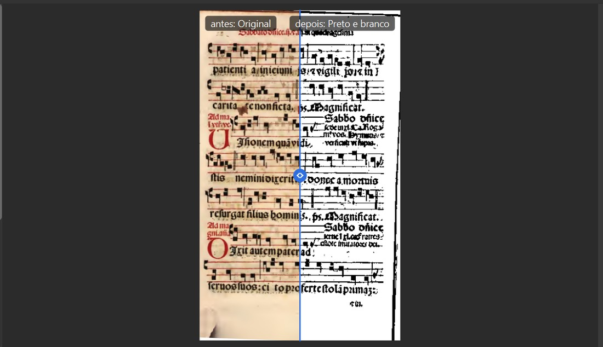
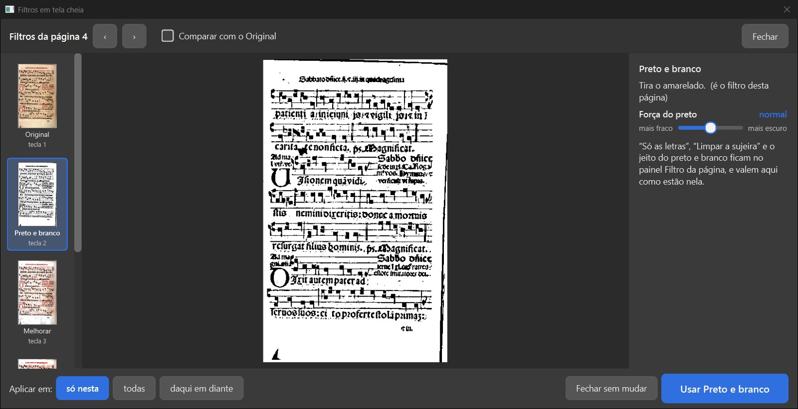
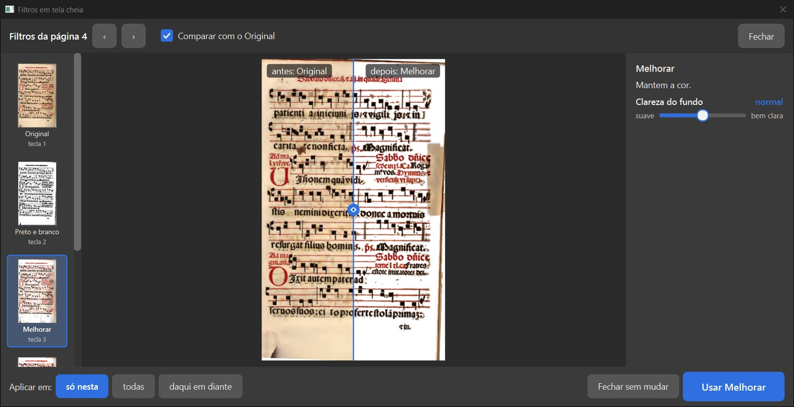
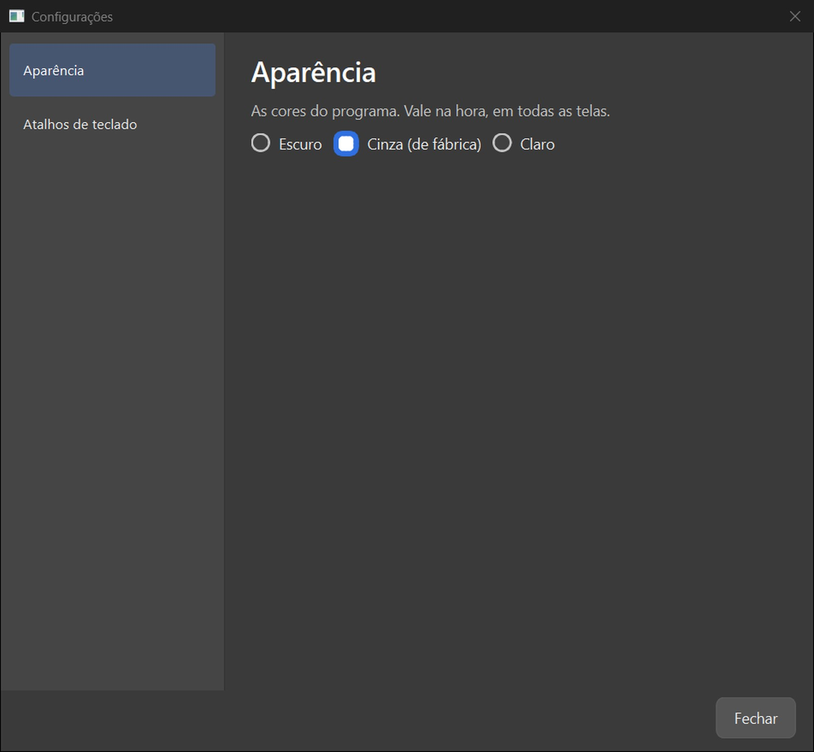
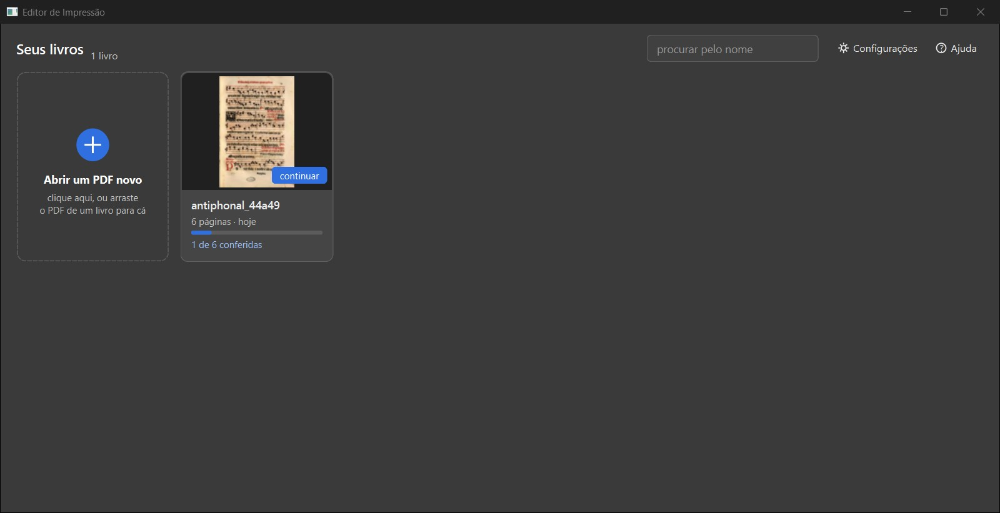
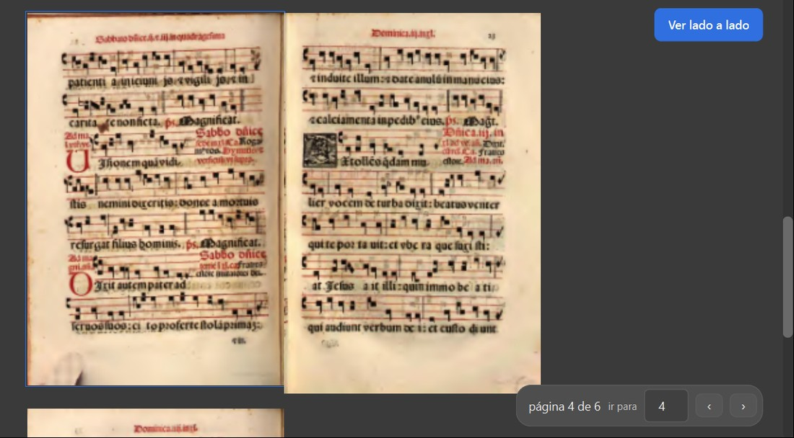
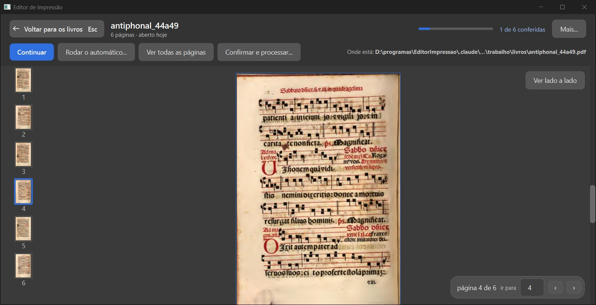
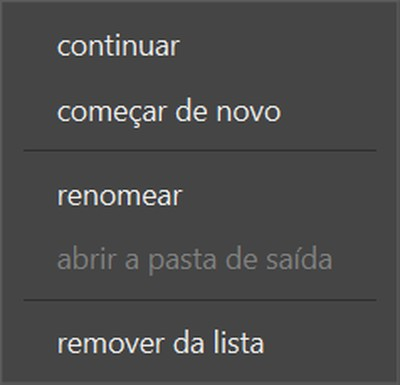
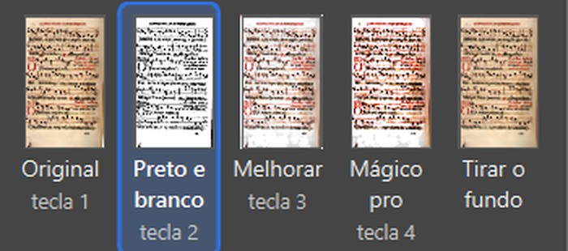
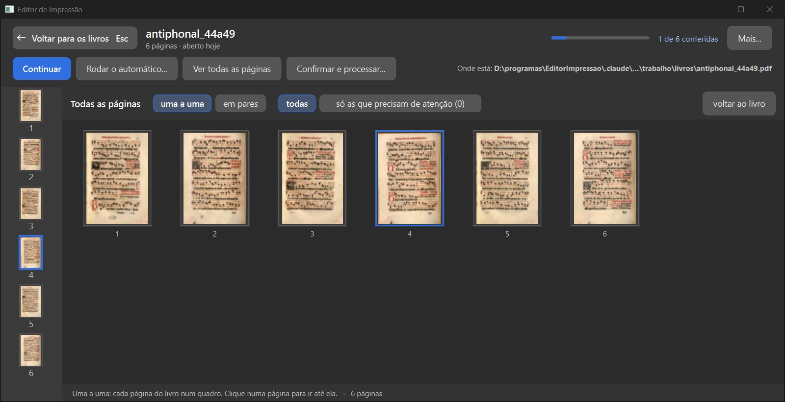

# Conferência em fotos: layout etapas 6 e 7 e os três acertos (verificador, 21/10/2026)

Ramo `layout-etapas4a7-2026-10-19`, código `f963cfd` (etapas 6 e 7 no `448299e`; acerto do livro aberto e da grade no `f963cfd`). Não marco nada como aprovado.

## O que conferi

- Fora de `ui/` e dos testes nada muda desde o `60a0a3d`.
- Testes, um arquivo por vez: dividir na tela 9, filtros em tela cheia 5, configurações 2, miniaturas 4, menu Painéis 3, painéis na tela 22, barra de menu 20, livro aberto 2, tela de início 15: todos passam.
- Reversão do "o do Editor" (`tests/test_dividir_na_tela.py`): falha no `9e6956d` ("(jeito: o do programa)"), passa no `448299e`.
- Janela de verdade: tela dos livros, livro aberto (uma por vez e lado a lado, "Mais…", Esc volta), Configurações, filtros em tela cheia (abrir pelo ícone, comparar, escolher, "Fechar sem mudar" não muda), a fila do Filtro e "Todas as páginas". 12 prints, todos abertos.
- Não abri as rodadas do GitHub citadas (39566066549, 39621726467).
- Acerto `f963cfd`: os 2 testes de reversão (`test_a_folha_e_desenhada_na_resolucao_da_tela`, `test_a_grade_desenha_na_altura_do_quadro`) falham no `448299e` e passam no novo. Na janela: o livro aberto ficou nítido; a grade NÃO (nitidez medida 669 contra 1004 antes e 5371 da página desenhada direto nesse tamanho). Causa vista no código: `ui/widgets/todas_as_paginas.py` `_pintar` faz `pix.scaled(alvo.size())` em pontos lógicos (150) e a tela a 125% aumenta de novo; a imagem guardada já tem 197 pontos. O teste só olha a imagem guardada, não o que é pintado.

## Ressalvas (o que ainda não está como no desenho)

- Não está como no desenho: "Para revisar" e "Receita usada" no livro aberto (o resumo não tem esse dado; receitas não existem).
- Não está como no desenho: 804 B, o aviso de livro novo ("ainda não passou pelo automático"): o livro ainda não abre direto na tela de trabalho.
- Não está como no desenho: Configurações sem as partes "Para todos os livros" e "Lado direito" (não existem ainda).
- Tela cheia dos filtros: o ajuste mexido ali mostra só o filtro (sem "Só as letras") até "Usar"; o antes e depois não aproxima.
- "Todas as páginas": continua mole depois do acerto f963cfd (a página é reduzida ao tamanho lógico antes de pintar, e a escala de 125% do Windows a aumenta de novo).

## As fotos contra as decisões dele

| Quadro | Decisão dele | Bate? |
|---|---|---|
| Filtros em tela cheia | 601 (07/10): "A — A “um grande”, com a chave “Comparar com o Original”". | sim |
| Configurações com a lista das partes à esquerda | 807 (12/10): "B — Lista das partes à esquerda"; 707 (12/10): "C — Nos dois lugares". | em parte: faltam as partes "Para todos os livros" e "Lado direito" (ainda não existem) |
| A tela dos livros | "Como abrir um livro novo?" (06/10): "Cartão “+” no começo da grade"; rodada 6: Configurações e Ajuda no alto, sem barra de menus. | sim |
| O livro aberto na tela inteira | "O livro aberto fica assim?" (06/10): "Sim, fica assim" + "quero ter a opção de clicar e ver como ia ficar as paginas lado a lado [...] eu não quero padrão eu quero como opção um botão que eu clique e veja pagina lado a lado." | sim |
| Os três acertos da conferência anterior | 907 (20/10): "B — “o do Editor”". | em parte: a grade continua mole |

## Filtros em tela cheia

O que você está escolhendo: se a tela cheia dos filtros ficou como você escolheu na rodada 11 (601).

O ícone no canto do título do painel "Filtro da página" (e o menu Ver > "Filtros em tela cheia") abre a tela: a fila dos filtros à esquerda, o escolhido grande no meio, o ajuste dele à direita. A chave "Comparar com o Original" começa desligada; ligada, vira o antes e depois com a linha que se arrasta. Escolher na fila só mostra; "Usar …" grava, "Fechar sem mudar" não muda nada (conferido: a página continuou em Preto e branco).

**O que olhar:** A linha do meio com "antes: Original" e "depois: …".

**Sua decisão:** 601 (07/10): "A — A “um grande”, com a chave “Comparar com o Original”".

*Ressalva:* O ajuste mexido aqui mostra só o filtro, sem o "Só as letras", até "Usar"; os outros ajustes do Preto e branco ficam no painel; o antes e depois não aproxima.

Opções: Está bom · Melhorar · Está pior · Ainda não entendi · e um comentário.

*Ampliado: "Comparar com o Original" ligado*

*A tela cheia ao abrir (chave desligada)*

*Melhorar escolhido na fila, comparando*

## Configurações com a lista das partes à esquerda

O que você está escolhendo: se a tela de Configurações e o lugar da troca de tema ficaram como você escolheu (807 e 707).

"Configurações" (no alto da tela dos livros) abre uma janela com a lista das partes à esquerda, "Aparência" e "Atalhos de teclado". Em "Aparência": Escuro, Cinza (de fábrica), Claro. O tema também se troca pelo menu Ver > Tema.

**O que olhar:** A lista à esquerda e os três temas.

**Sua decisão:** 807 (12/10): "B — Lista das partes à esquerda"; 707 (12/10): "C — Nos dois lugares".

Opções: Está bom · Melhorar · Está pior · Ainda não entendi · e um comentário.

*A janela de Configurações*

## A tela dos livros

O que você está escolhendo: se a tela dos livros ficou como você escolheu na rodada 6 e na página de escolhas (cartão "+").

Só os cartões, sem barra de menus. O cartão "+ Abrir um PDF novo" vem no começo da grade (clique ou arraste o PDF). No alto: "procurar pelo nome", "Configurações" e "Ajuda". Um clique num livro abre o livro na tela inteira; "continuar" vai direto ao trabalho.

**O que olhar:** O cartão "+" no começo e o alto da tela.

**Sua decisão:** "Como abrir um livro novo?" (06/10): "Cartão “+” no começo da grade"; rodada 6: Configurações e Ajuda no alto, sem barra de menus.

Opções: Está bom · Melhorar · Está pior · Ainda não entendi · e um comentário.

*A tela dos livros*

## O livro aberto na tela inteira

O que você está escolhendo: se o livro aberto ficou como você escolheu na rodada 6.

As páginas rolam uma embaixo da outra, com a coluna de miniaturas à esquerda e a pílula "página 4 de 6 · ir para" embaixo. No alto: "Voltar para os livros (Esc)", "Continuar", "Rodar o automático…", "Ver todas as páginas", "Confirmar e processar…", "Mais…" (continuar, começar de novo, renomear, abrir a pasta de saída, remover da lista) e "Onde está". "Ver lado a lado" é um botão (não vem ligado): mostra as páginas em pares, como o livro aberto.

**O que olhar:** O botão "Ver lado a lado" e as duas páginas lado a lado.

**Sua decisão:** "O livro aberto fica assim?" (06/10): "Sim, fica assim" + "quero ter a opção de clicar e ver como ia ficar as paginas lado a lado [...] eu não quero padrão eu quero como opção um botão que eu clique e veja pagina lado a lado."

Opções: Está bom · Melhorar · Está pior · Ainda não entendi · e um comentário.

*Ampliado: "Ver lado a lado" ligado*

*O livro aberto, uma página por vez (nítida, depois do acerto f963cfd)*

*O menu "Mais…"*

## Os três acertos da conferência anterior

O que você está escolhendo: se os três acertos que eu pedi ficaram bons.

1) O nome "Melhorar" cabe inteiro na fila do painel Filtro. 2) As páginas de "Todas as páginas" ficaram mais nítidas. 3) A frase de resumo da tela "O que fazer" diz "(jeito: o do Editor)", como a lista (907 B), com teste de reversão que falha no código de antes.

**O que olhar:** "Melhorar" inteiro na fila; as páginas da grade.

**Sua decisão:** 907 (20/10): "B — “o do Editor”".

*Ressalva:* A grade de "Todas as páginas" continua mole mesmo depois do acerto f963cfd: a página é desenhada no tamanho certo (197 pontos), mas ao pintar ela é reduzida para 150 e aumentada de novo pela escala do Windows (125%).

Opções: Está bom · Melhorar · Está pior · Ainda não entendi · e um comentário.

*Ampliado: a fila com "Melhorar" inteiro*

*"Todas as páginas" no f963cfd*

## Decisão: Layout: etapas 6 e 7: o que você decide?

O que você está escolhendo: se a tela cheia dos filtros, as Configurações, a tela dos livros e o livro aberto entram no programa.

Cada quadro é uma coisa que você decidiu, com a foto da janela de verdade. O que ainda não está como no desenho está na lista de ressalvas.

Opções: Aprovado · Melhorar · Ainda não entendi
