# Conferência em fotos: layout etapa 4, etapa 5 e rodada 14 (verificador, 21/10/2026)

Ramo `layout-etapas4a7-2026-10-19`, código `60a0a3d`. Para a gerente publicar. Não marco nada como aprovado.

## Ressalvas

- Na fila do painel Filtro, "Melhorar" sai cortado.
- Em "Todas as páginas" as páginas pequenas saem borradas.
- A frase de resumo da tela "O que fazer" diz "(jeito: o do programa)" (devia ser "o do Editor", 907 B).

## As fotos contra as decisões dele

| Quadro | Decisão dele | Bate? |
|---|---|---|
| O menu novo "Painéis" | 903 (20/10): "B — Um menu novo, “Painéis”". | sim |
| As peças novas no menu Ver | 904 (20/10): "A — Sim, no menu Ver". | sim (falta "Ver lado a lado", que ainda não existe) |
| "Só neste pedaço" sem "o mesmo da página" | 909 (20/10): "B — Sem o botão de cima, nenhum aceso". | sim |
| Ângulo posto à mão: as contas continuam à vista | 910 (20/10): "A — Os dois ângulos e, embaixo, o seu" + "a opção 1, podia aparecer só na hora que passasse o mouse em cima, os angulos continuam embaixo mas a mensagem só aparece quando bota o mouse em cima". | sim |
| "o do Editor" no Dividir e no Endireitar | 907 (20/10): "B — “o do Editor”"; 805 (12/10): "C — A conta vira “Editor”". | em parte: a frase de resumo da tela "O que fazer" ainda diz "(jeito: o do programa)" |
| Propriedades em duas partes (Endireitar e Dividir) | 706 (12/10): "B — Propriedades com duas partes: “Só nesta página” e “Para o livro todo”". | sim |
| Propriedades do Marcar | 402 (06/10): "C — Muda conforme a ferramenta (como no Photoshop)". | sim ("Marcar como" ainda com 3 jeitos: a 705, iluminura e moldura, mexe no processamento) |
| O painel "Filtro da página" | 403 (06/10): "B — Filtros numa fila + partes que abrem e fecham" + "Mas eu vou querer uma opção para conseguir abrir os filtros para ver um review de como ficaria com cada filtro, abrir em tela cheia, com as opções de cada filtro nessa tela cheia." | sim (a tela cheia é a etapa 6, não conferida aqui) |
| O cabeçalho das miniaturas e "ver todas" | 808 (12/10): "A — No cabeçalho das miniaturas". | sim |
| "Todas as páginas" abre uma a uma | 901 (20/10): "A — Uma a uma". | sim |
| Miniaturas em pares e em outro lugar | 801 (12/10): "A — Desce para a barra de baixo, no canto direito". | sim |

## O menu novo "Painéis"

O que você está escolhendo: se o menu "Painéis" ficou como você pediu na rodada 14 (903).

Entre "Ver" e "Ajuda" há o menu "Painéis": Propriedades, Filtro da página, Para revisar, Automático, Histórico, "Fechar o painel" e "Ícones da direita". Os quatro "Painel: …" saíram do Ver.

**O que olhar:** O menu aberto e o nome "Painéis" na linha dos menus.

**Sua decisão:** 903 (20/10): "B — Um menu novo, “Painéis”".

Opções: Está bom · Melhorar · Está pior · Ainda não entendi · e um comentário.

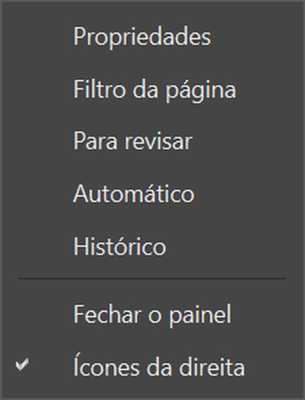

*Ampliado: o menu "Painéis" aberto*

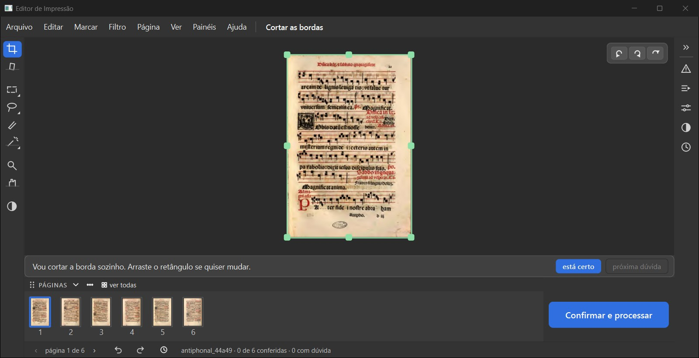

*A tela inteira: "Painéis" entre "Ver" e "Ajuda"*

## As peças novas no menu Ver

O que você está escolhendo: se as peças novas da tela ganharam item no menu Ver, como na rodada 14 (904).

O menu Ver tem Aproximar, Afastar, Ajustar à tela, e agora "Miniaturas", "Ícones da direita", "Todas as páginas" e "Filtros em tela cheia", depois "Modo comparar" e "Tema". "Ver lado a lado" ainda não existe no programa.

**O que olhar:** Os quatro itens do meio do menu.

**Sua decisão:** 904 (20/10): "A — Sim, no menu Ver".

Opções: Está bom · Melhorar · Está pior · Ainda não entendi · e um comentário.

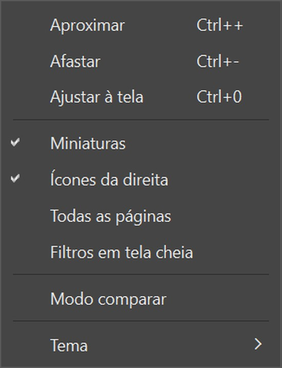

*Ampliado: o menu Ver aberto*

## "Só neste pedaço" sem "o mesmo da página"

O que você está escolhendo: se o "Só neste pedaço" ficou como você escolheu na rodada 14b (909).

No painel Filtro da página, a parte "Só neste pedaço" mostra Original, Preto e branco, Melhorar e Mágico pro, nenhum aceso, e não tem mais o botão "o mesmo da página". O pedaço só ganha filtro se o Kaique clicar num.

**O que olhar:** A lista embaixo de "Só neste pedaço": nenhum botão aceso.

**Sua decisão:** 909 (20/10): "B — Sem o botão de cima, nenhum aceso".

Opções: Está bom · Melhorar · Está pior · Ainda não entendi · e um comentário.

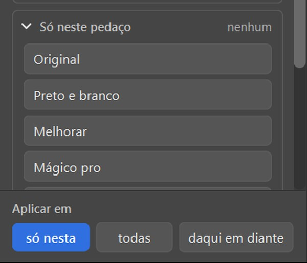

*Ampliado: "Só neste pedaço" aberto*

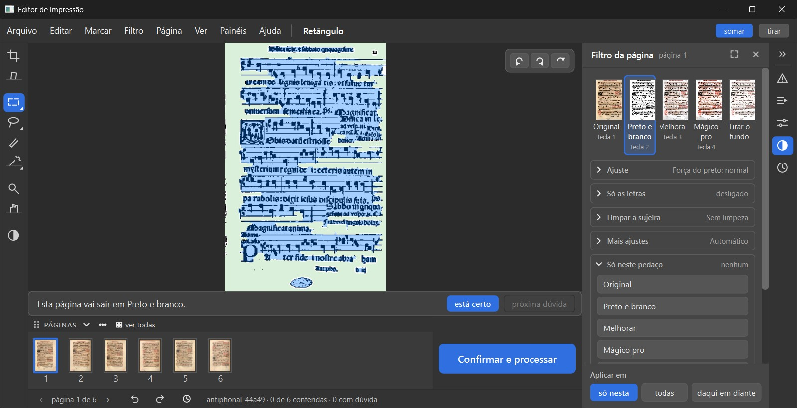

*A tela inteira*

## Ângulo posto à mão: as contas continuam à vista

O que você está escolhendo: se o Endireitar com o ângulo à mão ficou como você pediu na rodada 14b (910).

Girei a página à mão (−2,1°). A linha "ScanTailor −2,0° · Editor −2,0°" continua embaixo da lista "Conta". A frase "Você girou à mão: −2,1°. As contas voltam com “usar o ângulo do programa”." aparece só no balão, quando o mouse passa em cima da linha ou da lista.

**O que olhar:** A linha "ScanTailor · Editor" embaixo da "Conta" (o balão só aparece com o mouse em cima; não sai na foto).

**Sua decisão:** 910 (20/10): "A — Os dois ângulos e, embaixo, o seu" + "a opção 1, podia aparecer só na hora que passasse o mouse em cima, os angulos continuam embaixo mas a mensagem só aparece quando bota o mouse em cima".

Opções: Está bom · Melhorar · Está pior · Ainda não entendi · e um comentário.

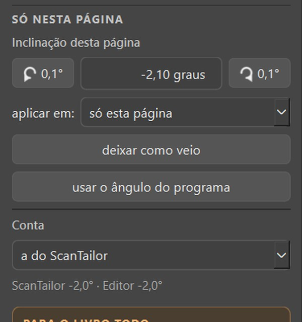

*Ampliado: o painel do Endireitar depois de girar à mão*

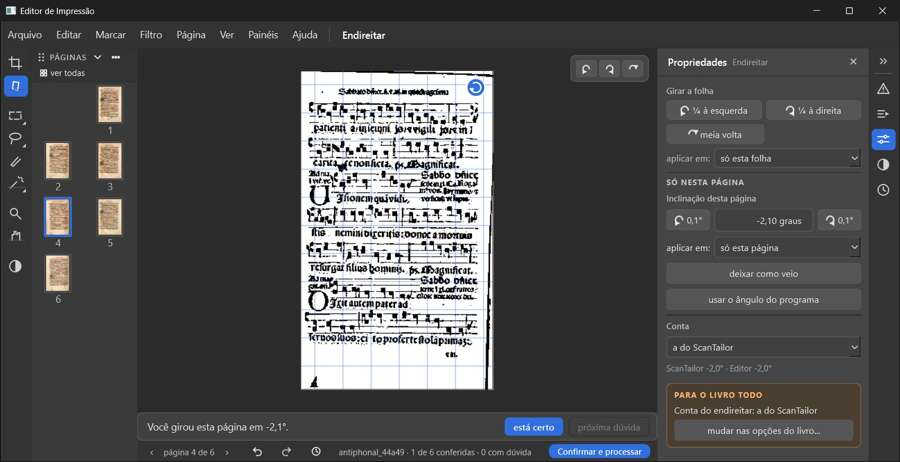

*A tela inteira*

## "o do Editor" no Dividir e no Endireitar

O que você está escolhendo: se as palavras "o do Editor" e "Editor" ficaram como você escolheu (805 e 907).

No Dividir, a lista "jeito:" diz "o do Editor" e "o do ScanTailor", no painel e na tela "O que fazer". No Endireitar, a linha da conta diz "ScanTailor +0,2° · Editor +0,3°".

**O que olhar:** A lista "jeito:" do Dividir e a linha da conta do Endireitar.

**Sua decisão:** 907 (20/10): "B — “o do Editor”"; 805 (12/10): "C — A conta vira “Editor”".

*Ressalva:* A frase de resumo embaixo das opções ("Vou dividir as 6 folhas em 12 páginas (jeito: o do programa)…") ficou com a palavra antiga.

Opções: Está bom · Melhorar · Está pior · Ainda não entendi · e um comentário.

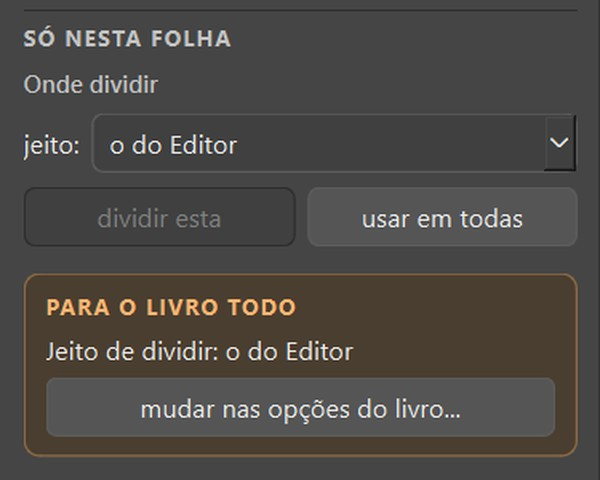

*Ampliado: o Dividir, "jeito: o do Editor"*

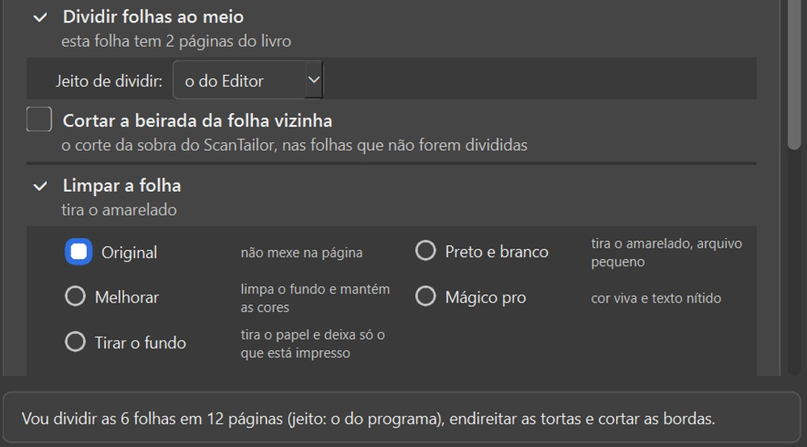

*A tela "O que fazer": a lista diz "o do Editor", a frase de baixo ainda diz "o do programa"*

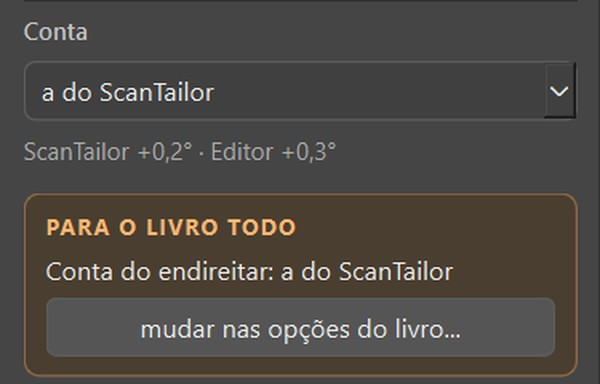

*O Endireitar: "ScanTailor +0,2° · Editor +0,3°"*

## Propriedades em duas partes (Endireitar e Dividir)

O que você está escolhendo: se o painel Propriedades separa o que é da página e o que é do livro, como você escolheu (706).

No Endireitar e no Dividir, o painel tem "Girar a folha" no alto, depois "Só nesta página" (ou folha) e, embaixo, a caixa "Para o livro todo" com "mudar nas opções do livro…".

**O que olhar:** As duas partes, com títulos em letras maiúsculas.

**Sua decisão:** 706 (12/10): "B — Propriedades com duas partes: “Só nesta página” e “Para o livro todo”".

Opções: Está bom · Melhorar · Está pior · Ainda não entendi · e um comentário.

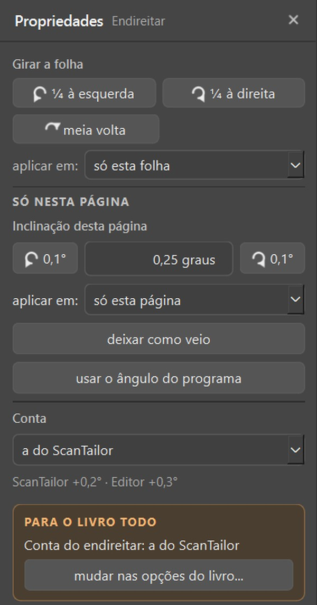

*Ampliado: o painel do Endireitar*

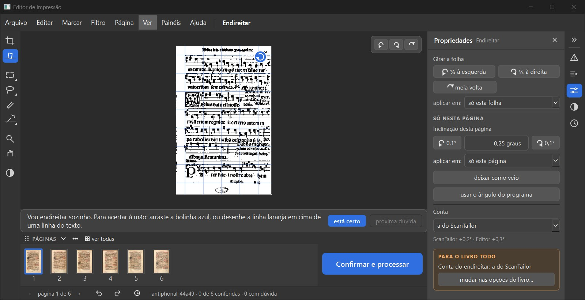

*A tela inteira*

## Propriedades do Marcar

O que você está escolhendo: se o painel Propriedades do Marcar ficou como você escolheu (402 e 701).

Com o Retângulo, o painel mostra "Girar a folha", "Marcar como" (gravura ou foto, letra e traço, papel), "Marcação desta página" (detectar automaticamente, usar em todas, daqui em diante) e "Foto". A fila embaixo da página ficou vazia.

**O que olhar:** As partes do painel e a contagem "Marcado: 6 de letra e traço e 8 de papel."

**Sua decisão:** 402 (06/10): "C — Muda conforme a ferramenta (como no Photoshop)".

Opções: Está bom · Melhorar · Está pior · Ainda não entendi · e um comentário.

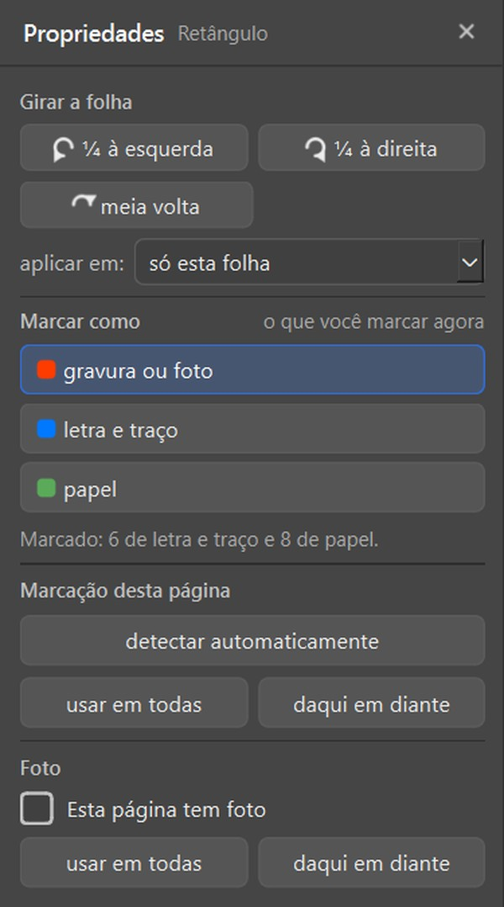

*Ampliado: Propriedades do Retângulo*

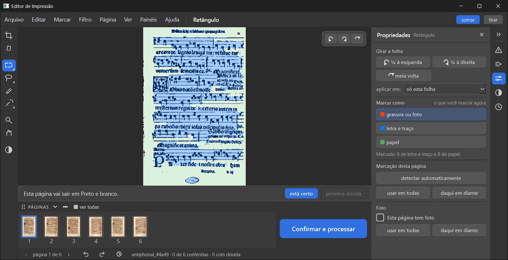

*A tela inteira*

## O painel "Filtro da página"

O que você está escolhendo: se o painel Filtro ficou como você escolheu na rodada 9 (403).

No alto, a fila com a página pequena nos cinco filtros e a tecla de cada um. Embaixo, partes que abrem e fecham: Ajuste, Só as letras, Limpar a sujeira (lista com amostra), Mais ajustes, Só neste pedaço. Depois "apagar página", separado, e no pé "Aplicar em: só nesta · todas · daqui em diante". O ícone do canto do título abre os filtros em tela cheia.

**O que olhar:** A fila dos filtros, as partes e o pé "Aplicar em".

**Sua decisão:** 403 (06/10): "B — Filtros numa fila + partes que abrem e fecham" + "Mas eu vou querer uma opção para conseguir abrir os filtros para ver um review de como ficaria com cada filtro, abrir em tela cheia, com as opções de cada filtro nessa tela cheia."

*Ressalva:* Na fila, o nome "Melhorar" sai cortado ("Melhora"). Acerto pendente.

Opções: Está bom · Melhorar · Está pior · Ainda não entendi · e um comentário.

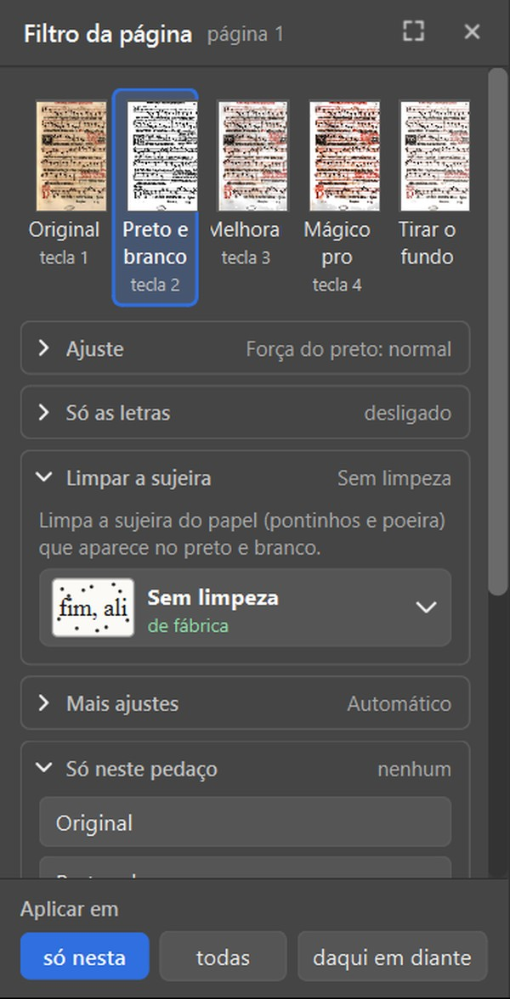

*Ampliado: o painel com "Limpar a sujeira" aberto*

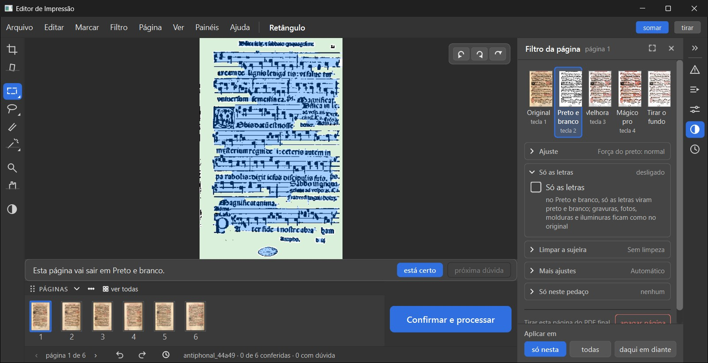

*A tela inteira*

## O cabeçalho das miniaturas e "ver todas"

O que você está escolhendo: se o cabeçalho das miniaturas e o botão de "Todas as páginas" ficaram onde você escolheu (808).

Em cima das miniaturas há o cabeçalho "PÁGINAS" ("FOLHAS" no Dividir): a alça de arrastar, a seta, os três pontinhos ("Ver em pares", "Lugar", "Fechar as miniaturas") e "ver todas".

**O que olhar:** A linha "PÁGINAS ˅ ••• ver todas" e o menu dos três pontinhos.

**Sua decisão:** 808 (12/10): "A — No cabeçalho das miniaturas".

Opções: Está bom · Melhorar · Está pior · Ainda não entendi · e um comentário.

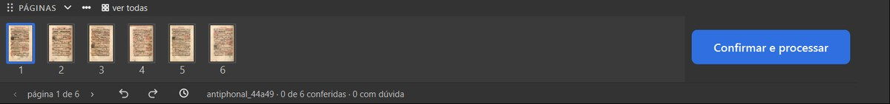

*Ampliado: o cabeçalho e as miniaturas*

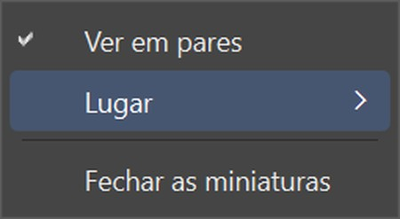

*O menu dos três pontinhos*

## "Todas as páginas" abre uma a uma

O que você está escolhendo: se a tela "Todas as páginas" ficou como você escolheu na rodada 14 (901).

"ver todas" abre a tela com uma página em cada quadro ("uma a uma" aceso), com "em pares", "todas" e "só as que precisam de atenção". Clicar numa página leva até ela; "voltar ao trabalho" fecha.

**O que olhar:** "uma a uma" aceso no alto.

**Sua decisão:** 901 (20/10): "A — Uma a uma".

*Ressalva:* As páginas pequenas desta tela saem borradas. Acerto pendente.

Opções: Está bom · Melhorar · Está pior · Ainda não entendi · e um comentário.

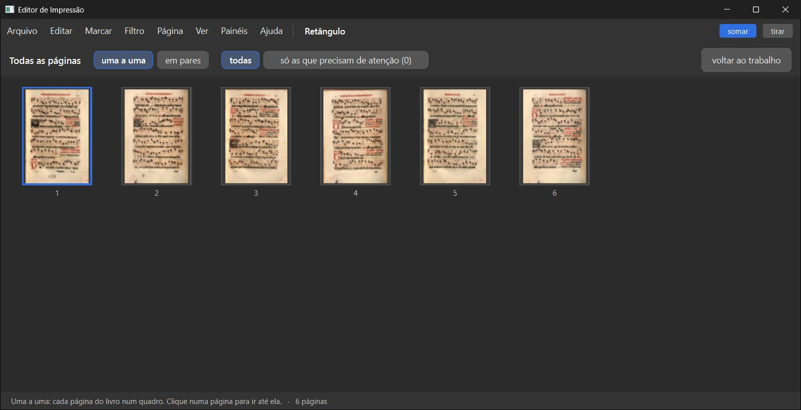

*A tela "Todas as páginas"*

## Miniaturas em pares e em outro lugar

O que você está escolhendo: se as miniaturas em pares e o lugar delas ficaram como você escolheu (rodada 7 e 801).

"Ver em pares" junta as miniaturas como no livro aberto: a 1 sozinha, depois 2-3, 4-5. Com as miniaturas à esquerda (ou fechadas), o "Confirmar e processar" desce para a barra de baixo, no canto direito. "Ver > Miniaturas" traz de volta as miniaturas fechadas.

**O que olhar:** O botão azul "Confirmar e processar" no canto de baixo quando as miniaturas saem de baixo.

**Sua decisão:** 801 (12/10): "A — Desce para a barra de baixo, no canto direito".

Opções: Está bom · Melhorar · Está pior · Ainda não entendi · e um comentário.

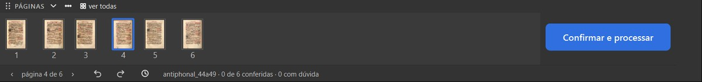

*Ampliado: em pares, embaixo*

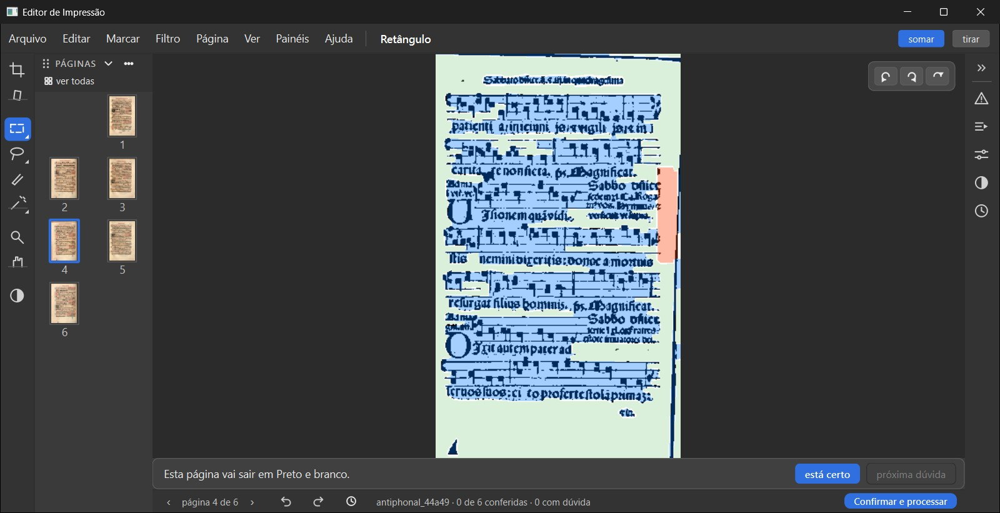

*Miniaturas à esquerda: o "Confirmar e processar" na barra de baixo*

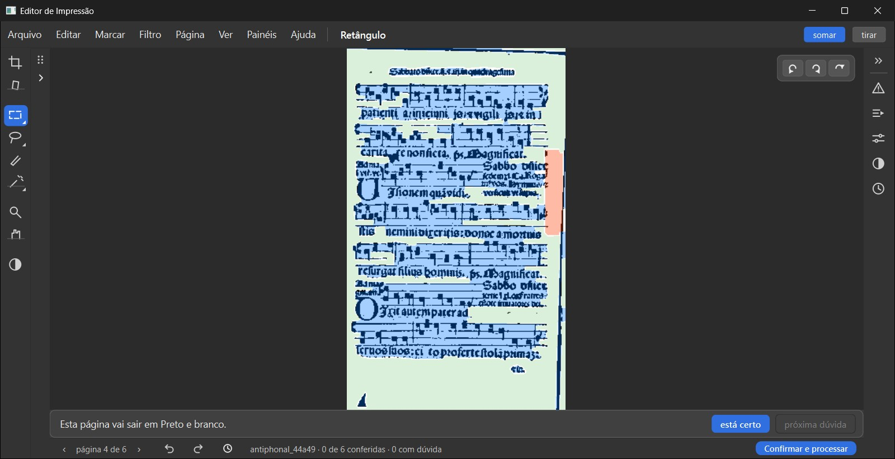

*Miniaturas fechadas*

## Decisão: Layout: etapa 4, etapa 5 e a rodada 14: o que você decide?

O que você está escolhendo: se estas partes da tela nova entram no programa.

Cada quadro acima é uma coisa que você decidiu, com a foto da janela de verdade. Ficaram dois acertos pequenos (o nome "Melhorar" cortado e as páginas borradas em "Todas as páginas") e uma palavra antiga na frase da tela "O que fazer".

Opções: Aprovado · Melhorar · Ainda não entendi
