# Aba 4 da página de conferência: "Para revisar" (preparada pelo verificador, 20/10/2026)

Ramo `fase2-para-revisar`, `ce2b835`. Arquivo para a gerente montar a aba: `conferencia-aba4.json`. **Não marco nada como aprovado.**

## Antes de publicar (para a gerente)

- NÃO publicar esta aba como está. Todas as fotos da janela são da tela de antes do layout que o Samuel aprovou e que está no fase-1 desde 14/10 (sem abas, painel "Para revisar" na coluna da direita com "Por página | Por motivo", "daqui em diante" no lugar de "só nas próximas"). É o mesmo erro de 09 e 12/10.
- O ramo fase2-para-revisar (ce2b835) não se junta ao fase-1 (b8e9af7) sem conflito: `git merge-tree` dá conflito em ui/tela_conferir.py e ui/widgets/paineis.py, exatamente onde ficam os avisos e o painel. Quem resolve é o implementador (o verificador não mexe em ui/).
- Depois da junção: os textos novos dos avisos ainda dizem "aba Marcar" e "aba Bordas" (core/analise.py do ramo); o layout já trocou "aba Endireitar" por "ferramenta Endireitar" e "programa" por "Editor". Acertar as palavras novas antes das fotos.
- Depois da junção, o verificador refaz na janela as fotos marcadas "tela antiga" e troca as "desatualizadas" (quadro pr-esta-bom), com os mesmos recortes (scripts/a4_recortes.py), e confere de novo as 89 páginas (a junção mexe na tela que pede a medida).
- O Cursus 3 e o Antiphon 260 dependem do conserto do corte com borda preta (outro ramo, decisão cg6 ainda aberta): se ele entrar antes, as fotos desses dois quadros mudam.
- Podem ir já, se a gerente quiser separar: as três perguntas ("Quando medir", "As contagens", "A tela igual ao PDF") falam de comportamento, não de aparência. Só a foto do painel na pergunta das contagens é da tela antiga (o painel novo pode contar diferente: conferir depois da junção).
- Cada quadro precisa da opção "Ainda não entendi" ao lado de "Está bom / Melhorar / Está pior" (as abas 2 e 3 só têm as três).

## Resumo para o Samuel

O programa passa a avisar, página por página, quando o "Só as letras" do Preto e branco pode ter estragado alguma coisa: uma letra grande que sumiu, texto falhado, página sem nada do livro. Cada aviso traz o botão do conserto que você escolheu: "Trazer de volta nesta página", "Deixar em branco", "Tirar do livro", "Desfazer".

Quando 4 linhas ou mais saem falhadas, o programa escurece sozinho a força do preto só naquela página e avisa. Ao processar com avisos sem olhar, aparece a lista "Página N - motivo", com "ver" e "continuar assim mesmo". O Kaique dá "está bom" numa página, num motivo, em todas ou em tudo, e o Ctrl+Z desfaz.

Ficaram três perguntas para você, no fim da aba: quando medir as páginas não visitadas, as três contagens que não batem e se a tela deve mostrar o mesmo que o PDF.

**PRONTO PARA CONFERIR no que faz: os seis pedaços e os consertos funcionam na janela de verdade. Duas escolhas suas ficaram em parte (a marca laranja é só desenho; no "Guardar só o texto" ela contorna a página toda) e a regra dá 22 vão e 75 certas, contra 21 e 78 aprovados.**

O Mágico pro saiu 1,1% mais lento (0,06 s por página); você mandou deixar para a Fase 5, de desempenho (19/10).

## As fotos contra as decisões dele

| Quadro | Decisão dele | Bate? | Fotos |
|---|---|---|---|
| Antiphonal 46: a letra grande que some | rv5-erro-1-desenho (09/10): "Botão 'Trazer de volta nesta página'" + "eu acho que pode ser a opção 1, mas onde sumiu, tem que aparecer selecionado automaticamente, como na opção 3" (a opção 3 era o retângulo 'letra e traço' da aba Marcar). | em parte: o botão sim; o lugar aparece marcado, mas não como uma seleção que se ajusta | tela antiga |
| Antiphonal 46: a tela mostra a letra T, o PDF sai sem ela | Sem decisão ainda (pergunta nova desta aba). | não se aplica | vale |
| Graduale 222: "Guardar só o texto" apaga a música | rv5-erro-6-so-texto (09/10): "Botão 'Trazer de volta nesta página'" + "opção 1, mas aparece marcado como apareceu na segunda opção." (a segunda opção mostrava um retângulo em volta de uma pauta). | em parte: o botão sim; a marca é a página inteira, não as pautas | tela antiga |
| Egenloff 12 e Rariora 8: página sem conteúdo | rv5-erro-5-sem-conteudo (09/10): "Os dois botões: 'Deixar em branco' e 'Tirar do livro'"; rv4-pag-rariora-008: "Vai para a lista, com botão"; rv4-pag-egenloff-012: "Concordo". | sim (com um botão a mais, "está bom assim") | tela antiga |
| Gladstone 18: "Parece em branco" numa página com título | rv4-em-branco: "Tem que ter um tipo de aviso para cada coisa, e um botão de apagar folha e outro realmente de só mudar para um folha branca."; rv5-em-branco (08/10): "Fica assim". | sim (o aviso errado na Gladstone 18 é bug à parte) | tela antiga, vale |
| Camões 27: a força do preto sozinha | rv4-erro-4-texto-falhado: "Força sozinha" + "mas temos que melhorar o reconhecimento de tintas, para não sair falhado assim, não precisar usar sempre o reforço."; rv5-erro-4-tintas (09/10): "Fica no plano; até lá, a força sozinha". | sim, com o limite de 4 linhas (decisão técnica da gerente, a confirmar com você) | tela antiga, vale |
| Palatino 66: a força não mexe mais; fica o aviso | rv4-erro-4-texto-falhado: "Força sozinha" (o limite de 4 linhas é da gerente). | sim | tela antiga, vale |
| A janela "Antes de processar" | rv5-aviso-so-texto (08/10): "Lista as páginas e os motivos"; rv4-aviso-so-texto: "quando alguém tentar imprimir sem ver os alertas o programa para e mostra os alertas e a pessoa diz se quer ver ou continuar". | sim | vale |
| "Está bom" numa página, num motivo, em todas e em tudo | rv4-aviso-so-texto: "Eu tenho que conseguir fazer isso com uma pagina individual, com um motivo individual de uma pagina e com todas as paginas ou com todos os motivos de todas as paginas, e eu devo conseguir abrir um selecionador em aba grande [...] quando eu resolver aquele problema, o programa já vai automaticamente ver que eu resolvi?" | sim | desatualizada |
| Graduale 221: as 89 páginas decidem igual na tela e na conta | rv4-resumo: "Fica assim" (a regra ajustada: 21 vão, 78 certas). | em parte: 22 vão e 75 certas, contra 21 e 78 aprovados | tela antiga |
| Opus Majus 20: a foto da estátua sai estragada, e o aviso pega | rv5-erro-2-gravura (09/10): "Fica no plano (1.5 e 2.18)"; rv4-erro-2-gravura: "ele tem que ser mais acertivo para achar as figuras". | sim (o aviso vale; o conserto da foto é o 1.5) | tela antiga, vale |
| Cursus 3: a faixa preta da beirada vai para a lista | rv4-erro-3-faixa: "Os dois jeitos estão bons"; corte: cg6 "Melhorar" (13/10). | sim | tela antiga, vale |
| Antiphon 260: a iluminura sai estragada e ninguém avisa | rv4-resumo: "Fica assim" (pela regra aprovada esta página vai); rv5-erro-2-gravura: "Fica no plano (1.5 e 2.18)". | não: devia ir e não vai | tela antiga, vale |
| Camões 66: as linhas pretas da beirada, sem aviso | rv4-pag-camoes-066: "São as linhas pretas: aviso no livro basta". | não (depende do 2.13, como está no plano) | tela antiga |
| Aba Marcar: as áreas se acertam sozinhas | Não foi pedido por você: veio do conserto da medida (decisão técnica da gerente). | não se aplica | tela antiga, vale |
| Dois cliques no cartão não tiram mais o aviso | Conserto de um defeito achado na primeira conferência. | não se aplica | tela antiga, vale |
| O teclado depois de clicar num botão do aviso | Conserto de um defeito achado na primeira conferência. | não se aplica | tela antiga |
| Projeto feito antes desta mudança | Não se aplica. | não se aplica | tela antiga |

## 1. Antiphonal 46: a letra grande que some (funciona; a marca é só desenho)

O que você está escolhendo: se o aviso da letra grande que some ficou como você pediu na rodada 5.

Caso real: no Antiphonal 46 o Preto e branco apaga a letra T vermelha. O programa avisa, desenha um quadrado laranja em volta do T e mostra o botão "Trazer de volta nesta página". Um clique e a página guarda tudo de novo; o Ctrl+Z desfaz.

O que ficou diferente do que você pediu: você escreveu "onde sumiu, tem que aparecer selecionado automaticamente, como na opção 3". O quadrado laranja mostra o lugar, mas é só um desenho por cima, como um post-it: não é uma marcação da aba Marcar que dá para aumentar ou diminuir, e o botão traz de volta a página inteira, não só o T.

**O que olhar:** O quadrado laranja em volta do T, nos dois cartões, e o botão "Trazer de volta nesta página".

O aviso aparece sozinho uns 8 segundos depois de chegar na página. O botão troca só essa página para "Guardar tudo", o aviso some e a página sai da lista. O Ctrl+Z desfaz.

**Ressalva:** A marca laranja não entra na marcação (está escrito no código: "são só um desenho"). Em 1280 x 657 os cartões são pequenos e a marca quase não se vê. No cartão a letra T continua lá: é o defeito do quadro seguinte.

Opções: Está bom · Melhorar · Está pior · Ainda não entendi · e um comentário.

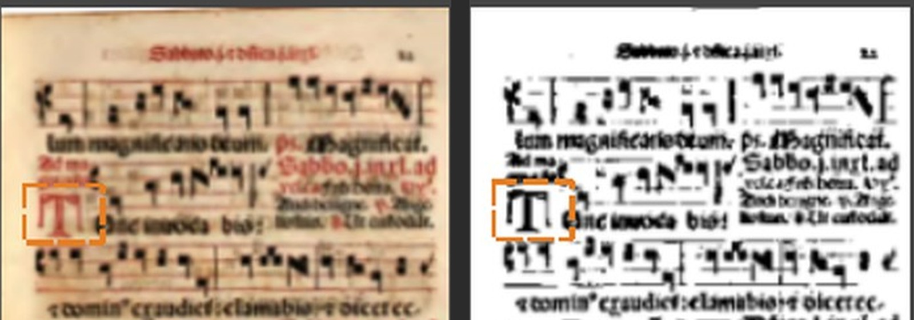

*Ampliado: o T no Original (vermelho) e no Preto e branco, com o quadrado laranja* (tela antiga: refazer depois de juntar o fase-1 no ramo)

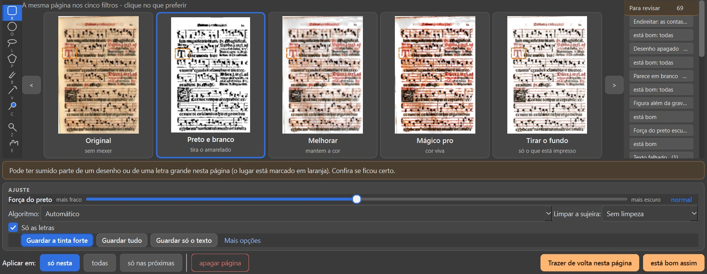

*Os cartões, o aviso e os dois botões* (tela antiga: refazer depois de juntar o fase-1 no ramo)

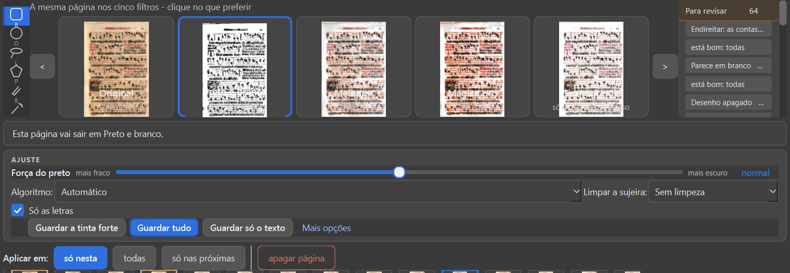

*Depois de "Trazer de volta nesta página": "Guardar tudo" ligado, aviso e marca sumiram* (tela antiga: refazer depois de juntar o fase-1 no ramo)

## 2. Antiphonal 46: a tela mostra a letra T, o PDF sai sem ela (defeito grave, já existia)

O que você está escolhendo: se este defeito é grave. A escolha do conserto está na pergunta "A tela igual ao PDF", no fim da aba.

Caso real: na tela, a página 46 aparece com a letra T. No PDF que o programa gerou, a letra sumiu. É como uma prova de gráfica que mostra uma coisa e a impressão sai outra.

O aviso "Desenho apagado" diz a verdade; a imagem da tela é que engana, porque é desenhada pequena para ser rápida.

**O que olhar:** A letra T grande à esquerda: na tela ela aparece; na página do PDF, não.

Processei o livro na janela: no PDF a letra T sumiu mesmo. O "Ver de perto" continua mostrando a letra T.

**Ressalva:** Não foi mexido de propósito: depende da sua resposta à pergunta "A tela igual ao PDF".

Opções: Está bom · Melhorar · Está pior · Ainda não entendi · e um comentário.

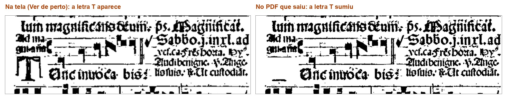

*Ampliado: o mesmo pedaço da página 46, na tela (com o T) e no PDF (sem o T)* (vale)

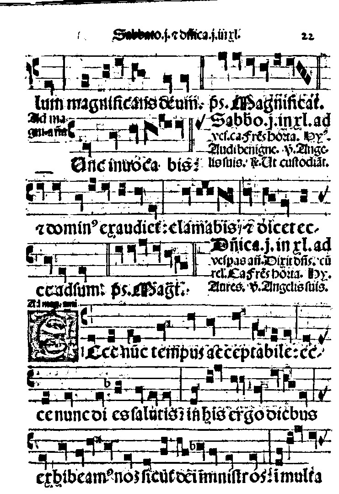

*A página inteira tirada do PDF: no lugar do T sobrou um tracinho* (vale)

## 3. Graduale 222: "Guardar só o texto" apaga a música (funciona; a marca é a página toda)

O que você está escolhendo: se o aviso do "Guardar só o texto" ficou como você pediu na rodada 5.

Caso real: no Graduale 222, quem escolhe "Guardar só o texto" perde as pautas. O programa avisa, marca de laranja e mostra "Trazer de volta nesta página": um clique e só essa página volta a guardar a música.

O que ficou diferente: você pediu "aparece marcado como apareceu na segunda opção", que era um retângulo em volta de uma pauta. Aqui o laranja é um contorno em volta da página inteira, porque o botão traz de volta a página toda.

**O que olhar:** O cartão do Preto e branco sem as pautas, o contorno laranja e o botão "Trazer de volta nesta página".

No jeito de fábrica ("Guardar a tinta forte") a página 222 não tem aviso. Trocando para "Guardar só o texto", o aviso aparece; o botão devolve só essa página para "Guardar a tinta forte". As outras páginas não mudam.

**Ressalva:** Conferido num pedaço de 7 páginas do Graduale (219 a 225); na janela a página se chama 4.

Opções: Está bom · Melhorar · Está pior · Ainda não entendi · e um comentário.

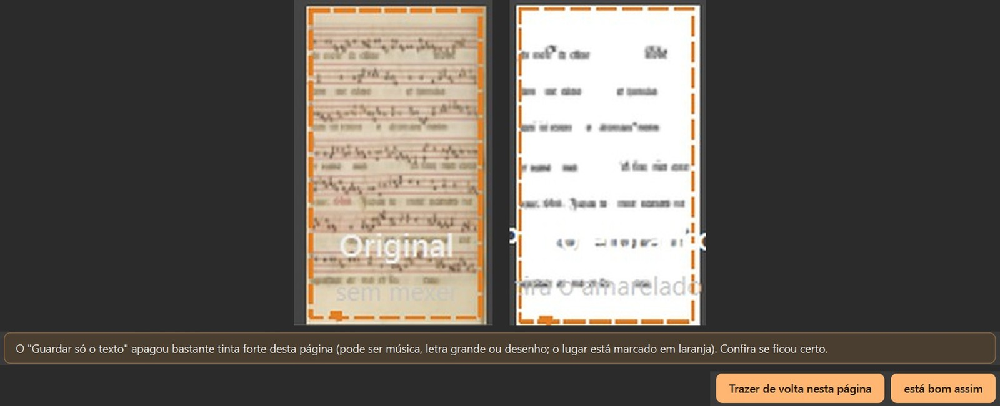

*Ampliado: Original e Preto e branco sem a música, o contorno laranja, o aviso e os botões* (tela antiga: refazer depois de juntar o fase-1 no ramo)

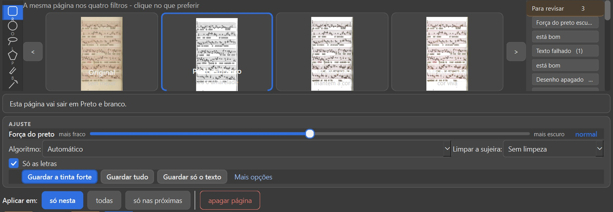

*Depois do botão: a música voltou e o aviso sumiu* (tela antiga: refazer depois de juntar o fase-1 no ramo)

## 4. Egenloff 12 e Rariora 8: página sem conteúdo (funciona)

O que você está escolhendo: se o aviso da página sem conteúdo ficou como você pediu (os dois botões, "Deixar em branco" e "Tirar do livro").

Caso real: o verso do Egenloff 12 só tem a mancha da página de trás. "Deixar em branco" põe uma folha branca no lugar (o livro fica com o mesmo número de páginas); "Tirar do livro" apaga a página.

Há um terceiro botão, "está bom assim", que não estava na sua escolha: ele tira só o aviso e deixa a página como está. Foi posto porque o aviso às vezes erra (quadro da Gladstone 18).

**O que olhar:** Os três botões: "Deixar em branco", "Tirar do livro" e "está bom assim".

Os três voltam com Ctrl+Z.

Opções: Está bom · Melhorar · Está pior · Ainda não entendi · e um comentário.

*Ampliado: Egenloff 12, o aviso e os três botões* (tela antiga: refazer depois de juntar o fase-1 no ramo)

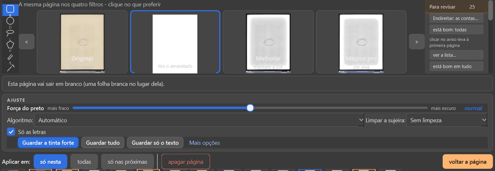

*Depois de "Deixar em branco": folha branca no lugar e o botão "voltar a página"* (tela antiga: refazer depois de juntar o fase-1 no ramo)

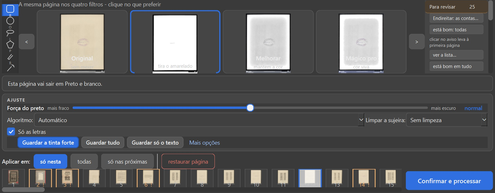

*Depois de "Tirar do livro": a página 12 fica apagada na tira e o botão vira "restaurar página"* (tela antiga: refazer depois de juntar o fase-1 no ramo)

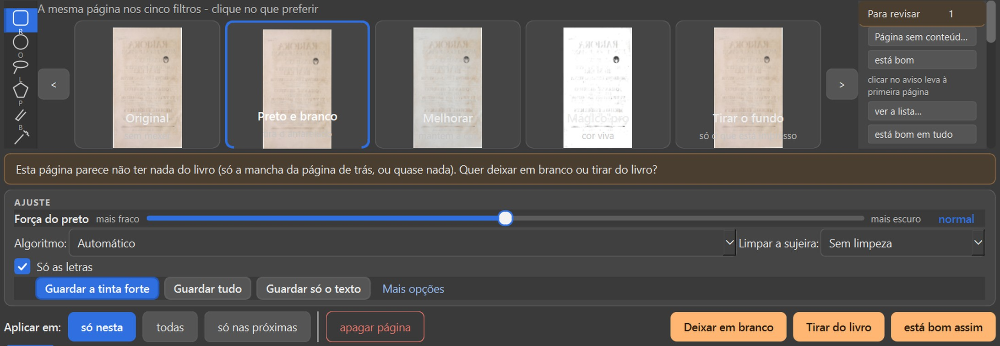

*Rariora 8: o mesmo aviso, com os três botões* (tela antiga: refazer depois de juntar o fase-1 no ramo)

## 5. Gladstone 18: "Parece em branco" numa página com título (erro conhecido, com saída)

O que você está escolhendo: se os dois avisos separados ("Parece em branco" e "Página sem conteúdo") ficaram como você pediu.

Caso real, e é um erro: a Gladstone 18 tem o título "DA ORAÇÃO", e o programa diz que ela parece em branco, oferecendo "Tirar do livro". O erro já estava na Lista de bugs.

O que mudou: agora o aviso tem também "está bom assim", que deixa a página como está.

**O que olhar:** A página tem o título "DA ORAÇÃO" e mesmo assim vem o aviso "Parece em branco".

O aviso errado continua; com o terceiro botão há uma saída certa.

**Ressalva:** O conserto do aviso em si fica para a Lista de bugs (não era deste trabalho).

Opções: Está bom · Melhorar · Está pior · Ainda não entendi · e um comentário.

*Ampliado: o aviso "Parece em branco" e os três botões* (tela antiga: refazer depois de juntar o fase-1 no ramo)

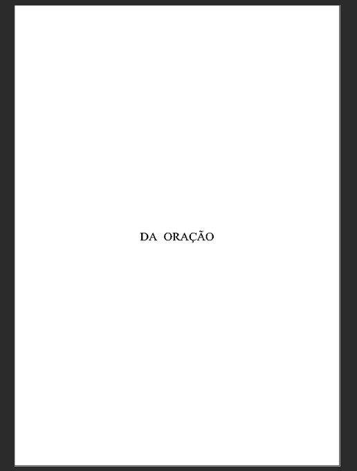

*A página: tem o título "DA ORAÇÃO"* (vale)

## 6. Camões 27: a força do preto sozinha (funciona)

O que você está escolhendo: se a força do preto sozinha ficou como você pediu ("Força sozinha", até o reconhecimento de tintas do item 1.4).

Caso real: no Camões 27 várias linhas saíam falhadas. O programa escureceu a força só nessa página (de "normal" para "bem forte"), avisou e deixou o botão "Desfazer".

Uma regra a mais, decidida pela gerente para não estragar página boa: a força só muda sozinha quando 4 linhas ou mais saem falhadas, e só fica se as falhas diminuírem. Nas 89 páginas do estudo ela agiu em duas (Camões 27 e 104); nas outras com texto falhado fica só o aviso, com o botão "usar mais escuro".

**O que olhar:** O medidor em "bem forte", o aviso "escureci a força do preto só nela" e o botão "Desfazer".

Com a força já em 85, o botão "usar mais escuro" não aparece. Há uma caixinha na tela "O que fazer" para desligar a força sozinha no livro.

**Ressalva:** A caixinha só aparece rolando a lista de opções. Com a força em 85, a frase do aviso "Texto falhado" ainda diz "tente a força do preto mais escura" (Lista de bugs).

Opções: Está bom · Melhorar · Está pior · Ainda não entendi · e um comentário.

*Ampliado: o aviso, o medidor em "bem forte" e os botões "Desfazer" e "está bom assim"* (tela antiga: refazer depois de juntar o fase-1 no ramo)

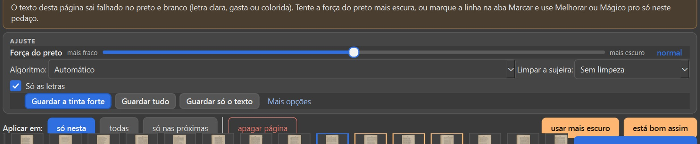

*Depois do "Desfazer": força normal e o aviso "Texto falhado" com "usar mais escuro"* (tela antiga: refazer depois de juntar o fase-1 no ramo)

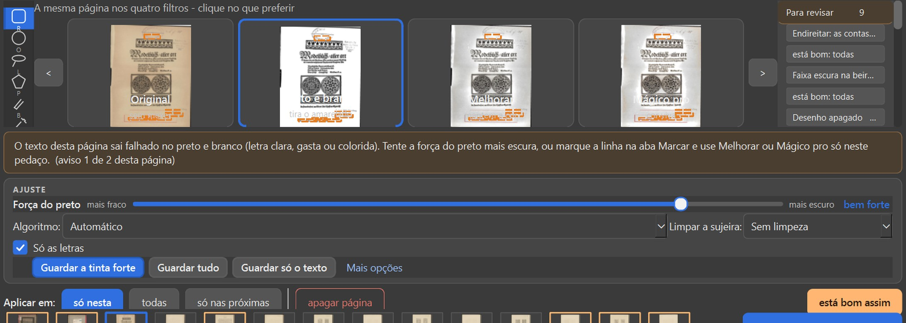

*Egenloff 3 depois de "usar mais escuro": o botão sumiu, fica "está bom assim"* (tela antiga: refazer depois de juntar o fase-1 no ramo)

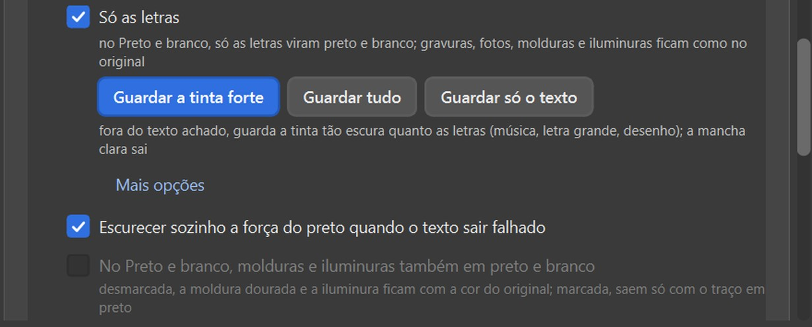

*A caixinha "Escurecer sozinho a força do preto quando o texto sair falhado"* (vale)

## 7. Palatino 66: a força não mexe mais; fica o aviso (melhorou)

O que você está escolhendo: se está bom a página de caligrafia ficar só com o aviso, sem a força mudar sozinha.

Caso real: na primeira versão, o programa escurecia sozinho a força nesta página e sujava a moldura. Agora ele não mexe: mostra "Texto falhado" e o botão "usar mais escuro", e quem decide é o Kaique.

A página continua indo para a lista sem precisar: é uma das cinco que decidem diferente do estudo que você aprovou.

**O que olhar:** O medidor em "normal" e o aviso "Texto falhado" com "usar mais escuro".

Agora não estraga nada; o aviso fica.

Opções: Está bom · Melhorar · Está pior · Ainda não entendi · e um comentário.

*Ampliado: o aviso "Texto falhado", a força em "normal" e os botões* (tela antiga: refazer depois de juntar o fase-1 no ramo)

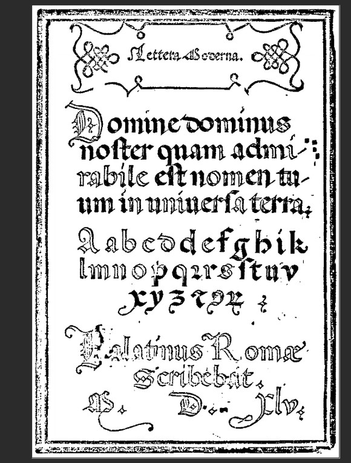

*Como saía na primeira versão, com a força escurecida sozinha (moldura suja)* (vale)

## 8. A janela "Antes de processar" (funciona; contagens em pergunta)

O que você está escolhendo: se a janela que aparece ao processar com avisos ficou como você pediu ("Lista as páginas e os motivos").

Caso real: no Camões, ao clicar em "Confirmar e processar", a janela lista "Página N - motivo" e "Folha N - motivo", com "ver" (vai para a página e não processa) e "continuar assim mesmo" (segue até "Ficou pronto!").

A frase de cima diz quantas páginas e quantos avisos: "75 páginas (104 avisos na lista)". Os números de três telas não batem: é a pergunta "As contagens", no fim da aba.

**O que olhar:** As linhas "Página N - motivo" e os botões "ver" e "continuar assim mesmo".

Fechar no X não processa.

**Ressalva:** A lista junta os avisos novos com os de sempre, e mistura "Folha N" com "Página N" (no Camões: 104 linhas, 4 da regra nova). Só mostra as páginas já visitadas: é a pergunta "Quando medir".

Opções: Está bom · Melhorar · Está pior · Ainda não entendi · e um comentário.

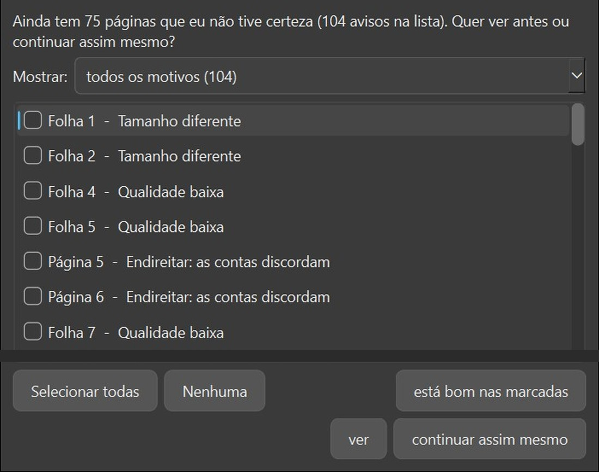

*Ampliado: a frase nova e as linhas da lista (Camões)* (vale)

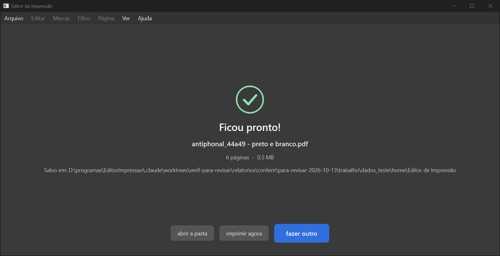

*Depois de "continuar assim mesmo": "Ficou pronto!"* (vale)

## 9. "Está bom" numa página, num motivo, em todas e em tudo (funciona; FOTOS A TROCAR)

O que você está escolhendo: se dar "está bom" nos avisos ficou como você pediu na rodada 4.

Caso real (Egenloff): "está bom assim" tira um aviso de uma página; "está bom: todas" tira um motivo do livro inteiro; "está bom em tudo" limpa a lista; na lista grande dá para marcar várias linhas e dar "está bom nas marcadas". O Ctrl+Z desfaz cada um.

Quando o problema é resolvido (por exemplo, "Guardar tudo" na página da letra que sumiu), o aviso some sozinho.

**O que olhar:** O número do painel "Para revisar" descendo em cada nível.

Um motivo de uma página: de 31 para 30 avisos. Um motivo em todas: de 31 para 6. Em tudo: "tudo certo". Na lista grande, duas linhas marcadas: de 31 para 29.

**Ressalva:** Os botões "ver a lista…" e "está bom em tudo" ficam no fim do painel e só aparecem rolando a coluna da direita.

**Para a gerente:** As quatro fotos deste quadro são da primeira conferência e mostram o Egenloff 3 com a força escurecida sozinha ("bem forte", "Força do preto escurecida" na lista) e, na esta-bom-1, o botão "usar mais escuro" com a força já em "bem forte". Os dois mudaram no ce2b835: o Egenloff 3 fica só com o aviso. Refazer no programa juntado.

Opções: Está bom · Melhorar · Está pior · Ainda não entendi · e um comentário.

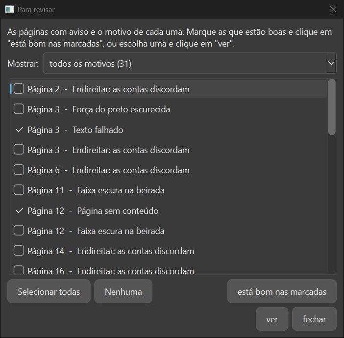

*A lista grande com duas linhas marcadas* (desatualizada: mostra o que o programa já não faz; trocar antes de publicar)

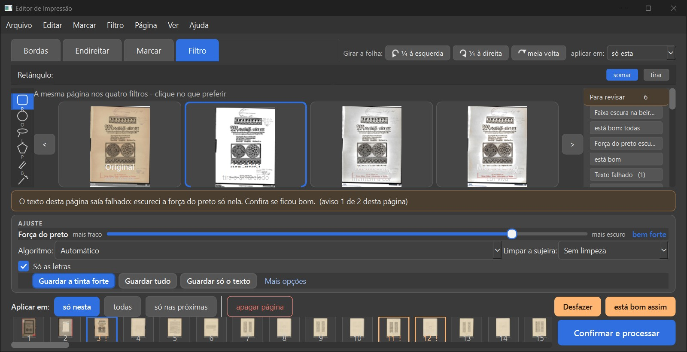

*Depois de "está bom: todas" no motivo do endireitar* (desatualizada: mostra o que o programa já não faz; trocar antes de publicar)

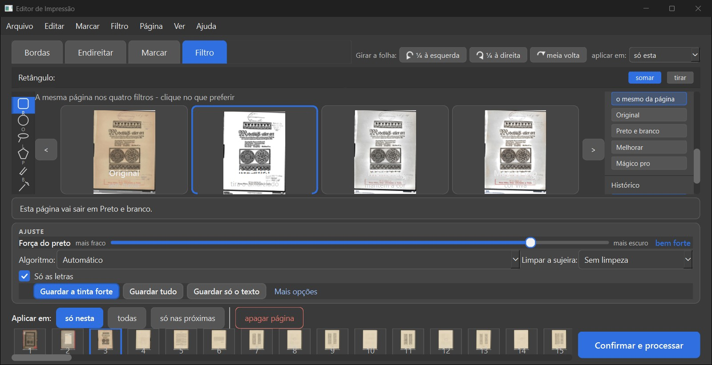

*Depois de "está bom em tudo": nenhuma página marcada na tira* (desatualizada: mostra o que o programa já não faz; trocar antes de publicar)

## 10. Graduale 221: as 89 páginas decidem igual na tela e na conta (consertado; 22 e 75)

O que você está escolhendo: se aceita o resultado da regra como está, um pouco abaixo do que você aprovou.

Você aprovou a regra com 21 páginas indo para a lista e 78 decididas certo, das 89 do estudo. Com o preparo do livro novo (endireitar antes de cortar), dá 22 e 75: três páginas certas a menos.

As cinco que decidem diferente do estudo: Antiphon 260, Cursus 3, Matemática 72, Opus Majus 20 e Palatino 66. O erro desta página, o Graduale 221 com aviso na tela e sem aviso na conta, foi consertado.

**O que olhar:** Não há mais aviso nem marca laranja nesta página.

A medida usa sempre as áreas achadas na página do tamanho do PDF. Na janela e na conta direta as 89 páginas dão o mesmo resultado.

**Ressalva:** O Opus Majus 20, reaberto em 20/10, vai para a lista e devia ir (quadro do Opus Majus 20).

Opções: Está bom · Melhorar · Está pior · Ainda não entendi · e um comentário.

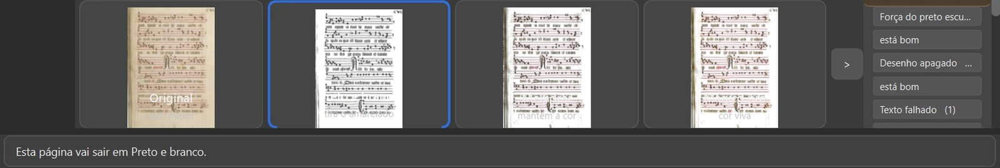

*Ampliado: Graduale 221 na janela, sem aviso* (tela antiga: refazer depois de juntar o fase-1 no ramo)

## 11. Opus Majus 20: a foto da estátua sai estragada, e o aviso pega (aviso certo; a foto estraga (já estragava))

O que você está escolhendo: se está certo esta página ir para a lista com o aviso "Figura além da gravura".

Caso real: a foto da estátua de Roger Bacon. No PDF que o programa gerou, com Preto e branco e "Só as letras", a estátua sai branca, com manchas e blocos pretos: a foto foi estragada. O aviso manda conferir, e está certo. É como um alarme que toca porque há fumaça de verdade.

A foto já sai assim no programa de hoje (conferi: a mesma imagem, ponto por ponto). O que este trabalho muda é só o aviso, que antes dizia "Tinta forte fora do texto". Achar a foto inteira é o item 1.5 (detector de figuras), que você deixou no plano.

**O que olhar:** A estátua: inteira no livro, branca e manchada no PDF.

Reabri em 20/10 como livro novo, na janela, e processei até "Ficou pronto!".

**Ressalva:** Corrige o que eu tinha escrito em 13/10 ("a foto sai intacta, a página não precisava ir"): aquela foto era da imagem pequena da tela, não do PDF.

Opções: Está bom · Melhorar · Está pior · Ainda não entendi · e um comentário.

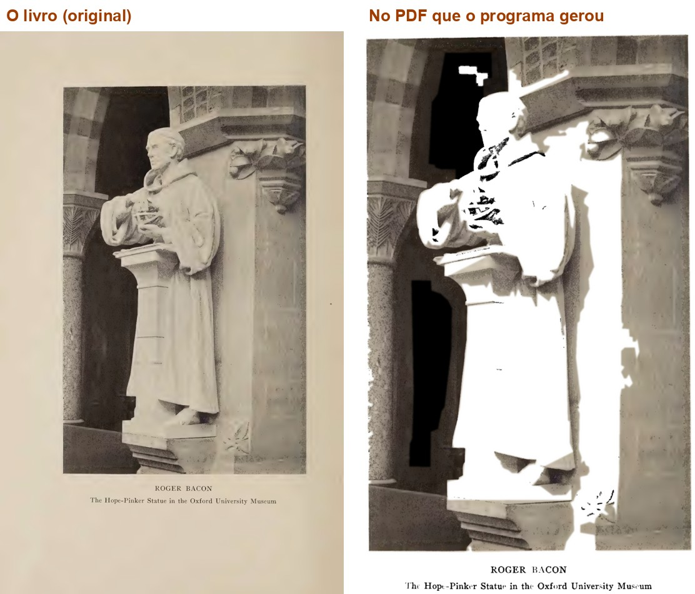

*Ampliado: a página no livro e no PDF que o programa gerou* (vale)

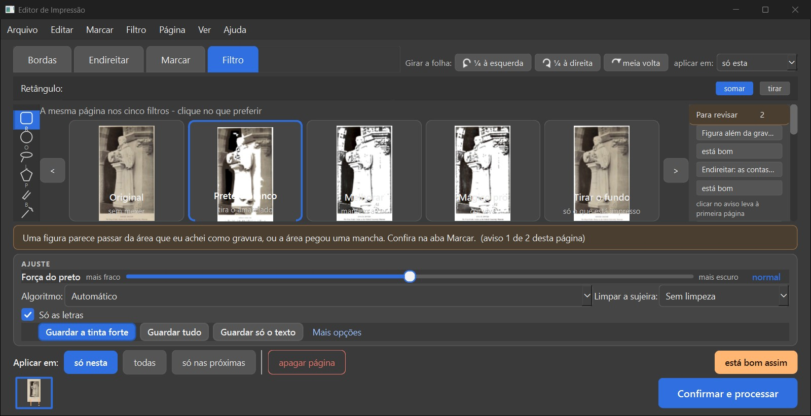

*A janela: o aviso "Figura além da gravura" e, no cartão do Preto e branco, a estátua já estragada* (tela antiga: refazer depois de juntar o fase-1 no ramo)

## 12. Cursus 3: a faixa preta da beirada vai para a lista (aviso certo)

O que você está escolhendo: se está certo esta página ir para a lista com o aviso "Faixa escura na beirada".

Caso real: no livro novo, o corte do Cursus 3 deixa uma faixa preta larga à direita e uma linha preta à esquerda. O aviso conta isso e manda conferir o corte.

O defeito é do corte (o endireitar antes de cortar, já no programa), não do aviso. O conserto do corte está em outro trabalho, que você marcou "Melhorar" (decisão cg6). Se ele entrar antes, esta página muda.

**O que olhar:** A faixa preta à direita da página e a linha preta à esquerda.

Reabri em 20/10 na janela: o aviso é só o da faixa.

**Ressalva:** O livro inteiro do Cursus (402 folhas) parou duas vezes na análise, por falta de memória no PC ("Aconteceu um problema inesperado"); reabri pelas 10 primeiras folhas, como livro novo.

Opções: Está bom · Melhorar · Está pior · Ainda não entendi · e um comentário.

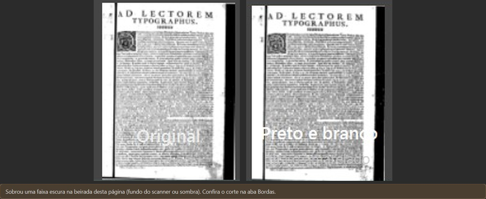

*Ampliado: Original e Preto e branco com a faixa preta à direita, e o aviso* (tela antiga: refazer depois de juntar o fase-1 no ramo)

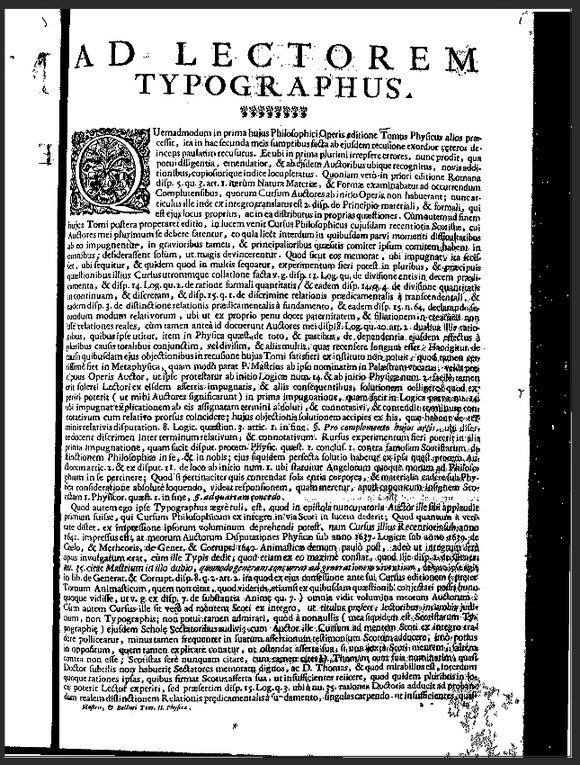

*A página como sai em Preto e branco, de perto* (vale)

## 13. Antiphon 260: a iluminura sai estragada e ninguém avisa (escapa)

O que você está escolhendo: se aceita que esta página fique sem aviso da iluminura, até o detector de figuras (item 1.5).

Caso real: no Preto e branco a iluminura sai chapada, quase toda preta, e há uma faixa preta embaixo. Na primeira visita aparece o aviso da faixa; depois de visitar mais três páginas, a faixa vira aviso do livro inteiro e a página 260 fica só com o aviso do Endireitar.

Pela regra que você aprovou ela devia ir para a lista. É uma das cinco que decidem diferente do estudo.

**O que olhar:** A iluminura chapada no cartão do Preto e branco, e o aviso, que é só o do Endireitar.

Reabri em 20/10 na janela, as folhas 256 a 264: 1ª visita, faixa + Endireitar; depois de visitar 259, 261 e 262, só Endireitar. A frase do livro ("No livro inteiro: as páginas deste livro têm uma faixa...") fica meio escondida embaixo do título do painel.

**Ressalva:** O aviso da faixa aparece e some conforme a pessoa visita outras páginas (vira aviso do livro quando 70% das páginas medidas têm faixa). Cada página levou de 13 a 42 segundos para ser medida.

Opções: Está bom · Melhorar · Está pior · Ainda não entendi · e um comentário.

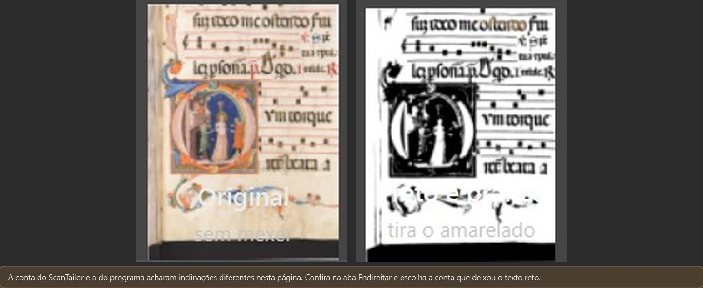

*Ampliado: Original e Preto e branco (iluminura chapada), e o único aviso* (tela antiga: refazer depois de juntar o fase-1 no ramo)

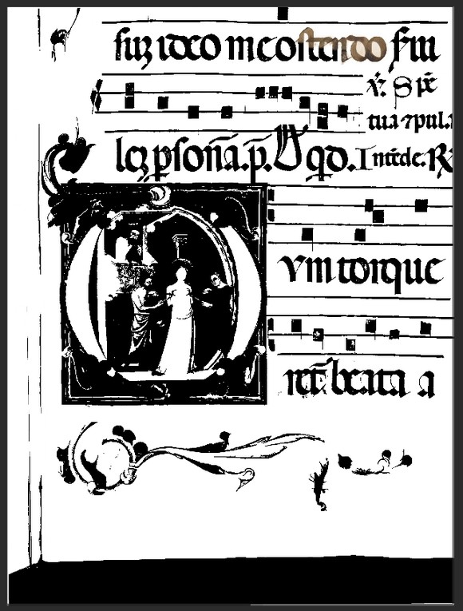

*A página como sai em Preto e branco, de perto (primeira conferência)* (vale)

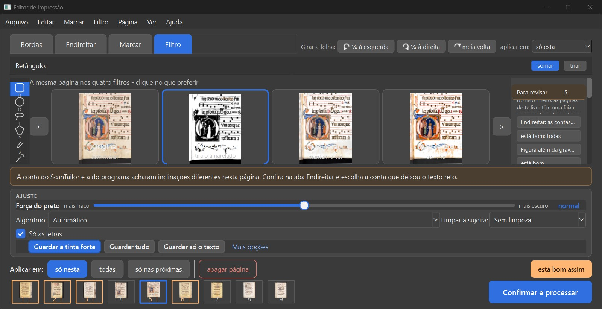

*A tela inteira depois de visitar outras páginas: a frase do livro meio escondida no alto do painel* (tela antiga: refazer depois de juntar o fase-1 no ramo)

## 14. Camões 66: as linhas pretas da beirada, sem aviso (sem aviso)

O que você está escolhendo: se pode esperar o corte (item 2.13) para este aviso existir.

Você decidiu: "São as linhas pretas: aviso no livro basta". Hoje o Camões não recebe esse aviso, nem na página nem no livro: as linhas são finas demais para a conta da faixa. Elas continuam saindo no resultado.

O único aviso da página 66 é o do Endireitar.

**O que olhar:** As linhas finas pretas nas beiradas do Preto e branco, e o aviso, que é só o do Endireitar.

Reabri em 20/10 na janela e visitei também 65, 67, 27 e 104: em nenhuma veio aviso de faixa ou de linhas. O 27 e o 104 receberam a força sozinha (85), como esperado.

**Ressalva:** O plano já diz que isto depende do corte (item 2.13).

Opções: Está bom · Melhorar · Está pior · Ainda não entendi · e um comentário.

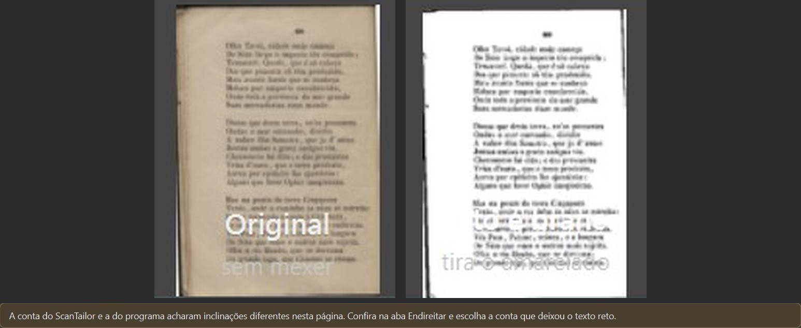

*Ampliado: Original e Preto e branco com as linhas finas nas beiradas, e o único aviso* (tela antiga: refazer depois de juntar o fase-1 no ramo)

## 15. Aba Marcar: as áreas se acertam sozinhas (novo, para saber)

O que você está escolhendo: se está bom as áreas da aba Marcar mudarem sozinhas alguns segundos depois de chegar numa página.

Caso real: no Graduale 221 a aba Marcar mostra 9 áreas ao chegar; uns 10 segundos depois, o programa troca por 18, achadas na página do tamanho do PDF. É como um rascunho que é passado a limpo sem ninguém pedir.

Uma área marcada à mão nesse intervalo continuou lá depois da troca. Nada avisa que o programa ainda está procurando.

**O que olhar:** As áreas azuis (letra) e verdes (papel) antes e depois.

Só acontece uma vez por página.

**Ressalva:** Não testei apagar ou mexer numa área do programa nesse intervalo, só marcar uma nova.

Opções: Está bom · Melhorar · Está pior · Ainda não entendi · e um comentário.

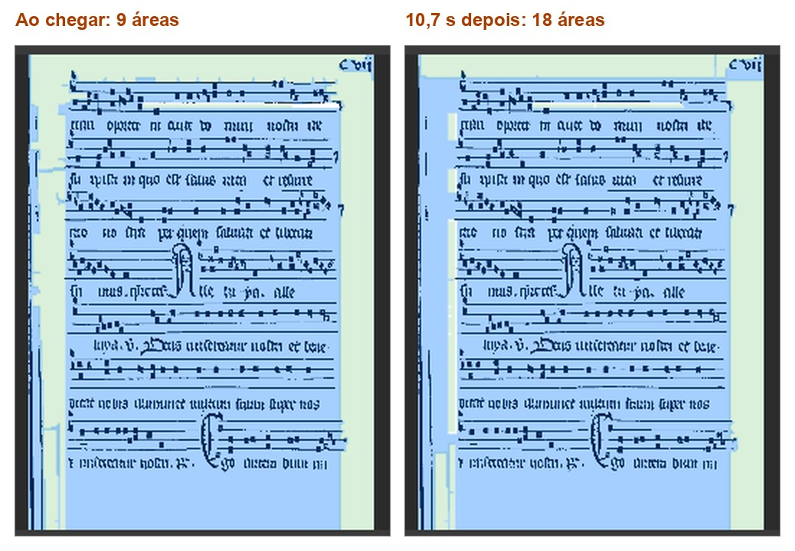

*Ampliado: Graduale 221 na aba Marcar, ao chegar e 10,7 segundos depois* (vale)

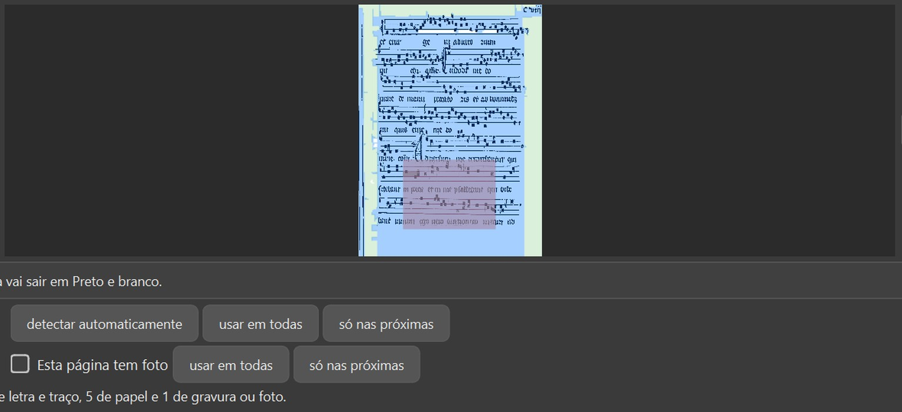

*Página 5: o retângulo marcado à mão continuou depois do acerto* (tela antiga: refazer depois de juntar o fase-1 no ramo)

## 16. Dois cliques no cartão não tiram mais o aviso (consertado)

O que você está escolhendo: se o conserto está bom.

Na primeira versão, dois cliques no cartão do filtro gravavam uma ação vazia e o aviso sumia. Agora os dois cliques só abrem o "Ver de perto" e o aviso continua.

**O que olhar:** Depois dos dois cliques, o aviso e os botões laranja continuam na tela.

Nada foi gravado no histórico.

Opções: Está bom · Melhorar · Está pior · Ainda não entendi · e um comentário.

*Ampliado: depois dos dois cliques, o aviso e os botões continuam* (tela antiga: refazer depois de juntar o fase-1 no ramo)

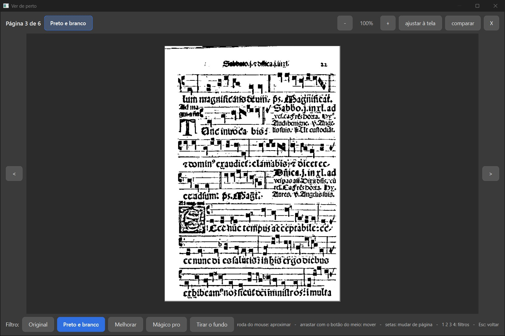

*O "Ver de perto" que os dois cliques abrem* (vale)

## 17. O teclado depois de clicar num botão do aviso (espaço sim; seta como antes)

O que você está escolhendo: se o conserto do teclado está bom.

Na primeira versão, depois de clicar num botão do aviso, a barra de espaço apertava o botão de novo. Agora o botão não fica com o teclado, e a barra de espaço faz "está certo e avança".

A seta para a direita só troca de página quando o teclado não está na tira de miniaturas nem no medidor da força: esses dois usam a seta (a tira rola; o medidor muda a força do preto daquela página). Isso já era assim no programa de hoje.

**O que olhar:** Depois de "Deixar em branco" e da barra de espaço, o programa passou para a página 13.

Com Tab, 40 vezes, o foco nunca parou num botão do aviso.

**Ressalva:** A seta foi conferida na janela de teste, que nunca fica ativa, e pelo código (a tecla vai primeiro para quem está com o teclado). A conclusão não depende da janela estar ativa, mas não testei com o teclado de verdade.

Opções: Está bom · Melhorar · Está pior · Ainda não entendi · e um comentário.

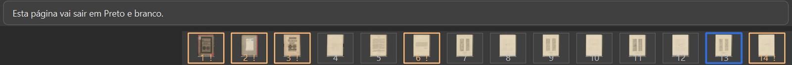

*Ampliado: depois da barra de espaço, a página 13 escolhida na tira* (tela antiga: refazer depois de juntar o fase-1 no ramo)

## 18. Projeto feito antes desta mudança (abre igual)

O que você está escolhendo: se está bom o que acontece com um livro começado antes desta mudança.

Caso real: um projeto do programa de hoje, com o aviso antigo "Tinta forte fora do texto" em 8 páginas, aberto no programa novo. Abriu em 7 segundos, o aviso antigo sumiu sozinho e os avisos novos vieram ao visitar cada página. A força sozinha vem desligada nesses livros.

**O que olhar:** No programa novo, a página 3 mostra "Texto falhado" com a força em "normal".

O erros.log ficou vazio.

**Ressalva:** O projeto salvo ganhou campos novos, todos com valor padrão. Projeto de antes de 09/10 não foi conferido (só existe na sua pasta de dados).

Opções: Está bom · Melhorar · Está pior · Ainda não entendi · e um comentário.

*Ampliado: no programa novo, "Texto falhado" e a força em "normal"* (tela antiga: refazer depois de juntar o fase-1 no ramo)

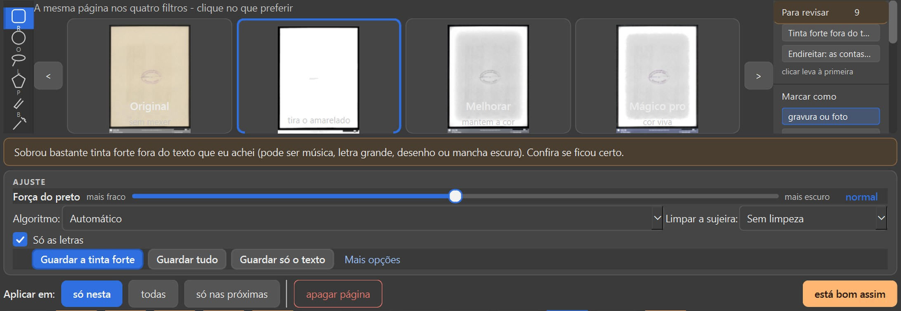

*O mesmo projeto no programa de hoje: o aviso antigo "Tinta forte fora do texto"* (tela antiga: refazer depois de juntar o fase-1 no ramo)

## Pergunta: Quando o programa mede as páginas que você não visitou?

O que você está escolhendo: em que hora o programa confere as páginas que ninguém abriu.

Hoje ele só confere a página que está na tela, como um revisor que só lê as páginas que você abre. As outras ele só lê na hora de gerar o PDF, quando já não dá para parar. Por isso a lista "Antes de processar" só traz as páginas visitadas: no Antiphonal, com 2 páginas visitadas a lista tinha 2 avisos; visitei mais 4 e ela passou a 4.

Conferir custa tempo: de 4 a 15 segundos por página nos livros comuns e de 20 a 26 no Antiphon. Num livro de 300 páginas, de 13 a 15 minutos (pela conta do implementador).

- **Medir o livro inteiro por trás, depois de abrir** (sugestão do verificador). Bom: a lista fica completa enquanto você confere, e nenhuma página muda sem aparecer na lista. Ruim: o PC trabalha de 13 a 15 minutos num livro de 300 páginas (pela conta do implementador; na janela pode chegar a 50 minutos, e a umas 2 horas em livro de folha grande), e a tela pode ficar mais lenta nesse tempo.
- **Medir o que falta só ao clicar em "Confirmar e processar"**. Bom: o PC só trabalha quando você pede, e a lista sai completa antes do PDF. Ruim: você espera esse mesmo tempo parado na hora de processar, olha a lista, e depois espera de novo o PDF ser gerado.
- **Deixar como está**. Bom: nada fica mais lento. Ruim: a lista só mostra as páginas visitadas; as outras saem no PDF do jeito que o programa decidiu, e o aviso só aparece depois.
- **Ainda não entendi**. Explique de outro jeito, com mais exemplos.

Sugestão do verificador (é minha, não é decisão): "Medir o livro inteiro por trás, depois de abrir", com uma barra de andamento. É a única em que a lista está completa na hora em que o Kaique decide, e a espera acontece enquanto ele já está conferindo.

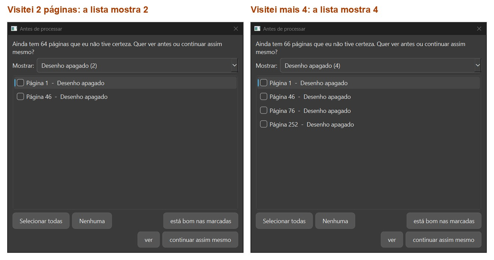

*As duas listas: 2 páginas visitadas, 2 avisos; mais 4 visitadas, 4 avisos* (tela antiga: refazer depois de juntar o fase-1 no ramo)

## Pergunta: Os três números de páginas e avisos não batem. Qual deve valer?

O que você está escolhendo: qual número cada tela mostra, para não haver três placares diferentes do mesmo jogo.

No Camões (106 páginas): o painel "Para revisar" diz 39 (só avisos de página); a lista "Antes de processar" diz 75 páginas e 104 avisos (junta os de folha: qualidade baixa, tamanho diferente); a janela de salvar diz 106 (toda página em que ninguém clicou "está certo").

Quem dá "continuar assim mesmo" para 75 páginas lê, na janela seguinte, que ainda há 106 sem conferir.

- **O painel passa a listar também os motivos de folha**. Bom: o painel e a lista mostram os mesmos avisos (no Camões, 104 nos dois). Ruim: o painel fica comprido, e a janela de salvar continua dizendo 106.
- **A janela de salvar passa a contar as páginas com aviso pendente** (sugestão do verificador). Bom: o número da janela de salvar fica igual ao da lista que acabou de aparecer (no Camões, 75), e some quando todos os avisos foram vistos. Ruim: ela deixa de lembrar as páginas sem "está certo" que não têm aviso nenhum.
- **Deixar como está**. Bom: não muda nada. Ruim: três números diferentes em três telas seguidas.
- **Ainda não entendi**. Explique de outro jeito, com mais exemplos.

Sugestão do verificador (é minha, não é decisão): a janela de salvar contar as páginas com aviso pendente. É o número que aparece por último, logo antes de processar, e hoje é o que mais desmente a lista. Se couber, a primeira opção junto.

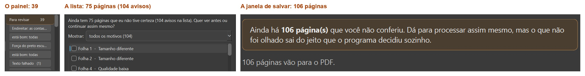

*Os três números no Camões: 39, 75 (104 avisos) e 106* (tela antiga: refazer depois de juntar o fase-1 no ramo)

## Pergunta: A tela deve mostrar a página igual à do PDF?

O que você está escolhendo: se a página que aparece na tela, no "Só as letras", passa a ser a mesma que vai para o PDF, como uma prova de gráfica fiel.

Hoje a tela usa uma imagem menor, para ser rápida. No Antiphonal 46 essa imagem mostra a letra T grande; no PDF a letra some. O aviso está certo, mas quem olha a tela vê a letra no lugar.

O programa já desenha por trás a página do tamanho do PDF, para medir os avisos. Ela chega de 4 a 15 segundos depois de abrir a página (20 a 26 em folha grande). Dá para mostrá-la na tela quase sem custo.

- **A tela troca sozinha pela imagem do PDF quando ela chegar** (sugestão do verificador). Bom: o que se vê é o que sai, sem precisar pedir. Ruim: a página muda sozinha na tela alguns segundos depois de aparecer, e nesse meio tempo ainda mostra a imagem menor.
- **Um botão "ver como sai no PDF"**. Bom: nada muda sozinho; quem quiser conferir aperta o botão. Ruim: quem não apertar continua vendo a letra que não vai sair.
- **Deixar como está**. Bom: a tela continua rápida e igual. Ruim: só o aviso diz a verdade; pelo olho a página parece certa.
- **Ainda não entendi**. Explique de outro jeito, com mais exemplos.

Sugestão do verificador (é minha, não é decisão): trocar sozinha quando chegar. Aviso que manda olhar uma coisa que a tela não mostra não ajuda o Kaique; e a troca só vale no "Só as letras", onde a imagem do PDF já é desenhada de qualquer jeito.

*A mesma página 46: a tela (com a letra T) e o PDF que saiu (sem ela)* (vale)
