# Aba 4 da página de conferência: "Para revisar", na tela nova (verificador, 21/10/2026)

Ramo `fase2-para-revisar`, código `adf4e69` (juntado ao layout). Arquivo para a gerente: `conferencia-aba4.json`. **Não marco nada como aprovado.**

## Antes de publicar

- Pode publicar. As fotos são da tela nova, tiradas por mim na janela de verdade em 20 e 21/10 e abertas uma a uma; as que mostram as frases novas ("Texto falhado", "Figura além da gravura"), o Cursus 3 e o Antiphon 260 são do código 8cb84b8 (com o conserto do corte).
- A frase nova do "Desenho ou escrita?" ("marque a área e escolha 'letra e traço' no painel Propriedades") não aparece em nenhuma foto: nenhuma das 32 páginas-gabarito nem dos livros que abri deu esse aviso. Ela está conferida pelo teste de reversão.
- As perguntas de baixo ficaram com as fotos da primeira conferência (falam de comportamento). Os números da pergunta "As contagens" mudaram na tela nova (ver o parecer).

## As fotos contra as decisões dele

| Quadro | Decisão dele | Bate? | Fotos |
|---|---|---|---|
| Antiphonal 46: a letra grande que some | rv5-erro-1-desenho (09/10): "Botão 'Trazer de volta nesta página'" + "eu acho que pode ser a opção 1, mas onde sumiu, tem que aparecer selecionado automaticamente, como na opção 3" (a opção 3 era o retângulo 'letra e traço' da aba Marcar). | em parte: o botão sim; o lugar aparece marcado, mas não como uma seleção que se ajusta | tela nova |
| Antiphonal 46: a tela mostra a letra T, o PDF sai sem ela | Sem decisão ainda (pergunta nova desta aba). | não se aplica | tela nova |
| Graduale 222: "Guardar só o texto" apaga a música | rv5-erro-6-so-texto (09/10): "Botão 'Trazer de volta nesta página'" + "opção 1, mas aparece marcado como apareceu na segunda opção." (a segunda opção mostrava um retângulo em volta de uma pauta). | em parte: o botão sim; a marca é a página inteira, não as pautas | tela nova |
| Egenloff 12 e Rariora 8: página sem conteúdo | rv5-erro-5-sem-conteudo (09/10): "Os dois botões: 'Deixar em branco' e 'Tirar do livro'"; rv4-pag-rariora-008: "Vai para a lista, com botão"; rv4-pag-egenloff-012: "Concordo". | sim (com um botão a mais, "está bom assim") | tela nova |
| Gladstone 18: "Parece em branco" numa página com título | rv4-em-branco: "Tem que ter um tipo de aviso para cada coisa, e um botão de apagar folha e outro realmente de só mudar para um folha branca."; rv5-em-branco (08/10): "Fica assim". | sim (o aviso errado na Gladstone 18 é bug à parte) | tela nova |
| Camões 27: a força do preto sozinha | rv4-erro-4-texto-falhado: "Força sozinha" + "mas temos que melhorar o reconhecimento de tintas, para não sair falhado assim, não precisar usar sempre o reforço."; rv5-erro-4-tintas (09/10): "Fica no plano; até lá, a força sozinha". | sim, com o limite de 4 linhas (decisão técnica da gerente, a confirmar com você) | tela nova |
| Palatino 66: a força não mexe mais; fica o aviso | rv4-erro-4-texto-falhado: "Força sozinha" (o limite de 4 linhas é da gerente). | sim | tela nova |
| A janela "Antes de processar" | rv5-aviso-so-texto (08/10): "Lista as páginas e os motivos"; rv4-aviso-so-texto: "quando alguém tentar imprimir sem ver os alertas o programa para e mostra os alertas e a pessoa diz se quer ver ou continuar". | sim | tela nova |
| "Está bom" numa página, num motivo, em todas e em tudo | rv4-aviso-so-texto: "Eu tenho que conseguir fazer isso com uma pagina individual, com um motivo individual de uma pagina e com todas as paginas ou com todos os motivos de todas as paginas, e eu devo conseguir abrir um selecionador em aba grande [...] quando eu resolver aquele problema, o programa já vai automaticamente ver que eu resolvi?" | sim | tela nova |
| Graduale 221: as 89 páginas decidem igual na tela e na conta | rv4-resumo: "Fica assim" (a regra ajustada: 21 vão, 78 certas). | em parte: 22 vão e 75 certas, contra 21 e 78 aprovados | tela nova |
| Opus Majus 20: a foto da estátua sai estragada, e o aviso pega | rv5-erro-2-gravura (09/10): "Fica no plano (1.5 e 2.18)"; rv4-erro-2-gravura: "ele tem que ser mais acertivo para achar as figuras". | sim (o aviso vale; o conserto da foto é o 1.5) | tela nova |
| Cursus 3: a faixa preta da beirada sumiu com o conserto do corte | rv4-erro-3-faixa: "Os dois jeitos estão bons"; corte: cg6 "Melhorar" (13/10). | sim | tela nova |
| Antiphon 260: agora vai para a lista | rv4-resumo: "Fica assim" (pela regra aprovada esta página vai); rv5-erro-2-gravura: "Fica no plano (1.5 e 2.18)". | sim | tela nova |
| Camões 66: as linhas pretas da beirada, sem aviso | rv4-pag-camoes-066: "São as linhas pretas: aviso no livro basta". | não (depende do 2.13, como está no plano) | tela nova |
| Aba Marcar: as áreas se acertam sozinhas | Não foi pedido por você: veio do conserto da medida (decisão técnica da gerente). | não se aplica | tela nova |
| Dois cliques no cartão não tiram mais o aviso | Conserto de um defeito achado na primeira conferência. | não se aplica | tela nova |
| O teclado depois de clicar num botão do aviso | Conserto de um defeito achado na primeira conferência. | não se aplica | tela nova |
| Projeto feito antes desta mudança | Não se aplica. | não se aplica | tela nova |

## 1. Antiphonal 46: a letra grande que some (funciona; a marca é só desenho)

O que você está escolhendo: se o aviso da letra grande que some ficou como você pediu na rodada 5.

Caso real: no Antiphonal 46 o Preto e branco apaga a letra T vermelha. O programa avisa, desenha um quadrado laranja em volta do T e mostra o botão "Trazer de volta nesta página". Um clique e a página guarda tudo de novo; o Ctrl+Z desfaz.

O que ficou diferente do que você pediu: você escreveu "onde sumiu, tem que aparecer selecionado automaticamente, como na opção 3". O quadrado laranja mostra o lugar, mas é só um desenho por cima, como um post-it: não é uma marcação da ferramenta Marcar que dá para aumentar ou diminuir, e o botão traz de volta a página inteira, não só o T.

**O que olhar:** O quadrado laranja em volta do T, nos dois cartões, e o botão "Trazer de volta nesta página".

O aviso aparece sozinho uns 8 segundos depois de chegar na página. O botão troca só essa página para "Guardar tudo", o aviso some e a página sai da lista. O Ctrl+Z desfaz.

*Ressalva:* A marca laranja não entra na marcação (está escrito no código: "são só um desenho"). Em 1280 x 657 os cartões são pequenos e a marca quase não se vê. No cartão a letra T continua lá: é o defeito do quadro seguinte.

*Ampliado: os cinco cartões com o quadrado laranja no T, o aviso e os botões na faixa* (tela nova (21/10))

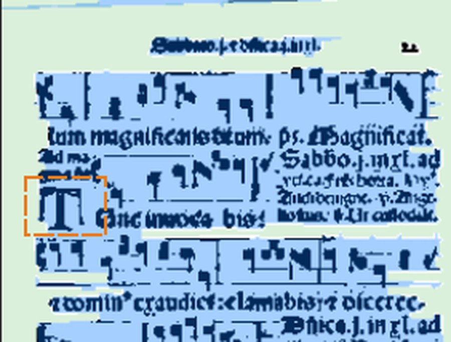

*Ferramenta Marcar: o quadrado laranja tracejado em volta do T* (tela nova (21/10))

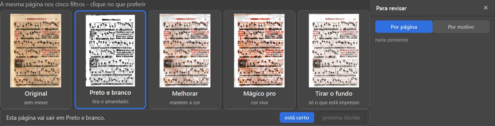

*Depois de "Trazer de volta nesta página": "Guardar tudo", aviso e marca sumiram; o painel diz "nada pendente"* (tela nova (21/10))

## 2. Antiphonal 46: a tela mostra a letra T, o PDF sai sem ela (defeito grave, já existia)

O que você está escolhendo: se este defeito é grave. A escolha do conserto está na pergunta "A tela igual ao PDF", no fim da aba.

Caso real: na tela, a página 46 aparece com a letra T. No PDF que o programa gerou, a letra sumiu. É como uma prova de gráfica que mostra uma coisa e a impressão sai outra.

O aviso "Desenho apagado" diz a verdade; a imagem da tela é que engana, porque é desenhada pequena para ser rápida.

**O que olhar:** A letra T grande à esquerda: na tela ela aparece; na página do PDF, não.

Processei o livro na janela: no PDF a letra T sumiu mesmo. O "Ver de perto" continua mostrando a letra T.

*Ressalva:* Não foi mexido de propósito: depende da sua resposta à pergunta "A tela igual ao PDF".

*Tela nova, "Ver de perto" do Preto e branco: o T ainda aparece inteiro (no PDF ele some)* (tela nova (21/10))

## 3. Graduale 222: "Guardar só o texto" apaga a música (funciona; a marca é a página toda)

O que você está escolhendo: se o aviso do "Guardar só o texto" ficou como você pediu na rodada 5.

Caso real: no Graduale 222, quem escolhe "Guardar só o texto" perde as pautas. O programa avisa, marca de laranja e mostra "Trazer de volta nesta página": um clique e só essa página volta a guardar a música.

O que ficou diferente: você pediu "aparece marcado como apareceu na segunda opção", que era um retângulo em volta de uma pauta. Aqui o laranja é um contorno em volta da página inteira, porque o botão traz de volta a página toda.

**O que olhar:** O cartão do Preto e branco sem as pautas, o contorno laranja e o botão "Trazer de volta nesta página".

No jeito de fábrica ("Guardar a tinta forte") a página 222 não tem aviso. Trocando para "Guardar só o texto", o aviso aparece; o botão devolve só essa página para "Guardar a tinta forte". As outras páginas não mudam.

*Ressalva:* Conferido num pedaço de 7 páginas do Graduale (219 a 225); na janela a página se chama 4.

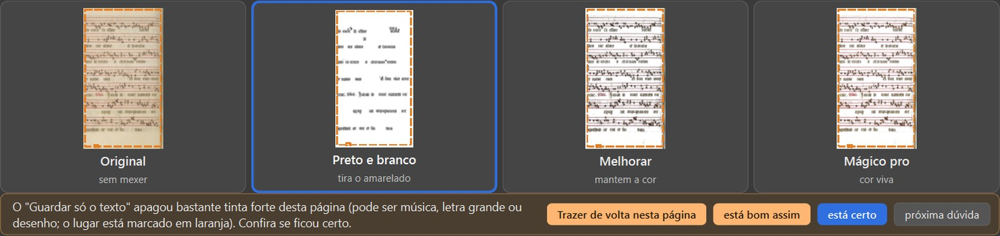

*Ampliado: Graduale 222 em "Guardar só o texto", a música some, o contorno laranja e o aviso* (tela nova (21/10))

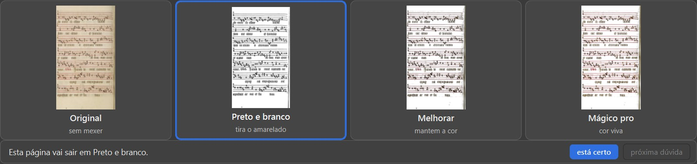

*Depois do botão: a música voltou ("Guardar a tinta forte") e o aviso sumiu* (tela nova (21/10))

## 4. Egenloff 12 e Rariora 8: página sem conteúdo (funciona)

O que você está escolhendo: se o aviso da página sem conteúdo ficou como você pediu (os dois botões, "Deixar em branco" e "Tirar do livro").

Caso real: o verso do Egenloff 12 só tem a mancha da página de trás. "Deixar em branco" põe uma folha branca no lugar (o livro fica com o mesmo número de páginas); "Tirar do livro" apaga a página.

Há um terceiro botão, "está bom assim", que não estava na sua escolha: ele tira só o aviso e deixa a página como está. Foi posto porque o aviso às vezes erra (quadro da Gladstone 18).

**O que olhar:** Os três botões: "Deixar em branco", "Tirar do livro" e "está bom assim".

Os três voltam com Ctrl+Z.

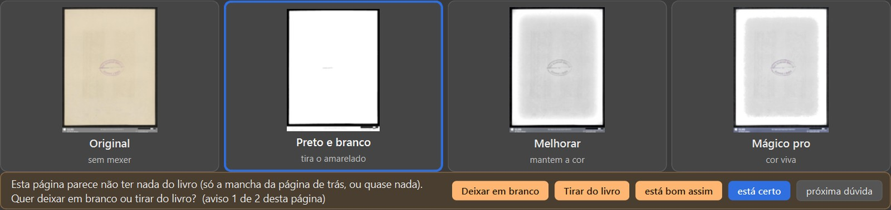

*Ampliado: Egenloff 12, o aviso e os três botões* (tela nova (21/10))

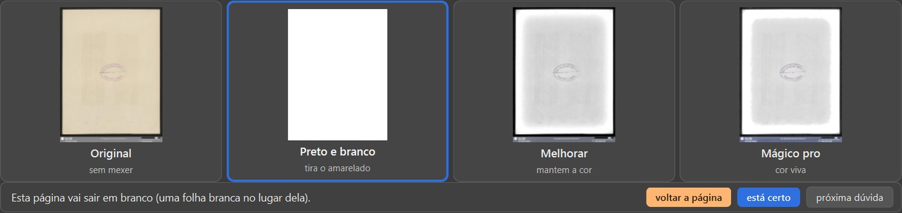

*Depois de "Deixar em branco": folha branca no lugar e o botão "voltar a página"* (tela nova (21/10))

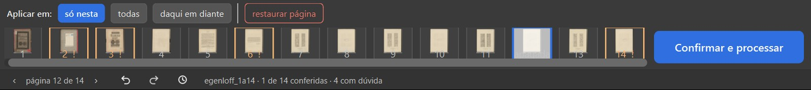

*Depois de "Tirar do livro": a página 12 fica apagada na tira e o botão vira "restaurar página"* (tela nova (21/10))

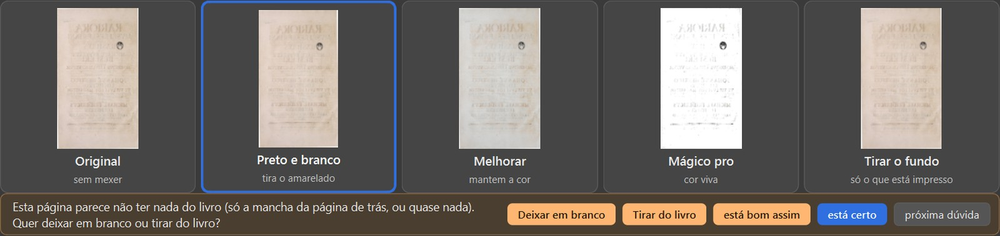

*Rariora 8: o mesmo aviso, com os três botões* (tela nova (21/10))

## 5. Gladstone 18: "Parece em branco" numa página com título (erro conhecido, com saída)

O que você está escolhendo: se os dois avisos separados ("Parece em branco" e "Página sem conteúdo") ficaram como você pediu.

Caso real, e é um erro: a Gladstone 18 tem o título "DA ORAÇÃO", e o programa diz que ela parece em branco, oferecendo "Tirar do livro". O erro já estava na Lista de bugs.

O que mudou: agora o aviso tem também "está bom assim", que deixa a página como está.

**O que olhar:** A página tem o título "DA ORAÇÃO" e mesmo assim vem o aviso "Parece em branco".

O aviso errado continua; com o terceiro botão há uma saída certa.

*Ressalva:* O conserto do aviso em si fica para a Lista de bugs (não era deste trabalho).

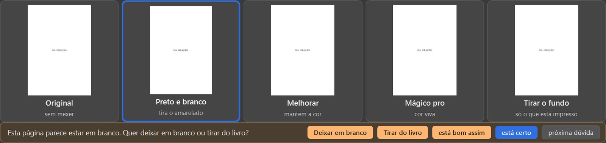

*Gladstone 18: "Parece em branco" numa página com o título "DA ORAÇÃO"* (tela nova (21/10))

## 6. Camões 27: a força do preto sozinha (funciona)

O que você está escolhendo: se a força do preto sozinha ficou como você pediu ("Força sozinha", até o reconhecimento de tintas do item 1.4).

Caso real: no Camões 27 várias linhas saíam falhadas. O programa escureceu a força só nessa página (de "normal" para "bem forte"), avisou e deixou o botão "Desfazer".

Uma regra a mais, decidida pela gerente para não estragar página boa: a força só muda sozinha quando 4 linhas ou mais saem falhadas, e só fica se as falhas diminuírem. Nas 89 páginas do estudo ela agiu em duas (Camões 27 e 104); nas outras com texto falhado fica só o aviso, com o botão "usar mais escuro".

**O que olhar:** O medidor em "bem forte", o aviso "escureci a força do preto só nela" e o botão "Desfazer".

Com a força já em 85, o botão "usar mais escuro" não aparece. Há uma caixinha na tela "O que fazer" para desligar a força sozinha no livro.

*Ressalva:* A caixinha só aparece rolando a lista de opções. Com a força em 85, a frase do aviso "Texto falhado" ainda diz "tente a força do preto mais escura" (Lista de bugs).

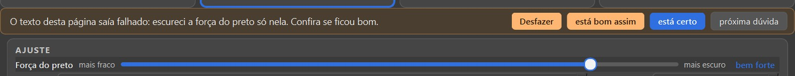

*Camões 27: o aviso, o botão "Desfazer" e a força em "bem forte"* (tela nova (21/10))

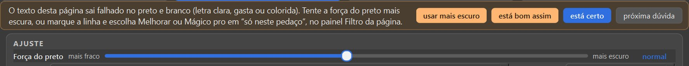

*Depois do "Desfazer": força normal e o aviso "Texto falhado" com "usar mais escuro"* (tela nova (21/10))

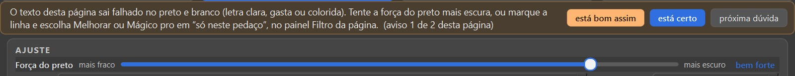

*Egenloff 3 depois de "usar mais escuro": o botão sumiu, fica "está bom assim"* (tela nova (21/10))

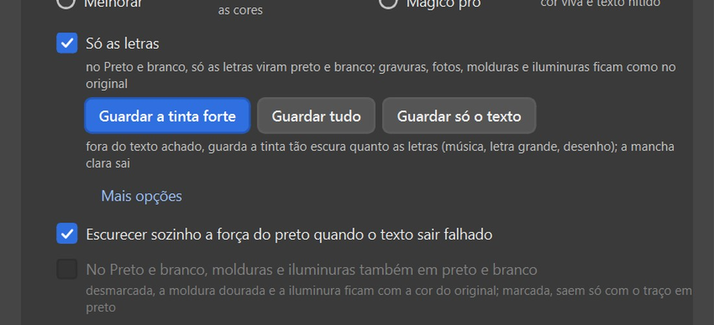

*Tela "O que fazer": a caixinha "Escurecer sozinho a força do preto...", logo abaixo do "Só as letras"* (tela nova (21/10))

## 7. Palatino 66: a força não mexe mais; fica o aviso (melhorou)

O que você está escolhendo: se está bom a página de caligrafia ficar só com o aviso, sem a força mudar sozinha.

Caso real: na primeira versão, o programa escurecia sozinho a força nesta página e sujava a moldura. Agora ele não mexe: mostra "Texto falhado" e o botão "usar mais escuro", e quem decide é o Kaique.

A página continua indo para a lista sem precisar: é uma das cinco que decidem diferente do estudo que você aprovou.

**O que olhar:** O medidor em "normal" e o aviso "Texto falhado" com "usar mais escuro".

Agora não estraga nada; o aviso fica.

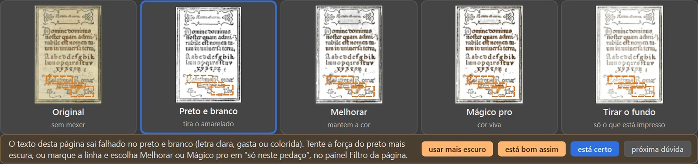

*Palatino 66: o aviso "Texto falhado", força normal, os botões* (tela nova (21/10))

## 8. A janela "Antes de processar" (funciona; contagens em pergunta)

O que você está escolhendo: se a janela que aparece ao processar com avisos ficou como você pediu ("Lista as páginas e os motivos").

Caso real: no Camões, ao clicar em "Confirmar e processar", a janela lista "Página N - motivo" e "Folha N - motivo", com "ver" (vai para a página e não processa) e "continuar assim mesmo" (segue até "Ficou pronto!").

A frase de cima diz quantas páginas e quantos avisos: "75 páginas (104 avisos na lista)". Os números de três telas não batem: é a pergunta "As contagens", no fim da aba.

**O que olhar:** As linhas "Página N - motivo" e os botões "ver" e "continuar assim mesmo".

Fechar no X não processa.

*Ressalva:* A lista junta os avisos novos com os de sempre; agora toda linha diz "Página N" (antes misturava "Folha N"). Só mostra as páginas já visitadas: é a pergunta "Quando medir".

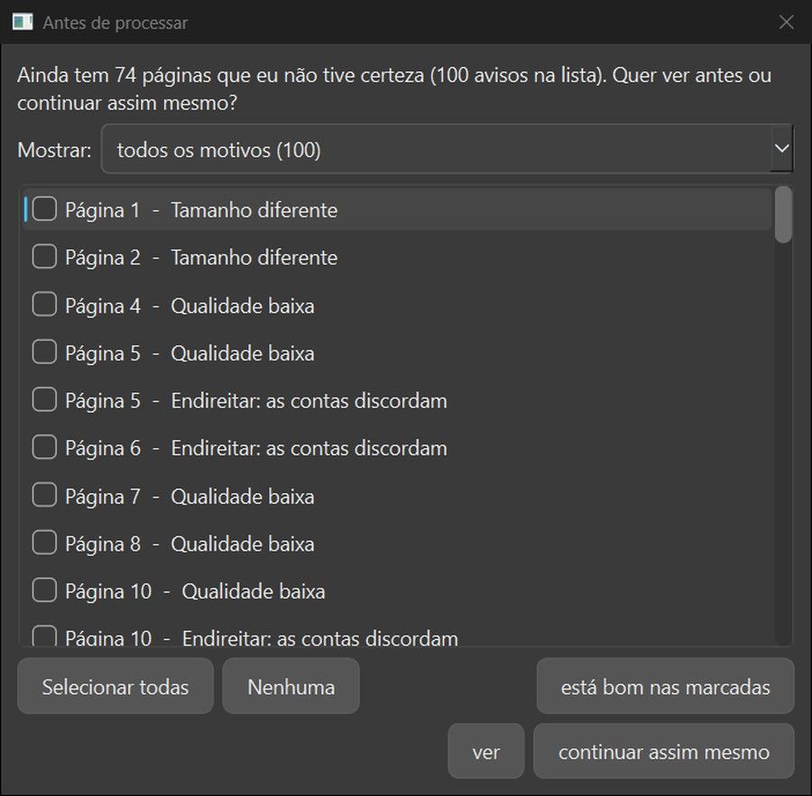

*Camões: a lista agora só fala em "Página N" (100 linhas)* (tela nova (21/10))

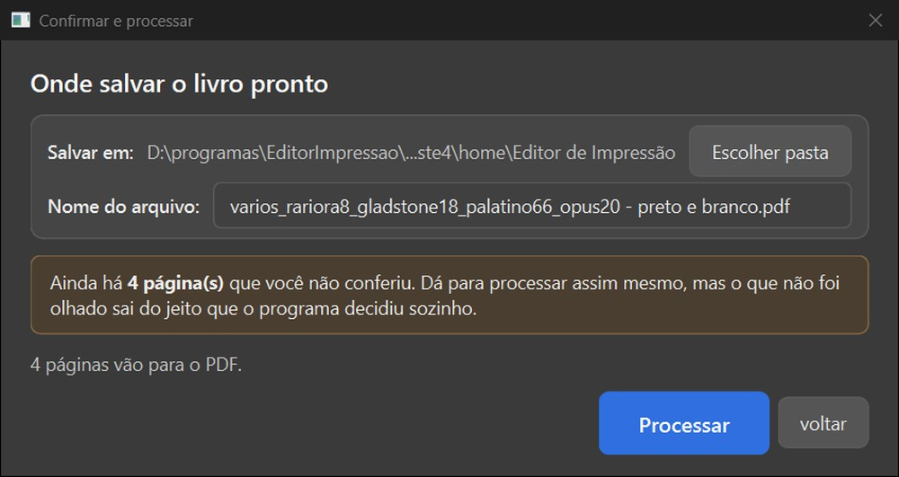

*Depois de "continuar assim mesmo": a janela de salvar* (tela nova (21/10))

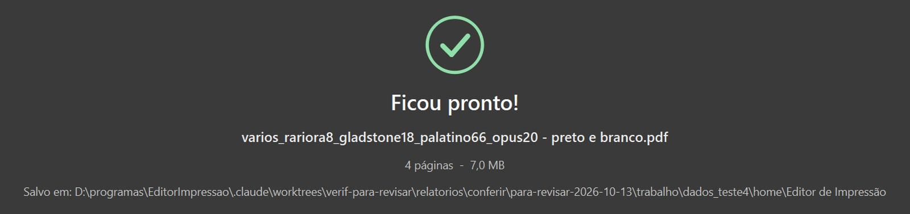

*"Ficou pronto!" (livro de 4 páginas, todas com aviso)* (tela nova (21/10))

## 9. "Está bom" numa página, num motivo, em todas e em tudo (funciona; FOTOS A TROCAR)

O que você está escolhendo: se dar "está bom" nos avisos ficou como você pediu na rodada 4.

Caso real (Egenloff): "está bom assim" tira um aviso de uma página; "está bom: todas" tira um motivo do livro inteiro; "está bom em tudo" limpa a lista; na lista grande dá para marcar várias linhas e dar "está bom nas marcadas". O Ctrl+Z desfaz cada um.

Quando o problema é resolvido (por exemplo, "Guardar tudo" na página da letra que sumiu), o aviso some sozinho.

**O que olhar:** O número do painel "Para revisar" descendo em cada nível.

Um motivo de uma página: de 31 para 30 avisos. Um motivo em todas: de 31 para 6. Em tudo: "tudo certo". Na lista grande, duas linhas marcadas: de 31 para 29.

*Ressalva:* Conferido de novo em 21/10, depois do conserto: "está bom em tudo" se desfaz com um Ctrl+Z só (Camões: "tudo certo" e, depois do Ctrl+Z, de volta os 98 e o painel com 35).

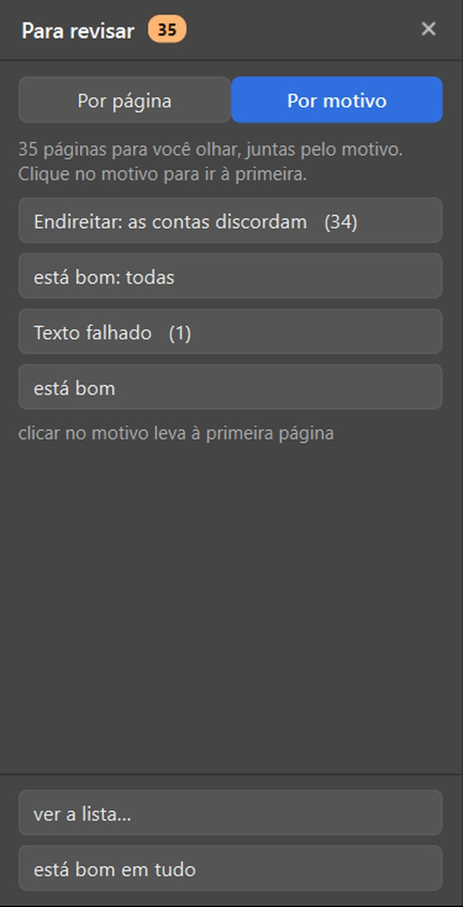

*O painel novo "Para revisar", em "Por motivo" (Camões)* (tela nova (21/10))

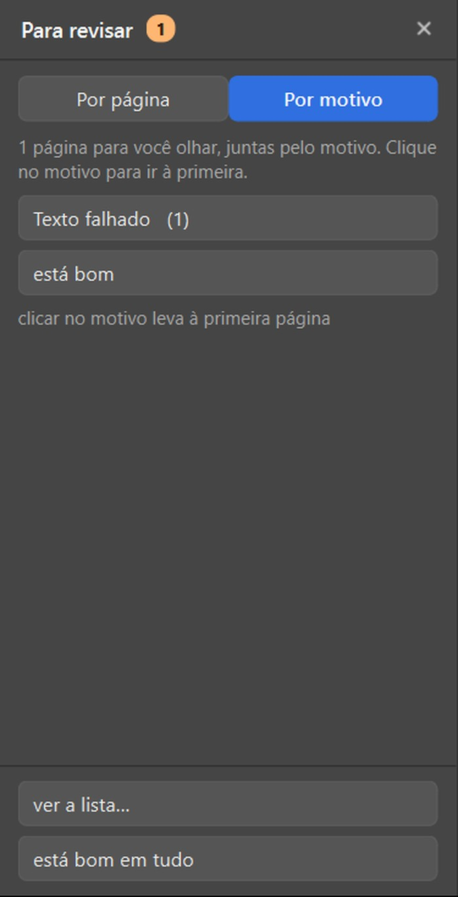

*Depois de "está bom: todas" no motivo do endireitar: sobra 1* (tela nova (21/10))

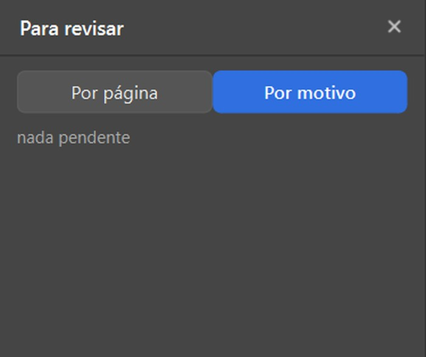

*Depois de "está bom em tudo": "nada pendente"* (tela nova (21/10))

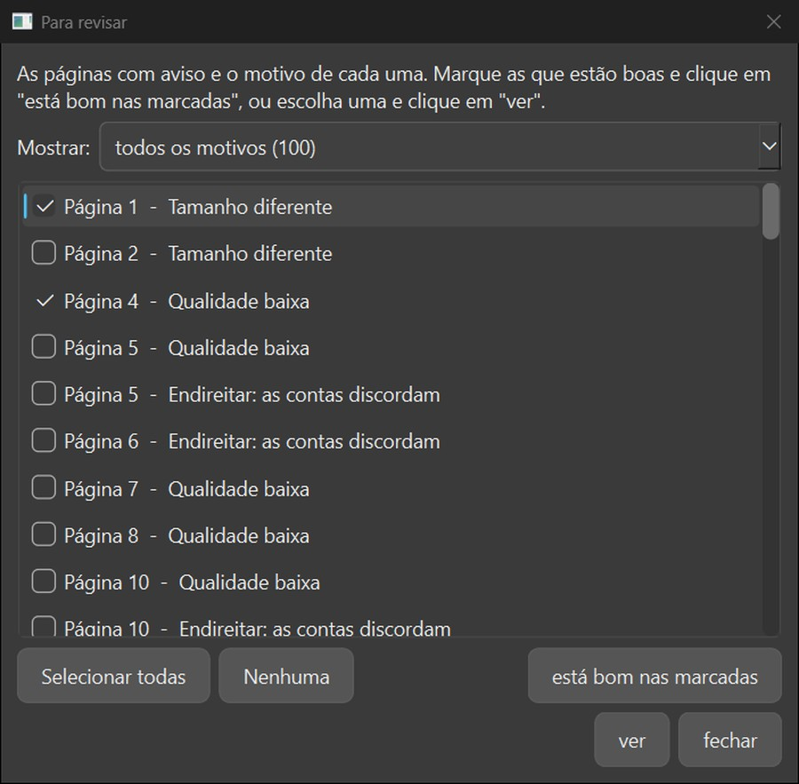

*"ver a lista…": a lista grande com duas linhas marcadas* (tela nova (21/10))

## 10. Graduale 221: as 89 páginas decidem igual na tela e na conta (consertado; 22 e 75)

O que você está escolhendo: se aceita o resultado da regra como está, um pouco abaixo do que você aprovou.

Você aprovou a regra com 21 páginas indo para a lista e 78 decididas certo, das 89 do estudo. Com o preparo do livro novo (endireitar antes de cortar), dá 22 e 75: três páginas certas a menos.

As cinco que decidem diferente do estudo: Antiphon 260, Cursus 3, Matemática 72, Opus Majus 20 e Palatino 66. O erro desta página, o Graduale 221 com aviso na tela e sem aviso na conta, foi consertado.

**O que olhar:** Não há mais aviso nem marca laranja nesta página.

A medida usa sempre as áreas achadas na página do tamanho do PDF. Na janela e na conta direta as 89 páginas dão o mesmo resultado.

*Ressalva:* O Opus Majus 20, reaberto em 20/10, vai para a lista e devia ir (quadro do Opus Majus 20).

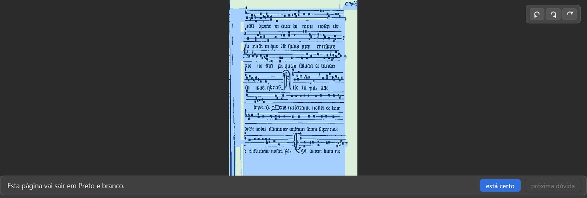

*Graduale 221 na tela nova: nenhum aviso* (tela nova (21/10))

## 11. Opus Majus 20: a foto da estátua sai estragada, e o aviso pega (aviso certo; a foto estraga (já estragava))

O que você está escolhendo: se está certo esta página ir para a lista com o aviso "Figura além da gravura".

Caso real: a foto da estátua de Roger Bacon. No PDF que o programa gerou, com Preto e branco e "Só as letras", a estátua sai branca, com manchas e blocos pretos: a foto foi estragada. O aviso manda conferir, e está certo. É como um alarme que toca porque há fumaça de verdade.

A foto já sai assim no programa de hoje (conferi: a mesma imagem, ponto por ponto). O que este trabalho muda é só o aviso, que antes dizia "Tinta forte fora do texto". Achar a foto inteira é o item 1.5 (detector de figuras), que você deixou no plano.

**O que olhar:** A estátua: inteira no livro, branca e manchada no PDF.

Reabri em 20/10 como livro novo, na janela, e processei até "Ficou pronto!".

*Ressalva:* Corrige o que eu tinha escrito em 13/10 ("a foto sai intacta, a página não precisava ir"): aquela foto era da imagem pequena da tela, não do PDF.

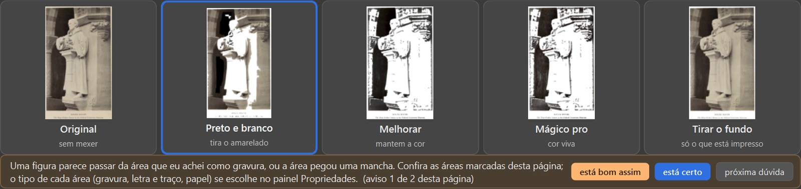

*Opus Majus 20 na tela nova: o aviso "Figura além da gravura"* (tela nova (21/10))

## 12. Cursus 3: a faixa preta da beirada sumiu com o conserto do corte (consertado pelo corte)

O que você está escolhendo: se está bom o Cursus 3 não ir mais para a lista.

Caso real: antes, o corte deixava uma faixa preta larga à direita e o aviso "Faixa escura na beirada" mandava conferir. Com o conserto do corte (que entrou no programa em 21/10), a faixa sumiu: a página sai limpa e não há mais o que avisar.

O aviso continua valendo para as páginas que ainda tiverem faixa.

**O que olhar:** A beirada direita da página, sem a faixa preta.

Reaberto em 21/10 na janela (folhas 1 a 10, livro novo): a página 3 não tem aviso nenhum.

*Ressalva:* Ficou uma linha preta fina na beirada esquerda, no cartão do Preto e branco.

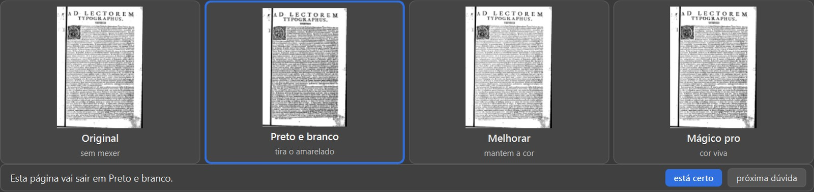

*Cursus 3 com o conserto do corte: a faixa preta sumiu e a página não vai mais para a lista* (tela nova (21/10))

## 13. Antiphon 260: agora vai para a lista (agora vai para a lista)

O que você está escolhendo: se o aviso que o Antiphon 260 ganhou está bom.

Caso real: antes esta página escapava (ficava só com o aviso do Endireitar). Com o conserto do corte, ela vai para a lista com "Figura além da gravura": a iluminura ou a faixa embaixo passa da área marcada.

Pela regra que você aprovou ela devia ir: agora vai.

**O que olhar:** O aviso "Figura além da gravura" e a faixa preta embaixo, no cartão do Preto e branco.

Reaberto em 21/10 na janela, as folhas 256 a 264 (a página 5 é a 260).

*Ressalva:* No cartão do Preto e branco a iluminura fica em cor (o "Só as letras" guarda), mas embaixo sobra uma faixa preta.

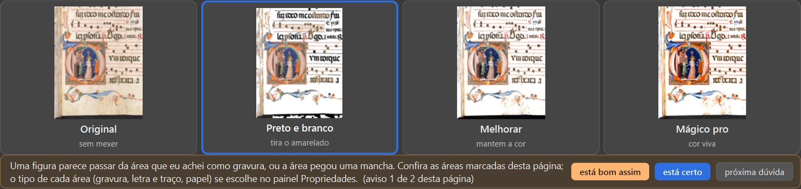

*Antiphon 260 com o conserto do corte: o aviso "Figura além da gravura"* (tela nova (21/10))

## 14. Camões 66: as linhas pretas da beirada, sem aviso (sem aviso)

O que você está escolhendo: se pode esperar o corte (item 2.13) para este aviso existir.

Você decidiu: "São as linhas pretas: aviso no livro basta". Hoje o Camões não recebe esse aviso, nem na página nem no livro: as linhas são finas demais para a conta da faixa. Elas continuam saindo no resultado.

O único aviso da página 66 é o do Endireitar.

**O que olhar:** As linhas finas pretas nas beiradas do Preto e branco, e o aviso, que é só o do Endireitar.

Reabri em 20/10 na janela e visitei também 65, 67, 27 e 104: em nenhuma veio aviso de faixa ou de linhas. O 27 e o 104 receberam a força sozinha (85), como esperado.

*Ressalva:* O plano já diz que isto depende do corte (item 2.13).

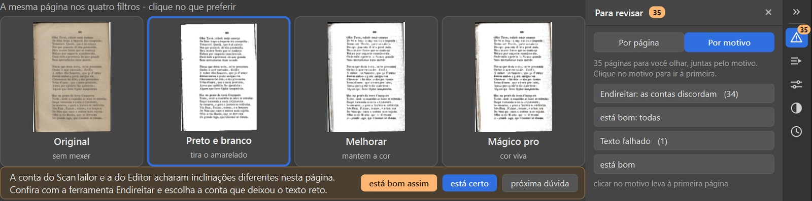

*Camões 66 na tela nova: só o aviso do endireitar, nada sobre as linhas da beirada* (tela nova (21/10))

## 15. Aba Marcar: as áreas se acertam sozinhas (novo, para saber)

O que você está escolhendo: se está bom as áreas da ferramenta Marcar mudarem sozinhas alguns segundos depois de chegar numa página.

Caso real: no Graduale 221 a ferramenta Marcar mostra 9 áreas ao chegar; uns 10 segundos depois, o programa troca por 18, achadas na página do tamanho do PDF. É como um rascunho que é passado a limpo sem ninguém pedir.

Uma área marcada à mão nesse intervalo continuou lá depois da troca. Nada avisa que o programa ainda está procurando.

**O que olhar:** As áreas azuis (letra) e verdes (papel) antes e depois.

Na tela nova continua igual: a página chega com a marcação da prévia e, segundos depois, se acerta sozinha (Graduale 223: 9 áreas, 13 s depois 10; Graduale 221: 18 áreas ao fim). O retângulo marcado à mão no meio continua.

*Ressalva:* Não testei apagar ou mexer numa área do programa nesse intervalo, só marcar uma nova.

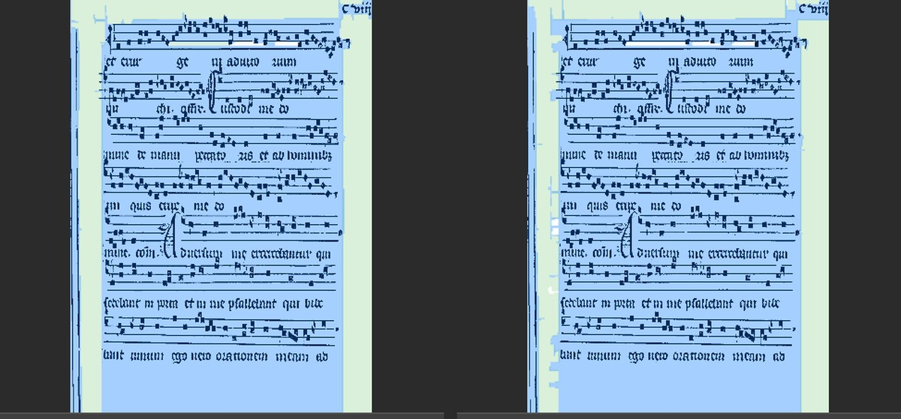

*Graduale 223, ferramenta Marcar: ao chegar (9 áreas) e 13 s depois (10 áreas)* (tela nova (21/10))

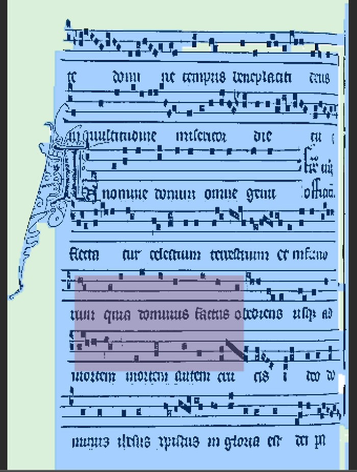

*Graduale 224: o retângulo marcado à mão antes do acerto (em rosa) continuou depois* (tela nova (21/10))

## 16. Dois cliques no cartão não tiram mais o aviso (consertado)

O que você está escolhendo: se o conserto está bom.

Na primeira versão, dois cliques no cartão do filtro gravavam uma ação vazia e o aviso sumia. Agora os dois cliques só abrem o "Ver de perto" e o aviso continua.

**O que olhar:** Depois dos dois cliques, o aviso e os botões laranja continuam na tela.

Nada foi gravado no histórico.

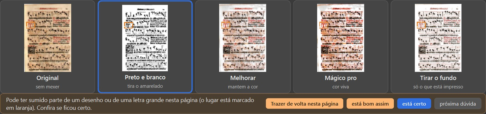

*Depois dos dois cliques no cartão (abre o "Ver de perto"): o aviso e os botões continuam* (tela nova (21/10))

## 17. O teclado depois de clicar num botão do aviso (espaço sim; seta como antes)

O que você está escolhendo: se o conserto do teclado está bom.

Na primeira versão, depois de clicar num botão do aviso, a barra de espaço apertava o botão de novo. Agora o botão não fica com o teclado, e a barra de espaço faz "está certo e avança".

A seta para a direita só troca de página quando o teclado não está na tira de miniaturas nem no medidor da força: esses dois usam a seta (a tira rola; o medidor muda a força do preto daquela página). Isso já era assim no programa de hoje.

**O que olhar:** Depois de "Deixar em branco" e da barra de espaço, o programa passou para a página 13.

Depois de clicar em "está bom assim" o botão não fica com o teclado (nenhum widget com o foco), e a barra de espaço faz "está certo e avança": a página 12 ficou conferida e a 13 escolhida.

*Ressalva:* A seta foi conferida na janela de teste, que nunca fica ativa, e pelo código (a tecla vai primeiro para quem está com o teclado). A conclusão não depende da janela estar ativa, mas não testei com o teclado de verdade.

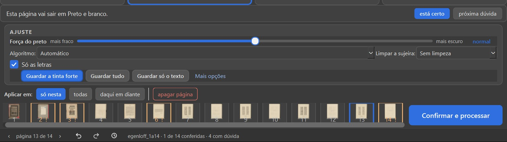

*Depois de "está bom assim" e da barra de espaço: a página 12 conferida e a 13 escolhida* (tela nova (21/10))

## 18. Projeto feito antes desta mudança (abre igual)

O que você está escolhendo: se está bom o que acontece com um livro começado antes desta mudança.

Caso real: um projeto do programa de hoje, com o aviso antigo "Tinta forte fora do texto" em 8 páginas, aberto no programa novo. Abriu em 7 segundos, o aviso antigo sumiu sozinho e os avisos novos vieram ao visitar cada página. A força sozinha vem desligada nesses livros.

**O que olhar:** No programa novo, a página 3 mostra "Texto falhado" com a força em "normal".

Projeto feito agora com o código do fase-1 (b6fd091) e aberto no ramo: abre direto, a força do preto sozinha fica desligada (força 50 em todas) e os avisos novos aparecem ao visitar a página. A prova por soma (abaixo) mostra que o PDF sai igual.

*Ressalva:* O projeto salvo ganhou campos novos, todos com valor padrão. Projeto de antes de 09/10 não foi conferido (só existe na sua pasta de dados).

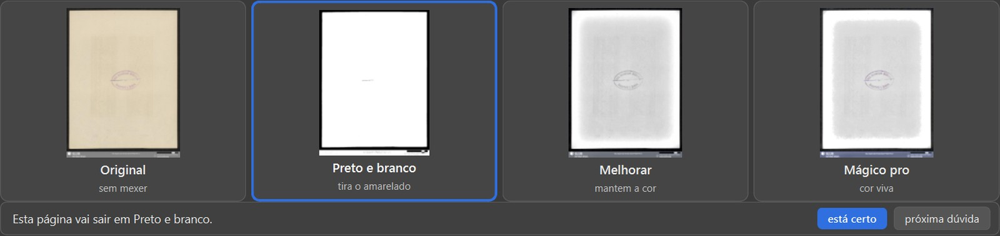

*Projeto feito no programa de hoje (fase-1): Egenloff 12 sem aviso* (tela nova (21/10))

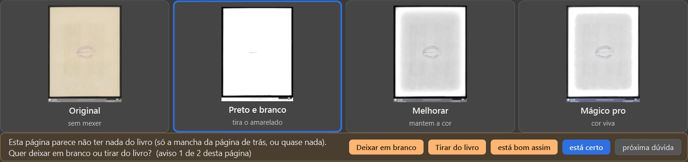

*O mesmo projeto no ramo: os avisos novos aparecem e a força continua normal (a força sozinha fica desligada)* (tela nova (21/10))
