# Segunda conferência do "Para revisar" (Fase 2), 13/10/2026, terminada em 20/10/2026

Verificador. Ramo `fase2-para-revisar`, commit `ce2b835`, em livro novo (endireitar antes de cortar). Pilotei a janela de verdade com mouse e teclado nativos, em 1280 x 657, com pasta de dados de teste. **Não mudei código e não marco nada como aprovado.**

## Veredito

**PRONTO PARA CONFERIR no que o ramo faz: os consertos valem na janela, confirmados de novo em 20/10 (as 19 imagens e as quatro páginas). MAS a conferência NÃO deve ir ao Samuel com estas fotos: elas são da tela de antes do layout que ele aprovou (no fase-1 desde 14/10), e o ramo não se junta ao fase-1 sem conflito (ui/tela_conferir.py e ui/widgets/paineis.py). Antes: juntar, acertar as palavras dos avisos e refazer as fotos. Corrigido o parecer do Opus Majus 20: a foto sai estragada no PDF e o aviso está certo.**

## O que mudou para o Kaique

O programa passa a avisar, página por página, quando o "Só as letras" do Preto e branco pode ter estragado alguma coisa: um desenho ou letra grande que sumiu, texto que saiu falhado, página que não tem nada do livro. Cada aviso traz o botão do conserto: "Trazer de volta nesta página", "Deixar em branco", "Tirar do livro", "Desfazer".

Quando o texto sai muito falhado (4 linhas ou mais), o programa escurece sozinho a força do preto só naquela página e avisa; dá para desfazer, e há uma caixinha para desligar na tela "O que fazer". Ao clicar em "Confirmar e processar" com avisos sem olhar, aparece a lista "Página N - motivo", com "ver" e "continuar assim mesmo".

O Kaique pode dizer "está bom" numa página, num motivo de uma página, num motivo em todas ou em tudo, e o Ctrl+Z desfaz. Novo desta rodada: os avisos de página em branco ganharam o botão "está bom assim", e na aba Marcar as áreas que o programa achou se acertam sozinhas uns 10 segundos depois de chegar numa página nova.

## O que está bom e as ressalvas

- RETOMADA 20/10: abri as 19 imagens que faltavam, uma a uma (todas batem com o parecer), e, para comparar com as decisões do Samuel, as 66 imagens citadas nos quadros.
- RETOMADA 20/10: reabri na janela, com o ce2b835, Opus Majus 20, Cursus 3, Antiphon 260 e Camões 66. Três confirmam o parecer; o Opus Majus 20 o desmente (ver abaixo).
- RESSALVA GRAVE: as fotos da janela são da tela antiga (abas Bordas/Endireitar/Marcar/Filtro, "só nas próximas", painel antigo). O layout aprovado está no fase-1 desde 14/10 e a junção dá conflito em ui/tela_conferir.py e ui/widgets/paineis.py (git merge-tree). Mostrar estas fotos ao Samuel repetiria o erro de 09 e 12/10.
- RESSALVA: os textos novos dos avisos dizem "aba Marcar" e "aba Bordas"; o layout já trocou "aba Endireitar" por "ferramenta Endireitar" e "programa" por "Editor".
- RESSALVA: as quatro fotos do quadro "está bom" (esta-bom-1 a 4, da primeira conferência) mostram o que o ce2b835 já não faz: Egenloff 3 com a força escurecida sozinha e "usar mais escuro" com a força em "bem forte". Trocar.
- EM PARTE (contra as decisões do Samuel): letra grande que some (rv5-erro-1-desenho): o lugar aparece marcado, mas a marca laranja é só desenho, não uma seleção da aba Marcar que se ajusta, e o botão traz de volta a página inteira. "Guardar só o texto" (rv5-erro-6-so-texto): a marca contorna a página toda, não a pauta como na opção que ele apontou. Regra: 22 vão e 75 certas, contra 21 e 78 aprovados.
- CORREÇÃO: Opus Majus 20. Em 13/10 escrevi "a foto sai intacta, a página não precisava ir". Reaberto e processado em 20/10: no PDF a foto da estátua sai destruída; o aviso "Figura além da gravura" está certo. O fase-1 desenha a página igual (o estrago já existia).
- BOM: Graduale 221 não recebe mais o aviso errado, e as 89 páginas dão 22 vão e 75 certas tanto direto quanto na ordem da janela (antes: 24 e 73 na janela).
- BOM: dois cliques no cartão do filtro abrem o "Ver de perto" e não mexem em nada; o aviso continua.
- BOM: "Parece em branco" e "Página sem conteúdo" têm agora o terceiro botão, "está bom assim" (Gladstone 18, Egenloff 12, Rariora 8).
- BOM: os botões do aviso não ficam mais com o teclado; depois do clique a barra de espaço faz "está certo e avança".
- BOM: a frase da lista diz "75 páginas (104 avisos na lista)"; "usar mais escuro" some quando a força já está em 85.
- BOM: a força do preto sozinha ficou cautelosa: age no Camões 27 e no 104; no Palatino 66, no Egenloff 3 e no Camões 11 fica só o aviso "Texto falhado".
- BOM: na aba Marcar, a área marcada à mão enquanto o programa ainda procurava continuou lá depois do acerto.
- BOM: processar até "Ficou pronto!" e abrir um projeto da primeira conferência continuam funcionando no programa novo.
- RESSALVA: depois de folhear 12 páginas com "Só as letras", o programa continua trabalhando por trás de 44 a 47 segundos; no programa de hoje, de 8 a 9. A troca de página em si não ficou mais lenta.
- RESSALVA: a tela continua mostrando a letra T que o PDF apaga (Antiphonal 46). Virou pergunta para o Samuel.
- RESSALVA: a lista "Antes de processar" continua só com as páginas visitadas. Pergunta para o Samuel.
- RESSALVA: painel, lista e janela de salvar contam coisas diferentes (Camões: 39, 75 e 106). Pergunta para o Samuel.
- RESSALVA: continuam como estavam, sem ser deste conserto: o "Parece em branco" errado da Gladstone 18, a faixa preta do Cursus 3 (é do corte), a iluminura do Antiphon 260 sem aviso e as linhas pretas do Camões 66.
- VELOCIDADE: o Mágico pro +1,1% foi mandado pelo Samuel para a Fase 5 (19/10: "vamos deixar esse concerto de lentidão para o final, para a fase de desempenho"). Não medi de novo.
- AMBIENTE: o Cursus inteiro (402 folhas, livro novo) parou duas vezes na análise com MemoryError (alocar 1,4 MB) e o aviso genérico "Aconteceu um problema inesperado"; logo depois o PC tinha 4 GB livres, com outros 7 agentes trabalhando. Não sei dizer se é do programa ou do PC; o pedaço de 10 folhas abriu normal.

## O que foi conferido

| O que | Como | Resultado |
|---|---|---|
| 1. A medida não depende mais da prévia (Graduale 221; as 89 páginas) | janela + máquina | Vale. Graduale 221 sem aviso; 22 vão e 75 certas nos dois caminhos, nenhuma página diferente. |
| 2. Dois cliques no cartão do filtro | janela | Vale. Abre o "Ver de perto", não grava ação, o aviso continua. |
| 3. "está bom assim" em "Parece em branco" e "Página sem conteúdo" | janela | Vale nas três páginas (Gladstone 18, Egenloff 12, Rariora 8); Ctrl+Z desfaz. |
| 4. Teclado depois do clique no botão do aviso | janela (nunca ativa) + código | Em parte, e agora explicado. O botão do aviso não fica com o teclado e a barra de espaço faz "está certo e avança". A seta: o programa só troca de página quando a tecla chega à janela principal (ui/janela_principal.py, keyPressEvent); antes ela passa por quem está com o teclado, e a tira de miniaturas (rola) e o medidor da força (muda a força da página, que o programa grava sozinho uns instantes depois) usam a seta. Isso não depende da janela estar ativa, e é igual no fase-1. Não testei com o teclado de verdade (não tomo o teclado do Samuel). |
| 5. Frase da janela "Antes de processar" | janela | Vale: "75 páginas (104 avisos na lista)". As três contagens continuam diferentes (pergunta). |
| 6. "usar mais escuro" com a força em 85 | janela | Vale: o botão não aparece (Egenloff 3). |
| 7. Força do preto sozinha, mais cautelosa | janela | Vale. Camões 27 e 104: age. Palatino 66, Egenloff 3 e Camões 11: só o aviso. |
| 8. Aba Marcar se acerta sozinha | janela | Acontece: Graduale 221, 9 áreas viram 18 em 10,7 s. A área marcada à mão no intervalo não se perdeu. |
| Processar até "Ficou pronto!" no programa novo | janela | Com aviso pendente, "continuar assim mesmo" e "Processar": "Ficou pronto!" em 8 s, PDF com 6 páginas, erros.log vazio. |
| Folhear com "Só as letras" (hoje contra o ramo) | janela | Trocar de página: igual ou melhor. Por trás depois de parar: 44 a 47 s contra 8 a 9 s. |
| Velocidade (Marial de 300 folhas, 2 rodadas de cada, alternadas) | máquina | Mais lento em: Processar 10 páginas em Mágico pro Decidido pelo Samuel em 19/10: fica para a Fase 5 ("vamos deixar esse concerto de lentidão para o final"). |
| As 19 imagens novas (20/10) | olho | Abertas uma a uma; todas batem com o parecer. Lista em "Retomada de 20/10". |
| Opus Majus 20, reaberto (20/10) | janela + PDF + máquina | Aviso certo; a foto sai destruída no PDF (já saía no fase-1). Corrige o parecer de 13/10. |
| Cursus 3, Antiphon 260, Camões 66, reabertos (20/10) | janela | Confirmam o parecer. |
| As fotos contra as decisões do Samuel (20/10) | olho | Fotos de tela antiga (layout aprovado não está no ramo); 4 desatualizadas; 2 escolhas dele "em parte". Ver conferencia-aba4. |

## Quadro por quadro

### Antiphonal 46: a letra T que some (funciona)

**O que olhar:** O aviso laranja, o quadradinho laranja em volta da letra T nos cartões e o botão "Trazer de volta nesta página".

O aviso aparece sozinho uns 8 segundos depois de chegar na página, com o lugar marcado em laranja. O botão troca só essa página para "Guardar tudo", o aviso some e a página sai da lista. O Ctrl+Z desfaz.

**Ressalva:** Em 1280 x 657 os cartões são pequenos: a marca laranja quase não se vê e o nome do filtro fica escrito por cima da miniatura. No tamanho de maximizada aparece bem. Repare que no cartão a letra T continua lá: é o defeito do quadro seguinte. Decisão do Samuel: rv5-erro-1-desenho (09/10): "Botão 'Trazer de volta nesta página'" + "eu acho que pode ser a opção 1, mas onde sumiu, tem que aparecer selecionado automaticamente, como na opção 3" (a opção 3 era o retângulo 'letra e traço' da aba Marcar). Bate com a decisão: em parte: o botão sim; o lugar aparece marcado, mas não como uma seleção que se ajusta. Fotos: tela antiga.

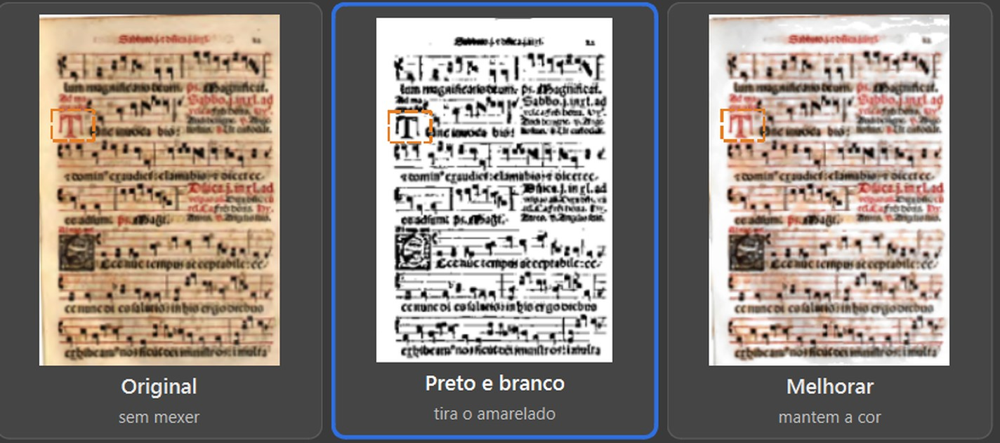

*A marca laranja em volta da letra T nos cartões (ampliado, janela no tamanho de maximizada)*

*Os cinco cartões, o aviso e os dois botões*

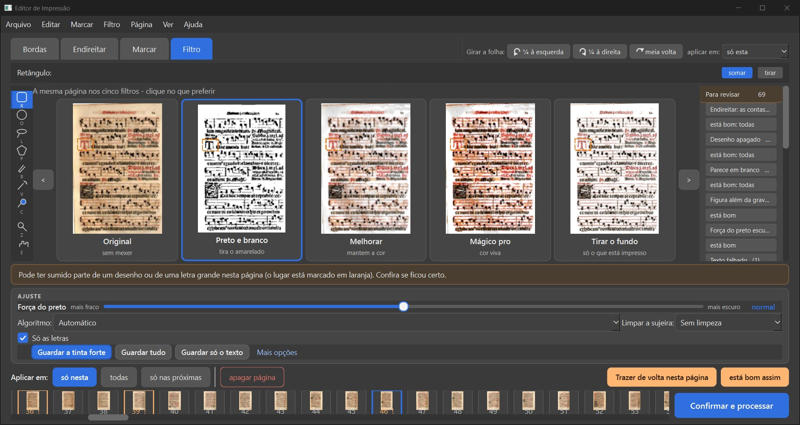

*A tela inteira no tamanho de janela maximizada (1920 x 1020), página 46 de 298*

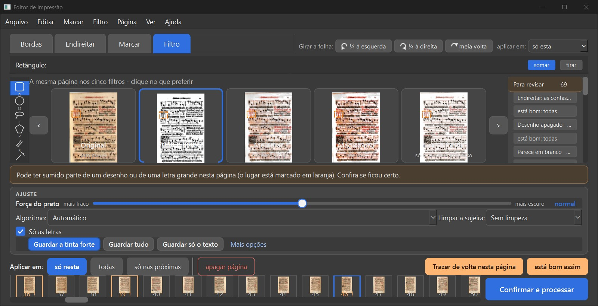

*A mesma tela em 1280 x 657: os cartões ficam pequenos e o nome do filtro fica por cima da miniatura*

*Depois de "Trazer de volta nesta página": "Guardar tudo" ligado, aviso e marca sumiram*

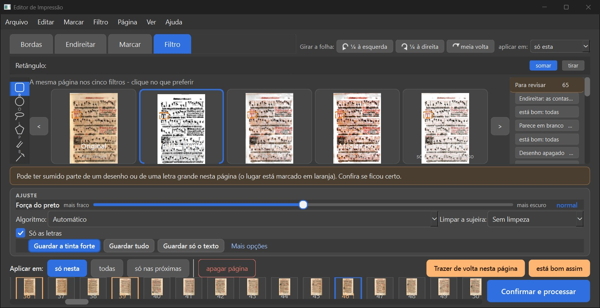

*Depois do Ctrl+Z: o aviso e os botões voltaram*

### A tela mostra a letra T, o PDF sai sem ela (defeito grave)

**O que olhar:** A letra T grande à esquerda: na tela ela aparece; na página do PDF que saiu, não.

O aviso diz a verdade, a tela não. A página que aparece na tela é desenhada pequena, e nesse tamanho a letra T fica. O PDF é desenhado grande, e nele a letra some. Processei o livro na janela: no PDF a letra T sumiu mesmo.

**Ressalva:** Não foi mexido nesta rodada, de propósito: é a pergunta "A tela igual ao PDF", mais abaixo. Conferi de novo no programa novo: o "Ver de perto" continua mostrando a letra T. Decisão do Samuel: Sem decisão ainda (pergunta nova desta aba). Bate com a decisão: não se aplica. Fotos: vale.

*O mesmo pedaço da página 46: à esquerda o "Ver de perto" da janela; à direita o PDF que o programa gerou*

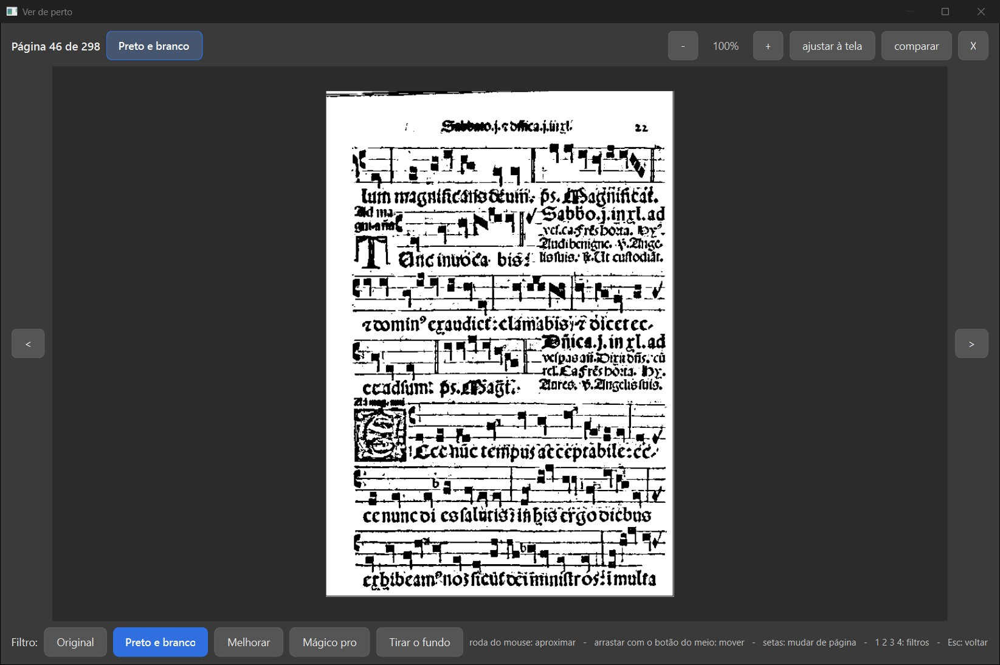

*O "Ver de perto" inteiro, com o aviso de pé: a letra T está lá*

*A página inteira tirada do PDF gerado pela janela: no lugar da letra T sobrou um tracinho*

*No programa novo (segunda conferência): o "Ver de perto" da mesma página continua com a letra T*

### Graduale 222: "Guardar só o texto" apaga a música (funciona)

**O que olhar:** O cartão do Preto e branco sem as pautas, a marca laranja na página inteira e o botão "Trazer de volta nesta página".

No jeito de fábrica ("Guardar a tinta forte") a página 222 não tem aviso nenhum. Trocando para "Guardar só o texto", o aviso aparece e o botão devolve só essa página para "Guardar a tinta forte". As outras páginas não mudam.

**Ressalva:** Usei um pedaço de 7 páginas do Graduale (219 a 225), para não abrir as 750 folhas. Na janela a página se chama 4. Decisão do Samuel: rv5-erro-6-so-texto (09/10): "Botão 'Trazer de volta nesta página'" + "opção 1, mas aparece marcado como apareceu na segunda opção." (a segunda opção mostrava um retângulo em volta de uma pauta). Bate com a decisão: em parte: o botão sim; a marca é a página inteira, não as pautas. Fotos: tela antiga.

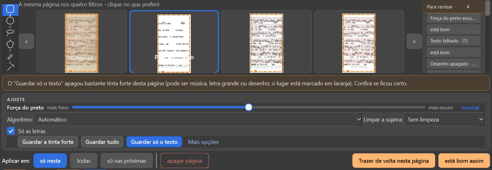

*O aviso do "Guardar só o texto", com a marca laranja (ampliado)*

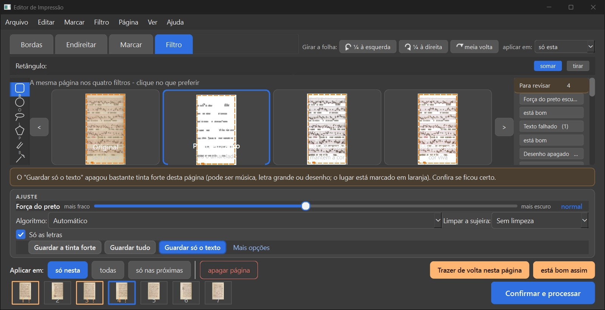

*A tela inteira*

*Depois do botão: a música voltou e o aviso sumiu*

### Egenloff 12 e Rariora 8: página sem conteúdo (funciona)

**O que olhar:** Os três botões: "Deixar em branco", "Tirar do livro" e, novo, "está bom assim".

"Deixar em branco" põe uma folha branca no lugar (o livro continua com o mesmo número de páginas). "Tirar do livro" apaga a página. "está bom assim" tira só esse aviso da lista e deixa a página como está. Os três voltam com Ctrl+Z.

**Ressalva:**  Decisão do Samuel: rv5-erro-5-sem-conteudo (09/10): "Os dois botões: 'Deixar em branco' e 'Tirar do livro'"; rv4-pag-rariora-008: "Vai para a lista, com botão"; rv4-pag-egenloff-012: "Concordo". Bate com a decisão: sim (com um botão a mais, "está bom assim"). Fotos: tela antiga.

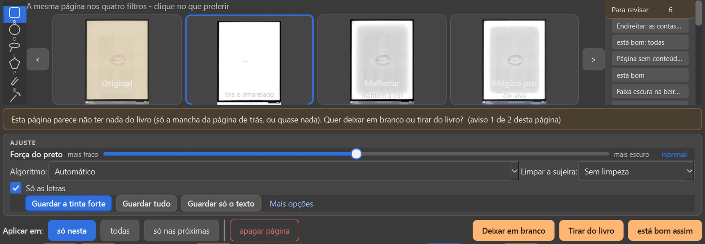

*Egenloff 12: o aviso e os três botões (ampliado)*

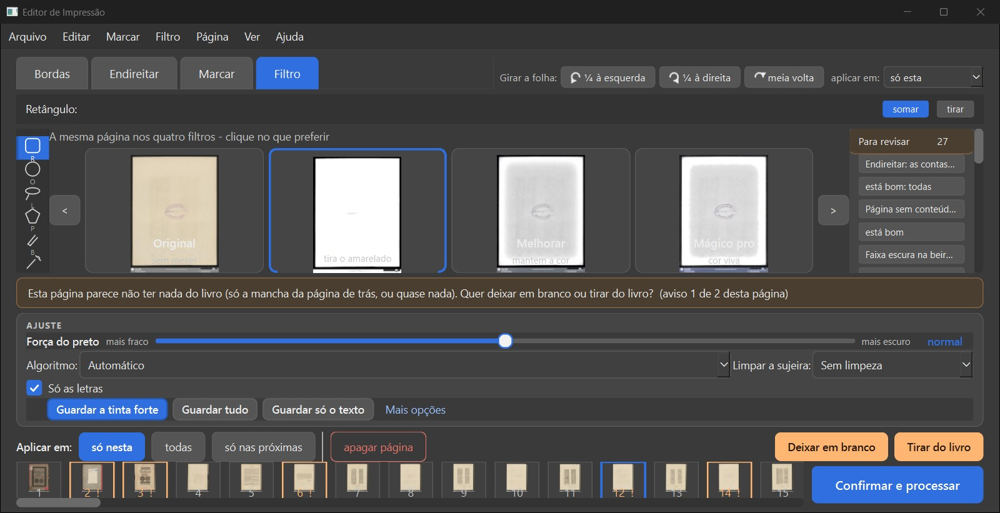

*A tela inteira*

*Depois de "Deixar em branco": folha branca no lugar e botão "voltar a página" (print da primeira conferência)*

*Depois de "Tirar do livro": a página 12 fica apagada na tira (print da primeira conferência)*

*Rariora 8: o mesmo aviso, com os três botões*

### Gladstone 18: "Parece em branco" numa página com título (erro conhecido, com saída)

**O que olhar:** A página tem o título "DA ORAÇÃO" e mesmo assim o programa pergunta se quer deixar em branco ou tirar do livro.

O erro da Gladstone 18 continua (já está na Lista de bugs e não era deste trabalho): a página tem título e o programa diz que parece em branco. O que mudou: agora o aviso tem o botão "está bom assim", que deixa a página como está.

**Ressalva:** O aviso errado continua vindo com "Tirar do livro" ao lado. Com o terceiro botão há saída certa; o conserto do aviso em si fica para a Lista de bugs. Decisão do Samuel: rv4-em-branco: "Tem que ter um tipo de aviso para cada coisa, e um botão de apagar folha e outro realmente de só mudar para um folha branca."; rv5-em-branco (08/10): "Fica assim". Bate com a decisão: sim (o aviso errado na Gladstone 18 é bug à parte). Fotos: tela antiga, vale.

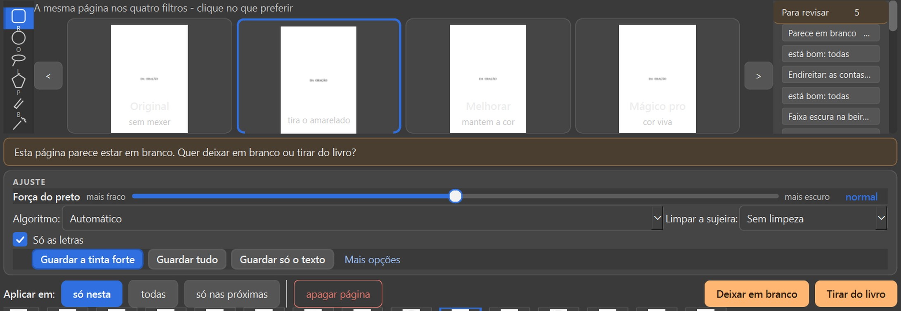

*Gladstone 18: "Parece em branco", agora com "está bom assim" (ampliado)*

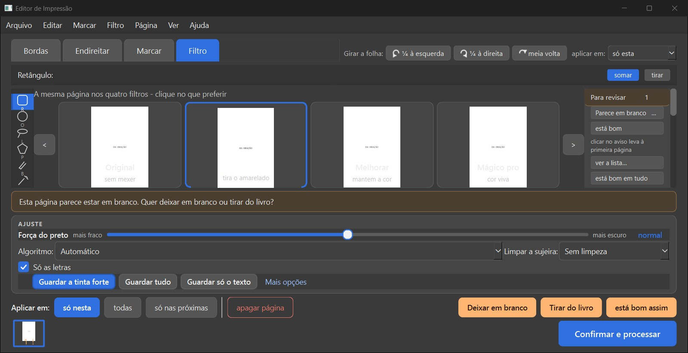

*A tela inteira*

*A página de perto: tem o título "DA ORAÇÃO"*

### Camões 27, Egenloff 3 e Palatino 66: a força do preto sozinha, mais cautelosa (funciona)

**O que olhar:** O medidor em "bem forte", o aviso "escureci a força do preto só nela" e o botão "Desfazer".

A força só muda sozinha quando 4 linhas ou mais saem falhadas. No Camões 27 e no 104 ela vai de 50 para 85 e avisa, com "Desfazer". No Egenloff 3, no Palatino 66 e no Camões 11 ela não mexe mais: fica só o aviso "Texto falhado", com o botão "usar mais escuro". Com a força já em 85, esse botão não aparece.

**Ressalva:** A caixinha só aparece depois de rolar a lista de opções para baixo. No Egenloff 3, com a força em 85, a frase do aviso ainda diz "tente a força do preto mais escura". Decisão do Samuel: rv4-erro-4-texto-falhado: "Força sozinha" + "mas temos que melhorar o reconhecimento de tintas, para não sair falhado assim, não precisar usar sempre o reforço."; rv5-erro-4-tintas (09/10): "Fica no plano; até lá, a força sozinha". Bate com a decisão: sim, com o limite de 4 linhas (decisão técnica da gerente, a confirmar com você). Fotos: tela antiga, vale.

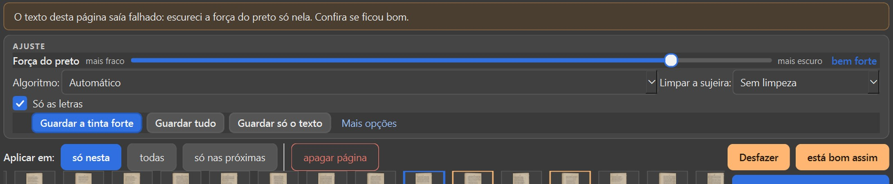

*Camões 27: o aviso, o medidor em "bem forte" e o "Desfazer" (ampliado)*

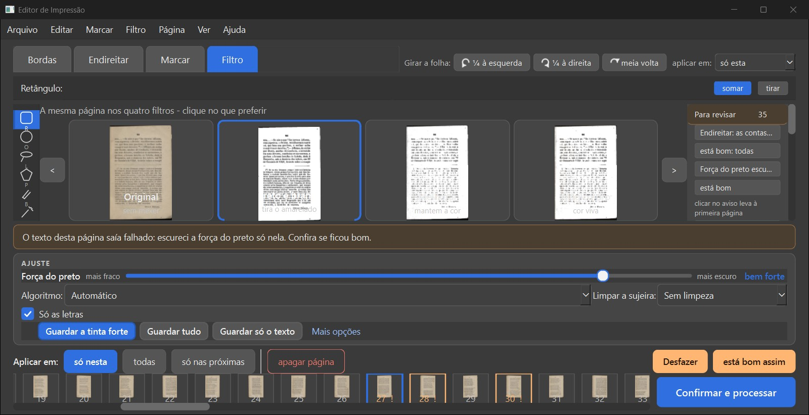

*A tela inteira*

*Depois do "Desfazer": força normal e o aviso "Texto falhado" (print da primeira conferência)*

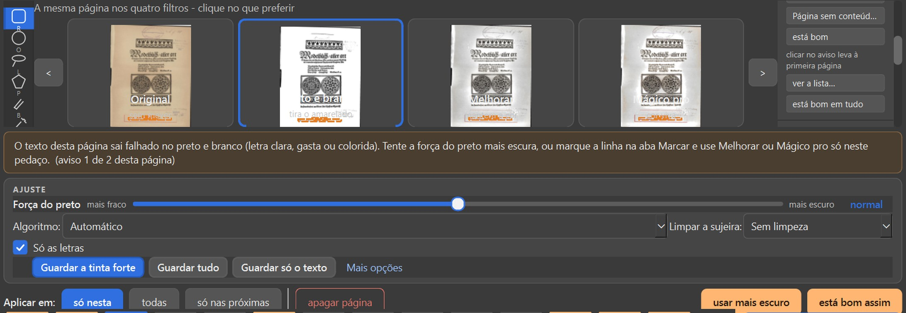

*Egenloff 3 agora: só o aviso "Texto falhado", força normal*

*Egenloff 3 depois de "usar mais escuro": o botão sumiu, fica "está bom assim"*

*A caixinha "Escurecer sozinho a força do preto quando o texto sair falhado"*

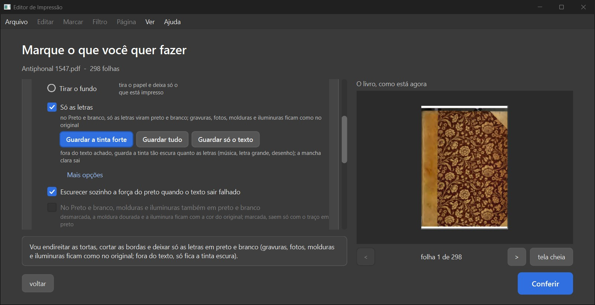

*A tela "O que fazer" inteira*

### A janela "Antes de processar" (funciona, contagens em pergunta)

**O que olhar:** As linhas "Página N - motivo", e os botões "ver" e "continuar assim mesmo".

"ver" leva à página e não processa. "continuar assim mesmo" segue para escolher a pasta e processa até "Ficou pronto!". Fechar no X não processa. A frase de cima agora diz quantas páginas e quantos avisos: "75 páginas (104 avisos na lista)".

**Ressalva:** A lista continua juntando os avisos novos com os de sempre (Camões: 104 linhas, 4 da regra nova). E os três números continuam diferentes: é a pergunta "As contagens", mais abaixo. Decisão do Samuel: rv5-aviso-so-texto (08/10): "Lista as páginas e os motivos"; rv4-aviso-so-texto: "quando alguém tentar imprimir sem ver os alertas o programa para e mostra os alertas e a pessoa diz se quer ver ou continuar". Bate com a decisão: sim. Fotos: vale.

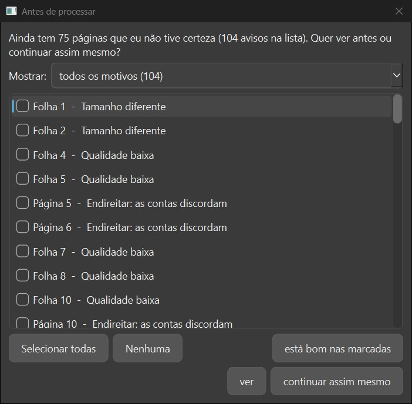

*Camões: a frase nova, "75 páginas (104 avisos na lista)"*

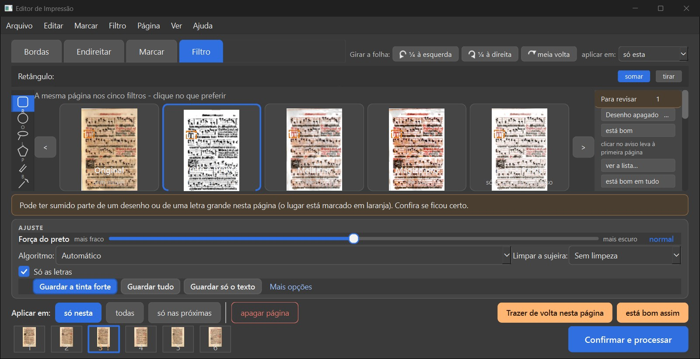

*Depois de "ver": o programa foi para a página do aviso e não processou*

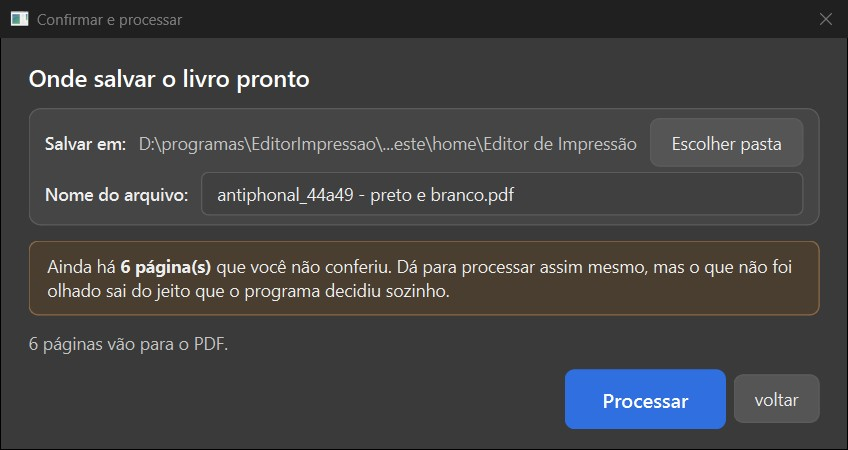

*Depois de "continuar assim mesmo": a janela de salvar*

*"Ficou pronto!"*

### "Está bom" em cada nível, com Ctrl+Z (funciona)

**O que olhar:** O número do painel "Para revisar" e o contador de páginas descendo em cada nível.

Um motivo de uma página: de 31 para 30 avisos, e o aviso seguinte da página aparece. Um motivo em todas: de 31 para 6. Em tudo: "tudo certo". Na lista grande, marquei duas linhas e dei "está bom nas marcadas": de 31 para 29. O Ctrl+Z desfez cada um.

**Ressalva:** Os botões "ver a lista…" e "está bom em tudo" ficam no fim do painel e só aparecem rolando a coluna da direita. Decisão do Samuel: rv4-aviso-so-texto: "Eu tenho que conseguir fazer isso com uma pagina individual, com um motivo individual de uma pagina e com todas as paginas ou com todos os motivos de todas as paginas, e eu devo conseguir abrir um selecionador em aba grande [...] quando eu resolver aquele problema, o programa já vai automaticamente ver que eu resolvi?" Bate com a decisão: sim. Fotos: desatualizada. As quatro fotos deste quadro são da primeira conferência e mostram o Egenloff 3 com a força escurecida sozinha ("bem forte", "Força do preto escurecida" na lista) e, na esta-bom-1, o botão "usar mais escuro" com a força já em "bem forte". Os dois mudaram no ce2b835: o Egenloff 3 fica só com o aviso. Refazer no programa juntado.

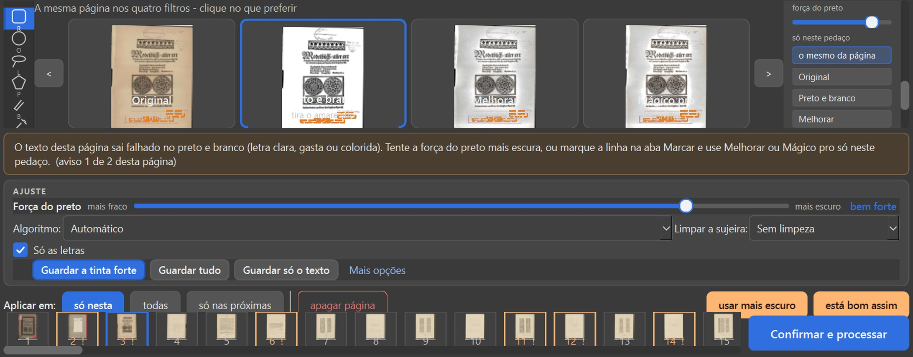

*Egenloff 3 depois de "está bom assim" no primeiro aviso: agora mostra o segundo (aviso 1 de 2)*

*Depois de "está bom: todas" no motivo do endireitar: sobram 4 páginas*

*Depois de "está bom em tudo": nenhuma página marcada na tira*

*A lista grande com duas linhas marcadas*

### Graduale 221: a janela voltou a decidir igual à conferência das 89 (consertado)

**O que olhar:** Não há mais aviso nem marca laranja nesta página.

Na primeira conferência a janela dava "Desenho apagado" aqui, e medindo direto não dava. Agora a medida usa sempre as áreas achadas na página do tamanho do PDF. Na janela a página ficou sem aviso, e as 89 páginas dão o mesmo resultado nos dois caminhos.

**Ressalva:** O resultado é 22 vão e 75 certas, não os 21 e 78 combinados com o Samuel: 5 páginas ainda decidem diferente do estudo no livro novo (Antiphon 260, Cursus 3, Matemática 72, Opus Majus 20, Palatino 66). Isso já estava escrito pelo implementador. Decisão do Samuel: rv4-resumo: "Fica assim" (a regra ajustada: 21 vão, 78 certas). Bate com a decisão: em parte: 22 vão e 75 certas, contra 21 e 78 aprovados. Fotos: tela antiga.

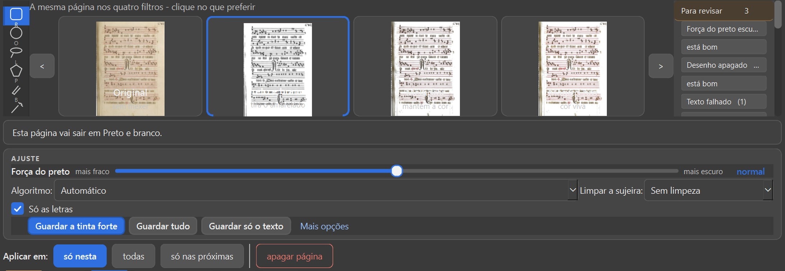

*Graduale 221 na janela, depois do conserto: sem aviso (ampliado)*

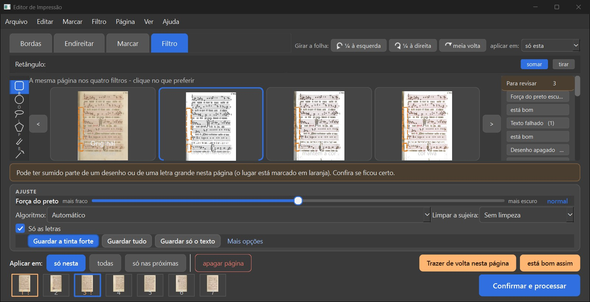

*A tela inteira (página 3 do pedaço de 7 páginas)*

### Cursus 3: a faixa preta da beirada vai para a lista (aviso certo)

**O que olhar:** A faixa preta à direita da página e a linha preta à esquerda.

Caso real: no livro novo, o corte do Cursus 3 deixa uma faixa preta larga à direita e uma linha preta à esquerda. O aviso conta isso e manda conferir o corte. O defeito é do corte (o endireitar antes de cortar, já no programa), não do aviso. O conserto do corte está em outro trabalho, que você marcou "Melhorar" (decisão cg6). Se ele entrar antes, esta página muda. Reabri em 20/10 na janela: o aviso é só o da faixa.

**Ressalva:** O livro inteiro do Cursus (402 folhas) parou duas vezes na análise, por falta de memória no PC ("Aconteceu um problema inesperado"); reabri pelas 10 primeiras folhas, como livro novo. Decisão do Samuel: rv4-erro-3-faixa: "Os dois jeitos estão bons"; corte: cg6 "Melhorar" (13/10). Bate com a decisão: sim. Fotos: tela antiga, vale.

*Ampliado: Original e Preto e branco com a faixa preta à direita, e o aviso*

*A página como sai em Preto e branco, de perto*

### Opus Majus 20: a foto da estátua sai estragada, e o aviso pega (aviso certo; a foto estraga (já estragava))

**O que olhar:** A estátua: inteira no livro, branca e manchada no PDF.

Caso real: a foto da estátua de Roger Bacon. No PDF que o programa gerou, com Preto e branco e "Só as letras", a estátua sai branca, com manchas e blocos pretos: a foto foi estragada. O aviso manda conferir, e está certo. É como um alarme que toca porque há fumaça de verdade. A foto já sai assim no programa de hoje (conferi: a mesma imagem, ponto por ponto). O que este trabalho muda é só o aviso, que antes dizia "Tinta forte fora do texto". Achar a foto inteira é o item 1.5 (detector de figuras), que você deixou no plano. Reabri em 20/10 como livro novo, na janela, e processei até "Ficou pronto!".

**Ressalva:** Corrige o que eu tinha escrito em 13/10 ("a foto sai intacta, a página não precisava ir"): aquela foto era da imagem pequena da tela, não do PDF. Decisão do Samuel: rv5-erro-2-gravura (09/10): "Fica no plano (1.5 e 2.18)"; rv4-erro-2-gravura: "ele tem que ser mais acertivo para achar as figuras". Bate com a decisão: sim (o aviso vale; o conserto da foto é o 1.5). Fotos: tela antiga, vale.

*Ampliado: a página no livro e no PDF que o programa gerou*

*A janela: o aviso "Figura além da gravura" e, no cartão do Preto e branco, a estátua já estragada*

### Palatino 66: a força não mexe mais; fica o aviso (melhorou)

**O que olhar:** O medidor da força do preto em "normal" e o aviso "Texto falhado" com "usar mais escuro".

Antes o programa escurecia a força sozinho e sujava a moldura desta página de caligrafia. Agora não mexe: mostra o aviso "Texto falhado" e deixa a escolha para a pessoa.

**Ressalva:** A página continua indo para a lista sem precisar (é uma das 5 que decidem diferente do estudo), mas agora sem estragar nada. Decisão do Samuel: rv4-erro-4-texto-falhado: "Força sozinha" (o limite de 4 linhas é da gerente). Bate com a decisão: sim. Fotos: tela antiga, vale.

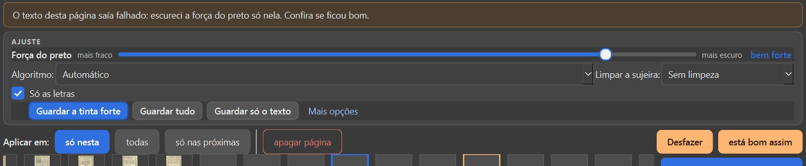

*Palatino 66 agora: força normal e o aviso "Texto falhado" (ampliado)*

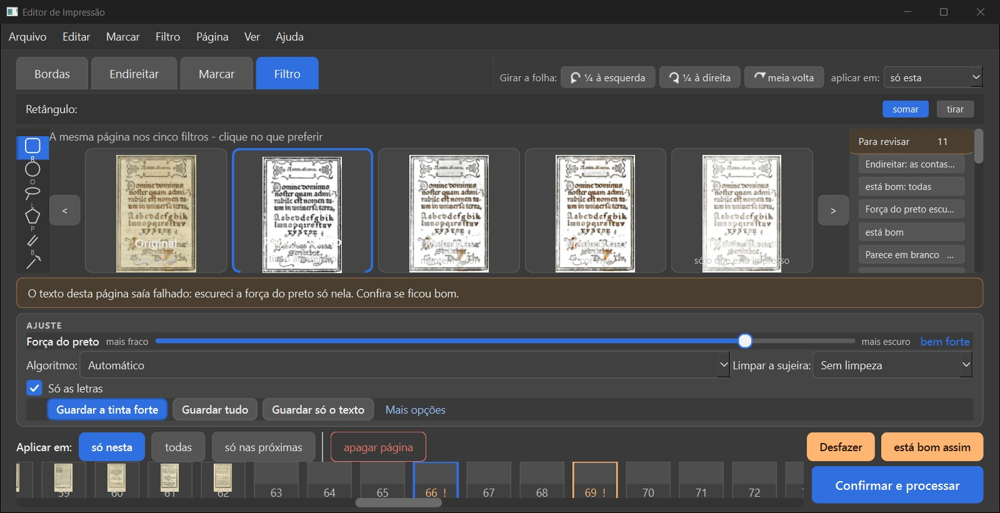

*A tela inteira*

*Como saía antes do conserto, com a força escurecida (print da primeira conferência)*

### Antiphon 260: a iluminura sai estragada e ninguém avisa (escapa)

**O que olhar:** A iluminura chapada no cartão do Preto e branco, e o aviso, que é só o do Endireitar.

Caso real: no Preto e branco a iluminura sai chapada, quase toda preta, e há uma faixa preta embaixo. Na primeira visita aparece o aviso da faixa; depois de visitar mais três páginas, a faixa vira aviso do livro inteiro e a página 260 fica só com o aviso do Endireitar. Pela regra que você aprovou ela devia ir para a lista. É uma das cinco que decidem diferente do estudo. Reabri em 20/10 na janela, as folhas 256 a 264: 1ª visita, faixa + Endireitar; depois de visitar 259, 261 e 262, só Endireitar. A frase do livro ("No livro inteiro: as páginas deste livro têm uma faixa...") fica meio escondida embaixo do título do painel.

**Ressalva:** O aviso da faixa aparece e some conforme a pessoa visita outras páginas (vira aviso do livro quando 70% das páginas medidas têm faixa). Cada página levou de 13 a 42 segundos para ser medida. Decisão do Samuel: rv4-resumo: "Fica assim" (pela regra aprovada esta página vai); rv5-erro-2-gravura: "Fica no plano (1.5 e 2.18)". Bate com a decisão: não: devia ir e não vai. Fotos: tela antiga, vale.

*Ampliado: Original e Preto e branco (iluminura chapada), e o único aviso*

*A página como sai em Preto e branco, de perto (primeira conferência)*

*A tela inteira depois de visitar outras páginas: a frase do livro meio escondida no alto do painel*

### Camões 66: as linhas pretas da beirada, sem aviso (sem aviso)

**O que olhar:** As linhas finas pretas nas beiradas do Preto e branco, e o aviso, que é só o do Endireitar.

Você decidiu: "São as linhas pretas: aviso no livro basta". Hoje o Camões não recebe esse aviso, nem na página nem no livro: as linhas são finas demais para a conta da faixa. Elas continuam saindo no resultado. O único aviso da página 66 é o do Endireitar. Reabri em 20/10 na janela e visitei também 65, 67, 27 e 104: em nenhuma veio aviso de faixa ou de linhas. O 27 e o 104 receberam a força sozinha (85), como esperado.

**Ressalva:** O plano já diz que isto depende do corte (item 2.13). Decisão do Samuel: rv4-pag-camoes-066: "São as linhas pretas: aviso no livro basta". Bate com a decisão: não (depende do 2.13, como está no plano). Fotos: tela antiga.

*Ampliado: Original e Preto e branco com as linhas finas nas beiradas, e o único aviso*

### Projeto feito antes desta mudança (abre igual)

**O que olhar:** No ramo, a página 3 mostra "Texto falhado" com a força em "normal": o programa não escureceu sozinho.

Criei um projeto no programa de hoje, com o aviso antigo "Tinta forte fora do texto" em 8 páginas, fechei e abri no ramo. Abriu em 7 segundos, o aviso antigo sumiu sozinho, a força do preto sozinha veio desligada e o erros.log ficou vazio.

**Ressalva:** Na segunda conferência abri no programa novo um projeto gravado pelo programa da primeira (sem o campo novo da marcação): abriu em 6 s, as áreas da aba Marcar ficaram como estavam (9 áreas ao chegar e 25 segundos depois) e o erros.log ficou vazio. Projeto de antes de 09/10 continua sem conferir (só existe na pasta de dados do Samuel). Decisão do Samuel: Não se aplica. Bate com a decisão: não se aplica. Fotos: tela antiga.

*No programa de hoje, página 12: o aviso antigo "Tinta forte fora do texto"*

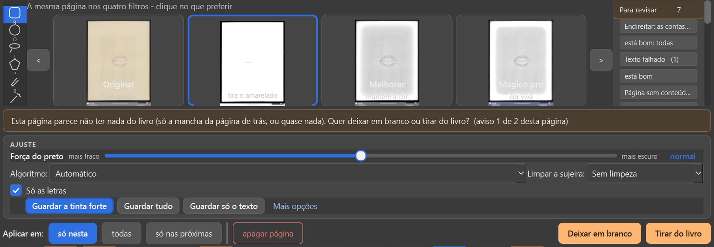

*O mesmo projeto no ramo, página 12: o aviso antigo sumiu e, depois de medir, veio "Página sem conteúdo"*

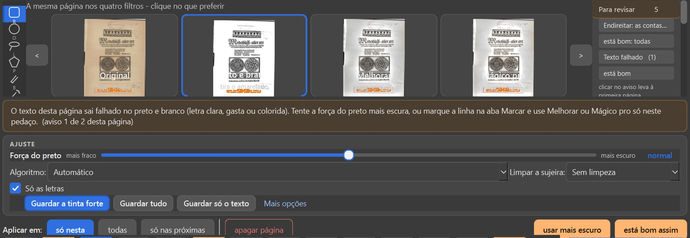

*No ramo, página 3: "Texto falhado", força normal, botão "usar mais escuro"*

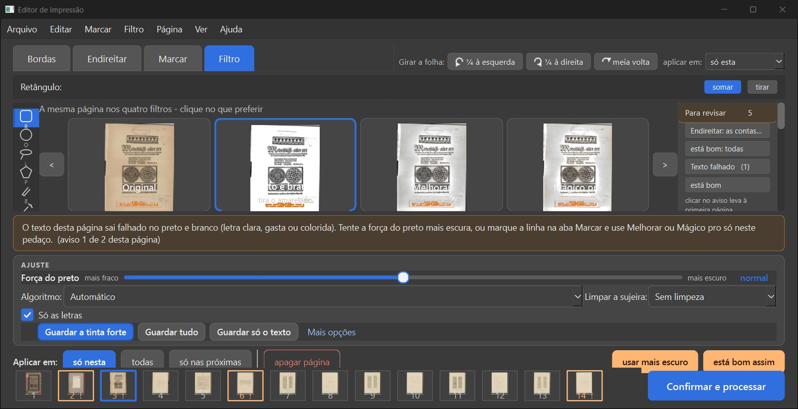

*A tela inteira*

### Aba Marcar: as áreas se acertam sozinhas (novo, para saber)

**O que olhar:** As áreas azuis (letra) e verdes (papel) mudam sozinhas uns 10 segundos depois de chegar na página.

Ao chegar numa página nova, a aba Marcar mostra as áreas achadas na página pequena da tela: 9 no Graduale 221. O programa procura de novo, por trás, na página do tamanho do PDF, e troca: 18 áreas, 10,7 segundos depois de chegar. Só acontece uma vez por página. Marquei um retângulo à mão nesse intervalo, na página 5, e ele continuou lá depois da troca.

**Ressalva:** Quem estiver olhando vê as áreas mudarem sem ter feito nada, e nada avisa que o programa ainda está procurando. Não testei apagar ou mexer numa área do programa nesse intervalo, só marcar uma nova. Decisão do Samuel: Não foi pedido por você: veio do conserto da medida (decisão técnica da gerente). Bate com a decisão: não se aplica. Fotos: tela antiga, vale.

*Graduale 221 na aba Marcar: ao chegar e 10,7 segundos depois*

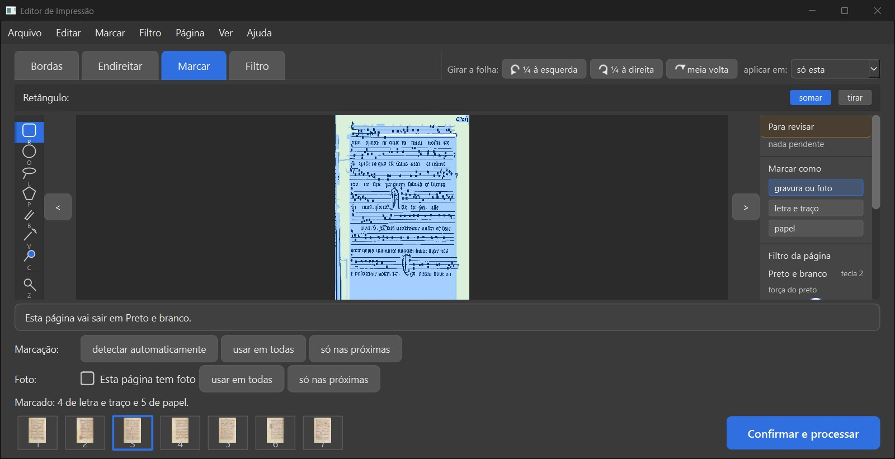

*A tela ao chegar: "Marcado: 4 de letra e traço e 5 de papel"*

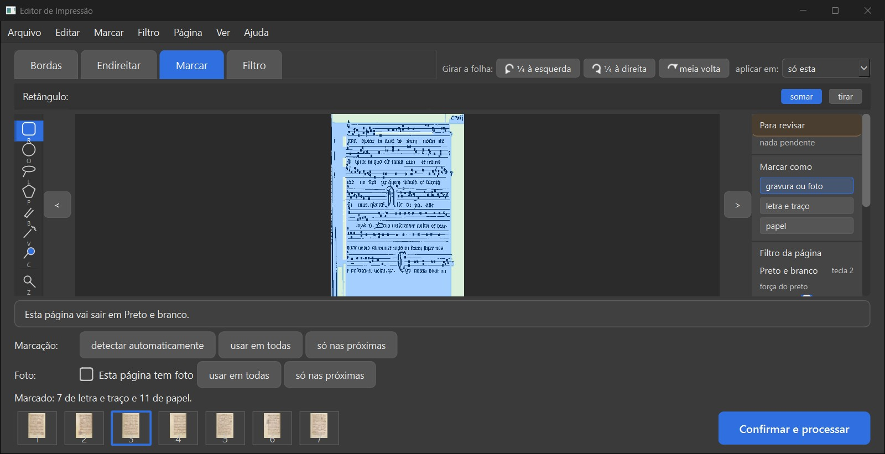

*A tela depois: "Marcado: 7 de letra e traço e 11 de papel"*

*Página 5: o retângulo que marquei à mão continuou depois do acerto (1 de gravura ou foto)*

### Dois cliques no cartão não tiram mais o aviso (consertado)

**O que olhar:** Depois dos dois cliques, o aviso e os botões laranja continuam na tela.

Dei dois cliques no cartão do Preto e branco na página da letra T. Abriu o "Ver de perto", nada foi gravado no histórico e o aviso continuou de pé.

**Ressalva:**  Decisão do Samuel: Conserto de um defeito achado na primeira conferência. Bate com a decisão: não se aplica. Fotos: tela antiga, vale.

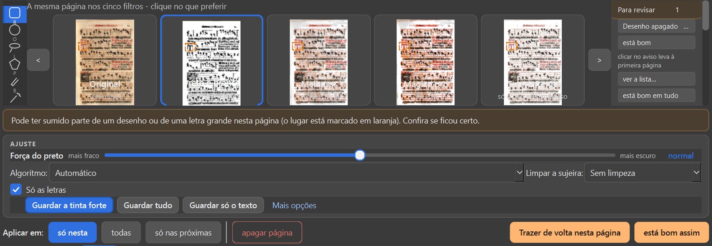

*Depois dos dois cliques e de fechar o "Ver de perto": o aviso continua (ampliado)*

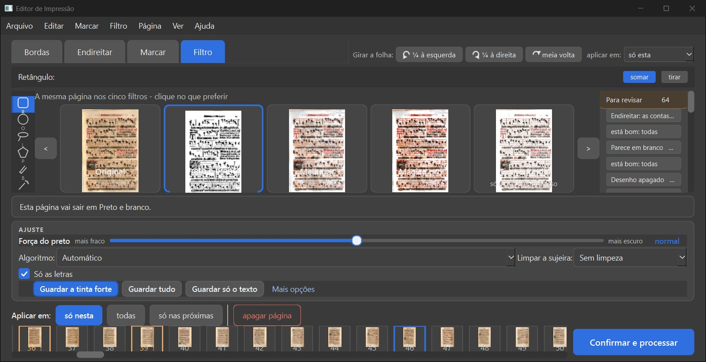

*A tela inteira*

### O teclado depois de clicar num botão do aviso (espaço sim, seta não sei)

**O que olhar:** Depois de "Deixar em branco" e da barra de espaço, o programa passou para a página 13.

Os botões do aviso não ficam mais com o teclado. Depois de clicar em "Deixar em branco", a barra de espaço fez "está certo e avança" (antes ela apertava o botão). Com Tab, 40 vezes, o foco nunca parou num botão do aviso.

**Ressalva:** A seta para a direita não trocou de página na minha janela de teste. Fiz o mesmo no programa de hoje e deu igual: a seta fica na tira de miniaturas ou no medidor da força, que é quem está com o teclado. Não é deste conserto, mas não posso dizer que a seta funciona. A minha janela de teste nunca fica ativa (não tomo o teclado do Samuel). Decisão do Samuel: Conserto de um defeito achado na primeira conferência. Bate com a decisão: não se aplica. Fotos: tela antiga.

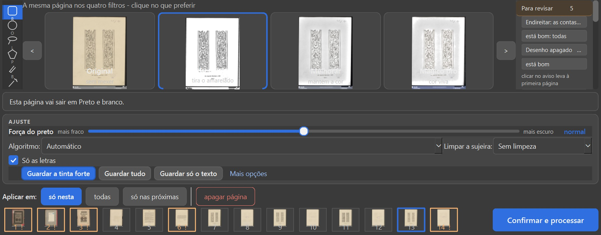

*Depois de "Deixar em branco" na página 12 e da barra de espaço: página 13 (ampliado)*

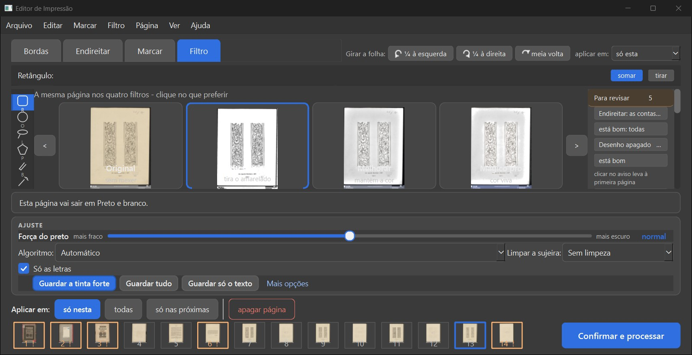

*A tela inteira*

## A pergunta para o Samuel: quando medir as páginas não visitadas

O que você está escolhendo: em que hora o programa confere as páginas que ninguém abriu. Hoje ele só confere a página que está na tela. As outras só são conferidas na hora de gerar o PDF, quando já não dá para parar.

Por isso a lista "Antes de processar" só mostra as páginas que você visitou. No Antiphonal de 298 páginas, com 2 visitadas, a lista mostrou 2 avisos de desenho apagado; visitei mais 4 e ela passou a mostrar 4. E a força do preto sozinha pode escurecer uma página que ninguém viu.

Conferir uma página custa tempo: na janela, de 4 a 15 segundos nos livros comuns e de 20 a 26 no Antiphon, de folha grande. O implementador mediu, sem a tela, de 13 a 15 minutos para um livro de 300 páginas.

- **Medir o livro inteiro por trás, depois de abrir** (sugestão do verificador). Bom: a lista fica completa enquanto você confere, e nenhuma página muda sem aparecer na lista. Ruim: o PC trabalha de 13 a 15 minutos num livro de 300 páginas (pela conta do implementador; na janela pode chegar a 50 minutos, e a umas 2 horas em livro de folha grande), e a tela pode ficar mais lenta nesse tempo.
- **Medir o que falta só ao clicar em "Confirmar e processar"**. Bom: o PC só trabalha quando você pede, e a lista sai completa antes do PDF. Ruim: você espera esse mesmo tempo parado na hora de processar, olha a lista, e depois espera de novo o PDF ser gerado.
- **Deixar como está**. Bom: nada fica mais lento. Ruim: a lista só mostra as páginas visitadas; as outras saem no PDF do jeito que o programa decidiu, e o aviso só aparece depois.
- **Ainda não entendi**. Explique de outro jeito, com mais exemplos.

Sugestão do verificador (é minha, não é decisão): "Medir o livro inteiro por trás, depois de abrir", com uma barra de andamento. É a única em que a lista está completa na hora em que o Kaique decide, e a espera acontece enquanto ele já está conferindo.

## Pergunta para o Samuel: Os três números de páginas e avisos não batem. Qual deve valer?

O que você está escolhendo: o que cada número da tela conta. Hoje são três contas diferentes, e elas aparecem uma atrás da outra.

No Camões (106 páginas): o painel "Para revisar" diz 39, porque conta só os avisos de página. A lista "Antes de processar" diz 75 páginas e 104 avisos, porque junta os avisos de página com os de folha (qualidade baixa, tamanho diferente). E a janela de salvar diz 106, porque conta toda página em que ninguém clicou "está certo".

Quem dá "continuar assim mesmo" para 75 páginas lê, na janela seguinte, que ainda há 106 sem conferir.

- **O painel passa a listar também os motivos de folha**. Bom: o painel e a lista mostram os mesmos avisos (no Camões, 104 nos dois). Ruim: o painel fica comprido, e a janela de salvar continua dizendo 106.
- **A janela de salvar passa a contar as páginas com aviso pendente** (sugestão do verificador). Bom: o número da janela de salvar fica igual ao da lista que acabou de aparecer (no Camões, 75), e some quando todos os avisos foram vistos. Ruim: ela deixa de lembrar as páginas sem "está certo" que não têm aviso nenhum.
- **Deixar como está**. Bom: não muda nada. Ruim: três números diferentes em três telas seguidas.
- **Ainda não entendi**. Explique de outro jeito, com mais exemplos.

Sugestão do verificador (é minha, não é decisão): a janela de salvar contar as páginas com aviso pendente. É o número que aparece por último, logo antes de processar, e hoje é o que mais desmente a lista. Se couber, a primeira opção junto.

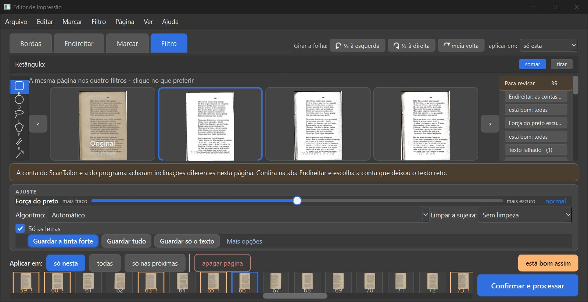

*O painel de hoje (39): só os avisos de página*

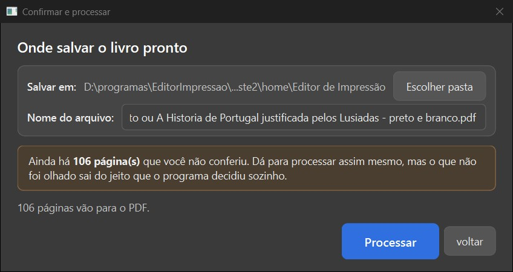

*A janela de salvar de hoje: 106 páginas*

*Os três números no Camões: 39, 75 (104 avisos) e 106*

## Pergunta para o Samuel: A tela deve mostrar a página igual à do PDF?

O que você está escolhendo: se a página que aparece na tela, no "Só as letras", passa a ser a mesma que vai para o PDF.

Hoje a tela usa uma imagem menor, para ser rápida. No Antiphonal 46 essa imagem mostra a letra T grande; no PDF a letra some. O aviso "Desenho apagado" está certo, mas quem olha a tela vê a letra no lugar.

O programa já desenha por trás a página do tamanho do PDF, para medir os avisos. Ela chega de 4 a 15 segundos depois de abrir a página (20 a 26 em folha grande). Dá para aproveitar essa imagem na tela quase sem custo.

- **A tela troca sozinha pela imagem do PDF quando ela chegar** (sugestão do verificador). Bom: o que se vê é o que sai, sem precisar pedir. Ruim: a página muda sozinha na tela alguns segundos depois de aparecer, e nesse meio tempo ainda mostra a imagem menor.
- **Um botão "ver como sai no PDF"**. Bom: nada muda sozinho; quem quiser conferir aperta o botão. Ruim: quem não apertar continua vendo a letra que não vai sair.
- **Deixar como está**. Bom: a tela continua rápida e igual. Ruim: só o aviso diz a verdade; pelo olho a página parece certa.
- **Ainda não entendi**. Explique de outro jeito, com mais exemplos.

Sugestão do verificador (é minha, não é decisão): trocar sozinha quando chegar. Aviso que manda olhar uma coisa que a tela não mostra não ajuda o Kaique; e a troca só vale no "Só as letras", onde a imagem do PDF já é desenhada de qualquer jeito.

*A mesma página 46: a tela (com a letra T) e o PDF que saiu (sem ela)*

*O "Ver de perto" de hoje, com o aviso de pé: a letra T aparece*

*Hoje: a marca laranja em volta de uma letra que, na tela, está lá*

## Folhear com "Só as letras" na janela (o que o teste de velocidade não mede)

Antiphonal 1547 (298 folhas), livro novo, clicando no botão ">" 12 vezes parando 1,5 s em cada página e mais 12 sem parar. Tempo até a página nova aparecer, e quanto o programa continua trabalhando por trás depois da última. A medida não enxerga menos que 0,05 s.

| Rodada | Parando 1,5 s: média | do meio | pior | Sem parar: média | do meio | pior | Por trás depois (parando) | Por trás depois (sem parar) |
|---|---|---|---|---|---|---|---|---|
| antes-1, programa de hoje (94f71bd) | 0,86 s | 0,22 s | 3,06 s | 2,62 s | 2,91 s | 4,74 s | **8,6 s** | **8,8 s** |
| depois-1, ramo (ce2b835) | 0,41 s | 0,14 s | 2,37 s | 2,33 s | 2,60 s | 4,44 s | **44,8 s** | **46,6 s** |
| antes-2, programa de hoje (94f71bd) | 0,56 s | 0,12 s | 2,87 s | 2,30 s | 2,26 s | 4,48 s | **8,4 s** | **9,3 s** |
| depois-2, ramo (ce2b835) | 0,47 s | 0,10 s | 2,46 s | 2,21 s | 2,60 s | 4,06 s | **44,1 s** | **45,1 s** |

**Trocar de página não ficou mais lento** (o ramo saiu igual ou um pouco melhor nas duas rodadas). **O trabalho por trás depois de parar passou de 8 a 9 segundos para 44 a 47.** A tela não trava nesse tempo, mas o processador fica ocupado. O implementador mediu uns 22 s contra 3 a 5 s, com o filtro de fábrica; com "Só as letras" deu o dobro.

## Retomada de 20/10/2026

A pedido da gerente, no mesmo `ce2b835`, numa pasta de dados nova (`trabalho/dados_teste3`). Não medi velocidade (Fase 5, decisão do Samuel de 19/10).

### As 19 imagens que faltavam abrir (uma linha por imagem)

1. `duplo-clique-1-aviso-continua-recorte.jpg`: Antiphonal 46 (pedaço de 6 páginas): cinco cartões com o quadrado laranja no T, o aviso "Pode ter sumido parte de um desenho..." de pé e os botões "Trazer de volta nesta página" e "está bom assim". O aviso continuou depois dos dois cliques. Bate com o parecer.
2. `duplo-clique-2-ver-de-perto.jpg`: "Ver de perto", página 3 de 6, Preto e branco: a letra T aparece (é a tela que engana). Bate.
3. `teclado-1-recorte.jpg`: Egenloff, página 13 escolhida na tira (moldura azul) e "Esta página vai sair em Preto e branco": a barra de espaço avançou da 12 para a 13. Bate.
4. `teclado-2-tela.jpg`: A mesma tela inteira, 1280 x 657 (com as abas da tela antiga). Bate.
5. `forca-1-camoes-recorte.jpg`: Camões 27: aviso "O texto desta página saía falhado: escureci a força do preto só nela", medidor em "bem forte", "Desfazer" e "está bom assim". Bate. (Print da primeira conferência; o comportamento no Camões 27 não mudou.)
6. `forca-2-camoes-tela.jpg`: Camões 27 na tela inteira, painel "Para revisar 35", "Desfazer". Bate.
7. `forca-4-egenloff-3-recorte.jpg`: Egenloff 3 (folha de rosto): só o aviso "Texto falhado" (aviso 1 de 2), força "normal", botões "usar mais escuro" e "está bom assim"; marcas laranja na linha do carimbo embaixo. Bate: a força não mexe mais sozinha.
8. `sem-conteudo-1-egenloff-recorte.jpg`: Egenloff 12 (verso só com o carimbo): aviso "Esta página parece não ter nada do livro" (aviso 1 de 2) e os três botões. Bate.
9. `sem-conteudo-2-egenloff-tela.jpg`: A mesma tela inteira, painel "Para revisar 6". Bate.
10. `sem-conteudo-5-rariora-recorte.jpg`: Rariora 8 (folha de rosto com o título muito fraco): o mesmo aviso, com os três botões. Bate. Repare: o cartão do Preto e branco ainda mostra a página amarelada, quase igual ao Original (a prévia talvez ainda não tivesse chegado).
11. `janela-diferente-1-graduale-221-recorte.jpg`: Graduale 221 (página 3 do pedaço): quatro cartões e a faixa "Esta página vai sair em Preto e branco", sem aviso. Bate.
12. `janela-diferente-2-graduale-221-tela.jpg`: A mesma tela inteira: a página 3 sem "!" na tira (a 1 tem). Bate.
13. `marcar-2-antes-tela.jpg`: Aba Marcar, Graduale 221: "Marcado: 4 de letra e traço e 5 de papel" (9 áreas). Bate. Repare: na aba Marcar o painel diz "Para revisar: nada pendente".
14. `marcar-3-depois-tela.jpg`: A mesma página uns 10 s depois: "Marcado: 7 de letra e traço e 11 de papel" (18 áreas); a diferença à vista é pequena (faixas à esquerda). Bate.
15. `palatino-66-3-tela.jpg`: Palatino 66: marcas laranja na linha "Palatinus Romae", aviso "Texto falhado", força "normal", "usar mais escuro". Bate.
16. `parece-em-branco-2-tela.jpg`: Gladstone 18: os cartões com o título "DA ORAÇÃO" pequeno e o aviso "Esta página parece estar em branco...", com os três botões. Bate (o aviso é o erro conhecido).
17. `contagens-2-painel-tela.jpg`: Camões 66: painel "Para revisar 39", aviso do Endireitar e só "está bom assim". Bate (o 39 da pergunta).
18. `contagens-3-salvar.jpg`: Janela "Onde salvar o livro pronto": "Ainda há 106 página(s) que você não conferiu" e "106 páginas vão para o PDF". Bate (o 106 da pergunta).
19. `bug-duplo-clique-tira-o-aviso-tela.jpg`: Apesar do nome, é a tela DEPOIS do conserto: pedaço do Antiphonal, página 3 com o aviso de pé e os dois botões. Bate com o quadro dos dois cliques (o nome do arquivo vem da primeira conferência e engana).

### As quatro páginas reabertas na janela

| Página | Como | O que vi |
|---|---|---|
| Opus Majus 20 | livro novo (a página do gabarito), janela + PDF processado até "Ficou pronto!" | Avisos "Figura além da gravura" e "Endireitar". No PDF a foto da estátua sai DESTRUÍDA (estátua branca, manchas e blocos pretos). O parecer de 13/10 estava ERRADO ("a foto sai intacta, não precisava ir"): aquela imagem era da prévia pequena. O aviso está certo. O programa de hoje (fase-1) desenha a mesma página igual, ponto por ponto: o estrago já existia; só o aviso mudou. |
| Cursus 3 | pedaço das folhas 1 a 10, livro novo, janela | Só o aviso "Faixa escura na beirada"; faixa preta larga à direita e linha à esquerda. Confirma o parecer. O livro inteiro (402 folhas) parou 2 vezes na análise com MemoryError ("Aconteceu um problema inesperado"). |
| Antiphon 260 | pedaço das folhas 256 a 264, livro novo, janela, visitando 259, 261 e 262 | 1ª visita: "Faixa" + "Endireitar"; depois das outras: só "Endireitar" (a faixa virou frase do livro, meio escondida no alto do painel). Iluminura chapada no Preto e branco, sem aviso. Confirma o parecer. |
| Camões 66 | livro inteiro, livro novo, janela, visitando 65, 67, 27 e 104 | Só o aviso do Endireitar; nenhum aviso das linhas pretas (página ou livro). 27 e 104 com a força sozinha em 85. Confirma o parecer. |

*Opus Majus 20: a página no livro e no PDF que o programa gerou (20/10, ce2b835).*

### O teclado

Em parte, e agora explicado. O botão do aviso não fica com o teclado e a barra de espaço faz "está certo e avança". A seta: o programa só troca de página quando a tecla chega à janela principal (ui/janela_principal.py, keyPressEvent); antes ela passa por quem está com o teclado, e a tira de miniaturas (rola) e o medidor da força (muda a força da página, que o programa grava sozinho uns instantes depois) usam a seta. Isso não depende da janela estar ativa, e é igual no fase-1. Não testei com o teclado de verdade (não tomo o teclado do Samuel).

### As fotos contra as decisões do Samuel

Conferência para a aba 4 em `conferencia-aba4.json` (e `.html`). Das 40 fotos dos quadros, 25 são de tela antiga (refazer depois de juntar o fase-1 no ramo) e 3 estão desatualizadas (quadro "está bom"). Duas escolhas do Samuel ficaram em parte (a marca laranja; o "Guardar só o texto"), e a regra dá 22/75 contra 21/78. **Recomendação: não publicar a aba 4 antes da junção e das fotos novas.** As três perguntas podem ir antes, se a gerente quiser separar.

## Velocidade

Marial de 300 folhas, o programa de hoje (`fase-1`, 94f71bd) contra o ramo (ce2b835), alternando, 2 rodadas de cada. Cada número é o valor do meio das 3 repetições da rodada. **O teste não liga o "Só as letras": ele confere que o resto do programa não ficou mais lento; o custo novo (medir a página visitada) não entra nele.**

| Rodada | Hora | Memória livre | Processador | Outros Python | Abrir | Trocar (média) | Trocar (pior) | Mágico pro, 10 pág. | Preto e branco, 10 pág. | Memória máxima | Durou |
|---|---|---|---|---|---|---|---|---|---|---|---|
| antes-1 (94f71bd) | 15:35 | 5,20 GB | 12% | 0 | 56,2 s | 2,41 s | 3,53 s | 54,8 s | 26,1 s | 1383 MB | 12,2 min |
| depois-1 (ce2b835) | 15:48 | 4,66 GB | 3% | 0 | 54,6 s | 2,30 s | 3,36 s | 55,4 s | 26,0 s | 1374 MB | 11,7 min |
| antes-2 (94f71bd) | 16:00 | 5,21 GB | 6% | 0 | 55,1 s | 2,31 s | 3,38 s | 54,3 s | 26,1 s | 1384 MB | 11,7 min |
| depois-2 (ce2b835) | 16:11 | 5,17 GB | 7% | 0 | 55,3 s | 2,33 s | 3,43 s | 55,0 s | 26,2 s | 1388 MB | 11,9 min |

| Medida | Antes | Depois | Diferença | Vai-e-vem do antes | Vai-e-vem do depois | Par a par (depois menos antes) | Dá para dizer? |
|---|---|---|---|---|---|---|---|
| Abrir o livro (300 folhas) | 55,7 s | 55,0 s | -0,7 s (-1,2%) | 1,2 s | 0,7 s | -1,6; +0,3 s | não dá para dizer (diferença menor que o vai-e-vem entre rodadas iguais) |
| Trocar de página (média de 20) | 2,36 s | 2,31 s | -0,05 s (-2,1%) | 0,10 s | 0,04 s | -0,12; +0,02 s | não dá para dizer (diferença menor que o vai-e-vem entre rodadas iguais) |
| Trocar de página (a pior das 20) | 3,45 s | 3,40 s | -0,05 s (-1,6%) | 0,15 s | 0,06 s | -0,16; +0,05 s | não dá para dizer (diferença menor que o vai-e-vem entre rodadas iguais) |
| Processar 10 páginas em Mágico pro | 54,6 s | 55,2 s | +0,6 s (+1,1%) | 0,5 s | 0,4 s | +0,6; +0,7 s | mais lento |
| Processar 10 páginas em Preto e branco | 26,1 s | 26,1 s | +0,1 s (+0,2%) | 0,0 s | 0,2 s | -0,0; +0,2 s | não dá para dizer (diferença menor que o vai-e-vem entre rodadas iguais) |

Tempos da medida na janela, na segunda conferência (do clique na página até a medida chegar): Camões 8 a 15 s; Egenloff 11 a 14 s; Antiphonal 8 s; páginas avulsas e pedaços pequenos 2 s. Na primeira: de 4 a 11 s nos livros comuns e de 20 a 26 s no Antiphon.

## O que não consegui conferir

- A seta do teclado com a janela ativa e o teclado de verdade (não tomo o teclado do Samuel). Conferida na janela inativa e pelo código: a conclusão não depende de a janela estar ativa.
- O programa juntado (ramo + fase-1 com o layout): a junção tem conflito e não é papel do verificador resolver. Nenhuma foto do jeito que o Samuel vai ver.
- O Cursus inteiro (402 folhas): parou duas vezes na análise por falta de memória; conferi pelo pedaço das folhas 1 a 10.
- Aba Marcar: só testei marcar uma área nova à mão enquanto o programa procurava. Não testei apagar ou mudar uma área do programa nesse intervalo.
- A segunda metade da força sozinha ("só fica se as falhas caírem"): não achei página que a exercite na janela.
- Projeto de antes de 09/10: só existe na pasta de dados do Samuel.
- A roda do mouse; a suíte inteira e o `teste_botoes.py` (não rodei; a velocidade foi para a Fase 5).

## Bugs para a Lista de bugs

| Data | Bug | Print |
|---|---|---|
| 20/10/2026 | Opus Majus 20 (página do gabarito), livro novo, Preto e branco com "Só as letras": a foto da estátua sai destruída no PDF (estátua branca, manchas e blocos pretos). Igual no fase-1 (mesma imagem, ponto por ponto). O aviso novo do "Para revisar" pega; o conserto é do detector de figuras (1.5). | `img/a4-opus-20.jpg` |
| 20/10/2026 | Na junção com o fase-1: os textos novos dos avisos (core/analise.py do ramo) ainda dizem "aba Marcar" e "aba Bordas"; o layout não tem mais abas ("ferramenta Endireitar"). | (sem print: está na saída dos roteiros p32 e p33) |
| 20/10/2026 | A seta do teclado não troca de página quando o teclado está na tira (ela rola) ou no medidor da força (a seta muda a força do preto da página, e o programa grava). Igual no fase-1. | (sem print: está na saída dos roteiros p32 e p33) |
| 20/10/2026 | Cursus inteiro (402 folhas), livro novo: a análise parou duas vezes com MemoryError (alocar 1,4 MB) e só a frase "Aconteceu um problema inesperado"; o Kaique fica na tela "O que fazer" sem saber o que houve. PC com outros 7 agentes; a causa pode ser do PC. | `trabalho/prints/r3-cursus-travou.png` |
| 20/10/2026 | Nomes diferentes para desfazer o mesmo tipo de coisa: "voltar a página" (depois de "Deixar em branco") e "restaurar página" (depois de "Tirar do livro"). E a lista "Antes de processar" mistura "Folha N" e "Página N". | `img/sem-conteudo-4-tirar-do-livro-recorte.jpg` |
| 20/10/2026 | O contador da tira diz "2 páginas para você olhar" num livro de 1 página (Opus Majus 20: conta a folha e a página); no Camões, o contador diz 96 a 98 e o painel 33 a 37. Faz parte da pergunta das contagens. | `img/r3-opus-20-tela.jpg` |
| 13/10/2026 | (para o Samuel decidir) A tela mostra o que o PDF não tem no "Só as letras": Antiphonal 46, a letra T aparece na tela e some no PDF. | `img/tela-engana-1-comparacao.jpg` |
| 13/10/2026 | (para o Samuel decidir) Painel, lista e janela de salvar contam coisas diferentes: Camões, 39, 75 (104 avisos) e 106. | `img/contagens-1-lado-a-lado.jpg` |
| 13/10/2026 | (para o Samuel decidir) A lista "Antes de processar" só traz as páginas visitadas. | `img/medir-1-listas.jpg` |
| 13/10/2026 | Depois de folhear 12 páginas com "Só as letras", o programa trabalha por trás de 44 a 47 s (programa de hoje: 8 a 9 s). Não trava a tela. | (sem print: está na saída dos roteiros p32 e p33) |
| 13/10/2026 | Na aba Marcar as áreas mudam sozinhas uns 10 s depois de chegar na página (Graduale 221: 9 viram 18) e nada avisa que o programa ainda está procurando. | `img/marcar-1-antes-e-depois.jpg` |
| 13/10/2026 | Egenloff 3 com a força em 85: a frase do aviso "Texto falhado" ainda manda tentar a força mais escura (o botão já não aparece). | `img/forca-7-egenloff-3-forca-85-recorte.jpg` |
| 13/10/2026 | Continuam, sem ser deste conserto: "Parece em branco" errado na Gladstone 18; faixa preta do corte no Cursus 3; iluminura do Antiphon 260 chapada e sem aviso; Camões 66 sem aviso das linhas pretas. | `img/parece-em-branco-1-recorte.jpg` |

## Como foi feito

- Janela de verdade do ramo, aberta fora da tela, com cliques, arrastos e teclas nativos do Windows (`scripts/piloto.py`, `scripts/v.py`); as leituras do estado só leem. Ida às páginas: arrastando a barra da tira de miniaturas e clicando na miniatura.
- Pasta de dados de teste em `trabalho/dados_teste` (fora do git). A pasta de dados do Samuel não foi usada. O `erros.log` de teste ficou vazio em todas as sessões.
- Livros inteiros abertos como livro novo: Antiphonal 1547 (298 folhas), Egenloff (138), Camões (106), Gladstone (146), Rariora (414), Palatino (134), Cursus (402), Antiphon (305). Pedaços: Antiphonal 44 a 49 (para processar até o fim), Graduale 219 a 225, Egenloff 1 a 14 (projeto antigo). Opus Majus 20: a página do gabarito.
- Máquina: `scripts/desenhar.py` e `scripts/ver_pdf.py` (a página na tela contra a do PDF), `scripts/ordem_da_medida.py` e `scripts/conferir_89_como_a_janela.py` (as 89 páginas na ordem da janela; resultado em `conferir-89-como-a-janela.json`), `velocidade/` (as quatro rodadas).
- Imagens: 58 em `img/`. Abri 41 uma a uma; as outras 17 são a tela inteira ou o recorte da mesma captura de uma que abri. Sete prints tinham saído com a imagem velha da janela (o primeiro print depois de abrir o programa); achei por máquina (`scripts/achar_prints_velhos.py`), refiz os que entram aqui e nenhum velho ficou em `img/`.
- **Segunda conferência:** ramo trazido com `git merge origin/fase2-para-revisar` (ce2b835). Pasta de dados nova (`trabalho/dados_teste2`), para todo livro ser livro novo. Roteiros `scripts/q1_consertos.py` (os pontos 1, 2, 3, 4, 6, 7 e 8), `q2_setas.py`, `q3_camoes_contagens.py` (pontos 5 e 7 e as contagens), `q4_folhear.py`, `q5_processar_e_antigo.py`.
- O "antes" da velocidade e do folhear é a minha worktree `velocidade-antes-pr` (origin/fase-1, 94f71bd), porque a `velocidade-antes` estava em uso por outro verificador. O `fase-1` de hoje não tem código que o ramo não tenha: a diferença entre os dois é só este trabalho.
- **Retomada de 20/10:** `scripts/r3_quatro_paginas.py` (as quatro páginas; Cursus e Antiphon por pedaços em `trabalho/livros/`), `r3_processar_opus.py` (o PDF do Opus Majus 20), `r3_render_raiz.py` (a mesma página com o código do fase-1, worktree `velocidade-antes-pr`), `a4_recortes.py` e `aba4_reabertos.py` (recortes ampliados), `aba4.py` (a conferência da aba 4), `vistas_20_10.py` e `terceira.py` (este parecer). As 67 imagens da segunda conferência foram todas abertas uma a uma até 20/10; as de 20/10 (`a4-*`, `r3-*`) também.
- Tudo no commit `ce2b835` do programa. A primeira conferência (commit `2d820d6` deste ramo) foi em `36b9e32`. A retomada de 20/10 (as imagens, as quatro páginas e a aba 4) foi no mesmo `ce2b835`, numa pasta de dados nova (`trabalho/dados_teste3`).
