# Conserto do corte com borda preta: acerto do Pesel 21 conferido (verificador, 20/10/2026)

Ramo `conserto-corte-g6-2026-10-13`, commit `5a84f7c` (contra o `d97b937` de 13/10). Não mudei código; não marco nada como aprovado.

## Veredito

**PRONTO PARA CONFERIR.** O Pesel 21 volta a sair exatamente como hoje no programa, e as outras 88 páginas não mudam. O teste de reversão falha no código antigo e passa no novo. A conferência para o Samuel decidir de novo a `cg6` está em `conferencia-cg6.json`.

## O que conferi (máquina ou olho)

| O que | Como | Resultado |
|---|---|---|
| Teste de reversão no código novo (5a84f7c) | máquina, no PC | `test_cartao_escuro_sai_inteiro_no_livro_novo` (3 casos) e `test_pesel_21_sai_como_no_fase_1`: 4 passaram |
| O mesmo teste no código antigo (d97b937) | máquina, no PC | os 4 **falharam**: 105,3 × 171,4 mm contra 148,0 × 210,1 mm (página de mentira, 3 ângulos); 144,7 × 206,1 mm no Pesel 21 |
| As 89 páginas, medidas de novo por mim (livro novo, 300 DPI, sem filtro, `scripts/medir89.py`) | máquina | d97b937 contra 5a84f7c: muda só pesel_p021__inteira (144,7 × 206,1 → 157,1 × 240,6 mm); as 89 dão o mesmo md5 que a medida do implementador |
| Suíte no Windows do GitHub, rodada 39396681554 | máquina | passou: 114 arquivos, 2061 passaram, 0 falharam, 73 pulados; botões e prints passaram. Testou `bd193d4`; o código de `core/`, `ui/` e `tests/` é idêntico ao `5a84f7c` (git diff vazio) |
| As 11 imagens do implementador | olho | abertas uma a uma; ver abaixo |

Saída do código antigo:

```

E       AssertionError: livro novo 105.3 x 171.4 mm, ordem antiga 148.0 x 210.1 mm
E       assert (42.672 <= 1.0)
E        +  where 42.672 = abs((105.32533333333333 - 147.99733333333333))
E       AssertionError: livro novo 105.3 x 171.4 mm, ordem antiga 148.0 x 210.1 mm
E       assert (42.672 <= 1.0)
E        +  where 42.672 = abs((105.32533333333333 - 147.99733333333333))
E       AssertionError: livro novo 104.9 x 171.4 mm, ordem antiga 148.0 x 210.1 mm
E       assert (43.09533333333333 <= 1.0)
E        +  where 43.09533333333333 = abs((104.902 - 147.99733333333333))
```

## As imagens (uma linha por página)

1. Pesel 21: hoje 15,7 × 24,1; 13/10 cortado rente, legenda a 1-2 mm da borda; agora igual a hoje. Cantinhos brancos do giro continuam (já anotado). Certo.
2. Pesel 21 de perto: legenda com uns 3 cm de cartão embaixo, igual a hoje. Certo.
3. Cursus 3: a faixa preta larga da direita sai; sobra um fio fino à direita e a linha da esquerda. 13/10 = agora.
4. Matemática 32: a faixa preta da direita sai; a faixa de baixo fica (fundo do scanner). 13/10 = agora.
5. Antiphon 260: a faixa de baixo fica mais fina (uns 2 cm). 13/10 = agora.
6. Antiphon 88: menos preto dos lados; sobra preto em cima e embaixo. 13/10 = agora.
7. Camões 104: fio escuro da beirada menor (diferença pequena). 13/10 = agora.
8. Camões 66: as três quase iguais (1 mm). 13/10 = agora.
9. Antiphonal 252: as três quase iguais (1 mm embaixo). 13/10 = agora.
10. Egenloff 3: as três iguais à vista (tarja da biblioteca embaixo continua). 13/10 = agora.
11. Rariora 155: as três iguais à vista. 13/10 = agora.

## As fotos contra as decisões do Samuel (cg6, 13/10)

| Quadro | Decisão dele | Bate? |
|---|---|---|
| Pesel 21: o cartão escuro volta a sair inteiro | cg6, Pesel 21 (13/10): "Está pior" - "Ele chega a quase cortar as letras. Nós estamos olhando o endireitar com o cortar ou só o endireitar?" | sim: volta a ser como hoje |
| Cursus 3: a faixa preta larga da direita sai | cg6, Cursus 3 (13/10): "Está pior" - "como vamos resolver isso dentro do programa então?" | em parte: tira a faixa larga, não todo o preto (o resto é 2.13/2.14) |
| Matemática 32: a faixa preta da direita sai; a de baixo fica | cg6, Matemática 32 (13/10): "Está pior" - "Era para sumir completamente né?" | em parte: o preto não some todo |
| Antiphon 260: a faixa preta de baixo fica mais fina | cg6, Antiphon 260 (13/10): "Está bom" - "Mas sobrou preto embaixo." | sim, com a sobra que ele viu |
| Antiphon 88: menos preto em volta | cg6, Antiphon 88 (13/10): "Está bom" - "mas ainda sobrou preto embaixo." | sim, com a sobra que ele viu |
| Camões 104: o fio escuro da beirada fica menor | cg6, Camões 104 (13/10): "Está pior" - "Como vamos resolver isso, com filtro? copiando a imagem do livro e colocando em uma folha branca? com o endireitar e depois cortar? selecionando só essa parte preta e apagando?" | em parte: melhora pequena; o resto é 2.13/2.14 |

Ele esperava o preto sumir por completo em três páginas. O conserto não faz isso (é o 2.13/2.14); cada quadro diz isso com as palavras dele. As fotos são da página pronta, não da janela: não ficam velhas com o layout.

## Ressalvas

- O "sem conteúdo" do Pesel 21 é por pouco (2,1% contra o limite de 3%, conta do implementador): outro cartão do mesmo livro pode cair do outro lado.
- 89 páginas soltas, nenhum livro inteiro; nada visto na janela.
- Velocidade: não medi (a do implementador é só indicativa: rodada 39396712441, igual). A medida que vale é no fim da fase.
- Quadros só das 6 páginas que mudam de verdade; Camões 66, Antiphonal 252, Egenloff 3 e Rariora 155 mudam 1 mm ou menos e ficaram fora (já foram mostrados em 13/10).

## Bugs para a Lista de bugs

Nenhum novo.

## Quadro: Pesel 21: o cartão escuro volta a sair inteiro

O que você está escolhendo: se o Pesel 21 ficou como você queria.

Em 13/10 você marcou "Está pior": "Ele chega a quase cortar as letras." O conserto daquele dia confundia o cartão pardo com o fundo do scanner e cortava rente, a 1 ou 2 mm da legenda. É como uma tesoura que achou que a moldura era sobra.

Agora a página sai exatamente como sai hoje no programa (15,7 × 24,1 cm, igual ponto por ponto): a legenda volta a ter uns 3 cm de cartão embaixo. Os cantinhos brancos do giro continuam, como hoje (defeito já anotado).

**O que olhar:** O espaço entre a legenda e a beirada de baixo.

Opções: Está bom · Melhorar · Está pior · Ainda não entendi · e um comentário.

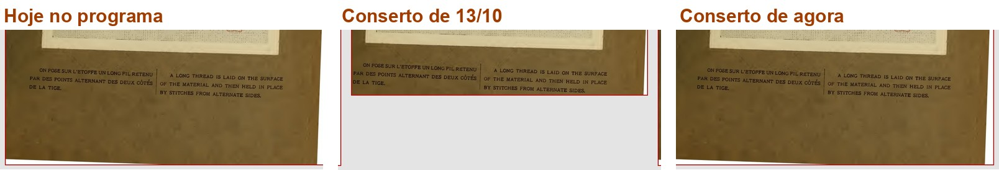

*Ampliado: o pé da página hoje, no conserto de 13/10 e agora*

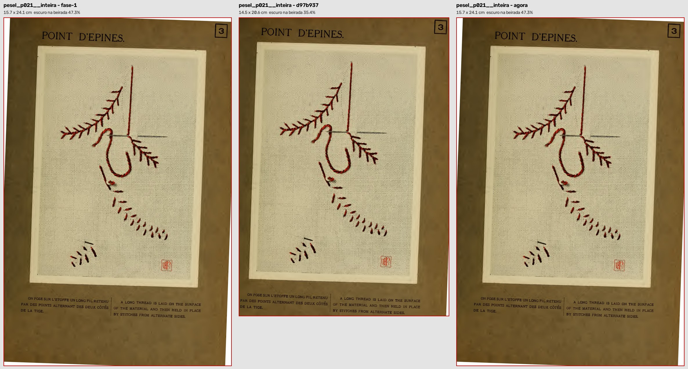

*A página inteira nas três versões*

## Quadro: Cursus 3: a faixa preta larga da direita sai

O que você está escolhendo: se a melhora do Cursus 3 basta por agora.

Hoje, no livro novo, o corte deixa uma faixa preta larga à direita (o defeito que o endireitar antes de cortar trouxe em 12/10). Com o conserto, ela sai; sobra um fio fino de até 4 mm e a linha preta da esquerda.

Você perguntou "como vamos resolver isso dentro do programa então?": tirar todo o preto é o item 2.13 (o corte do ScanTailor, com a caixa do conteúdo) e pintar de branco é o 2.14. Este conserto só desfaz a piora.

**O que olhar:** A faixa preta à direita.

Opções: Está bom · Melhorar · Está pior · Ainda não entendi · e um comentário.

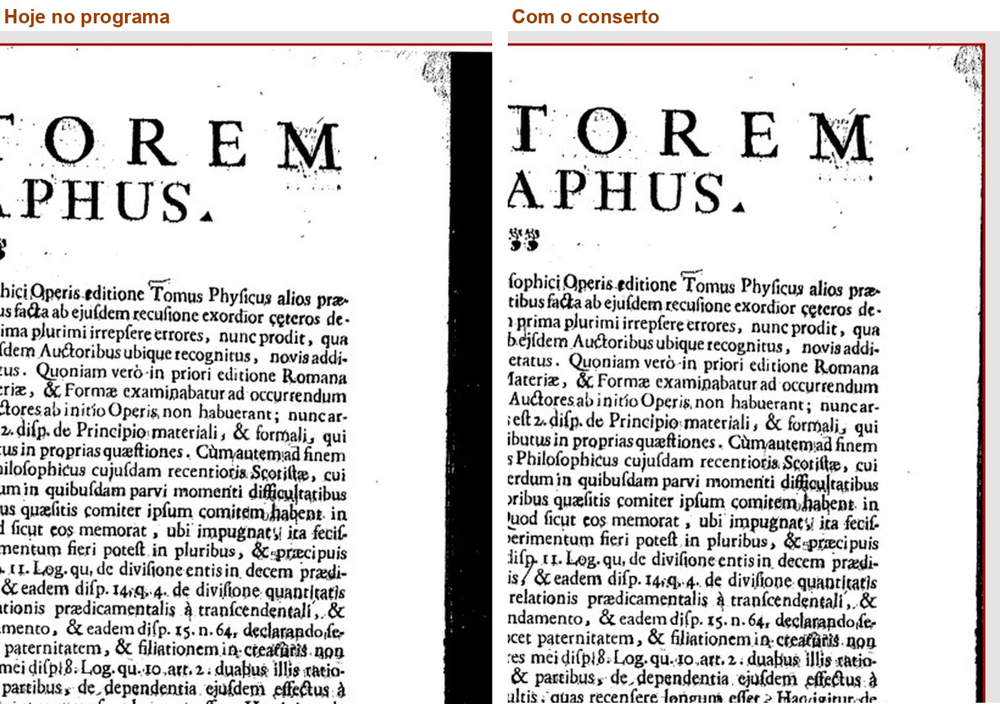

*Ampliado: o canto de cima à direita, hoje e com o conserto*

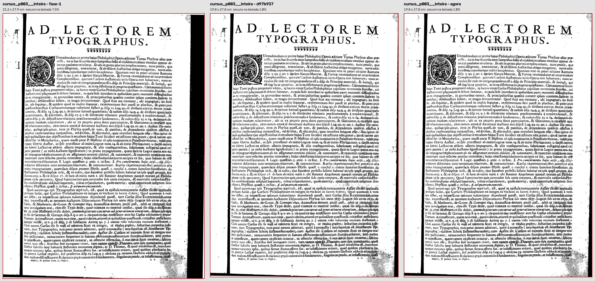

*A página inteira: hoje, conserto de 13/10 e agora (as duas últimas iguais)*

## Quadro: Matemática 32: a faixa preta da direita sai; a de baixo fica

O que você está escolhendo: se a melhora da Matemática 32 basta por agora.

Hoje a página sai com uma faixa preta de 4 cm à direita. Com o conserto ela some. A faixa preta de baixo continua: é o fundo do scanner, que já estava lá antes de 12/10.

Você perguntou "Era para sumir completamente né?". Sumir tudo é o item 2.13 (corte) ou o 2.14 (pintar de branco); este conserto só desfaz a piora de 12/10.

**O que olhar:** A faixa preta à direita (some) e a de baixo (fica).

Opções: Está bom · Melhorar · Está pior · Ainda não entendi · e um comentário.

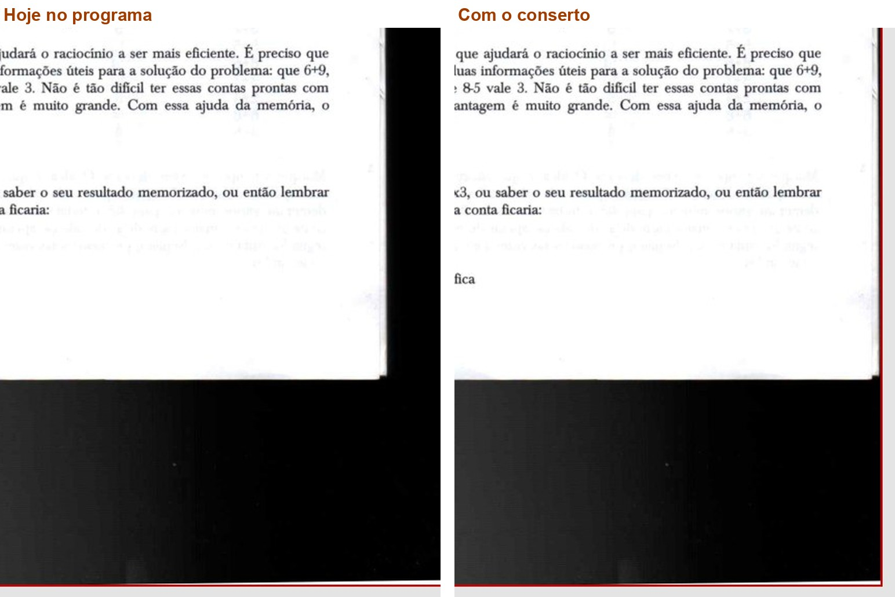

*Ampliado: o canto de baixo à direita, hoje e com o conserto*

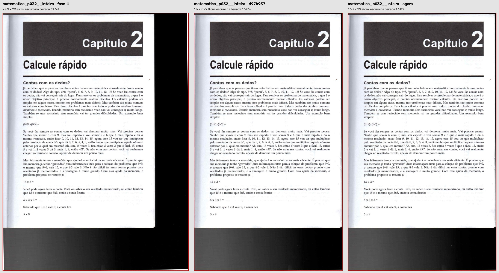

*A página inteira nas três versões*

## Quadro: Antiphon 260: a faixa preta de baixo fica mais fina

O que você está escolhendo: se a melhora do Antiphon 260 basta por agora.

Hoje sobra uma faixa preta larga embaixo. Com o conserto ela fica com uns 2 cm, a mesma de antes de 12/10.

Você escreveu "Mas sobrou preto embaixo.": sobrou, sim; tirar essa sobra é o 2.13 ou o 2.14.

**O que olhar:** A faixa preta embaixo da página.

Opções: Está bom · Melhorar · Está pior · Ainda não entendi · e um comentário.

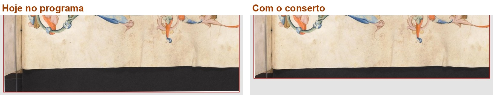

*Ampliado: o pé da página, hoje e com o conserto*

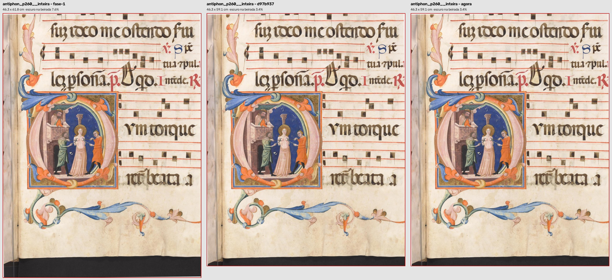

*A página inteira nas três versões*

## Quadro: Antiphon 88: menos preto em volta

O que você está escolhendo: se a melhora do Antiphon 88 basta por agora.

Hoje sobra preto largo dos lados. Com o conserto sobra uma beirada fina, com o preto de cima e de baixo do fundo do scanner.

Você escreveu "mas ainda sobrou preto embaixo.": continua lá; é o 2.13 ou o 2.14.

**O que olhar:** O preto em volta da folha.

Opções: Está bom · Melhorar · Está pior · Ainda não entendi · e um comentário.

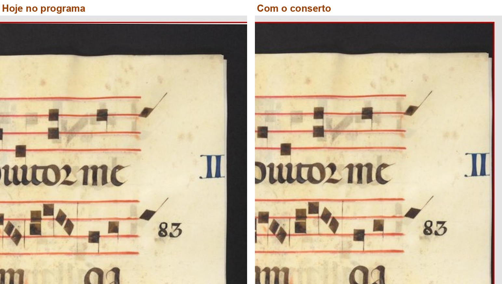

*Ampliado: o canto de cima à direita, hoje e com o conserto*

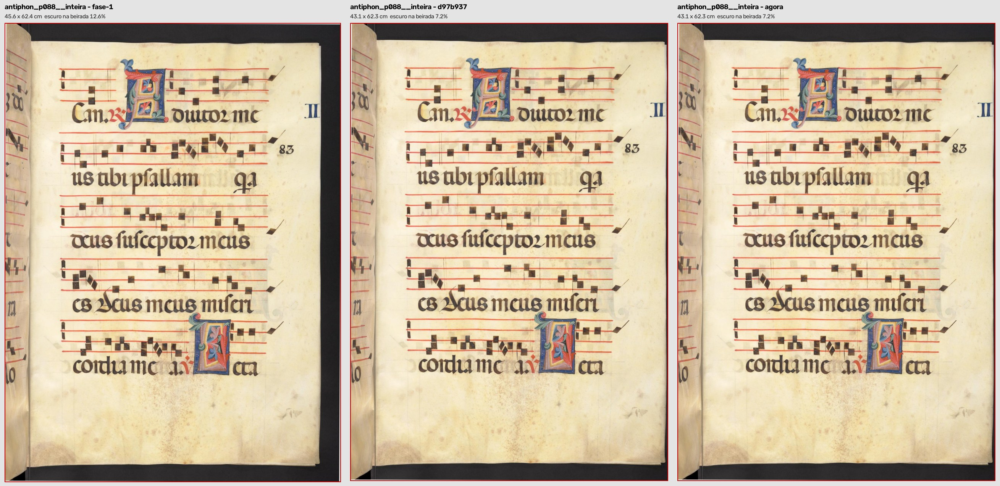

*A página inteira nas três versões*

## Quadro: Camões 104: o fio escuro da beirada fica menor

O que você está escolhendo: se a melhora do Camões 104 basta por agora.

A diferença é pequena: hoje sobra um fio escuro de uns 2 mm na beirada da capa; com o conserto, uns 0,5 mm, como antes de 12/10.

Você perguntou como resolver de vez ("com filtro? copiando a imagem do livro e colocando em uma folha branca? ..."): é o 2.13 (corte até o conteúdo) e o 2.14 (pintar de branco).

**O que olhar:** A beirada escura à esquerda da capa.

Opções: Está bom · Melhorar · Está pior · Ainda não entendi · e um comentário.

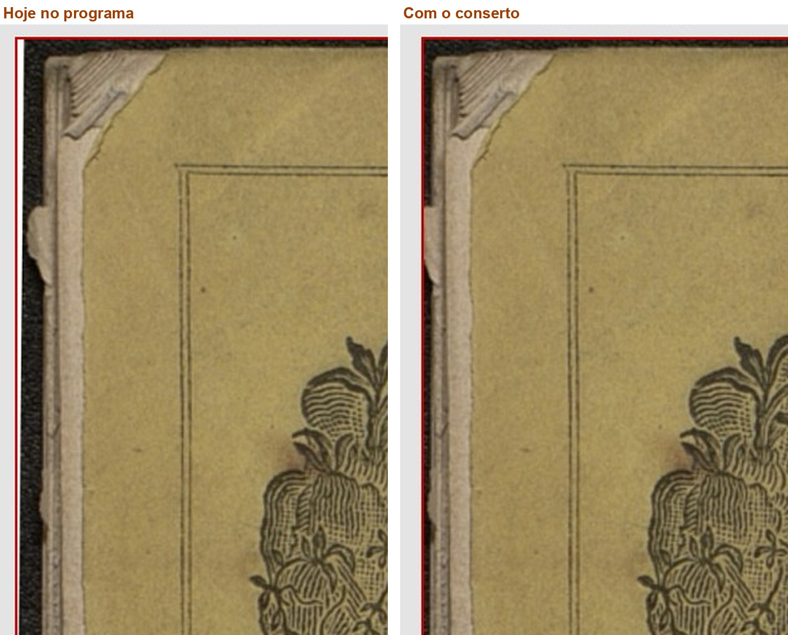

*Ampliado: o canto de cima à esquerda, hoje e com o conserto*

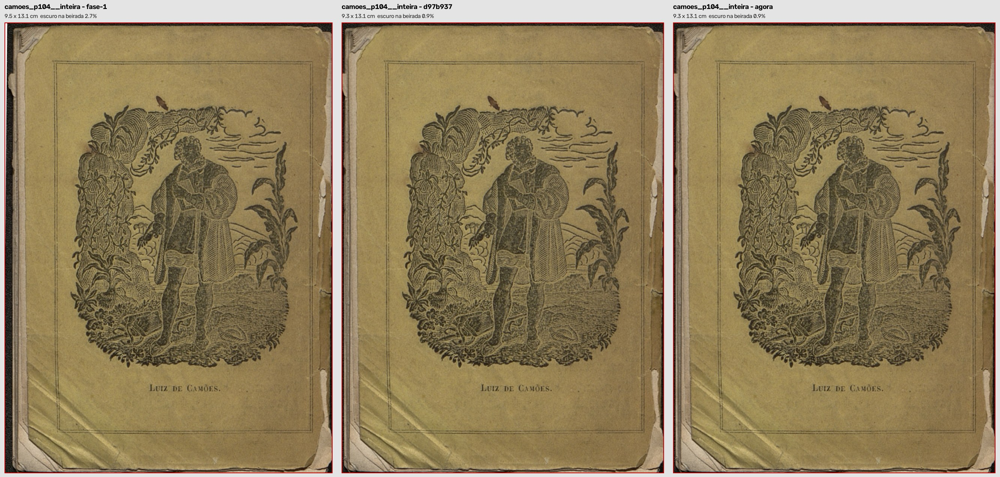

*A página inteira nas três versões*

## Decisão: Conserto do corte com borda preta: o que você decide agora?

O que você está escolhendo: se este conserto entra no programa agora, como está, ou depois.

Em 13/10 você marcou "Melhorar" e perguntou: "Só não sei se vamos fazer esse concerto agora ou deixar para depois". O Pesel 21 foi acertado; as cinco melhorias continuam iguais. O que ele não faz é tirar todo o preto: isso é o 2.13 e o 2.14, que vêm depois.

Sugestão (do verificador, não é decisão): entrar agora. Hoje o programa deixa faixas pretas largas que este conserto tira, e ele não piora nenhuma das 89 páginas.

Opções: Aprovado: entra agora · Melhorar · Deixar para depois · Ainda não entendi
