# Etapa 2: a versão de teste empacotada aguenta? (16/11/2026)

**O que é:** a conferência que vem antes de construir a atualização sozinha. Ela responde três perguntas, sem mudar
nenhuma linha do programa e sem instalar nada no Windows: a versão de teste de hoje vira um programa empacotado que
abre e trabalha? Os livros que o Kaique começou no programa de 28/10 abrem iguais nela? O que o empacotamento de hoje
precisa mudar para o Velopack?

**Veredito: PRONTO PARA CONFERIR.** O programa empacotado de hoje abre, divide, endireita, corta, limpa em Preto e
branco e grava o PDF. Um livro feito no programa de 28/10 abre nele sem perder nada, e o PDF sai idêntico ao de antes.
Os três leitores de texto funcionam dentro do pacote. Há uma ressalva de imagem que já existia em 28/10 (faixa preta
na beirada de algumas páginas do Righetti) e a lista do que falta para o Velopack.

**Como foi testado sem aparecer na sua tela.** O programa rodou numa **área de trabalho escondida do Windows** (a
mesma tela "de verdade", com fonte e janelas, mas que nunca é mostrada no seu monitor). Os botões foram apertados por
mensagens do próprio Windows e pelo leitor de tela do Windows, sem tocar no seu mouse nem no teclado. Os prints saem
dessa área escondida. Cada teste usou uma pasta de dados própria: a sua pasta do programa não foi tocada (conferido:
nenhum livro de teste apareceu nela, e os arquivos dela continuam com as datas antigas).

---

## 1. Empacotar a versão de teste de hoje (máquina)

- Feito com o empacotador do projeto, só a versão em pasta (o `.exe` com a pasta, a mesma que o instalador leva).
- **Tempo: 10 min 53 s. Tamanho: 1.889 MB, 35.090 arquivos** (34.521 deles são do leitor de texto Kraken).
- O próprio empacotador conferiu e achou tudo dentro: os 4 modelos, as duas peças do ScanTailor (gravura e
  ferramentas), o motor do Kraken, o Tesseract com os 6 idiomas e o Visual C++ oficial.
- Um aviso técnico do empacotador sem efeito visto: uma peça interna do `scipy` não foi achada.
- Versão empacotada: ramo da versão de teste em `cb41a22a` (16/11), que só difere da ponta de hoje no Livro de
  decisões.

## 2. O programa empacotado abre e trabalha (máquina + olho)

**Livro:** cópia das folhas 21 a 30 do Righetti (duas páginas por folha, com borda preta de scanner; a cópia foi
posta de pé, porque o Righetti vem deitado e o programa não gira sozinho, defeito já anotado em 22/10).

**O caminho, como o Kaique faria, no programa empacotado:**

1. abrir o PDF: a janela aparece em ~23 s e abre direto na área de trabalho, com "Livro novo: ainda não passou pelo
   automático" (print c1);
2. "Rodar o automático...": marcar Dividir, Endireitar, Cortar e Limpar, desmarcar Gravuras, e escolher Preto e branco
   no "Jeito de limpar" (print c2; a frase da janela diz "Vou dividir as folhas, endireitar, cortar as bordas e limpar
   em Preto e branco, no livro todo (10 páginas)");
3. "Rodar 4 etapas": 17 s; a área de trabalho mostra 20 páginas, "8 com dúvida" (print c3);
4. "Confirmar e processar" > "continuar assim mesmo" > "Processar": **PDF em 11 s, 20 páginas**, "Ficou pronto!"
   (print c4).

**O PDF que saiu**, uma página por quadro, na ordem (dividida, endireitada, cortada, Preto e branco, ajustes de
fábrica):

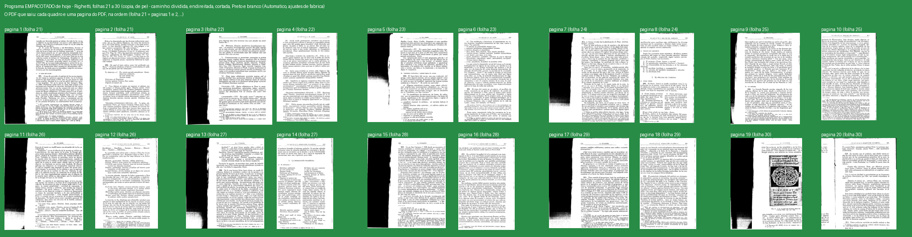

O que vi (olho): as 10 folhas viraram 20 páginas, na ordem; todas em preto e branco, com o texto legível; a gravura
da página 19 ficou; as páginas da direita saíram limpas. **Nas páginas da esquerda (1, 3, 5, 7, 13, 15, 17, 19) sobra
a faixa preta do scanner na beirada esquerda** (ver a ressalva 1).

Antes desse, o mesmo livro rodou mais duas vezes: com a receita de fábrica (sem Dividir e em Original, que é o que vem
marcado de fábrica) e com Dividir em Original. As duas também deram PDF sem erro (guardadas em `saida_teste`).

**Os três leitores de texto no empacotado** (`--conferir-ocr`, máquina), nas páginas Palatino 57 e Horas 11: docTR,
Tesseract e Kraken disponíveis, cada um achado dentro da pasta empacotada, com o mesmo número de linhas do
empacotado de 29/09 (docTR 24 e 12; Tesseract 16 e 0; Kraken 17 e 16). O detector de gravura do ScanTailor abre e lê.
O Kraken levou 90 a 98 s para abrir o motor da primeira vez (o PC estava rodando outro teste ao mesmo tempo).

Nenhum dos testes deixou erro no registro de erros do programa.

## 3. O livro do Kaique (programa de 28/10) aberto no programa de hoje (máquina + olho)

**Como foi feito.** Uma cópia à parte do código de 28/10 (o mesmo do instalador que está na sua Área de Trabalho:
o `.exe` é de 28/10 18:10, e o último salvamento de código antes dele é o de 17:30). Com ela, numa pasta de dados
própria, um projeto de verdade: Righetti, 14 primeiras folhas (cópia), girar 1/4 à esquerda todas as folhas,
Automático (Dividir, Endireitar, Cortar, Limpar em Preto e branco, Montar cadernos), e à mão: Mágico pro na página 6,
corte à mão na página 8, uma gravura marcada à mão na página 10, a página 2 tirada do livro. PDF: "27 páginas, 2
cadernos, 14 folhas para imprimir" (prints a1 a a3).

Depois, a pasta de dados do programa de 28/10 foi copiada para a pasta de dados do programa empacotado de hoje (é o
que acontece no notebook do Kaique: a pasta de dados fica, o programa muda).

**O que aconteceu no programa de hoje:** o livro aparece em "Seus livros" com "pronto, PDF gerado" (print b1);
clicando, abre; "Continuar" leva à área de trabalho com a página 2 "apagada" e as páginas conferidas com o tique
(print b2); "Confirmar e processar" avisa que já existe o PDF de antes (print b3) e oferece "salvar como ... (2)";
"Ficou pronto!" em 38 s, com os mesmos "27 páginas, 2 cadernos, 14 folhas" (print b4).

**A comparação (máquina):**

- Configuração de cada folha e de cada página: **nada mudou e nada sumiu** nas 14 folhas e 28 páginas. O único valor
  diferente é o lugar do PDF, porque foi escolhido "salvar como (2)".
- O programa de hoje acrescentou 8 campos novos, todos com o valor que não muda nada: capa aberta (não), linha à mão
  (nenhuma), fundo tirado (nenhum), giro da página (0), gravura achada à mão (não), gravuras em tons de cinza (não),
  página inserida (0), respeitar as gravuras achadas (sim).
- O PDF: as mesmas 14 folhas, do mesmo tamanho, e **a imagem de cada folha é idêntica** à do PDF de 28/10 (diferença
  zero em todas).

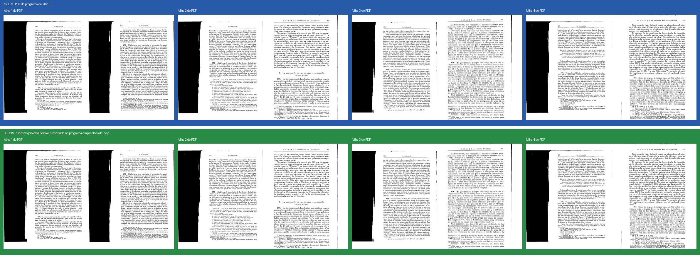

Faixa azul: o PDF do programa de 28/10. Faixa verde: o mesmo livro aberto e processado no programa empacotado de hoje.
As quatro primeiras folhas do PDF de cadernos.

**O que mudou para quem usa** (olho e máquina, conferido de novo com print das duas versões). Corrigido: na primeira
versão deste relatório escrevi que o livro antigo "agora" abre primeiro na tela do livro aberto. **Isso estava
errado: o programa de 28/10 já abria assim.** Nas duas versões o caminho é o mesmo e as telas são iguais ponto por
ponto: "Seus livros", clique no livro, a tela do livro aberto (com "Continuar", "Rodar o automático...", "Confirmar e
processar..."), "Continuar", a área de trabalho. A única diferença é na barra de baixo da área de trabalho: hoje há o
botão "marcações" (pedido de 29/10, D-580) e a setinha da qualidade da prévia (pedido de 04/11, D-620); por falta de
espaço, o nome do livro aparece encurtado ("righ..."). Nada do trabalho dele se perde.

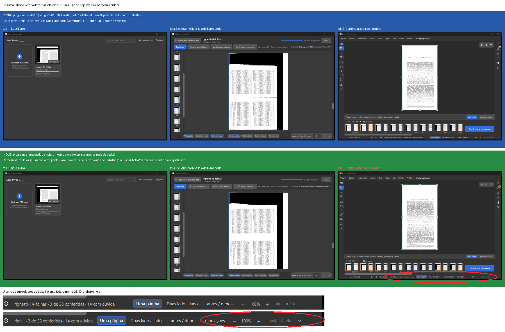

Faixa azul: programa de 28/10. Faixa verde: programa empacotado de hoje. As mesmas três telas na mesma ordem; em
vermelho, a única diferença (a barra de baixo, ampliada no fim).

## 4. O que o empacotamento de hoje precisa mudar para o Velopack (conferido no código, sem mudar)

1. **O programa não sabe a própria versão.** Só existe "1.0.0" escrito no instalador; nenhum arquivo do programa tem
   a versão. O Velopack precisa dela a cada "versão para o Kaique".
2. **O começo do programa.** O `main.py` atende dois modos sem janela antes de abrir a janela: o dos ajudantes que
   desenham as páginas (cada abertura do programa lança dois deles, com o mesmo `.exe`; visto rodando) e o
   `--conferir-ocr`. A peça do Velopack que tem de ser a primeira coisa do programa entra aí, com cuidado para os
   ajudantes não procurarem atualização.
3. **O instalador muda.** Hoje é o Inno Setup (administrador, Arquivos de Programas, Visual C++ dentro, número fixo
   que o Windows usa para reconhecer o programa). Com o Velopack, sai o Inno e entra o instalador dele; as travas que
   hoje estão no instalador (não gerar sem modelos, sem as peças do ScanTailor, sem o Visual C++) têm de ir para o
   empacotador. **7 testes** de `tests/test_empacotar.py` conferem o Inno; pela regra de 03/11 eles só mudam com o seu
   "sim".
4. **O empacotador procura o motor do Kraken e o Visual C++ na pasta ao lado do projeto.** Rodando numa cópia de
   trabalho, foi preciso uma ligação provisória de pasta (como em 28/10). O comando de publicar tem de saber onde
   estão essas peças.
5. **Falta no PC:** o .NET (o empacotador do Velopack precisa dele; não está instalado) e a biblioteca do Velopack no
   ambiente do programa (não está nem na lista de dependências).
6. **Tamanho.** A pasta tem 1.889 MB e 35.090 arquivos, quase tudo do Kraken. O Velopack baixa só os arquivos que
   mudaram, então o Kraken não desce de novo a cada versão; mas a primeira atualização pode vir inteira (o estudo
   achou um defeito do Velopack nisso, consertado só na versão nova dele).
7. **O que já está pronto:** o programa só lê o que fica ao lado do `.exe` (Kraken, Tesseract), nunca grava ali, e os
   livros e projetos ficam na pasta de dados, fora do programa: trocar a pasta do programa não toca no trabalho.
8. O arquivo único do pendrive não serve ao Velopack: continua existindo, mas não se atualiza.

---

## Ressalvas

1. **Faixa preta nas páginas da esquerda do Righetti** (olho). Depois de dividir, endireitar e cortar, a borda preta do
   scanner continua na beirada esquerda das páginas da esquerda. Acontece igual no programa de 28/10 e no de hoje, no
   código e no empacotado: não é coisa do empacotamento. Vai para a Lista de bugs (abaixo).
2. **O "antes" do item 3 rodou pelo código de 28/10, não pelo `.exe` instalado de 28/10.** Instalar pediria
   administrador e mexeria no seu Windows. O código e as peças são os mesmos daquele dia; o ambiente do Python é o de
   hoje.
3. **O livro do item 2 foi posto de pé na cópia.** O programa não gira o Righetti sozinho (defeito de 22/10); no item 3
   o giro foi feito no programa, como o Kaique faria.
4. **Só dois livros parciais** (14 e 10 folhas do Righetti). Não testei livro grande no empacotado.
5. **Tempos medidos com o PC ocupado** (outros testes e agentes): a janela levou ~23 s para aparecer no empacotado,
   mais que os ~8 s anotados em setembro. Não é medida de velocidade (essa é da Fase 5).
6. **Prints da área escondida:** são da janela de verdade. A caixinha "Toggle" do leitor de tela não marcava as etapas
   do Automático, então as caixinhas foram marcadas por clique de verdade (mensagem do Windows), como as outras.
7. Nenhum teste automático do programa foi rodado (nenhuma linha mudou); o GitHub está fora hoje.

## Bugs para a Lista de bugs

- **16/11/2026 — Righetti: a faixa preta do scanner fica na beirada esquerda das páginas da esquerda depois de
  Dividir + Endireitar + Cortar** (Automático, ajustes de fábrica). Igual no programa de 28/10. Print:
  `relatorios/frente-kaique-2026-11-16/etapa2/item2/faixa-preta-paginas-da-esquerda.png`.

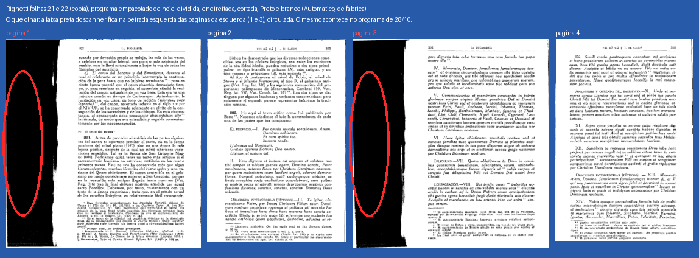

## Como cumpri cada decisão

- D-711 ("vai a versão de teste, mas atualizada para ele"): empacotada a versão de teste de hoje.
- D-722 ("Sim", testar no seu PC e desfazer): nada foi instalado; tudo em pasta de teste dentro da cópia; as sobras
  foram tiradas (lista no fim).
- D-605 (o novo não estraga o testado): item 3, nenhuma configuração mudou e o PDF saiu idêntico.
- D-637 (quem usa e o livro): seção "O que mudou para quem usa" do item 3.
- D-723 e D-724 (Velopack, assinatura grátis): item 4 diz o que falta; a assinatura entra no comando de publicar da
  etapa 3.

## Onde estão as coisas

- Scripts: `relatorios/frente-kaique-2026-11-16/etapa2/scripts/` (área escondida, piloto, projeto de 28/10,
  comparação).
- Comparação: `item3/projeto-comparado.txt`, `item3/pdf-comparado.json`, `item3/pdf-antes-depois.png`.
- Leitores de texto: `item2/palatino_p057.json`, `item2/horas_p011.json`.
- Prints: `prints/` (a = programa de 28/10; b = livro de 28/10 no empacotado de hoje; c = livro novo no empacotado).
- Fora do git (na cópia `kaique-etapa2`): `dist/EditorImpressao/` (o programa empacotado) e `saida_teste/etapa2/`
  (pastas de dados, PDFs, todos os prints).

### Prints

a1: programa de 28/10, depois do Automático (Righetti 14 folhas, giradas, divididas, 28 páginas).
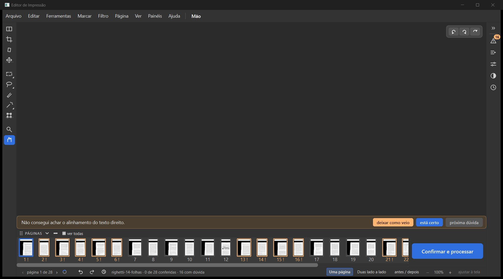

a2: programa de 28/10, página 10 com a gravura marcada à mão (retângulo laranja).
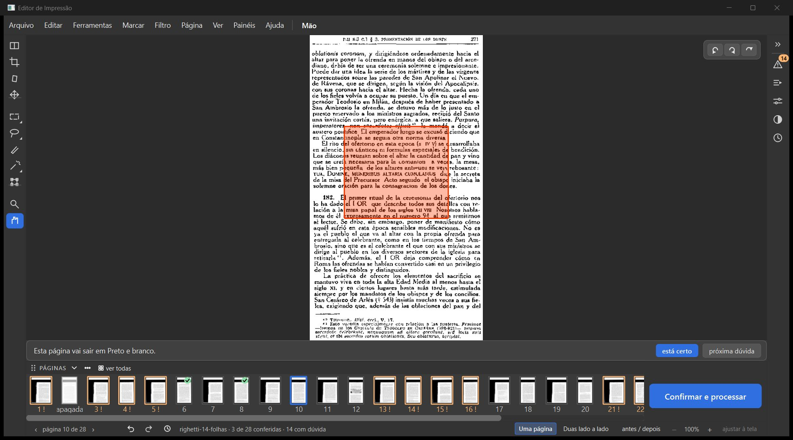

a3: programa de 28/10, "Ficou pronto!" (27 páginas, 2 cadernos).
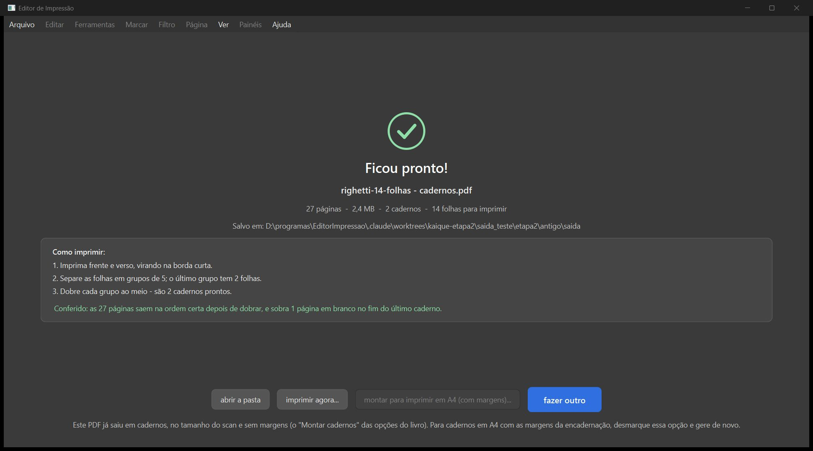

b1: empacotado de hoje com a pasta de dados de 28/10: o livro em "Seus livros".
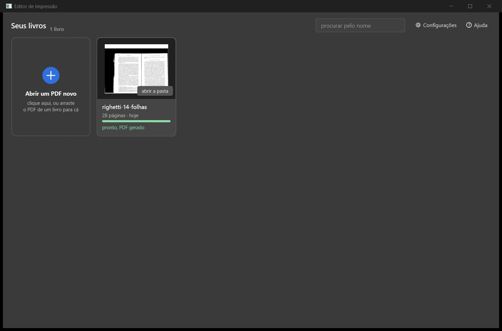

b2: empacotado de hoje, o livro de 28/10 na área de trabalho (página 2 "apagada", 6 e 8 conferidas).
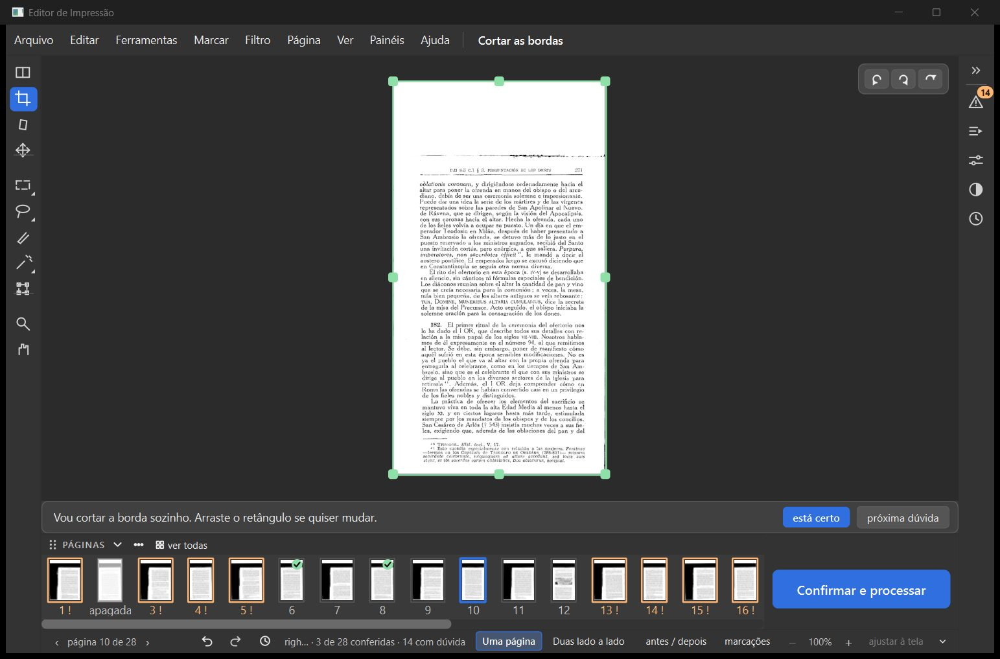

b3: empacotado de hoje, "Confirmar e processar" (27 páginas vão para o PDF, 1 foi apagada).
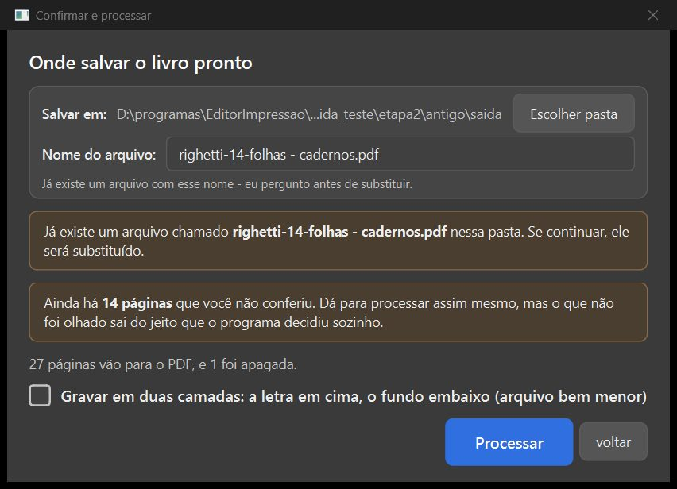

b4: empacotado de hoje, "Ficou pronto!" com os mesmos números de 28/10.
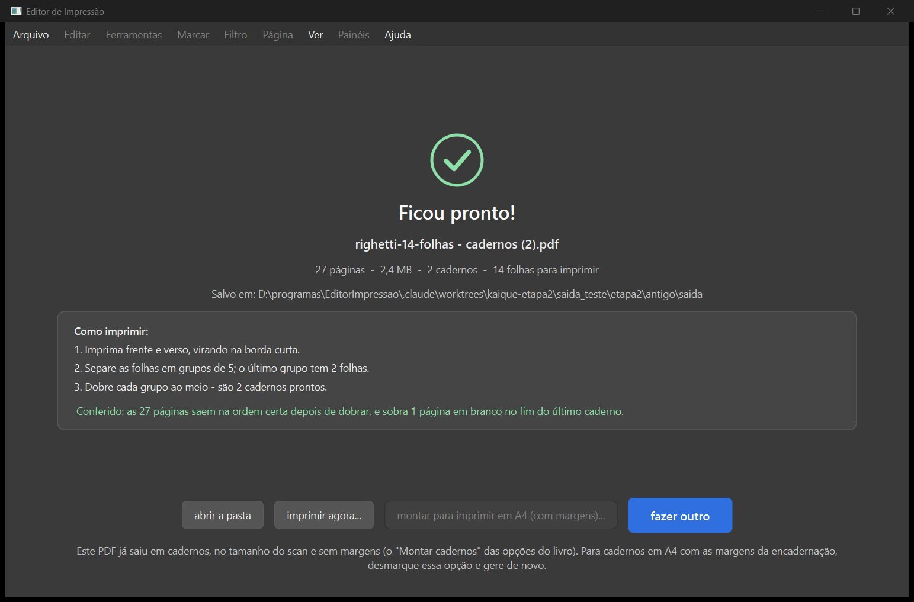

c1: empacotado de hoje, livro novo (Righetti folhas 21 a 30, cópia) aberto.
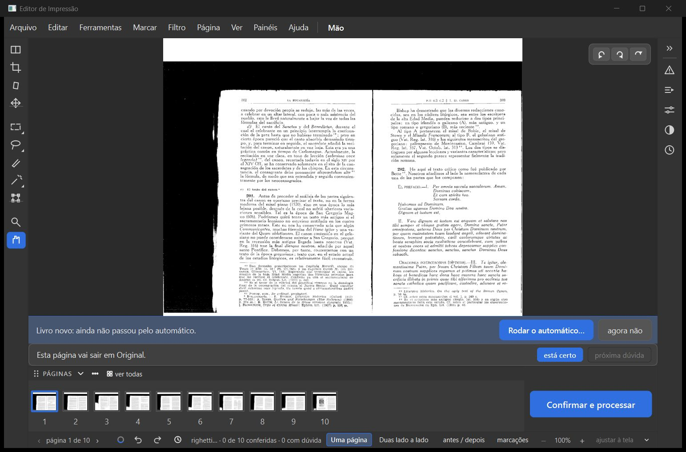

c2: empacotado de hoje, janela do Automático com Dividir, Endireitar, Cortar e Limpar em Preto e branco.
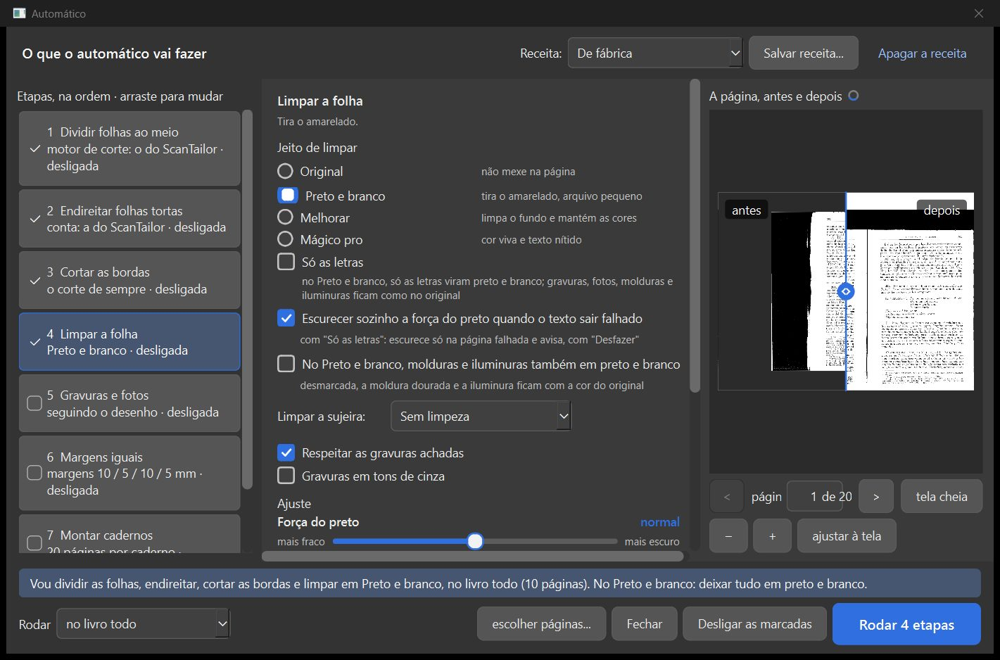

c3: empacotado de hoje, área de trabalho depois do Automático (página 1, dividida, endireitada, cortada, Preto e
branco).
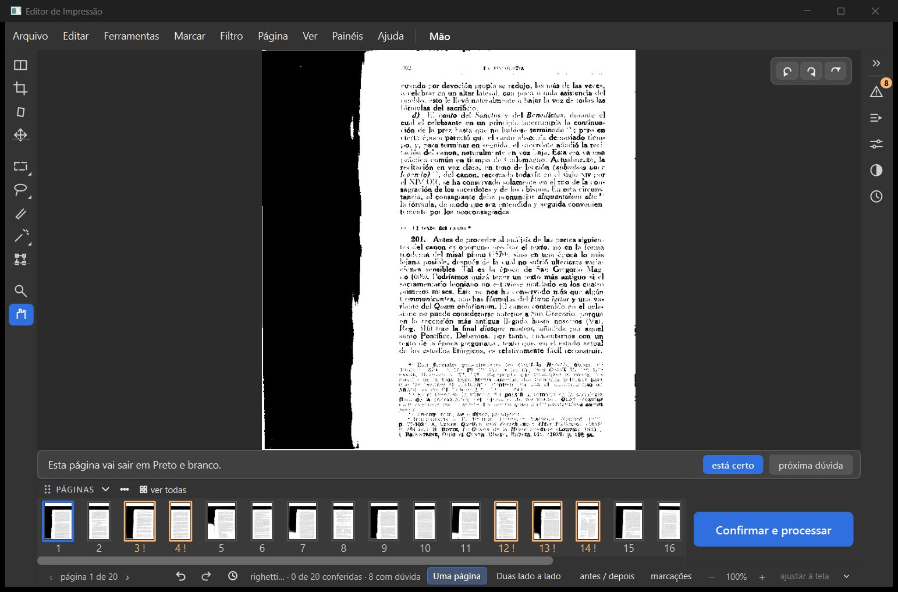

c4: empacotado de hoje, "Ficou pronto!" (20 páginas).
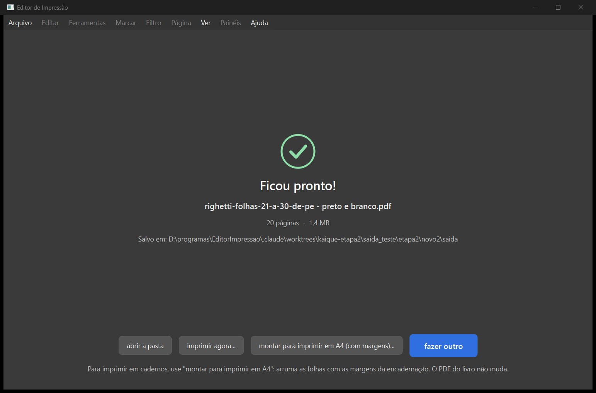
