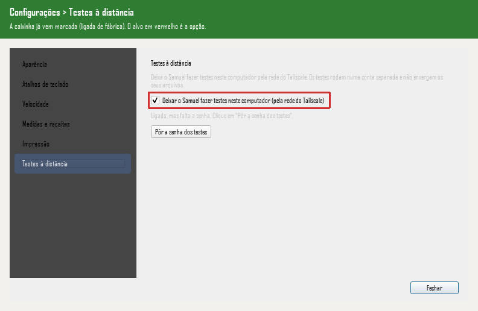
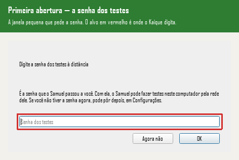

# Etapa 4: os testes à distância (relatório do implementador, 16/11/2026)

**O que foi feito.** Nas Configurações, entrou uma parte nova, "Testes à distância". Nela fica a
caixinha "Deixar o Samuel fazer testes neste computador (pela rede do Tailscale)", que já vem
marcada. Na primeira vez que o programa abre, uma janela pequena pede a senha dos testes. A parte
que liga e desliga os testes no Windows ficou separada numa peça só. **Nada foi feito de verdade no
Windows de ninguém.** Nos testes, essa peça é trocada por uma de mentira, que só anota os comandos
que o programa daria.

**Situação:** pela metade. Parei por ordem da gerente, porque o PC ia ser desligado. A rodada do
GitHub com todos os testes ainda não terminou.

## O que o Kaique vê

1. **Na primeira vez que abre o programa novo:** aparece a janela "Testes à distância". Ela pede a
   senha que o Samuel passar. Ele digita e clica em "OK". O Windows faz uma pergunta só, e ele clica
   em "Sim". Se clicar em "Agora não", nada é instalado, e ele pode pôr a senha depois nas
   Configurações.
2. **Em Configurações > Testes à distância:** a caixinha marcada, uma frase que diz como está
   ("Ligado", "Falta a senha" ou "Desligado") e, quando falta a senha, o botão "Pôr a senha dos
   testes".
3. **No livro e no PDF:** nada muda. Os filtros, as ferramentas e os projetos dele ficam iguais.

## Como cumpri cada decisão

| Decisão | Como foi feito | Prova |
|---|---|---|
| D-712: vem ligada de fábrica; o instalador não pergunta nada | A opção nasce ligada. O instalador não foi mexido. | `test_d712_opcao_ligada_de_fabrica`, `test_d712_instalador_nao_pergunta_nada`, print 1 |
| D-721: a janela da senha na primeira abertura; sem a senha, nada liga; a senha pode entrar depois | A janela aparece uma vez só. Sem senha, o Windows não é tocado. Depois, a senha entra pelo botão das Configurações. | `test_d721_primeira_vez_pede_a_senha_e_liga`, `test_d721_sem_senha_nada_liga`, `test_p215_por_a_senha_dos_testes`, print 2 |
| D-705: só pela rede do Tailscale, sem porta nova dentro do programa | O firewall fecha a porta para todos e abre só para os endereços do Tailscale, na placa de rede dele. O programa não abre porta nenhuma. | `test_ligar_da_os_comandos_esperados` |
| D-711: liga sozinho com o Windows e entra com senha, não com chave | O serviço fica automático. Entra com senha (`PasswordAuthentication yes`), e só a conta de testes pode entrar. | `test_ligar_da_os_comandos_esperados` |
| D-717: conta separada, sem administrador, escondida da tela de entrada | A conta entra só no grupo Usuários e é escondida pelo registro do Windows. | `test_ligar_da_os_comandos_esperados` |
| Dizer "Não" ao Windows não muda nada | Nada é instalado, a opção fica desligada e aparece um aviso em português. | `test_disse_nao_nada_e_instalado` |
| Desligar fecha a entrada | Para o serviço, tira ele da partida do Windows, apaga a regra do firewall e desativa a conta. | `test_desligar_para_o_servico_e_fecha_a_entrada` |
| D-722: desfazer tudo no fim do teste (é a etapa 5) | A lista do que desfazer está pronta, mas não foi rodada. | `test_desfazer_tira_a_conta_e_o_openssh` |
| A senha nunca aparece no comando | No comando, a senha vai como um nome (`$SenhaDosTestes`). O texto da senha chega por fora. | `test_a_senha_nunca_aparece_no_comando` |

## Caminho → função (a regra fica num lugar só)

| Caminho | Função |
|---|---|
| A janela da senha na primeira abertura | `core.testes_a_distancia.ligar` |
| A caixinha das Configurações, ao marcar | `core.testes_a_distancia.ligar` |
| A caixinha das Configurações, ao desmarcar | `core.testes_a_distancia.desligar` |
| O botão "Pôr a senha dos testes" | `core.testes_a_distancia.ligar` |

Todos os caminhos usam a mesma função, e os comandos saem de um lugar só
(`plano_de_ligar` e `plano_de_desligar`).

## Prioridade baixa ou normal (D-716)

Isso fica com quem pede o teste. O programa não precisou mudar. Ao entrar de longe, a gerente
começa o comando com `start "" /belownormal /wait ...` para prioridade baixa, ou sem esse pedaço
para normal. O Windows passa a mesma prioridade para tudo o que esse comando abrir. Sem dizer nada,
roda em baixa.

## Testes

- **No PC:** `test_decisoes_testes_a_distancia.py` passou inteiro (11 de 11).
  `test_configuracoes_em_partes.py` passou (2 de 2). O `test_promessas.py` foi **parado no meio** por
  ordem da gerente, e o resultado dele não se sabe.
- **No GitHub:** rodada **43895649793**, ainda sem resultado.

## Ressalvas (só se provam na etapa 5, no PC do Samuel)

- A parte que roda de verdade no Windows (a pergunta de administrador e a senha passada cifrada)
  **nunca foi rodada**. Os testes só conferem os comandos e os botões da tela.
- O nome da placa de rede "Tailscale" e os endereços IPv6 dele precisam ser conferidos.
- **Antivírus (D-725):** se ele reclamar da conta escondida, a saída é liberar só essa conta.
  Nada foi feito no antivírus.
- Que a conta de testes não enxerga a pasta do Kaique é uma regra do Windows. Só se prova num
  Windows de verdade. Atenção às pastas soltas no disco, por exemplo uma pasta de livros direto
  no D:.

## Bugs para a Lista de bugs

Nenhum achado.

## Perguntas para o Samuel

**Do que se trata:** o que acontece com a conta de testes escondida e com o comando de longe quando o
programa for tirado do notebook do Kaique.
**Como está hoje:** não há decisão. Ao tirar o programa, os dois ficariam no notebook.
**O que você escolhe:**
- (a) tirar o programa apaga a conta de testes e tira o comando de longe. A sugestão é esta, para
  nada escondido ficar para trás;
- (b) deixar os dois como estão;
- Só comentário.

Nada do que já funciona muda com essa escolha. Nesta etapa, nada foi feito nisso.
