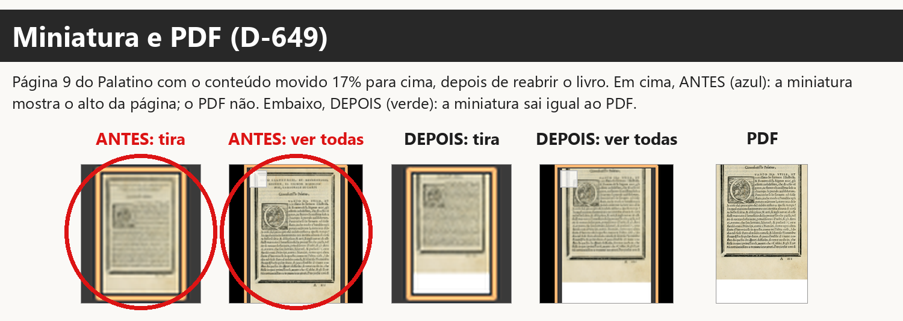
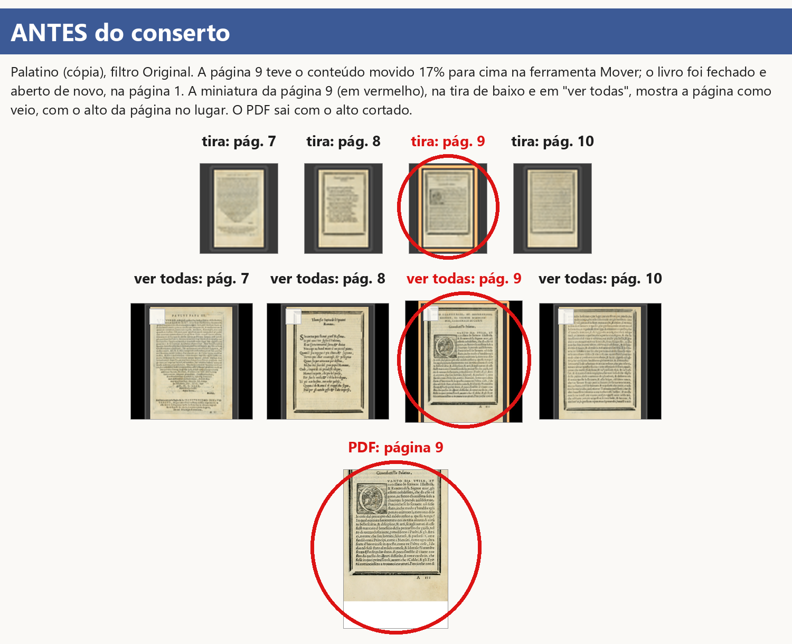
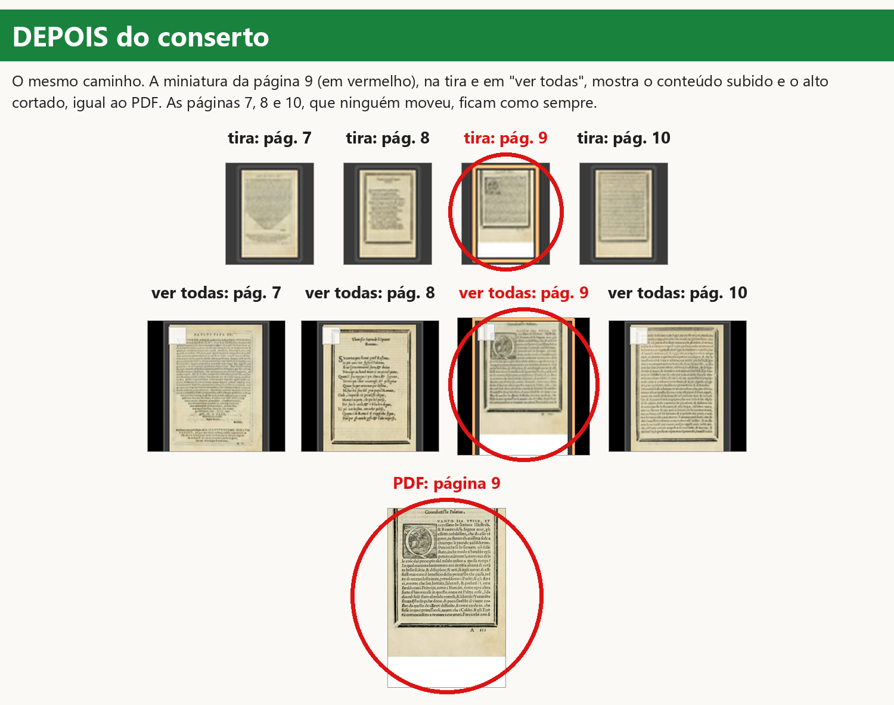
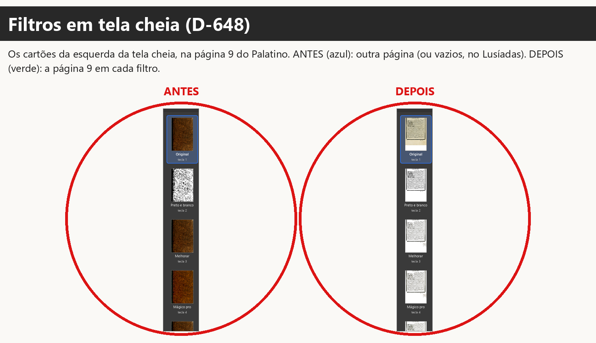
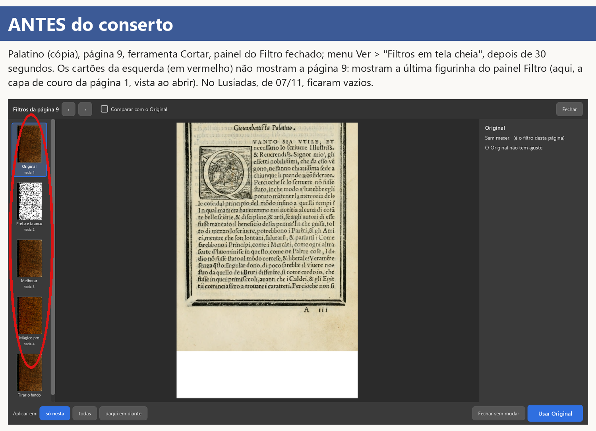
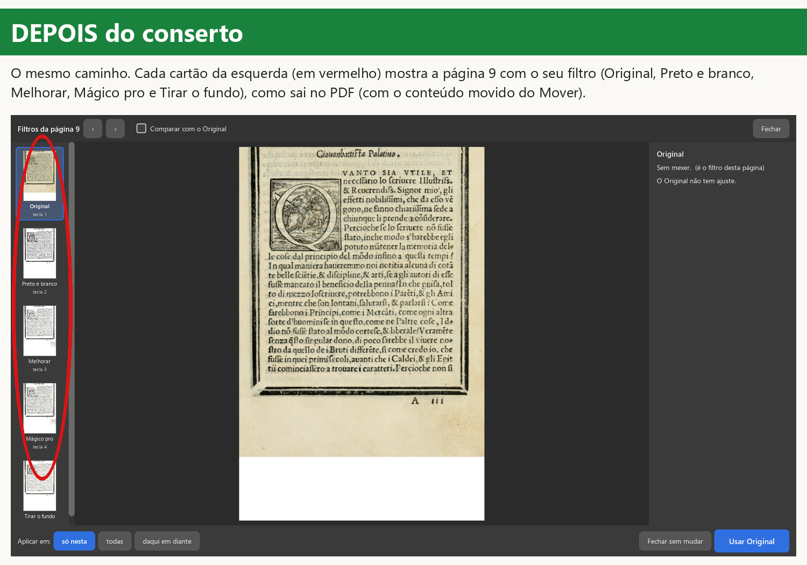
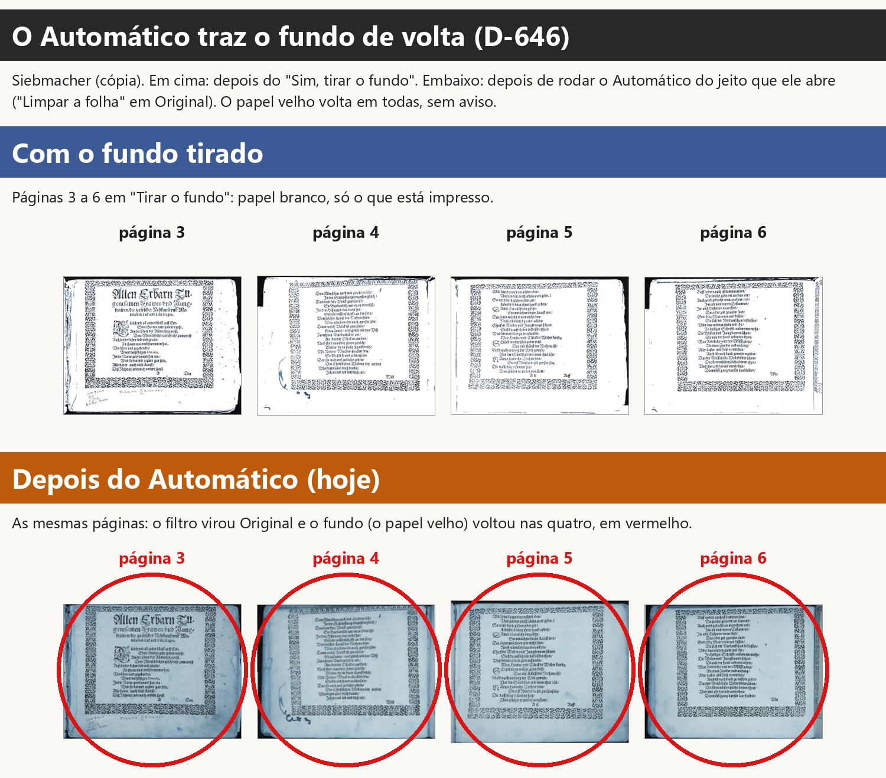

# ONDE-PAREI: três defeitos graves (10/11/2026)

Ramo `graves-2026-11-10` (a partir do `obra-2026-10-26` em `58806f81`), worktree
`.claude/worktrees/graves`. Pedido da gerente de 10/11 (Samuel: "pode ser"). Achados no teste como o
Kaique de 07/11 (versão `6904a634`; relatório fora do git em
`.claude/worktrees/teste-kaique-funcoes/relatorios/teste-kaique-funcoes/`). Nenhuma página dos
Lusíadas foi copiada para o git: os prints usam o Palatino e o Siebmacher (domínio público).

## Resumo

| Defeito | Situação |
|---|---|
| 1. Tela, miniaturas e PDF diferentes; a folha espremida (D-649, D-547, D-473) | **consertado** (`1e04573b`, `6d13ccfc`) |
| 2. O Automático desfaz o "Tirar o fundo" (D-646, D-134) | **parado: pergunta ao Samuel** (nome e lugar da opção; muda o formato do projeto e testes antigos) |
| 3. Cartões de "Filtros em tela cheia" vazios (D-648, D-184, D-192) | **consertado** (`bcd49735`) |

## Decisões que esta tarefa precisa cumprir

- **D-649** (07/11): "Consertar" · "Isso é um erro grave. O preview as miniaturas tem que estar sincronizada e o
  resultado final tem que sair como a edição foi mostrada no preview ."
- **D-547** (27/10, escolha da gerente apoiada na D-473): "Todas as telas e miniaturas mostram a página já
  movida/redimensionada, como sai no PDF".
- **D-473** (26/10, apoiada na D-066 "precisamos que o pdf saia que nem está na tela"): "Tela e PDF diferentes é
  defeito, nunca escolha".
- **D-646** (07/11): "Consertar" · "É só criar uma opção para desfazer o tirar fundo, e só vai desfazer o tirar fundo
  quando apertar ela. E via de regra, nenhum filtro deve fazer o fundo voltar."
- **D-134** (29/09): "Página sempre abre em 'Original', sem mexer. Em PDF com camadas, 'Tirar o fundo' vira mais uma
  opção na lista de filtros [...] Assim eu decido se tiro ou não, e o Kaique escolhe um filtro só, sem mudança
  escondida." · "eu quero poder escolher tirar o fundo sem colocar nenhum filtro."
- **D-069** (30/09, F5): "BOM - mas eu quero poder ter essa opção dentro do app depois de abrir o livro, e também a
  opção de voltar ao original." (pela metade)
- **D-648** (07/11): "Consertar" · "Esse é um grave."
- **D-184** (07/10): "A — A “um grande”, com a chave “Comparar com o Original”".
- **D-192** (22/10): "faça o recomendado." · "Está bom".
- **D-605** (03/11): "nenhuma função nova, ou nova escolha dentro do programa pode alterar o que já está escolhido e
  testado".
- **D-667** (10/11): "se mudou a ferramenta, muda em todos os lugares".

## O que já está escolhido e testado aqui

- D-546: nas ferramentas de marcar, cortar, dividir e endireitar a página aparece SEM a composição (o Mover compõe
  sozinho). Não mudou.
- D-547: só a miniatura da página movida (ou numa folha escolhida) é composta; as outras ficam com a folha como veio
  (`tests/test_decisoes_9b2.py::test_d547_*`, que confere "as outras: cruas"). Não mudou.
- D-473/D-064: a prévia é trocada pela imagem do PDF reduzida (`test_d473_d064_*`). Não mudou.
- D-659 (09/11): o acerto por trás não devolve mais a folha crua
  (`tests/test_decisoes_gravura_a_mao.py::test_d659_a_tela_nao_troca_a_previa_pela_folha_crua`).
- D-184/D-192: a tela cheia (`tests/test_filtros_tela_cheia.py`, 11 provas); a página grande já usava a conta do PDF.
- D-134, D-136, D-490 e o filtro "Tirar o fundo" (`tests/test_tirar_fundo_no_programa.py`, 54 provas, entre elas
  `test_original_nao_mexe_na_pagina`, `test_outro_filtro_nao_tira_o_fundo`, `test_alerta_sai_quando_a_pagina_sai_do_filtro`).

## Como fica para quem usa e no livro

**Defeito 1.** Antes: Kaique move o conteúdo da página 5 para cima no Mover, fecha e reabre o livro; a miniatura da
página 5 (embaixo e em "ver todas") mostra o título no lugar; o PDF sai sem o título. Depois: a miniatura da página
movida mostra o que vai sair no PDF (o título fora), embaixo e em "ver todas", mesmo sem visitar a página (a prévia
dela é feita por trás, depois da página da vez; leva um ou dois segundos). As páginas que ninguém moveu ficam como
sempre. O PDF não muda (a conta é a mesma, agora num lugar só). A folha espremida no Mover e na Mão (que fez o
"Centralizar" gravar errado) já tinha sido consertada em 09/11 e não volta.

**Defeito 3.** Antes: Ver > "Filtros em tela cheia" com outra ferramenta e o painel do Filtro fechado: os quatro
cartões da esquerda cinza para sempre (ou, se o painel Filtro mostrou outra página antes, as figurinhas DAQUELA
página: no Palatino, a capa de couro no lugar da página 9). Depois: cada cartão aparece com a página no seu filtro, a mesma imagem da
página grande quando ele é escolhido (com o "Só as letras", a gravura respeitada, a página movida), em poucos
segundos. Nada muda no PDF.

**Defeito 2.** Não mudou nada (ver "Perguntas para o Samuel").

## A causa de cada um

1. **Miniatura x PDF.** Duas causas. (a) A folha espremida: no `6904a634`, o acerto por trás da página com a marcação
   provisória devolvia a FOLHA CRUA como "a imagem do PDF", e a tela a esticava para a forma da página; o
   "Centralizar" mediu essa imagem e gravou o conteúdo 17% para cima: por isso o PDF saiu sem o título. Consertada na
   origem em 09/11 (`88731637`); a prova do D-659 falha no `6904a634` ("devolveu a folha crua como se fosse o desenho
   do PDF"). (b) A miniatura só era composta como no PDF se a prévia da página ainda estivesse guardada (as últimas
   30 visitadas): depois de reabrir o livro ela ficava com a página como veio, e a grade "Todas as páginas" nunca
   compunha. Além disso a conta "como sai no PDF" estava escrita três vezes (PDF, tela, Automático: revisão M2).
2. **Automático x "Tirar o fundo".** "Tirar o fundo" é um FILTRO da página (D-134): escolher qualquer outro filtro,
   inclusive pelo "Limpar a folha" do Automático (que abre com a receita, "Original"), troca o filtro e o fundo volta.
   A regra da D-646 ("nenhum filtro deve fazer o fundo voltar") pede que o fundo tirado vire uma coisa da página
   SEPARADA do filtro, com os filtros feitos por cima da página sem o fundo.
3. **Cartões da tela cheia.** Não tinham conta própria: copiavam a figurinha do painel "Filtro da página", que só é
   desenhada com esse painel aberto ou com a ferramenta Filtro. Aberta pelo menu Ver com outra ferramenta, nada era
   desenhado. Com o painel aberto, mostravam a conta mais simples das figurinhas (revisão A2), não a da página grande.
   E um segundo defeito, achado ao provar: num livro com "Limpar a folha" desligado (livro novo), a conta "como sai
   com o filtro X" (`core/pipeline.renderizar_com_filtro`, a da página grande da tela cheia, do cartão "Tirar o
   fundo" e do "comparar") desenhava a cópia sem a marca de "filtro escolhido à mão" que a tela grava ao escolher: o
   Preto e branco aparecia em Original, e depois de "Usar" a página saía em Preto e branco. Agora a cópia leva a
   marca (o mesmo que escolher).

## O que juntei num lugar só

- `core/pipeline.compor_como_no_pdf`: margens iguais + página movida/na folha escolhida. Usada pelo PDF
  (`_pagina_pronta`), pela tela (`ui/tela_conferir._como_sai_no_pdf`, que serve cartões, lado a lado, antes/depois,
  tela cheia e miniaturas) e pela prévia do Automático (`core/automatico.como_sai_na_tela`). Antes: três cópias.
- Miniatura composta: uma só (`TelaConferir.miniatura_como_sai`), a mesma na tira e na grade.
- Cartões da tela cheia: a mesma imagem da página grande (`FiltrosEmTelaCheia._imagem`).
- Não mexi em `core/pipeline.garantir_selecao` nem em `core/filtros._limpar_o_papel_de_verdade` (outro agente).

## Andamento

- [x] Defeito 1: código, reversão, testes dos arquivos tocados.
- [x] Defeito 2: causa achada; parado na pergunta.
- [x] Defeito 3: código, reversão.
- [x] Prints (pasta `prints/`), testes de decisões, `teste_botoes.py`.
- [ ] GitHub: rodada final dos testes e filtro de velocidade (números abaixo; a gerente confere o fim).

## Testes

No PC (um arquivo por vez, sem janela, prioridade baixa, `LOCALAPPDATA` à parte):
- `tests/test_decisoes*.py`: os 55 arquivos passam. Um deles,
  `test_decisoes_desfazer_pagina.py::test_d621_cada_etapa_sozinha_volta_so_ela_so_nesta_pagina[cortar]`, falhou UMA
  vez com a primeira versão do conserto 1 ("selecao" mudou): a miniatura que faltava era pedida pela prévia normal,
  que desenha na página de verdade e remonta a marcação. Causa tirada no `6d13ccfc` (a miniatura é desenhada numa
  cópia); o teste antigo não foi mexido e passa (duas vezes seguidas).
- Arquivos tocados e vizinhos: `test_decisoes_9b2` (30), `test_filtros_tela_cheia` (11), `test_tirar_fundo_no_programa`
  (54), `test_misto_no_programa` (41), `test_misto_consertos` (25), `test_miniaturas_novas` (5), `test_margens_na_tela`
  (4), `test_core` (62), `test_camadas` (64 + 26 pulados), `test_promessas` (268 + 1 xfail), `test_etapa10b_imagem`,
  `test_para_revisar_na_tela`, `test_livro_aberto`, `test_cadernos`, `test_avisos`, `test_corte_pelo_conteudo_livro`,
  `test_margens_scantailor`, `test_girar_cartoes_e_previas`, `test_menus_que_nao_faziam_nada`: todos passam.
  `test_decisoes_girar_capa.py` caiu uma vez sem mensagem (o processo fechou depois do 1º teste) e passou inteiro
  (26) ao rodar de novo: instabilidade, sem relação achada.
- `teste_botoes.py`: 374 ações, 0 falhas.

No GitHub:
- `42936381314` (commit `bcd49735`): verde na 2ª tentativa. Na 1ª, só `test_dialogo_impressao.py` caiu com o código
  3221226505 (o processo fechou DEPOIS dos 5 testes passarem; não toca nada deste conserto).
- `42944019482` (commit `6d13ccfc`, o final do código): ver o resultado na entrega.
- Filtro de velocidade `42936386218` (obra-2026-10-26 -> graves-2026-11-10, disparado no `bcd49735`; o `6d13ccfc` só
  muda a miniatura e o desenho dos cartões, nada do PDF): ver o resultado na entrega.

## Como cumpri cada uma

- **D-649 / D-547** (miniatura igual ao PDF): `tests/test_graves_d649_miniatura_igual_ao_pdf.py::
  test_d649_b_a_miniatura_da_pagina_movida_sai_como_o_pdf_depois_de_reabrir` (medida: onde começa a tinta na
  miniatura da tira e da grade = no PDF, até 3% da altura). Falha no obra `58806f81` ("não aconteceu a tempo: a
  miniatura da página movida composta como no PDF"), passa no novo. Prints `d649-*.png`.
- **D-649 (a folha espremida)**: causa consertada em 09/11; a prova
  `tests/test_decisoes_gravura_a_mao.py::test_d659_a_tela_nao_troca_a_previa_pela_folha_crua` falha no `6904a634`
  (a versão do teste de 07/11: "devolveu a folha crua como se fosse o desenho do PDF") e passa hoje. Guarda nova:
  `test_d649_a_o_mover_mostra_a_pagina_e_nao_a_folha_espremida`.
- **D-473** (tela = PDF): a composição é UMA conta (`core/pipeline.compor_como_no_pdf`) para o PDF, a tela e o
  Automático; as provas antigas da D-547/D-473 (`tests/test_decisoes_9b2.py`, 30) passam.
- **D-648 / D-184 / D-192**: `tests/test_graves_d648_cartoes_da_tela_cheia.py` (medida: cada cartão recebe a página
  com tinta; Preto e branco com menos de 5% de meios-tons, Original com o papel amarelado). A prova da janela falha
  no obra `58806f81` ("não aconteceu a tempo: os quatro cartões com a página"); a da conta no livro novo também
  (o Preto e branco saía em Original). As 11 provas antigas da tela cheia passam. Prints `d648-*.png`.
- **D-646 / D-134 / D-069**: não construído; pergunta 1 com print `d646-pergunta.png`.
- **D-605**: nenhum teste antigo foi mudado; os testes dos arquivos tocados passam (lista em "Testes").
- **D-667**: a regra mudou num lugar só (composição; "como sai com o filtro X"); nenhum desvio por ferramenta.

## Perguntas para o Samuel

**Pergunta 1 (D-646, o fundo que volta).** Print: `relatorios/graves-2026-11-10/prints/d646-pergunta.png`.
Hoje "Tirar o fundo" é um filtro da página. Por isso qualquer outro filtro, inclusive o "Original" que o Automático
põe, traz o papel velho de volta. Para cumprir "nenhum filtro deve fazer o fundo voltar", proposta:

- "Tirar o fundo" continua onde está (lista de filtros, pergunta ao abrir). Depois dele, Preto e branco, Melhorar,
  Mágico pro e Original passam a ser feitos em cima da página já sem o fundo, e o Automático também.
- Para trazer o fundo de volta: um item **"Desfazer o tirar o fundo"** no menu **Filtro**, logo abaixo de "Tirar o
  fundo", e o mesmo botão no painel "Filtro da página", embaixo das figurinhas, com o "Aplicar em" de sempre (só
  nesta / todas / daqui em diante). Só ele traz o fundo.

Pode ser assim (nome e lugar)? Sim ou não; se não, diga o nome e onde.

O que isso muda no que já foi escolhido e testado (D-605), e por isso não fiz sem perguntar:
- Hoje escolher "Original" numa página em "Tirar o fundo" traz o fundo de volta (é assim que a D-069, "voltar ao
  original", funciona hoje: pelo Automático com Original). Com a proposta, "Original" vira "sem filtro, sem o fundo".
- Provas antigas que cobram o jeito de hoje e passariam a falhar: `tests/test_tirar_fundo_no_programa.py`
  (`test_original_nao_mexe_na_pagina`, `test_outro_filtro_nao_tira_o_fundo`,
  `test_alerta_sai_quando_a_pagina_sai_do_filtro`) e a frase de `ui/janela_principal._tirar_o_fundo_do_livro_inteiro`
  ("Original volta ao como veio").
- O projeto ganha um campo por página ("fundo tirado"), separado do filtro (CLAUDE.md §6: mudar o formato dos
  arquivos de dados). Projetos antigos: a página em "Tirar o fundo" abre com o fundo tirado e o filtro Original.

**Pergunta 2 (D-649, só para confirmar o alcance).** Consertei a miniatura da página MEXIDA (movida, aumentada ou
numa folha escolhida): agora ela sai igual ao PDF. As miniaturas das outras páginas continuam mostrando a página como
foi escaneada (colorida, sem o filtro e sem o corte), como foi decidido na D-547 e como os testes cobram. Quer que
TODAS as miniaturas mostrem a página já com o filtro e o corte, como no PDF? (Sugestão: não por agora; isso faz o
programa desenhar o livro inteiro por trás ao abrir, e deixa a primeira abertura mais lenta.)

## Achados para a gerente

1. **A tela estica qualquer "imagem do PDF" para a forma da prévia, calada** (`ui/tarefas.GerenciadorPrevias.
   _por_a_imagem_do_pdf`, `cv2.resize` para o tamanho da prévia). Foi isso que transformou o erro de 07/11 (a folha
   crua devolvida no lugar da página) numa "folha espremida" em vez de um erro visível. Sugestão: recusar uma imagem
   de outra proporção (registrar no `erros.log` e manter a prévia). Não fiz: não é a causa, e muda o caminho da D-473.
2. **As figurinhas do painel "Filtro da página" e o "comparar" da tela grande continuam com a conta mais simples**
   (revisão A2): podem mostrar a gravura em manchas que a página não terá. Só a tela cheia passou a usar a conta da
   página grande. Juntar as outras duas mexe no aviso "Ficou escura" (medido nas figurinhas) e em provas antigas:
   pede pedido próprio.
3. **As miniaturas das páginas que ninguém moveu mostram a página como foi escaneada** (sem filtro, sem corte, sem
   as margens iguais), de propósito desde a D-547 (há prova que cobra isso). Se a D-649 ("sempre mostram a mesma
   coisa") valer para todas, é a Pergunta 2.
4. **M8 continua**: se o "Tirar o fundo" dá erro, a página sai com o fundo e nada avisa (`core/pipeline.
   _sem_fundo_da_folha`). Não mexi (não pedido; aviso novo pede decisão).
5. **Custo da miniatura composta**: com o "usar em todas" do Mover em muitas páginas, cada uma é desenhada por trás
   numa cópia (depois da página da vez). Enquanto isso, a troca pela imagem do PDF (D-473) da página da vez espera a
   fila acabar. Num livro de 134 páginas todas movidas isso pode levar minutos. Não medi num livro grande.
6. O agente dos quadrados brancos mexe em `core/pipeline.garantir_selecao` e `core/filtros`: eu não toquei nessas
   funções; meu `core/pipeline.py` muda só o fim de `_pagina_pronta`, acrescenta `compor_como_no_pdf` e mexe em
   `renderizar_com_filtro` (a marca de filtro escolhido à mão na cópia).

## Roteiro para o Samuel testar (pelo atalho da versão de teste)

1. **Miniatura (D-649).** Abra um livro, vá a uma página do meio, ferramenta Mover, arraste o conteúdo bem para cima
   (o alto da página sai da folha, em vermelho). Vá para a página 1, feche o programa e abra o livro de novo. Olhe a
   miniatura daquela página embaixo e em "ver todas": em um ou dois segundos ela mostra o conteúdo subido, igual ao
   PDF. Gere o PDF e compare.
2. **Tela cheia (D-648).** Num livro aberto, escolha a ferramenta Cortar, feche o painel do Filtro e abra Ver >
   "Filtros em tela cheia". Os cartões da esquerda mostram a página em que você está, um em cada filtro. Vale também
   num livro novo, que ainda não passou pelo Automático (o Preto e branco aparece em preto e branco).
3. **Fundo (D-646).** Nada a testar ainda: falta a resposta da Pergunta 1.

## Ideias para a Lista de espera

- A tarefa "conferir o impresso de fora" (`ui/tarefas.TarefaConferirOImpressoDeFora`) faz a sua própria conta de
  margens + medida; poderia chamar `compor_como_no_pdf(anotar_o_de_fora=...)`.

## Bugs para a Lista de bugs

(nenhum novo além dos achados acima)

## Os prints

