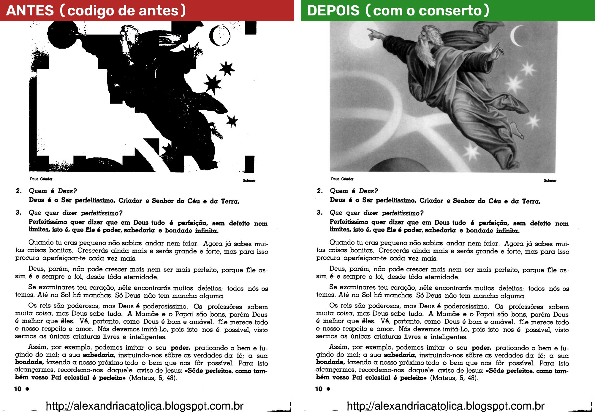
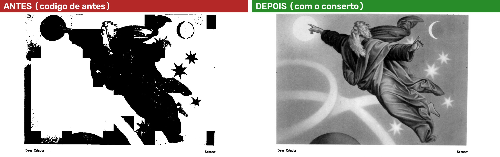
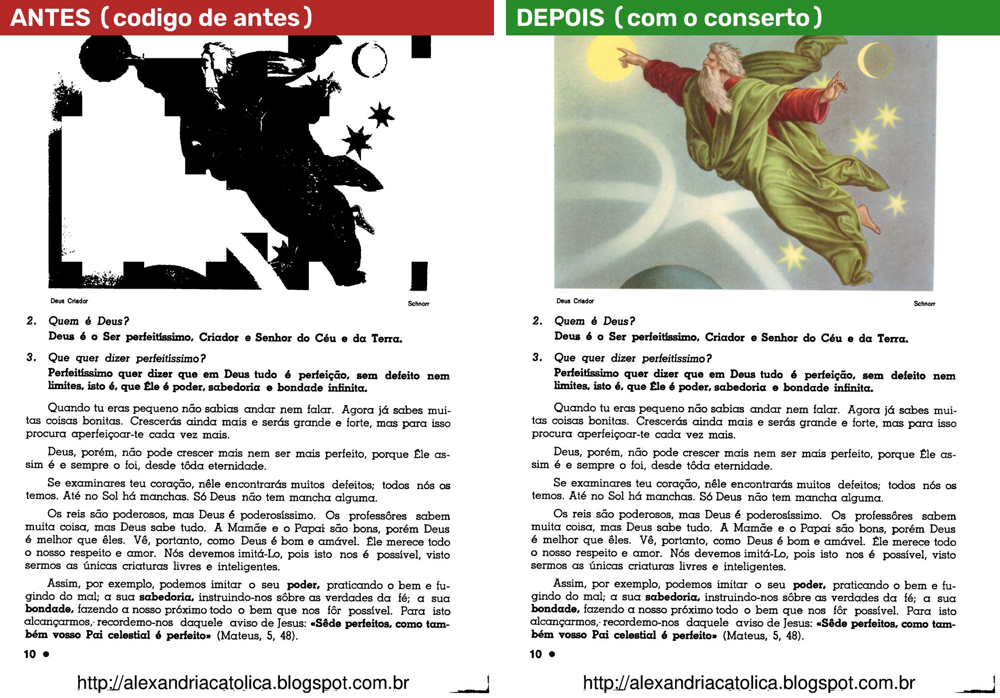
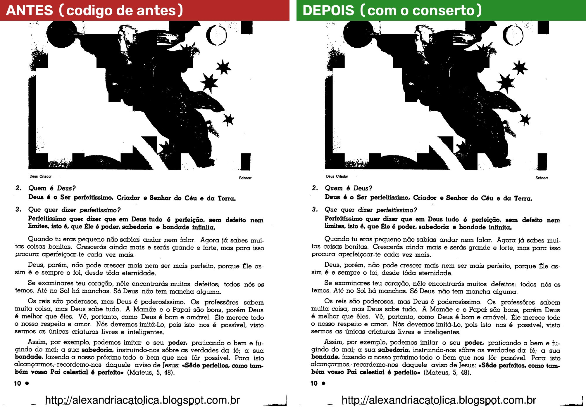
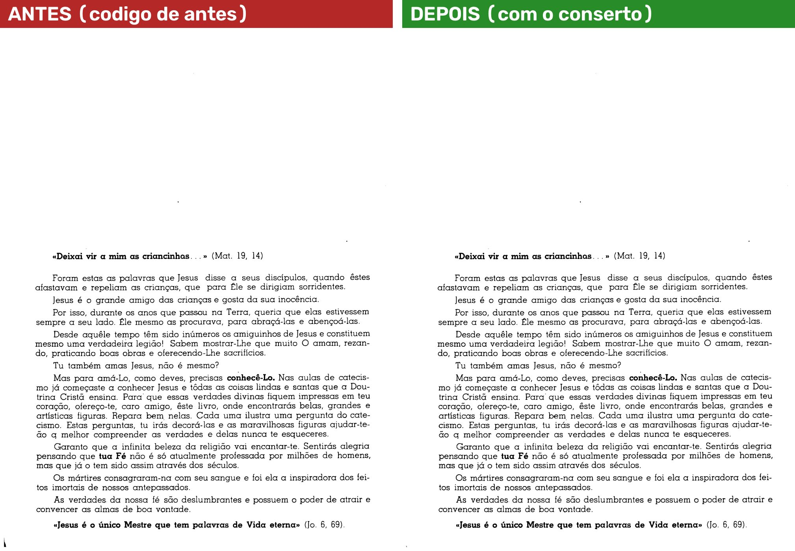

# Gravura no Preto e branco escolhido à mão (D-659)

**O defeito:** num livro que nunca passou pelo Automático, escolher Preto e branco no painel "Filtro da página"
estragava a gravura (manchas pretas), mesmo com "Respeitar as gravuras achadas" e "Gravuras em tons de cinza"
marcadas. Era a página 8 do *Na escola de Jesus* (prints 01 e 02 da sessão 4, 09/11/2026).

**O conserto:** agora, sem o Automático, quando a página está em Preto e branco escolhido à mão e uma das três
caixinhas está marcada ("Respeitar as gravuras achadas", "Gravuras em tons de cinza" ou "Só as letras"), o
programa procura a gravura **só nessa página**. Se você usar "todas" ou "daqui em diante", procura só nas páginas
que receberam a opção. Página sem a opção não é procurada. A etapa 5 do Automático ("Gravuras e fotos")
continua desmarcada.

Suas palavras (D-659): "ele vai procurar a gravura quando eu selecionar a opção ali no filtro né? e ai se eu
selecionar para o livro todo ou para varias paginas, ele vai procurar nas paginas especificas, não precisa
procurar em todas." e "se estamos no manual e eu estou fazendo ajustes em uma pagina, ele vai procurar só naquela
pagina se eu optar para que ele faça aquele ajuste em varias paginas ai sim o programa vai ler as outras paginas".

**Como as imagens foram feitas:** numa **cópia** do PDF do *Na escola de Jesus* (199 páginas), aberta como livro
novo, sem o Automático, igual ao que o programa faz ao abrir. A página foi posta em Preto e branco escolhido à
mão, do mesmo jeito que o clique no painel grava, e desenhada no tamanho do PDF (300 DPI), com o detector de
gravura de verdade. Em cada imagem, **à esquerda o código de antes** e **à direita o código com o conserto**. Seu
projeto não foi aberto nem alterado. Sem prints da janela: por ordem sua, o programa não foi aberto na sua tela.

## 1. Página 8, "Respeitar as gravuras achadas" (vem marcada de fábrica)

O que olhar: a gravura de cima. Antes, manchas pretas, como no seu print 01. Depois, a gravura em tons de
cinza, como no seu print 02 (no Automático). O texto fica igual nas duas.

A gravura de perto:

## 2. Página 8, "Gravuras em tons de cinza" (com "Respeitar" desmarcada)

O que olhar: a gravura sai em tons de cinza mesmo sem o "Respeitar", como você pediu em 02/11 ("por gravuras em
tons de cinza sozinho já deveria resolver o problema"). Nesta página o resultado é o mesmo do caso 1: o
programa já tomava esta gravura por foto, e foto sai cinza no Preto e branco.

## 3. Página 8, as duas marcadas (o caso do seu print)

## 4. Página 8, "Só as letras"

O que olhar: com "Só as letras", só as letras viram preto e branco. A gravura sai como no original, colorida
(D-148). Antes, também virava manchas.

## 5. Página 8, as três desmarcadas: nada muda

O que olhar: as duas imagens são **iguais, ponto por ponto**. Com as três desmarcadas o programa não procura
nada, e o filtro vale na página inteira (D-586: "Desligada, o filtro vale na página inteira").

## 6. Página 6, sem gravura, com "Respeitar" (de fábrica)

O que olhar: o texto fica igual. A página é procurada (a caixinha "Respeitar" vem marcada) e não tem gravura.
A única diferença está numa marca preta do scanner no canto de baixo, à esquerda, fora do texto: o programa a
reconheceu e ela quase sumiu. São 261 pontos em 7 milhões (0,004% da página). É a mesma conta que o
Automático faz quando procura gravuras.

O canto de baixo, aumentado:

## 7. Quanto tempo a procura leva

Medido no seu PC, numa página do tamanho do PDF (300 DPI). Nesse momento o PC também rodava testes, então os
números estão um pouco altos.

- **Primeira procura** (o programa carrega o detector): cerca de **9,5 segundos**.
- **Procuras seguintes:** cerca de **2,3 segundos por página**.
- Na tela, a prévia aparece primeiro, na hora. A procura no tamanho do PDF é feita por trás, depois, como já
  acontece depois do Automático. Só a página que você está vendo é procurada por trás.
- **As três desmarcadas:** nenhuma procura. O desenho levou 0,5 s, como antes.

## 8. Quantas páginas são procuradas (provas de máquina, contadas)

| O que você faz | Páginas procuradas |
|---|---|
| Preto e branco "só nesta" na página 1, e depois anda pelas páginas 2 e 3 | só a 1 (na tela e ao gerar o PDF) |
| Página 2 de 4, Preto e branco, depois "todas" | as 4 |
| Página 2 de 4, Preto e branco, depois "daqui em diante" | 2, 3 e 4 (a 1 nunca) |
| Preto e branco na página 1 e na 3 de 4 | só a 1 e a 3 |
| As três caixinhas desmarcadas | nenhuma |
| Melhorar, Mágico pro ou Original à mão | nenhuma |

## 9. Achado no caminho (consertado junto)

Depois do clique no Preto e branco, a tela podia voltar a mostrar a folha crua, sem filtro e sem corte, no lugar
da prévia certa. Era um defeito antigo na troca da prévia pela imagem do tamanho do PDF: um nome de variável
estava sendo usado para duas coisas. Ele também atingia páginas depois do Automático com "Gravuras em tons de
cinza" e a etapa 5 desmarcada. Consertado, com prova própria.

## 10. Ressalvas

1. **"Pares", "ímpares" e "pôr filtro nas escolhidas da grade" não existem para o filtro.** O "Aplicar em" do
   painel Filtro tem só "só nesta", "todas" e "daqui em diante". Pares e ímpares existem só no girar. Não criei
   botão novo, porque não foi pedido. A conta vale por página, então qualquer jeito de levar o filtro a várias
   páginas segue a mesma regra.
2. **Depois de rodar o Automático com "Limpar a folha" e sem "Gravuras e fotos"**, uma página que tinha só a
   "Respeitar" marcada volta a sair toda em preto e branco. Com "Gravuras em tons de cinza" ou "Só as letras", a
   gravura continua sendo procurada. É o que já está decidido na D-589 ("sem 'Só as letras' e com Gravuras desmarcada, a página sai toda em preto
   e branco") e não mudou.
3. Uma página procurada à mão **guarda a gravura achada**. Se depois o Automático cortar ou endireitar a página,
   essa marcação acompanha o papel, como acontece com toda página já procurada. Ela não é procurada de novo.
4. Seu projeto de teste (gravado em 09/11, com a página 8 em Preto e branco à mão) passa a mostrar a gravura certa
   ao ser aberto de novo nesta versão. Projeto gravado antes da obra de 26/10 sai igual.
