# Os erros do teste do Lusíadas: provas e como acontecem

Verificador, 14/11/2026. Versão testada: a versão de teste de hoje. Livro: uma cópia do *Os Lusíadas contados às
crianças* (o mesmo do teste do Kaique de 06/11). Nenhuma linha do programa foi mudada: aqui só se mostra o erro, a
prova e a explicação, como você pediu ("eu quero ver esses erros, as provas dele e uma explicação de como acontece,
explique de forma simples. quero antes de dar inicio.").

## Resumo

**Ainda acontecem, na versão de teste de hoje (12):**

- 1 — remendos pretos e brancos nos rostos da página 14 (defeito: o programa tomou pedaços da pintura por letra);
- 2 — "de 134" no Automático com 133 indo para o PDF, e o sino que muda só de andar pelas páginas;
- 3 — a miniatura não fica branca depois de "deixar em branco";
- 4 — textos cortados na barra de baixo com o Propriedades aberto (na janela do tamanho do notebook do Kaique);
- 5 — página que sai deitada no arquivo para imprimir; o aviso existe, mas fica escondido e só depois de gravar;
- 7 — contornos laranja com a Mão (duas regras suas que se cruzam: precisa da sua escolha);
- 8 — o aviso "será substituído" que não some ao trocar o nome;
- 9 — "vai sair em Preto e branco" numa página tirada do livro;
- 10 — o código "(G2)" na tela (e mais dois códigos em balões);
- 11 — a lista do Automático que volta para o topo;
- 12 — a página 22 quase em branco que sai suja: **é defeito** (o jeito de preto automático escolhe errado);
- 13 — a pintura da página 8 que quase some: **é defeito** (a pintura foi achada, mas tratada como desenho de traço);
  a caixinha "Gravuras em tons de cinza", que já existe, resolve nesta página.

**Já não acontece (1):**

- 6 — a folha espremida com a Mão: consertada na versão de teste em 09/11.

Nenhum conserto foi começado: cada um espera o seu sim, um por vez.

## Como testei

Fiz o caminho do Kaique na janela de verdade do programa, posta fora da sua tela: abrir o livro, "Rodar o
automático..." com Dividir e "A 1ª folha é a capa aberta", Endireitar, Limpar em Preto e branco, Gravuras e fotos (como
vêm de fábrica), sem Cortar; depois olhar as páginas com a Mão, deixar uma página em branco, tirar a contracapa
repetida do livro, abrir o painel Propriedades, processar, montar para imprimir em A4, abrir o Automático de novo e a
janela de salvar. Os cliques foram feitos como se fossem do mouse. Cada prova tem um resumo em cima e faixas com cor:
azul = como é hoje; laranja = a mesma coisa com outra opção, para comparar. O que olhar está circulado em vermelho.

Uma coisa que não consegui fazer como o Kaique: a roda do mouse não funciona com a janela fora da tela (na lista do
Automático, a lista foi posta no fim pelo programa de teste, como a roda faria). E um erro eu não consegui repetir nem
na versão do teste do Kaique: a folha espremida (erro 6), que dependia do tempo.

## Parte 1 — Para você: um erro por vez

### Erro 1 — Remendos pretos e brancos nos rostos (página 14)

**Do que se trata.** É a página 14 do Lusíadas, a pintura dos homens de chapéu com os barcos ao fundo. No PDF, o peito
do homem da direita e a cabeça do homem da frente saem com retângulos pretos e brancos duros, como remendos.

**O que acontece hoje.** Ainda acontece, igual ao teste do Kaique.

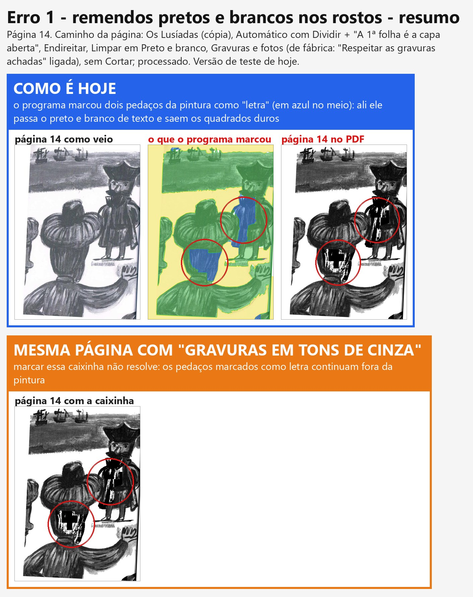

**Como acontece.** Quando a página está em Preto e branco, o programa primeiro procura o que é pintura e o que é letra.
A pintura ele deixa em cinza; a letra ele passa para preto e branco puro. Nesta página ele achou a pintura quase
inteira (verde na imagem do meio), mas tomou dois pedaços dela por letra (azul). Nesses dois pedaços a pintura vira
preto e branco de texto: são os remendos.

**Defeito ou escolha.** Defeito do programa: quem marcou "letra" no meio da pintura foi a procura automática. A
caixinha "Gravuras em tons de cinza" não resolve (faixa laranja).

**De onde veio.** Da procura de letra e pintura que o programa faz sozinho, ligada desde o começo de outubro.

**Situação.** Você escolheu "Consertar" em 09/11. Ainda não começou: espera o seu sim, um erro por vez.

### Erro 2 — Números que não batem

**Do que se trata.** São dois números: o "página 132 de 134" e o "(134 páginas)" na janela do Automático, e o sino
(o triângulo de aviso no alto da coluna da direita, com o número de páginas que pedem um olhar).

**O que acontece hoje.**

- **"de 134" e saem 133: ainda acontece.** Com uma página tirada do livro, o Automático continua dizendo 134. A
  janela de salvar, logo depois, diz certo: "133 páginas vão para o PDF, e 1 foi apagada". A barra de baixo da área de
  trabalho também diz "página 133 de 134".
- **O sino que muda sozinho: ainda acontece.** Com o livro aberto do zero, logo depois do Automático, fiz como o
  Kaique ("Qualidade baixa" + "Selecionar todas" + "está bom nas marcadas"): o sino ficou em 25, parado, por dois
  minutos. Depois só andei com a seta para a direita da página 1 até a 41, sem mexer em nada: o sino passou para 26.

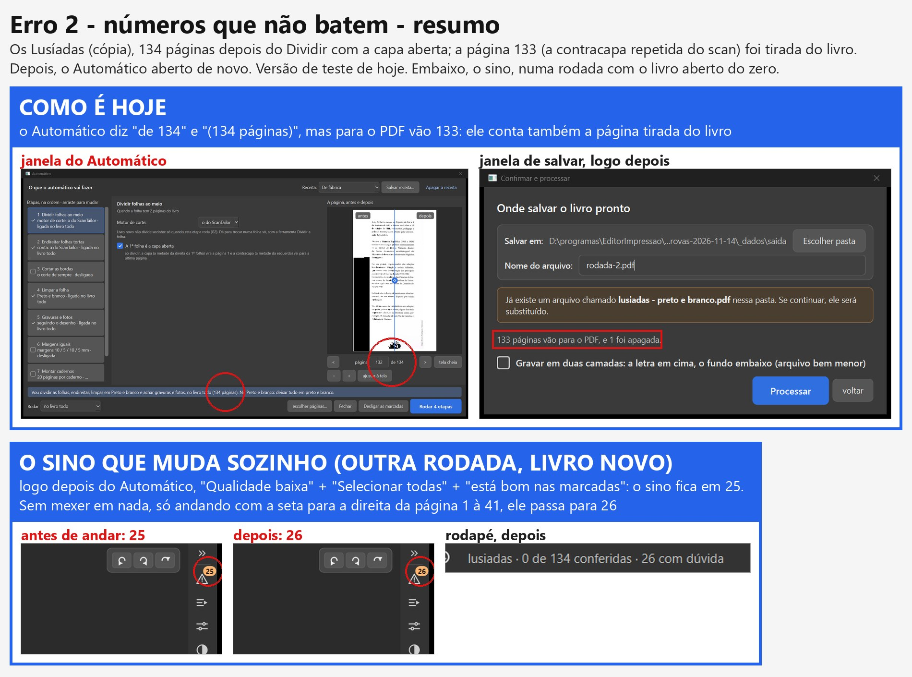

**Como acontece (o "de 134").** A página tirada do livro continua na lista do programa, só marcada como "não vai para
o PDF" (para dar para trazer de volta). O Automático e a barra de baixo contam a lista inteira; a janela de salvar
conta só as que vão para o PDF. Quem escreveu a conta do Automático deixou de propósito ("para a numeração não mudar
quando uma página é tirada"), mas não escreveu em lugar nenhum que o número inclui a página tirada.

**Como o sino muda sem ninguém mexer.** Um dos avisos, "Endireitar: as contas discordam" (o programa tem duas contas
para saber quanto a página está torta, e avisa quando elas não concordam), é medido de novo quando a página é
desenhada no tamanho do PDF. Esse desenho acontece por trás, sozinho, quando a pessoa passa pela página (ou perto
dela). Se a medida nova discorda, o aviso aparece numa página que não o tinha, e o sino sobe; se passa a concordar, o
aviso some e o sino desce. Na minha rodada, a página nova com aviso foi a 19 (entre as que eu passei). É o que o
Kaique viu (24 → 25 → 28). A mesma medida também roda no processar, por isso o número pode mudar de novo depois de processar.

**Defeito ou escolha.** Defeito: o mesmo livro tem dois números diferentes, conforme a tela.

**Situação.** "Consertar" (09/11). Ainda não começou.

### Erro 3 — A miniatura não fica branca depois de "deixar em branco"

**Do que se trata.** É a tira de miniaturas embaixo da área de trabalho, e o botão "deixar em branco" (no painel
Propriedades, em "Esta página"), que põe uma folha branca no lugar da página.

**O que acontece hoje.** Ainda acontece: a página grande fica branca, a miniatura continua mostrando o título.

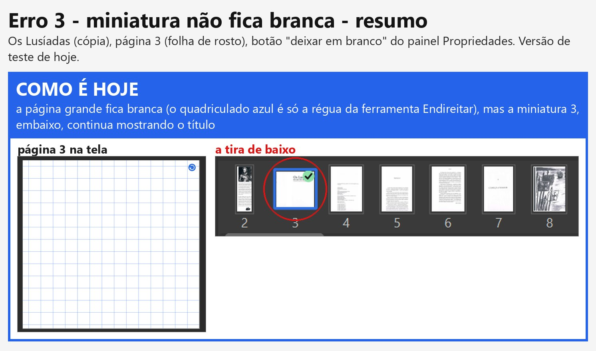

**Como acontece.** A miniatura mostra a folha como veio do scanner, cortada no lugar da página. Ela só é redesenhada
"como sai no PDF" em dois casos: quando a página foi mudada de lugar ou de tamanho, e quando é uma página em branco
acrescentada à mão (essa sai branca). A página "deixada em branco" não entrou nessa regra. Na grade "Todas as
páginas" acontece o mesmo.

**Defeito ou escolha.** Defeito. Vai contra o que você pediu em 07/11: "O preview as miniaturas tem que estar
sincronizada e o resultado final tem que sair como a edição foi mostrada no preview."

**Situação.** "Consertar" (09/11). Ainda não começou.

### Erro 4 — Textos cortados na barra de baixo (não é urgente)

**Do que se trata.** É a barra do pé da área de trabalho: "página N de M", desfazer, refazer, "Uma página", "Duas
lado a lado", "antes / depois", "marcações", zoom.

**O que acontece hoje.** Ainda acontece na janela do tamanho do notebook do Kaique (1280 x 657) com o painel
Propriedades aberto: "uas lado a lad" e "página 133 de 13". Na janela grande, com o mesmo painel aberto, coube
inteira nesta rodada.

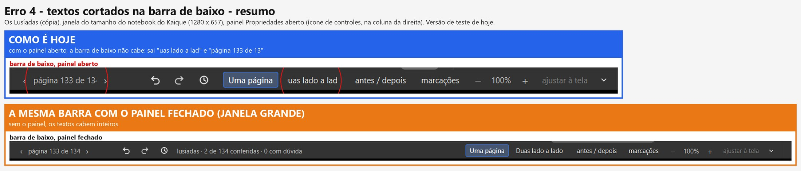

**Como acontece.** O painel aberto ocupa a direita, e a barra de baixo fica mais estreita. Os botões não sabem
encolher nem ir para outra linha: quando falta lugar, o Windows corta o texto do botão.

**Defeito ou escolha.** Defeito de tela (o que se aperta continua funcionando; o PDF não muda).

**Situação.** "Consertar" (09/11), no fim da fila, como você disse: "não é urgente".

### Erro 5 — Página que sai deitada no arquivo para imprimir

**Do que se trata.** É o arquivo que sai de "montar para imprimir em A4" (na tela de "Ficou pronto!"), com o Livreto
de fábrica: duas páginas de cada lado de uma folha A4 deitada.

**O que acontece hoje.** Ainda acontece. Nesta rodada foi a página 3 (a folha de rosto), que saiu deitada na face 3.
Na folha 7, a do Kaique, o corte caiu de novo no meio do título "PERIGOS E TRAIÇÕES".

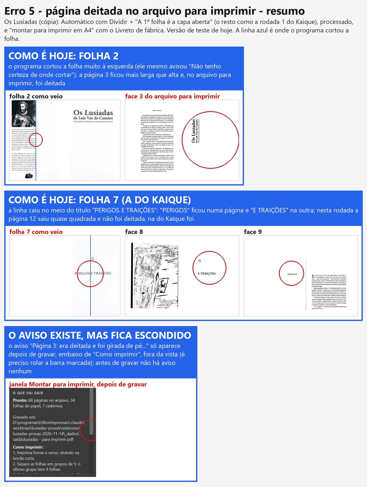

**Como acontece.** São duas coisas em fila.

1. Na folha que tem só uma página impressa (a outra metade em branco), o Dividir não acha a dobra e corta fora do
   meio. Ele mesmo avisa "Não tenho certeza de onde cortar" (folhas 2 e 7). Uma das páginas fica mais larga que alta.
2. Na montagem, toda página mais larga que alta é girada de lado para caber na metade da folha A4. O programa escreve
   um aviso ("Página 3: era deitada e foi girada de pé e diminuída"), mas só depois de gravar, lá embaixo, fora da
   vista. Antes de gravar não aparece nada.

**Defeito ou escolha.** As duas coisas. O corte errado é defeito do Dividir, mas ele avisou, e o Kaique (como no
teste) disse "continuar assim mesmo". O giro escondido é defeito: o aviso existe e ninguém vê.

**De onde veio.** O girar sozinho e o aviso são do "montar para imprimir" (22/10); o aviso nasceu do seu pedido de
20/10 ("Quero que o programa avise quando isso estiver acontecendo"), mas ficou só depois de gravar. A sua pergunta de 09/11 já foi respondida na
Central: dá para arrastar a linha só naquela folha, e o resto fica como o Automático fez.

**Situação.** "Consertar" (09/11). Ainda não começou.

### Erro 6 — Com a Mão e "Uma página", a folha aparece espremida

**Do que se trata.** Logo depois de dividir o livro no Automático, com a ferramenta Mão escolhida e a vista "Uma
página", a página aparecia com a folha inteira (as duas páginas) apertada na largura de uma.

**O que acontece hoje.** Já não acontece. Na versão de teste de hoje, pelo mesmo caminho, as páginas 1, 2, 5, 8 e 14
aparecem certas com a Mão e "Uma página".

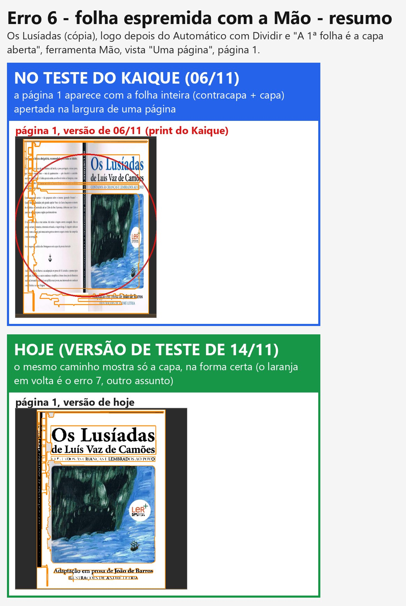

**Como acontecia.** Era um desenho errado que a tela mostrava enquanto o desenho certo não chegava: o programa
entregava, por um caminho, a folha inteira como veio do scanner no lugar da página já dividida, e a tela a esticava
para a forma de uma página. Isso foi consertado em 09/11, no conserto do Preto e branco escolhido à mão (a mesma
causa fazia o PDF sair sem o título na página 5, que você testou em 13/11: "funcionando"). Há duas provas automáticas
que guardam isso e as duas passam hoje.

**Ressalva.** Rodei o mesmo caminho também na versão do teste do Kaique (06/11) e lá também não apareceu: o defeito
dependia de quanto o desenho demorava. Por isso a prova do "antes" é o print do próprio Kaique. Ainda há um ponto
fraco: a tela continua esticando, sem avisar, qualquer imagem que chegue com outra forma; se outro caminho entregar a
imagem errada, o espremido volta. Fica anotado na parte da gerente.

**Defeito ou escolha.** Defeito de tela (o PDF saía certo).

**Situação.** Consertado na versão de teste em 09/11. Falta você conferir pelo caminho do Kaique (dividir no
Automático, Mão, "Uma página").

### Erro 7 — Marcações laranja à vista com a Mão

**Do que se trata.** A Mão é a última ferramenta da coluna da esquerda (o desenho de uma mãozinha, logo abaixo da
lupa). Ela serve só para olhar a página e arrastá-la quando está ampliada; não muda nada. Os contornos laranja são
o programa mostrando onde ele achou letra e pintura.

**O que acontece hoje.** Ainda acontece: com a Mão escolhida e o botão "marcações" desligado, os contornos laranja
continuam em volta do texto e da pintura.

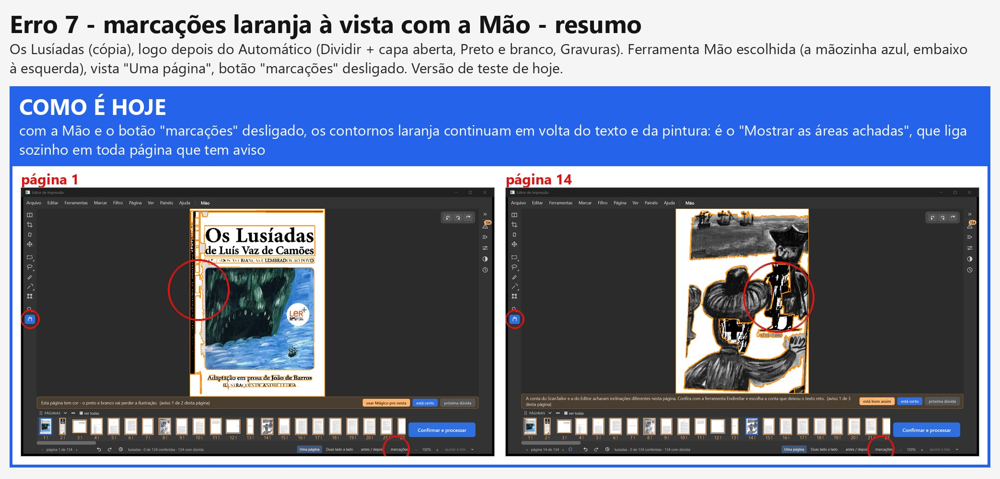

**Como acontece.** Existem duas coisas diferentes na tela, e elas seguem regras diferentes:

- as cores das marcações (o rosa, o azul...): seguem o botão "marcações", e esse obedece o que você decidiu em 29/10
  (some com a Zoom e com a Mão);
- os contornos laranja ("Mostrar as áreas achadas"): você pediu em 08/10 que "no para revisar, elas já vão aparecer
  laranjas". O programa liga esse laranja sozinho em toda página que tem aviso, com qualquer ferramenta. Logo depois
  do Automático quase todas as páginas têm aviso, então quase todas ficam com laranja.

**Defeito ou escolha.** As duas regras foram pedidas por você, e elas se cruzam. Não é um defeito de conta: falta
dizer qual vale quando as duas batem.

**O que você escolhe.**

- **Opção 1 — a Mão e a Zoom escondem também o laranja** (a página limpa, como vai sair). O laranja aparece com as
  ferramentas de marcar, e com a caixinha "Mostrar as áreas achadas". Muda o que você pediu em 08/10 só para a Mão e a
  Zoom.
- **Opção 2 — o botão "marcações" passa a mostrar e esconder o laranja também.** Um botão só para tudo o que é
  marcação; desligado, nenhuma cor e nenhum contorno.
- **Opção 3 — fica como está** (laranja sempre nas páginas com aviso).
- Sugestão da verificação: opção 2 (um botão só, que você já conhece). Nada mais do que já funciona muda.

**Situação.** "Consertar" (09/11), mas precisa desta escolha antes.

### Erro 8 — Na janela de salvar, o aviso "será substituído" não some

**Do que se trata.** É a janela "Onde salvar o livro pronto", que abre ao clicar em "Confirmar e processar". Quando já
existe um PDF com o mesmo nome na pasta, aparece a faixa "Já existe um arquivo chamado ... Se continuar, ele será
substituído."

**O que acontece hoje.** Ainda acontece: troquei o nome para "rodada-2.pdf" (que não existe) e a faixa continuou
dizendo que o outro arquivo seria substituído. Nada é apagado: o programa só substitui o arquivo que tem o nome
escrito, e pergunta antes.

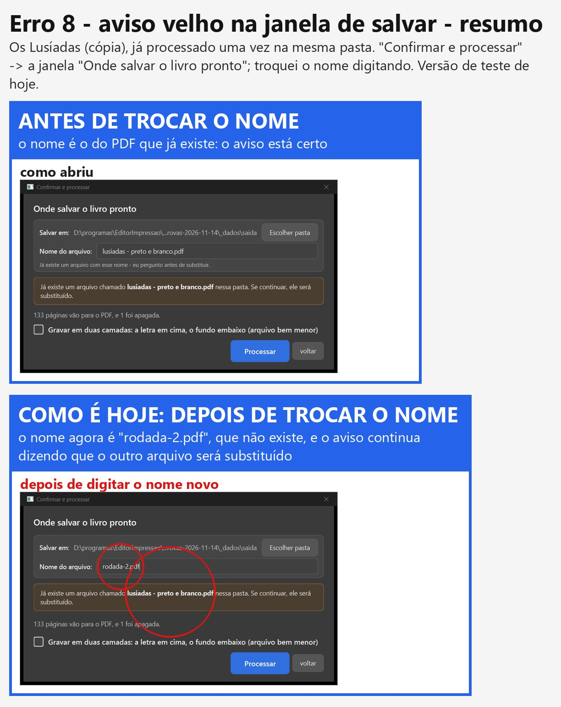

**Como acontece.** A janela confere o nome em dois lugares. Um aviso pequeno, embaixo do nome, é refeito a cada letra
digitada. A faixa grande só é refeita quando se troca a pasta, nunca quando se troca o nome. Por isso ela fica
falando do nome velho.

**Sua pergunta: "porque aconteceu esse bugue, que regra o agente errou".**

- **Quem fez e quando.** A faixa grande entrou em 08/08/2026, quando o "Salvar em" e o "Nome do arquivo" saíram da
  tela de trabalho e foram para esta janela (um trabalho do Claude daquela época, antes das regras dos agentes). O
  pedido era o seu de 18/07: "avisar se já existir arquivo com o mesmo nome, oferecendo substituir ou renomear". O
  agente ligou a faixa só ao "escolher pasta" e esqueceu o campo do nome.
- **Por que ninguém viu.** O teste que confere a faixa não digita um nome: ele manda a janela se conferir direto, por
  dentro. Por isso passa, e o defeito ficou. Em 25/09, outro trabalho escreveu no código o comentário "a faixa é
  refeita toda vez que o destino muda", o que não era verdade, e ninguém conferiu.
- **Que regra faltou.** Na época, nenhuma. Hoje três regras pegariam: o teste tem que fazer o caminho de quem usa (o
  clique simulado por dentro não vale como prova, 22/09); o conserto tem que passar por todos os caminhos da mesma
  coisa (aqui, mudar a pasta e mudar o nome; regra de 13/11); e todo comentário que diz "isto acontece sempre que..."
  é conferido na hora (regra de 13/11).
- O modelo de pedido aos agentes que você também pediu para ver é da gerente: ela mostra junto com este erro.

**Situação.** "Consertar" (09/11). Ainda não começou.

### Erro 9 — Depois de "tirar do livro", a faixa ainda diz "vai sair em Preto e branco"

**Do que se trata.** A faixa é a tarja logo acima da tira de miniaturas, com uma frase e os botões "está certo" e
"próxima dúvida".

**Sua pergunta: "para que serve, e em que situação é disparado?"** A faixa sempre diz uma frase sobre a página da
vez:

- se a página tem um aviso, mostra o aviso (com os botões para resolver);
- se não tem aviso e você ainda não deu "está certo", mostra uma frase da ferramenta escolhida. Com a Mão, a Zoom, as
  de marcar, o Mover e o Filtro, a frase é "Esta página vai sair em [filtro]": serve para dizer com que filtro a
  página vai para o PDF. Com o Endireitar, diz "Vou endireitar sozinho..."; com o Cortar, "Vou cortar a borda
  sozinho...";
- se a página foi deixada em branco, diz "Esta página vai sair em branco";
- se você já deu "está certo", diz "Página N conferida".
Ela não é disparada por nenhum clique: muda sozinha a cada página e a cada ferramenta.

**O que acontece hoje.** Ainda acontece: a miniatura diz "apagada", e a faixa diz "Esta página vai sair em Preto e
branco." Com o Endireitar escolhido, ela diz "Vou endireitar sozinho...", também errado.

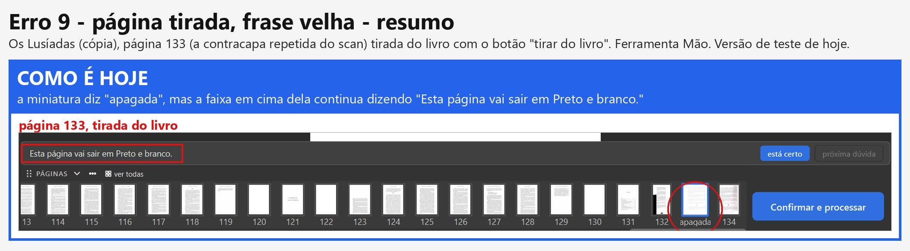

**Como acontece.** A frase da faixa tem um caso para a página "deixada em branco", mas não tem para a página "tirada do
livro". Quando os dois botões foram postos em toda página (26/10), só um ganhou frase.

**Defeito ou escolha.** Defeito.

**Situação.** "Consertar" (09/11). Ainda não começou.

### Erro 10 — O código "(G2)" na tela

**Do que se trata.** Na janela do Automático, na etapa "1 Dividir folhas ao meio", embaixo de "Motor de corte", está
escrito "Livro novo não divide sozinho: só quando esta etapa roda (G2)".

**O que acontece hoje.** Ainda acontece.

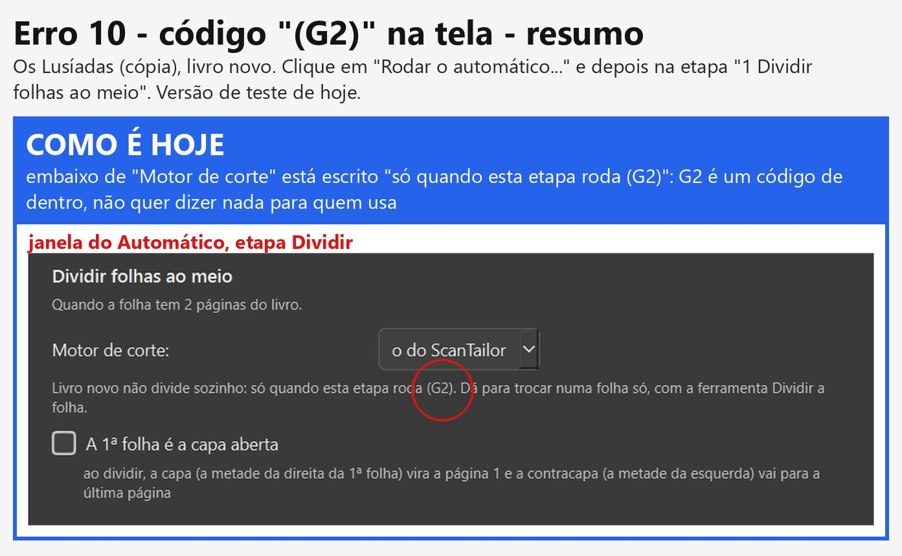

**Como acontece.** "G2" é o nome que a sua pergunta tinha numa conferência antiga (05/10). Quem escreveu o texto da
tela copiou o código junto.

**Onde mais tem código na tela.** Procurei em todos os textos do programa. Além do "(G2)", há dois em balões (o
texto que aparece quando o mouse para em cima):

- no botão "desligar as marcadas" do Automático: "(D-068: toda função automática liga e desliga)";
- na lista "Quando o ângulo muda depois do corte à mão, o corte:" (etapa Endireitar do Automático): "D-094: a mesma
  escolha existe nas Configurações...".

**Defeito ou escolha.** Defeito: contra a sua regra "Não se deve usar código na nomeação de coisas". Os três entraram
juntos em 26/10, na obra.

**Situação.** "Consertar" (09/11). Ainda não começou.

### Erro 11 — A lista de etapas do Automático volta para o topo

**Do que se trata.** É a lista "Etapas, na ordem" da janela grande do Automático (1 Dividir ... 7 Montar cadernos),
com uma caixinha em cada etapa.

**O que acontece hoje.** Ainda acontece quando a lista não cabe na janela (no tamanho do notebook do Kaique): rolei
até o fim, marquei "6 Margens iguais", e a lista pulou para o topo. O mesmo com "7 Montar cadernos".

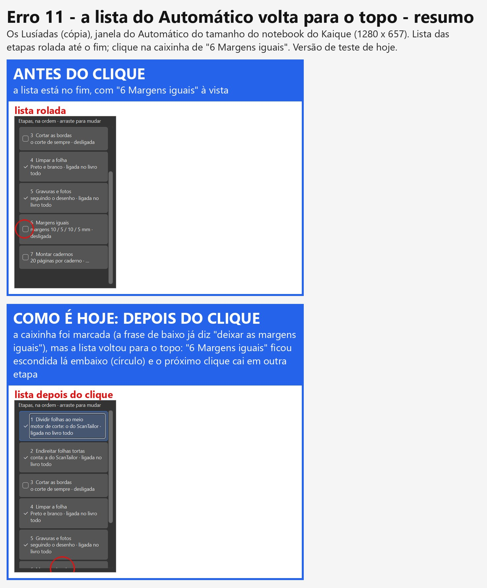

**Como acontece.** Cada vez que qualquer coisa muda no Automático (uma caixinha, uma opção), a lista é apagada e
montada de novo, do começo. Montada de novo, ela volta para o alto. O clique seguinte cai na etapa que estiver
naquele lugar (no teste do Kaique, "Cortar as bordas").

**Defeito ou escolha.** Defeito. Acontece também no painel Automático da direita, que usa a mesma lista.

**Situação.** "Consertar" (09/11). Ainda não começou. A sua ideia da ferramenta que descreve tudo sem precisar de
foto foi para a Lista de espera.

### Erro 12 — Página 22 quase em branco sai suja (investigar)

**Do que se trata.** É a página 22, o verso de uma folha que não tem nada impresso; só se vê, bem fraquinho, o texto
da outra face por transparência. No PDF ela sai com tracinhos pretos pela página toda e um bloco preto embaixo.

**O que acontece hoje.** Ainda acontece.

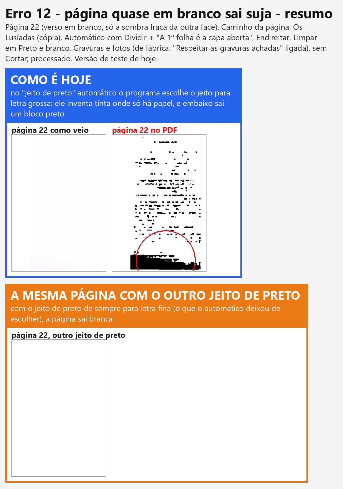

**Sua pergunta: defeito ou escolha das ferramentas?** As duas coisas, mas o principal é defeito.

- **O defeito:** o Preto e branco tem jeitos diferentes de decidir o que é tinta. De fábrica, o programa escolhe
  sozinho o jeito de cada página. Numa página sem tinta, ele mede as manchinhas do papel como se fossem letra grossa e
  escolhe o jeito de letra grossa. Esse jeito sempre acha "tinta" em algum lugar: separa o papel em dois tons e pinta
  o mais escuro de preto. Com o jeito de sempre (o de letra fina), a mesma página sai toda branca (faixa laranja).
  Medido: 10,7% da página em preto no jeito que o programa escolheu; 0% no outro.
- **A escolha:** o programa avisou "Parece em branco" nessa página, e o aviso estava certo. Se o Kaique apertasse
  "deixar em branco", a página sairia branca. Mas ninguém deveria precisar disso para não sair sujeira.

**De onde veio.** A escolha sozinha do jeito de preto é antiga (setembro, antes do plano de 24/09); o jeito de
letra grossa existe por causa das letras góticas pesadas (Graduale, Palatino).

**Situação.** Você pediu "investigar antes" (09/11). Investigado: é defeito. O conserto espera o seu sim.

### Erro 13 — A pintura das bandeiras quase some (página 8) (investigar)

**Do que se trata.** É a página 8, a pintura das bandeiras e dos navios. No PDF quase tudo vira branco, com riscos
soltos.

**O que acontece hoje.** Ainda acontece.

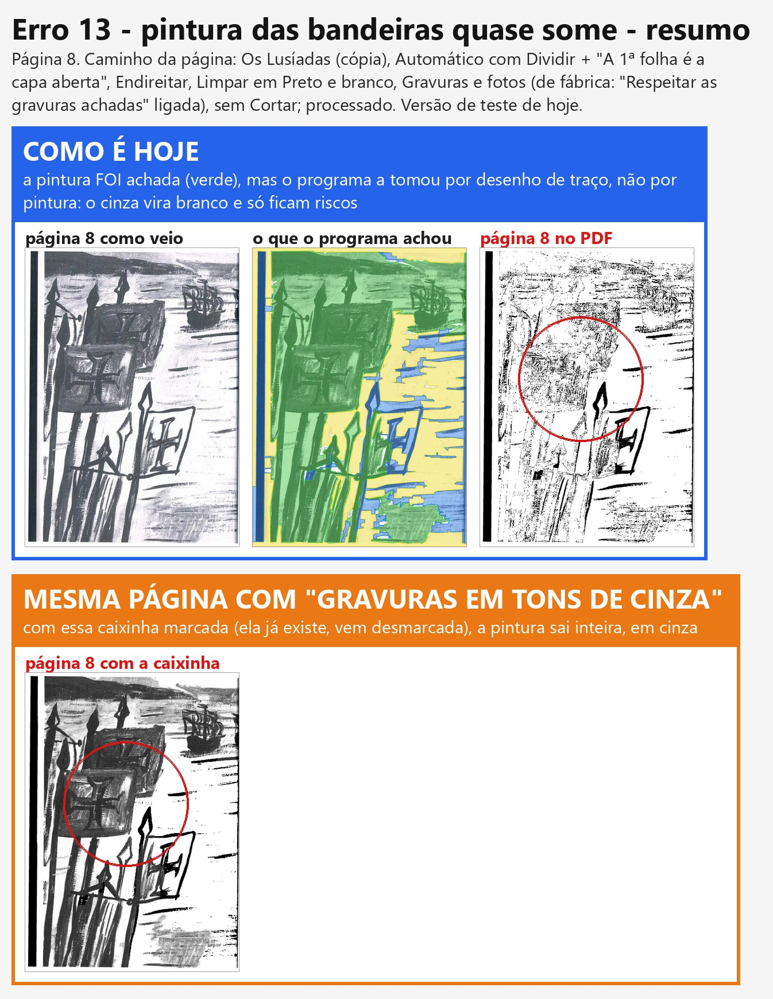

**Suas perguntas.**

- **"a gravura foi achada?"** Sim. O programa achou a pintura (verde na imagem do meio), mais da metade da página.
- **"mau uso ou bugue?"** Defeito do programa. Depois de achar, ele decide se é pintura (sai em cinza) ou desenho de
  traço (sai em preto e branco, só as linhas). Aqui ele errou: tomou a pintura de pincel, clarinha, por desenho de
  traço, e o cinza claro foi para branco. Também marcou pedaços do céu e do mar como papel, que vão a branco.
- **Tem jeito hoje?** Tem: a caixinha "Gravuras em tons de cinza" (no Preto e branco, painel "Filtro da página" e
  Automático), que você aprovou em 01/11. Com ela, a página sai inteira em cinza (faixa laranja). Ela vem desmarcada, e
  o Kaique não tinha como saber que precisava dela nessa página.

**De onde veio.** É da mesma família do defeito que você aceitou deixar para depois em 29/10 (pintura confundida com
enfeite no *Na escola de Jesus*). A sua ideia de 09/11 (o aviso com as marcações para aumentar, diminuir ou trocar o
filtro só naquele pedaço) foi para a Lista de espera, na Fase 3.

**O que você escolhe (para quando o conserto começar).**

- **Opção 1 — consertar a conta** que separa pintura de desenho de traço, para a pintura clara de pincel sair em cinza
  sozinha. É conserto de imagem: precisa ser medido em outros livros antes, porque a mesma conta decide as gravuras de
  traço (que devem continuar em preto e branco).
- **Opção 2 — o programa avisar** nas páginas onde ele achou a pintura e a transformou em traço, com o botão
  "Gravuras em tons de cinza" no próprio aviso (a caixinha já existe; só passa a ser oferecida na hora certa).
- **Opção 3 — as duas.**
- Sugestão da verificação: opção 3, começando pela 2 (mais rápida e não muda nenhuma outra página).
- Nada do que já funciona muda na opção 2; na 1, as gravuras de traço precisam ser conferidas de novo.

**Situação.** Investigado: defeito. O conserto espera o seu sim.

---

## Parte 2 — Para a gerente: a causa no código (não vai para o Samuel)

Versão lida e rodada: `obra-2026-10-26` em `c7e34fd8` (cópia `lusiadas-provas`). Teste de máquina = log e medidas do
piloto (`scripts/anotacoes-*.txt`, `scripts/analise*.json`); teste de olho = os prints abertos um por um.

### Erro 1 (D-678) — remendos na página 14

- **Causa:** a marcação da página 14 tem 4 regiões `LETRA` de origem `rede` (o modelo de regiões, `core/rede_selecao.py`
  / `core/detectar_regioes.py`) dentro da pintura: peito do homem da direita e nuca/rosto do da frente
  (`prints/analise/p14-2-marcado.jpg`). Em `core/filtros.aplicar_filtro_com_selecao` → `_preto_e_branco_com_gravura`, a
  pintura vira cinza só onde `peso_gravura > 0`; o resto recebe a `binaria` da página inteira. As regiões de letra
  ficam fora da zona de gravura → retângulos em 1 bit no meio do cinza.
- **Outros caminhos:** a mesma marcação vale na prévia, nas figurinhas, no "antes / depois", na tela cheia e no PDF
  (`_filtrar_com_a_marcacao` é o ponto único). "Gravuras em tons de cinza" NÃO resolve
  (`prints/analise/p14-5-com-gravuras-em-cinza.png`): a regra continua "letra fora da gravura". "Só as letras" não
  testado aqui.
- **Ideia de conserto:** num ponto só (`garantir_selecao` ou a união das regiões da máquina), letra achada pela rede
  que fica cercada por gravura e não tem forma de linha de texto passa a contar como gravura.

### Erro 2 (D-679) — números

- **"de 134":** `ui/automatico.py` — `EstadoDoAutomatico.do_projeto` (`self.total_paginas = len(projeto.paginas)`, ~l.322 e
  l.343) alimenta `A.resumo(...)` ("no livro todo (N páginas)"); `PaginaAntesEDepois._numero_e_total` (~l.1840) devolve
  `len(self.projeto.paginas)` sem o Dividir, e `len(passos)` com ele (os passos também incluem a tirada: print b-10 "132
  de 134"; c-03 mostra a 133 tirada como "página 133 de 134"). O comentário logo acima diz que é de propósito
  ("contar pelos passos sem o Dividir (página tirada do livro mudaria a numeração de sempre)"). A barra de baixo
  (`rotulo_da_pagina`: "página 133 de 134") conta igual; a `JanelaConfirmar._frase_do_livro` conta `paginas_ativas`
  (133). Três telas, duas contas.
- **Sino:** reproduzido na fase d (abaixo). Antes, sem repetir: fase a, 134 parado 60 s e andando; fase b (todos os
  avisos aceitos), 0 parado 60 s e em 40 setas. `scripts/sino.py`: desenhar as 133 páginas no tamanho do PDF (`renderizar_pagina`) numa cópia do projeto
  não criou nenhum aviso pendente novo (`scripts/sino.json`; ali nenhum aviso C1 "nasceu" porque todos já estavam aceitos). Fase d (livro do zero, `_dados-d`, `scripts/anotacoes-d.txt`): logo depois do Automático, "Qualidade baixa" (67) + todas + "está bom" -> 134 para 25 (igual ao Kaique); parado 120 s: 25; 10 setas: 25; 20 setas: 26; 40 setas: 26. Avisos pendentes no fim (`scripts/sino_d.json`): nas páginas 11 a 21, só a 14 (contas discordam + ângulo diferente, já existiam na fase a) e a 19 (contas discordam): a 19 é a nova. Causa: `core/pipeline` (~l.1551) `_anotar_contas_discordam(pagina, bool(medidas.get("discordam")))` roda a cada medida da geometria no tamanho do PDF (prévia por trás, medida do "Para revisar", processar) e põe ou tira o aviso C1 (e põe a página como não conferida). Caminhos que acrescentam avisos depois de
  abrir: `ui/tela_conferir._alertas_da_previa` (prévia e medida do "Para revisar" que chegam por trás), a medida por
  trás ao abrir (D-284) e `_medir_o_em_branco_por_tras` (`ui/tarefas.py`); o cartão da tela inicial lê o
  `resumo.json` gravado num momento anterior (por isso 27 × 25).
- **Ideia de conserto (sino):** medir o C1 uma vez (na análise do Automático, no tamanho do PDF) e não pôr nem tirar
  o aviso escondido depois; ou, se a medida por trás muda, avisar na faixa daquela página ("este aviso apareceu agora").
- **Ideia de conserto:** uma função só para "páginas do livro que vão para o PDF" (já existe `Projeto.paginas_ativas`),
  usada no Automático, na barra de baixo e na janela de salvar; se a tirada continuar numerada, dizer na tela
  ("134, 1 fora do livro").

### Erro 3 (D-680) — miniatura da página em branco

- **Causa:** `ui/tela_conferir._acertar_as_miniaturas_movidas` só troca a miniatura em dois casos: `inserida` (D-623,
  `_miniatura_branca`) e `_pagina_sai_movida` (D-547/D-649). `em_branco` não entra; a tira fica com a folha crua.
  A grade "Todas as páginas" (`_pagina_dentro_da_folha` → `miniatura_como_sai`) tem a mesma falta.
- **Gambiarra a evitar (§11.12):** é o caso típico de duas regras para a mesma coisa ("sai branca": `inserida` e
  `em_branco`). `core/pipeline._filtrar` já trata as duas juntas (`em_branco or inserida`); a tela não.
- **Ideia de conserto:** uma função "a página sai branca?" (a mesma do `_filtrar`) usada pela tira e pela grade.

### Erro 4 (D-681) — barra de baixo

- **Causa:** a barra (`ui/tela_conferir.py`, montagem ~l.1200-1250: `botoes_mostrar`, "antes / depois", "marcações",
  zoom, qualidade) é um `QHBoxLayout` sem regra de encolher/quebrar; com o painel da direita aberto a 1280 × 657 o
  espaço fica menor que a soma dos botões e o Qt corta o texto. Nesta rodada a janela grande (1582 lógicos) coube.
- **Ideia de conserto:** decidir o que some ou encolhe primeiro (ex.: "página N de M" vira "N/M"; textos dos botões
  com largura mínima garantida), na montagem da barra, para todas as ferramentas.

### Erro 5 (D-682) — página deitada no arquivo para imprimir

- **Causa (duas peças):** (1) o Dividir (`core/dividir_scantailor` / motor "o do ScanTailor") pôs a linha fora do meio
  nas folhas sem lombada visível (folha 2 em 0,239; folha 7 em 0,732, ambas com `lombada_incerta`, `confianca_corte`
  1,0 gravada mesmo assim); a página que sobra fica mais larga que alta. (2) `core/impressao._gira` gira 90° toda
  página "deitada" (largura > 1,02 × altura) numa vaga em pé (`rotacao_automatica=True` de fábrica). O aviso
  `_avisos_de_giro` existe, mas `ui/dialogo_impressao._terminou` só o mostra depois de gravar, no fim da coluna da
  direita, abaixo de "Como imprimir" (fora da vista; `prints/crus/a-21`).
- **Outros caminhos:** qualquer página larga (folha não dividida, página com "Mover" para folha deitada) gira igual;
  "mandar para a impressora" também (mesma `montar_para_impressao`).
- **Ideia de conserto:** o aviso aparecer antes de gravar (na prévia da janela, junto da folha) e a página larga que
  veio de uma folha dividida com "Lombada incerta" ser apontada no "Antes de processar" — sem girar escondido.

### Erro 6 (D-683) — folha espremida

- **Situação:** não reproduzido hoje (p.1, 2, 5, 8, 14 com a Mão: `pixmap_editor` na forma da página) nem na versão
  `51bdcb0b` (cópia `teste-kaique-lusiadas`, mesma rota; `_dados/saida-mao.txt`, prints `mao-*`). Depende de tempo.
- **Causa achada antes (agente graves, `relatorios/graves-2026-11-10/ONDE-PAREI.md`):** a folha crua devolvida como
  "imagem do PDF" pela procura da gravura por trás, esticada pela tela (`ui/tarefas.GerenciadorPrevias.
  _por_a_imagem_do_pdf`, `cv2.resize`). Consertada na origem em `88731637` (09/11), depois da versão do Kaique.
  Provas `tests/test_decisoes_gravura_a_mao.py::test_d659_a_tela_nao_troca_a_previa_pela_folha_crua` e
  `tests/test_graves_d649_miniatura_igual_ao_pdf.py::test_d649_a_o_mover_mostra_a_pagina_e_nao_a_folha_espremida`:
  rodei as duas hoje, passam (2 passed). A prova de que a primeira falha no código antigo é do agente graves, não
  refeita por mim.
- **Ponto fraco que continua:** o `cv2.resize` calado em `_por_a_imagem_do_pdf` (achado 1 do agente graves): qualquer
  outro caminho que entregue imagem de outra forma vira "folha espremida" em vez de erro visível.

### Erro 7 (D-684) — laranja com a Mão

- **Causa:** `ui/tela_conferir._mostrar_as_achadas` liga `editor_selecao.mostrar_achadas` quando
  `pagina.precisa_revisao` (D-237, 08/10: "no para revisar, elas já vão aparecer laranjas"), qualquer que seja a
  ferramenta. O botão "marcações" (D-580/D-584) só controla `mostrar_marcacao` (as cores); o `paintEvent` de
  `ui/widgets/editor_selecao.py` pinta o laranja das achadas sempre, de propósito (docstring: "Arriscado: pôr o
  _pintar_achadas_e_escolhida de volta dentro do if"). Depois do Automático quase toda página tem aviso → laranja em
  quase todas. São duas decisões que se cruzam: precisa da escolha do Samuel.
- **Outros caminhos:** Zoom igual à Mão; "Duas lado a lado" e "antes / depois" com a peça do editor (D-612).

### Erro 8 (D-685) — aviso velho na janela de salvar

- **Causa:** `ui/widgets/destino.py`: `campo_nome.textEdited` → só `_conferir()` (o aviso pequeno do seletor); o sinal
  `alterado` só é emitido em `escolher_pasta`. `ui/janela_confirmar.JanelaConfirmar` liga `destino.alterado` a
  `_reavaliar`, que é quem mostra/esconde `aviso_existe`. Trocar o nome nunca chama `_reavaliar`.
- **Origem (git):** seletor e `alterado` de `c3840ebd` (18/07, "Escolher onde salvar..."); a faixa `aviso_existe` e a
  ligação só ao `alterado` de `765a56f3` (08/08, "Secao 2, etapa 1 - barra de menu, e o destino sai da tela de
  trabalho", autor Claude); a docstring falsa "Chamado toda vez que o destino muda (sinal `alterado`)" de `c8ae8b6a`
  (25/09, "Comentarios explicativos no codigo"). O pedido: Pedido 5 de 18/07 ("avisar se já existir arquivo com o
  mesmo nome, oferecendo substituir ou renomear"; `historico/arquivo-morto/...68 pedidos).md` l.68).
- **Por que o teste não pegou:** `tests/test_barra_de_menu.py::test_a_janela_de_confirmar_avisa_que_vai_substituir`
  chama `janela.destino.definir(...)` e depois `janela._reavaliar()` à mão; nenhum teste digita no campo.
- **Outros caminhos:** a mesma faixa não aparece no caso contrário (abrir com nome livre e digitar o nome de um
  arquivo que existe): só o aviso pequeno cinza aparece; a pergunta "substituir / salvar como (2)" de
  `JanelaPrincipal._perguntar_sobre_substituir` continua protegendo o arquivo. O menu Arquivo > "Nome do arquivo..."
  não usa este seletor.
- **Ideia de conserto:** o seletor emite `alterado` também quando o nome muda (um sinal só para "o destino mudou"),
  e a prova digita no campo.

### Erro 9 (D-686) — frase velha depois de "tirar do livro"

- **Causa:** `ui/tela_conferir._atualizar_faixa` tem ramo para `em_branco` e para a conferida, não para `apagada`; cai
  em `_texto_tranquilo(aba)` ("Esta página vai sair em {filtro}" na Mão/marcar/Filtro/Mover; "Vou endireitar
  sozinho..." no Endireitar; "Vou cortar a borda sozinho..." no Cortar). `_conferida_na_faixa` já exclui `apagada`,
  e `_atualizar_os_botoes_da_pagina` já troca o botão para "trazer de volta": só a frase ficou.
- **Origem:** a frase "vai sair em" é de `d9fae8c2` (18/07); "tirar do livro" em toda página é de `82cdadae` (26/10,
  etapa 2 da obra), sem tocar a faixa.
- **Outros caminhos:** menu Página, grade "Todas as páginas" (tirar várias), no Dividir (folha `apagada`: o
  `_texto_tranquilo` do Dividir também não olha).
- **Ideia de conserto:** um ramo `apagada` em `_atualizar_faixa` (antes do texto da ferramenta), com o botão "trazer
  de volta", como o do `em_branco`.

### Erro 10 (D-687) — códigos na tela
Busca em todos os textos de `ui/` (`scripts/codigos_na_tela.py` → `scripts/codigos_na_tela.txt`; strings que não são
docstring nem comentário):

- `ui/automatico.py:2285` — texto à vista na etapa Dividir: "só quando esta etapa roda **(G2)**".
- `ui/automatico.py:765-767` — balão do botão "desligar as marcadas": "(**D-068**: toda função automática liga e
  desliga)".
- `ui/automatico.py:2304-2305` — balão da lista "Quando o ângulo muda depois do corte à mão, o corte:": "**D-094**: a
  mesma escolha existe nas Configurações...".
- Não são código interno: "(F1)" (`ui/tela_inicio.py:183`, é a tecla) e "A4" (tamanho de papel). Em `core/`, os textos
  com "item 2.11", "item 2.12", "item 1.2", "item 2.2", "item 2.8" vão só para o `erros.log`, não para a tela.
- Os três vieram juntos no commit `e2321b16` (26/10, "Etapa 3: ... painel Automático e janela grande de verdade").
- **Ideia de conserto:** tirar os três e pôr em `tests/test_decisoes*.py` uma prova que varre os textos de `ui/` com o
  mesmo padrão (pedido da própria D-687).

### Erro 11 (D-688) — a lista volta ao topo

- **Causa:** `ui/automatico.ListaDeEtapas.refazer` (ligado a `estado.mudou`) faz `clear()` e recria todos os itens a
  cada mudança; o `QListWidget` volta a barra para 0. Medido: barra 2 → 0 ao marcar "6 Margens iguais" e "7 Montar
  cadernos" na janela a 1280 × 657.
- **Outros caminhos:** qualquer opção que mude o estado (caixinhas de dentro, combos, receita) e o painel Automático
  compacto (mesma classe).
- **Ideia de conserto:** em `refazer`, atualizar texto e caixinha dos itens que já existem (ou guardar e devolver a
  posição da barra), recriando só quando a ordem muda.

### Erro 12 (D-689) — página 22 suja

- **Causa:** página quase branca (cinza 249 a 255 no desenho de 300 DPI). `algoritmo_preto_branco = "auto"` →
  `core/filtros.escolher_algoritmo_automatico` limiariza a página com Otsu e mede a "espessura do traço" dessas manchas
  de papel; dá traço grosso → escolhe Otsu. Otsu numa página sem tinta separa dois tons de papel: 10,7% de preto.
  Sauvola na mesma página: 0,0%; Wolf: 6,6% (`scripts/analise.json`, `prints/analise/p22-pb-*.png`). Não há
  verificação de contraste mínimo antes de escolher.
- **Outros caminhos:** toda página em Preto e branco "auto" sem gravura e quase vazia (versos em branco do livro todo;
  o aviso "Parece em branco" marcou 7 no teste do Kaique). O aviso `em_branco` acerta, mas não muda nada sozinho.
- **Ideia de conserto:** em `escolher_algoritmo_automatico`, página sem contraste de tinta (ex.: diferença entre os
  percentis claros e escuros menor que um limite) fica no Sauvola; a mesma regra serve a prévia e o PDF (já é uma
  função só).

### Erro 13 (D-690) — pintura da página 8

- **Causa:** a pintura FOI achada (gravura 55% da página, origem `rede`). `_tipos_das_zonas` classificou a zona
  única como "desenho" (nem foto/pintura, nem enfeite) → `_desenho_em_preto_e_branco` (traço em 1 bit): o cinza
  claro vai a branco. Além disso, partes do céu e do mar claros foram marcadas `PAPEL` (amarelo em
  `p8-2-marcado.jpg`) → branco. Com `gravuras_em_tons_de_cinza=True` (D-588) a página sai inteira em cinza
  (`p8-5-com-gravuras-em-cinza.png`). Mesma família da D-585 (pintura confundida com enfeite, aceita até depois).
- **Outros caminhos:** prévia, figurinhas e PDF passam pela mesma função; vale para toda pintura clara de pincel.
- **Ideia de conserto:** é decisão do Samuel (ver o que ele escolhe): ou a pintura clara passa a contar como pintura
  em `_tipos_das_zonas` (regra de imagem, precisa medida e teste em mais livros), ou o aviso da página leva a
  "Gravuras em tons de cinza".

### Arquivo gravado fora do projeto
O 1º processar da fase a gravou `C:/Users/fotog/Documents/Editor de Impressao/lusiadas - preto e branco.pdf`
(18,7 MB, 14/11 13:07): com uma pasta de dados nova, a pasta de saída sugerida é Documentos. Nada dele foi substituído
(a pasta só tinha três PDFs do Gradus de 18/07). Não apaguei. A gerente pergunta ao Samuel se pode apagar.
