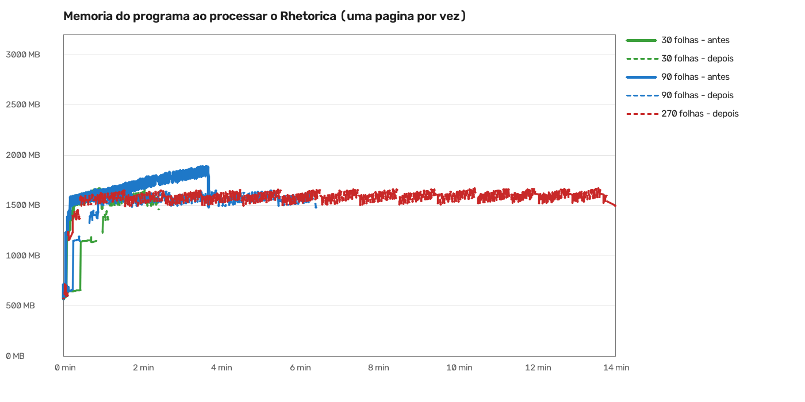

# Falta de memória ao processar: causa e conserto

**O programa guardava o livro novo inteiro na memória até o fim, e só então gravava o PDF no disco.**
Quanto maior o livro, mais memória. No Rhetorica a memória do computador acabava e aparecia
"Este livro ficou grande demais para a memória do computador". Era defeito do programa.

**Agora as páginas prontas vão para o disco aos poucos, e a memória fica parada**, seja o livro pequeno ou
grande. O PDF sai igual, sem perda. Com 270 folhas do Rhetorica, que antes caía, o processamento terminou.

**O aviso também mudou (sua escolha na Central, 2-12):** "Faltou memória no computador: outros programas
abertos estão usando quase toda a memória. Feche o que não estiver usando. Nada do seu trabalho no livro se
perdeu.", com os botões "tentar de novo" e "entendi". Agora ele só deve aparecer quando outros programas
ocupam a memória.

## O gráfico

Linha cheia: antes do conserto (sobe com o livro). Tracejada: depois (parada em ~1.650 MB).

## As medidas (Rhetorica, uma página por vez)

| Caminho | Folhas | Código | Pico do programa | PDF | Resultado | Onde foi o pico |
|---|---|---|---|---|---|---|
| Processar | 30 | antes | 1.665 MB | 87 MB | pronto | processar as páginas |
| Processar | 30 | depois | 1.652 MB | 87 MB | pronto | processar as páginas |
| Processar | 90 | antes | 1.891 MB | 301 MB | pronto | processar as páginas |
| Processar | 90 | depois | 1.664 MB | 301 MB | pronto | processar as páginas |
| Processar | 270 | depois | 1.674 MB | 921 MB | pronto | processar as páginas |
| Processar + Montar cadernos | 30 | antes | 1.659 MB | 87 MB | pronto | processar as páginas |
| Processar + Montar cadernos | 30 | depois | 1.644 MB | 87 MB | pronto | processar as páginas |
| Processar + Montar cadernos | 90 | antes | 1.889 MB | 301 MB | pronto | processar as páginas |
| Processar + Montar cadernos | 90 | depois | 1.656 MB | 301 MB | pronto | processar as páginas |
| Processar + livreto (Montar para imprimir) | 30 | antes | 2.142 MB | 87 MB | pronto | montar o livreto |
| Processar + livreto (Montar para imprimir) | 30 | depois | 1.655 MB | 87 MB | pronto | processar as páginas |
| Processar + livreto (Montar para imprimir) | 90 | antes | 3.102 MB | 301 MB | pronto | montar o livreto |
| Processar + livreto (Montar para imprimir) | 90 | depois | 1.656 MB | 301 MB | pronto | processar as páginas |

"Pico do programa" é a memória mais alta que o programa usou. Antes, com 270 folhas, caiu por falta de
memória (não há linha "antes" de 270: não terminou).

## Velocidade

Ao comparar a velocidade, achei que a primeira versão do conserto deixava livro grande mais lento: a cada ida
ao disco o programa relia o arquivo de trabalho inteiro (num livro de 935 MB, 21 segundos a mais no total).
Consertei: agora cada ida grava só o que é novo (1,4 segundo no total no mesmo livro, mais ~2 segundos no fim).
Num livro que leva ~14 minutos, isso é perto de 0,4%. Livro com PDF de menos de 64 MB não muda nada.
O filtro de velocidade do GitHub confere isso (rodada 41951188321).

## Ressalvas

- As medidas do Rhetorica "depois" foram feitas com a primeira versão do conserto; a segunda muda só a
  velocidade da ida ao disco, não a memória (os testes de máquina conferem as duas coisas).
- O PC estava com outros agentes rodando: os tempos totais das medidas variam muito (o mesmo código deu 52 s
  e 91 s). Por isso a velocidade foi medida por partes e vai ao filtro do GitHub.
- Ainda copiam o PDF inteiro para a memória, na tela: "Imprimir agora" com o livro todo e "Extrair as
  páginas escolhidas". Ficaram anotados para a Lista de bugs, sem mexer.
