# Conferência da etapa 10a — o corte não come a página

Obra de 26/10/2026 (D-014: feita até o fim, você confere tudo no fim). Implementador, ramo `obra-etapa10a-2026-10-26`. Em cada quadro: o scan, ANTES (o código de 26/10, `11f9ed3`) e DEPOIS, na mesma escala. Caminho: o programa inteiro (análise do livro, dividir, endireitar, cortar, filtro), como o botão "Confirmar e processar"; imagem tirada da página pronta.

**O que muda no livro de fábrica:** 17 das 32 páginas do gabarito mudam (somas: 45 de 96 iguais). Em 5 só a cunha do giro, até 1,3 mm da beirada (Boécio 3, Escola 7 e 35, Graduale 222, Siebmacher 9: medido ponto a ponto); em 12 o corte (Boécio 8 e 22, Graduale 221 e 223, Horas 13, 14, 26 e 27, Marial 7, Rhetorica 18 e 73, Siebmacher 7), as maiores mostradas aqui. O projeto começado antes de 09/10/2026 não muda nada (32 de 32 cortes iguais).

**Opinião:** PRONTO PARA CONFERIR (não aprovado: só você aprova). O mais grave era a borda preta "até a moldura" comendo páginas inteiras (Cursus 3, Siebmacher 74, ljs47 2, Antiphon 2); está consertado. As ressalvas estão escritas em cada quadro.

## Cursus 3 — o corte comia o começo das linhas (lista única 4.2)

**De onde veio:** Lista única 4.2 / C-1 (23/10): "o corte da esquerda comeu a primeira letra ou duas das linhas do bloco de baixo". D-104 (22/10): "Tem mais alguma função que pode fazer essa mesma coisa de comer parte da pagina sem que a gente queira no nosso programa?"

**Por onde a página passou:** Projeto do teste dos 14 livros: livro novo, "Cortar a beirada da folha vizinha", "Achar a página dentro da borda preta" (até a moldura), endireitar, cortar; filtro Original (para ver só o corte).

**O que olhar:** Na esquerda do ANTES falta um quarto da página (o corte da beirada da vizinha ficou colado no texto, o giro levou o canto, e a caixa do ScanTailor jogou fora o resto). No DEPOIS o texto está inteiro.

Tamanho da página pronta: antes 11,6 x 25,3 cm; depois 15,9 x 25,5 cm.

**Ressalva / nota:** Ressalva: no alto à esquerda continua um fio preto da lombada ao lado do "A" de "AD" (existe também sem o corte da beirada da vizinha; tirar ele cortaria o "A"). Projeto já analisado guarda o corte da beirada antigo: a folga nova vale numa análise nova do livro.

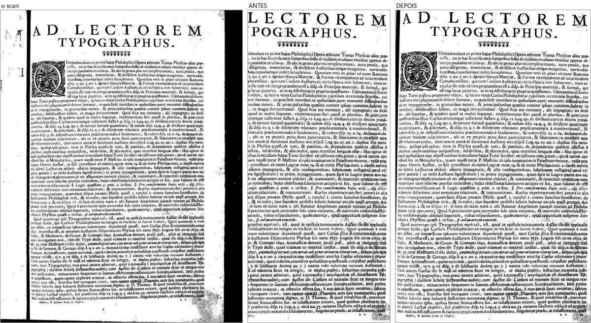

## Siebmacher 74 — folha quase em branco virava uma tira (4.10 / 4.8)

**De onde veio:** Lista única 4.10 / S-1: "Faixa preta grossa na beirada esquerda (a lombada não foi cortada mesmo com 'borda preta' marcada) e borrões pretos espalhados". A tira era o corte: 2,6 x 8,6 cm.

**Por onde a página passou:** Projeto do teste: borda preta até a moldura, endireitar, cortar; filtro Preto e branco (o do livro).

**O que olhar:** ANTES: só uma tira da beirada da folha, que no Preto e branco virou faixa preta. DEPOIS: a folha inteira, sem o preto do scanner.

Tamanho da página pronta: antes 2,6 x 8,6 cm; depois 13,1 x 10,6 cm.

**Ressalva / nota:** Ressalva: a lombada do lado direito (a beirada das outras folhas, castanha) ainda aparece fininha; e esta folha sai cinza no Preto e branco (é o filtro com uma folha quase sem tinta, não o corte).

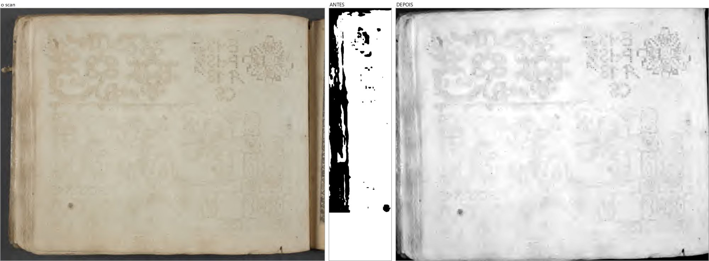

## ljs47 2 — a guarda virava uma tira só com a etiqueta (4.8)

**De onde veio:** Lista única 4.8 / L-3: "a 2 virou uma tira deitada de 21 × 11 cm só com a etiqueta da biblioteca".

**Por onde a página passou:** Projeto do teste: borda preta até a moldura; filtro Original.

**O que olhar:** ANTES: só a etiqueta. DEPOIS: a guarda inteira, dentro da borda preta.

Tamanho da página pronta: antes 20,9 x 10,7 cm; depois 32,4 x 42,7 cm.

**Ressalva / nota:** Ressalva: a beirada larga das outras folhas, à direita, fica (é larga demais para a regra segura).

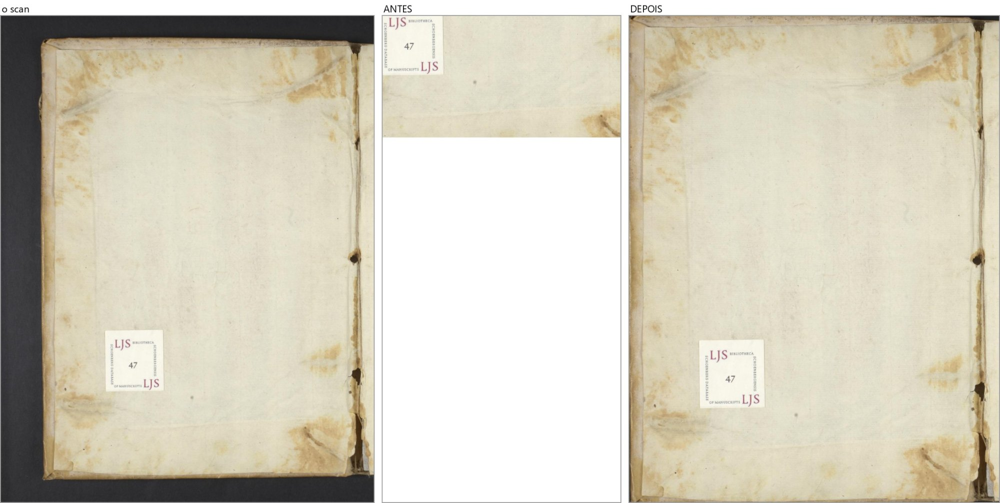

## Antiphon 2 — guarda manchada e o "usar o corte alargado" (1.4)

**De onde veio:** Lista única 1.4 / A-2: "O corte ficou menor: a página virou uma tira estreita (do meio para a direita) e perdeu a metade esquerda". D-098 (13/10): "ele avisa e da opção e de mudar o corte e mostrar ele alargado com o que foi tirado."

**Por onde a página passou:** Projeto do teste: borda preta até a moldura, cortar a beirada da vizinha; filtro Original.

**O que olhar:** ANTES: a caixa do ScanTailor abraçava as manchas (do meio para a direita) e cortava o número "19" e o carimbo. DEPOIS: a folha inteira; não aparece mais o aviso "Corte deixou algo de fora", então o botão nem é preciso. E o corte alargado agora nunca fica menor que o corte que a página tem (teste de máquina).

Tamanho da página pronta: antes 20,1 x 34,8 cm; depois 39,8 x 56,7 cm.

**Ressalva / nota:** Ressalva: o lado da tela (o que a prévia mostra antes de a medida chegar) é da etapa 9.

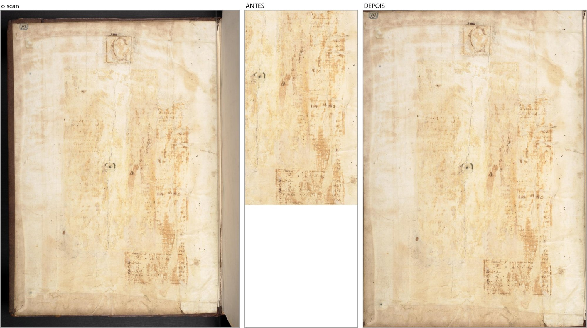

## Boécio 2 — o fio preto na beirada (4.10)

**De onde veio:** Lista única 4.10 / B-6: "Ficou um risco preto fino em toda a beirada esquerda".

**Por onde a página passou:** Projeto do teste: de fábrica (endireitar, cortar); filtro Preto e branco (o do livro).

**O que olhar:** Olhar a beirada esquerda: no ANTES o fio preto de cima a baixo; no DEPOIS, nada.

Tamanho da página pronta: antes 8,9 x 12,9 cm; depois 8,9 x 12,9 cm.

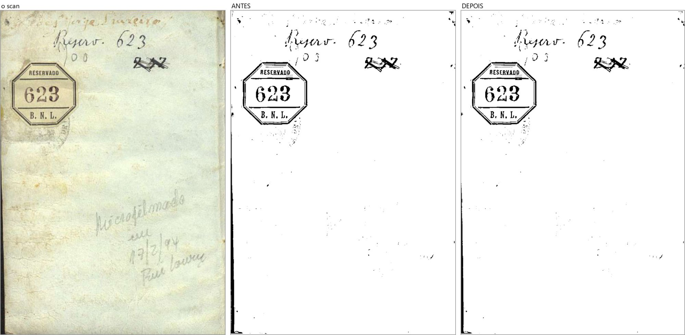

## Escola 197 — o corte comia os números 1, 2 e 3 da margem

**De onde veio:** Lista de bugs, 13/10 (verificador do corte): "Escola 197: na ordem nova o corte come os números 1, 2 e 3 dos itens, na margem esquerda".

**Por onde a página passou:** Livro novo de fábrica só com esta página; filtro Original.

**O que olhar:** Na esquerda: ANTES os itens começam no travessão; DEPOIS aparecem "1", "2" e "3".

Tamanho da página pronta: antes 15,5 x 24,3 cm; depois 15,9 x 24,3 cm.

**Ressalva / nota:** Regra nova (a coluna de números da margem): peças do tamanho das letras da linha ao lado, em coluna (duas ou mais). Um número sozinho na margem continua de fora.

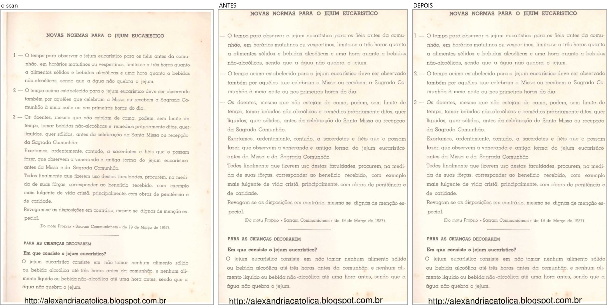

## Boécio 8 — cunhas brancas do giro (ressalva do G6)

**De onde veio:** D-095 (12/10): "Se esse trabalho não mexe nele, porque estamos avaliando isso? o resultado aqui dessa pagina não seria cortar as bordas pretas?" — cunhas brancas com corte até a beirada (Boécio 8, Marial 7, Graduale 221).

**Por onde a página passou:** Livro novo de fábrica; filtro Original.

**O que olhar:** Nos cantos do ANTES, triângulos brancos (o giro de 1,1 grau); no DEPOIS, com a cor do papel.

Tamanho da página pronta: antes 8,8 x 12,4 cm; depois 8,8 x 12,3 cm.

**Ressalva / nota:** Muda as somas de fábrica desta página (só os pontos da cunha, até 1,3 mm da beirada: medido).

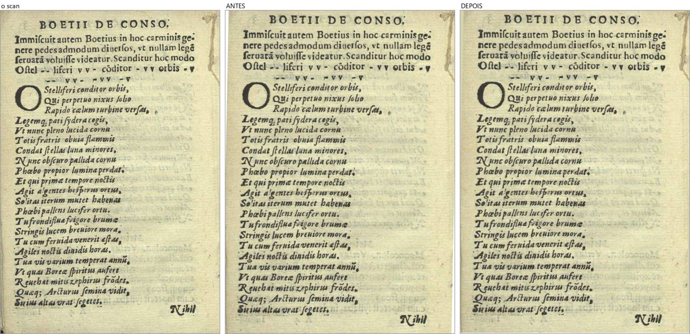

## Graduale 221 — beirada escura e cunha (ressalva do G6)

**De onde veio:** D-095 (ver acima).

**Por onde a página passou:** Livro novo de fábrica; filtro Original.

**O que olhar:** Na esquerda, o ANTES vai até a beirada escura da folha; o DEPOIS para no papel. O "Cvij" do alto continua inteiro.

Tamanho da página pronta: antes 33,7 x 46,3 cm; depois 32,6 x 46,0 cm.

**Ressalva / nota:** Muda as somas de fábrica desta página (de propósito).

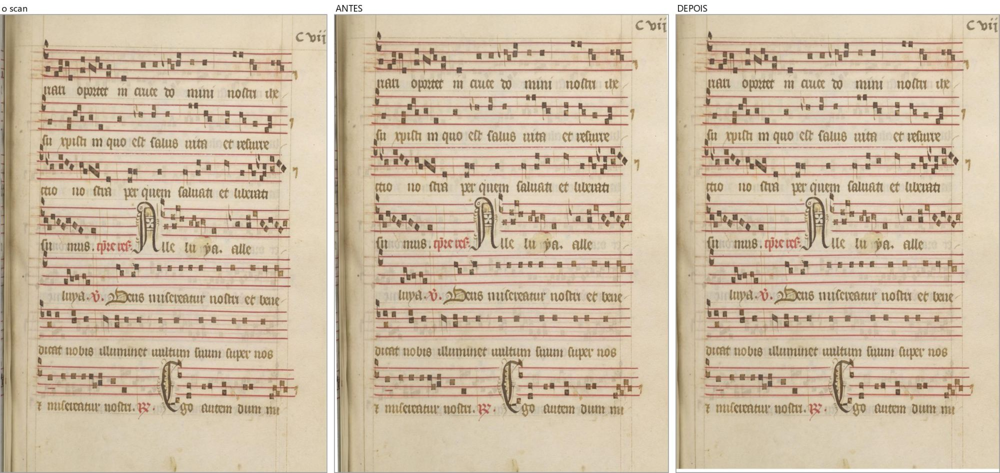

## Marial 7 — cunhas e o fio escuro de cima e de baixo (ressalva do G6)

**De onde veio:** D-095 (ver acima).

**Por onde a página passou:** Livro novo de fábrica; filtro Original.

**O que olhar:** Em cima e embaixo: o ANTES tinha o fio escuro da beirada e as cunhas brancas.

Tamanho da página pronta: antes 24,5 x 33,1 cm; depois 24,5 x 32,8 cm.

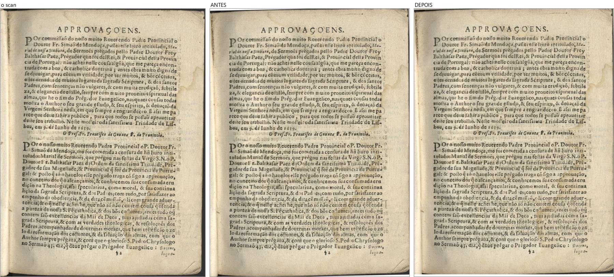

## Siebmacher 7 — a faixa preta do scanner em cima e embaixo

**De onde veio:** Lista única 4.10 ("A sombra da lombada fica como faixa preta na beirada") e D-097 ("tem que ficar rente a folha de papel, não pode ter preto ali.").

**Por onde a página passou:** Livro novo de fábrica; filtro Original.

**O que olhar:** Em cima e embaixo do ANTES, a faixa preta do scanner; no DEPOIS, o papel. A moldura de riscos fica inteira.

Tamanho da página pronta: antes 13,8 x 10,7 cm; depois 13,8 x 10,5 cm.

**Ressalva / nota:** Muda as somas de fábrica desta página (de propósito).

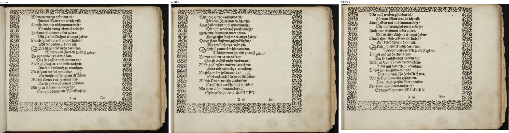

## Horas 18 — sobra branca do lado direito (4.4)

**De onde veio:** Lista única 4.4 / H-2: "O corte tirou o lado esquerdo da moldura e deixou sobra branca do lado direito: a página ficou torta no papel".

**Por onde a página passou:** Projeto do teste: de fábrica (endireitar, cortar); filtro Melhorar (o do livro).

**O que olhar:** ANTES: a moldura colada na esquerda e 2 a 3 cm de sobra (com a beirada da folha) na direita. DEPOIS: a moldura no meio, com folga dos dois lados.

Tamanho da página pronta: antes 27,9 x 42,7 cm; depois 26,1 x 38,7 cm.

**Ressalva / nota:** Achado: a moldura NÃO era cortada (está inteira no PDF do teste, conferido ponto por ponto); o defeito era a sobra da direita. Muda o corte de fábrica de 4 páginas do Livro de Horas do gabarito (13, 14, 26, 27): ver as três abaixo.

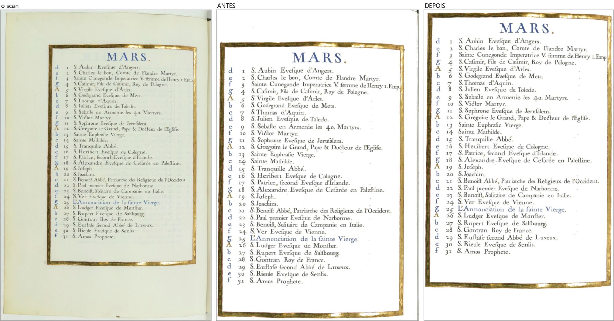

## Horas 13 (gabarito) — o mesmo conserto

**De onde veio:** Lista única 4.4 (ver acima).

**Por onde a página passou:** Livro novo de fábrica; filtro Original.

**O que olhar:** A direita perde a sobra; a moldura fica inteira.

Tamanho da página pronta: antes 35,1 x 50,1 cm; depois 28,1 x 50,0 cm.

**Ressalva / nota:** Ressalva: a esquerda ainda guarda a sobra (há manchas do tamanho de letra perto da beirada).

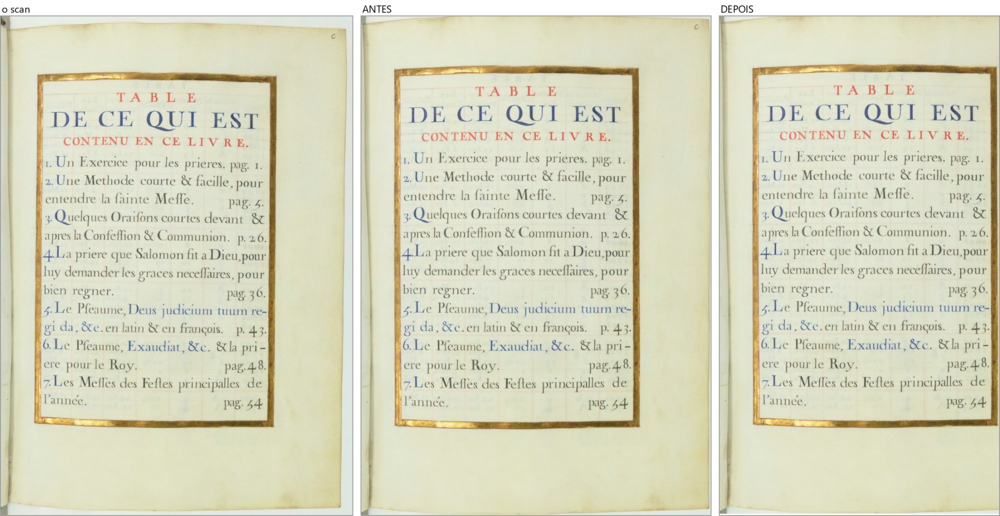

## Horas 14 (gabarito) — o mesmo conserto

**De onde veio:** Lista única 4.4 (ver acima).

**Por onde a página passou:** Livro novo de fábrica; filtro Original.

**O que olhar:** A tabela fica no meio; a moldura inteira.

Tamanho da página pronta: antes 35,3 x 47,3 cm; depois 27,9 x 42,1 cm.

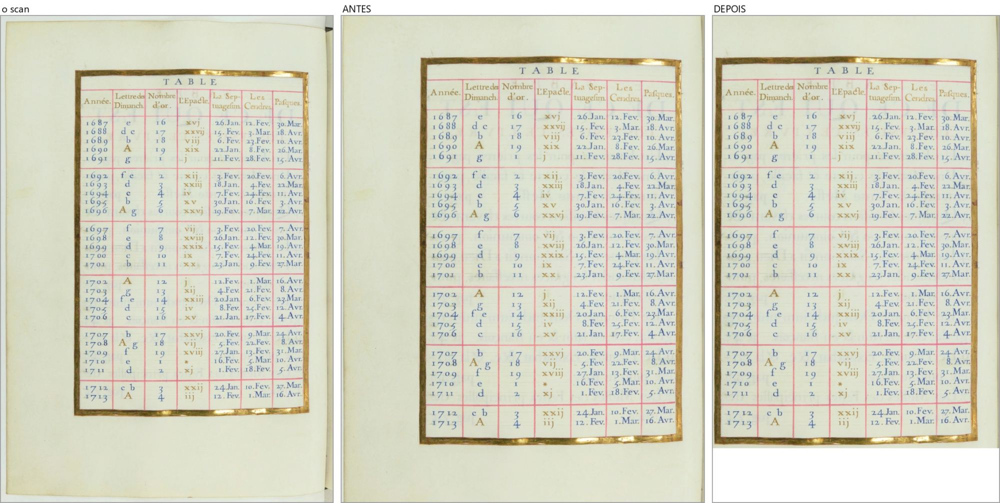

## Horas 27 (gabarito) — o mesmo conserto

**De onde veio:** Lista única 4.4 (ver acima).

**Por onde a página passou:** Livro novo de fábrica; filtro Original.

**O que olhar:** Embaixo perde a sobra; a moldura inteira.

Tamanho da página pronta: antes 27,9 x 49,1 cm; depois 27,9 x 45,6 cm.

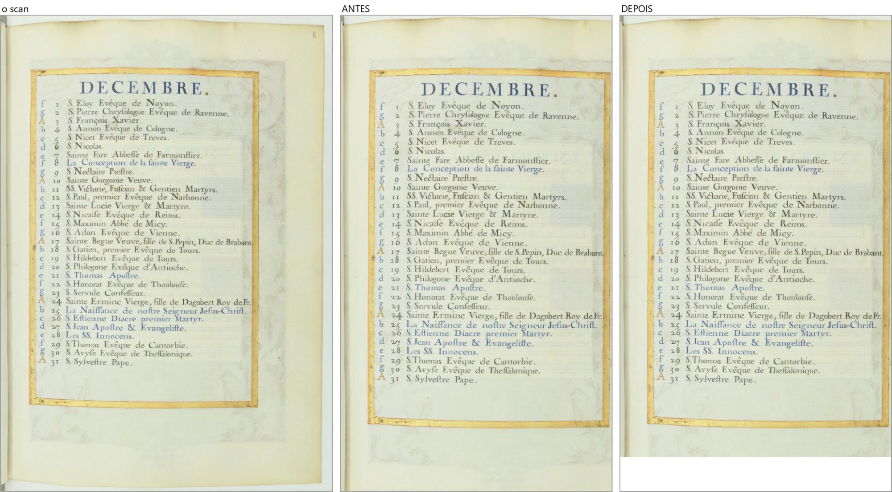

## Righetti 96 (folha dupla girada e dividida) — o dividir reto

**De onde veio:** D-104, quinto lugar: "Dividir as duas páginas é uma linha reta em pé: numa folha dupla torta, a ponta das letras perto do meio pode ir para a outra página (suspeita)".

**Por onde a página passou:** Livro novo de fábrica com dividir; a folha girada e dividida como na tela; filtro Original; página da direita.

**O que olhar:** Perto da dobra (esquerda da página) nenhuma letra cortada nem levada para a outra página (provado em três folhas: 96, 100 e 123). Antes e depois iguais no meio.

Tamanho da página pronta: antes 16,2 x 19,8 cm; depois 16,2 x 19,8 cm.

**Ressalva / nota:** Ressalva: a faixa preta do scanner em cima (a tampa branca do scanner vem antes dela) continua. A regra que a tiraria confundiria uma moldura impressa preta: ficou anotada para a etapa do Righetti.

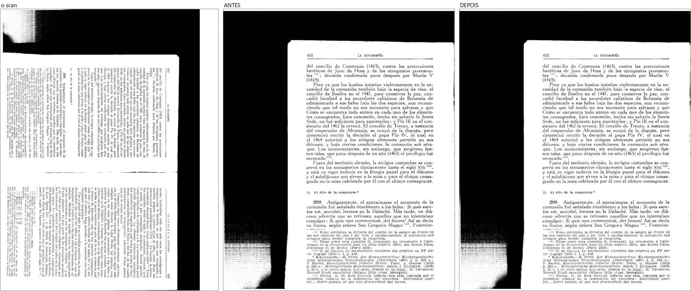

## Imprimir aumentado: agora avisa que CORTA (oitavo lugar da D-104)

**De onde veio:** Lista de bugs, 22/10: "Imprimir com escala acima de 100% corta o que passa da metade da folha; avisa só pela margem pequena". D-017 (13/10): aumentar "não corta nada escondido".

**O que olhar:** a folha montada em A4 (livreto) com as duas páginas da Escola 7 e 8 a 140%: o que passa da metade da folha não sai. O aviso novo, palavra por palavra:

> Página 1: aumentada além do lugar dela na folha - o que está impresso fica CORTADO (à esquerda 0,6 cm; à direita 0,2 cm; em cima 2,2 cm; embaixo 2,4 cm). Diminua a escala desta página ou do lado dela.

> Página 2: aumentada além do lugar dela na folha - o que está impresso fica CORTADO (em cima 0,8 cm; embaixo 1,7 cm). Diminua a escala desta página ou do lado dela.

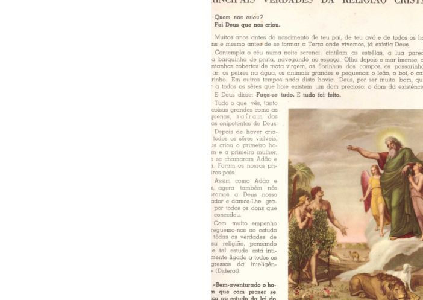

## Moldura escura antes de desentortar (D-113, `d212-1`)

**De onde veio:** "Mas fica anotado para depois da junção isso ser resolvido, porque na verdade, eu acho que o primeiro passo em uma pagina dessas seria tirar essa moldura preta transformando a pagina em totalmente branca sem mexer nas letras, ai o desentortador não iria confundir as letras com moldura preta. não é?"

**O que foi feito:** o desentortar mede a caixa do texto numa cópia da página com a moldura escura do scanner pintada de branco (as letras não mudam; a página que sai é a de sempre).

**Resposta honesta à sua pergunta ("não é?"):** em parte. Na página de teste (Marial 41 encurvada, com a moldura) a curva ainda NÃO é achada, e a foto abaixo mostra igual desligado (esquerda) e ligado (direita). Medi a causa: com a caixa só do bloco do texto, o desentortar acha a curva; com a caixa que pega também as notas da margem ("Prou. 8", "Mat. 5. 8"), não acha - com ou sem a moldura. Ficou como pergunta para você (no ONDE-PAREI): deixar as notas da margem de fora da caixa que o desentortar segue.

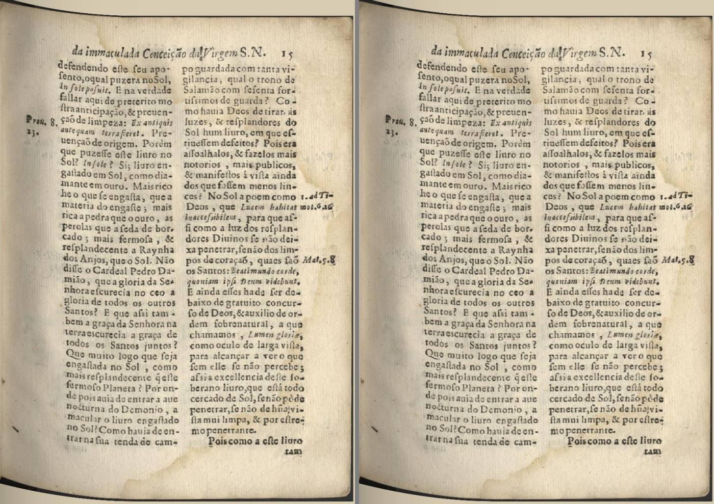
