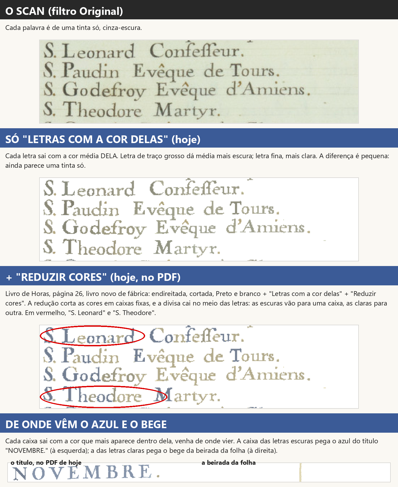
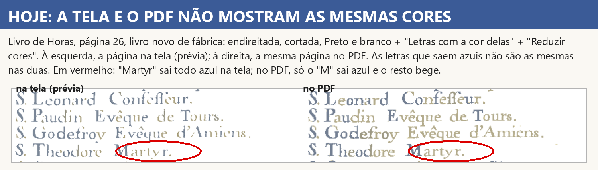
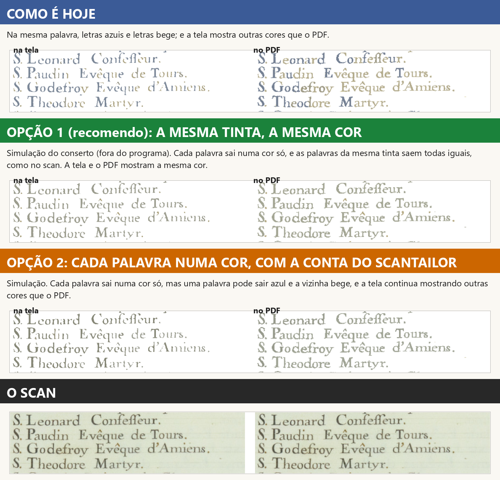
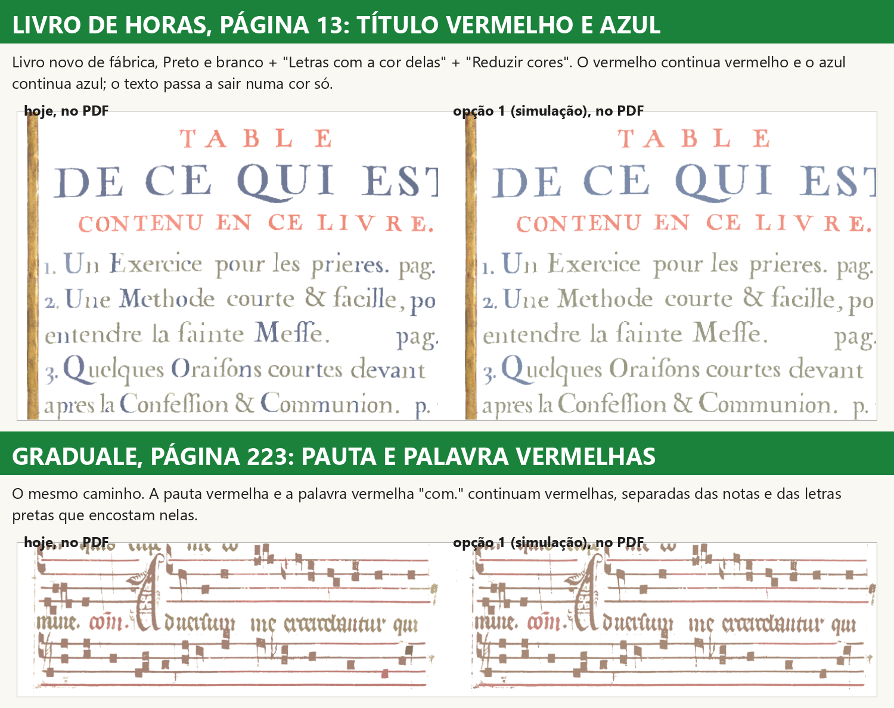
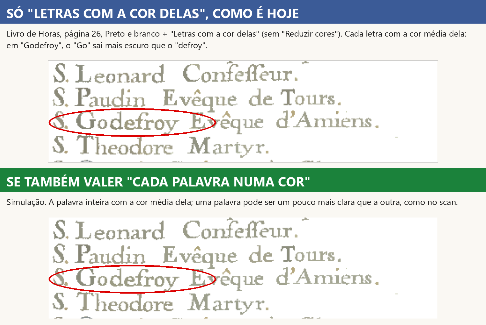

# Estudo: cada palavra numa cor só ("Letras com a cor delas" + "Reduzir cores")

Implementador, 14/11/2026. **Só estudo: nenhuma linha do programa mudou** (`core/`, `ui/` e raiz intactos; tudo o
que está aqui são scripts de medida em `scripts/` e prints em `prints/`). Ramo `palavra-cor-2026-11-14`, saído da
versão de teste `obra-2026-10-26` (`c7e34fd8`). Pedido do Samuel: "bota o 13 para ser estudado"; decisão D-701
(13/11): "Consertar: cada palavra sai numa cor só, como no scan (recomendo)".

## Em uma frase

**A mesma palavra sai em duas cores porque o programa pinta cada letra com a média dela e depois corta as cores em
caixas fixas cuja divisa cai bem no meio da tinta do texto; cada caixa ainda pega emprestada a cor de outra coisa da
página (o azul do título, o bege da beirada da folha).** É defeito do programa, não escolha do Kaique. E há um
segundo defeito junto: **a tela e o PDF não mostram as mesmas cores**, porque essa conta muda com a resolução.

## 1. Decisões que esta tarefa precisa cumprir

- **D-701** (13/11): "Consertar: cada palavra sai numa cor só, como no scan (recomendo)".
- **D-178**: "(a) Trazer como opção, desligada de fábrica (recomendado)" · "Aprovado" · "Está bom".
- **D-189** (21/10): "Ele está apagando as letras, isso sim, e quando foi que eu pedi para fazer isso? isso é do
  scantailor?" · "aprovado, mas ainda tem que melhorar, em alguns casos, ele acaba apagando a letra."
- **D-191**: "entra no programa e a caixinha não fica escondida."
- **D-192**: tela cheia com as mesmas opções do painel e a página do meio igual ao que sai.
- **D-594**: o "Limpar a folha" do Automático tem todas as opções do painel.
- **D-649**: "o resultado final tem que sair como a edição foi mostrada no preview".
- **D-605 / §11.8**: "nenhuma função nova, ou nova escolha dentro do programa pode alterar o que já está escolhido e
  testado".
- **D-147** (achada na busca do Livro): no Preto e branco, foto e pintura em tons de cinza.

## 2. O que já está escolhido e testado aqui

- "Letras com a cor delas": opção do Preto e branco, desligada de fábrica; letra vermelha sai vermelha, letra preta
  sai escura, papel branco (D-178; `tests/test_cores_scantailor.py`, `tests/test_cores_scantailor_na_tela.py`).
- "Reduzir cores": à vista no painel Filtro, desligada de fábrica (D-191); nos filtros de cor posteriza a página
  inteira (`test_reduzir_cores_na_pagina_de_cor`).
- "Reduzir cores" não apaga letra (D-189, etapa 10b de 27/10, `c8844671`): no Preto e branco a redução vai sem o
  "forçar preto e branco" (`tests/test_decisoes.py::test_d189_reduzir_cores_no_preto_e_branco_nao_forca_preto`), e
  menos de 2% das letras da Horas 26 viram preto
  (`tests/test_etapa10b_imagem.py::test_reversao_d189_reduzir_cores_nao_apaga_meia_palavra`).
- Figurinhas seguem as caixinhas (`tests/test_cartoes_seguem_as_caixinhas.py`); tela cheia com as mesmas opções
  (`tests/test_filtros_tela_cheia.py`); Automático com as duas opções
  (`tests/test_decisoes_automatico_opcoes_do_filtro.py`); sem a DLL a página sai como sem as caixinhas
  (`test_sem_a_dll_sai_como_sem_as_caixinhas`, `tests/test_falha_do_scantailor_vai_ao_erros_log.py`).
- "No Preto e branco o vermelho sai preto" de fábrica (V1, 30/09) e foto em cinza (D-147): o conserto não toca.

## 3. Por que a mesma palavra sai em duas cores (a causa, medida)

Caminho da página em todas as medidas: **Livro de Horas, página 26, livro novo de fábrica, endireitada, cortada,
Preto e branco + "Letras com a cor delas" + "Reduzir cores"**, pelo corpo do programa (`core.pipeline`), sem janela.

1. **"Letras com a cor delas"** é a segmentação de cor do ScanTailor (`ColorSegmenter.cpp`, copiado sem mudança na
   nossa DLL). Ela pinta **cada peça** de tinta com a **média** das cores dela. Letra de traço grosso dá média mais
   escura (vermelho entre 131 e 150); letra fina, mais clara (155 a 182), porque tem proporcionalmente mais beirada
   misturada com o papel. A mesma tinta vira dezenas de cores próximas. Sozinha, a diferença é pequena.
2. **"Reduzir cores"** é a posterização do ScanTailor (`Posterizer.cpp`, sem mudança). Ela estica as cores da página
   entre a mais escura (122) e o branco e corta cada canal em 4 faixas fixas. Na Horas 26 a primeira divisa cai em
   155: **no meio da faixa das letras**. Letra com média até 155 vai para uma caixa; acima, para outra.
3. Cada caixa sai com **a cor que mais aparece dentro dela**, venha de onde vier. A caixa das letras escuras pega o
   azul-acinzentado (115,127,146) do "N" do título azul "NOVEMBRE."; a das letras claras pega o bege (179,171,140) de
   uma faixa da beirada direita da folha. Por isso uma diferença pequena vira azul contra bege.

**Prova.** Refiz a conta do ScanTailor em numpy (`scripts/m2_causa.py`) e ela dá exatamente a cor da DLL em **100%**
dos pontos de letra. Em "S. Leonard": "S", "L", "o", "n", "a" com média até 155 saem azuis; "e" (158) e o "r" final
(168) saem bege. Medida "palavra em duas cores" (`scripts/m3_palavras.py`: as letras juntadas em palavras; a palavra
conta como "duas cores" se a segunda cor ocupa mais de 10% dela): **48%** das palavras do calendário no PDF hoje;
32% com só "Letras com a cor delas" (variação suave, de claridade).

**De onde veio a conta.** É do ScanTailor (código original dele, dentro da nossa DLL). No ScanTailor, com o "forçar
preto e branco" de fábrica, a caixa escura vira **preto**: era o "ANTES" do print da Central (metade preta, metade
clara), igual ao ScanTailor. O conserto de 27/10 (D-189) tirou o "forçar" para a letra clara não sumir; com isso a
caixa escura passou a sair azul. Ele tratou o sintoma (o preto e a letra apagada), não a causa (a divisa no meio da
tinta). **O ScanTailor não tem "uma cor por palavra"**: ele trabalha cor a cor, ponto a ponto; a mesma divisão de
palavra acontece nele.

### Achado junto: a tela e o PDF não mostram as mesmas cores (D-649)

As duas contas do ScanTailor olham a página inteira (o limiar de cada canal na segmentação; "a mais escura" e "a mais
frequente de cada caixa" na redução), e a página tem outro tamanho em cada lugar. Parte azul da tinta do
calendário: **69%** na prévia (110 pontos por polegada), **59%** na tela cheia (150), **63%** na prévia do Automático
(180), **43%** a 220 (a resolução do "comparar"), **50%** no PDF (300). Pontos de letra com cor visivelmente
diferente entre a prévia e o PDF: **36%**.

## 4. A regra da ferramenta e todos os caminhos (§11.12)

**A função que decide a cor de cada letra:** `core/cores_scantailor.aplicar(...)` → `cores()` → DLL
`st_ferramentas_cores` (segmentação + posterização). Ela é chamada em dois lugares do `core/pipeline.py`, **os dois
com a mesma função** (nenhuma conta copiada): `_filtrar` (a página com marcação, "Só as letras", "só neste pedaço")
e `filtro_com_as_caixinhas` (o filtro numa imagem solta).

| Caminho | Por onde passa | Usa a função? | Resolução |
|---|---|---|---|
| PDF ("Confirmar e processar") | `processar` → `_pagina_pronta` → `_filtrar` | sim | 300 |
| Prévia e miniaturas da tira | `GerenciadorPrevias` → `renderizar_pagina` → `_filtrar` | sim | 110 |
| Grade "Todas as páginas", folhear, folhas do caderno | as prévias (`renderizar_pagina`) | sim | até 160 / 90 / 180 |
| Tela cheia dos filtros | `renderizar_com_filtro` → `renderizar_pagina` → `_filtrar` | sim | 150 |
| Figurinhas do painel Filtro | `_TarefaCartoes` → `filtro_com_as_caixinhas` | sim (sem a marcação) | 70 |
| "Comparar" da tela ampliada | `filtro_com_as_caixinhas` | sim (sem a marcação) | 220 |
| Automático / "Limpar a folha" | grava os dois campos; prévia por `renderizar_pagina` + `compor_como_no_pdf` | sim | 180 e 300 |
| Caixinhas do painel e da tela cheia, "Aplicar em" (só nesta / todas / daqui em diante), desfazer, refazer | só gravam `letras_com_a_cor` / `reduzir_cores` na página (`_mudar_cores`, `_gravar_opcao_da_tela_cheia`, `MARCAS_DA_PAGINA`); a imagem vem dos caminhos acima | — | — |
| "Só neste pedaço" | o pedaço é composto antes; as cores valem na página composta | sim | a do caminho |
| "Tirar o fundo" | `aplicar` devolve "nada muda" | sim | — |

**Conclusão:** a regra já mora num lugar só (bom). O defeito está **dentro** dela, e ela dá resultado diferente em
cada resolução. Consertando dentro de `aplicar`, todos os caminhos acima passam a ter o conserto sem tocar em `ui/`.
(Figurinhas e "comparar" recebem a página sem a marcação: entrada diferente, mesma regra; já era assim.)

## 5. O plano do conserto

**O que muda, num lugar só: `core/cores_scantailor.py`, no ramo do Preto e branco de `aplicar`.**

1. A segmentação do ScanTailor continua igual (cada peça com a sua cor: é o que "Letras com a cor delas" já faz e foi
   aprovado).
2. Quando "Reduzir cores" está marcada **no Preto e branco**, no lugar da posterização por caixas do ScanTailor entra
   uma função nova, `uma_cor_por_tinta(...)`:
   - junta as letras em palavras (as peças de tinta juntadas na horizontal, com uma folga proporcional à altura das
     letras: o espaço entre letras some, o entre palavras fica);
   - dentro de cada palavra, junta as peças da **mesma tinta** (cor parecida; a claridade pesa pouco, porque é ela que
     muda entre letra grossa e fina). Peça de outra tinta (capitular vermelha, pauta vermelha encostada nas notas)
     fica separada;
   - na página, junta as palavras da mesma tinta numa cor só (a média pesada delas);
   - pontinhos pequenos (ponto final, apóstrofo, pedaço de acento) seguem a cor da palavra deles.
3. Nos filtros de cor (Original, Melhorar, Mágico pro), "Reduzir cores" continua a posterização do ScanTailor, sem
   mudança. Sem "Reduzir cores", nada muda (a pergunta 2 abaixo decide se muda).
4. Os limites (quanto é "cor parecida", folga entre letras, tamanho de pontinho) ficam como constantes nomeadas no
   topo do arquivo, com comentário. A lista dos dois campos não muda; nenhum caminho de `ui/` muda.

**Simulação, fora do programa** (`scripts/m5_prototipo.py` com `M5_PESO_L=0.15 M5_LIMIAR=10`, a partir das páginas que o programa de hoje desenha; resultados em `_dados/m5-v3`):

| Medida | Hoje | Opção 1 (a mesma tinta, a mesma cor) | Opção 2 (cada palavra, com as caixas do ScanTailor) |
|---|---|---|---|
| Horas 26, palavras em duas cores, PDF | 48% | 5% | 4% |
| Horas 26, palavras em duas cores, prévia | 44% | 7% | 25% |
| Horas 26, pontos com cor diferente tela x PDF | 36% | 2% | 32% |
| Horas 13, palavras em duas cores, PDF | 36% | 3% | 3% |
| Horas 13, pontos diferentes tela x PDF | 19% | 4% | 6% |
| Graduale 223, palavras em duas cores, PDF | 18% | 1% | 3% |

A opção 2 junta cada palavra mas mantém as caixas do ScanTailor: a palavra vizinha ainda pode sair de outra cor, e a
tela continua diferente do PDF. Por isso o plano segue a **opção 1**.

O que sobra na simulação (5% na Horas 26): pontinhos (ponto final, apóstrofo, pedaço de acento) que saem de outra cor
que a palavra, e a letra azul da coluna da esquerda. Na Graduale, a prévia (110) ainda difere do PDF em 18% dos
pontos: nessa resolução a própria segmentação parte as notas e as letras de outro jeito (já era assim com só "Letras
com a cor delas"). Testei também decidir a tinta pela cor do miolo da letra (`scripts/m7_miolo.py`): deixa o texto
mais escuro, mais perto do scan, mas pinta pontos finais de laranja; descartado como está.

**A prova que vai cobrar o mesmo resultado em todos os caminhos** (arquivo novo `tests/test_d701_palavra_numa_cor.py`,
com a medida "palavra em duas cores" do `scripts/m3_palavras.py` passada para os testes):

- **Reversão, página desenhada (roda no GitHub):** palavras de letras grossas e finas da mesma tinta, um título azul
  grande e uma palavra vermelha; Preto e branco + as duas caixinhas por `_filtrar`. Cobra: nenhuma palavra em duas
  cores; o vermelho continua vermelho e o azul continua azul; nenhuma letra vira preto nem branco (D-189). Tem de
  falhar no código de hoje (vou conferir isso antes de consertar).
- **Mesmo resultado nos caminhos (GitHub, página desenhada):** a mesma página por `_filtrar` (prévia e PDF),
  `filtro_com_as_caixinhas` (figurinhas e "comparar") e em duas resoluções; cobra a mesma cor de cada palavra em todos
  (diferença menor que a que se vê).
- **Caso real (no PC; pula no GitHub, a página fica fora do git):** Horas 26 pelo caminho inteiro de livro novo,
  `_pagina_pronta` (PDF), `renderizar_pagina` a 110, 150 e 180 e `renderizar_com_filtro` (tela cheia): palavras em
  duas cores abaixo de 8% em todas (hoje 44% a 54%); pontos com cor diferente entre a prévia e o PDF abaixo de 5%
  (hoje 36%); a medida da D-189 (letra que vira preto) continua abaixo de 2%.
- Os testes antigos continuam como estão. O `test_d189_...nao_forca_preto` continua valendo: o plano mantém o
  "forçar preto e branco" desligado no Preto e branco.

**Riscos.**
- *Velocidade:* só as páginas com "Reduzir cores" no Preto e branco pagam a conta nova (juntar peças e palavras numa
  página de 300 pontos por polegada; estimo 0,3 a 0,6 segundo por página, a medir); as outras não fazem conta nenhuma
  a mais. A posterização do ScanTailor deixa de rodar nessas páginas (economiza 20 a 30 ms). Filtro de velocidade do
  GitHub antes e depois.
- *Letra apagada (D-189):* a cor nova é a média da própria tinta; não há "forçar preto e branco", então nenhuma letra
  vai para o branco. A medida da D-189 fica na prova.
- *Duas tintas parecidas:* se uma rubrica muito desbotada tiver cor perto da tinta do texto, as duas podem virar uma
  só. É o limite de "cor parecida"; a prova da Horas 13 e da Graduale cobra que o vermelho e o azul ficam.
- *Não é mais o ScanTailor:* no Preto e branco, "Reduzir cores" deixa de ser a conta do ScanTailor (a regra da Fase 2
  era "igual ao ScanTailor"). A D-701 é mais nova e pede uma coisa que o ScanTailor não faz; está dito na pergunta 1.

## 6. Como fica para quem usa e no livro (§11.9)

- **O que o Kaique faz:** nada muda. As mesmas caixinhas, nos mesmos lugares (painel Filtro em "Mais ajustes", tela
  cheia, Automático em "Limpar a folha"), desligadas de fábrica, com "Aplicar em" e desfazer como hoje.
- **O que ele vê, antes:** com as duas marcadas, a mesma palavra sai metade azul, metade bege; e a tela mostra
  palavras azuis diferentes das do PDF.
- **Depois:** cada palavra numa cor só, e o texto da mesma tinta todo da mesma cor (cinza-esverdeado claro na Horas
  26); título azul azul, rubrica vermelha vermelha; a tela, as miniaturas, a tela cheia, o Automático e o PDF mostram
  a mesma cor.
- **No PDF:** só mudam as páginas em Preto e branco com as duas caixinhas marcadas. Livro sem elas sai idêntico.
- Problema novo conhecido: nenhum medido; o que sobra está dito no fim da seção 5.

## 7. Perguntas para o Samuel

**Pergunta 1 (pode já estar respondida: se a gerente achar que "como no scan" já decide, não precisa perguntar).**

No painel "Filtro da página", em "Mais ajustes", com o Preto e branco, as caixinhas "Letras com a cor delas" e "Reduzir
cores" marcadas fazem as letras saírem coloridas e com poucas cores. Hoje, no Livro de Horas página 26, a mesma
palavra sai metade azul e metade bege, e a tela mostra outras cores que o PDF. É **defeito do programa**: a conta veio
do ScanTailor, que trabalha cor a cor e não palavra a palavra. Você mandou consertar em 13/11 ("cada palavra sai numa
cor só, como no scan"). O print acima ("COMO É HOJE", "OPÇÃO 1", "OPÇÃO 2", "O SCAN") mostra as duas saídas.

O que você escolhe:
- **Opção 1 (recomendo): a mesma tinta, a mesma cor.** Cada palavra numa cor só, e todo o texto da mesma tinta na
  mesma cor, como no scan. A tela e o PDF passam a mostrar a mesma cor. O vermelho e o azul continuam. No Preto e
  branco, "Reduzir cores" deixa de usar a conta do ScanTailor (nos outros filtros continua igual).
- **Opção 2: cada palavra numa cor, mantendo a conta do ScanTailor.** A palavra fica inteira, mas a vizinha pode sair
  azul enquanto esta sai bege, e a tela continua mostrando outras cores que o PDF.
- **Só comentário.**

As caixinhas continuam desligadas de fábrica e no mesmo lugar. Nada muda em livro que não usa as duas. Situação: em
estudo; nada foi mudado no programa.

**Pergunta 2.**

No mesmo lugar, com só "Letras com a cor delas" marcada (sem "Reduzir cores"), cada letra sai com a cor média dela: em
"Godefroy", o "Go" sai um pouco mais escuro que o "defroy". Você aprovou essa caixinha assim ("Está bom"); a diferença
é pequena. Não é defeito: é como a conta do ScanTailor pinta cada letra.

O que você escolhe:
- **Deixar como está (recomendo):** só muda quando "Reduzir cores" também estiver marcada. Nada do que você já testou
  muda.
- **Também "cada palavra numa cor só" com só "Letras com a cor delas":** a palavra inteira com a cor média dela; uma
  palavra pode ser um pouco mais clara que a outra.
- **Só comentário.**

Situação: em estudo; nada foi mudado.

## 8. Bugs para a Lista de bugs (não consertados; fora desta tarefa)

- **14/11/2026 — faixa preta na beirada direita do Livro de Horas 26 no Preto e branco** (livro novo de fábrica,
  endireitada, cortada, Preto e branco sem caixinha): a sombra da beirada da folha vira uma faixa preta de uns 7 mm
  ao longo da página (64% de preto nas colunas da beirada; no scan, 1%). Com "Letras com a cor delas" ela fica bege
  e é de onde vem o bege da caixa clara. Print: `prints/bug-beirada-direita-horas26-pb.png` (à esquerda o scan, à
  direita o Preto e branco). Pode já ser conhecido (faixa da beirada, CLAUDE.md §9); a gerente confere.

## 9. Arquivos

- `ONDE-PAREI.md` (o andamento), este relatório (`relatorio.md/.html/.pdf`), `prints/` (5 prints + o do bug).
- `scripts/m1_pagina.py` (a página pelo caminho inteiro), `m2_causa.py` (a conta refeita = DLL), `m3_palavras.py` (a
  medida "palavra em duas cores" e a tela x PDF), `m4_render.py` (as páginas em cada resolução), `m5_prototipo.py` (as
  duas opções), `m7_miolo.py` (a variante descartada), `m6_prints.py` (os prints). Os dados ficam em `_dados/` (fora
  do git).
- Nenhuma janela foi aberta; pasta de dados própria (`_dados/local`). Nenhum teste do programa foi rodado: nada do
  programa mudou.
