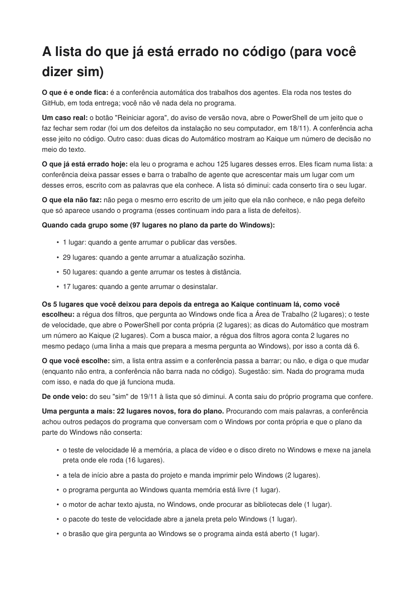

# Passo 0 do plano da parte do Windows: o pacote de regras, o porteiro e o formulário (19/11/2026)

Implementador. Ramo `passo0-porteiro-2026-11-19`, worktree `.claude/worktrees/passo0`, saiu de `obra-2026-10-26`
(`746dbda6`). Nenhuma linha do programa (`core/`, `ui/`, arquivos do programa na raiz) muda. Este ONDE-PAREI é também
o formulário da entrega (D-792), conferido pelo próprio programa:
`python -m regras_dos_agentes entrega relatorios/passo0-2026-11-19/ONDE-PAREI.md --etapa quebrar`.

## Pedido

- Papel: implementador
- Commit de partida: 746dbda6
- Ramo: passo0-porteiro-2026-11-19

## Arquivos que vou mexer

- `regras_dos_agentes/` (pasta nova: o pacote, o porteiro, a lista de exceções, o formulário, o montador)
- `tests/test_conferencias_*.py` (novos)
- `tests/conferencias_excecoes.json` (novo: a lista de exceções, proposta, esperando o "sim")
- `ganchos/pre-commit` (novo; não ligado)
- `relatorios/passo0-2026-11-19/` (este relatório)

## Onde parei

- Feito: o pacote, o porteiro (24 conferências), a lista de exceções (44 lugares, proposta), o formulário, o gancho
  (não ligado), o pacote do passo 1 e o texto para o Samuel. Testes novos passam no PC, um arquivo por vez.
- Conferindo este formulário com o GitHub, o próprio programa achou um defeito nele: com duas rodadas citadas, a K21
  olhava só a última citada. Consertado (`e2fad264`, com teste de reversão que falha no código antigo). Esperando a
  rodada 44453253677 (do commit do conserto) para conferir o formulário de novo.

## Decisões que esta tarefa precisa cumprir

(Palavras copiadas do Livro, `docs/plano/DECISOES.md` desta cópia.)

- **D-767** (18/11/2026): "não faça mais nada escodindo ou de mentira" · "não quero fazer consertos quero que funcione".
  Aqui: a conferência antes do commit é provada com o git de verdade, num repositório de verdade numa pasta temporária,
  com um Python de verdade; nada mexe no Windows.
- **D-775** (18/11/2026): "o agente vai tentar quebrar antes de fazer o teste real na tela né?". Aqui: o formulário
  confere as três etapas e os seis campos do relatório de quem quebra.
- **D-784** (18/11/2026): "ok, mas como vai saber que regras enviar para o agente?". Aqui: o pacote sai de um programa
  (catálogo + tabela arquivo → etiquetas + montador); um teste cobra que todo arquivo do git tem linha.
- **D-785** (18/11/2026): "ok, mais ainda existem mais casos na opção A". Aqui: nada deste passo mexe no Windows; não
  há prova à vista; nenhuma janela abre.
- **D-786** (18/11/2026): "a". Aqui: nenhum processamento muda; não há filtro de velocidade a rodar.
- **D-787** (18/11/2026): "A". Aqui: no PC, um arquivo de teste por vez; o conjunto inteiro no GitHub.
- **D-791** (18/11/2026): "não sei do que você está falando" · "b". Aqui: as 24 conferências viram testes em
  `tests/` e a mesma busca roda antes do commit; cada uma acusa um exemplo errado feito de propósito e não acusa o certo;
  a lista de exceções é por lugar, gerada pelo programa, e só diminui.
- **D-792** (18/11/2026): "mas e o que vai determinar o que vai nesse formulario? vai ser feito um toda vez que for
  enviado um trabalho para um agente?". Aqui: um programa confere o formulário (F1 a F20 e as perguntas das etiquetas)
  nas três etapas.
- **D-793** (18/11/2026): "ok". Aqui: a conferência K23 lê a lista de ferramentas de cada agente.
- **D-796** (19/11/2026): "1, mas tem que ser explissito o pedido né". Aqui: a K13 lê a lista de arquivos do pedido
  no formulário e barra o agente de tela que mexe em `core/` fora dela.
- **D-797** (19/11/2026): "Só precisa de dois lugares né?". Aqui: nada deste passo junta nem fala do `master`.
- **D-798** (19/11/2026): "fechou". Aqui: a K10 barra o rótulo de pronto no ramo de quem construiu e "APROVADO"
  escrito por agente. Esta entrega não traz esse rótulo.
- **D-799** (19/11/2026): "Aprova o plano?". Aqui: o passo 0 do plano-v3, como escrito.
- **D-800** (19/11/2026): "esses consertos deixa para depois". Aqui: os 5 lugares de fora ficam na lista marcados
  "depois da entrega".
- **D-605** (03/11/2026): "A partir de agora, nenhuma função nova, ou nova escolha dentro do programa pode alterar o
  que já está escolhido e testado". Aqui: nenhum teste antigo muda; o porteiro não é ligado no repositório.
- **D-637** (05/11/2026): "você tem que pensar na experiencia do usario e no resultado final do livro dentro do
  programa". Aqui: ver "Como fica para quem usa e no livro".

## O que já está escolhido e testado aqui

- Os testes que já existem e fazem parte do mesmo cuidado continuam como estão (plano-v3 §8, item 11):
  `tests/test_botoes_em_portugues.py`, `tests/test_sem_janela_na_tela.py`,
  `tests/test_memoria_nao_cresce_com_o_livro.py`, `tests/test_promessas.py` e as provas das decisões
  (`tests/test_decisoes.py` e os outros `test_decisoes_*`). Nenhum deles foi tocado; as conferências novas vivem em
  arquivos novos.
- A barra de rolagem cinza (CLAUDE.md §9): a K22 é escrita contra os valores de hoje de `ui/estilo.py`.

## Como fica para quem usa e no livro

- **O Kaique:** antes e depois, nada muda. Nenhuma tela, nenhum botão, nenhum texto do programa, nenhum arquivo do
  programa. O PDF que sai é o mesmo, página por página: nada do processamento foi tocado.
- **O Samuel:** recebe um texto curto com a lista de exceções para dizer "sim" (ver "Perguntas para o Samuel").
- **Os agentes e a gerente:** antes, as regras iam inteiras e o formulário não existia; depois, o pacote sai de um
  programa, o porteiro roda nos testes do GitHub (quando o Samuel disser "sim") e o formulário é conferido por programa.

## A causa, a regra e todos os caminhos

- **Por que existe:** na etapa 5, cada função conversava com o Windows do seu jeito e nada conferia o código antes de
  juntar (CLAUDE.md §11.12, caso da etapa 5). O porteiro barra esses erros já conhecidos; o pacote e o formulário fazem
  as regras chegarem ao agente e voltarem conferidas.
- **A regra, num lugar só:** cada conferência do código parado é uma função em `regras_dos_agentes/porteiro.py`
  (`k01()` a `k24()`, rodadas por `conferir_codigo()`); a comparação com a lista é `comparar()` em `excecoes.py`; as
  conferências das mudanças, `conferir_mudancas()` em `porteiro_mudancas.py`; o formulário, `conferir()` em
  `formulario.py`; as etiquetas de um trabalho, `etiquetas_do_trabalho()` em `tabela_arquivos.py`; se um arquivo está
  no pedido, `coberto()` em `pedido.py`; o Livro, a classe `Livro` em `livro.py`.
- **Os caminhos que chegam nelas (procurados com busca no código):**
  - teste do GitHub → `achados_do_repositorio()` → `conferir_codigo()` → `comparar()`;
  - conferência antes do commit (`ganchos/pre-commit` → `python -m regras_dos_agentes antes-do-commit`) →
    `achados_do_proximo_commit()` → `conferir_codigo()` → `comparar()`;
  - linha de comando `porteiro` → as mesmas duas de cima;
  - `excecoes --gerar` e `--diminuir` → `achados_do_repositorio()` → `gerar()` / `diminuir()` (que usa `comparar()`);
  - formulário (`entrega`) → `conferir_mudancas()` e as conferências de cada campo;
  - montador do pacote e formulário → `etiquetas_do_trabalho()` (as mesmas etiquetas nos dois) e `formulario.CAMPOS`
    (os mesmos títulos nos dois).
  Nenhum caminho tem conta própria.

## O que pode falhar e o que o programa faz

- **O git não responde** (não instalado, repositório estragado, commit de partida que não existe): `GitFalhou` com o
  motivo; a linha de comando sai com código 3 ("não deu para conferir"), nunca 0.
- **Sem licença:** não se aplica a licença do Windows (nada aqui pede); arquivo sem licença de leitura vira K00 ("não
  deu para ler"), nunca "passou".
- **Sem internet:** o GitHub não responde na K21: fica "não conferido" (código 3), nunca "passou".
- **Disco cheio:** a gravação da lista ou do pacote falha com `OSError`; a linha de comando sai com código 3 e diz o
  arquivo. Nada é gravado pela metade no repositório do projeto (a lista é escrita de uma vez).
- **A pessoa diz "Não":** não se aplica: nenhuma pergunta do Windows neste passo.
- **Arquivo preso** (outro programa segurando a lista ou o pacote): `OSError`, código 3, com o motivo.
- **Desligar no meio:** a conferência só lê; o commit barrado não acontece (o git só faz o commit se o gancho sair
  com 0). A lista e o pacote são gravados de uma vez; se o computador desligar no meio da gravação, o git mostra o
  arquivo mudado e a gerente vê antes do commit.
- **Sem o Python do projeto no gancho:** o commit é barrado com a mensagem de onde o Python foi procurado.
- **O gancho não existe numa cópia de ramo antigo:** o git não avisa (documentação lida); quem garante é o teste do
  GitHub.
- **Arquivo do programa que não é Python válido** (ou com a marca de UTF-8 no começo): o primeiro vira K00; o segundo
  é lido normalmente (três arquivos de hoje têm a marca).

## O que li da peça de fora e onde

- **git, a pasta dos ganchos (`core.hooksPath`):** https://git-scm.com/docs/git-config (entrada `core.hooksPath`; lida
  na cópia local do git 2.53, `git-config.html`): "A relative path is taken as relative to the directory where the hooks
  are run". E: "You can also disable all hooks entirely by setting core.hooksPath to /dev/null."
- **Onde o gancho roda:** https://git-scm.com/docs/githooks, DESCRIPTION: "Before Git invokes a hook, it changes its
  working directory to either $GIT_DIR in a bare repository or the root of the working tree in a non-bare repository."
  Então `core.hooksPath=ganchos` faz cada cópia usar a pasta `ganchos/` do próprio ramo.
- **A configuração é uma só para todas as cópias:** https://git-scm.com/docs/git-worktree, CONFIGURATION FILE: "By
  default, the repository config file is shared across all worktrees." Ligar uma vez no repositório principal vale
  para todas as cópias (a gerente liga).
- **Gancho que não existe: o git não avisa:** código do git v2.53.0, `hook.c:13` (`find_hook`, linhas 13 a 48, lido
  com `gh api repos/git/git/contents/hook.c?ref=v2.53.0`): sem o arquivo, devolve `NULL` sem mensagem; só avisa quando
  o arquivo existe e não é executável. Provado em `tests/test_conferencias_antes_do_commit.py`.
- **Executável no Windows:** código do git v2.53.0, `run-command.c:132` (`is_executable`): no Windows não há bit de
  executável; vale o `.exe` ou o arquivo que começa com `#!`. A documentação (https://git-scm.com/docs/githooks):
  "Hooks that don't have the executable bit set are ignored." O gancho começa com `#!/bin/sh` e vai ao git com o bit.
- **O gancho antes do commit:** https://git-scm.com/docs/githooks, pre-commit: "It takes no parameters [...] Exiting
  with a non-zero status from this script causes the git commit command to abort before creating a commit." E: "can be
  bypassed with the --no-verify option".
- **Quebra de linha do Windows no gancho:** com `core.autocrlf=true` (a configuração do Git deste PC, lida com
  `git config --show-origin`), o git troca a quebra de linha ao tirar o arquivo para a cópia
  (https://git-scm.com/docs/git-config, entrada `core.autocrlf`), e o gancho sai com as quebras do Windows. Testado de
  verdade em 19/11: o `sh` do Git para Windows 2.53 roda um script assim sem erro; no GitHub, os testes do gancho rodam
  com a cópia que o git tirou (com as quebras do Windows) e passaram.
- **A rodada do GitHub (K21):** lida em 19/11 na rodada 44202459161 (https://github.com/Samuel-Bottini-BR/EditorImpressao/actions/runs/44202459161):
  o commit testado só aparece no registro do passo "Trocar o codigo" (`.github/scripts/trocar_codigo.sh:31`, a linha
  "codigo trocado pelo de <ramo> (<commit>)"); `gh api .../jobs/<id>/logs` recusa ("the response contains terminal
  escape sequences") e `gh run view <id> --log --job <id>` dá o registro.
- **Ler o código Python:** https://docs.python.org/3/library/tokenize.html (os comentários vêm como `COMMENT`; um `#`
  dentro de texto não é comentário) e https://docs.python.org/3/library/ast.html (a coluna `col_offset` é contada em
  bytes UTF-8: "the UTF-8 byte offset of the first token that generated the node"; por isso a conversão para letras em
  `leitura_do_codigo.py`).

## O que foi feito

O pacote de regras por trabalho, o porteiro (as 24 conferências) com a lista de exceções gerada pelo programa (44
lugares, proposta, esperando o "sim" do Samuel), o programa que confere o formulário da entrega nas três etapas, a
conferência antes do commit (não ligada) e o pacote do passo 1, montado pelo programa.

## Arquivos criados ou alterados

- `regras_dos_agentes/` (novo: 17 arquivos)
- `tests/test_conferencias_codigo.py` (novo)
- `tests/test_conferencias_excecoes.py` (novo)
- `tests/test_conferencias_mudancas.py` (novo)
- `tests/test_conferencias_formulario.py` (novo)
- `tests/test_conferencias_pacote.py` (novo)
- `tests/test_conferencias_antes_do_commit.py` (novo)
- `tests/conferencias_excecoes.json` (novo)
- `ganchos/pre-commit` (novo)

## Como cumpri cada uma

- **D-767:** o gancho e as conferências das mudanças são provados com o git de verdade e um Python de verdade, numa
  pasta temporária (`tests/test_conferencias_antes_do_commit.py`, `tests/test_conferencias_mudancas.py`).
- **D-775:** o formulário confere as três etapas e os seis campos de quem quebra
  (`tests/test_conferencias_formulario.py::test_antes_da_prova_a_vista_exige_o_relatorio_de_quem_quebrou`,
  `tests/test_conferencias_formulario.py::test_relatorio_de_quem_quebra_tem_os_seis_campos_e_o_lugar_de_cada_achado`).
- **D-784:** `tests/test_conferencias_pacote.py::test_todo_arquivo_do_git_tem_linha_na_tabela` e o pacote do passo 1
  em `anexos/pacote-passo1.md`, montado pelo programa.
- **D-785:** nada abre janela; os testes novos não usam tela.
- **D-786:** nenhum processamento muda (nenhum arquivo do programa no git diff).
- **D-787:** no PC, um arquivo de teste por vez (ver "Testes"); o conjunto inteiro no GitHub.
- **D-791:** cada conferência acusa o errado e não acusa o certo (`tests/test_conferencias_codigo.py`,
  `tests/test_conferencias_mudancas.py`); a exceção por lugar
  (`tests/test_conferencias_excecoes.py::test_correcao_2_erro_novo_no_mesmo_arquivo_e_barrado`); a lista só diminui
  (`tests/test_conferencias_excecoes.py::test_lugar_consertado_tem_de_sair_da_lista`).
- **D-792:** `tests/test_conferencias_formulario.py` (cada campo que falta volta; enchimento não vale).
- **D-793:** `tests/test_conferencias_codigo.py::test_k23_acusa_agente_com_ferramenta_de_abrir_agente_ou_da_central`.
- **D-796:** `tests/test_conferencias_mudancas.py::test_k13_barra_o_agente_de_tela_em_core_fora_da_lista_do_pedido` e
  `tests/test_conferencias_formulario.py::test_o_pedido_tem_de_ser_o_do_pacote_da_gerente`.
- **D-797:** nada junta; nenhuma regra nova fala do `master`.
- **D-798:** `tests/test_conferencias_mudancas.py::test_k10_barra_o_rotulo_de_pronto_no_ramo_de_quem_construiu`.
- **D-799:** o passo 0 do plano-v3: as três correções, a lista por lugar, o formulário, o K13 e o K10.
- **D-800:** `tests/test_conferencias_excecoes.py::test_so_os_lugares_que_o_samuel_deixou_para_depois_ficam_depois_da_entrega`.
- **D-605:** nenhum teste antigo mudou (o próprio porteiro, K11, confere isso nesta entrega).
- **D-637:** ver "Como fica para quem usa e no livro": nada muda para o Kaique nem no PDF.

## Testes

- No PC, um arquivo por vez (`QT_QPA_PLATFORM=offscreen`, pasta temporária fora do projeto):
  `tests/test_conferencias_codigo.py` 21 passaram; `tests/test_conferencias_excecoes.py` 10 passaram e 1 parado de
  propósito (o que barra o repositório espera o "sim"); `tests/test_conferencias_mudancas.py` 14;
  `tests/test_conferencias_formulario.py` 26; `tests/test_conferencias_pacote.py` 10;
  `tests/test_conferencias_antes_do_commit.py` 8.
- Mutação (desfazer cada correção do esboço numa cópia e ver o teste dela falhar): correção 1, 2 testes falham;
  correção 2, 1 falha; correção 3, 1 falha.
- GitHub, rodada 44450557071 (o último commit de código, 1d381001): passou inteira. 249 arquivos de teste, 4092
  passaram, 0 falharam, 147 pulados (entre eles o teste do porteiro que espera o "sim" do Samuel, com o motivo
  escrito); os botões e os prints da janela real também passaram. Antes, a rodada 44449552916 (de um commit do meio)
  também passou inteira.

## Caminho e função

- A lista caminho → função está em "A causa, a regra e todos os caminhos".
- Prova de que o gancho e o GitHub acham o mesmo, pela mesma função:
  `tests/test_conferencias_antes_do_commit.py::test_o_gancho_e_o_github_acham_o_mesmo_no_mesmo_arquivo`.
- Prova de que o montador e o formulário usam o mesmo pedido: `tests/test_conferencias_pacote.py::test_o_pedido_do_pacote_e_lido_de_volta_igual`.

## Máquina ou olho

- Máquina: todas as conferências, a lista, o formulário, o gancho (testes novos).
- Olho: o texto para o Samuel (aberto em PDF e conferido: os números batem com a lista; a lista com marcadores aparece
  certa) e o pacote do passo 1 (lido).

## Ressalvas

- **A lista não vale ainda:** o teste que barra o repositório fica parado até a gerente trocar a situação para
  "valendo" com o "sim" do Samuel. Até lá, nenhuma conferência do código parado barra no GitHub (nem as que hoje dão
  zero, como a do emoji): escolhi deixar o porteiro inteiro desligado, como o plano diz ("depende dele antes de ligar o
  porteiro").
- **A conta deu 44, não 43:** a diferença é a linha `class _SHELLEXECUTEINFO(ctypes.Structure):` do arquivo dos testes
  à distância (fora das funções que o plano listou). É conversa com o Windows de verdade (a estrutura do pedido de
  licença), e some no passo 4 com o resto do arquivo.
- **O que o porteiro não pega:** texto montado em pedaços (ex.: `"power" + "shell"`), uma segunda peça com outro nome,
  importação por texto (`importlib`). A K10 só lê documentos (não `.py`) e conta o rótulo em maiúsculas ou como linha
  de situação; o rótulo escrito de outro jeito no meio da frase passa.
- **K21 lê o registro da rodada:** depende da frase do `trocar_codigo.sh`; se a frase mudar, a K21 dá "não conferido"
  (nunca "passou").
- **K09 olha a pasta da cópia**, porque o `.pdf` fica fora do git; no GitHub ela não roda.
- **O gancho só foi provado no Windows** (com o `sh` do Git para Windows); fora do Windows, a quebra de linha do
  Windows quebraria o script.
- **As linhas das janelas de prova na tabela** pegam qualquer nome com "janela_de_prova" ou "servidor_das_versoes": se
  o agente do passo 1 escolher outro nome, o pacote avisa "fora da tabela" e manda todas as regras (o lado seguro).
- **O pacote do passo 1 foi montado com o commit de partida `746dbda6`:** a gerente remonta com o commit da versão de
  teste depois de juntar este passo (o comando está no anexo).
- Nenhum teste antigo foi rodado no PC (só os novos): o conjunto inteiro roda no GitHub.

## Ideias e bugs

- **Ideia (Lista de espera):** a K06 poderia pegar também a importação por texto (`importlib.import_module("ui...")`),
  que hoje fica de fora.
- **Ideia (Lista de espera):** o montador sugerir as decisões do pedido pelos arquivos (o Livro diz "onde toca"), como
  a proposta das regras já previa.
- **Bug para a Lista de bugs (19/11/2026):** três arquivos do repositório começam com a marca de UTF-8 (BOM):
  `relatorios/mover-lado/piloto_roda.py`, `tests/test_decisoes_ferramentas_antes_depois.py`,
  `tests/test_decisoes_tira_marca_a_tela.py`. Não quebra nada (o Python aceita), mas é diferente do resto; achado pelo
  porteiro.

## Perguntas para o Samuel

### A lista do que já está errado no código

**O que é e onde fica:** é a conferência automática que barra o trabalho de um agente quando o código tem um erro que
já conhecemos. Ela roda nos testes do GitHub, em toda entrega; você não vê nada dela no programa.

**O que acontece hoje:** ela leu o programa e achou 44 lugares com esses erros, que ficam numa lista: o resto ela
barra. A lista só diminui: cada conserto tira o seu lugar, e o plano da parte do Windows tira 39 deles. Os 5 que você
deixou para depois da entrega ficam na lista até lá.

**O que você escolhe:** sim, a lista entra assim e a conferência passa a barrar; ou não, e diga o que mudar. Sugestão:
sim. Nada do programa muda com isso, e nada do que já funciona muda.

**De onde veio:** do seu "sim" de 19/11 à lista que só diminui; a conta saiu do próprio programa que confere.

## Commit

Último commit de código do trabalho: 1d381001 (depois dele, só este ONDE-PAREI mudou).

## Perguntas do Windows que o Samuel vê

0 (nada deste passo mexe no Windows).

## A prova de verdade

Não se aplica: nada deste passo mexe no Windows (o plano diz "Prova à vista: não há"); a prova de verdade do gancho é
o git de verdade nos testes, numa pasta temporária.
