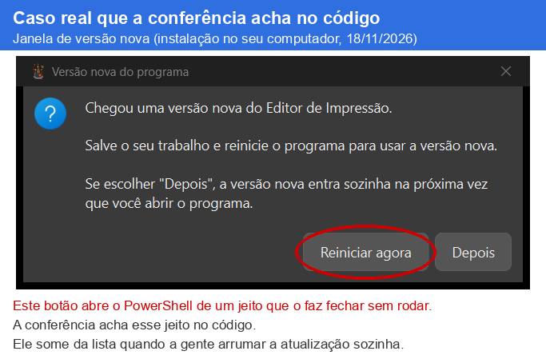

# A lista do que já está errado no código (para você dizer sim)

**O que é e onde fica:** é a conferência automática dos trabalhos dos agentes. Ela roda nos testes do GitHub, em toda entrega; você não vê nada dela no programa.

**Um caso real:** o botão "Reiniciar agora", da janela de versão nova, abre o PowerShell de um jeito que o faz fechar sem rodar (foi um dos defeitos da instalação no seu computador, em 18/11). A conferência acha esse jeito no código.

**O que já está errado hoje:** ela leu o programa e achou 189 lugares desses erros. Eles ficam numa lista: a conferência deixa passar esses e barra o trabalho de agente que acrescentar mais um lugar com um desses erros, escrito com as palavras que ela conhece. A lista só diminui: cada conserto tira o seu lugar.

**O que ela não faz:** não pega o mesmo erro escrito de um jeito que ela não conhece, e não pega defeito que só aparece usando o programa (esses continuam indo para a lista de defeitos).

**Quando cada grupo some (113 lugares no plano da parte do Windows):**

- 1 lugar: quando a gente arrumar o publicar das versões.
- 41 lugares: quando a gente arrumar a atualização sozinha.
- 53 lugares: quando a gente arrumar os testes à distância.
- 18 lugares: quando a gente arrumar o desinstalar.

**Ficam para depois da entrega ao Kaique, como você escolheu em 19/11 (58 lugares, nos mesmos três pedaços que você deixou para depois; a busca maior só achou mais linhas neles):**

- a régua dos filtros, que pergunta ao Windows onde fica a Área de Trabalho (2 lugares).
- o teste de velocidade, que conversa com o Windows por conta própria (o PowerShell, a placa de vídeo, o disco, a memória, a janela preta) (54 lugares).
- as duas dicas do Automático que mostram um número ao Kaique (2 lugares).

**O que você escolhe:** sim, a lista entra assim e a conferência passa a barrar; ou não, e diga o que mudar (enquanto não entra, a conferência não barra nada no código). Sugestão: sim. Nada do programa muda com isso, e nada do que já funciona muda.

**De onde veio:** do seu "sim" de 19/11 à lista que só diminui. A conta saiu do próprio programa que confere.

**Uma pergunta a mais: 18 lugares novos, fora do plano.** Procurando com mais palavras, a conferência achou outros pedaços do programa que conversam com o Windows por conta própria e que o plano da parte do Windows não conserta:

- o brasão que gira pergunta ao Windows se o programa ainda está aberto (5 lugares).
- o motor de achar texto ajusta, no Windows, onde procurar as bibliotecas dele (4 lugares).
- o motor de achar texto Tesseract abre sem janela preta, com uma bandeira do Windows (2 lugares).
- a tela de início abre a pasta do projeto e manda imprimir pelo Windows (2 lugares).
- o programa pergunta ao Windows quanta memória está livre (1 lugar).
- o motor de achar texto Kraken abre sem janela preta, com uma bandeira do Windows (1 lugar).
- o trabalho das páginas em outro processo abre sem janela preta, com uma bandeira do Windows (1 lugar).
- o pacote do teste de velocidade abre a janela preta pelo Windows (1 lugar).
- a tela de carregamento abre o brasão sem janela preta, com uma bandeira do Windows (1 lugar).

**O que você escolhe para esses:** ficam para depois da entrega ao Kaique, como os outros pedaços que você já deixou para depois (ficam na lista até lá); ou entram no plano (cada um vira conserto antes da entrega). Sugestão: depois da entrega, como você decidiu para os outros. Nada do programa muda com nenhuma das duas escolhas agora.
