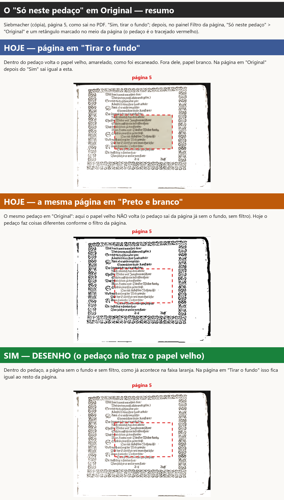
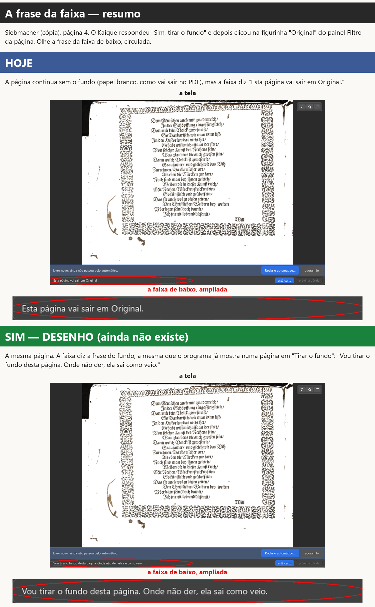
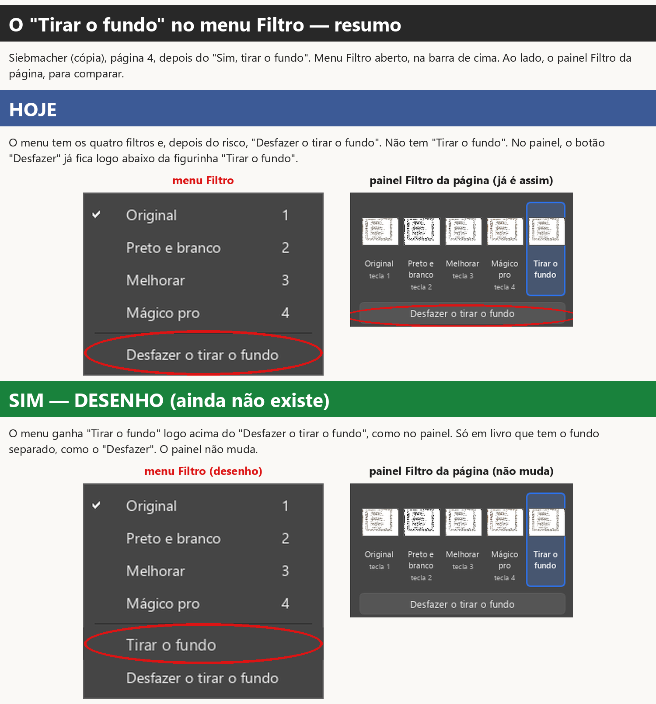
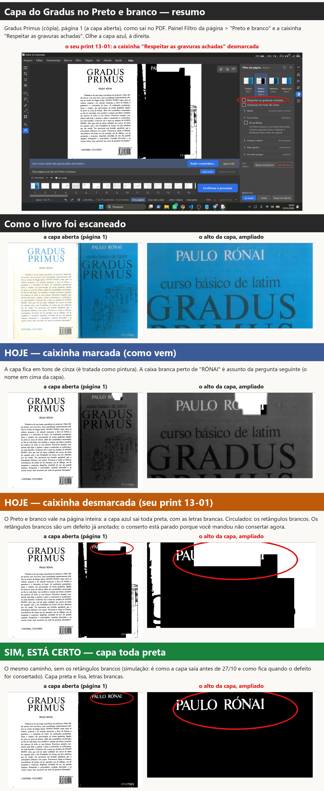
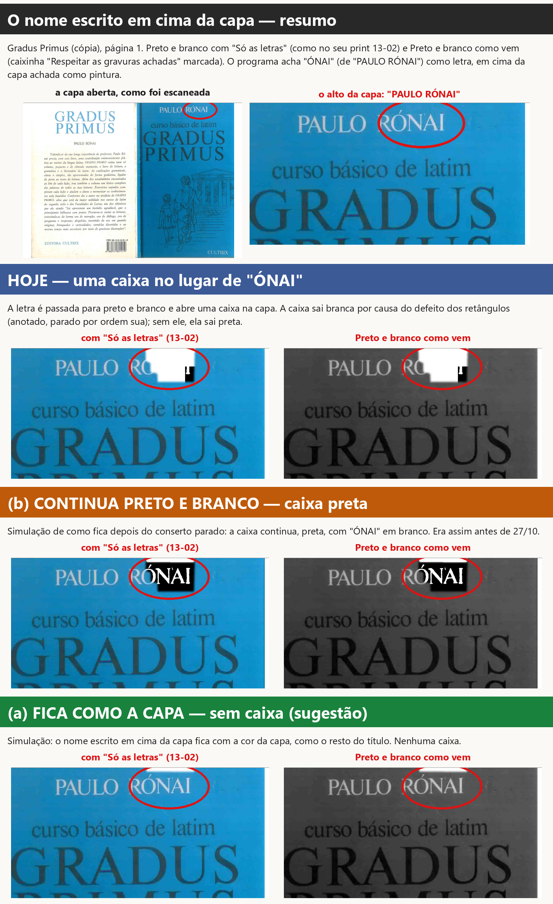
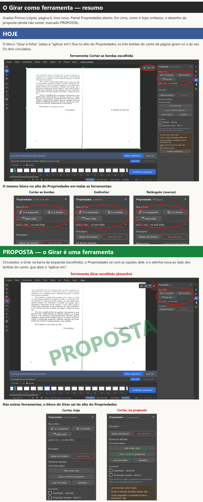

# Seis perguntas com prints (14/11/2026)

Preparadas pelo verificador para a gerente publicar na Central. Nenhuma linha do programa mudou. Os prints são da
versão de teste, feitos sem abrir janela na sua tela, com cópias dos livros. O que ainda não existe aparece como
**desenho** ou **proposta**, escrito no título da faixa.

Cores das faixas: **azul** = como é hoje; **laranja** = a outra opção (ou outro caso de hoje); **verde** = a
sugestão. O que olhar está circulado ou tracejado em vermelho.

---

## Pergunta A2 — o "Só neste pedaço" em Original, num livro com o fundo tirado

**Do que se trata.** No painel **Filtro da página** (à direita da página), a parte **"Só neste pedaço"** deixa
escolher um filtro só para uma área que você marca na página. Caminho: painel Filtro da página > "Só neste pedaço" >
"Original" > marcar a área na página (com o Retângulo, por exemplo). O filtro escolhido vale para o que se
marcar depois.

**O que acontece hoje.** No Siebmacher, depois do "Sim, tirar o fundo", marquei um pedaço em "Original" no meio da
página 5:
- com a página em **"Tirar o fundo"** (ou em "Original" depois do "Sim"), **o papel velho, amarelado, volta dentro do
  pedaço** (faixa azul);
- com a mesma página em **"Preto e branco"**, o mesmo pedaço **não traz** o papel velho: sai da página já sem o fundo,
  sem filtro (faixa laranja).

Ou seja, hoje o mesmo pedaço faz duas coisas diferentes, conforme o filtro da página. **Não é defeito do programa**: o
papel velho no pedaço é o que você escolheu em 05/10 ("Sim, do mesmo jeito (só muda se alguém marcar um pedaço)"). Mas
a sua regra de 07/11 diz "nenhum filtro deve fazer o fundo voltar".

**O que você escolhe:** se o pedaço em "Original" pode trazer o papel velho de volta numa página com o fundo tirado.

- **Sim, o pedaço não traz o papel velho (sugestão).** Dentro do pedaço sai a página sem o fundo e sem filtro, em
  todas as páginas com o fundo tirado, qualquer que seja o filtro da página (faixa verde). Para o Kaique: o papel velho
  só volta pelo botão "Desfazer o tirar o fundo", e aí volta a página inteira; não haverá jeito de trazer o papel velho
  só num pedaço. No PDF: nesses livros, o pedaço em "Original" sai com papel branco. O que já funciona e muda: a sua
  escolha de 05/10 e a prova antiga que a guarda (ela passa a cobrar o jeito novo). Não muda nada nos livros sem o
  fundo tirado, nem nos pedaços em Preto e branco, Melhorar ou Mágico pro.
- **Não, fica como hoje.** Na página em "Tirar o fundo" ou "Original", o pedaço em "Original" traz o papel velho; na
  página em Preto e branco, Melhorar ou Mágico pro, não traz. Nada muda.
- **Só comentário.**

**Você continua no controle?** Sim. O pedaço só age quando alguém marca um pedaço e escolhe o filtro dele; vale só na
página onde foi marcado. Tela e PDF saem iguais.

**De onde veio.** Da sua escolha de 05/10 e da sua regra de 07/11. O agente que fez o conserto do fundo (13/11) achou
o choque entre as duas e não mexeu, para perguntar.

**Situação de agora.** O conserto do "Tirar o fundo" está na versão de teste, esperando o seu teste. Este ponto não
foi mexido: está como na faixa azul até você responder.

(Para consulta: D-172, D-646, D-699, D-605.)

---

## Pergunta A3 — a frase da faixa numa página em "Original" com o fundo tirado

**Do que se trata.** A **faixa cinza embaixo da página**, na área de trabalho, diz o que vai sair da página da vez.

**O que acontece hoje.** No Siebmacher, depois do "Sim, tirar o fundo", cliquei na figurinha "Original" da página 4
(a tecla 1, o menu Filtro e o Automático fazem o mesmo). A página continua sem o fundo, como manda a sua regra de
07/11, mas a faixa diz **"Esta página vai sair em Original."** Antes de clicar, dizia "Vou tirar o fundo desta página.
Onde não der, ela sai como veio." Todo trabalho salvo antes do conserto com páginas em "Tirar o fundo" abre assim. A
página e o PDF estão certos; só a frase não diz que o fundo foi tirado. **Não é defeito da imagem**: é a frase, que
não acompanhou o conserto (o agente não mudou texto sem você mandar).

**O que você escolhe:** a frase da faixa numa página em "Original" com o fundo tirado.

- **(1) "Vou tirar o fundo desta página. Onde não der, ela sai como veio." (sugestão).** A mesma frase que a página em
  "Tirar o fundo" já mostra (faixa verde, desenho).
- **(2) "Esta página vai sair em Original, sem o fundo."** Frase nova. Se quiser, a mesma regra vale para as outras:
  "Esta página vai sair em Preto e branco, sem o fundo" (hoje, nessas, a faixa diz só "Esta página vai sair em Preto e
  branco.").
- **(3) Fica como está:** "Esta página vai sair em Original."
- **Só comentário.**

Em todas: só muda a frase. A página, o PDF e o que já funciona não mudam.

**Você continua no controle?** Não há nada para ligar ou desligar: é só o texto da faixa, que aparece sozinho quando
a página não tem aviso.

**De onde veio.** Achado pelo agente que fez o conserto do fundo (13/11), depois do seu pedido de 07/11.

**Situação de agora.** O conserto do fundo está na versão de teste, esperando o seu teste; a frase está como na faixa
azul.

(Para consulta: D-646, D-699.)

---

## Pergunta A4 — o "Tirar o fundo" no menu Filtro

**Do que se trata.** O **menu Filtro**, na barra de cima do programa, tem os filtros da página com as teclas 1 a 4.

**O que acontece hoje.** O menu tem Original, Preto e branco, Melhorar, Mágico pro e, depois de um risco, **"Desfazer
o tirar o fundo"**. **Não tem "Tirar o fundo"**: ele só existe no painel Filtro da página (a figurinha) e na lista do
"Só neste pedaço". A sua resposta de 13/11 ("Ok") dizia "logo abaixo do 'Tirar o fundo', no menu Filtro e no painel".
No painel ficou assim; no menu não deu, porque o menu não tinha "Tirar o fundo".

**O que você escolhe:** se o menu Filtro ganha o "Tirar o fundo".

- **Sim, logo acima do "Desfazer o tirar o fundo" (sugestão).** Faz o mesmo que a figurinha "Tirar o fundo" do painel,
  na página da vez; o tique do menu acompanha, como nos outros filtros. Aparece só em livro que tem o fundo separado,
  como o "Desfazer". Sem tecla nova. No PDF nada muda; nada do que já funciona muda.
- **Não, fica como está.** O "Tirar o fundo" continua só no painel.
- **Só comentário.**

**Você continua no controle?** Sim: é só mais um lugar para o mesmo clique da figurinha. Age só quando se clica.

**De onde veio.** Uma ideia de agente de 29/09, na Lista de espera ("'Tirar o fundo' também no menu Filtro (e talvez
tecla 5)"), **não um pedido seu**; e a sua resposta de 13/11, que fala do menu. A tecla 5 fica de fora, a não ser que
você queira.

**Situação de agora.** O "Desfazer o tirar o fundo" está na versão de teste, esperando o seu teste. O menu está como
na faixa azul.

(Para consulta: D-699, D-492, Lista de espera de 29/09.)

---

## Pergunta B1 — a capa do Gradus toda preta no Preto e branco

**Do que se trata.** No painel **Filtro da página**, logo abaixo das figurinhas dos filtros, há a caixinha
**"Respeitar as gravuras achadas"**. Marcada (como vem), o filtro respeita as pinturas e fotos que o programa achou: no
Preto e branco elas saem em tons de cinza. Desmarcada, o filtro vale na página inteira.

**O que acontece hoje.** No seu teste de 13/11 (print 13-01), no Gradus, página 1, você escolheu "Preto e branco" e
desmarcou a caixinha (às 16h09, está no histórico do trabalho). A capa azul saiu **toda preta, com as letras brancas**.
Isso é o que você escolheu em 29/10: "Desligada, o filtro vale na página inteira: no Preto e branco, a capa sairia
toda em preto e branco". Então a capa preta é **efeito da escolha, não defeito**. Os **retângulos brancos** em cima dela
são **defeito do programa**, já anotado; o conserto está parado porque você mandou não consertar agora.

**O que você escolhe:** se a capa toda preta, com a caixinha desmarcada, está certa.

- **Sim, está certo assim (sugestão).** Nada muda no programa. Fica anotado que a capa preta é o efeito da caixinha
  desmarcada; o único defeito são os retângulos brancos, que esperam a sua ordem (faixa verde: a capa preta e lisa, como
  sairia sem eles).
- **Não, a capa não devia sair toda preta.** Diga no comentário como queria; vira pergunta nova.
- **Só comentário.**

**Você continua no controle?** Sim. A caixinha liga e desliga por página, e vai às outras pelo "Aplicar em". Marcada,
a capa sai em tons de cinza (faixa azul). Ela age só quando você clica nela.

**De onde veio.** A caixinha é um pedido seu de 29/10 ("A"). A investigação dos seus prints 13-01 e 13-02 foi feita
em 13/11.

**Situação de agora.** A caixinha está no programa e foi testada por você em 29/10. Os retângulos brancos estão
parados por ordem sua ("Não quero consertar isso agora"); esta pergunta não mexe neles.

(Para consulta: D-586, D-583, D-147, D-700.)

---

## Pergunta B3 — o nome escrito em cima da capa colorida

**Do que se trata.** No **Preto e branco**, o programa separa a página em partes: letras, pinturas e papel. Com **"Só
as letras"** (painel Filtro da página > Preto e branco > parte "Só as letras"), só as letras viram preto e branco; as
pinturas ficam com a cor. Com a caixinha "Respeitar as gravuras achadas" marcada (como vem), a pintura sai em tons de
cinza e as letras em preto e branco.

**O que acontece hoje.** Na capa do Gradus, o programa achou a capa azul como pintura e o pedaço **"ÓNAI"** (de
"PAULO RÓNAI") como letra, em cima dela. Uma regra do programa faz a letra ganhar da pintura: o pedaço vira preto e
branco e **abre uma caixa no meio da capa** (seu print 13-02). Hoje a caixa sai **branca**, por causa do mesmo defeito
dos retângulos (anotado, parado por ordem sua); sem esse defeito ela sai **preta**, com "ÓNAI" em branco, como era
antes de 27/10. Essa regra ("a letra ganha da pintura") é de 30/09 e foi feita para outro caso: legenda escura
impressa sobre cartão claro, como as legendas do Pesel. **Não é pedido seu nem defeito**: é uma regra do programa que
aqui dá um resultado ruim. Por isso é escolha sua.

**O que você escolhe:** o que acontece com um nome claro escrito em cima de uma capa ou pintura escura que o programa
achou.

- **(a) Fica como a capa, com a cor dela, sem caixa (sugestão).** Faixa verde (simulação). Para o Kaique: a capa sai
  inteira, sem caixa, no "Só as letras" e no Preto e branco como vem. No PDF: o mesmo. O que já funciona e muda: a
  regra de 30/09 deixa de valer para letra clara sobre pintura escura; a legenda escura sobre cartão claro (Pesel)
  continua como hoje, e isso precisa ser conferido nas páginas do Pesel quando for feito.
- **(b) Continua virando preto e branco.** Faixa laranja (simulação de como fica depois do conserto parado): a caixa
  continua, preta. Nada muda além do conserto dos retângulos, que já está anotado.
- **Só comentário.**

**Você continua no controle?** Sim. Quem quiser a capa toda em preto e branco desmarca "Respeitar as gravuras
achadas" (pergunta B1). Com (a) ou (b), a regra age sozinha, só onde o programa acha letra em cima de pintura.

**De onde veio.** A regra é do programa (30/09), feita para as legendas do Pesel; achada na investigação dos seus
prints 13-01 e 13-02 (13/11).

**Situação de agora.** Só pergunta; nada foi feito. O conserto dos retângulos brancos está parado por ordem sua.

(Para consulta: D-148, D-147, D-586, D-587, D-700; item 1.2.)

---

## Pergunta C — o Girar como ferramenta (proposta)

**Do que se trata.** Hoje o **Girar** fica em dois lugares da área de trabalho:
- o bloco **"Girar a página"** (ou "Girar a folha", numa folha inteira), **no alto do painel Propriedades, em todas as
  ferramentas** (Cortar, Endireitar, Mover, as de marcar...), com as três setas e o **"aplicar em"** (só esta / todas /
  daqui em diante / só as pares / só as ímpares);
- os **três botões pequenos no canto de cima, à direita da página**, que giram **só a página da vez**.

Foi o que você escolheu em 12/10: "Quero a opção B e D" (o bloco no alto do Propriedades e os botões do canto) e
"B — Só no painel" (o "aplicar em" só no Propriedades; o canto gira só a página da vez). Em 13/10, "Está bom".

**O que você disse em 13/11.** "Para escolher aplicar em todas tem que estar dentro de um painel de outras funções,
não existe um painel do girar" · "Pode ser, e ai as opções dele apareceriam em propriedades quando fosse selecionado
né?" · "Como o propriedades funciona hoje? Ele funciona através da escolha de ferramentas né?"

**Como o Propriedades funciona hoje.** Sim: ele mostra as opções da ferramenta escolhida na barra da esquerda. A
exceção é o alto do painel: o bloco do Girar e, embaixo dele, os botões "Esta página" (deixar em branco / tirar do
livro) aparecem em todas as ferramentas. Os botões "Esta página" não mudam nesta proposta.

**A proposta da gerente (desenho, ainda não existe).**
1. O Girar vira uma **ferramenta na barra da esquerda**, junto do Dividir, Cortar, Endireitar e Mover.
2. Escolhendo o Girar, o **Propriedades mostra só as opções dele**: as três setas e o "aplicar em".
3. Nas outras ferramentas, o bloco do Girar **sai do alto do Propriedades** (sobra espaço para as opções delas).
4. Os **três botões do canto continuam**, para girar rápido só a página da vez, **com uma setinha ao lado** que abre o
   "aplicar em".

**O que você escolhe:** se o Girar passa a ser uma ferramenta, com as opções no Propriedades só quando ele está
escolhido.

- **Sim, a proposta inteira (sugestão da gerente).** Para o Kaique: para girar uma página só, continua o canto (ou
  Ctrl+setas, ou o menu Página). Para girar várias, escolhe o Girar na barra e usa o "aplicar em" no Propriedades, ou a
  setinha do canto. No PDF nada muda: o giro é o mesmo. O que já funciona e muda: as suas escolhas de 12/10 (o bloco
  sai do alto do Propriedades) e a de "Só no painel" (o canto ganha o "aplicar em" pela setinha). As provas dessas
  escolhas passam a cobrar o jeito novo.
- **Sim, mas sem a setinha no canto.** O Girar vira ferramenta como acima; os botões do canto continuam girando só a
  página da vez, como hoje ("Só no painel" continua valendo).
- **Não, fica como hoje.** Bloco no alto do Propriedades em todas as ferramentas e os botões do canto.
- **Só comentário.**

**Você continua no controle?** Sim: girar só acontece quando se clica numa seta (no Propriedades ou no canto) ou se
usa a tecla. O "aplicar em" começa em "só esta", o mais seguro, como hoje.

**De onde veio.** Da sua conversa de 13/11 no chat (as frases acima). O lugar da ferramenta na barra, no desenho, é só
um exemplo.

**Situação de agora.** Só proposta; nada foi feito. Se você disser sim, ela entra **junto com o conserto do girar numa
regra só** (o girar que hoje faz coisas diferentes em lugares diferentes), que espera as suas respostas às 4 perguntas
da revisão do código, na Central.

(Para consulta: D-049, D-053, D-367, D-618, D-636; CLAUDE.md §11.12.)

---

## Como os prints foram feitos (para consulta)

- Versão de teste de hoje, sem abrir janela na sua tela; dados numa pasta à parte; cópias do Siebmacher (10 primeiras
  folhas) e do Gradus.
- **A2, B1, B3:** as páginas desenhadas pela mesma conta do PDF. **A3, A4, C:** prints da janela do programa (feita
  fora da tela).
- **Desenhos e simulações** (dizem isso no título da faixa): A2 verde (o pedaço igual ao resto da página, que é o que
  o programa já faz na página em Preto e branco); A3 verde (a frase do fundo, tirada da própria faixa do programa); A4
  verde (a linha "Tirar o fundo" desenhada no menu); B1 verde e B3 laranja (sem o defeito dos retângulos, tirado só no
  teste); B3 verde (o nome não recorta a capa, só no teste); C verde (o Girar desenhado na barra, no Propriedades e no
  canto).
- **Ressalvas:** no A2, o pedaço foi gravado direto na página (do mesmo jeito que o Retângulo grava), não desenhado
  com o mouse. No B3, nas faixas laranja e verde ainda aparece um fiozinho branco na beirada de cima da capa, em cima
  de "ÓNAI": é uma lasquinha que o programa acha como "papel" na beirada, e não muda entre as opções. A simulação da
  opção (a) só vale para o desenho da pergunta: o conserto de verdade precisa ser conferido no Pesel, onde a regra de
  hoje é que salva as legendas.
