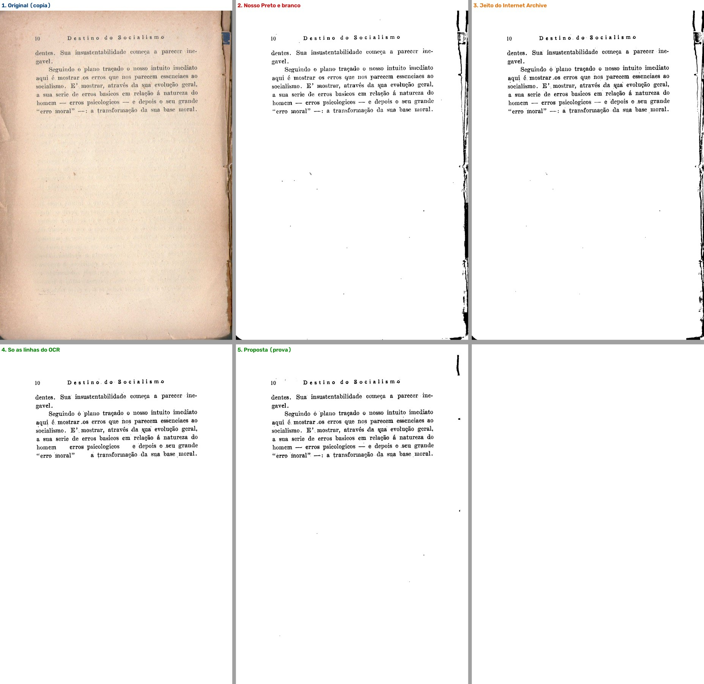
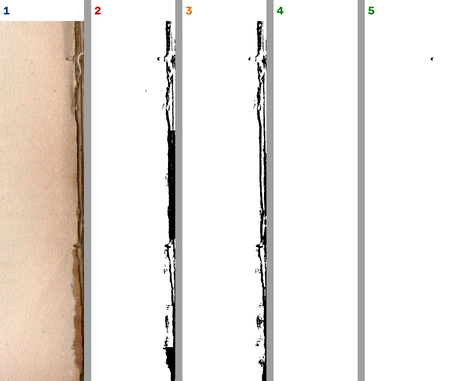
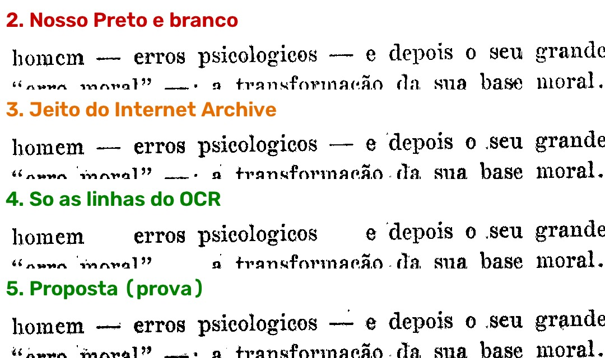
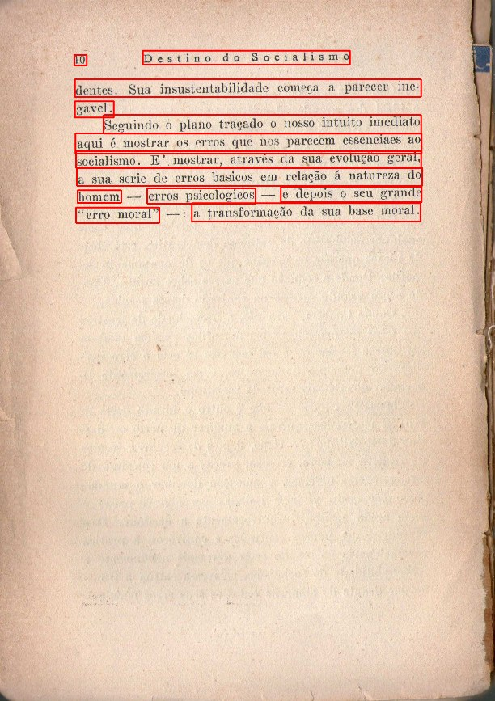

# Como o Internet Archive faz: letra preservada, papel sem mancha

**Para o Samuel, 10/11/2026.** Pedido: "coloque um agente para fazer pesquisas de como eles fazem por favor."

## Em poucas linhas

- **O OCR está funcionando.** Na página 18 do *Destino do socialismo* ele achou todas as linhas de texto. Mas o Preto e branco de hoje não usa o OCR: passa a página inteira para preto e branco.
- **O Internet Archive corta a folha antes de tudo.** A lombada, a beirada estragada e as beiradas das outras folhas saem da imagem antes de qualquer preto e branco. No seu teste, o corte ainda não tinha rodado ("Livro novo: ainda não passou pelo automático").
- **Depois, ele é sensível só dentro das linhas do texto** e cauteloso no resto da página. Mancha lisa não entra.
- **O que escapa não vira preto no PDF deles:** fica com a cor do papel. Quando eles fazem preto e branco puro, a beirada dobrada também sai preta, igual à nossa.
- **Na prova com uma cópia da sua página**, juntar as duas ideias com uma regra a mais limpou a lombada e guardou as letras e os travessões. Foi uma página só: precisa ser medido em outras antes de decidir.
- **Nada disso pede Linux nem placa de vídeo.** É conta que o programa já sabe fazer.

## As imagens da prova (cópia da página, só o filtro)

1 = original · 2 = nosso Preto e branco · 3 = jeito do Internet Archive · 4 = só as linhas do OCR · 5 = proposta.

A beirada da lombada, ampliada: no 2 e no 3 ela vira preto; no 5 some.

Os travessões: "só as linhas do OCR" (4) perde os travessões entre as palavras; a proposta (5) os guarda.

As linhas que o OCR achou, em vermelho:

---

O texto completo da pesquisa vem a seguir.

**Data:** 10/11/2026 · **Quem:** agente pesquisador · **Pedido:** gerente, a partir do teste guiado de 10/11 (sessão 5, *Destino do socialismo*, página 18 de 193, Preto e branco, "Limpeza cuidadosa (leve)").

**As palavras do Samuel (10/11/2026):**
- "deixe anotado, hoje não temos como reconhecer essa partes que são marcas da folha ou folha meio dobrada ou manchas na folha que quando vão para o preto e branco fica essa mancha, o ocr está funcionando? porque era para ele preservar as letras e passar e deixar a folha branca"
- "eu errei é internet arquive, sim é isso que temos que fazer, coloque um agente para fazer pesquisas de como eles fazem por favor."

**Nada do programa foi mexido.** Li o código-fonte do Internet Archive (três repositórios, copiados para `D:\programas\EditorImpressao-arquivos\pesquisa-internet-archive\fontes\`) e a documentação deles. Fiz uma **prova pequena, sem janela**, numa **cópia** da página do teste (`...\pesquisa-internet-archive\experimento\`): o nosso Preto e branco, o jeito do Internet Archive refeito em poucas linhas e uma proposta. Nada foi instalado no `.venv` (só usei o `.venv` para rodar, como leitura). O PDF do Samuel foi só lido.

Como ler as marcas: **[lido]** = li no código ou no documento de fora · **[medido]** = rodei neste PC e olhei as imagens · **[dedução]** = conclusão minha, não conferida.

Esta pesquisa **não repete** a de 28/09 (`fase1-1.1-camadas-internet-archive.md`, como os PDFs deles estão montados) nem a de 05/10 (`fase2-misto-letras-fora-do-ocr.md`, a tinta fora das linhas do OCR). Ela vai **antes** da máscara (o corte da página) e **depois** (o que eles fazem com o que sobra), que é onde está a resposta para a mancha da beirada.

---

## 1. A resposta em cinco frases

1. **O OCR está funcionando, mas o Preto e branco não o usa.** Na página do teste o docTR achou as 13 linhas de texto em 1,5 s, inclusive o "10" e o cabeçalho [medido]. Hoje essas linhas só servem para endireitar e para o "Só as letras"; o Preto e branco comum passa a página inteira para preto e branco sem saber onde está a letra [lido no nosso código].
2. **O Internet Archive não "reconhece" a mancha: ele a evita em três lugares.** (a) **Antes de tudo, corta a folha** rente ao papel, tirando a lombada, a beirada escura e as beiradas das outras folhas (programa `autocrop`); (b) a máscara de tinta usa um preto e branco **sensível só dentro das linhas do OCR** e **cauteloso no resto** da página, que não pega mancha lisa; (c) o que escapa **não vira preto**: no PDF colorido deles, cada ponto da máscara leva a **cor original** (a beirada marrom continua marrom) e o papel de verdade fica por baixo [lido].
3. **O Internet Archive também não deixa o papel branco.** O PDF deles mostra o papel como foi fotografado. "Papel branco" só aparece em dois casos: no nosso "Tirar o fundo" dos PDFs deles (item 1.1) e no modo `--bw-pdf` deles, que é **a mesma máscara, em preto puro** [lido]. Nesse modo, a beirada dobrada **também sai preta**: na prova, a máscara deles fez na lombada praticamente a mesma faixa preta que o nosso Preto e branco (1,07% da página fora das linhas, contra 1,21% no nosso) [medido].
4. **O que resolveu na prova foi juntar as duas ideias deles com uma regra a mais:** dentro das linhas do OCR, o preto e branco sensível; fora delas, só fica a peça que (a) tem um ponto tão escuro quanto a letra da página, (b) não encosta na beirada da folha e (c) não é uma faixa comprida ao longo dela. Resultado: lombada e beirada limpas, travessões entre palavras guardados, 0,05% da página de tinta fora das linhas (contra 1,21%) [medido, uma página só].
5. **Para o nosso programa nada disso precisa de Linux nem de placa de vídeo:** o programa do Internet Archive não tem versão pronta para Windows com Python 3.14, mas a parte que importa são umas 150 linhas de conta que o programa já sabe fazer (Sauvola do DoxaPy, OpenCV, linhas do docTR). O caminho é **reescrever a ideia**, não instalar o deles. Licenças: AGPL-3.0 (archive-pdf-tools, archive-hocr-tools) e GPL-2.0 (autocrop), todas aceitas pela decisão de 17/09 [lido].

## 2. Tabela

| O que é | Licença | Roda aqui (Windows, Python 3.14, GTX 1650)? | Roda no notebook do Kaique? |
|---|---|---|---|
| `archive-pdf-tools` (`internetarchivepdf/mrc.py`, `recode.py`; `cython/sauvola.pyx`, `cython/optimiser.pyx`): a máscara de tinta | AGPL-3.0 (menos `pdfrenderer.py`, Apache-2.0) [lido] | **Não como pacote:** o PyPI tem versão pronta para Windows só até o Python 3.13 (1.5.7, `cp39` a `cp313`); no 3.14 teria de compilar o Cython, e ele chama o `jbig2` (jbig2enc) e precisa do hOCR do Tesseract [lido no PyPI, 10/11]. **A ideia sim:** refeita em numpy/OpenCV, roda [medido] | Sim, a ideia refeita (só processador) [dedução] |
| `autocrop` (`autoCropScribe.c`, `docs/algorithm.md`): o corte da folha do Internet Archive | GPL-2.0 ("Software license GPL version 2", no topo do arquivo) [lido] | Não direto: C de 2008 com Leptonica 1.68 e `Makefile` de Linux. Serve de **referência**; o nosso corte (2.13) já faz o mesmo papel | — |
| `archive-hocr-tools` (`hocr/parse.py`, `hocr_page_to_word_data`) | AGPL-3.0 [lido no `setup.py`] | Não precisamos: as linhas já vêm do docTR | — |
| Tesseract 5 (o OCR que o Internet Archive usa) | Apache-2.0 | Sim, já instalado e desligado na detecção (item 1.3) | Sim |
| docTR `fast_base` (OnnxTR), já no programa | Apache-2.0 | Sim: 1,5 s nesta página, sem placa de vídeo [medido] | Sim (mais lento) [dedução] |
| Sauvola do DoxaPy / scikit-image, OpenCV (já no programa) | CC0 / BSD / Apache-2.0 | Sim [medido] | Sim |
| ScanTailor Advanced, "preencher as margens" (`OutputGenerator.cpp`, `fillMarginsInPlace`) | GPL-3.0 | Já ligado ao programa (2.14, "pintar de branco") | Sim |

---

## 3. O caminho do Internet Archive, de ponta a ponta [lido]

### 3.1 A foto: o vidro aperta a folha

Os livros são fotografados na máquina **Scribe**: o livro fica aberto num berço em "V" e **duas placas de vidro em "V" apertam as páginas** contra o berço; a junção das placas fica em cima da lombada (`autocrop/docs/algorithm.md`, seção "Find binding edge": "The Scribe scanner glass platen is used to press the pages flat"). Ou seja: **a dobra da beirada já sai bem menor na foto deles do que num scanner de mesa**. Isso não é programa, é o aparelho; nós não temos como copiar.

### 3.2 O corte da folha, antes de tudo (`autocrop`)

Repositório `internetarchive/autocrop` (escrito em 2008, "deployed in 2011", diz o README). O programa `autoCropScribe` grava o recorte e o ângulo no `scandata.xml` do livro, e o operador ainda pode corrigir à mão (o "republisher"; num registro de exemplo, visto só no resultado da busca, aparecem os campos `pages_crop_touched` e `pages_skew_touched`). Passos, em `docs/algorithm.md` e `autoCropScribe.c`:

1. Abre a foto reduzida 8 vezes e faz um preto e branco simples, com o limiar tirado do pico do papel no histograma (`CalculateTreshInitial`).
2. **Tira a moldura preta** de cima, de baixo e de fora: anda da beirada para dentro enquanto a linha tiver 90% de preto (`RemoveBackground{Top,Bottom,Outer}`, em `autocrop_remove_bg.c`).
3. **Acha a lombada** procurando a linha vertical de maior diferença entre escuro e papel, girando de -1° a +1° (`FindBindingEdge2`).
4. Endireita pelo texto (Leptonica `pixFindSkew`) se a confiança passar de 2; senão, pela lombada.
5. **Tira as beiradas das outras folhas** que aparecem atrás (`FindOuterEdgeUsingCleanLines`).
6. **"Linhas de corte limpas"** (`RemoveBlackPelsBlockRow/Col`): uma régua de 80% do lado e 3 pontos de largura anda para dentro até achar um trecho com **menos de 5 pontos pretos**. O corte para onde o papel fica limpo.

**Por que importa para a mancha da beirada:** a lombada escura, a beirada estragada e as folhas de trás **saem da imagem antes de qualquer preto e branco**. O que o Samuel viu nas laterais da página 18 é justamente o que esse passo tira.

### 3.3 O OCR (Tesseract)

Documentação: https://archive.org/developers/ocr.html. O módulo de OCR deles usa o **Tesseract 5.3**; respeita o `scandata.xml` (páginas marcadas para sair ficam fora); o preto e branco que o Tesseract faz por dentro (Otsu, ou Sauvola quando estoura o tempo) **serve só para ler**, não vai para o PDF. A saída é o **hOCR**: cada palavra com a caixa e uma **confiança de 0 a 100**; as palavras ficam agrupadas em linhas (`archive-hocr-tools`, `hocr/parse.py`, `hocr_page_to_word_data`).

### 3.4 A máscara de tinta (`archive-pdf-tools`)

Código lido em 10/11/2026, versão 1.5.7, commit `68c7a21` de 28/10/2026. Função central: `create_mrc_hocr_components` em `internetarchivepdf/mrc.py`. Mesmo desenho da leitura de 28/09, agora com os números e o que cada passo faz com a sujeira:

| Passo | Onde | O que faz | O que acontece com mancha e beirada |
|---|---|---|---|
| 1. Máscara das linhas | `create_hocr_mask` | Para cada linha do hOCR: **pula** se estiver vazia ou se a confiança média das palavras for **menor que 20**. Dentro da caixa da linha, Sauvola com **k = 0,1** (sensível), janela = DPI/4 (75 pontos a 300 DPI). Testa a linha normal e invertida (letra clara em fundo escuro) e fica com a que tem menos de 20–30% de tinta e menos ruído (`mean_estimate_sigma`) | Uma "linha" que o OCR achou numa mancha tem texto de lixo e confiança baixa: **é jogada fora**. Fora das linhas, nada deste passo entra |
| 2. Máscara da página inteira | `create_threshold_mask` | Se a página tem ruído (sigma > 1), borra de leve (sigma × 0,1). Depois Sauvola na página toda com **k = 0,34** (cauteloso), mesma janela. **Soma** à máscara das linhas (`MIX_THRESHOLD = True`) | O Sauvola compara cada ponto com a média em volta. **Mancha lisa** (amarelado, mancha d'água, verso claro) tem a média em volta quase igual a ela: **não entra**. **Beirada com borda dura** (o papel claro encostando numa faixa escura) entra **na orla**; se a faixa for mais estreita que a janela (≈ 6 mm), entra inteira |
| 3. Limpar pontinhos | `fast_mask_denoise` (`cython/optimiser.pyx`), padrão `--denoise-mask fast` | Ponto de tinta com menos de 4 vizinhos de tinta num quadrado 5×5 sai | Some a poeira solta |
| 4. Camada de cima | `optimise_rgb2` | A cor **original** da página onde a máscara diz "tinta" | O que escapou para a máscara (a orla da beirada) sai **marrom como é**, não preto |
| 5. Fundo | `optimise_rgb2` com a máscara invertida; `--bg-downsample` | A página com a tinta apagada, reduzida (3× nos nossos livros) | A mancha fica **aqui**, embaixo, visível como no papel |
| 6. Montar o PDF | `recode.py`, `insert_images_mrc` | Fundo primeiro, camada de cima com a máscara por cima | O PDF parece a foto do papel |
| Modo preto e branco | `recode.py`, `force_1bit_output` (opção `--bw-pdf` em `bin/recode_pdf`) | Grava **só a máscara**, invertida, em 1 bit | **Tudo o que entrou na máscara sai preto**, inclusive a orla da beirada |

O Sauvola deles (`cython/sauvola.pyx`, `binarise_sauvola`) é o de livro-texto: o ponto é tinta quando é mais escuro que `média × (1 + k × (desvio / 128 − 1))`. Com k = 0,34 numa área lisa (desvio perto de zero), o ponto precisa ser **34% mais escuro que a média em volta**: por isso a mancha lisa não entra.

### 3.5 O que eles fazem com cada coisa (resumo)

| Coisa no papel | Onde é tratada | Resultado no PDF colorido deles | No `--bw-pdf` |
|---|---|---|---|
| Lombada, beirada escura, folhas de trás | **Corte** (autocrop), antes da máscara | Some (fica fora da página) | Some |
| Dobra da beirada | Vidro na foto + corte | Fica no fundo; a orla dura entra na máscara com a cor marrom | Orla preta, se sobrou dentro do corte |
| Mancha lisa, amarelado, mancha d'água | Sauvola k = 0,34 não pega | Fica no fundo, visível | Some |
| Verso transparecendo (cinza claro) | Idem | Fica no fundo | Some, quando é claro; o escuro entra |
| Ilustração | Os traços entram pelo passo 2; os tons ficam no fundo | Inteira (traço em cima, tom embaixo) | Só os traços, sem os tons |
| "Linha" de texto falsa numa mancha | Confiança do Tesseract < 20 | Não ganha o Sauvola sensível | Idem |

**Lição [dedução]:** o Internet Archive nunca precisou "reconhecer mancha", porque o produto dele não é papel branco: é papel como está, comprimido. Quem quer papel branco (nós, no Preto e branco e no "Tirar o fundo") precisa de um passo que eles não têm: **decidir o que fazer com o que está fora das linhas e não é gravura**.

---

## 4. Por que a mancha vira preto no nosso e não no deles

Lido no nosso código (`core/filtros.py`, `filtro_preto_e_branco`, na versão de teste `obra-2026-10-26`, commit `cc5d985`) e medido na cópia da página:

1. **No nosso, a folha ainda não estava cortada.** O print do Samuel diz "Livro novo: ainda não passou pelo automático": o corte da beirada (2.13), o "pintar de branco" (2.14) e a faixa da tampa (D-559) ainda não tinham rodado. **No Internet Archive o corte vem antes de tudo.** [lido no print e no `autocrop`]
2. **O nosso Preto e branco é um só para a página inteira, e mais sensível que o deles fora das linhas.** Janela = altura ÷ 50 (43 pontos nesta página, contra 75 deles) e k entre 0,12 e 0,30 conforme a letra (contra 0,34 deles fora das linhas); em letra grossa, o automático troca para **Otsu**, um limiar só para a página toda, que pinta de preto **qualquer** mancha mais escura que ele (`escolher_algoritmo_automatico`). Nesta página o automático escolheu Sauvola [medido].
3. **Não usamos as linhas do OCR no Preto e branco.** Elas existem (`core/linhas_do_texto.py`) e são usadas no "Só as letras" e no "Para revisar" (`core/pipeline.py`, `_filtrar_no_misto`), não no Preto e branco comum [lido].
4. **Saída em 1 bit:** o que entra na máscara sai preto. Nisso somos iguais ao `--bw-pdf` deles; a diferença do PDF colorido deles (a cor original na orla) não existe no nosso Preto e branco.

**Medido nesta página (só o filtro, sem o caminho inteiro; ver 5.3):** a beirada da lombada saiu como faixa preta tanto no nosso Preto e branco quanto na máscara completa do Internet Archive. **Copiar a máscara deles sozinha não teria resolvido o caso do Samuel**; o que os salva é o corte antes e a cor original depois.

---

## 5. A prova nesta página [medido]

### 5.1 Método (para refazer)

- Cópia da página 18 do PDF (folha de duas páginas, 3043 × 2168, cerca de 300 DPI; o PDF tem 192 folhas, o programa mostra 193 páginas), **metade da esquerda** ("10 Destino do Socialismo"), com a beirada da lombada: `...\pesquisa-internet-archive\experimento\a-pagina-esquerda.png`.
- **Nosso Preto e branco:** `core.filtros.filtro_preto_e_branco(pagina, 50, True, "auto")` da versão de teste (força de fábrica). Também com "st_pouco" (a "Limpeza cuidadosa (leve)") e em 150 e 100 DPI: a lombada sai preta em todos (`z3-nosso-em-varias-resolucoes.png`).
- **Linhas do OCR:** `core.ocr_doctr.DetectorDoctr().segmentar(pagina)` (o mesmo docTR do programa).
- **Jeito do Internet Archive refeito:** Sauvola k = 0,1 dentro de cada caixa de linha; Sauvola k = 0,34 na página inteira com o borrão leve (ruído medido 1,48, então borra); soma; limpar pontinhos 5×5 com 4 vizinhos. Janela 75. (Simplifiquei: sem o teste da linha invertida e sem o corte de confiança < 20, porque o docTR não dá confiança de leitura.)
- **Proposta:** caixas do docTR da **mesma linha juntadas** numa só (o docTR quebra a linha no vão entre palavras e o travessão ficava de fora); Sauvola k = 0,1 dentro; fora das linhas, o Sauvola k = 0,34 da página, mas só fica a peça que tem um ponto **tão escuro quanto a letra típica da página** (a mediana do cinza da tinta dentro das linhas: 109 nesta página), **não encosta nos 3% de fora** da largura e **não é faixa comprida** (mais de 25% da altura e menos de 5% da largura); por fim, o mesmo limpar pontinhos.
- Scripts na pasta da sessão do agente (fora do projeto); resultados e números em `...\experimento\resultado.json`.

### 5.2 Números

| Jeito | Tinta na página | Tinta **fora** das linhas (sujeira) | Tinta dentro das linhas |
|---|---|---|---|
| Nosso Preto e branco (automático = Sauvola) | 2,86% | **1,21%** | 1,64% |
| Internet Archive, máscara completa (`--bw-pdf`) | 2,98% | **1,07%** | 1,91% |
| Internet Archive, só a página inteira | 2,58% | 1,07% | 1,51% |
| Só as linhas do OCR | 1,91% | 0% | 1,91% |
| **Proposta** | 2,04% | **0,05%** | — |

Tempo: docTR 1,5 s na página; o nosso filtro 0,35 s. A proposta não foi cronometrada (são as mesmas contas do Sauvola, mais uma contagem de peças; [dedução]: dezenas de milissegundos).

### 5.3 O que se vê nas imagens

As imagens estão no relatório (`relatorios/pesquisa-internet-archive-2026-11-10/imagens/`):

- **01, a página inteira nos cinco jeitos:** nosso e Internet Archive com a faixa preta da lombada à direita; só as linhas e a proposta, limpas.
- **02, a beirada da lombada ampliada:** no nosso, faixa preta chapada; no Internet Archive, faixa recortada; na proposta, nada (sobra um risquinho no alto, à direita, fora da medida de 3%).
- **03, os travessões ("homem — erros psicologicos — e depois"):** "só as linhas do OCR" **perde os travessões** (o docTR deixou o "—" fora das caixas das palavras); a proposta os guarda, porque junta as caixas da mesma linha.
- **04, as linhas que o docTR achou** desenhadas no original: todas as 13, nenhuma na mancha.

### 5.4 Ressalvas da prova (escritas, não escondidas)

- **Uma página só**, de um livro só, e **só o filtro** (sem dividir, endireitar e cortar pelo programa). É teste "para achar a causa" (CLAUDE.md §4.10 permite), não conferência.
- **A beirada da esquerda do print do Samuel não se repetiu na minha cópia:** com a cópia direto do PDF, o lado esquerdo saiu limpo nos cinco jeitos. Pode ser a divisão, o endireitar ou a prévia do programa; não deu para saber sem abrir o programa, o que a ordem de 09/11 proíbe.
- As letras na proposta saem **um pouco mais finas** que no nosso Preto e branco (o k = 0,1 deles dentro da linha não é o nosso medidor "Força do preto"). Na construção, o preto **dentro** das linhas tem de continuar sendo o nosso, com as regras já aprovadas (vermelho sai preto, letra colorida, medidor); só o que está **fora** das linhas muda.
- A regra "não encosta nos 3% de fora" **apagaria** tinta de verdade colada na beirada (número de página, nota de margem, letra que o corte deixou rente). Depois do corte da página isso é raro, mas tem de ser medido no acervo (regra do Samuel de 22/10: "Primeiro provar em páginas de verdade, depois decidir").
- Fora das linhas e fora das gravuras, a proposta **só guarda peça escura**: a música do Graduale e as letrinhas de diagrama dependem dessa regra "escuro como a letra" (a mesma "rede de segurança" da pesquisa de 05/10, que guardou notas e pautas na prova de então). Gravura vem do detector do ScanTailor (1.2), como sempre.

---

## 6. O que serve para nós, sem Linux

| Peça | Usar direto? | Estudar e reescrever? |
|---|---|---|
| A ordem do Internet Archive: **cortar a folha → achar as linhas → preto e branco sensível dentro, cauteloso fora → limpar pontinhos** | — | **Sim.** É a espinha do 1.4. Todas as peças já existem no programa (corte 2.13/2.14, docTR, Sauvola do DoxaPy, limpar pontinhos) |
| `create_hocr_mask` (linha normal × invertida, < 20 de confiança) | Não (AGPL e preso ao hOCR do Tesseract) | **Sim**, a regra da linha invertida serve para título claro em faixa escura (ver `docs/pesquisa/inverter-letra-clara-2026-11-04.md`) |
| `create_threshold_mask` (k = 0,34 + borrão se ruidoso) | Não | Sim, é a peça "cautelosa" de fora das linhas |
| `fast_mask_denoise` | Não | Já temos equivalente (o "Limpar a sujeira"); é um filtro 5×5 do OpenCV |
| Confiança de leitura < 20 | O docTR do programa **só acha** caixas, não lê: a confiança que ele dá é de "aqui tem texto", não "li bem". O Tesseract (já instalado, desligado) dá a de leitura | Usar a confiança do Tesseract, ou a da parte de leitura do docTR, **só como filtro** para jogar fora "linha" falsa em mancha. **Não é transcrever** (a transcrição é da Fase 7) — mas é pergunta para o Samuel antes [dedução] |
| `autocrop` | Não (C de Linux) | O nosso corte já faz isso; a regra das "linhas de corte limpas" (andar até ter menos de 5 pontos pretos) é uma régua para conferir o corte |
| Saída em duas camadas (1.6) | O `archive-pdf-tools` não roda no Python 3.14 em Windows | O PyMuPDF (já no programa) põe imagem com máscara no PDF (`insert_image(..., mask=...)`, o mesmo que o `recode.py` usa); a máscara em 1 bit pode ir em PNG/Flate em vez de JBIG2 (fica maior; o `jbig2enc` não tem versão oficial para Windows) [lido + dedução] |
| Placa de vídeo | — | Nada disto usa a placa de vídeo. Nenhum modelo que desenha: a rede (docTR) só aponta onde está a linha |

## 7. Licenças

- `archive-pdf-tools`: **AGPL-3.0** (todo o código, menos `internetarchivepdf/pdfrenderer.py`, Apache-2.0). Obriga a abrir o código de quem usa o deles, inclusive por rede. Cabe na decisão de 17/09 (CLAUDE.md §3). Mas a recomendação é **reescrever a ideia**, não copiar o código: as contas são de livro-texto (Sauvola de 2000) e cabem em poucas linhas.
- `archive-hocr-tools`: **AGPL-3.0**. Não precisamos.
- `autocrop`: **GPL-2.0** ("Copyright(c)2008 Internet Archive. Software license GPL version 2"). Traz a Leptonica 1.68 (licença tipo BSD) junto. Só referência.
- Tesseract: Apache-2.0. docTR/OnnxTR: Apache-2.0. DoxaPy: CC0. OpenCV: Apache-2.0. scikit-image: BSD. PyMuPDF: AGPL (ressalva resolvida em 17/09). ScanTailor Advanced: GPL-3.0.

## 8. Outros acervos grandes (só o que acrescenta)

- **HathiTrust** (recebe os livros do Google e de bibliotecas): as regras de entrega aceitam **página de texto em 1 bit (TIFF CCITT G4)** e **página com ilustração em tons (JPEG 2000)**, misturadas no mesmo livro (o exemplo deles: livro de texto em preto com poucas figuras coloridas vai quase todo em 1 bit e só as figuras em cor) [lido no resumo da busca; a página deles devolveu "acesso negado" (403) quando tentei abrir, então não conferi a frase exata]. A escolha é **por página**, não por ponto: a mesma ideia da opção "pintar a página toda / só as letras" que já temos.
- **Google Books:** o processamento não é público; só patentes (por exemplo, desentortar a página com câmeras estéreo, US 7.463.772). Nada para usar [lido].
- **Wikisource / ProofreadPage:** mostra a foto da página ao lado do texto; não limpa a imagem. Os voluntários usam o ScanTailor e os arquivos do próprio Internet Archive. Nada novo [conhecimento geral, não pesquisado nesta tarefa].
- **ScanTailor Advanced:** o preto e branco é um só para tudo o que não é gravura (pesquisa de 05/10), mas ele tem **"preencher as margens"** (`fillMarginsInPlace`): tudo fora da caixa do conteúdo vira branco. É o nosso **2.14 ("pintar de branco")**, já construído e com decisão do Samuel (o Kaique escolhe por livro entre cortar e pintar; D-559). **Para a beirada da página 18, esta é a peça mais rápida de conferir** [dedução].

---

## 9. Recomendação

### (a) O caminho para o nosso programa, em passos

1. **Primeiro, conferir o que já existe [dedução, sem código novo]:** rodar o Automático com o corte da beirada e o "pintar de branco" (2.13, 2.14, D-559) na página 18 do *Destino do socialismo*, pelo caminho inteiro, e ver quanto da mancha some. É o passo que o Internet Archive faz antes de tudo, e no teste de 10/11 ele ainda não tinha rodado ("Livro novo: ainda não passou pelo automático").
2. **Máscara de tinta em duas partes (o 1.4):** dentro das linhas do docTR (caixas da mesma linha juntadas), o **nosso** Preto e branco de hoje, com todas as regras aprovadas; fora das linhas e fora das gravuras, só a tinta que passa num preto e branco **cauteloso** (Sauvola k ≈ 0,34, janela ≈ DPI/4) **e** tem ponto tão escuro quanto a letra da página **e** não é faixa colada na beirada. O resto vira papel branco.
3. **Linha falsa em mancha:** usar uma confiança de leitura (Tesseract ou a parte de leitura do docTR) só para descartar "linha" sem texto, como o Internet Archive faz com o "menor que 20". Precisa de pergunta ao Samuel antes, porque toca na regra "OCR só para achar o texto".
4. **Avisar em vez de esconder:** página em que sobra muita tinta forte fora das linhas (música, capitular, linha que o OCR perdeu) vai para o "Para revisar", como a pesquisa de 05/10 já propôs.
5. **Medir no acervo antes de decidir** (regra de 22/10, "Primeiro provar em páginas de verdade"): as páginas do gabarito da Fase 1, o Graduale (música), o Opus 165 (letrinhas dos diagramas), o Camões 104 e o Cursus 3 (beirada), e esta página 18.
6. **Ligar só como opção, sem mudar o Preto e branco testado** (D-605: "nenhuma função nova [...] pode alterar o que já está escolhido e testado"): a forma (caixinha nova, ou parte do "Limpar a sujeira", ou do "Só as letras") é pergunta para o Samuel na Central, com prints.

### (b) O que isso muda nos itens 1.4, 1.5 e 1.6

- **1.4** ("achar a tinta só dentro das linhas de texto, guardando a cor original"): continua, mas com duas correções do que está escrito na memória (`memoria/itens/1.4.md`): (1) "só dentro das linhas" **apaga** o que o OCR não cobre (os travessões nesta página; a música no Graduale, pesquisa de 05/10); o certo é **"sensível dentro das linhas, cauteloso e com regras fora"**; (2) a mancha da beirada não se resolve só com a máscara: depende do **corte antes** (2.13/2.14). A "cor original" vale para Mágico pro, Melhorar e "Tirar o fundo"; no Preto e branco a regra do Samuel continua (vermelho sai preto).
- **1.5** ("juntar os detectores e montar a página"): ganha a ordem do Internet Archive como espinha: corte → linhas (docTR) → gravuras (ScanTailor) → tinta fora das duas com as três regras → papel branco. O "Só as letras" já usa as linhas; o Preto e branco comum passaria a usá-las também, **só se o Samuel escolher**.
- **1.6** ("PDF em duas camadas"): o desenho do PDF do Internet Archive (fundo embaixo, cor de cima com máscara de 1 bit) dá para fazer com o PyMuPDF que já temos, sem o `archive-pdf-tools`. A máscara do 1.4 é a mesma da camada de cima; a máscara em JBIG2 não tem programa oficial para Windows, então a primeira versão seria com compressão comum (arquivo maior). Ressalva: a D-304 diz "o tamanho do arquivo depois não importa", então o 1.6 vale pela opção de fundo/cor, não pelo tamanho.

### (c) Riscos e o que não se sabe

- **Uma página só foi medida.** A proposta pode errar em página com nota de margem, número de página colado na beirada, letra muito clara (tinta desbotada mais clara que a mediana da letra), música, tabela, capitular sem linha do OCR.
- **A beirada da esquerda do print não foi reproduzida** (ver 5.4).
- **Velocidade:** o docTR custa ~1,5 s por página neste PC (e mais no notebook do Kaique). Hoje ele já roda no endireitar; se as linhas forem guardadas e reaproveitadas (o programa já guarda, `_chave_das_linhas`), o custo novo é pequeno. Não medido.
- **O docTR não dá confiança de leitura**: sem ela, uma mancha em forma de linha que o docTR tome por texto ganharia o preto e branco sensível. Nesta página não aconteceu (nenhuma das 13 caixas está em mancha).
- **O teste da linha invertida** do Internet Archive não foi refeito na prova.
- Não conferi o "republisher" do Internet Archive (o programa em que o operador corrige o corte): não achei o código aberto, só registros.
- Não li o código do Scribe (a parte de foto); só a documentação do `autocrop`, que o descreve.

## 10. Links e arquivos consultados (10/11/2026)

- https://github.com/internetarchive/archive-pdf-tools (commit `68c7a21`, 28/10/2026): `README.rst`, `LICENSE`, `internetarchivepdf/mrc.py` (`create_hocr_mask`, `create_threshold_mask`, `create_mrc_hocr_components`, `threshold_image`), `internetarchivepdf/recode.py` (`insert_images_mrc`, `force_1bit_output`), `internetarchivepdf/const.py`, `cython/sauvola.pyx` (`binarise_sauvola`), `cython/optimiser.pyx` (`fast_mask_denoise`, `optimise_rgb2`), `bin/recode_pdf` (`--bw-pdf`, `--denoise-mask`, `--hq-pages`)
- https://github.com/internetarchive/autocrop (commit `38b46ed`, 2013): `README`, `docs/algorithm.md`, `autoCropScribe.c`, `autocrop_remove_bg.c`
- https://github.com/internetarchive/archive-hocr-tools: `setup.py` (licença), `hocr/parse.py` (`hocr_page_to_word_data`)
- https://archive.org/developers/ocr.html (módulo de OCR do Internet Archive: Tesseract 5.3, binarização, scandata, hOCR)
- https://pypi.org/pypi/archive-pdf-tools/json (versões prontas: 1.5.7, Windows só até `cp313`)
- https://hathitrust.org/technical-requirements-digitized-page-images-submitted-to-hathitrust (só pelo resumo da busca; a página devolveu 403)
- https://patents.google.com/patent/US7463772 (Google, desentortar página; só o título e o resumo da busca)
- https://bugs.launchpad.net/ia-tracking/+bug/792663/comments/3 e o registro `mycotaxon1051unse_repub_corrections.log` (campos `pages_crop_touched`, `pages_skew_touched`; vistos só no resultado da busca, não abri)
- Nosso código, versão de teste `obra-2026-10-26` (`cc5d985`): `core/filtros.py` (`filtro_preto_e_branco`, `escolher_algoritmo_automatico`, `janela_para_altura`, `k_do_sauvola`), `core/pipeline.py` (`_filtrar_no_misto`), `core/linhas_do_texto.py`, `core/ocr_doctr.py`, `core/misto.py`
- Documentos do projeto: `docs/pesquisa/fase1-1.1-camadas-internet-archive.md`, `docs/pesquisa/fase2-misto-letras-fora-do-ocr.md`, `docs/pesquisa/fase2-mapa-scantailor.md` (6.14), `memoria/itens/1.4.md`, `memoria/itens/2.14.md`, `memoria/referencias/internet-archive.md`, `docs/plano/PLANO-DEFINITIVO.md` (Fase 1; Lista de bugs, 10/11), `docs/plano/DECISOES.md` (D-559, D-605)
- Prints do teste: `relatorios/testes-guiados/2026-11-10-sessao-5/prints/03-preto-e-branco-manchas-na-beirada.png` e `04-original-mesma-pagina.png`
- Prova: `D:\programas\EditorImpressao-arquivos\pesquisa-internet-archive\experimento\` (cópia da página, imagens e `resultado.json`); código de fora em `...\pesquisa-internet-archive\fontes\`
