# Prints de prova para a Central (13/11/2026)

Verificador. **Nenhuma linha do programa mudou.** Nada foi posto na Central (a gerente põe).
Conferido **por olho**: abri todas as 11 imagens montadas e as fotos de onde elas vieram, uma por uma.

## Em uma frase

A faixa da tampa some pelo Automático nos dois jeitos. Mas três coisas não estão como o pedido dizia:
**(1)** no Livro de Horas hoje a palavra ainda sai em duas cores (não preta e clara, mas azul e bege);
**(2)** o Gradus dividido não tem nenhuma folha com lugar sem página, então a prova foi feita no Righetti dividido;
**(3)** no "Montar para imprimir" o quadro "O que vai sair" abre escondido inteiro, nem o título aparece.

## Como os prints foram tirados

- Sem janela na tela do Samuel: Qt "offscreen" com uma tela de 1600 x 821 pontos a 125% (= 1280 x 657, o notebook
  do Kaique, como os prints antigos da Central), fontes do Windows; print por `grab()`; processo em prioridade baixa.
- Cópias dos livros em `.claude\worktrees\provas-central\_tmp\livros`; pasta de dados do programa à parte
  (`_tmp\dados-*`), uma por rodada, para cada livro abrir do zero. O acervo e a pasta de dados do Samuel não foram tocados.
- programa de hoje: ramo `obra-2026-10-26`, commit `3a721bf8` (worktree `.claude\worktrees\provas-central`). programa de antes do conserto da D-189: commit `50f03701` (o pai de `c8844671`, 27/10 12:02) (worktree `.claude\worktrees\provas-central-antes`).
- As páginas "no PDF" são do arquivo gravado por `core.pipeline.processar` (o mesmo do "Confirmar e processar").
- Ressalva: no modo sem janela o desenho das letras da interface sai um pouco diferente do Windows de verdade
  (mesma fonte Segoe UI, sem o acabamento do Windows). Os textos estão legíveis.

## 1. A faixa preta da tampa some pelo Automático (`ac-tampa`; D-559, D-692)

Caminho: Righetti, cópia com as folhas 91 a 100 do PDF (a folha 96 é a 6ª); todas as folhas giradas ¼ à esquerda
("todas as folhas"); Automático com 1 Dividir + 2 Endireitar + 3 Cortar as bordas, opções de fábrica, no livro todo;
uma rodada com "O que fica fora da página: cortar fora" e outra, do zero, com "pintar de branco". A folha 96 vira as
páginas 11 e 12 dessa cópia (números impressos 452 e 453). O programa achou a tampa nas 10 folhas.

**Resultado: nos dois jeitos a faixa some, na tela e no PDF.** Observações honestas:

- Neste livro "cortar fora" e "pintar de branco" saem quase iguais, porque a etapa Cortar já corta a página abaixo da
  tampa: página 452 com 465 x 494 pt (cortar) e 465 x 497 pt (pintar); página 453 com 264 x 465 pt nos dois.
- O preto do LADO esquerdo da página 452 continua nos dois jeitos: é o fundo do scanner ("borda preta"), não a tampa,
  e só sai com a caixinha "Achar a página dentro da borda preta do scanner", desligada de fábrica (G7). Imagem 1-d.
- As miniaturas da tira de baixo continuam mostrando a faixa: a tira mostra a folha como veio do scan (é assim em
  todo o programa, o código diz "a tira e a grade mostram a folha como veio"). Pode confundir quem olha a tira.

### 1-tampa-a-onde-fica-a-escolha.png

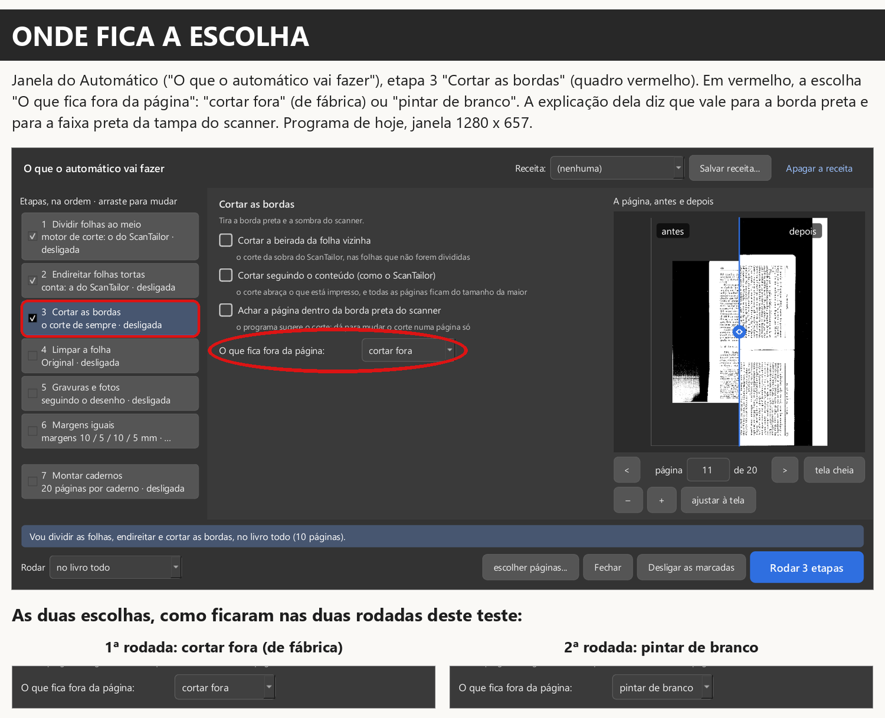

- **Legenda para a Central:** Onde fica a escolha: Automático, etapa 3 "Cortar as bordas", "O que fica fora da página: cortar fora / pintar de branco" (vale para a borda preta e para a faixa da tampa).
- **Livro, página e versão:** Righetti, folha 96 (cópia); programa de hoje: ramo `obra-2026-10-26`, commit `3a721bf8`
- **O que prova:** A escolha "cortar fora / pintar de branco" existe no Automático, na etapa 3, à vista, e a explicação dela diz que vale para a tampa (D-692: "deveria poder ser escolhido no automático").

### 1-tampa-b-na-tela.png

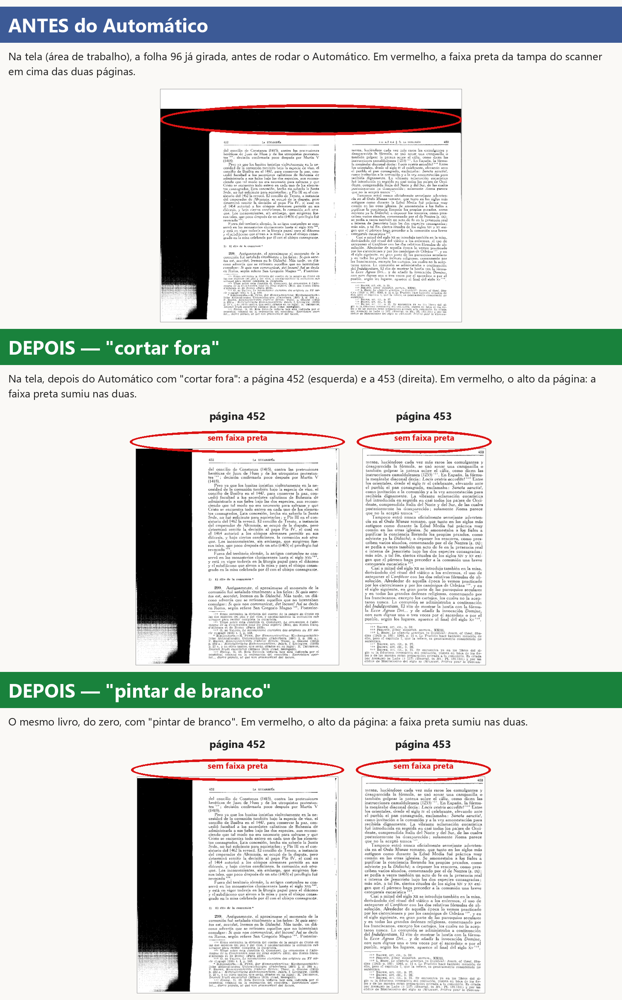

- **Legenda para a Central:** Na tela: antes (azul) a faixa preta da tampa em cima da folha 96; depois do Automático, com "cortar fora" e com "pintar de branco" (verde), a faixa sumiu nas páginas 452 e 453.
- **Livro, página e versão:** Righetti, folha 96 = páginas 452 e 453 (cópia); programa de hoje: ramo `obra-2026-10-26`, commit `3a721bf8`
- **O que prova:** Na tela, a faixa da tampa some depois do Automático com "cortar fora" e com "pintar de branco" (D-559).

### 1-tampa-c-no-pdf.png

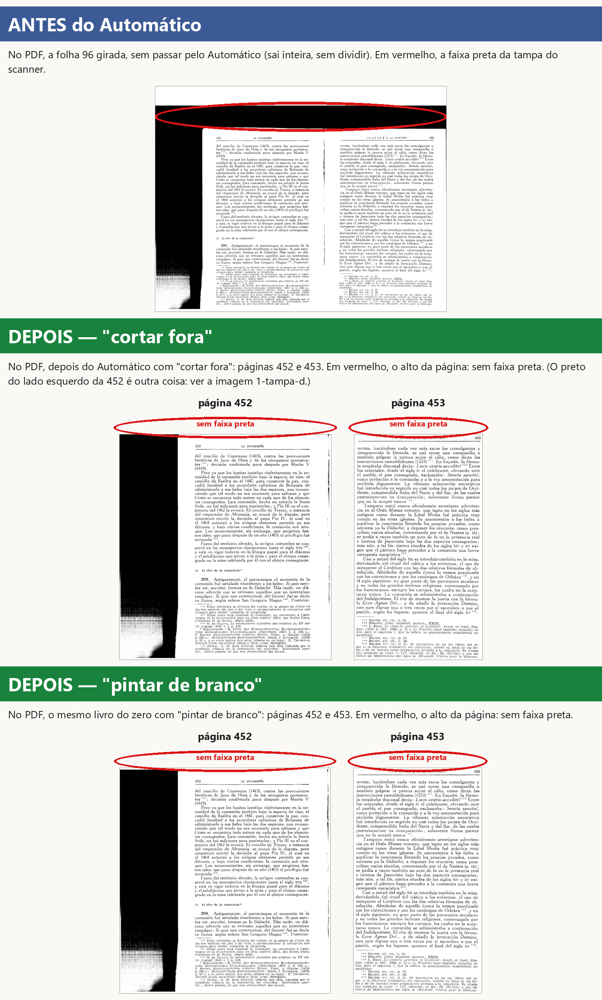

- **Legenda para a Central:** No PDF: antes (azul) a faixa preta da tampa em cima da folha 96; depois do Automático, com "cortar fora" e com "pintar de branco" (verde), as páginas 452 e 453 saem sem a faixa.
- **Livro, página e versão:** Righetti, folha 96 = páginas 452 e 453 (cópia); programa de hoje: ramo `obra-2026-10-26`, commit `3a721bf8`
- **O que prova:** No PDF gravado, a faixa da tampa some nos dois jeitos (D-559, D-692: "essa resposta não tem print provando").

### 1-tampa-d-preto-do-lado.png

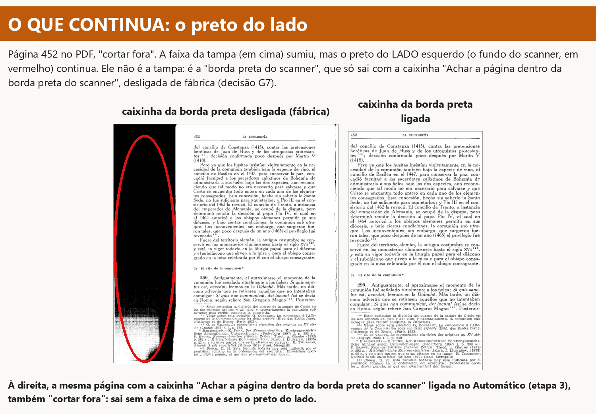

- **Legenda para a Central:** Página 452: a faixa da tampa sumiu, mas o preto do lado (fundo do scanner) continua com a caixinha da borda preta desligada (fábrica); com ela ligada, sai também.
- **Livro, página e versão:** Righetti, página 452 (cópia); programa de hoje: ramo `obra-2026-10-26`, commit `3a721bf8`
- **O que prova:** O preto que sobra do lado não é a tampa: é a borda preta do scanner, que sai com a outra caixinha ligada. Não é defeito da D-559, mas o Samuel vai ver esse preto nas imagens 1-b e 1-c.

## 2. Cores no Preto e branco com "Reduzir cores" (`dv-211-215`; D-189, D-191)

Caminho: Livro de Horas, cópia com as páginas 25 a 27 do PDF (a 26 é a 2ª). Nos dois programas: livro novo com o que
cada um faz de fábrica ao abrir (o de antes passava pela tela "O que fazer" > "Conferir"; o de hoje abre direto, sem
Automático), página 26, painel "Filtro da página": "Preto e branco", "Mais ajustes" aberto, "Letras com a cor delas"
e "Reduzir cores" marcadas. Página como sai no PDF, a 300 DPI.

**ACHADO.** Antes do conserto, parte das letras da palavra saía PRETA e parte clara. Hoje nenhuma letra sai preta
nem some (a prova da D-189, "nenhuma letra some", está cumprida), **mas a palavra ainda sai em duas cores**: em
"S. Leonard", o "S.", o "L" e o "n" saem azul-acinzentados e "eo", "ard" saem bege claro; em "Theodore", "Th" azul e
"eodore" bege. No scan a palavra é de uma tinta só. A frase do pedido "hoje cada palavra sai inteira numa cor só"
**não é o que o programa faz**. Cada letra sai inteira numa cor (o comentário do conserto fala de letra, não de palavra).

### 2-cores-a-palavras-antes-e-hoje.png

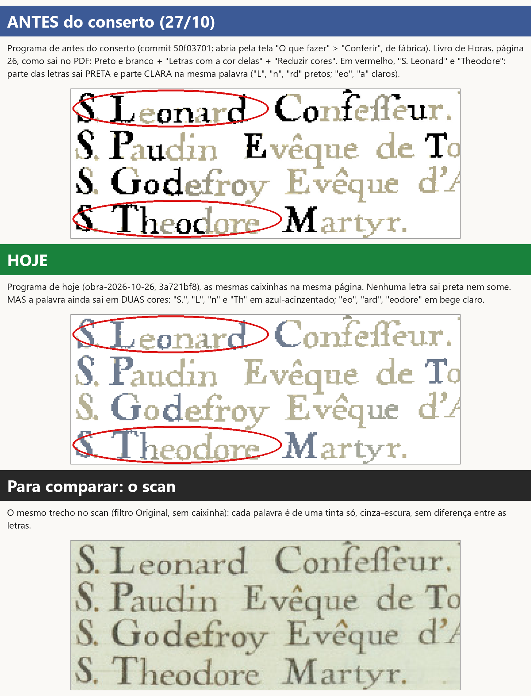

- **Legenda para a Central:** Horas 26, "S. Leonard" e "Theodore" no PDF (Preto e branco + Letras com a cor delas + Reduzir cores): antes, metade preta e metade clara; hoje nada sai preto, mas a palavra ainda sai em duas cores (azul e bege).
- **Livro, página e versão:** Livro de Horas, página 26 (cópia), "S. Leonard" e "Theodore"; antes: programa de antes do conserto da D-189: commit `50f03701` (o pai de `c8844671`, 27/10 12:02); hoje: programa de hoje: ramo `obra-2026-10-26`, commit `3a721bf8`
- **O que prova:** O conserto de 27/10 tirou o preto (D-189), mas a palavra ainda sai em duas cores. Não está "inteira numa cor só".

### 2-cores-b-onde-ficam-as-caixinhas.png

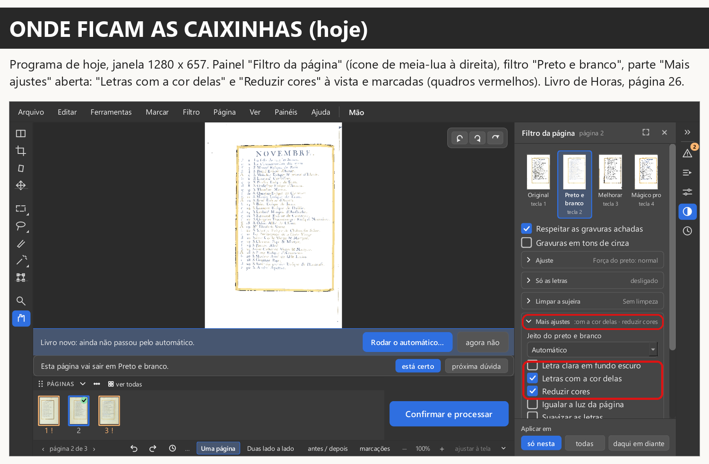

- **Legenda para a Central:** Onde ficam as caixinhas hoje: painel "Filtro da página" > Preto e branco > "Mais ajustes": "Letras com a cor delas" e "Reduzir cores" à vista.
- **Livro, página e versão:** Livro de Horas, página 26 (cópia); programa de hoje: ramo `obra-2026-10-26`, commit `3a721bf8`
- **O que prova:** As caixinhas "Letras com a cor delas" e "Reduzir cores" ficam à vista no painel Filtro, em "Mais ajustes" (D-191: "a caixinha não fica escondida"). Para caberem em 1280 x 657 fechei a parte "Só as letras", como o Kaique faria.

## 3. Numeração das folhas do caderno com lugar sem página, num livro dividido (`n0411-caderno-pagina-em-branco`; D-604)

Caminho: livro aberto do zero; Automático só com "Dividir folhas ao meio" (fábrica), no livro todo; depois a janela do
Automático na etapa 7 "Montar cadernos", 20 páginas por caderno (fábrica), indo às últimas folhas.

**ACHADO.** O Gradus dividido tem 140 páginas = 7 cadernos de 20, cheios: nenhuma das 35 folhas tem lugar sem
página (voltei da folha 35 até a 23: todas cheias). Para mostrar a folha com lugar vazio num livro **dividido** de
verdade usei o Righetti inteiro (cópia), girado ¼ à esquerda e dividido do mesmo jeito: 270 páginas, o último caderno
com 10 páginas em 12 lugares.

**As páginas exatas da folha:** Righetti, **folha 66 de 68 — frente: "páginas em branco e 261"; verso: "páginas 262
e em branco"**. As outras do último caderno: folha 67 — frente 270 e 263, verso 264 e 269; folha 68 — frente 268 e
265, verso 266 e 267. Observações: o lugar vazio cai na primeira folha do último caderno (a 66), não na última; e o
texto sai "páginas em branco e 261", que soa estranho. A D-604 diz "Página em branco que o caderno acrescenta no fim:
a confirmar com ele se aparecer": apareceu, e o jeito de escrever é pergunta para o Samuel.

### 3-caderno-a-gradus-dividido-sem-lugar-vazio.png

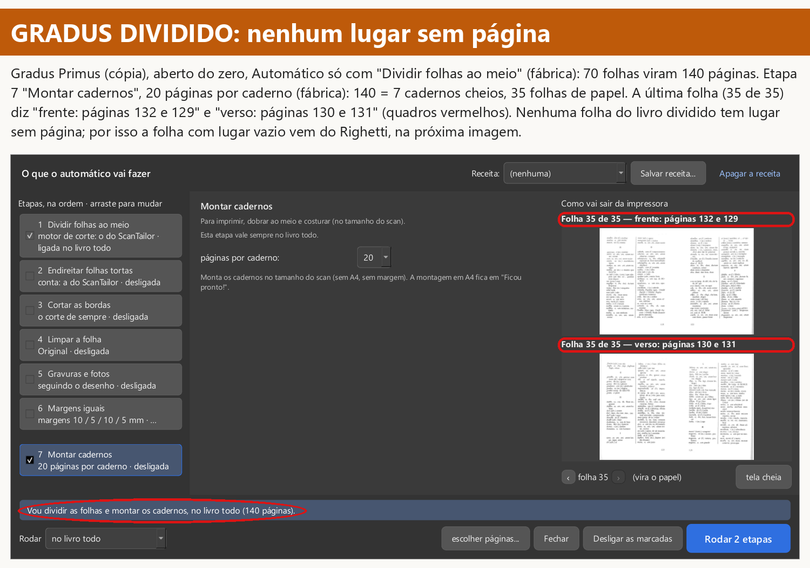

- **Legenda para a Central:** Gradus dividido pelo Automático: 140 páginas = 7 cadernos de 20 cheios; a última folha (35 de 35) é "frente: páginas 132 e 129 / verso: páginas 130 e 131". Não há lugar sem página nesse livro.
- **Livro, página e versão:** Gradus Primus (cópia), dividido: 140 páginas, folha 35 de 35; programa de hoje: ramo `obra-2026-10-26`, commit `3a721bf8`
- **O que prova:** No Gradus dividido não existe folha com lugar sem página (responde ao "Porque usou uma folha sem estar divida?": dividido, ele não tem lugar vazio).

### 3-caderno-b-righetti-folha-com-lugar-sem-pagina.png

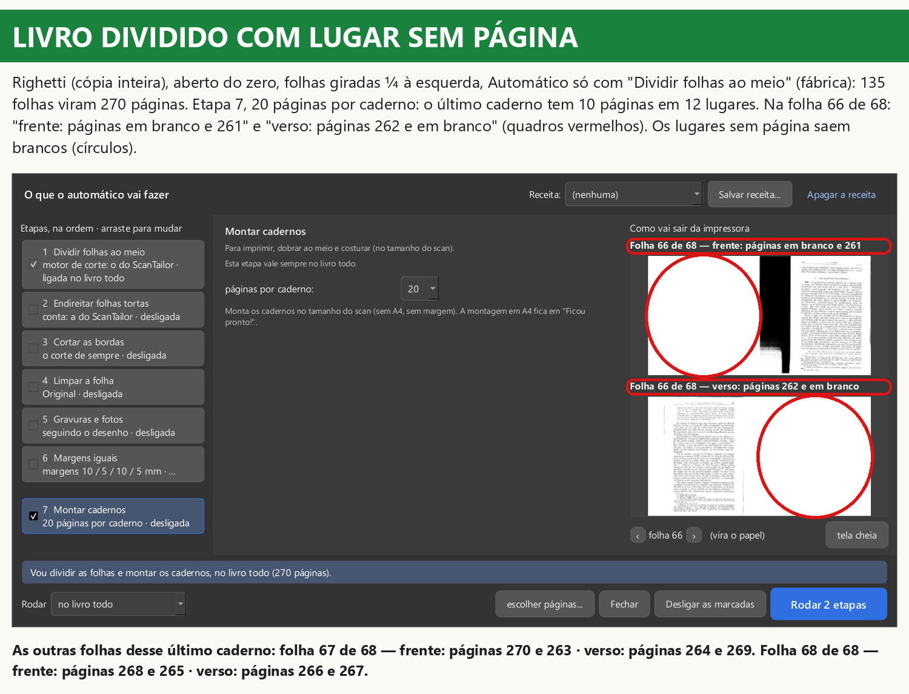

- **Legenda para a Central:** Righetti dividido (270 páginas), etapa 7, folha 66 de 68: "frente: páginas em branco e 261" e "verso: páginas 262 e em branco"; os dois lugares sem página saem brancos.
- **Livro, página e versão:** Righetti (cópia inteira), dividido: 270 páginas, folha 66 de 68; programa de hoje: ramo `obra-2026-10-26`, commit `3a721bf8`
- **O que prova:** Num livro dividido, a folha com lugar sem página diz as páginas verdadeiras de cada lado e "em branco" no lugar vazio (D-604).

## 4. O quadro "O que vai sair" do "Montar para imprimir" (`n0411-o-que-vai-sair`)

Caminho: Palatino (cópia), aberto do zero, gravado como o "Confirmar e processar" grava (fábrica, 134 páginas); depois
a janela "Montar para imprimir" com o PDF pronto, no tamanho de fábrica (1000 x 617 na tela de 1280 x 657), opções de
fábrica (Livreto, A4, 20 por caderno).

**ACHADO.** Ao abrir, o quadro fica inteiro fora da vista: **nem o título "O QUE VAI SAIR" aparece** (o lado direito
mostra até a altura 545 e o título começa na 585). O pedido dizia "só o título à vista". Rolando até o fim, o quadro
aparece inteiro. O texto dele, neste exemplo: "Livreto (cadernos) em papel A4. Entram as 134 páginas do livro. Saem 34 folhas de papel (frente e verso), 7 cadernos; o último com 4 folhas. Ao gravar, os passos para imprimir e dobrar aparecem aqui."

### 4-o-que-vai-sair-a-como-abre.png

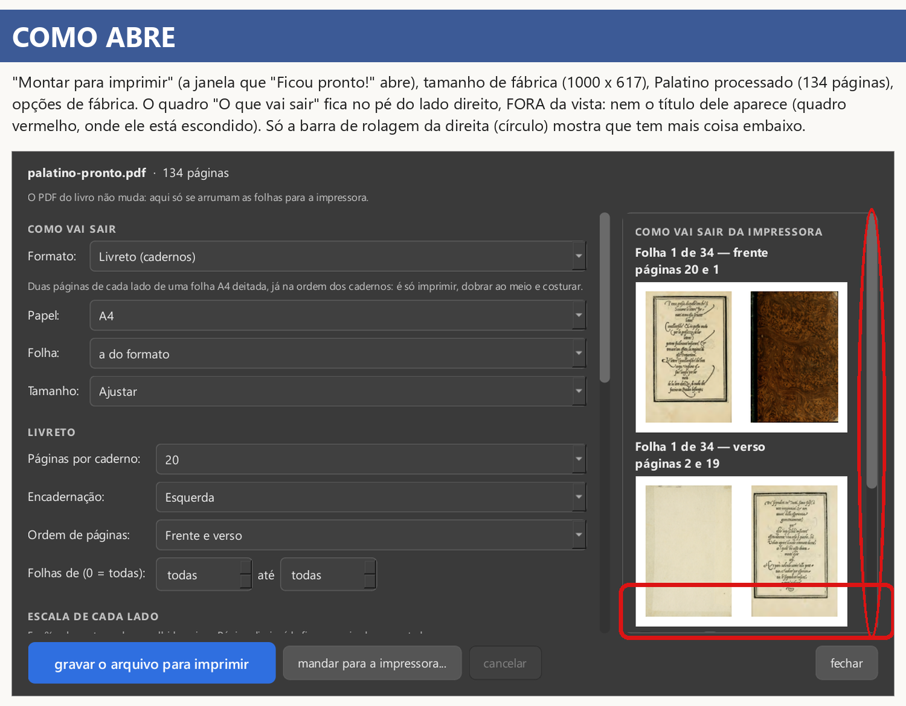

- **Legenda para a Central:** Como abre o "Montar para imprimir" (tamanho de fábrica): o quadro "O que vai sair" fica fora da vista, no pé do lado direito; nem o título aparece, só a barra de rolagem indica.
- **Livro, página e versão:** Palatino (cópia), PDF pronto de 134 páginas; programa de hoje: ramo `obra-2026-10-26`, commit `3a721bf8`
- **O que prova:** Como a janela abre: o quadro "O que vai sair" escondido no pé do lado direito, sem nem o título à vista.

### 4-o-que-vai-sair-b-rolado.png

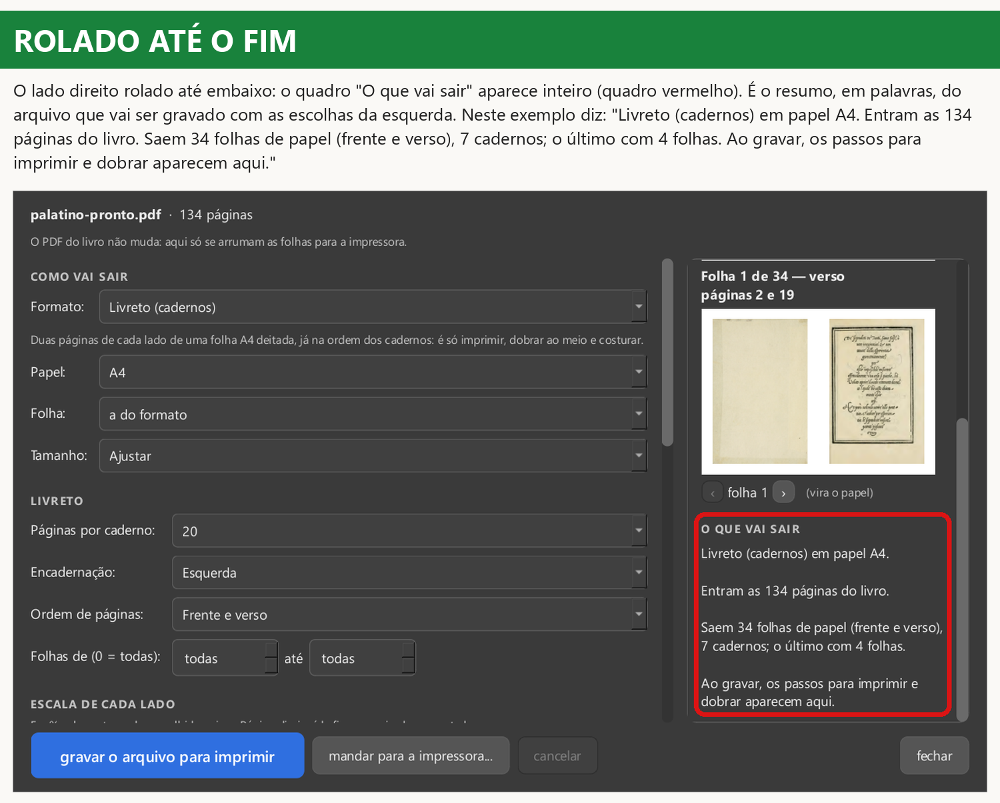

- **Legenda para a Central:** O lado direito rolado até embaixo: o quadro "O que vai sair" inteiro. Exemplo do Palatino: Livreto (cadernos) em papel A4. Entram as 134 páginas do livro. Saem 34 folhas de papel (frente e verso), 7 cadernos; o último com 4 folhas. Ao gravar, os passos para imprimir e dobrar aparecem aqui.
- **Livro, página e versão:** Palatino (cópia), PDF pronto de 134 páginas; programa de hoje: ramo `obra-2026-10-26`, commit `3a721bf8`
- **O que prova:** O exemplo que o Samuel pediu ("Quero um exemplo disso"): o quadro é o resumo em palavras do arquivo que vai ser gravado.

## 5. Pares trocados no "Duas lado a lado" (`v-capa`; D-693)

Caminho: La vida eterna (cópia), aberto do zero; Automático só com "Dividir folhas ao meio" (fábrica): 180 folhas = 360
páginas; área de trabalho em "Duas lado a lado". A página 1 (capa) aparece sozinha e depois os pares 2-3, 4-5, 6-7...
do PDF. Só o problema, nenhuma tela nova.

**Resultado:** nos pares 6-7, 8-9 e 10-11 do PDF a página de número impresso ímpar fica à esquerda: 7 | 8, 9 | (em
branco, seria a 10), 11 | 12. Num livro aberto a ímpar fica à direita.

### 5-pares-trocados-duas-lado-a-lado.png

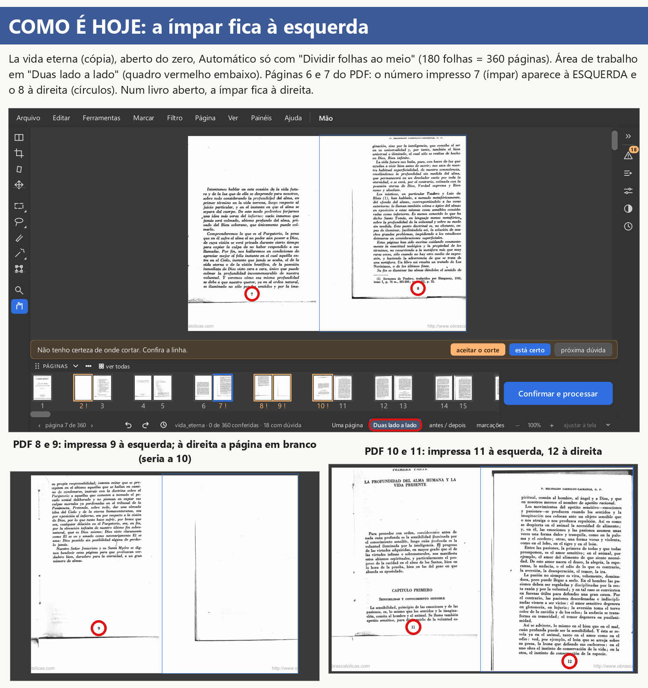

- **Legenda para a Central:** La vida eterna dividido, "Duas lado a lado": nos pares 6-7, 8-9 e 10-11 do PDF a página de número impresso ímpar (7, 9, 11) aparece à esquerda; num livro aberto ela fica à direita.
- **Livro, página e versão:** La vida eterna (cópia), páginas 6 a 11 do PDF (impressas 7 a 12); programa de hoje: ramo `obra-2026-10-26`, commit `3a721bf8`
- **O que prova:** O problema da D-693: com o PDF começando no meio da numeração, o "Duas lado a lado" põe a ímpar impressa à esquerda.

## Achados, em resumo (para a gerente levar)

1. **Cores (D-189):** hoje a palavra ainda sai em duas cores (azul e bege) com "Reduzir cores" + "Letras com a cor
   delas". O preto saiu; "cada palavra inteira numa cor só" não acontece.
2. **Caderno (D-604):** o Gradus dividido não tem lugar sem página; a prova foi no Righetti dividido (folha 66 de 68).
   O texto "páginas em branco e 261" é o jeito de hoje e a D-604 deixou esse caso "a confirmar".
3. **"O que vai sair":** ao abrir não aparece nem o título do quadro.
4. **Tampa (D-559/D-692):** funciona nos dois jeitos. Avisos: os dois jeitos saem quase iguais no Righetti; o preto do
   lado é outra caixinha (desligada de fábrica); a tira de miniaturas mostra a folha como veio do scan.

## Onde estão as coisas

- Imagens e este relatório: `relatorios\provas-central-2026-11-13\` (legendas também em `legendas.json`).
- Scripts que tiraram e montaram os prints: `relatorios\provas-central-2026-11-13\scripts\` (cópia; rodavam em
  `.claude\worktrees\provas-central\_tmp\`).
