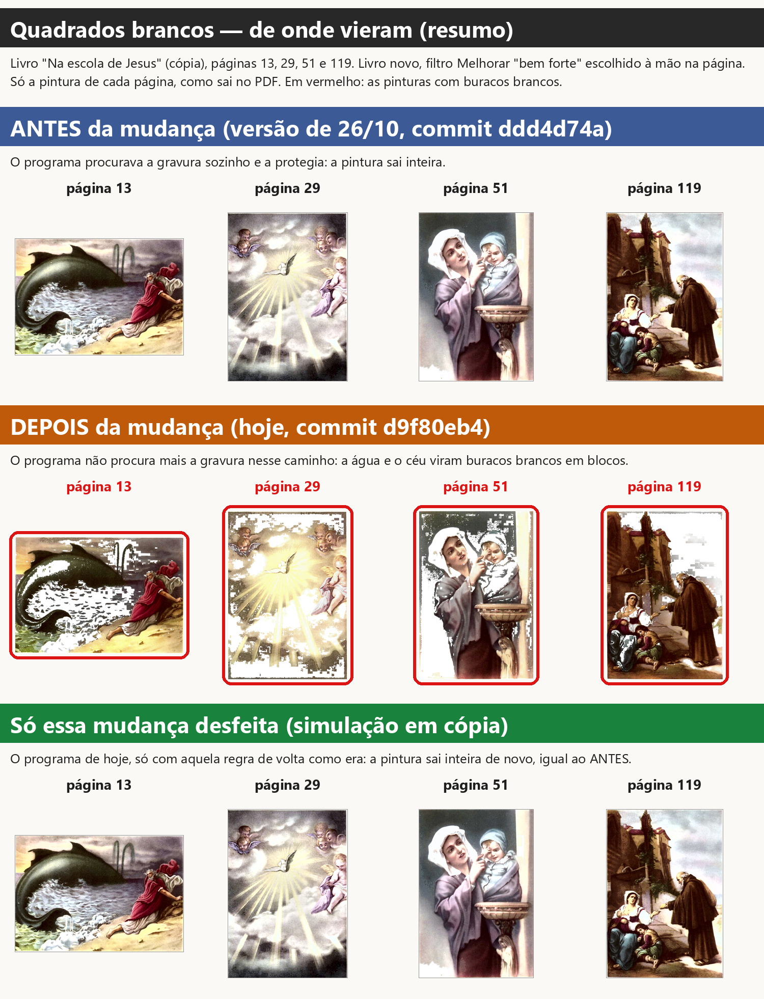
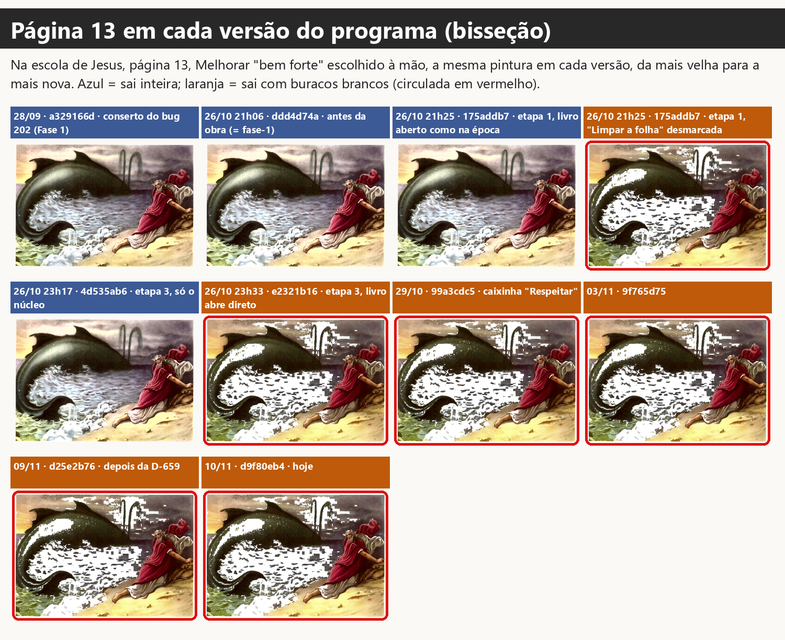
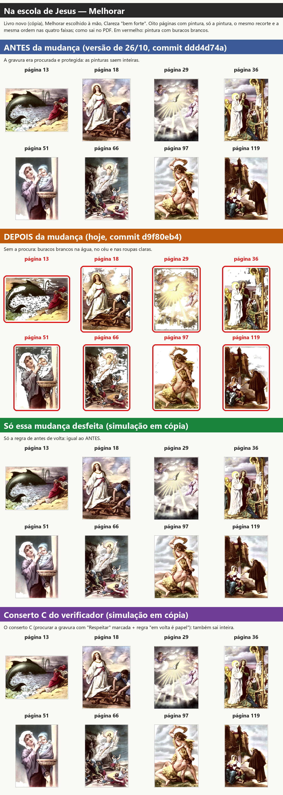
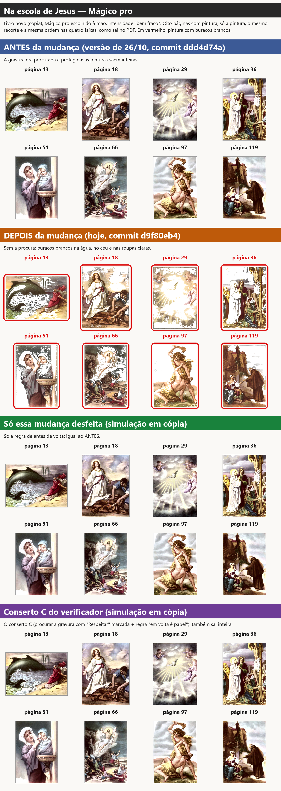
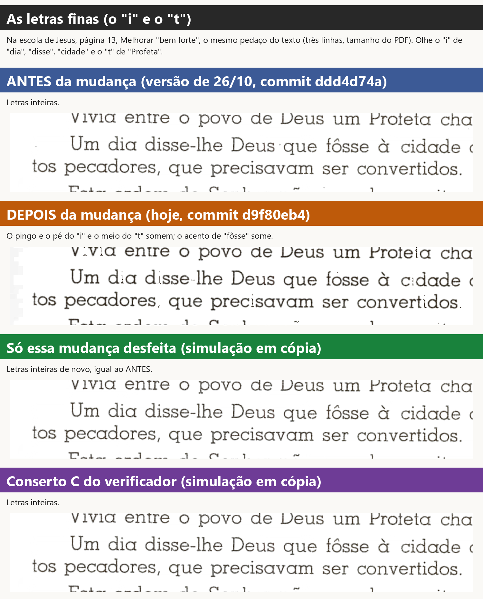
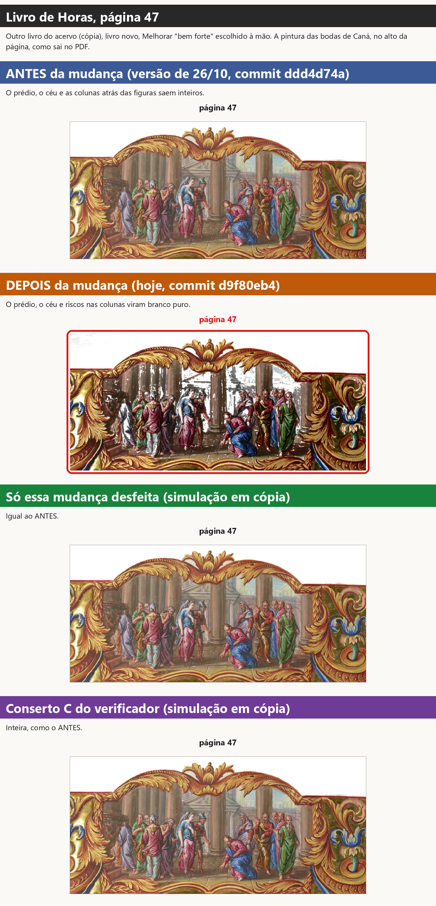
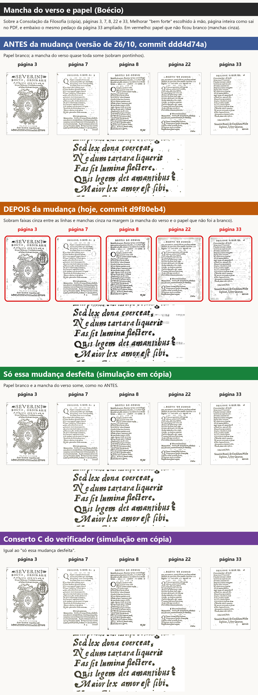
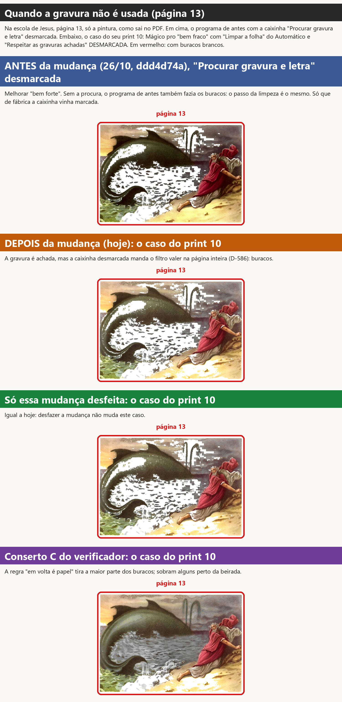

# Quadrados brancos: de onde vieram

**Investigador, 10/11/2026.** Só investigação: nenhuma linha do programa mudou. Rodei versões antigas
do programa e a de hoje nas mesmas páginas, com as mesmas escolhas, em cópias dos livros, sem abrir
janela na sua tela.

A sua pergunta (Central, 10/11, "Ainda não entendi"):

> "Mas antes ele não fazia isso né, você tentou usar o motor do scantailor para achar gravura e onde achar
> gravura ele não deixar esses pontos brancos assim, pois eu nunca tinha visto o programa fazer isso,
> descubra que agente fez o programa começar a fazer isso, é só você ver os testes que fizemos antes com o
> melhorar e magico pro."

## A resposta curta

1. **Você tem razão: antes o programa não fazia isso.** Na versão de 26/10 (a de antes da obra, igual ao
   programa que você testou em setembro e outubro), o Melhorar e o Mágico pro deixam as pinturas inteiras.
2. **Começou na obra de 26/10, com duas etapas juntas.** A etapa 1 criou a regra "sem o Automático, o
   programa não procura a gravura". A etapa 3 fez todo livro novo abrir com o Automático desligado. Desde
   então, o Melhorar e o Mágico pro escolhidos à mão não protegem mais a pintura.
3. **A sua ideia está certa:** onde o motor do ScanTailor acha a gravura, os quadrados não aparecem. Hoje,
   nesse caminho, o motor nem é chamado.
4. **Desfazendo só aquela regra, os quadrados somem** e as letras finas voltam inteiras. O resultado sai
   praticamente igual ao conserto C do verificador.

O verificador também não errou no que mediu: o branco sai mesmo do último passo do Melhorar (a limpeza do
papel). Mas esse passo existe desde agosto. O que mudou em 26/10 foi que a pintura deixou de ser procurada
e protegida antes dele.

## As imagens

Cada imagem tem uma faixa por situação, sempre com as mesmas cores:

- **azul — ANTES da mudança** (versão de 26/10, commit `ddd4d74a`);
- **laranja — DEPOIS da mudança** (hoje, commit `d9f80eb4`);
- **verde — só essa mudança desfeita** (o programa de hoje com a regra de antes de volta; simulação em cópia);
- **roxo — conserto C do verificador** (simulação em cópia, para comparar).

Em vermelho: as pinturas com buracos brancos (o nome da página e um contorno por fora).

### Resumo

### A página 13 em dez versões do programa

### Oito pinturas do livro, Melhorar

### As mesmas oito, Mágico pro

### As letras finas (o "i" e o "t")

### Outro livro: Livro de Horas, página 47

### A mancha do verso e o papel (Boécio)

### Quando a gravura não é usada (o programa de antes sem a procura, e o seu print 10)

## 1. Antes o programa fazia isso? Não.

**Como testei.** Peguei o programa como estava em cada data (do histórico do git, em cópias à parte) e fiz
a mesma coisa em todos: abrir o *Na escola de Jesus* como livro novo, escolher o Melhorar "bem forte" (e
depois o Mágico pro "bem fraco") na página, e desenhar a página do jeito que ela sai no PDF. Para as
páginas saírem no mesmo enquadramento em todas as versões, deixei desligados o dividir, o endireitar e o
cortar (o filtro não depende deles).

**Página 13 (Jonas e a baleia), parte da pintura que virou buraco branco:**

| versão | Melhorar | Mágico pro | gravura achada? |
|---|---|---|---|
| 28/09 (`a329166d`, conserto do anjo, Fase 1) | 0,8% | 0,8% | sim |
| 26/10, antes da obra (`ddd4d74a` = o `fase-1`) | 1,4% | 1,4% | sim |
| hoje (`d9f80eb4`) | **23,5%** | **27,4%** | **não procurada** |
| hoje com só a mudança desfeita | 1,4% | 1,4% | sim |
| hoje com o conserto C | 1,4% | 1,4% | sim |

O pouco que aparece "antes" (perto de 1%) é o que já é branco no original (a espuma, o brilho da água):
olhando a imagem, a pintura está inteira.

**Nas oito pinturas medidas** (páginas 13, 18, 29, 36, 51, 66, 97 e 119), antes: de 0,5% a 3,9%; hoje: de
9% a 29% no Melhorar e de 10% a 42% no Mágico pro.

**No livro inteiro** (199 páginas, as mesmas escolhas, medido página por página):

| | Melhorar: páginas com buracos bem visíveis | Mágico pro: idem | páginas com letra quebrada |
|---|---|---|---|
| antes da obra (`ddd4d74a`) | 2 | 2 | 0 |
| hoje (`d9f80eb4`) | **65** | **83** | **25 a 28** |
| hoje com só a mudança desfeita | 2 | 2 | 0 |

"Bem visíveis" = 6% ou mais da pintura em branco onde o original não era branco. Contando também os casos
menores (2% ou mais): antes 16, hoje 115 (Melhorar) e 139 (Mágico pro), desfeita 16. As duas do "antes"
(páginas 43 e 173) são céu claro que vai a branco liso, sem blocos: a basílica da página 43 é desenho de
traço, e a regra da Fase 1 manda o papel de dentro dele a branco.

**Nos testes de antes.** Os testes do Melhorar e do Mágico pro que vocês fizeram (Fase 1, 28/09 a 02/10;
conferência de 30/09, "roupa e céu do anjo" marcada BOM) foram todos com o programa de antes da obra, que
procurava a gravura em toda página mostrada ("Procurar gravura e letra" vinha ligado). O conserto do anjo
(bug 202, 28/09) protege o que fica **dentro** da gravura achada. Por isso, naquela época, não aparecia.

## 2. Qual mudança fez começar

A página 13 em cada versão (imagem 1) mostra exatamente onde virou:

| data e hora | commit | o que é | página 13 |
|---|---|---|---|
| 26/10, 21h06 | `ddd4d74a` | o programa antes da obra | inteira |
| 26/10, 21h25 | `175addb7` | **obra, etapa 1** — livro aberto como na época | inteira |
| 26/10, 21h25 | `175addb7` | etapa 1 — com "Limpar a folha" desmarcada | **buracos** |
| 26/10, 23h17 | `4d535ab6` | obra, etapa 3, só a parte de dentro | inteira |
| 26/10, 23h33 | `e2321b16` | **obra, etapa 3 — o livro abre direto na área de trabalho** | **buracos** |
| 29/10, 03/11, 09/11, 10/11 | `99a3cdc5`, `9f765d75`, `d25e2b76`, `d9f80eb4` | depois | buracos |

São duas mudanças da mesma noite, que só juntas fazem o defeito aparecer:

**A regra — etapa 1 da obra (`175addb7`, 26/10 às 21h25, ramo `obra-etapa1-2026-10-26`, agente
Implementador da etapa 1; juntada à obra às 21h55, `11f9ed38`).** O que ela queria fazer: cumprir a sua
**D-009** (sessão 1 dos testes guiados, 26/10): *"eu deveria conseguir abrir o livro sem escolher nenhuma
opção para fazer tudo manualmente."* Para isso, o agente fez o que é feito à mão valer no PDF mesmo com o
Automático desligado. Junto, ele decidiu sozinho um detalhe (escolha técnica nº 5 do ONDE-PAREI dele,
pela regra D-014, "obra até o fim sem pausas, os detalhes técnicos eu decido"):

> "filtro escolhido à mão → caminho inteiro com esse filtro e **só a marcação à mão** (o detector de gravura
> é automático e fica desligado)"

No programa, isso é uma linha em `core/pipeline.py`, no começo de `garantir_selecao` (a função que procura
a gravura, a letra e o papel da página). Antes era: "procura, se 'Procurar gravura e letra' estiver ligado".
Ficou: "procura só se 'Limpar a folha' (o Automático) **e** 'Procurar gravura e letra' estiverem ligados".
Isso não foi pedido por você: foi a leitura do agente de que "procurar a gravura" é coisa do Automático.

**O caminho — etapa 3 da obra (`e2321b16`, 26/10 às 23h33, ramo `obra-etapa3-2026-10-26`, agente da
etapa 3; juntada à versão de teste em 27/10 às 11h45, `427e3ae2`).** O que ela queria fazer: cumprir a sua
**D-002** (*"Trabalho automático = painel 'Automático' que abre e fecha [...] abrir o PDF sem mexer e rodar
as etapas depois"*; o Kaique: *"nós tínhamos que abrir direto na área de trabalho"*) e o "sempre abre em
Original, sem mexer". O livro passou a abrir direto na área de trabalho, com todas as etapas do Automático
desligadas (inclusive "Limpar a folha"), e o filtro escolhido no painel passou a ficar marcado como "mexido
à mão".

**Juntas:** desde 27/10, o Kaique abre um livro novo, escolhe o Melhorar ou o Mágico pro no painel, e o
programa cai na regra da etapa 1: não procura a pintura. Sem a pintura achada, o último passo do Melhorar
(a limpeza do papel) trata a água, o céu e as roupas claras como papel e pinta de branco, em blocos.

**O mesmo defeito já tinha aparecido no Preto e branco**, em 09/11 (página 8, print 01 da sessão 4: "todas
aquelas mudanças que a gente tinha feito [...] respeitar gravura e tudo mais no manual não está
funcionando"). A causa era a mesma regra. O conserto D-659 (`88731637`, 09/11) fez o programa voltar a
procurar a gravura **só no Preto e branco**. O agente anotou no código: "Melhorar e Magico pro a mao nao
procuram: a decisao fala do Preto e branco". Por isso o Melhorar e o Mágico pro ficaram de fora.

## 3. A sua ideia: onde o motor do ScanTailor acha a gravura, não há quadrados?

**Sim.** O "motor do ScanTailor" é o detector de gravura que o programa usa de fábrica desde 30/09 (item
1.2): ele olha a página e diz onde está a figura. Quando ele acha a figura, o Melhorar trata a figura como
figura (sem a limpeza do papel por cima) e o resto como página.

- **Antes da obra**, o motor rodava em toda página mostrada: achou a gravura em 197 das 199 páginas do
  *Na escola de Jesus* (só as páginas 4 e 197, que são só de texto, ficaram sem). Buracos bem visíveis: só
  2 páginas (43 e 173), as duas com gravura achada, e sem blocos (céu claro que vai a branco liso).
- **Hoje**, com o Melhorar ou o Mágico pro escolhido à mão, o motor **não é chamado**: em nenhuma das
  199 páginas a gravura foi procurada. Por isso os quadrados aparecem em quase toda pintura.
- **Hoje, pelo Automático** com "Gravuras e fotos" ligada e "Respeitar as gravuras achadas" marcada, o
  motor roda e os quadrados não aparecem (o verificador mediu: 0,6% na página 13).
- **O seu print 10** (Mágico pro, "Respeitar as gravuras achadas" desmarcada) é outro caso: lá a gravura até
  é achada, mas a caixinha desmarcada manda o filtro valer na página inteira (D-586, 29/10: "Desligada, o
  filtro vale na página inteira"). Esse caso não existia antes de 29/10 (não havia a caixinha). Desfazer a
  mudança da etapa 1 **não** muda o print 10; o conserto C melhora (a regra "em volta é papel" segura a maior parte). Página 13 no caso do print 10:
  hoje 27,4% de buraco; com só a mudança desfeita, 27,4% (igual); com o conserto C, 5,8% (sobram alguns
  perto da beirada); pelo Automático com "Respeitar" marcada, 1,4%. Imagem 7.
- **O programa de antes também fazia os buracos quando a procura estava desligada**: com "Procurar
  gravura e letra" desmarcada, a versão de 26/10 dá 22,8% na página 13 (imagem 7, faixa azul). O passo da
  limpeza é o mesmo desde agosto; o que protegia a pintura era a procura, que de fábrica vinha ligada.

## 4. O que acontece se só aquela mudança for desfeita

Simulei, numa cópia e só dentro do processo de teste, o programa de hoje com aquela linha de volta como era
antes de `175addb7`: a gravura volta a ser procurada sempre que "Procurar gravura e letra" está ligada (no
livro novo ela vem ligada). Nada mais mudou.

**O que melhora:**

- **Os quadrados somem.** Página 13: de 23,5% para 1,4% (Melhorar) e de 27,4% para 1,4% (Mágico pro), o
  mesmo número do programa de antes. Livro inteiro: de 65 e 83 páginas com buracos bem visíveis para 2 e 2, as mesmas do programa de antes.
- **As letras finas voltam inteiras** (o "i" e o "t"; imagem 4). Pontos de tinta que viravam branco, fora
  da pintura: página 13 de 2,1% para 0,1%; página 97 de 4,8% para 0,4%; página 29 de 6,7% para 0,1%.
- **Livro de Horas 47:** o prédio e o céu voltam (de 2,6% para 0,1%).
- **O papel fica mais branco nas páginas de texto.** No Boécio, o papel que não ia a branco (as faixas cinza
  entre as linhas e as manchas na margem) cai de 3% a 17% da área de papel para menos de 0,5%, como no
  programa de antes (imagem 6). A mancha do verso some igual ou melhor.

**O que custa ou muda:**

- **Tempo.** A primeira vez que cada página é desenhada fica mais lenta, porque o motor procura a gravura:
  no livro inteiro, a 300 pontos por polegada, o Melhorar passou de 2,4 s para 7,7 s por página na primeira
  vez (o programa de antes: 5,9 s), e o Mágico pro na mesma página, com a gravura já achada, de 2,3 s para
  5,5 s (dentro da gravura o filtro faz mais conta). Da segunda vez em diante a marcação fica guardada na página. O teste de velocidade que vale é o do
  GitHub (não rodei).
- **A procura volta em toda página mostrada**, mesmo nas que ficam no Original, como era antes da obra (o
  livro novo vem com "Procurar gravura e letra" ligado). Isso é diferente do que você disse para o Preto e
  branco na D-659 ("não precisa procurar em todas"), e por isso é pergunta para você, não escolha minha.
- **As letras no Boécio** perdem um pouco mais da beirada clara (página 33: de 5,6% para 6,3% dos pontos
  de tinta). Olhando, continuam inteiras.
- **O print 10 continua igual** (ver seção 3).
- Não medi: o Preto e branco à mão com "Respeitar" desmarcada, os testes do programa em `tests/`, a rodada
  do GitHub e o gabarito inteiro.

**Comparado com o conserto C do verificador:** nas oito pinturas, no Livro de Horas 47 e no Boécio, o
resultado é praticamente o mesmo (nas pinturas, diferença de no máximo 0,07 ponto percentual; nas letras do
Boécio, até 0,35). As duas
diferenças: (1) o C só procura a gravura nas páginas com Melhorar ou Mágico pro e "Respeitar" marcada; o
desfazer procura em toda página; (2) o C conserta também o print 10 (caixinha desmarcada), com a regra "em
volta é papel"; o desfazer não.

## 5. Pergunta para você

**Como o Melhorar e o Mágico pro escolhidos à mão devem voltar a proteger as pinturas?** As cores são as
das faixas das imagens.

- **Verde — voltar como era antes da obra.** O programa volta a procurar a gravura em toda página que
  mostra, sempre que "Procurar gravura e letra" está ligada (no livro novo ela vem ligada). É o jeito que
  você testou em setembro e outubro. Custa uns 5 segundos a mais na primeira vez de cada página, inclusive
  nas que ficam no Original. Não muda o caso do print 10.
- **Roxo — o conserto C do verificador.** O programa procura a gravura só nas páginas com Melhorar ou Mágico
  pro e "Respeitar as gravuras achadas" marcada (como a D-659 já faz no Preto e branco), e a regra "em volta
  é papel" segura o resto. Nas pinturas sai igual ao verde. Conserta também a maior parte do print 10.
- **Laranja — deixar como está** (com os buracos).

Minha sugestão: o **roxo**, porque segue o que você disse para o Preto e branco ("não precisa procurar em
todas") e também resolve o print 10. Mas o verde é o que já foi testado por vocês. Qualquer um dos dois é
mudança no programa e precisa do seu "sim".

## 6. Como medi

- `scripts/rodar_versao.py` — desenha as páginas como saem no PDF com qualquer versão do programa
  (`DESFAZER=1`: só a mudança desfeita; `CONSERTO_C=1`: o conserto C; `LIMPAR`, `PROCURAR`, `RESPEITAR`:
  as caixinhas).
- `scripts/rodar_amostra.sh` e `scripts/rodar_livro.sh` — as páginas e o livro inteiro, uma situação por vez,
  em prioridade baixa.
- `scripts/medir.py` — as medidas: buraco branco na pintura (pontos que saíram brancos onde o original não
  era papel, dentro da caixa da pintura); tinta de letra que sumiu; papel que não ficou branco.
- `scripts/resumir_livro.py`, `scripts/montar.py` (as imagens), `scripts/gravar_relatorio.py`.
- As medidas estão em `medidas/`.
- As versões antigas: `git worktree` (`ddd4d74a`, `175addb7`) e `git archive` (`a329166d`, `4d535ab6`,
  `e2321b16`, `99a3cdc5`, `9f765d75`, `d25e2b76`), em pastas temporárias apagadas no fim.

## 7. Ressalvas

1. As simulações (desfazer e conserto C) mudam a regra só dentro do processo de teste; o programa não foi
   tocado. Antes de entrar no programa, precisariam dos testes (`tests/test_decisoes*.py`, teste de
   reversão), do GitHub e do gabarito.
2. Nas versões antigas, o livro foi aberto do jeito daquela época, mas com dividir, endireitar e cortar
   desligados, para o enquadramento ser o mesmo. O filtro não depende deles.
3. A medida do livro inteiro é feita na cópia pequena da página (um quarto do tamanho): serve para separar
   páginas com e sem buracos, não para comparar números finos.
4. O "pouco" que aparece no ANTES (1% a 4%) é branco que já existe no original (espuma, brilhos, nuvens
   claras), que a medida conta. Olhando, as pinturas estão inteiras.
