# Quadrados na capa do Gradus Primus

**Investigação, 13/11/2026.** Nenhuma linha do programa mudou. Refiz as duas páginas dos seus prints pela conta do
programa (a mesma da tela e do PDF), em cópias do livro e do seu projeto, sem abrir janela na sua tela. Rodei também
versões antigas do programa e o conserto C, e testei todas as escolhas do painel Filtro em cinco capas.
Teste de **máquina** (medidas) e de **olho** (abri todas as imagens). Só você aprova.

Os seus prints: 13-01 ("1- novo problema achado no branco e preto") e 13-02 ("2- quadrado branco na capa?").

## A resposta curta

1. **A capa preta do 13-01 é efeito da escolha, não defeito.** Com "Respeitar as gravuras achadas" desmarcada, o
   Preto e branco vale na página inteira, e a capa azul vira preto. É o que a D-586 diz: "no Preto e branco, a capa
   sairia toda em preto e branco". **Foi você que desmarcou a caixinha** (às 16h09min49s, no histórico do projeto);
   ela estava marcada, como vem de fábrica.
2. **Os retângulos brancos são defeito do programa.** Vêm de um passo do Preto e branco criado em 27/10 para tirar a
   sombra da mão nas fotos de celular. Ele mede a luz da página em quadradinhos e confunde a capa azul lisa com
   sombra: pinta quadradinhos dela de branco. Sem esse passo, a capa sai preta e lisa, como antes da obra.
3. **O quadrado branco do 13-02 tem duas causas juntas.** (a) O programa achou "ÓNAI" (de "PAULO RÓNAI") como
   letra e recortou esse pedaço da capa; com "Só as letras", letra vira preto e branco, e ali abre uma caixa. Isso
   já acontecia antes da obra, mas a caixa era **preta**. (b) Dentro da caixa, o mesmo passo da sombra pinta de
   **branco**. O retângulo perto de "PAU" no 13-01 é o mesmo passo da sombra (lá não há caixa nenhuma).
4. **Não é a mesma origem dos quadrados brancos do Melhorar** (D-668). Lá era a limpeza do papel; aqui é o Preto e
   branco. **O conserto C não resolve:** a página sai igual, ponto por ponto.
5. **Onde mais acontece:** em todo Preto e branco dessa capa (inclusive com "Respeitar" marcada, como vem de
   fábrica: a caixa branca aparece igual) e na capa do *Na escola de Jesus* (Preto e branco com "Respeitar"
   desmarcada). Na tela, no cartão e no PDF, igual. Não acontece no Original, no Tirar o fundo, nem no Melhorar e
   no Mágico pro escolhidos à mão. Achei também um defeito vizinho, mais antigo: na capa da *Matemática* o programa
   acha "papel" em cima da cor e pinta de branco (seção 4), e o conserto C levaria isso ao Melhorar à mão.
6. **Desde quando:** os quadrados brancos, desde 27/10 (obra, etapa 10b, o conserto da "foto de celular"). A
   caixa na capa vem de uma regra de 30/09 (item 1.2); conferi que ela já existia, preta, no programa de 26/10.
7. **Conserto que sugiro (não consertei):** o passo da sombra não age onde a página tem cor forte; e o título
   escrito na capa colorida fica como a capa. O segundo é escolha sua (perguntas na seção 7).

## As imagens

Cada imagem tem uma faixa por situação: **azul = antes da obra** (programa de 26/10), **laranja = hoje** (versão de
teste), **verde = hoje sem o passo da sombra** (simulação numa cópia), **roxo = conserto C**. O defeito está
circulado em vermelho.

### 1-print-13-01

**O que olhar:** 13-01: os retângulos brancos no alto da capa só existem na faixa laranja (hoje); antes da obra e sem o passo da sombra, a capa é preta lisa.

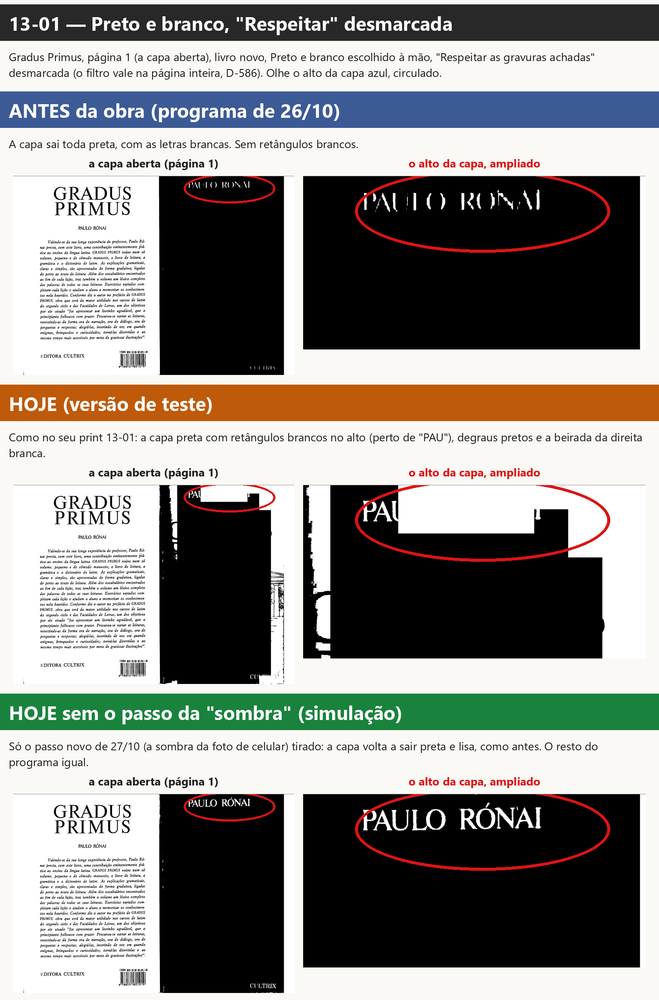

### 2-print-13-02

**O que olhar:** 13-02: a caixa sobre "ÓNAI" era preta antes da obra e ficou branca hoje; tirando o passo da sombra ela volta a ser preta; o conserto C não muda.

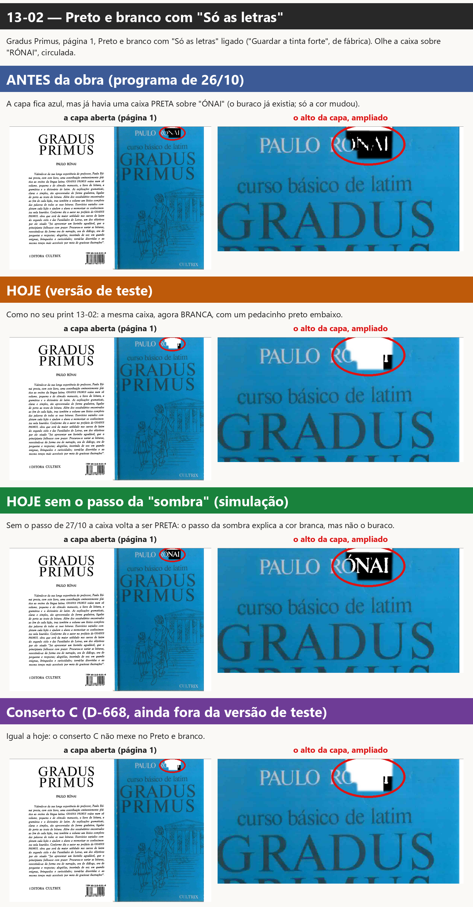

### 3-de-onde-vem-o-buraco

**O que olhar:** O pedaço "ÓNAI" achado como letra (vermelho) fura a gravura da capa (verde): é ali que o 13-02 abre a caixa.

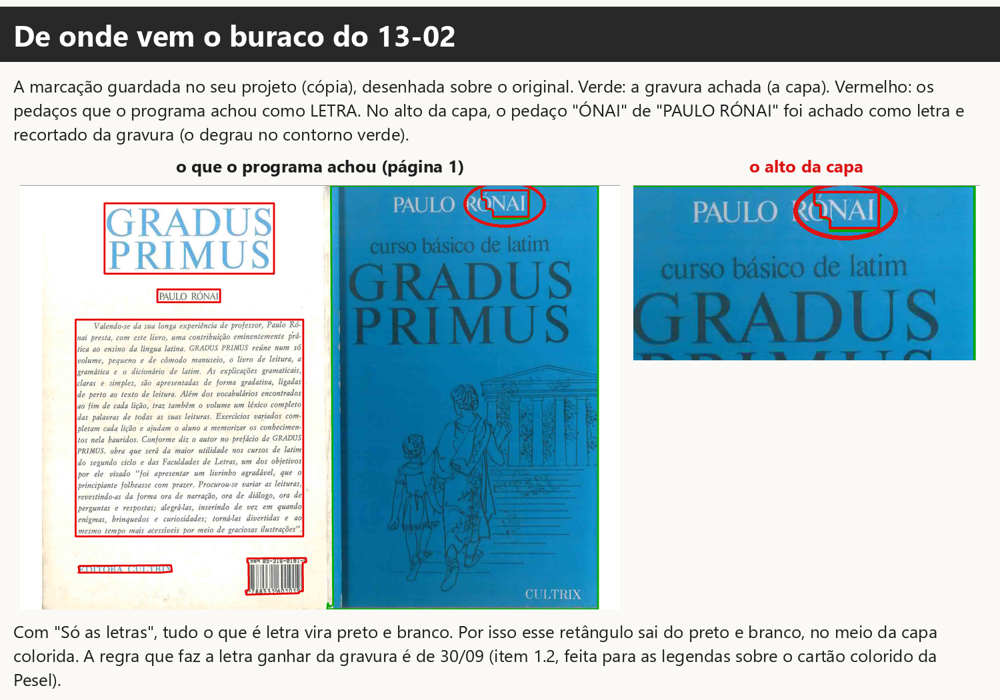

### 4-tela-cartao-pdf

**O que olhar:** O mesmo retângulo branco na tela, no cartão do filtro e no PDF: não é diferença de tela, sai assim no livro.

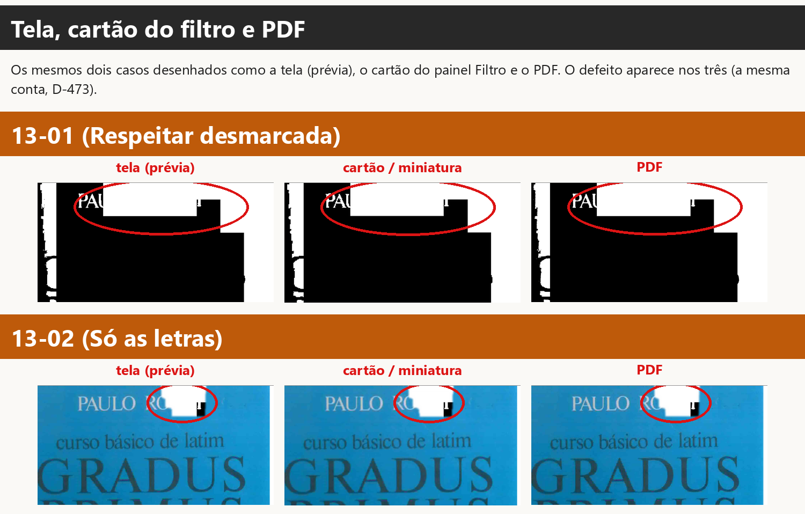

### 5-gradus-todas-as-escolhas

**O que olhar:** Gradus Primus, capa (p. 1): todas as escolhas como saem no PDF; circuladas as que têm quadrado ou caixa que não existe no original (Auto: Só as letras, Auto: P&B, Resp. não, Auto: P&B, Resp. não + cinza, Auto: P&B, Resp. sim, P&B + Só as letras, Só as letras, Guardar tudo, P&B, Respeitar não, P&B, Resp. não + cinza, P&B, Respeitar sim, P&B, Resp. sim + cinza).

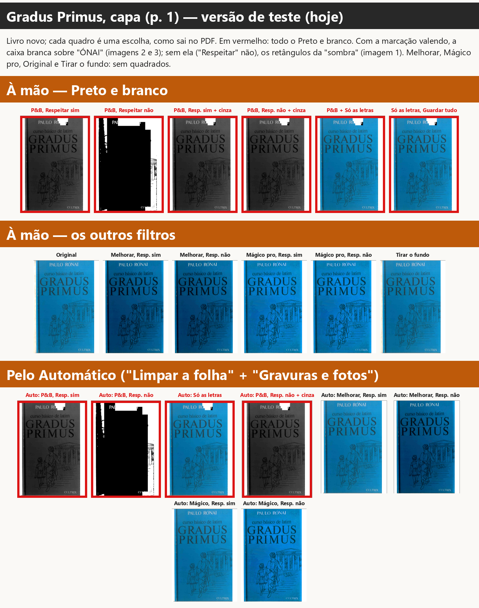

### 6-escola-todas-as-escolhas

**O que olhar:** Na escola de Jesus, capa (p. 1): todas as escolhas como saem no PDF; circuladas as que têm quadrado ou caixa que não existe no original (Auto: P&B, Resp. não, P&B, Respeitar não).

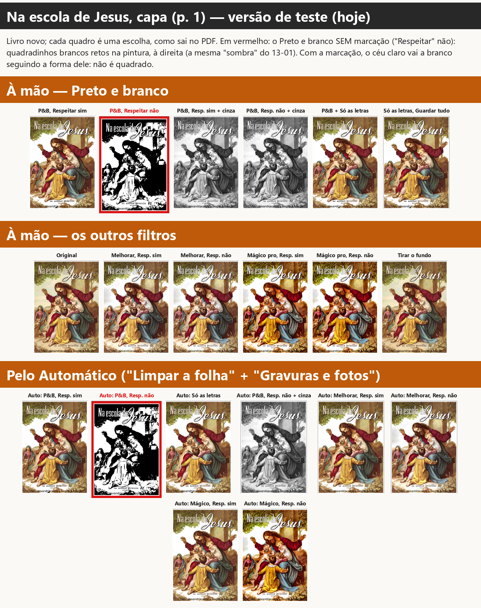

### 7-matematica-todas-as-escolhas

**O que olhar:** Matemática para vencer, capa (p. 1): todas as escolhas como saem no PDF; circuladas as que têm quadrado ou caixa que não existe no original (Auto: Só as letras, Auto: P&B, Resp. não + cinza, Auto: P&B, Resp. sim, P&B + Só as letras, Só as letras, Guardar tudo, P&B, Resp. não + cinza, P&B, Respeitar sim, P&B, Resp. sim + cinza).

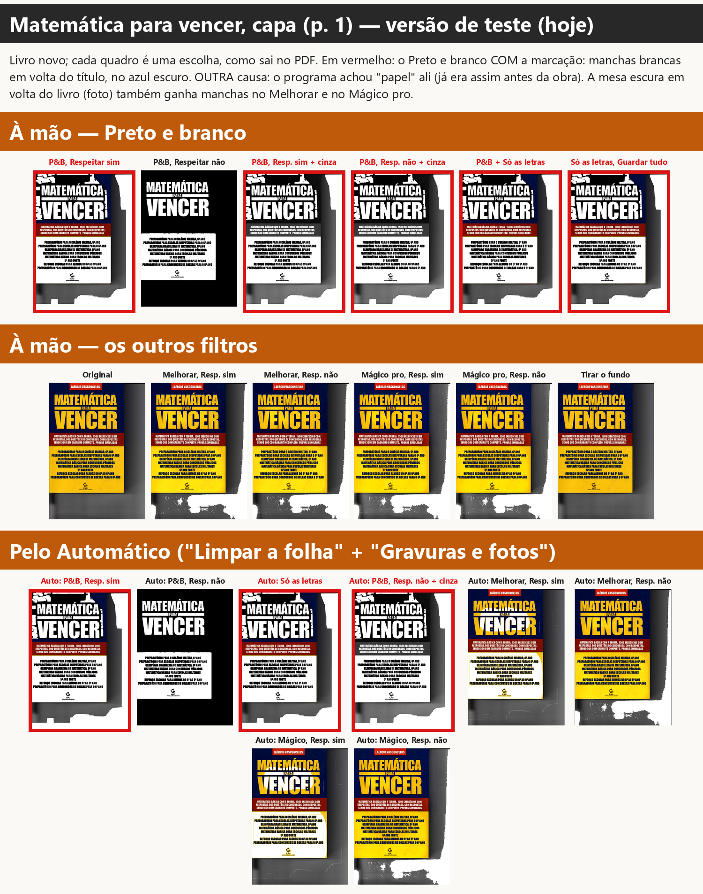

### 8-pesel-todas-as-escolhas

**O que olhar:** Pesel, capa (p. 1): todas as escolhas como saem no PDF; circuladas as que têm quadrado ou caixa que não existe no original (nenhuma).

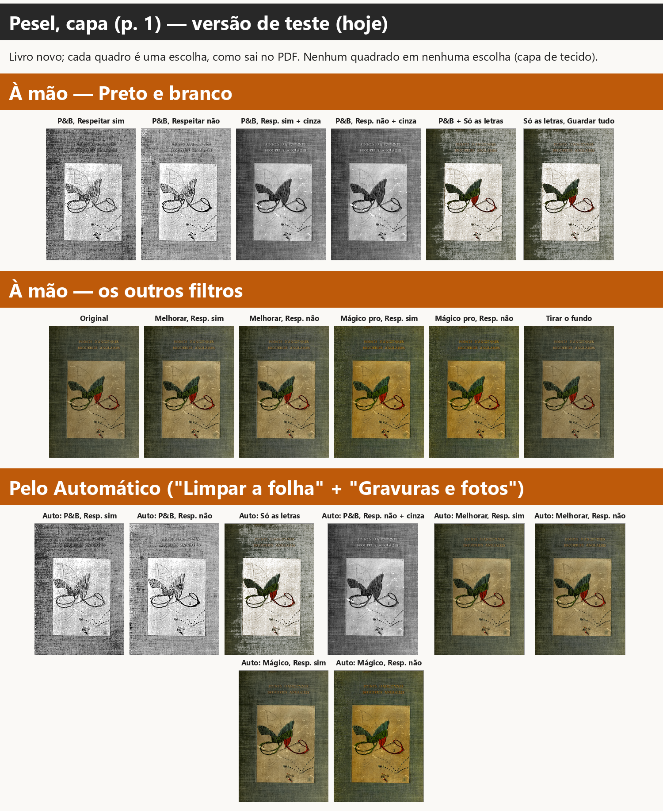

### 9-destino-todas-as-escolhas

**O que olhar:** Destino do socialismo, capa (p. 1): todas as escolhas como saem no PDF; circuladas as que têm quadrado ou caixa que não existe no original (nenhuma).

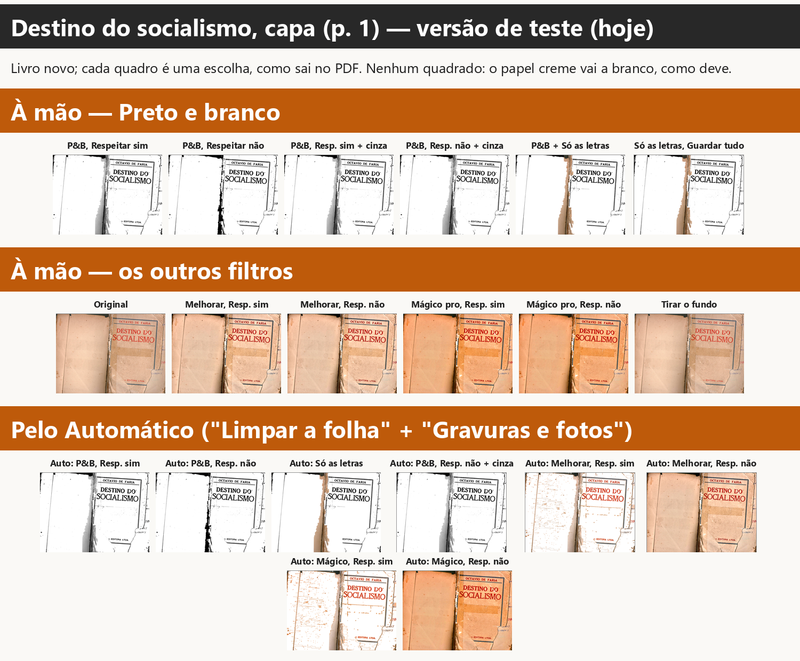

### 10-escola-capa-preto-e-branco

**O que olhar:** Capa da Escola, Preto e branco sem "Respeitar": os quadradinhos brancos só existem hoje (laranja); antes e sem o passo da sombra, não.

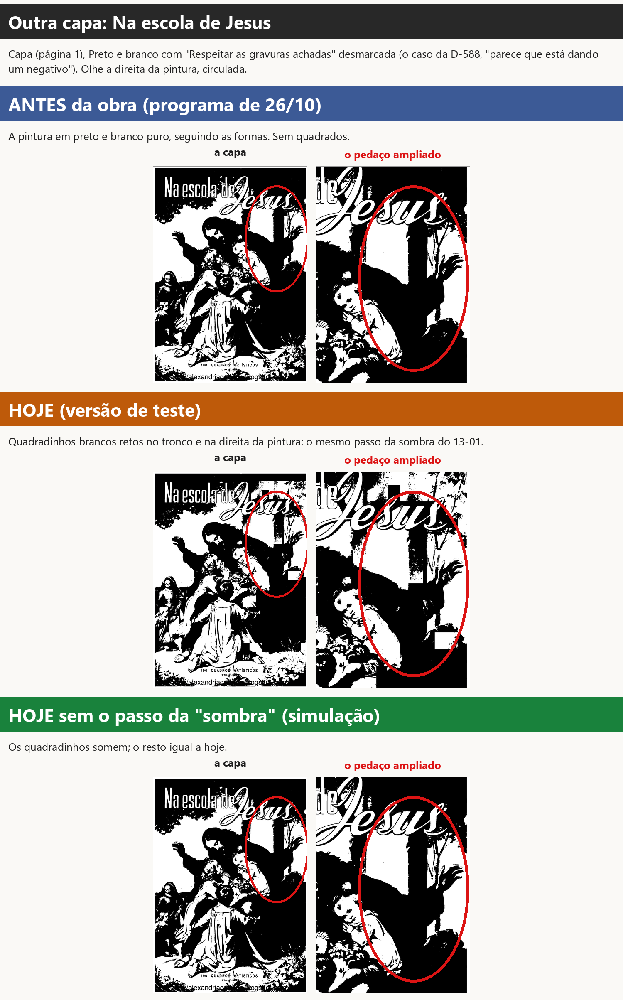

### 11-matematica-e-o-conserto-c

**O que olhar:** Matemática, Melhorar: o amarelo vira branco quando a marcação vale (Automático hoje; à mão com o conserto C). À mão hoje, fica amarelo.

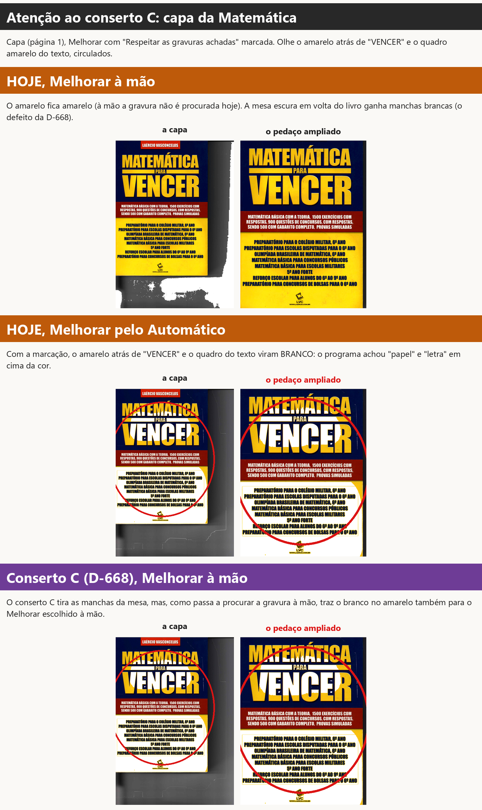

## 1. O 13-01: por que a capa sai preta

**Como você deixou a página** (cópia do seu projeto, `acoes.jsonl`): às 16h09min34s escolheu Preto e branco
(a caixinha "Respeitar" estava **marcada**, de fábrica); às 16h09min45s e 48s marcou e desmarcou "Gravuras em tons
de cinza"; **às 16h09min49s desmarcou "Respeitar as gravuras achadas"** (o registro diz: "Respeitar as gravuras
achadas na página 1: desligada", de marcada para desmarcada); às 16h10min02s ligou "Só as letras" (o 13-02). O
programa não desmarcou nada sozinho.

**A capa preta é a escolha.** Desmarcada, a caixinha manda o filtro valer na página inteira (D-586). No Preto e
branco de fábrica, a página é dividida entre tinta e papel por um limite só (o jeito Otsu, que o programa escolheu
para esta página). A capa azul inteira fica mais escura que esse limite: vira tinta, preto. As letras claras ("PAULO
RÓNAI", "CULTRIX") ficam brancas. Medido: antes da obra, 98,7% da capa sai preta.

**Os retângulos brancos são defeito.** O passo "sombra da foto de celular" (de 27/10) olha a página em
quadradinhos (24 por lado). Onde um quadradinho é mais escuro que o papel (entre metade e 85% da luz dele) e tem
"pouca tinta", ele acha que é sombra e refaz o preto e branco ali com a luz igualada. Na capa azul lisa, os
quadradinhos do alto (entre "PAULO RÓNAI" e "curso básico") e da beirada passam por sombra e viram branco, em blocos
retos. Os que têm o título grande ou o desenho têm muita "tinta" e ficam pretos. Por isso a forma em degraus.

**A prova:**
- o mesmo Preto e branco **sem marcação nenhuma** (livro em que a gravura nunca foi procurada) sai **igual, ponto
  por ponto**, ao do seu caso: a marcação não tem nada a ver com o 13-01;
- passo a passo do filtro na capa: depois do limite único, 98,5% da capa está preta; o passo da sombra muda 15,6% da
  capa (os retângulos); os outros passos mudam quase nada (0,2%);
- tirando **só a parte dos quadradinhos** desse passo (simulação), a capa sai preta lisa; tirando só a parte da
  "lombada" do mesmo passo, nada muda;
- nas versões: antes da obra e logo antes da etapa 10b, a capa sai preta lisa (branco liso na capa azul: 0,05%); a
  partir do commit da sombra em quadradinhos, 13,2%; hoje, 13,6%.

## 2. O 13-02: de onde vem o quadrado branco

**O buraco.** A marcação guardada no seu projeto (imagem 3) tem a capa inteira como gravura, menos um pedaço no alto:
o "ÓNAI" de "PAULO RÓNAI", que o leitor de texto achou como letra. Uma regra do detector de gravura (item 1.2, de
30/09: "Legenda impressa sobre a foto continua sendo legenda", feita para as legendas sobre o cartão colorido da
Pesel) faz a letra ganhar da gravura e recorta esse pedaço da capa. Com "Só as letras", tudo o que não é gravura vai
para o preto e branco. Então esse retângulo sai do preto e branco, no meio da capa azul.

**A cor branca.** No preto e branco desse retângulo, o azul é escuro (sairia preto) e as letras são claras (sairiam
brancas): antes da obra era uma caixa **preta** com "ÓNAI" em branco (faixa azul da imagem 2). Desde 27/10 o passo da
sombra pinta esse azul de branco: a caixa fica **branca**, com um pedacinho preto embaixo (o pedaço que caiu fora do
quadradinho de "sombra"). Sem o passo da sombra (simulação), a caixa volta a ser preta.

**"Guardar a tinta forte" não é a causa:** com "Guardar tudo" e com "Guardar só o texto" a caixa sai igual.

**O retângulo perto de "PAU" no 13-01 é a mesma coisa?** É o **mesmo passo** (a sombra em quadradinhos), mas não o
mesmo buraco: no 13-01 a caixinha desmarcada tira a marcação toda, e o retângulo é um dos quadradinhos de "sombra" da
capa. No 13-02 só aparece o quadradinho que cai dentro do buraco da letra; o resto da capa fica como gravura (azul).

## 3. O conserto C resolve?

**Não.** O conserto C (D-668) mexe no Melhorar e no Mágico pro (procurar a gravura e a limpeza do papel). O Preto e
branco não passa por ali. Rodei os dois casos com o programa do ramo `quadrados-c-2026-11-10`: as páginas saem iguais
às de hoje (13-01: 13,6% de branco liso na capa azul nas duas; 13-02: a mesma caixa branca). São duas coisas
diferentes: lá era a limpeza do papel do Melhorar; aqui é o Preto e branco.

## 4. Onde mais acontece

Testei, na versão de teste, cinco capas (Gradus, *Na escola de Jesus*, *Matemática para vencer*, Pesel e
*Destino do socialismo*) com 20 escolhas cada: Original, Preto e branco ("Respeitar" marcada e desmarcada, com e sem
"Gravuras em tons de cinza", "Só as letras" com "Guardar a tinta forte" e "Guardar tudo"), Melhorar e Mágico pro
("Respeitar" marcada e desmarcada) e Tirar o fundo, escolhidos à mão e pelo Automático ("Limpar a folha" + "Gravuras
e fotos"). Cada uma desenhada como a tela, o cartão do filtro e o PDF. Olhei todas (imagens 5 a 9).

**Onde ACONTECE:**

- **Preto e branco, em qualquer caminho, no Gradus:** com a marcação valendo ("Respeitar" marcada, ou "Gravuras em
  tons de cinza", ou "Só as letras", à mão ou pelo Automático) a caixa branca sobre "ÓNAI"; sem a marcação
  ("Respeitar" desmarcada), os retângulos da sombra. **Ou seja: com a "Respeitar" marcada, como vem de fábrica, a
  caixa branca também aparece** (a capa sai em tons de cinza, D-147, com a caixa branca no alto).
- **Preto e branco sem a marcação, na capa do *Na escola de Jesus*:** quadradinhos brancos retos na pintura
  (imagem 10). É o mesmo passo da sombra. Antes da obra, não havia.
- **Na tela (prévia), no cartão do filtro (e na miniatura) e no PDF:** nos três, igual (imagem 4).

**Outro defeito, parecido, com outra causa (já existia antes da obra):**

- ***Matemática para vencer*, Preto e branco com a marcação:** manchas brancas no azul escuro em volta do título.
  Causa: o programa marcou pedaços do azul como **"papel"**, e papel vai a branco. Tirando só essas áreas de papel
  (simulação), as manchas somem. O programa de 26/10 já fazia igual.
- ***Matemática*, Melhorar e Mágico pro pelo Automático ("Respeitar" marcada):** o amarelo atrás de "VENCER" e o
  quadro amarelo do texto viram branco (imagem 11). Mesma família: "papel" e "letra" achados em cima da cor.
  Antes da obra, o Melhorar com a procura fazia ainda pior (as letras amarelas brancas).

**Onde NÃO acontece:**

- Original e Tirar o fundo: nenhuma capa.
- Melhorar e Mágico pro escolhidos **à mão** (hoje): nenhum quadrado nas capas. Na *Matemática*, a mesa escura em
  volta do livro (é uma foto) ganha manchas brancas: é o defeito da D-668, que o conserto C tira.
- Pesel (capa de tecido) e *Destino do socialismo* (capa de papel creme): nenhum quadrado em nenhuma escolha. No
  *Destino*, o papel creme vai a branco, como deve.
- *Matemática* no Preto e branco **sem** marcação: a capa sai preta lisa (o passo da sombra não age ali).

**Atenção ao conserto C (D-668), que ainda não está na versão de teste:** ele faz o Melhorar e o Mágico pro
escolhidos à mão procurarem a gravura quando "Respeitar" está marcada. Na *Matemática*, isso traz para o Melhorar à
mão o amarelo branco que hoje só aparece pelo Automático (imagem 11, faixa roxa). Nas outras capas o C não criou
quadrado: no Gradus e na Escola a capa sai com o tratamento de gravura (mais clara ou mais forte), sem caixas; no
Preto e branco, nada muda (todas as 20 escolhas saem iguais, ponto por ponto). Pela D-605, isso é para você saber
antes de juntar o C. (O C não foi testado no Pesel e no *Destino*: parei para não pesar o PC.)

## 5. Desde quando

| o quê | desde | mudança | quem |
|---|---|---|---|
| retângulos brancos no Preto e branco (13-01; a cor branca do 13-02) | 27/10/2026, 12h02 | commit `c8844671`, "Etapa 10b: [...] sombra da foto de celular", função `_sombra_em_quadros` em `core/filtros.py` | implementador da **etapa 10b da obra** (ramo `obra-etapa10b-2026-10-26`); juntado à obra em 27/10, 16h46 (`03506fae`) |
| a caixa na capa (o buraco do 13-02) | a regra é de 30/09/2026 (item 1.2, Fase 1); conferido que já existia em 26/10 (`ddd4d74a`) e em `ab38208c` | commits `71e14bef` e `47cabac8`: "a escrita ganha" da gravura do ScanTailor | implementador do item 1.2; a regra existe para as legendas da Pesel e a pauta do Graduale 222 |

O que o passo de 27/10 queria consertar: a Lista de bugs de 23/10, "Páginas fotografadas (celular): o Preto e branco
transforma a sombra da mão ou da página numa grande mancha preta" (Razões do Integralismo 57, Atanásio 8). Esse
conserto funciona nessas páginas; o problema é que ele também age em área colorida lisa, que não é sombra.

Conferido nas versões (página 1 do Gradus, Preto e branco na página inteira; branco liso na capa azul):
antes da obra (`ddd4d74a`, 26/10) 0,05% · logo antes da etapa 10b (`ab38208c`) 0,05% · `50f03701` (a sombra da
lombada, 27/10 11h45) 0,07% · **`c8844671` (a sombra em quadradinhos, 27/10 12h02) 13,2%** · `7ffba04` 12,9% ·
hoje (`84b32df8`) 13,6% · conserto C 13,6%.

**Uma ligação provável com a D-588.** Em 29/10 você achou que a capa do *Na escola de Jesus* no Preto e branco com
"Respeitar" desmarcada "parece que está dando um negativo". Isso foi dois dias depois de 27/10, e essa capa tem os
mesmos quadrados (imagem da capa da Escola). O "negativo" em si (pintura escura vira preto) é o Preto e branco na
página inteira; os blocos brancos em cima dele são deste defeito.

## 6. Que conserto eu sugiro (só sugestão: não consertei)

**Para os retângulos brancos (o passo da sombra):** o passo só trata como sombra o quadradinho **sem cor forte**.
Medi a cor (saturação, de 0 a 255) dos quadradinhos que ele chama de sombra: nas fotos de celular para as quais ele
foi feito, 39 (Razões 57) e 80 (Atanásio 8) em média; nas capas, 116 (Escola) e 168 (Gradus). Um limite perto de
100 separa os dois casos medidos, mas a margem na Escola é pequena: precisa ser medido em mais páginas antes. A
prova antiga do conserto de 23/10 (`test_reversao_foto_de_celular_a_sombra_da_mao_nao_vira_mancha`) tem de
continuar passando (D-605), e o teste de reversão novo mede o branco liso na capa azul do Gradus (13,6% hoje, perto
de 0 antes de 27/10).

**Para a caixa do "Só as letras" na capa:** isso é escolha, não detalhe técnico, então vai como pergunta (abaixo).
A regra "a letra ganha da gravura" foi feita para legenda escura sobre cartão claro (Pesel). Aqui é título claro
pintado na capa escura. Minha sugestão: com "Só as letras", letra clara sobre fundo escuro dentro de uma gravura
achada fica como a gravura (com a cor). Mesmo consertando só o passo da sombra, a caixa continua, preta.

**Para o "papel" achado em cima da cor (Matemática):** o detector não marcar como papel nem como letra o que fica
sobre uma área de cor forte e escura (a capa, a pintura). Isso é defeito antigo (de antes da obra) e não é o que
você mostrou; por isso só sugiro pôr na Lista de bugs, e, se você for juntar o conserto C, olhar junto (seção 4).

## 7. Perguntas para você

1. **13-01:** com "Respeitar" desmarcada, a capa azul sai toda preta, como a D-586 diz ("a capa sairia toda em
   preto e branco"). Está certo assim, sendo defeito só os retângulos brancos? **Sugestão: sim.**
2. **Os retângulos brancos:** posso pedir o conserto do passo da sombra para ele não agir onde a página tem cor
   forte (capa colorida, pintura), sem perder o conserto da sombra da mão nas fotos de celular? **Sugestão: sim.**
3. **O título escrito em cima da capa colorida** ("ÓNAI", no Preto e branco com a marcação e no "Só as letras"):
   - (a) fica como a capa, com a cor dela, sem caixa (**sugestão**);
   - (b) continua virando preto e branco, como antes da obra (uma caixa preta no lugar da branca).
4. **O "papel" achado em cima da cor (Matemática) e o conserto C:**
   - (a) consertar isso antes de juntar o conserto C, para o Melhorar à mão não passar a branquear o amarelo
     (**sugestão**);
   - (b) juntar o C como está e pôr este defeito na Lista de bugs;
   - (c) só pôr na Lista de bugs, sem mexer agora.

## 8. Ressalvas

1. Rodei a conta do programa sem janela (a mesma da tela e do PDF), não a janela de verdade. A prévia, o cartão do
   filtro e o PDF saem com o mesmo defeito (imagem 4); a tira de miniaturas usa a prévia da página.
2. As simulações (sem o passo da sombra) tiram o passo só dentro do processo de teste; o programa não foi tocado.
3. A medida "branco liso onde o original não é papel" aponta onde olhar; não separa branco que devia estar lá (um
   título branco grande) de branco que não devia. Olhei todas as imagens; o que está circulado é o que eu vi.
4. "Pelo Automático" rodei "Limpar a folha" e "Gravuras e fotos" só na página da capa, com as escolhas de cada caso.
5. Achado à parte, fora do assunto: na **prévia** (antes da bolinha terminar), o "PRIMUS" azul-claro da quarta capa
   sai com letras quebradas no Preto e branco; no PDF sai inteiro. Não depende do passo da sombra. Como a tela troca
   a prévia pela imagem do PDF quando fica pronta (D-064/D-473), aparece só por alguns segundos.

## 9. Como medi

- `scripts/rodar_capa.py` — desenha uma página como a tela (prévia, 110), o cartão do filtro (70) e o PDF (300),
  com qualquer versão do programa e qualquer escolha (à mão, na ordem do seu histórico, ou pelo Automático);
  `SEM_QUADROS=1`, `SEM_FAIXA=1`, `SEM_SOMBRA=1` tiram partes do passo da sombra (só no processo de teste).
- `scripts/passos_pb.py` — o Preto e branco passo a passo.
- `scripts/pb_da_versao.py`, `scripts/misto_da_versao.py` — o 13-01 e o 13-02 em cada versão.
- `scripts/rodar_matriz.sh`, `scripts/medir_quadros.py` — todas as escolhas em cinco capas, e a medida.
- `scripts/cor_da_sombra.py` — a cor dos quadradinhos de "sombra".
- `scripts/montar.py`, `scripts/montar_matriz.py`, `scripts/pecas_imagem.py` — as imagens; `scripts/gravar_relatorio.py`.
- Medidas em `medidas/`.
