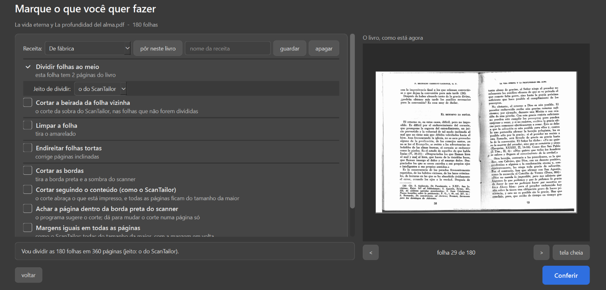
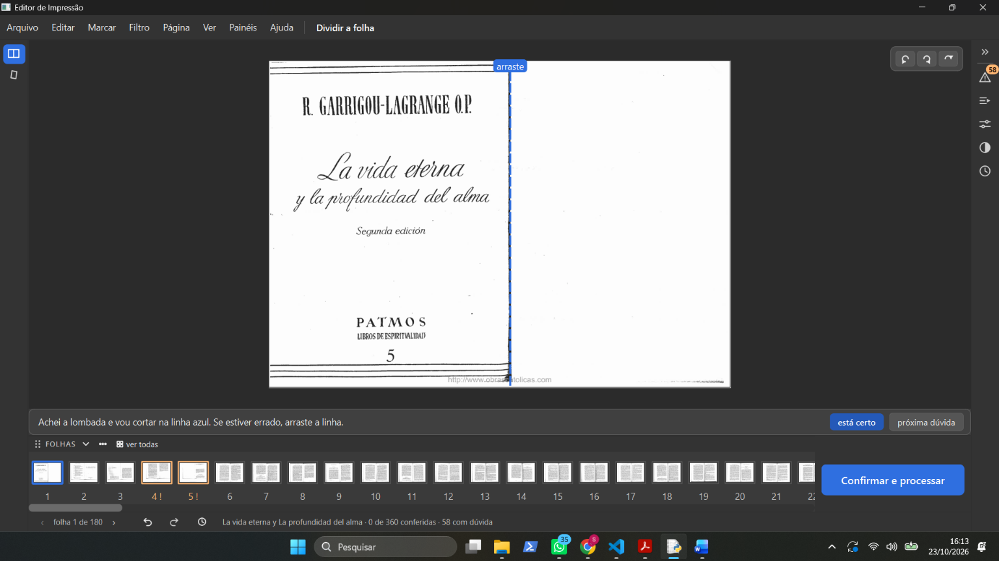
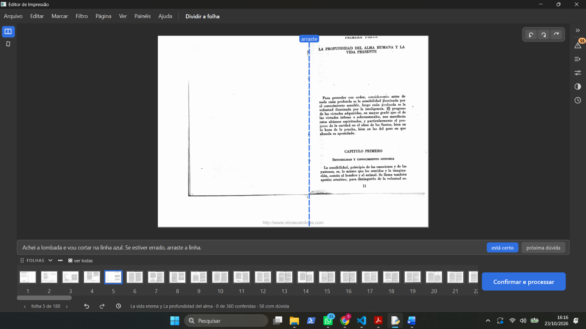

# Testes guiados — sessão 0 (Samuel sozinho, 23/10/2026)

Livro: "La vida eterna y La profundidad del alma.pdf" (180 folhas). Programa no `fase-1` `718454b`
(logo depois da junção da Fase 2). Fonte: `ressalvas-iniciais.docx` (o documento dele, copiado aqui).

Palavras dele no chat: "em menos de 10 minutos achei vários erros e notei como o programa está confuso"
e "esses foi um dos poucos erros, na verdade, eu também fiquei perdido na hora de usar as ferramentas e
preciso saber usar ela para poder ensinar o kaique, o programa não é intuitivo, não consegui nem achar o
modo automatico."

Tipos: **erro** (faz errado ou não faz nada) · **confuso** (faz, mas não dá para entender) · **falta** ·
**a conferir**.

| # | O que ele escreveu | Print | Tipo | O que o código diz (gerente, só leitura) |
|---|---|---|---|---|
| 0-1 | "Receita automática está muito confuso, esse painel" |  | confuso | É a fila "Receita" da tela "Marque o que você quer fazer" (`ui/tela_opcoes.py:197-223`, `core/perfis.py`, item 2.19): guarda e repõe as escolhas desta tela, como os perfis do ScanTailor. Nada nela é automático. O código já diz "provisório até o layout". |
| 0-2 | "Essa opção não dá para desativar" ("Escurecer sozinho a força do preto quando o texto sair falhado") |  | confuso | Só vale com "Só as letras" ligado; sem ele fica cinza, mas continua marcado (de fábrica vem marcado) — parece "ligado e travado" (`ui/tela_opcoes.py:544-553`, `:1039-1040`). |
| 0-3 | "clico no está certo e não acontece nada." (Dividir a folha, folha 1) |  | erro | O clique grava a folha como conferida, mas nada na tela muda: a faixa repete a mesma frase, o rodapé conta páginas e não folhas, e não vai para a próxima (só a barra de espaço vai) (`ui/tela_conferir.py:666-670`, `_marcar_revisada` `:5065-5070`). |
| 0-4 | "As opções do lado sumiram, era para aparecer né, elas somem conforme se escolhe opções quando se vai abrir o pdf a primeira vez?" |  | confuso + a investigar | Os painéis (Para revisar, Automático, Propriedades, Filtro, Histórico) ficam na coluna de ícones da **direita** e começam fechados; a esquerda só tem as ferramentas, e as de etapas desmarcadas somem. Só dois ícones à esquerda não bate com as escolhas (Dividir + Limpar): investigar. |
| 0-5 | "Olha o que o app fez com pdf jogou ele para cima, não faço a mínima ideia do porque." (folha 5) |  | a conferir | A tela "Dividir a folha" mostra o PDF como ele é, só girado (`ui/tarefas.py:533-556`, `core/pdf_io.py:152-210`). Provável: a folha já está assim no PDF. Conferir abrindo a página 5 no Acrobat (1º passo da sessão 1). |
| 0-6 | "não consegui nem achar o modo automatico." | — | confuso | O Automático existe: é um dos painéis da coluna de ícones da direita da tela de conferir (`PainelAutomatico`, `ui/widgets/paineis.py`) e o botão "Rodar o automático..." da tela inicial (`ui/tela_inicio.py:687`). Nada na tela diz isso. |
