# Teste do Kaique — 26/10/2026 (agente fazendo papel de usuário leigo)

**Livro:** cópia de *La vida eterna y La profundidad del alma* (180 folhas, 2 páginas por folha, espanhol, preto e branco amarelado).
**Como foi feito:** o programa rodou de verdade (`main.py` da worktree `teste-kaique`), com a janela de 1280×657 fora da tela, dados e projetos numa pasta de trabalho separada. Tudo foi feito do jeito de uma pessoa: tirar print, olhar, clicar por coordenada no que estava visível. **Não li código do programa**, nem os documentos do projeto. Ajuda usada: só o que aparece na tela (menus, textos dos botões).
**Conferência:** cada PDF gerado foi aberto com PyMuPDF e as páginas foram desenhadas em imagem para ver se o que foi feito à mão saiu de verdade.

## Quadro-resumo

| # | Tarefa (nas palavras do Kaique) | Resultado | Cliques | Principal problema |
|---|---|---|---|---|
| 1 | Abrir o livro | conseguiu com dificuldade | ~22 | A janela de escolher arquivo está **em inglês** ("Look in", "File name", "Open") e digitar o caminho inteiro não abriu o livro; só deu certo entrando pasta por pasta |
| 2 | Dividir as folhas | conseguiu | 2 | "Jeito de dividir: o do ScanTailor / o do Editor" — o Kaique não sabe o que é ScanTailor |
| 3 | Consertar a divisão de uma folha | conseguiu | 3 | Três botões parecidos: "aceitar o corte", "está certo", "próxima dúvida" |
| 4 | Endireitar só uma página | conseguiu com dificuldade | ~12 | Não existe "Endireitar" em nenhum menu; só um ícone sem nome na barra da esquerda. E a página de texto aparecia com a mensagem "Esta página parece estar em branco" |
| 5 | Mover o texto para o meio e aumentar | **não conseguiu** | ~15 | Não há como aumentar o texto. O "mover" parecia funcionar na tela, mas **no PDF o texto não saiu no meio** |
| 6 | Tirar página em branco | conseguiu | 2 | — (botão "Tirar do livro" claro) |
| 7 | O programa endireitar sozinho, só isso | **não conseguiu** | ~14 | Desmarquei "Cortar as bordas", mas o programa **continuou cortando** (painel e PDF) e na volta a caixinha estava marcada de novo |
| 8 | O programa fazer tudo sozinho (tirar o amarelado) | conseguiu com dificuldade | ~10 + 2 processamentos | Escolher "Preto e branco" nas opções do livro **não teve efeito**: o PDF saiu igual (byte a byte) ao "Original". Só funcionou pelo painel "Filtro da página" + "todas" |
| 9 | Ver duas páginas lado a lado | conseguiu | 3 | Fica escondido em Ver > Todas as páginas > "em pares" |
| 10 | Achar e resolver os avisos | conseguiu | ~9 | Os números não batem: 56 no sino, "64 páginas (66 avisos)" ao processar, "356 páginas que você não conferiu" mesmo com "nada pendente" |
| 11 | Gerar o PDF e montar os cadernos | conseguiu | ~8 | A rodinha do mouse **mudou sozinha um número** (100% → 60%) ao rolar a janela "Montar para imprimir" |

Resumo: **7 conseguiu (3 com dificuldade), 2 não conseguiu.** Dois problemas são graves porque a tela diz que fez e o PDF mostra que não fez (tarefas 5, 7 e 8).

---

## Tarefa 1 — "Quero abrir esse livro no programa."

**Resultado:** conseguiu com dificuldade (~22 cliques/tentativas).

**Caminho:** tela "Seus livros" → clicou no **+ "Abrir um PDF"** (fácil, a tela explica bem) → abriu a janela "Escolha o PDF do livro" → tentou digitar o caminho do arquivo no campo de baixo → não abriu → entrou pasta por pasta (clique duplo e digitando o começo do nome) → clique duplo no PDF → abriu a tela "Marque o que você quer fazer".

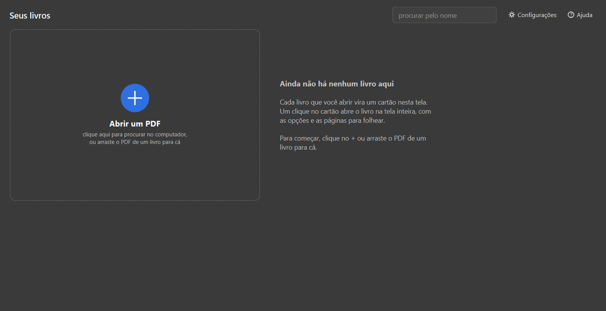

- **Palavra que confunde:** a janela de escolher arquivo está **toda em inglês**: "Look in:", "File name:", "Files of type:", "Open", "Cancel", "My Computer", "Date Modified". O resto do programa é em português.
  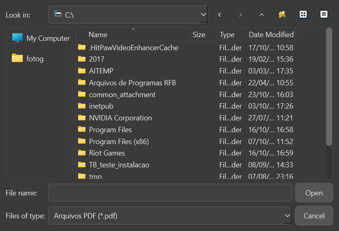
- **Caminho sem saída:** digitar o caminho completo no "File name" e apertar Enter **não abriu o livro**: a janela foi parar em `C:\` e o campo ficou vazio, sem nenhum aviso. Com o caminho começando em `AppData`, apareceu uma lista suspensa de sugestões por cima e o Enter também não abriu. Só funcionou indo pasta por pasta. (Ressalva: parte disso pode ser do meu piloto, que digita mandando letra por letra para a janela; mas a falta de aviso e o inglês são do programa.)
- **Ferramenta que faltou:** atalho para "Área de trabalho", "Downloads" ou "Documentos" no lado esquerdo — só há "My Computer" e "fotog". O Kaique costuma ter o PDF no Downloads ou na Área de trabalho.
- Depois de abrir, a tela de opções é clara ("Marque o que você quer fazer", à direita "O livro, como está agora").
  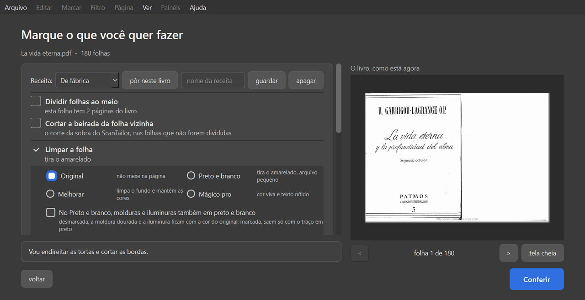

## Tarefa 2 — "Quero dividir as folhas, porque cada folha do scan tem duas páginas."

**Resultado:** conseguiu (2 cliques: marcar a caixinha e "Conferir"; depois cerca de 1 minuto de "Olhando o livro...").

**Caminho:** marcou **"Dividir folhas ao meio — esta folha tem 2 páginas do livro"** → o texto de baixo mudou para "Vou dividir as 180 folhas em 360 páginas (jeito: o do ScanTailor)..." (ótimo, confirma o que vai acontecer) → **"Conferir"** → barra "Olhando o livro... faltam cerca de 55 segundos" → tela de trabalho com a linha azul de corte em cada folha.

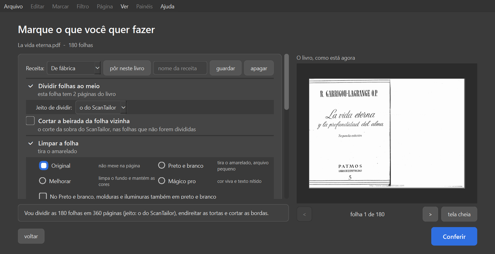
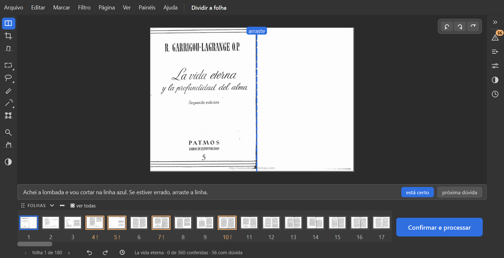

- **Palavra que confunde:** "Jeito de dividir: **o do ScanTailor**" / "**o do Editor**". O Kaique não sabe o que é ScanTailor nem qual "Editor". Também aparece "Cortar a beirada da folha vizinha — o corte da sobra do ScanTailor" e "Conta do endireitar: a do ScanTailor".
  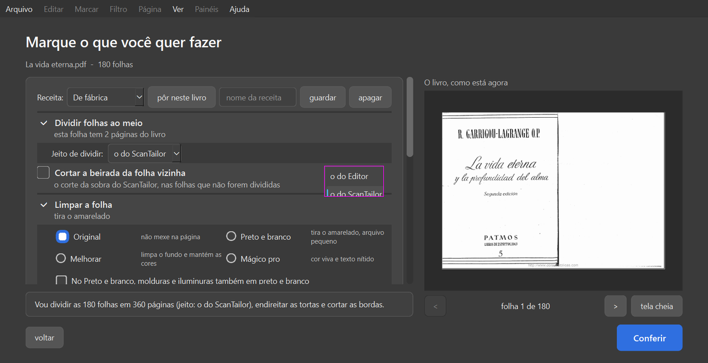
- **Palavra que confunde:** "Receita: De fábrica / pôr neste livro / guardar / apagar" no topo das opções — não fica claro o que é uma "receita".
- **Palavra que confunde:** na tela de trabalho, contador "0 de 360 conferidas · 56 com dúvida" e a palavra "FOLHAS" na faixa de baixo; depois a mesma faixa vira "PÁGINAS" em outro modo. Folha × página não é explicado.

## Tarefa 3 — "Uma folha ficou dividida no lugar errado; quero consertar só essa."

**Resultado:** conseguiu (3 cliques).

**Caminho:** as miniaturas com **"!"** laranja (4!, 5!, 7!, 10!) chamam atenção → clicou na **folha 4** → a linha azul estava na beirada esquerda, longe da lombada, e a faixa dizia "Não tenho certeza de onde cortar. Confira a linha." → **arrastou a linha** (etiqueta "arraste") até a lombada → a faixa mudou para "Achei a lombada e vou cortar na linha azul" e o "!" da folha 4 sumiu → clicou "está certo".

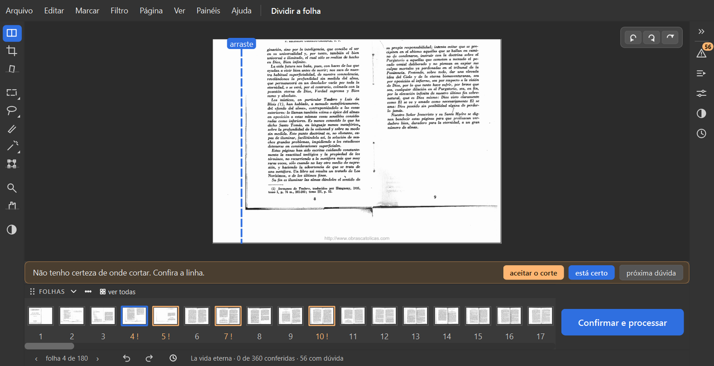

- **Palavra que confunde:** três botões lado a lado: **"aceitar o corte"**, **"está certo"**, **"próxima dúvida"**. "Aceitar o corte" e "está certo" parecem a mesma coisa.
- **Clique sem resposta:** "está certo" depois de arrastar não mudou nada visível (a tela continuou igual, o contador continuou "0 de 360 conferidas"). O Kaique não sabe se o clique pegou.
- Conferido no PDF: a folha 4 saiu dividida na lombada (páginas 7 e 8 do PDF certas).

## Tarefa 4 — "Essa página está torta; quero endireitar só ela."

**Resultado:** conseguiu com dificuldade (~12 cliques, quase metade procurando).

**Caminho:** procurou a palavra "endireitar" → passou o mouse nos ícones da esquerda (**nenhum balão de dica apareceu**) → abriu os 7 menus (Arquivo, Editar, Marcar, Filtro, Página, Ver, Painéis, Ajuda) → **nenhum tem "Endireitar"** → tentou o 3º ícone da esquerda (um quadradinho inclinado) → o título no alto virou **"Endireitar"** e à direita apareceu "Inclinação desta página -0,56 graus" com botões **↺ 0,1° / ↻ 0,1°** e "aplicar em: só esta página" → clicou 3× em ↻ 0,1° → "Você girou esta página em -0,9°."

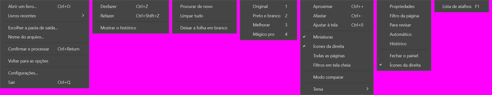
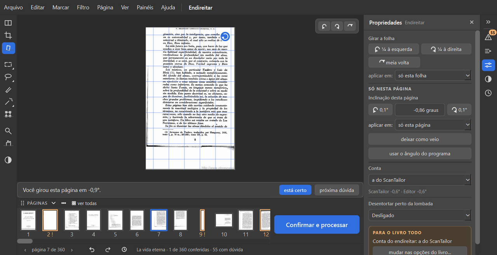

- **Não sei onde clicar:** a barra de ferramentas da esquerda só tem ícones, **sem nome**. Os nomes ("Dividir a folha", "Cortar as bordas", "Endireitar") só aparecem no alto **depois** de clicar.
  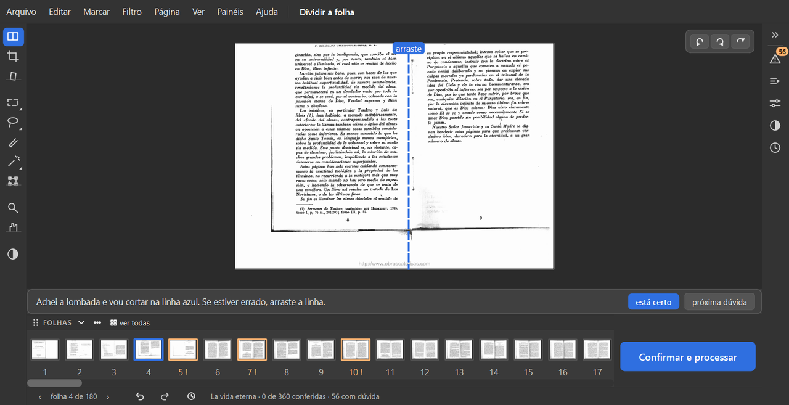
  (Ressalva: o balão pode não ter aparecido por causa do meu piloto, que passa o mouse por mensagem do Windows com a janela fora da tela. Vale o Samuel conferir com o mouse de verdade.)
- **Ferramenta que faltou:** o menu "Página" não tem "Endireitar", "Girar" nem "Cortar"; o menu "Ajuda" tem só "Lista de atalhos F1". Não há ajuda que diga "para endireitar, use o 3º ícone".
- **Mudou algo diferente do que diz:** ao entrar no modo Endireitar na **página 7** (página cheia de texto), a faixa mostrava **"Esta página parece estar em branco. Quer deixar em branco ou tirar do livro?"** com os botões "Deixar em branco" e "Tirar do livro". O Kaique pode apertar "Tirar do livro" achando que é o certo e perder uma página de texto.
  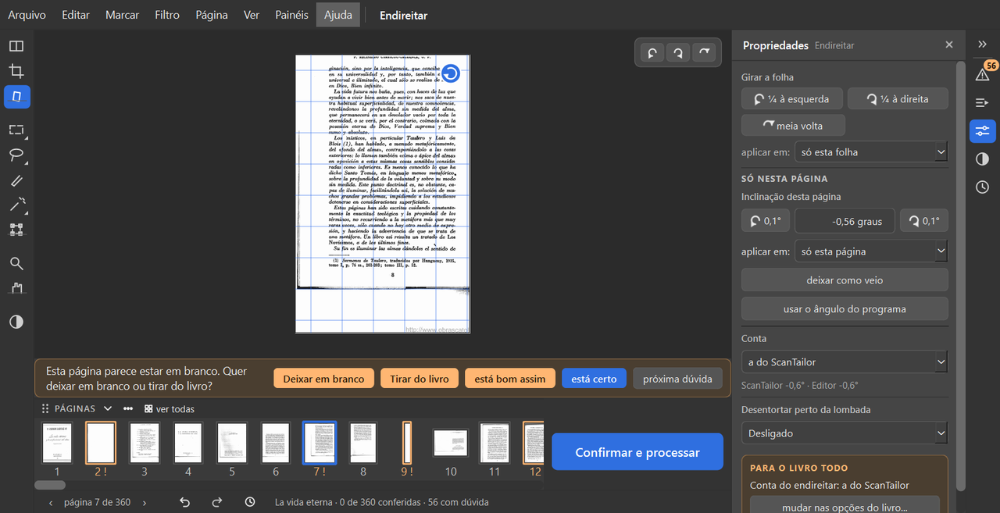
- **Palavra que confunde:** "deixar como veio", "usar o ângulo do programa", "Conta: a do ScanTailor", "ScanTailor -0,6° · Editor -0,6°", "Desentortar perto da lombada".

## Tarefa 5 — "O texto dessa página está deslocado; quero mover ele para o meio da folha e aumentar um pouco." (página 7)

**Resultado:** **não conseguiu** (~15 cliques; tentou duas vezes, num segundo processamento só para conferir).

**Caminho:** ícone de corte (2º da esquerda) → título "Cortar as bordas" → retângulo verde em volta da página → à direita viu **"Mover conteúdo"** apagado, com "(só depois de escolher um tamanho de folha)" → clicou **"tamanho..."** → janela "Tamanho final da folha impressa" (16,23 × 21,01 cm) com o aviso em laranja → OK → "Mover conteúdo" ficou disponível → marcou → arrastou o retângulo (ficou azul) para deixar o texto no meio → tentou aumentar puxando o canto para fora → o retângulo **não passa da borda da folha** e o texto **não aumenta** (só o retângulo muda) → marcou "Proporção travada" e tentou de novo → nada.

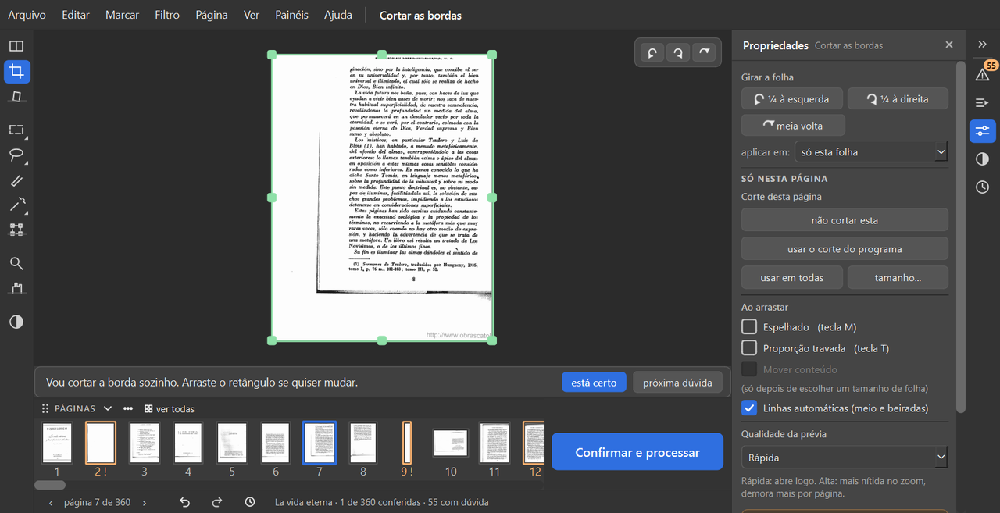
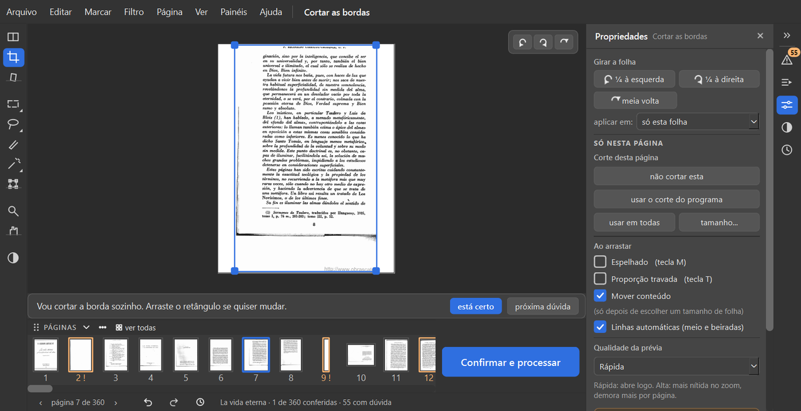
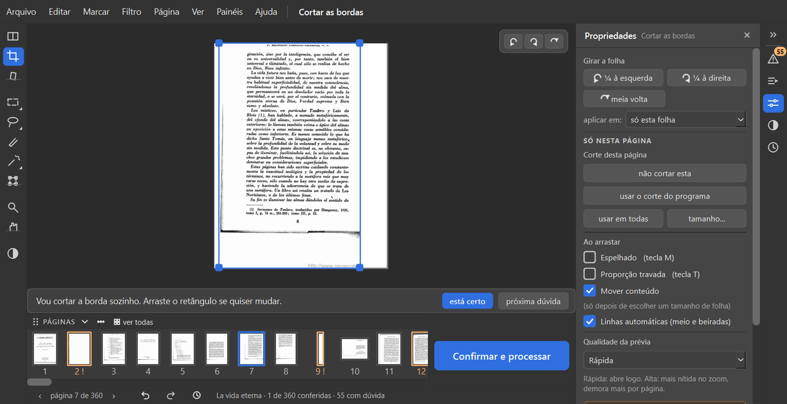

- **Palavra que confunde:** a janela de tamanho diz **"Esse tamanho é menor que o corte que você já fez (16.2 × 21.0 cm) — não vou mudar o seu corte, mas ele não vai caber inteiro na folha."** — mas os números são **iguais** (16,23 × 21,01 contra 16,2 × 21,0). O Kaique não entende o que está errado.
  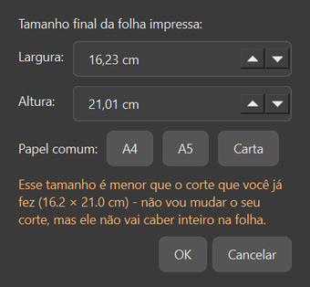
- **Ferramenta que faltou:** **aumentar/diminuir o texto** (escala) da página. Não existe em lugar nenhum da tela de trabalho. (Na janela "Montar para imprimir" existe "Escala", mas é para o livro inteiro na impressão.)
- **Ferramenta que faltou:** um botão "centralizar" — tem que arrastar no olho.
- **Clique sem resposta:** "Mover conteúdo" começa apagado e a frase que explica por quê fica embaixo, em letra pequena.
- **Conferido no PDF (o mais importante):** a página 7 (6ª do PDF, porque a página 2 foi apagada) saiu com 16,2 × 21,0 cm, como pedido, **mas o texto não ficou no meio**: medindo a tinta, a margem da esquerda tem 15 pontos e a da direita 53 (desenho a 40 DPI). O arrastar do "Mover conteúdo" **não chegou ao PDF** (o tamanho da folha chegou; a posição do texto, não). Num segundo processamento, com o livro reaberto (`La vida eterna - pagina7.pdf`, sem arrastar de novo), a página saiu igual.
  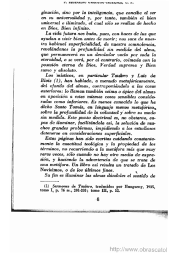

## Tarefa 6 — "Essa página está em branco; quero tirar do livro."

**Resultado:** conseguiu (2 cliques).

**Caminho:** miniatura **"2!"** → a faixa dizia "Esta página parece estar em branco. Quer deixar em branco ou tirar do livro?" → **"Tirar do livro"** → a miniatura virou "apagada".

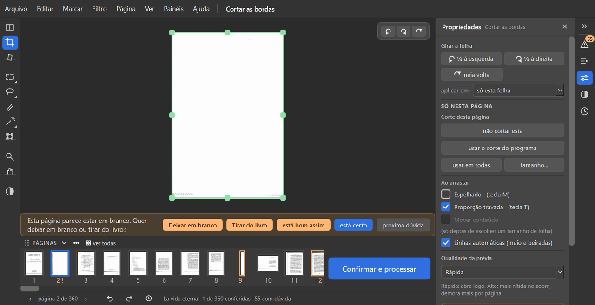
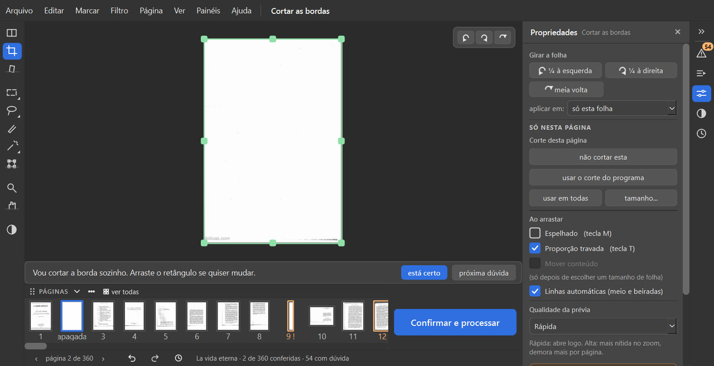

- Conferido no PDF: 359 páginas (360 − 1), e a tela de processar diz "359 páginas vão para o PDF, e 1 foram apagadas" (erro de concordância: "1 foram").
- Observação: o botão "apagar página" também aparece no painel do filtro, em vermelho. Bom ter os dois caminhos.

## Tarefa 7 — "Quero que o programa endireite sozinho, só isso, sem mexer no resto."

**Resultado:** **não conseguiu** (~14 cliques e um processamento inteiro).

**Caminho:** procurou um botão "endireitar sozinho" → Painéis > **Automático** → o painel mostra o que o programa faz sozinho: "Dividir folhas ao meio", "Endireitar folhas tortas", "Cortar as bordas", "Limpar a folha", todos marcados → tentou desmarcar "Cortar as bordas" ali → **não desmarca** (o painel só mostra) → "Voltar para as opções" → rolou a lista → **desmarcou "Cortar as bordas"** (o texto de baixo mudou para "Vou dividir as 180 folhas em 360 páginas ... e endireitar as tortas", sem "cortar") → "Conferir" → esperou → o painel Automático **continuou dizendo "Cortar as bordas" marcado**, e o modo "Cortar as bordas" continuou com o retângulo de corte em cada página → processou mesmo assim.

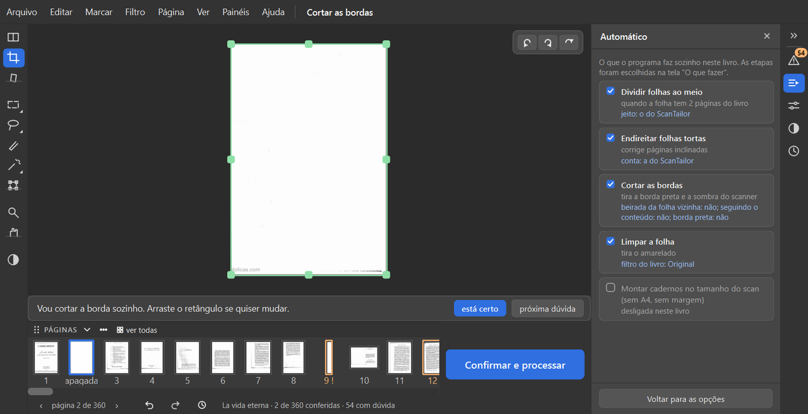
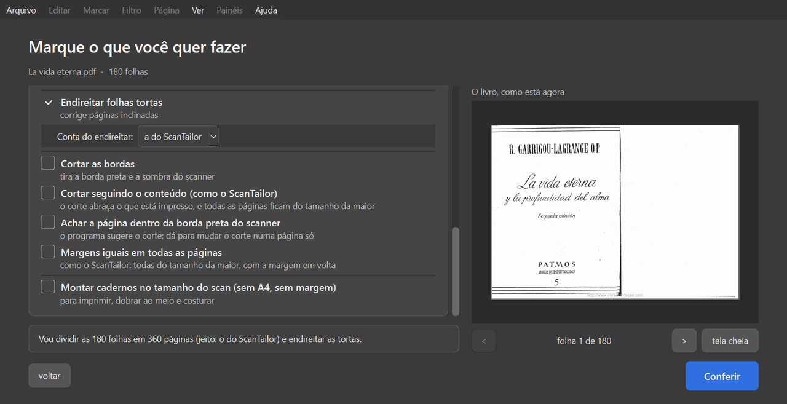
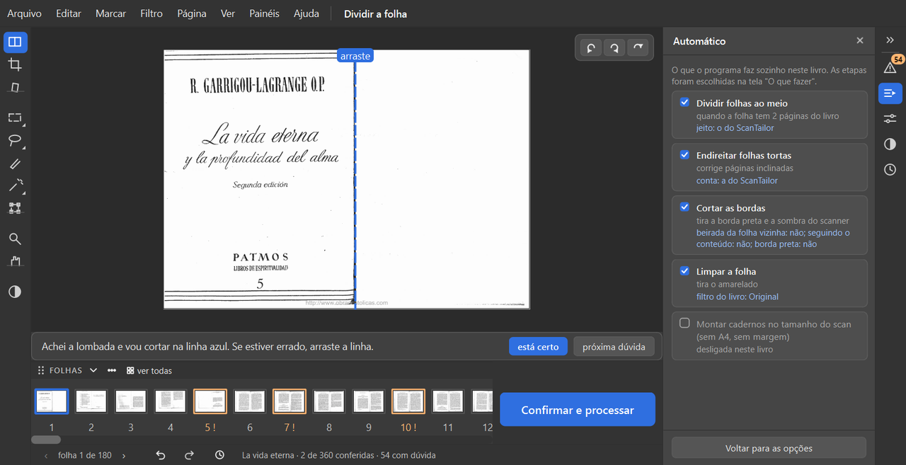

- **Ferramenta que faltou:** "só endireitar" de um clique. Para fazer só isso o Kaique tem que desmarcar várias coisas nas opções, e "Limpar a folha" não tem caixinha de desligar (fica "Original").
- **Clique sem resposta:** as caixinhas do painel "Automático" parecem caixinhas de marcar, mas não fazem nada ao clicar.
- **Mudou algo diferente do que diz:** desmarcar "Cortar as bordas" **não valeu**. Conferido no PDF (`La vida eterna - original.pdf`): as páginas saíram **cortadas**, cada uma de um tamanho (15,5×20,5; 14,3×21,0; 12,1×15,5 cm...), quando meia folha do scan tem 14,85×21 cm. E ao voltar às opções depois ("Rodar o automático..."), a caixinha "Cortar as bordas" estava **marcada de novo**.
  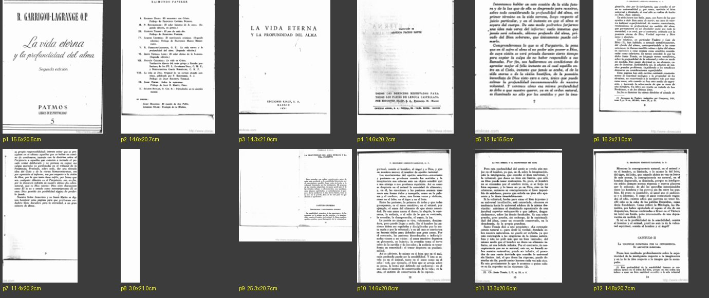
  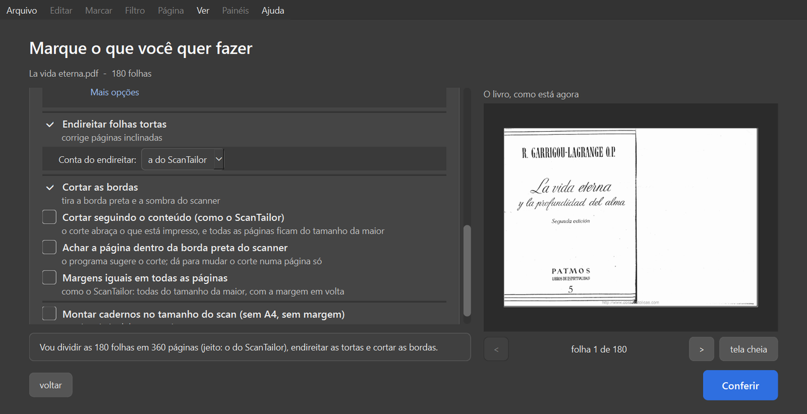
- **Palavra que confunde (janela "Antes de processar"):** "Ainda tem 64 páginas que eu não tive certeza (66 avisos na lista). Quer ver antes ou continuar assim mesmo?", com botões "Selecionar todas", "Nenhuma", "está bom nas marcadas", "ver", "continuar assim mesmo". Muitos botões, e os números não batem com os 54 do sino.
  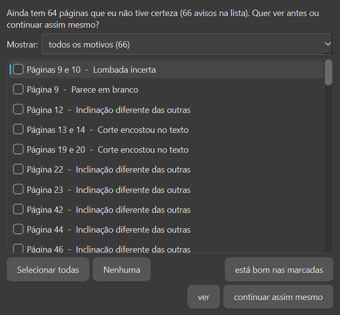
- **Cuidado:** o lugar de salvar vinha como `C:\Users\fotog\Documents\Editor de Impressao` (pasta de verdade do Samuel). Troquei para a minha pasta de trabalho em "Escolher pasta" antes de processar; nada foi gravado em Documentos.
  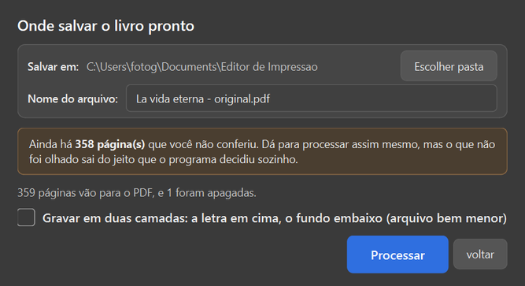

## Tarefa 8 — "Quero que o programa faça tudo sozinho no livro inteiro." (incluindo tirar o amarelado)

**Resultado:** conseguiu com dificuldade (~10 cliques e dois processamentos; o primeiro saiu errado sem avisar).

**Caminho 1 (não funcionou):** "fazer outro" → cartão do livro → **"Rodar o automático..."** → voltou para as opções → em "Limpar a folha — tira o amarelado" escolheu **"Preto e branco — tira o amarelado, arquivo pequeno"** → o texto de baixo confirmou "... deixar tudo em preto e branco e separar as gravuras do texto" → "Conferir" → processou como `La vida eterna - automatico.pdf`.

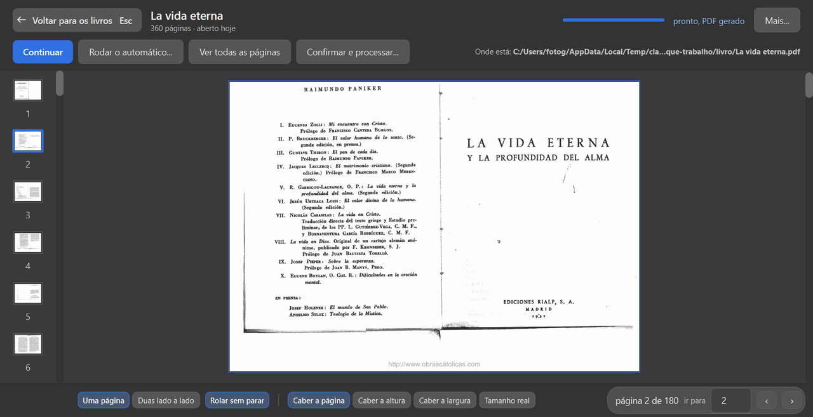
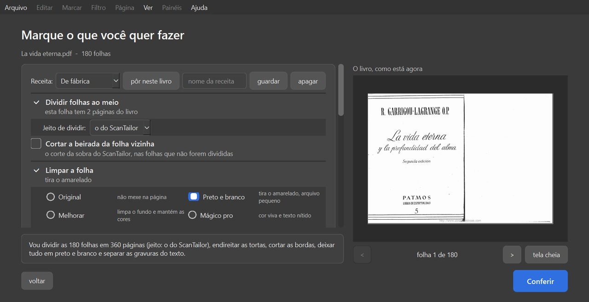

- **Mudou algo diferente do que diz:** o PDF saiu **igual ao "Original"**: 287,7 MB (o scan tinha 40 MB), páginas cinza com o amarelado. O arquivo tem exatamente o mesmo tamanho em bytes do PDF feito sem preto e branco. Na tela de trabalho, o painel Automático continuava dizendo **"filtro do livro: Original"**.
  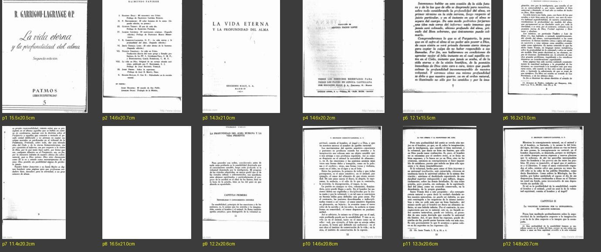
  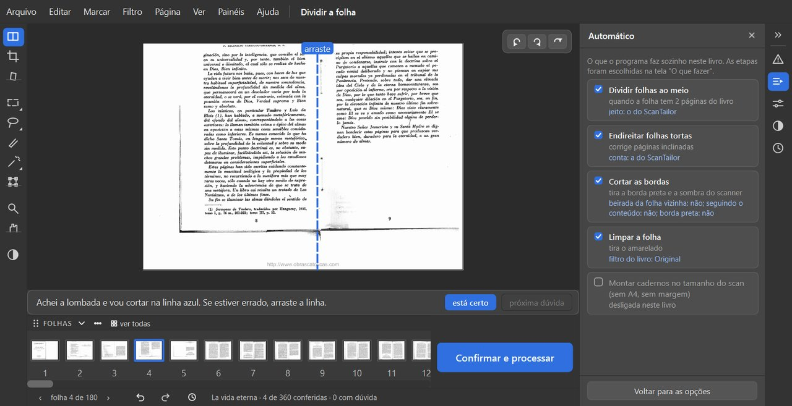

**Caminho 2 (funcionou):** ícone do círculo meio preto (direita) → painel **"Filtro da página"** com Original / Preto e branco / Melhorar / Mágico pro → embaixo "Aplicar em: só nesta / todas / daqui em diante" → clicou **"todas"** e **"Preto e branco"** → processou → **23,3 MB**, todas as páginas em preto e branco, papel branco.

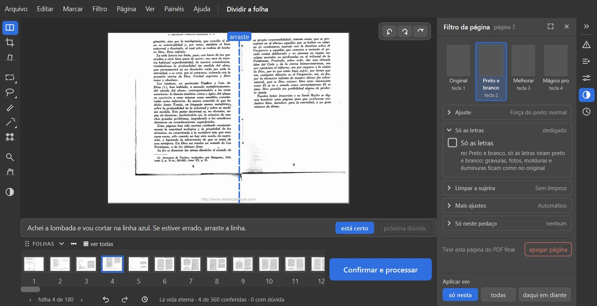
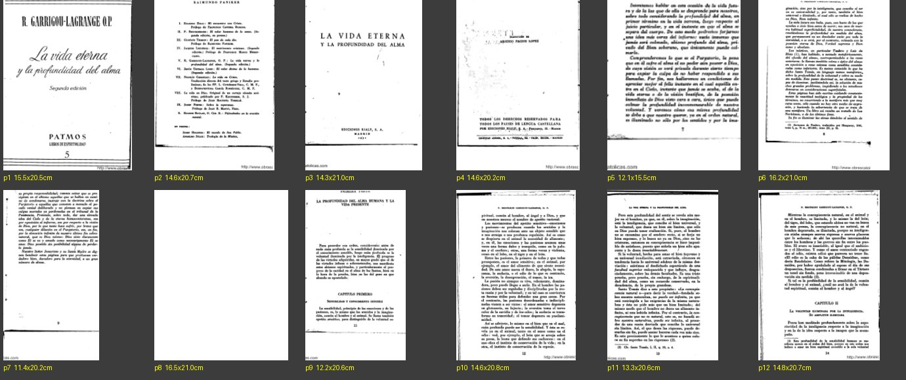

- **Palavra que confunde:** o painel se chama "Filtro **da página**", mas tem "todas" embaixo; o Kaique não imagina que é ali que se muda o livro inteiro.
- **Caminho sem saída:** o botão do cartão se chama "Rodar o automático...", mas só leva de volta às opções; nada roda sozinho até o fim.
- **Palavra que confunde:** "Gravar em duas camadas: a letra em cima, o fundo embaixo (arquivo bem menor)" na janela de processar.

## Tarefa 9 — "Quero ver duas páginas lado a lado, como no livro aberto."

**Resultado:** conseguiu (3 cliques).

**Caminho:** menu **Ver > Todas as páginas** → grade com todas as páginas → botão **"em pares"** → "Em pares: as duas páginas lado a lado, como no livro aberto." → "voltar ao trabalho".

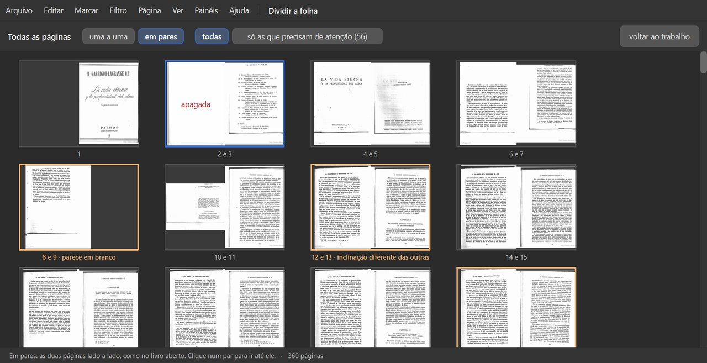

- Também há "Duas lado a lado" na tela do cartão do livro (antes de entrar no trabalho). Dois lugares diferentes para a mesma ideia.
- **Palavra que confunde:** "Ver > Todas as páginas" no menu e "ver todas" embaixo das miniaturas — não sei se são a mesma coisa.

## Tarefa 10 — "O programa mostra avisos; quero achar e resolver os avisos."

**Resultado:** conseguiu (~9 cliques).

**Caminho:** triângulo com **56** na barra da direita → painel **"Para revisar"** (lista "Por página" com o motivo em laranja e a explicação) → clicou em "Página 9 — Parece em branco" → levou à **folha 5**, que estava com a linha de divisão errada ("Não tenho certeza de onde cortar") → arrastou a linha para a lombada → clicou "Página 12 — Inclinação diferente das outras" → foi para o modo Endireitar → "está certo" → aba **"Por motivo"** → "Parece em branco (8)" → "Deixar em branco" → "está bom: todas" na inclinação (54 → 10) → **"está bom em tudo"** → "nada pendente".

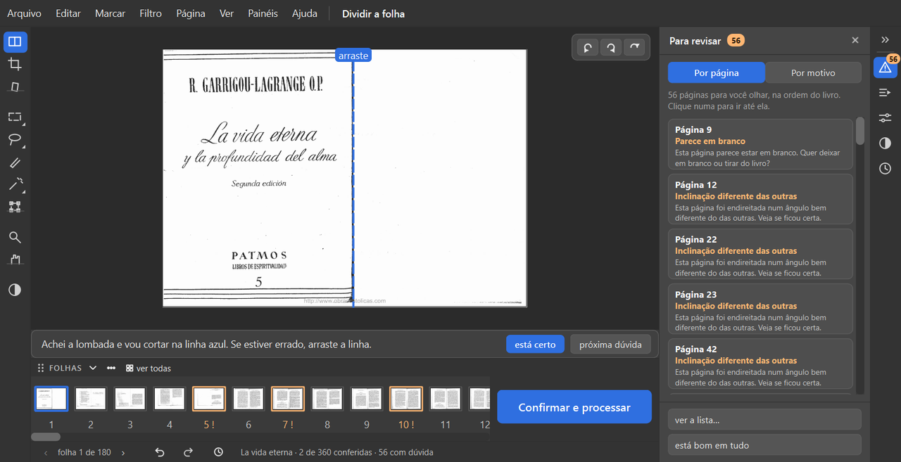
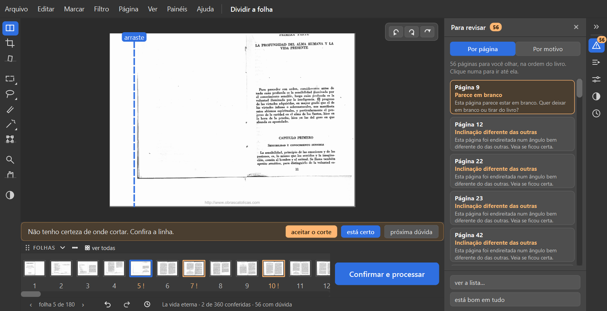
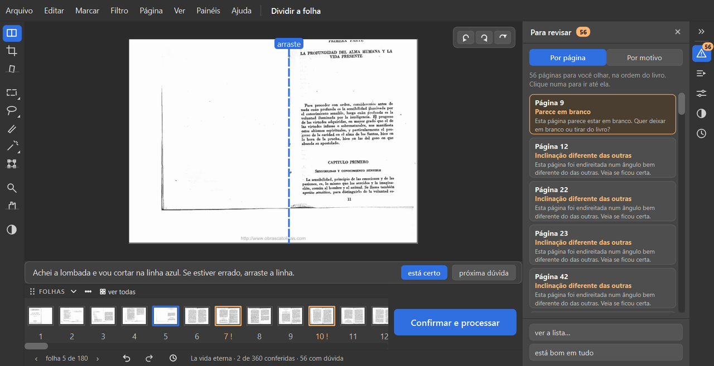
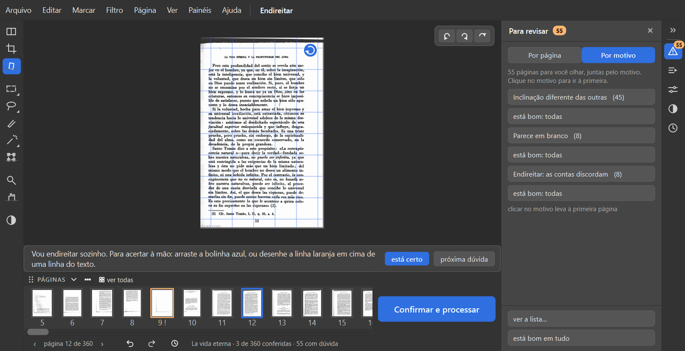
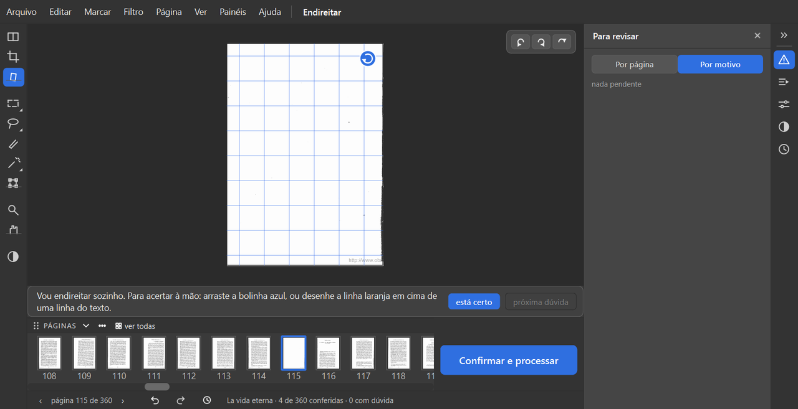

- **Palavra que confunde:** o aviso diz "Página 9", mas clicar leva para a **"folha 5"**. A conta folha ↔ página não é mostrada.
- **Palavra que confunde:** "está bom: todas" aparece três vezes, embaixo de cada motivo, sem dizer de qual motivo é. E "está bom em tudo" embaixo — fácil apertar sem querer e aprovar 54 páginas sem olhar.
- **Palavra que confunde:** quatro botões na faixa: "Deixar em branco", "Tirar do livro", "está bom assim", "está certo". "Está bom assim" e "está certo" parecem iguais.
- **Os números não batem:** sino 56 → janela "Antes de processar" diz "64 páginas ... (66 avisos)" → janela final diz "Ainda há **356 página(s)** que você não conferiu" **mesmo depois de "nada pendente"**. A janela de antes de processar também lista motivos que não estão no painel ("Corte encostou no texto", "Lombada incerta").
  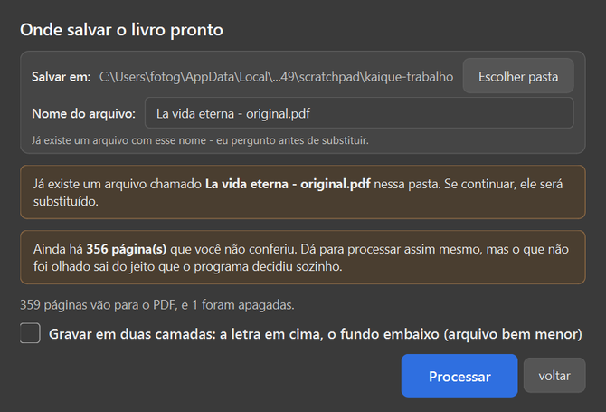

## Tarefa 11 — "Quero gerar o PDF pronto e montar os cadernos para imprimir." (sem "imprimir agora")

**Resultado:** conseguiu (~8 cliques).

**Caminho:** **"Confirmar e processar"** → "Onde salvar o livro pronto" (mudou o nome do arquivo) → **"Processar"** → "Processando o livro... faltam cerca de 2 minutos" (com "cancelar") → **"Ficou pronto!"** 359 páginas → **"montar para imprimir em A4 (com margens)..."** → janela "Montar para imprimir" (Formato: Livreto, Papel A4, Páginas por caderno 20...) → **"gravar o arquivo para imprimir"** → "Save" → "Desenhando as folhas como imagem: 86 de 180" → mensagem final:
> "Pronto: 180 páginas no arquivo, 90 folhas de papel, 18 cadernos. ... Imprima frente e verso, virando na borda curta. Separe as folhas em grupos de 5. Dobre cada grupo ao meio - são 18 cadernos prontos. Conferido: as 359 páginas saem na ordem certa depois de dobrar, e sobra 1 página em branco no fim do último caderno."

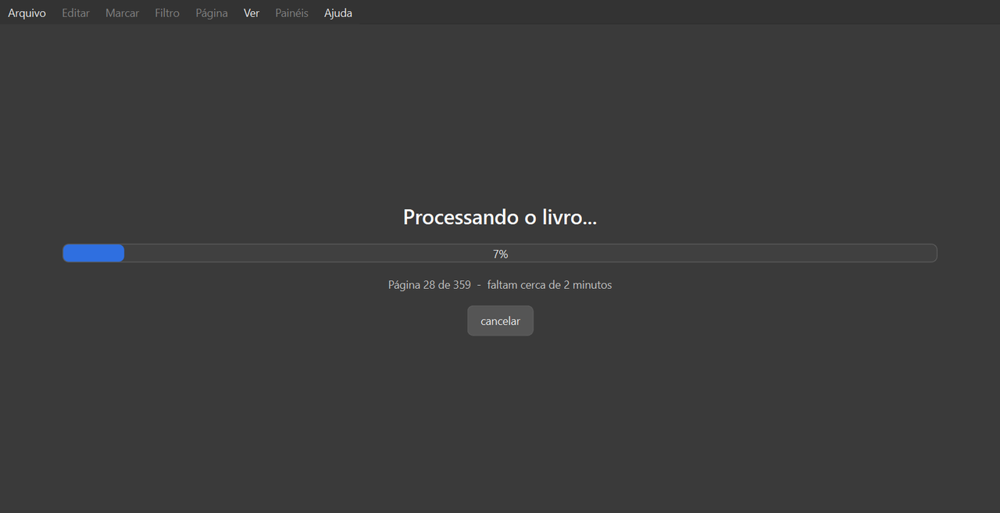
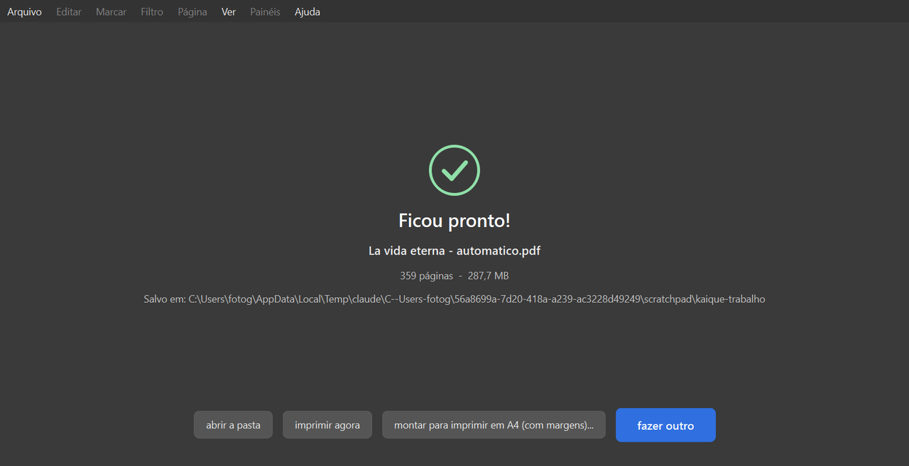
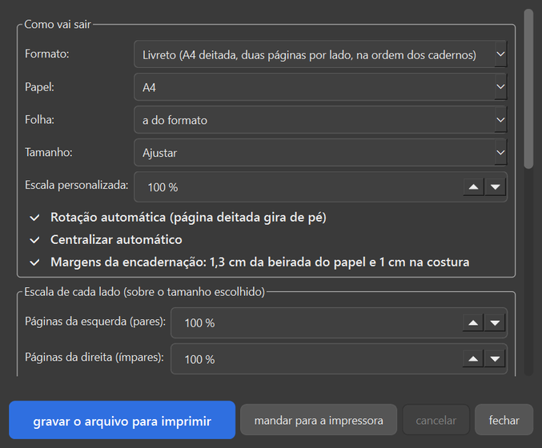
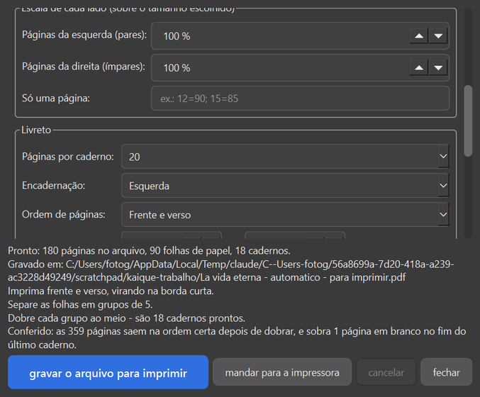

- **Conferido no PDF de cadernos:** 180 páginas A4 deitadas (29,7 × 21 cm), duas páginas do livro por lado; o primeiro lado tem a última página do 1º caderno ao lado da capa, como se espera num livreto de 20 páginas. Olhei só os 4 primeiros lados.
  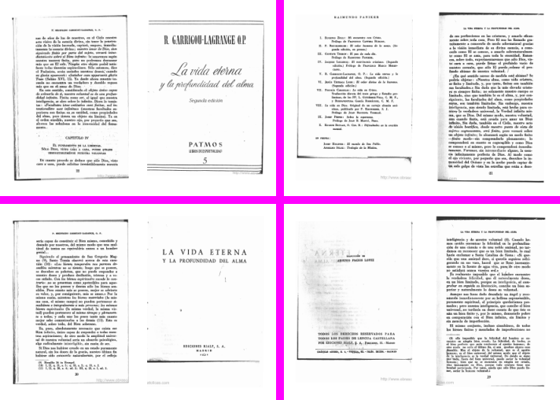
- **Mudou algo sem eu pedir (grave):** ao rolar a janela "Montar para imprimir" com a rodinha do mouse, o campo **"Páginas da esquerda (pares)" passou de 100% para 60%** sozinho, porque a rodinha passou por cima dele. Percebi só porque estava olhando o print; consertei digitando 100. O Kaique pode imprimir um livro com metade das páginas encolhidas.
  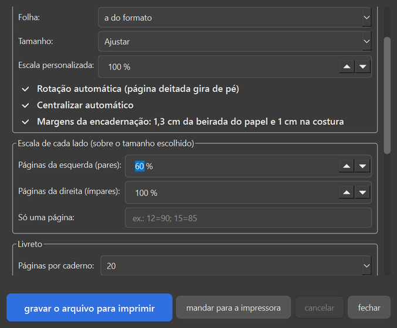
- **Palavra que confunde:** a janela de salvar cadernos também está em inglês ("Save", "File name").
- **Palavra que confunde:** muitas opções técnicas para quem só quer cadernos: "Escala personalizada", "Folha: a do formato", "Imprimir como imagem", "Reverter páginas", "Agrupar", "Folhas de (0 = todas)".
- "mandar para a impressora" e "imprimir agora" ficam ao lado de "gravar..." — **não cliquei** em nenhum dos dois.
- O PDF "Original" ficou com 287,7 MB (o scan tinha 40 MB). Para o Kaique levar num pendrive ou mandar por e-mail, é grande demais, e nada avisa.

---

## Os 10 piores problemas para o Kaique (do mais grave para o menos)

1. **A tela diz que fez, o PDF mostra que não fez — "Preto e branco" escolhido nas opções foi ignorado** (tarefa 8). O PDF saiu igual ao Original, sem aviso. O Kaique imprimiria um livro inteiro amarelado achando que limpou. Só funciona pelo painel "Filtro da página" + "todas".
2. **Desmarcar "Cortar as bordas" não vale** (tarefa 7). O programa cortou mesmo assim e a caixinha volta marcada. Não existe jeito visível de "só endireitar".
3. **"Mover conteúdo" não chega ao PDF** (tarefa 5). Arrastar o texto para o meio parece funcionar na tela, mas a página sai deslocada como antes.
4. **A rodinha do mouse muda números sem querer** na janela "Montar para imprimir" (100% → 60%). Pode estragar uma impressão inteira sem ninguém perceber.
5. **Aviso errado numa página de texto**: "Esta página parece estar em branco. Quer ... tirar do livro?" aparecendo na página 7 (cheia de texto), com o botão "Tirar do livro" ao lado. Risco de perder página boa.
6. **Não há como aumentar o texto de uma página** (tarefa 5), nem botão "centralizar".
7. **Ferramentas só com ícone, sem nome, e nenhum menu tem "Endireitar"/"Cortar"/"Dividir"**; o menu Ajuda só tem "Lista de atalhos". O Kaique fica clicando em ícone por tentativa.
8. **Janela de escolher/salvar arquivo em inglês** e sem atalho para Área de trabalho/Downloads; digitar o caminho não abriu o livro e não deu aviso.
9. **Os números de avisos não batem** (56 / 64 / 66 / "356 que você não conferiu" depois de "nada pendente") e "folha 5" × "página 9" sem explicação — o Kaique não sabe se terminou de revisar.
10. **Palavras técnicas e botões quase iguais**: "o do ScanTailor / o do Editor", "Conta do endireitar", "Receita", "duas camadas"; e "aceitar o corte" × "está certo" × "está bom assim" × "está bom: todas" × "está bom em tudo". O "está certo" não mostra resposta visível ao clicar.

---

## Sobre o teste (ressalvas honestas)

- **Prints:** 48 na pasta `prints/`.
- **Coisas que podem ser do meu piloto e não do programa** (vale o Samuel conferir com mouse de verdade): (a) os balões de dica não apareceram ao passar o mouse nos ícones; (b) clicar com o mouse num item de menu aberto às vezes não fazia nada — pelo teclado (setas + Enter) funcionou; (c) digitar o caminho na janela de arquivo pode ter sofrido com a lista de sugestões que aparece por cima.
- Os prints de menus e janelas por cima foram tirados de fora do programa e colados no lugar aproximado (borda rosa) nos prints "junto"; a posição exata do menu na tela não é a real.
- O programa rodou fora da tela o tempo todo, com os dados em pasta separada; a pasta de verdade `%LOCALAPPDATA%\EditorImpressao` não foi tocada por este teste (últimas mudanças lá são de 18:04–18:57, antes do teste começar às 19:41) e nada foi gravado em `Documentos\Editor de Impressao`.
- Não li código do programa, nem `CLAUDE.md`, `memoria/`, `docs/`, `historico/`, `relatorios/` (exceto esta pasta). Li só o ajudante `base.py` indicado, e usei dele só a parte de infraestrutura.
- Scripts em `piloto/`: `piloto.py` (abre o programa pelo `main.py` e recebe comandos), `kq.py` (manda um comando: print, clique, duplo, arrastar, mover, rolar, tecla, digitar), `k.sh`/`iniciar.sh` (atalhos), `folha_contato.py` (desenha páginas do PDF de saída), `ativar.py` (tentativa de fazer os balões aparecerem).
