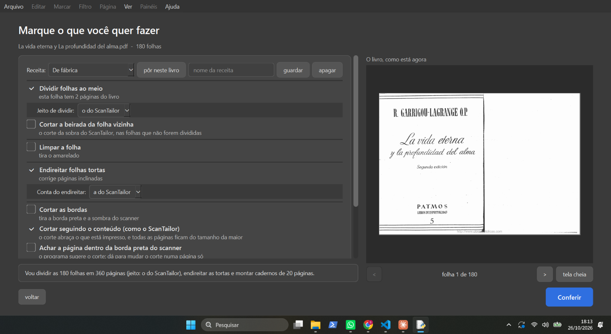
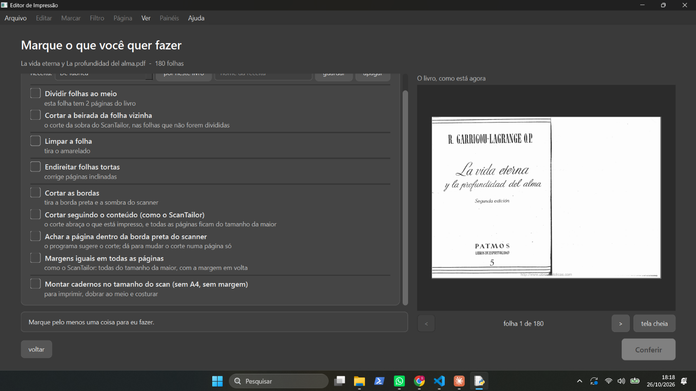
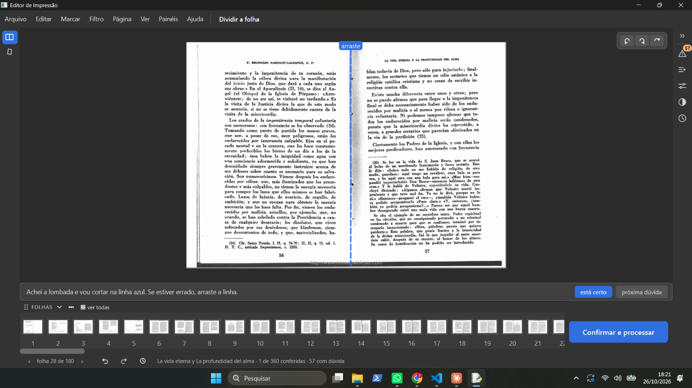
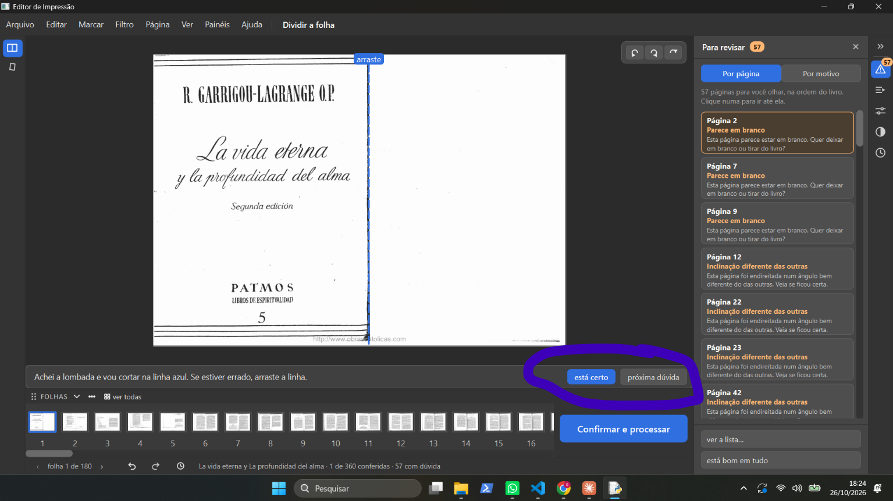
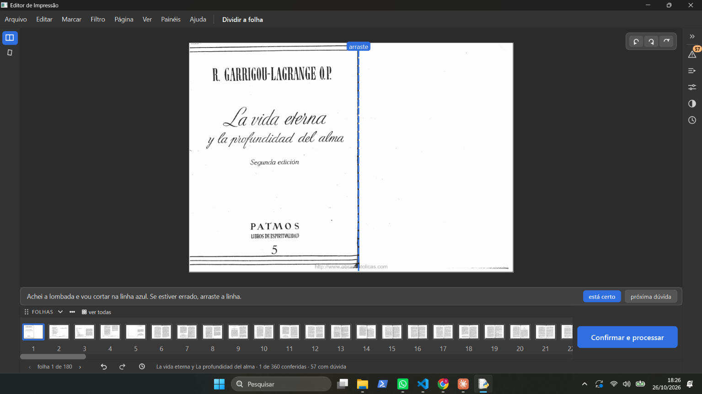
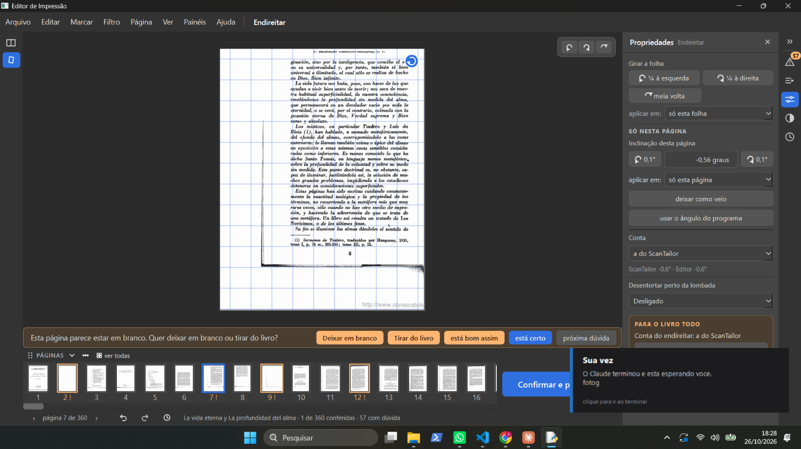
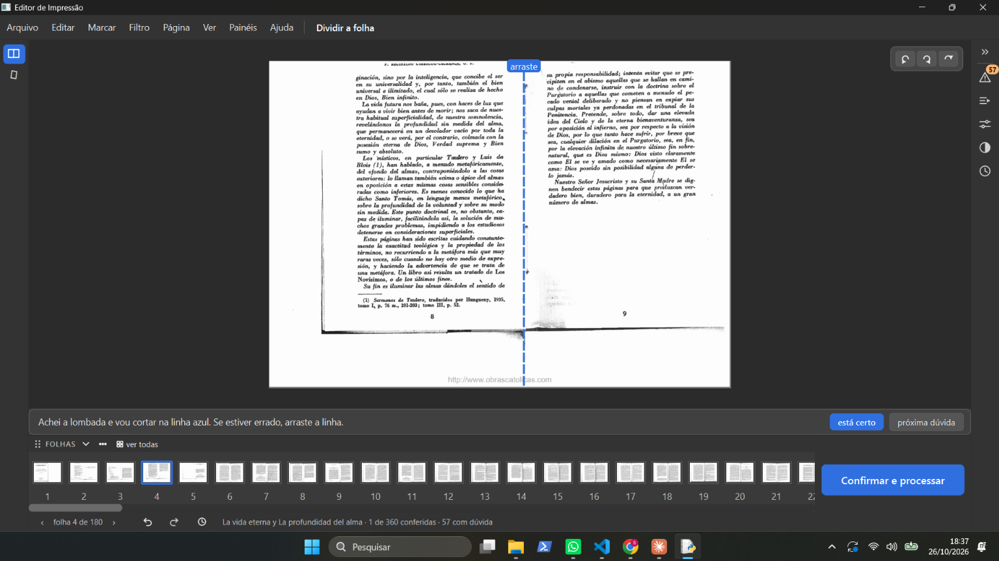
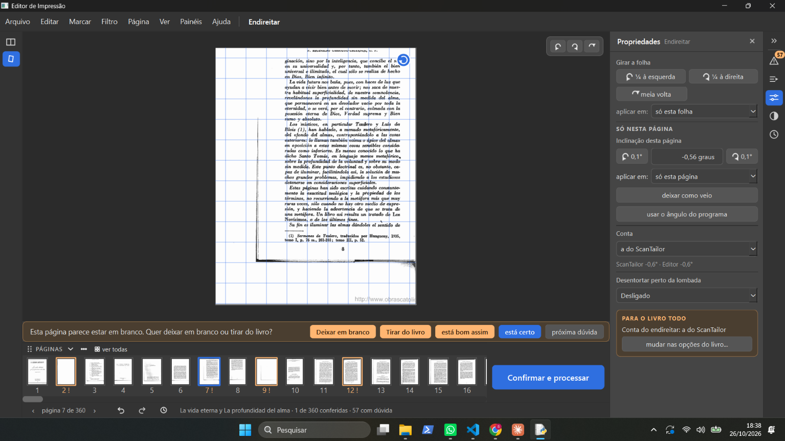
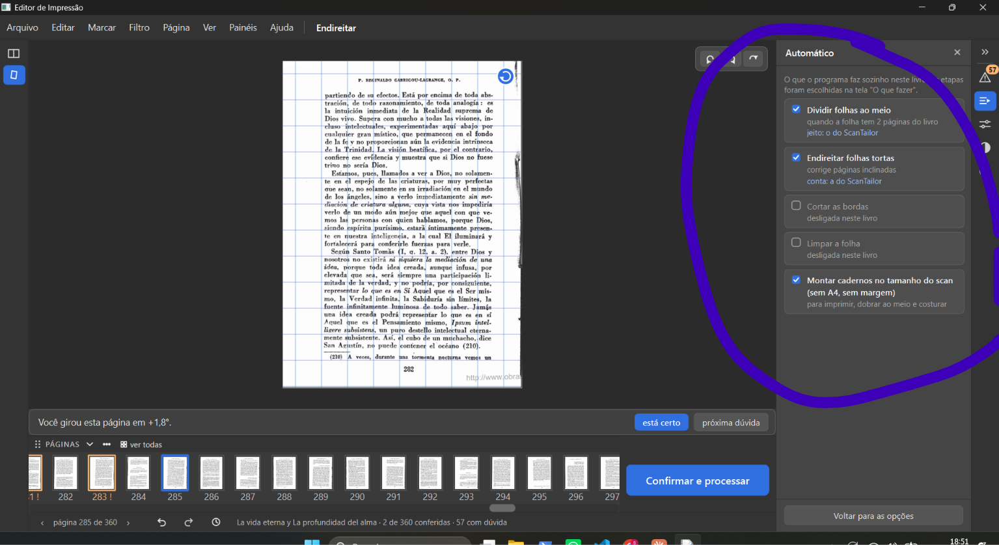
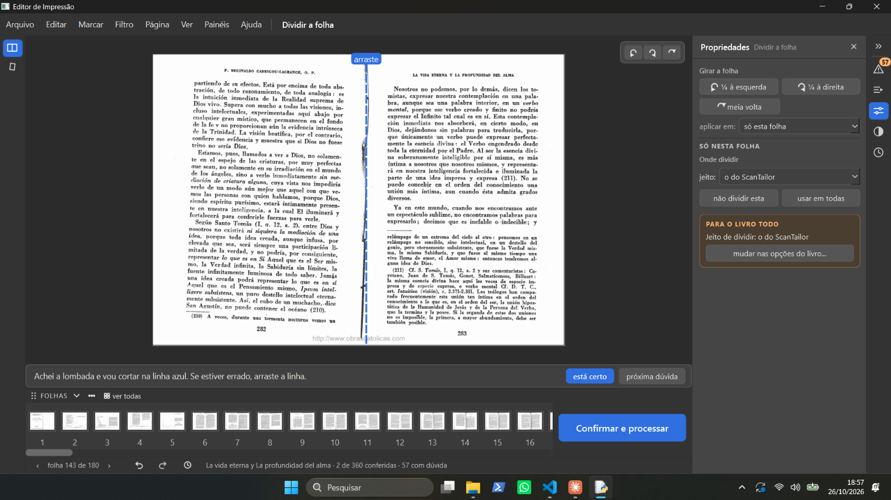

# Testes guiados — sessão 1 (gerente guiando, 26/10/2026)

Livro: "La vida eterna y La profundidad del alma.pdf" (180 folhas,
`D:/Livros para editar/2 - TEOLOGIA/Escatologia/`), recomeçado com "começar de novo" (defeito de 29/09: mudar as
caixinhas num livro já conferido não vale). Programa no `fase-1` `331228e`.

Decisão de abertura, palavras dele no chat: "1. oK  2- A" (1 = bloco "Avisos" no topo da lista única; 2 = fazer já a
sessão 1 guiada, antes de ler a lista).

Tipos: **erro** (faz errado ou não faz nada) · **confuso** (faz, mas não dá para entender) · **falta** ·
**a conferir**.

## Passo a passo

| Passo | Instrução da gerente | O que ele viu / disse |
|---|---|---|
| 1 | Abrir o programa pelo atalho "Editor de Impressao (desenvolvimento)" e ver se o cartão do "La vida eterna..." está na tela inicial. | "onde está o livro?" |
| 1b | Caminho do PDF; na tela inicial, botão direito no cartão → "começar de novo", ou "Abrir um PDF" (+ azul). | Chegou em "Marque o que você quer fazer" (print `s1-01`): marcados Dividir (o do ScanTailor), Endireitar (a do ScanTailor), "Cortar seguindo o conteúdo"; desmarcados "Cortar a beirada", **"Limpar a folha"**, "Cortar as bordas", "Achar a página dentro da borda preta". Resumo: "Vou dividir as 180 folhas em 360 páginas (jeito: o do ScanTailor), endireitar as tortas e montar cadernos de 20 páginas." |
| 2 | Teste: desmarcar tudo, ler a frase "Vou...", clicar "Conferir". | Print `s1-02`: todas as 9 caixinhas desmarcadas; a frase vira "Marque pelo menos uma coisa para eu fazer."; o "Conferir" fica cinza (não clica). Achado 1-2. |
| 3 | Marcar Dividir, Limpar a folha, Endireitar, Cortar seguindo o conteúdo, Montar cadernos; **não** clicar "Conferir" ainda; mandar print. | Clicou "Conferir" e foi para a tela de conferir (print `s1-03`): ferramenta "Dividir a folha", folha 28 de 180, linha azul "arraste" na lombada, faixa "Achei a lombada e vou cortar na linha azul. Se estiver errado, arraste a linha." com "está certo" / "próxima dúvida"; **só 2 ícones à esquerda**; rodapé "1 de 360 conferidas · 57 com dúvida"; alerta 57 na direita. `projeto.json` gravado às 18:21: `dividir_folhas` true, `endireitar` true, `cortar_pelo_conteudo` true, `montar_cadernos` true, **`limpar` false**. É o mesmo projeto da sessão 0 (não foi "começar de novo": "1 de 360 conferidas" é a folha 1 que ele marcou em 23/10). Achados 1-3 e 1-4. |

## Achados

| # | O que ele escreveu | Print | Tipo | O que o código diz (gerente, só leitura) |
|---|---|---|---|---|
| 1-1 | "estou aqui no inicio, onde deveria ter já a questão do automatico né, mas na verdade essa parte inicial virou onde nós escolhemos o que vamos usar dentro do livro, se não escolhermos opção nenhuma, não conseguimos fazer nada no livro, o agente fez esse teste, abrir o livro sem escolher opção? ( anote todas as minhas perguntas e prints.)" |  | confuso + a conferir | **Nenhum agente testou abrir com tudo desmarcado**: não está no mapa (ramo `mapa-do-programa-2026-10-23`) nem nos 14 livros (`testes-livros-2026-10-23`). Ele entende a tela como "escolher as ferramentas que vou ter", e ela também é o "automático" (o que vem marcado o programa faz sozinho ao clicar "Conferir") — confirma o 0-6. Teste feito na hora, passo 2. |
| 1-2 | "não dá para iniciar sem escolher nenhuma opção, o que está errado, essa tela deveria ser só para escolher o automatico, eu deveria conseguir abrir o livro sem escolher nenhuma opção para fazer tudo manualmente." |  | erro (de projeto da tela) + pedido de mudança | Com tudo desmarcado: "Marque pelo menos uma coisa para eu fazer." e "Conferir" cinza. Hoje a tela faz duas coisas ao mesmo tempo: escolhe o que o programa faz sozinho **e** quais ferramentas aparecem depois (desmarcar "Limpar a folha" some com as ferramentas de marcar, Zoom, Mão e filtros — 0-4; marcar depois não vale — 0-9/2.5). **O que ele quer:** a tela serve só para escolher o automático; sem nada marcado, o livro abre com todas as ferramentas para fazer tudo à mão. Vai para a rodada de consertos depois das sessões (nenhum código muda durante a sessão). |
| 1-3 | "problema que eu já tinha falado, não aparece as outras ferramentas, porque???" |  | confuso (repete 0-4) | No `projeto.json` gravado ao clicar "Conferir", **"Limpar a folha" ficou desmarcada** (`limpar: false`); sem ela somem as ferramentas de marcar, Zoom, Mão e os filtros (mapa: "Desmarcada, todas somem"). Mesmo problema do 0-4: a caixinha marcada é só um tique sem quadrado, fácil de não ver se marcou; e nada avisa que desmarcar esconde ferramentas. Reforça o pedido 1-2. Ainda a confirmar com ele se chegou a marcar "Limpar a folha". |
| 1-4 | "Segundo era para ter feito as coisas automaticamente, mas não dividiu as folhas." |  | confuso | O automático **fez** a parte dele: achou a lombada em cada folha (a linha azul). A tela "Dividir a folha" mostra a folha inteira com a linha onde vai cortar, para conferir; a divisão de verdade só acontece em "Confirmar e processar" (como no ScanTailor). Nada na tela diz que a divisão já está "feita, só falta confirmar" — ele esperava ver as páginas separadas. **Logo depois ele mandou:** "quando eu abro ele aparece as folhas divididas." — print (só no chat, sem arquivo para copiar): "ver todas" → "Todas as páginas", "uma a uma", 360 páginas já separadas; marcadas em laranja "2 · parece em branco", "7 · parece em branco", "9 · parece em branco", "12 · inclinação diferente das outras", "22" e "23 · inclinação diferente das outras"; botão "só as que precisam de atenção (57)". Ou seja: a divisão automática está feita; na ferramenta "Dividir a folha" a folha aparece inteira com a linha, e no "ver todas" aparece dividida — duas vistas diferentes do mesmo resultado, sem explicar. |
| 1-5 | "eu clico no esta certo e não acontece nada." (círculo dele em volta de "está certo" / "próxima dúvida", folha 1) |  | erro (repete 0-3 / lista 1.1) | Mesmo defeito do 0-3, ainda aberto: o clique grava a folha, mas nada na tela muda. No print o painel "Para revisar" (57) está aberto à direita. |
| 1-6 | "eu não tinha marcado limpar folhas, mas agora marquei, e abri de novo o livro e não aparece as opções do lado ainda., eu digo das ferramentas do lado esquerdo, isso está errado, o programa era para ser como o photoshop, você errou totalmente, errou em varias coisas, os agente alucinaram e fizeram o programa errado e agora teremos que refazelo." |  | **erro** (defeito de 29/09, lista 2.5) + pedido de mudança de projeto | Ele marcou "Limpar a folha" e reabriu o livro, mas o `projeto.json` (gravado às 18:26:46) continua com **`limpar: false`**: a marcação **não foi gravada** porque o livro já tem trabalho (folha 1 conferida) — o defeito de 29/09. Por isso a coluna da esquerda segue com 2 ícones. **Pedido dele:** o programa tem que ser "como o photoshop" (ferramentas sempre à vista à esquerda, independentes do automático). Ele diz que o programa terá que ser refeito — decisão grande, levada a ele no chat (26/10). |
| 1-7 | "essa folha eu não precisava endireitar ela, eu precisava conseguir mover ela dentro da area branca e redimensionar." (ferramenta Endireitar, página 7 de 360, inclinação -0,56°; o texto está deslocado para a direita e para baixo, com a borda preta do scan embaixo à esquerda) |  | falta + confuso | **Mover existe, mas escondido:** "Mover conteúdo" fica no painel da ferramenta de bordas (`ui/tela_conferir.py:1365-1374`), que só aparece com "Cortar as bordas" marcada na primeira tela, e mesmo lá fica cinza até escolher um tamanho de folha ("só depois de escolher um tamanho de folha"). Neste livro a caixinha não foi marcada, então a ferramenta nem aparece. ~~**Redimensionar o conteúdo** (aumentar/diminuir a mancha dentro da folha) **não existe**.~~ **Errado — corrigido no 1-9:** existe, arrastando um canto no "Mover conteúdo". É o mesmo pedido "como o Photoshop": pegar a página, mover e mudar o tamanho direto, sem depender de caixinha. **Outro achado no mesmo print:** a faixa diz "Esta página parece estar em branco" na página 7, que tem texto — aviso falso (lista 5.7). |
| 1-8 | Resposta às opções A/B/C da gerente: "a- Eu já tinha decidido isso antes, você não lembra porque? b- seria todo um retrabalho c- eu quero achar o resto dos erros. Eu quero saber o que foi feito errado, para poder arrumar, quero saber como foram feitos esses testes e porque eles não perceberam. Isso tinha sido uma coisa falada expliccitamente e já aviamos tradados dessa opção A e de como seria o modo automatico, isso foi uma grande alucinação" | — | **erro de processo** (decisão perdida) | Ele tem razão: decisões 1 e 2 de 25/09/2026 (Photoshop puro, todas as ferramentas numa tela; painel Automático no lugar da tela "O que fazer"), repetidas em 12/10 (R12 708). Nunca entraram numa etapa do layout. Investigação completa: [o-que-deu-errado.md](o-que-deu-errado.md). A sessão continua (opção C dele). |
| 1-9 | "1- mover deveria se poder fazer sem ter que ir em cortar bordas e poder ser feito como é no photoshope, que você arrasta a hora que quiser  e aumenta a hora que quiser. a ferramenta de mover não deveria estar vinculada ao corte de bordas, deveriam ser duas coisas independentes  2- essa função existe e eu escolhi isso dentro das perguntas feitas para mim, olha a nossa central ou os outros artefatos." | — | erro (ferramenta presa a outra) + **correção da gerente** | **Ele tem razão no 2: redimensionar existe.** Pedido dele de 22/09/2026 ("quero conseguir redimensionar o conteudo tambem"): no "Mover conteúdo", arrastar um canto muda o tamanho (`ui/widgets/visualizador.py:864-870`); e em 22/10 (`fr-24`, Central) "Mas se eu quiser redimensionar isso dentro do programa eu vou conseguir né?" → respondido "sim". A gerente errou no 1-7 ao dizer que não existe (procurou só o botão, não o canto que arrasta). **O problema real (1):** mover e redimensionar só existem dentro da ferramenta de bordas, que só aparece com "Cortar as bordas" marcada, e só ficam ativos depois de escolher um tamanho de folha. **O que ele quer:** Mover (com redimensionar) como ferramenta própria, independente do corte de bordas, usável a qualquer hora, como no Photoshop. Liga-se à decisão 1 de 25/09 (todas as ferramentas numa tela). |
| 1-10 | "o corte já foi decidido mas a pagina continua como se fosse duas? como a pessoa vai saber se cortou mesmo? Eu sei que se escolher a ferramenta de endireita ela vai aparecer em uma só folha, mas não deveria ser assim eu tinha escolhido para poder trocar de duas paginas para duas, isso foi escolhido em conferencias do layout, parece que tudo que eu falei foi ignorado." (prints: "Dividir a folha", folha 4 de 180, a folha inteira com a linha azul; "Endireitar", página 7 de 360, uma página só) |   | **erro (decisão não construída)** | **Ele tem razão: decidido em 06/10/2026, rodada 7 do layout** (`memoria/conferencias.md` l.182; rascunho, perguntas 201 e 202): botão **"Ver lado a lado" em cima das páginas, canto direito** (201 B), com **pares rolando** (202 A). Foi construído **só no livro aberto da tela inicial** (`ui/widgets/paginas_rolando.py`, usado só por `ui/tela_inicio.py`: "Uma página / Duas lado a lado"); a área de trabalho (`ui/tela_conferir.py`) não tem o botão. Na área de trabalho, o Dividir mostra a **folha** do scan com a linha e o Endireitar mostra **uma página**, sem jeito de trocar. Também (1-4 de novo): depois de decidido o corte, nada mostra as duas páginas já separadas. Mesmo padrão do `o-que-deu-errado.md`: decidido, construído pela metade, ninguém conferiu contra a decisão. **Neste passo ele ainda não tinha feito o "começar de novo" do passo 5** (rodapé "1 de 360 conferidas", 2 ícones). |
| 1-11 | "você está delirando novamente, eu já tinha escolhido limpar a folha." (resposta à gerente pedir de novo "começar de novo" e marcar todas, inclusive "Limpar a folha") | — | confuso (explicação da gerente) + erro (29/09) | Ele marcou, sim (1-6). O `projeto.json` às 18:38:30 continua `limpar: false`: o programa **jogou fora** a marcação (defeito de 29/09). A mudança de caixinhas não fica no `acoes.jsonl` (só "Conferir a folha 1"), então nada no programa mostra que ele marcou. A gerente escreveu o passo 5 como se ele não tivesse marcado; o "começar de novo" é só o jeito de contornar o defeito, não correção do que ele fez. |
| 1-12 | "aqui as opções estão travadas , não consigo desmarcar ou mudar, ou fazer uma nova sessão do automatico, ou rodar somente uma coisa do automatico aqui, precisamos pensar em como vão ser as proximas baterias de testes, porque os testes não tem funcionado, gastamos um monte de tempo com testes e eles não conseguiram fazer o que eu queria que fizesse que é dar uma boa experiencia de usuario para o kaique." (círculo dele em volta do painel Automático, página 285 de 360, Endireitar) |  | **erro (decisão 2 não construída)** | O painel só mostra tiques sem clique e "Voltar para as opções" (`ui/widgets/paineis.py:973-1046`, o próprio código diz que receitas, ordem e "Rodar N etapas" ainda não existem). Virou a etapa 3 do plano e a nova bateria de testes (Registro 26/10). |
| 1-13 | "4 - não entendi isso? eu quero poder sim fazer automatico para todo livro, mas também quero pode fazer uma a uma." | — | pedido | Plano, etapa 3: rodar o automático no livro todo, em páginas escolhidas, numa página só, e uma etapa só. (O "4" era o item da bateria de testes "todo clique muda algo"; explicado no chat.) |
| 1-14 | "por exemplo quando a tela está assim no dividir, é bom para mudar folhas que sairam erradas, eu posso entrar ali e mudar a marcação de folhas erradas, mas quando eu escolher para começar no automatico e dividir as folhas o livro tem que aparecer em uma pagina por vez para mim." (Dividir, folha 143 de 180, "2 de 360 conferidas") |  | pedido | Plano, etapa 6: a folha inteira com a linha fica só dentro da ferramenta Dividir, para consertar; depois de dividido, o livro aparece uma página por vez, com "Ver lado a lado" como opção. |
| 1-15 | Sobre a bateria de testes: "eu acho que o botão tem que ser provado que ele faz o que se diz que se faz, e não só se ele muda algo na tela." · "Novo nível de teste ele vai abrir o aplicativo para testar?" · "Sim" | — | decisão | Nova bateria de testes **aprovada** (Registro 26/10): teste do Kaique com o programa de verdade; cada botão prova a promessa inteira (tela, projeto, PDF). |
| 1-16 | "Faça a sessão de testes e depois comece" · quem faz: "2" (o agente "teste do Kaique") · e antes: "Todos os apontamentos que eu fiz nessa conversa ficaram anotados juntos com os prints" | — | decisão | Testes primeiro, obra depois (mantém 23/10). Próximo: o agente "teste do Kaique" no programa de hoje. Os achados 1-12 a 1-16 e os prints `s1-09`/`s1-10` foram passados para cá depois de sair do modo de plano (lá só o arquivo do plano podia ser escrito). |
| 1-17 | "Os problemas que o agente achou sábado estão nesse novo plano?" · "Por favor revise os documentos do projeto para ver se tem mais alguma coisa faltando, pois se não os testes que fizemos estarão esquecendo coisas já determinadas e achadas." · "Explica de novo a etapa nove" · sobre o "imprimir agora": "2" | — | decisão + pedido | Lista única: 13 de 50 já cobertos pelas etapas; os outros 37 foram para as etapas 9 (consertos), 10 (imagem final) e 11 (nomes). **"imprimir agora" (5.1) fica na etapa 9** (resposta "2"; a gerente recomendava consertar logo). Revisão de todos os documentos do projeto pedida a um agente revisor (só leitura). |
