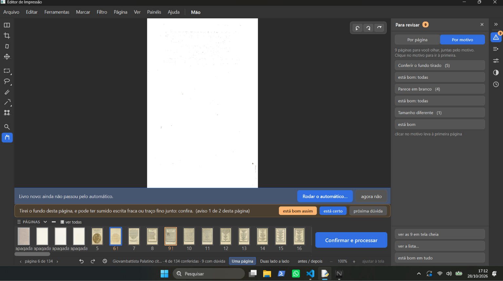
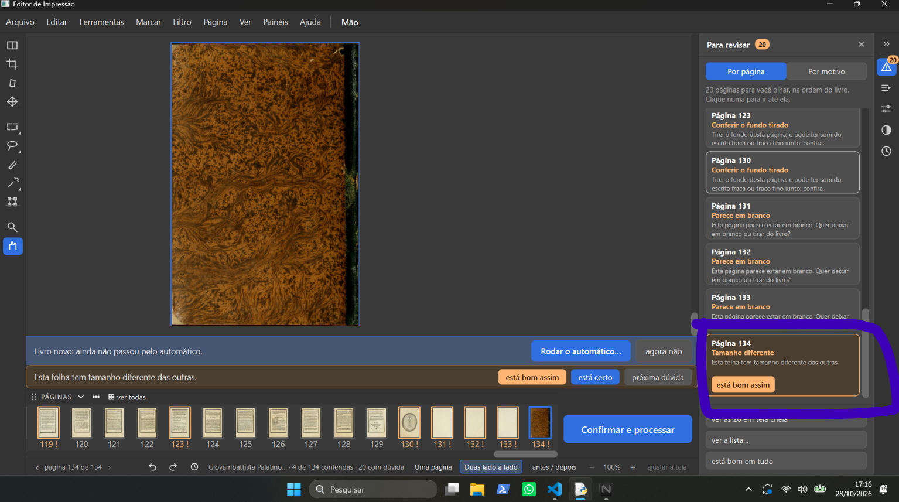
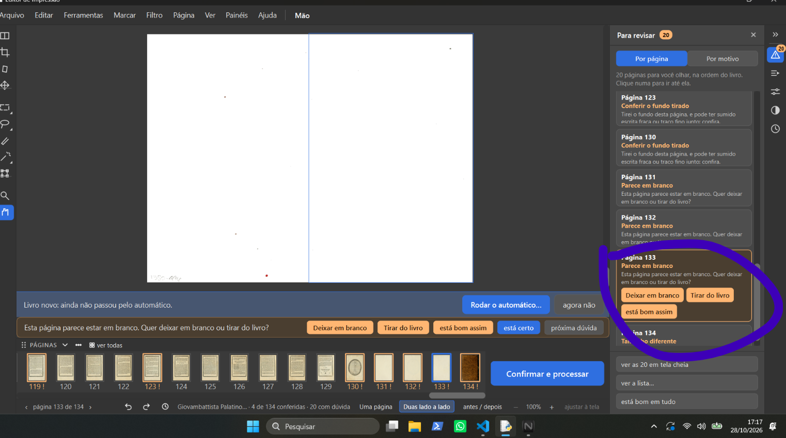
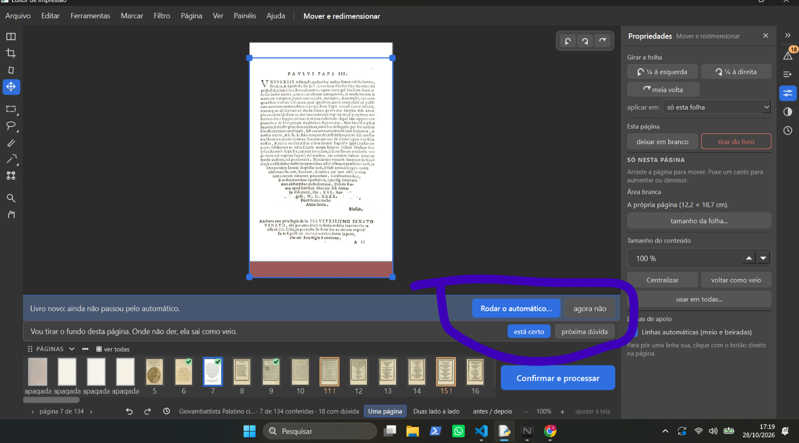
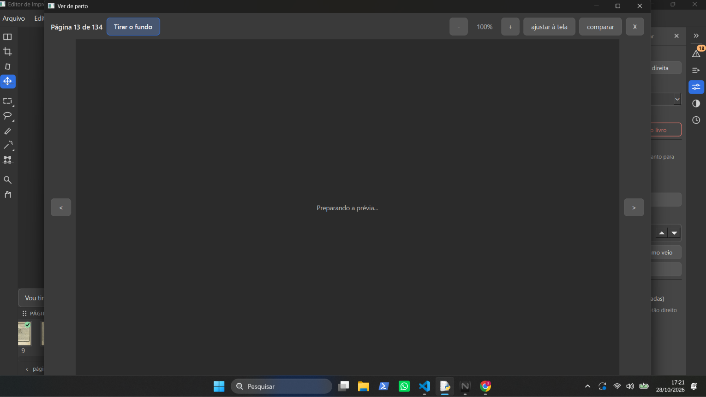
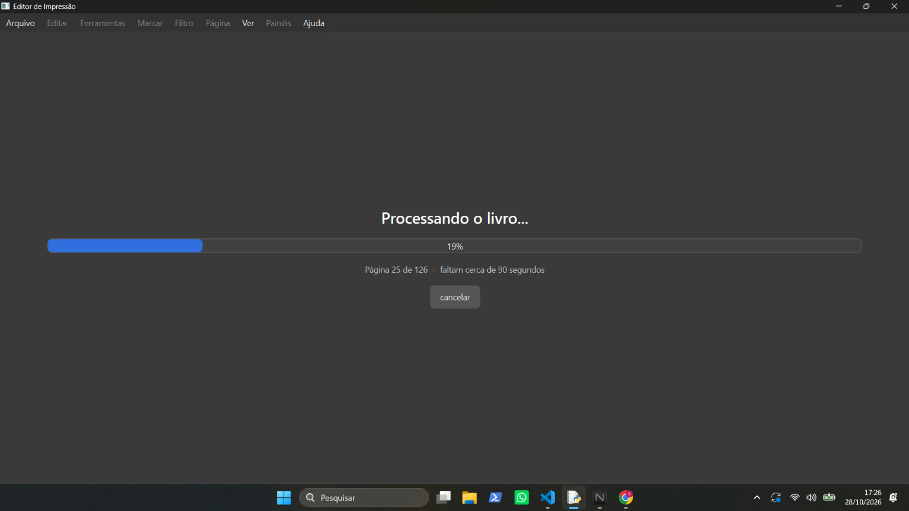
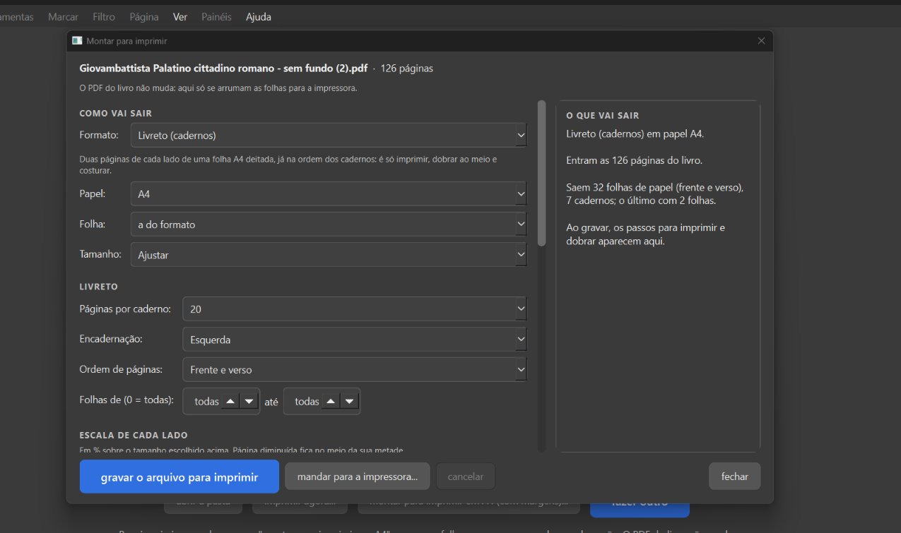

# Testes guiados — sessão 2 (ele testando sozinho pelo atalho, 28/10/2026)

Programa: atalho "Editor de Impressao (rodada de consertos)" → worktree `.claude\worktrees\obra-juncao`, ramo
`obra-2026-10-26` (`fc38afd`), dados de teste em `D:\programas\EditorImpressao-arquivos\dados-teste-rodada-de-consertos`.

Tipos: **erro** (faz errado ou não faz nada) · **confuso** (faz, mas não dá para entender) · **falta** ·
**a conferir**.

## Achados

| # | O que ele escreveu | Print | Tipo | O que a gerente achou (só leitura, nada mudado) |
|---|---|---|---|---|
| 2-1 | "eu cheguei a abrir o aplicativo, mas ele está bem travado" | — | erro (a conferir) | Livro aberto de manhã: *Cursus philosophicus. Tomo 2* (402 páginas). Pelo `acoes.jsonl`: aberto ~10:32, primeira ação 10:36, Mover na página 1 (10:36), **Marcação na página 1** (10:37–10:38), fechado 10:44. A página 1 tem **302 marcações de letra** feitas pelo programa; cada mexida na Marcação grava as 302 de novo (antes + depois, 140 a 565 mil caracteres por ação; ação comum ~500). Suspeita, não provada: a Marcação pesa a cada clique. Também no PC: League of Legends aberto desde 27/10 22:16 (1,6 GB de memória), só 2 GB livres de 16. Perguntado a ele onde travou mais (abrir / passar páginas / Marcação ou Mover / travou tudo); sem resposta ainda. |
| 2-2 | "quando eu clico em tirar do livro a pagina fica como apagada, mas não é tirada do pc" |  | a conferir | Print: Palatino, página 6 de 134; as 4 primeiras miniaturas com "apagada". **O que o programa faz hoje:** "Tirar do livro" marca a página como tirada; ela **continua na tira de miniaturas com a palavra "apagada"** (para poder "trazer de volta") e **não vai para o PDF final** (`ui/tela_conferir.py` `apagar_pagina`; `core/avisos.py`). O arquivo do PDF de entrada no computador nunca é mexido. **Decidido (D-046, 07/10):** "Tirar do livro" = "o que não é página do livro sai de vez". Nada decidido sobre a página sumir da tira na tela. Perguntado a ele o que esperava (sumir da tira? sair do PDF? apagar do PDF de entrada?). |
| 2-3 | "está pedindo para conferir o fundo tirado, mas onde eu vejo se o fundo foi tirado? em qual botão eu olho o fundo tirado anteriormente." (círculo dele no cartão "Página 6 — Conferir o fundo tirado · Parece em branco", que só tem "está bom assim") | print só no chat, sem arquivo para copiar (Palatino, página 6 de 134, "Para revisar" 10, aba "Por página") | confuso | O aviso (`core/analise.py` CONFERIR_FUNDO_TIRADO) só tem "está bom assim"; **nada no cartão diz onde comparar**. O jeito que existe: botão **"antes / depois"** na barra de baixo (ao lado de "Duas lado a lado"): Original à esquerda da linha, como vai sair à direita, linha que se arrasta (`ui/tela_conferir.py`, etapa 6, D-184). Respondido a ele no chat. **No mesmo print:** a faixa diz "Livro novo: ainda não passou pelo automático", mas já há avisos de "fundo tirado" (a conferir). |
| 2-4 | "ele só da a opção está bom assim" (círculo dele no cartão "Página 134 — Tamanho diferente", a contracapa marmorizada, Palatino) | print só no chat, sem arquivo para copiar (página 134 de 134, "Para revisar" 11) | confuso / falta (a conferir) | Os avisos "Conferir o fundo tirado" e "Tamanho diferente" foram feitos com um botão só, "está bom assim" (`core/analise.py`, CONFERIR_FUNDO_TIRADO e TAMANHO_DIFERENTE). **Livro de decisões: nada decidido** sobre outros botões nesses dois avisos (regra 7: não inventar). Vira pergunta a ele: o que cada um deve oferecer. |
| 2-5 | "Outra pergunta, quando eu excluo paginas, isso altera em alguma coisa na ordem certa do livro, no caso excluir a capa e contra capa, folhas que não importam do começo e do fim." | — | pergunta (respondida) | Código: as tiradas só são puladas (`core/avisos.py` `_paginas_vivas_por_folha`); as que ficam seguem na mesma ordem e os cadernos são montados com elas (`core/cadernos.py`), completando com branco só no fim do último caderno. Ponto de atenção explicado a ele: tirar número **ímpar** de páginas antes do texto troca o lado (direita/esquerda) de todas as seguintes; tirar número par (como as 4 do começo do Palatino) não troca. Nada no Livro sobre avisar isso. |
| 2-6 | "nessa pagina que é capa não aparece nenhum botão para deixar em branco. só aparece em outras paginas, eu devia conseguir fazer isso em qualquer pagina, anote todas as fotos e guarde todos os prints que eu mandar, pois são apontamentos sobre o aplicativo" (círculos dele: cartão da página 134, "Tamanho diferente", só "está bom assim"; cartão da página 133, "Parece em branco", com "Deixar em branco", "Tirar do livro" e "está bom assim") |   | confuso (escondido) | **Decidido, D-046 (07/10 e 09/10):** "Deixar em branco" e "Tirar do livro" em qualquer página ("Essa opção de tirar do livro ou deixar folha em branco eu quero ter em outras paginas"). **Existe na rodada de consertos (etapa 2), mas fora da vista:** bloco "Esta página" no alto do painel **Propriedades** (ícone dos controles deslizantes, à direita), com os dois botões em toda página (`ui/tela_conferir.py` "Esta página"; `ui/widgets/paineis.py`); também tecla **Delete** (deixar em branco), **Shift+Del** (tirar do livro, D-561) e menu Página. No cartão do "Para revisar" e na faixa de baixo, os dois botões só aparecem nos avisos de página em branco/sem conteúdo (D-269, D-271). Ele não achou: o lugar não aparece onde ele está olhando. Dois prints anteriores dele desta sessão (2-3 e 2-4, 17:13 e 17:14) chegaram só no chat, sem arquivo: pedido a ele para mandar de novo. |
| 2-7 | "eu cliquei está certo mas o livro continua com o aviso naquela folha, não devia ter mais aviso se eu apertei está certo" (círculo dele na faixa de baixo: "Vou tirar o fundo desta página. Onde não der, ela sai como veio." com "está certo" e "próxima dúvida"; Palatino, página 7, ferramenta Mover e redimensionar) |  | confuso | **O "está certo" funcionou:** tique verde na miniatura 7, rodapé "7 de 134 conferidas", "Para revisar" de 20 para 18. A frase que ficou **não é aviso**: é a frase "tranquila" que a faixa mostra quando a página não tem aviso (`ui/tela_conferir.py` `_texto_tranquilo`, filtro Tirar o fundo), com os botões "está certo" / "próxima dúvida" que ficam sempre ali. Como a frase fala de "tirar o fundo" (o mesmo assunto do aviso "Conferir o fundo tirado"), parece que o aviso continua. **Correção dele (a gerente leu errado):** "você está vendo errado , o está certo deixou o tique verde mas continuou com o aviso na pagina, dá para ver que a opção esta certo continua aparecendo, deveria sumir quando eu aperto está certo." (print da página 13, 17:23, círculos na miniatura 13 com tique e na faixa com "está certo" / "próxima dúvida"; só no chat, sem arquivo). Virou **D-572** no Livro de decisões: depois de "está certo", a faixa não mostra mais aviso nem o botão "está certo"; o que ela mostra no lugar fica como pergunta. |
| 2-8 | "demora muito para carregar a pagina na visão de imagem grande." (janela "Ver de perto", página 13 de 134, "Tirar o fundo", só "Preparando a prévia...") |  | erro (lentidão, a conferir) | Medido fora da tela, na mesma página e nos mesmos ajustes (cópia, nada gravado): 1,1 s a 220 DPI (o tamanho do "Ver de perto", `ui/tela_ampliada.py` DPI_AMPLIADA), 1 a 2 s a 300 DPI (o PDF). **A conta da imagem não explica a demora**: a suspeita é a fila de prévias do programa (2 de cada vez, `ui/tarefas.py`), com pré-carregamento e medidas do tamanho do PDF na frente. Programa aberto: 1,7 GB de memória, 808 s de processador em ~25 min. Para provar, a gerente vai olhar o programa por dentro (py-spy, numa pasta temporária, sem mexer no programa) enquanto ele abre o "Ver de perto" de novo. **Primeira medição (17:23–17:26):** o "Ver de perto" não foi aberto nesses 3 minutos; o programa estava em "Confirmar e processar" (5 páginas ao mesmo tempo; muito tempo em `core/detectar_regioes.achar`). Medir de novo quando ele disser "pode medir". |
| 2-9 | "quero poder colocar varios livros para processar, no caso eu fazer toda a restauração, salvar e depois lá na area de trabalho do aplicativo, a home, que não tem botão para voltar para ela hoje, eu escolho todos os livros que eu quiser e mando para fazer o processamento em massa." (print: "Processando o livro...", 19%, página 25 de 126, "faltam cerca de 90 segundos") |  | pedido novo + falta | **Processar vários livros de uma vez:** não existe e não estava no Livro: virou **D-573** (quando entra: perguntar). **Voltar para a tela dos livros:** existe só no menu **Arquivo > "Voltar para os livros"** (`ui/barra_de_menu.py`); na área de trabalho não há botão à vista (o "Voltar para os livros" com Esc é do livro aberto da tela inicial, D-340). Perguntado se ele quer um botão à vista. |
| 2-10 | "eu deveria conseguir ver o livreto pronto aqui nessa tela para que eu possa ver se ficou certo, quero tres opções, e eu queria conseguir na hora de processa o livro já poder transformar ele em livreto." (print: "Montar para imprimir", Palatino "sem fundo (2).pdf", 126 páginas, Livreto A4, 20 por caderno; à direita só o texto "O que vai sair": 32 folhas, 7 cadernos) |  | falta + pedido novo | A janela não mostra imagem nenhuma do livreto (`ui/dialogo_impressao.py`). Viraram **D-574** (ver o livreto pronto na janela; três opções apresentadas no chat) e **D-575** (sair em livreto já ao processar; não contradiz a D-314, perguntar como fica depois). |
