# Automático — apontamentos do Samuel, 29/10/2026

Trabalho: uma coisa por vez, e ele testa cada uma assim que fica pronta (D-576).

| # | Palavras dele | Print | O que é |
|---|---|---|---|
| a-1 | "vamos começar com a 1" (ver como vai ficar conforme as opções, na janela do Automático; 2-11 de 28/10) | — | D-577 |
| a-2 | "um bug que acontece quando nós usamos o automatico, de vez as paginas mudarem, elas continuam iguais, mas o que aparece são as marcações feitas no pdf, de gravura e de letras, tem que ter um jeito de aparecer e desaparecer essas marcações nas paginas." · "1- print quando estamos com a opção 1 pagina selecionada 2- quando estamos com o antes e depois" | 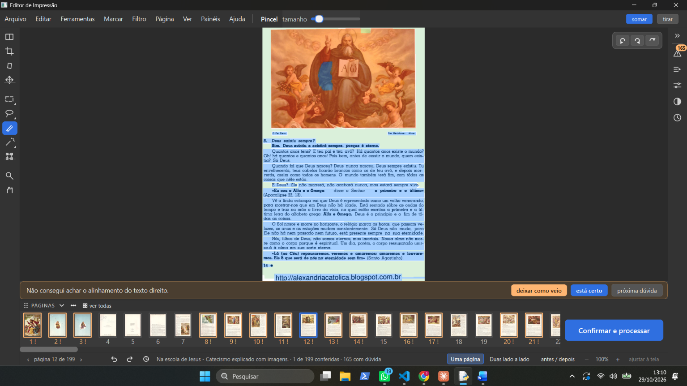 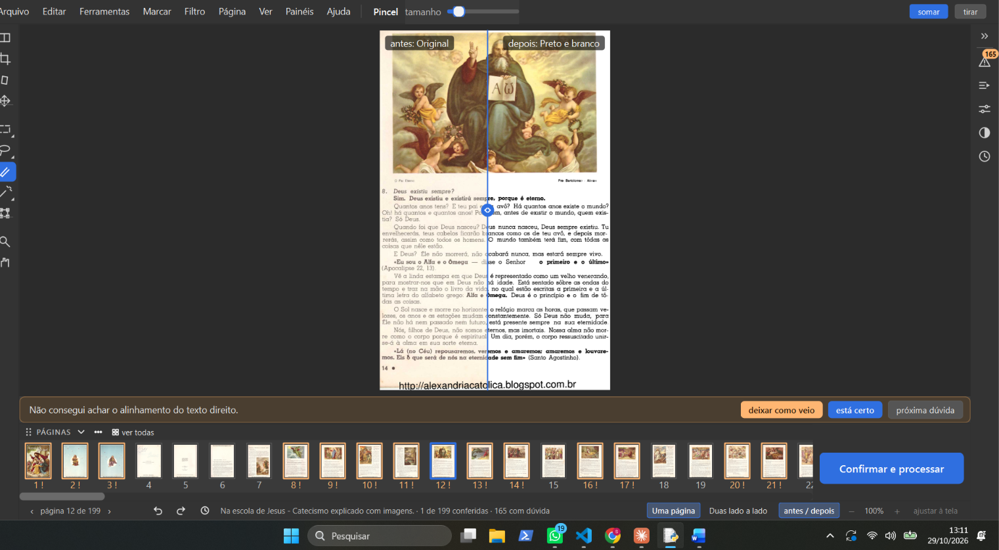 | D-578. *Na escola de Jesus*, página 12 de 199, ferramenta Pincel (marcar). No "antes / depois" a página sai certa (Preto e branco, gravura colorida); em "Uma página" aparece pintada de azul (letras), salmão (gravura) e verde (papel). |
| a-2b | "não tem nenhuma opção de marcação escolhida, está o zoom escolhido" (correção dele à explicação da gerente) | 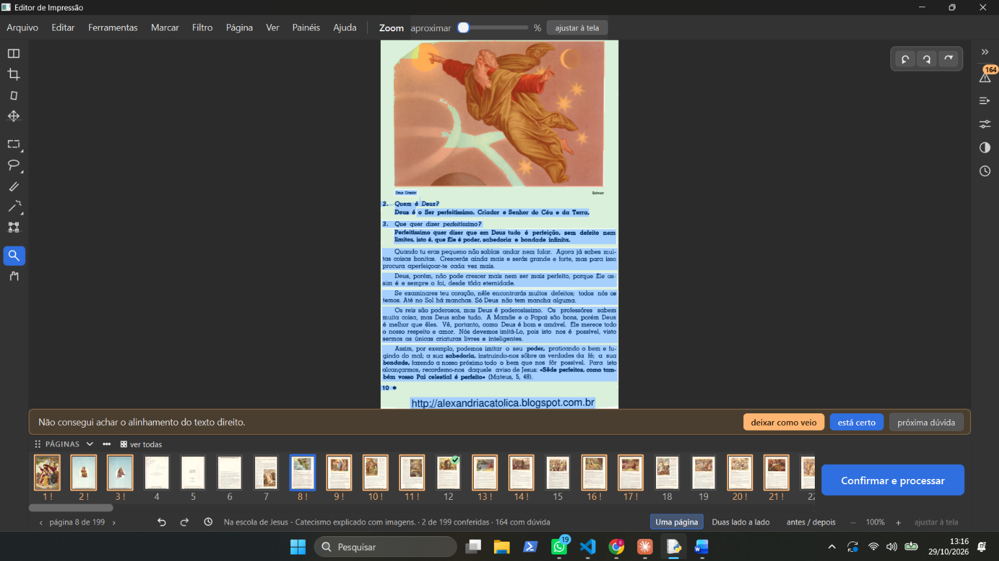 | Página 8 de 199, ferramenta Zoom: as cores aparecem também. A gerente tinha dito "só nas ferramentas de marcar": errado. Ver a causa corrigida abaixo. |
| a-3 | "Outra coisa para adicionar ai, quando usamo o automatico temos que conseguir depois de ter passado ele diminuir ou aumentar ou mudar opções, caso não tenha saido como a gente queria e dai o programa recalcula isso que mudamos, nós mudamos em uma pagina e ele faz no resto" | — | D-579 |
| a-4 | "e quando mostra para fazer os cadernos lá na parte de fazer caderno tem que ter um botão para ver como vai ficar o caderno." | — | Já era a D-574 (28/10, 2-10: "eu deveria conseguir ver o livreto pronto aqui nessa tela"); palavras de hoje acrescentadas a ela. |
| a-5 | "outra coisa para adicionar na nossa lista, eu desfiz todo o historico e continuou a marcação antiga nas paginas. acho que como eu desfiz tudo, as marcações deveriam sumir também né?" | 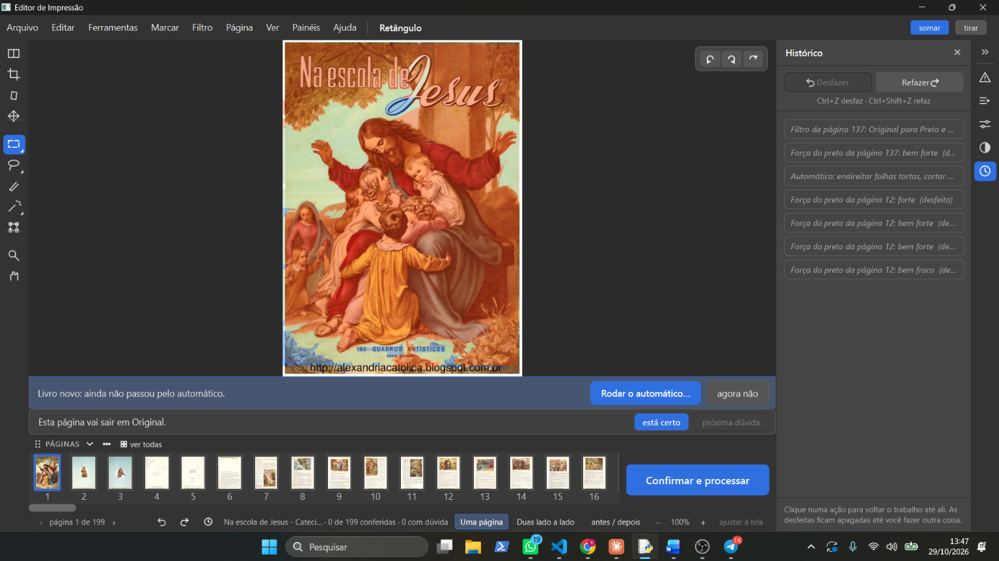 | D-581. Print: histórico com todas as ações desfeitas (inclusive "Automático: endireitar folhas tortas, cortar ..."), faixa "Livro novo: ainda não passou pelo automático" de volta. Pela D-020 (18/07, "Ctrl+Z desfaz qualquer alteração"), sim: é defeito. |
| a-6 | "depois de rodar o automatico, quando eu tento escolher outro filtro para uma folha só, ele joga o filtro em cima do filtro que já tinha sido aplicado, e quando eu escolho outro filtro ainda, ele nem mostra a mudança em tela mesmo eu estando na opção antes e depois. Precisamos da opção de jogar o filtro em cima de outro filtro ou só substituir o filtro que está colocado em cima. ou só colocar os filtros em cima das gravuras, por exemplo nesse livro eu gostaria de passa o magico pro em cima de todas as gravuras que ele achou muito bem, mas não dá." | 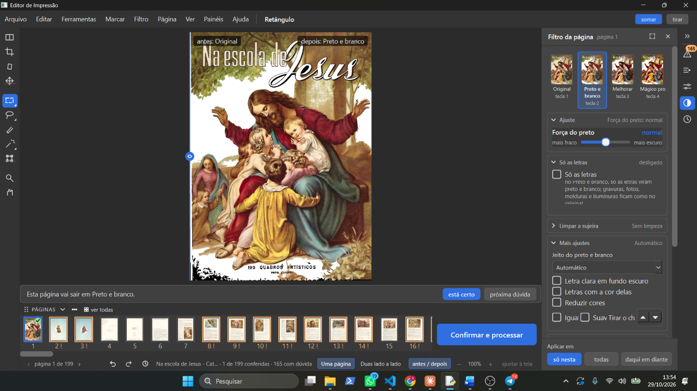 | D-582 (defeito), D-583 (empilhar ou substituir), D-221 (30/09: filtro nas áreas achadas; palavras de hoje acrescentadas). Print: capa, página 1, "antes / depois", Original × Preto e branco; a gravura sai colorida no Preto e branco com "Só as letras" desligado. |

## Causa do a-2 (lida no código da versão de teste, `obra-2026-10-26`)

Não é a página que deixa de mudar: o processamento está certo (o "antes / depois" mostra o Preto e branco). O que
acontece é que a vista da página (a mesma para o Zoom, a Mão e as ferramentas de marcar: `FERRAMENTAS_DE_NAVEGACAO` em
`ui/widgets/editor_selecao.py:95` são ferramentas do mesmo editor) pinta **sempre** toda a marcação da
página por cima da imagem, cada tipo numa cor (`ui/widgets/editor_selecao.py`, `_pintar_marcacao`, cores nas linhas
193-199: letra azul, gravura salmão, papel verde). Depois que o Automático roda a etapa de gravuras e fotos, a página
inteira fica marcada, e a imagem some debaixo das cores. A caixinha "Mostrar as áreas achadas" (D-237) só liga o
contorno laranja; não esconde o colorido. Então o conserto do a-2 e o "jeito de aparecer e desaparecer" são a mesma
coisa: um botão que mostra e esconde o colorido das marcações.

## Teste do item 1 (botão "marcações"), 29/10

- Pergunta dele: "Assim que eu abro o livro as marcações já aparecem se eu apertar no botão marcação, elas já estão feitas, acho que o programa já procura elas quando a gente abre ele né? mas se eu desmarcar elas saem." Resposta (código): o programa acha gravura, letra e papel sozinho ao desenhar uma página com filtro (`core/pipeline.garantir_selecao`); neste livro parte delas sobrou do Automático desfeito (D-581, item 2).
- Resultado dele: "deu certo, deu tudo certo, vamos para o proximo". D-578, D-580 e D-584 marcadas como testadas no Livro.

## Item 3 (D-582), investigação de 29/10
- Não é defeito de tela: a tela mostra o filtro escolhido toda vez (diferença 0,0 entre o que aparece e o desenho do filtro). O filtro não vai por cima do outro: cada escolha desenha a página de novo a partir do scan.
- O que fica "por cima" é a marcação que o Automático deixou ("Gravuras e fotos"): na capa, 82% da página virou "enfeite colorido", que guarda a cor em todos os filtros (D-144, D-127, D-128). Por isso Preto e branco, Melhorar e Mágico pro saem quase iguais (diferença 2,2 de 255) e parece que nada muda.
- Imagem da explicação: `relatorios/automatico-filtro/5-capa-nos-4-filtros-com-e-sem-a-marcacao.jpg` (ramo `automatico-filtro-2026-10-29`, commit `d4407e9`, só provas e relatório).
- Vira a pergunta D-583 ao Samuel; achado à parte na Lista de bugs (figurinhas do painel sem a marcação).
- "Só as letras" do Automático conferido em 29/10: funciona (livro, página herdada, tela, PDF, desfazer). D-585: causa achada (escrita por cima da pintura), sem conserto seguro; Samuel: "deixar como está e deixar anotado, vamos continuar para o que temos que fazer".

## Teste da caixinha "Respeitar as gravuras achadas" (D-583, D-586, D-587), 29/10
- Página 17 (pintura colorida saindo cinza no Preto e branco): é a D-147 (pintura e foto em tons de cinza). Os riscos laranja são o contorno das áreas achadas, ligado sozinho nas páginas com "!" (D-237); ele perguntou "porque estão ali, não são marcações". Pergunta da gerente (o botão "marcações" também esconder o laranja?) ficou sem resposta.
- Capa, caixinha desmarcada: "onde está a opção que deixa só cinza e branco ,essa parece que está dando um negativo". Não existe; vira a D-588.
- Resultado dele: "beleza, vamos deixar esse problema para resolver logo após terminamos os que nós propomos a fazer, o programa está mudando de efeito como deveria". D-583, D-586 e D-587 marcadas como testadas no Livro.

## Ordem da lista, 29/10 (fim do dia)
- Ele pediu a lista de novo ("acho que você está confundindo, olha a conversa e veja a lista e passa ela aqui pra mim"); a gerente repassou a de 14h59 (itens 1 a 8) com a situação de cada um.
- Ordem nova, palavras dele: "vamos deixar a 5 para depois, é mais importante fazer a 6 e a 7 e 8". Fica: D-577 (ver como vai ficar), D-579 (mudar e refazer o resto), D-574 (ver o caderno), depois D-221 (filtro nas gravuras achadas), depois D-588 (gravura em tons de cinza).

## Teste do item 6 (D-577, ver como fica na janela do Automático), 30/10
- Palavras dele: "ele não está funcionando, e não funciona em tela cheia também, como pode ver pelo print ele não muda no antes e depois conforme eu troco os filtros"
- 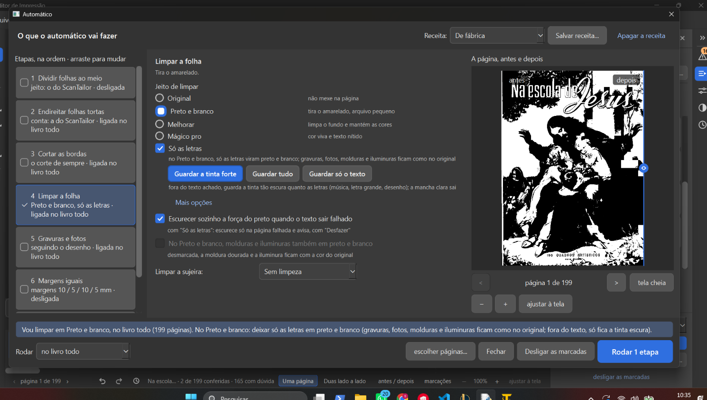 Janela do Automático, *Na escola de Jesus*, página 1 de 199 (capa), etapa 4 "Limpar a folha", Preto e branco + "Só as letras" + "Guardar a tinta forte", "Escurecer sozinho" ligado. O "depois" mostra a capa inteira em preto e branco duro (a pintura também), e não muda quando ele troca o filtro.
- 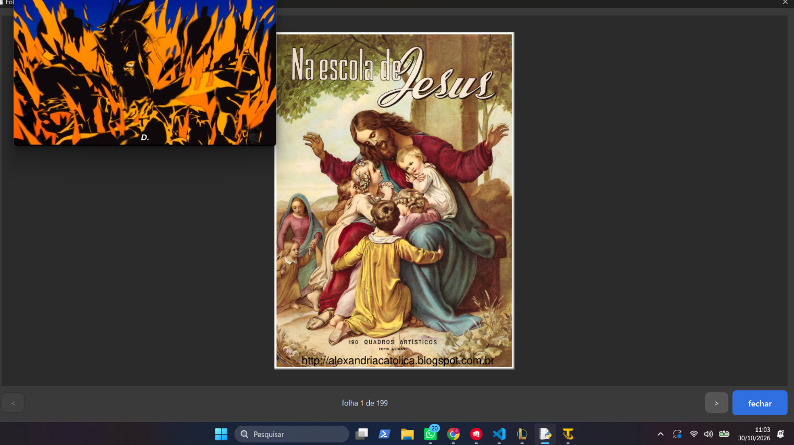 "tela cheia": mostra a folha 1 de 199 crua, colorida (sem antes e depois). No canto de cima à esquerda aparece um quadro solto com uma imagem laranja e preta (a origem ainda não foi vista).
- Situação: D-577 **não passou no teste dele**. A causa está em investigação.
- **Causa achada (30/10, na versão de teste):** a prévia supõe sempre "pular as páginas mexidas à mão" (`EstadoDoAutomatico.pedido()` com `pular_mexidas=True`; D-004). No livro de teste, a capa (página 1) e a página 17 estão marcadas como mexidas à mão no filtro (`mexida_a_mao: ['filtro']`, dos testes de 29/10). Então o Automático pula a capa, e o "depois" fica igual ao que já está no livro: a capa em 1 bit do teste da D-588. Prova numa cópia do projeto: na página 1, Preto e branco × Mágico pro dá diferença de 2,1 (de 255) pulando e muda sem pular; na página 3 (não mexida), dá 17,4 (muda). Nas páginas não mexidas a prévia funciona.
- "tela cheia" mostra a folha crua do PDF: foi escolha do construtor ("como antes", TelaCheiaDoPDF), uma das ressalvas dadas a ele.
- Pergunta da gerente: "Minha sugestão: na prévia, a página mexida à mão também mostra como ela fica com as opções escolhidas. Quando você apertar "Rodar", o programa continua perguntando se pula essas páginas. Responda sim ou não."
- Resposta dele (30/10): "ok, então quando for dar o ok, ele vai perguntar se querermos mudar as paginas que foram mudadas a mão. Mas na previa ali, ele mostra a mudança em todas as paginas mas só muda as que nós autorizarmos ( no caso as que foram mexidas a mão), segundo tem que dar para ver na previa em tela grande e poder dar zoom na previa em tela grande, terceiro - essa opção que eu mandei print, quero saber como eu posso marcar e desmarcar ela."
  - 1: a prévia mostra a mudança em todas as páginas, inclusive as mexidas à mão; ao "Rodar", a pergunta da D-004 continua decidindo.
  - 2: o antes e depois da prévia também em tela grande, com zoom (o "tela cheia" hoje mostra a folha crua).
  - 3:  a caixinha "No Preto e branco, molduras e iluminuras também em preto e branco" fica cinza porque "Só as letras" está marcada (D-168: `ui/automatico.py`, `cx_decoracao_pb.setEnabled(not (so_letras and no_pb))`). Desmarcando "Só as letras", ela volta a funcionar.
- Quarta coisa (30/10, palavras dele): "quarta coisa, quando você mexe no antes e depois, ele começa a mostrar o antes de qual pagina, parece que ele troca o antes conforme se troca os perfis dos filtros." Pela D-577, o "antes" é a página como está agora no livro e não muda com as opções. Vai para o construtor investigar e reproduzir.

## Problema do Kaique: "Montar cadernos" volta sozinho (30/10) — D-589
- Samuel: "tenho outro problema para resolver também, para ser colocado nessa lista [...] olha o arquivo world nessa pasta" (`D:\programas\EditorImpressao-arquivos\TESTES MANUAIS DO SAMUEL\kaique audio transcrição\Kaique audios.docx`, áudios 1.ogg a 3.ogg).
- Kaique, áudio 1: "Tá vendo ali na caixa de seleção, ó, ela não tá selecionada, nem ela e nem a opção de dividir, que é a primeira. É, aí na hora que gera, depois o resultado final, né, aí aplicou o filtro branco, letra preta. Aí só que ele forma os cadernos do mesmo jeito."
- Kaique, áudio 2: "Aí antes de de rodar a etapa, é, ele mostra marcado ali, tá vendo? É, depois, né, depois de rodar a etapa, aí ele volta a marcar."
- Kaique, áudio 3: "Aí eu vou lá, ajusto a etapa, né, tiro, é, a opção de montar os cadernos, aí depois ele coloca de novo sozinho."
- 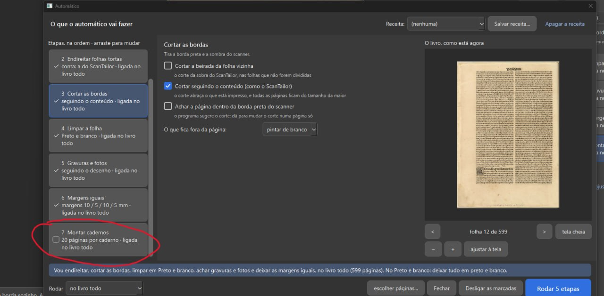 Janela do Automático (versão do Kaique, ainda com "O livro, como está agora"), livro de 599 folhas: a 7 "Montar cadernos" está desmarcada, mas o texto embaixo diz "20 páginas por caderno · ligada no livro todo"; o botão diz "Rodar 5 etapas".
- 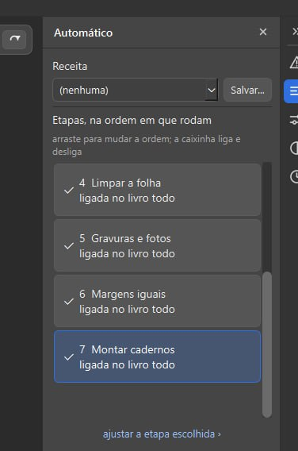 Painel Automático depois de rodar: "7 Montar cadernos · ligada no livro todo", com o ✓.

## Capa colorida na ferramenta Cortar e em preto e branco no "Ver de perto" (30/10)
- Palavras dele: "1- no primeiro print está normal 2- quando eu abro, mostra em preto e branco"
- 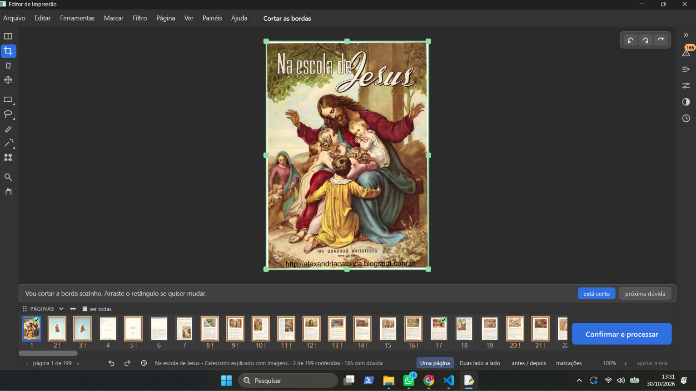 Área de trabalho, ferramenta "Cortar as bordas", capa colorida, com o retângulo verde.
- 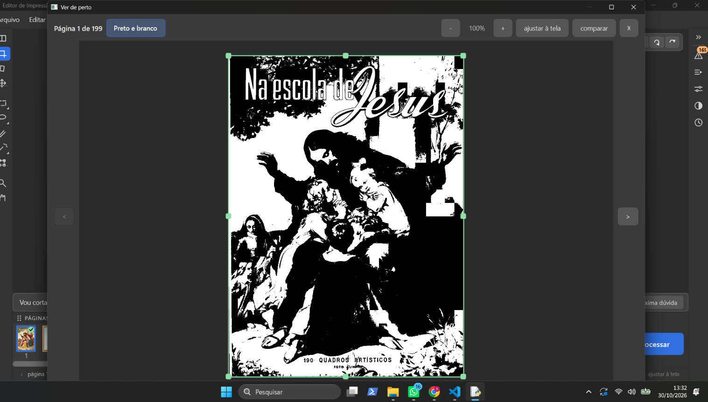 "Ver de perto" aberto da mesma ferramenta: capa em "Preto e branco", 1 bit.
- O que é (código da versão de teste): a ferramenta Cortar mostra sempre a página sem filtro, só girada e dividida (`ui/tela_conferir._atualizar_previa_para_recorte` → `core/pipeline.preparar_para_recorte`, conserto de 23/09 para o corte não "andar sozinho"). O "Ver de perto" (`ui/tela_ampliada.py`, modo Bordas) mostra a página com o filtro dela (`previas.pegar`). O filtro da capa é Preto e branco, do teste de 29/10 (D-588).

## Teste da D-577 depois do conserto (30/10, 13:33)
- Palavras dele: "1- a questão do antes e depois, ela é de acordo com o que? 2- no primeiro print mostra o antes no original e no segundo print mostra o depois no preto e branco."
- 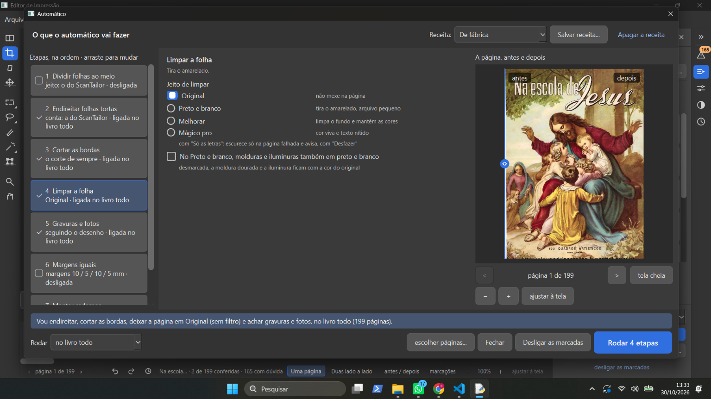 Capa, "Limpar a folha" em Original. A linha está toda à esquerda, então o que aparece é o "depois": a capa colorida (Original), como ele escolheu. Antes do conserto a capa mexida não mudava.
- 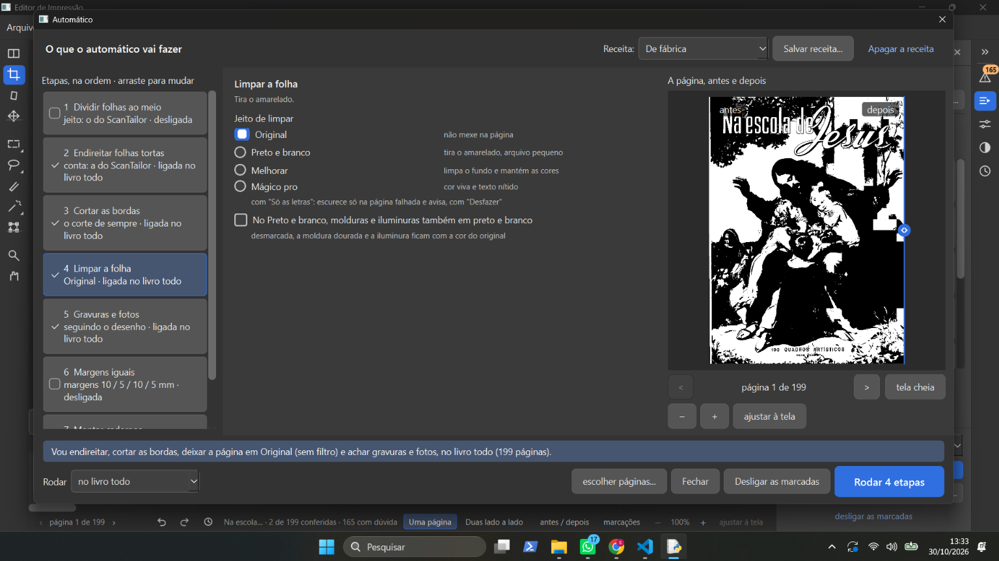 Mesma escolha, linha toda à direita: aparece o "antes", a capa como está no livro (Preto e branco 1 bit, do teste da D-588).
- Leitura da gerente: a tela está certa, e ele leu os lados trocados. Isso pode explicar a "quarta coisa" (o antes parecia mudar com o filtro).
- Sobre a capa colorida no Cortar e P&B no "Ver de perto" (30/10): "você não analisou direito os prints, leia novamente minha mensagem, na area de trabalho está aparecendo sem filtro nenhum, no caso eu estava na ferramenta de cortar, ata, entendi". Entendido por ele: a ferramenta Cortar mostra a página sem filtro. A sugestão da gerente (o "Ver de perto" do Cortar também sem filtro) ainda não foi respondida.
- Palavras dele (13:38): "aqui o filtro antes está no preto e branco, mas você pode ver que o divisor do antes e depois esta no antes e mesmo assim aparece como o filtro original que deveria ser o depois né."
- 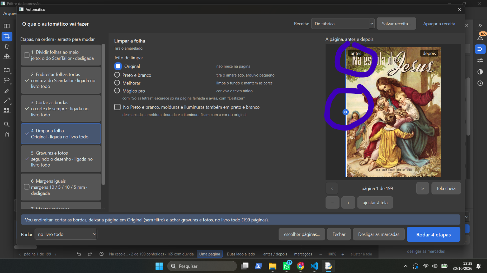 Ele circulou o rótulo "antes" e a linha encostada na esquerda. O que acontece: à direita da linha aparece o depois (Original), quase a página toda; o rótulo "antes" fica parado no canto, em cima do depois. É o mesmo visor do "antes / depois" da área de trabalho (`VistaAntesDepois`).
- Pergunta da gerente: "Minha sugestão: a palavra "antes" some quando a linha passa por cima dela, e a palavra "depois" também, do outro lado. Vale aqui e no "antes / depois" da área de trabalho. Responda sim ou não."
- Resposta dele: "está bem confuso, na verdade, porque eu já tinha colocado um filtro antes, eu acho que o antes deveria ser sempre o original e o filtro depois o que escolhemos, ai se quiser comparar faz isso na tela cheia."
  - Na prática: o "antes" da prévia do Automático passa a ser a página original (hoje é a página como está no livro, com o filtro já posto). O "depois" continua sendo o que se escolhe na janela. Comparar com o filtro que já estava: na tela cheia (o "Ver de perto" tem "comparar", `ui/tela_ampliada.py`). A sugestão dos rótulos não foi aceita nem recusada.
- Pergunta da gerente: o "antes" de uma página já cortada e endireitada: a sugestão era a página cortada e endireitada, mas sem filtro (em Original); a outra opção, a folha crua do scanner. "Pode ser a sugestão? Responda sim ou não." Sem resposta ainda.
- Ele (30/10): "na tela cheia vai ter um botão de comparação , ai vão aparecer duas telas para comparar". Na prática: a tela cheia da prévia do Automático ganha um botão de comparar que mostra duas telas lado a lado (como o "comparar" do "Ver de perto", `ui/tela_ampliada.py`). O que vai em cada tela ainda não foi dito.
- Pergunta da gerente: "à esquerda, a página como está agora no livro, com o filtro que você já tinha posto. À direita, o "depois", com o que você escolheu na janela. As duas andam juntas no zoom, como no "comparar" do "Ver de perto". Responda sim ou não."
- Resposta dele: "nessa vai ter o filtro que estava antes, seja ele original ou que foi aplicado e o filtro que está selecionado no momento". Fica: no comparar, uma tela com o filtro que a página já tinha (Original ou o aplicado) e a outra com o filtro escolhido agora na janela.
- Resposta dele à pergunta do "original": "mostra já cortada e endireitada se tiver sido feito isso." Fica: o "antes" é a página como está no livro (com o corte e o endireitar que já tiver), mas sem filtro (em Original).
- Correção dele (30/10), no lugar da resposta acima: "o antes é sem filtro e sem cortar sem nada, o depois na tela de atualizar que aplica os filtros de endireitar cortar ou fazer qualquer outra coisa para ver como iria ficar." Fica: o "antes" é a página crua do PDF (sem filtro, sem corte, sem endireitar); o "depois" é o que o Rodar faria com as etapas e opções da janela.
- Pergunta da gerente: "numa folha que vai ser dividida ao meio, o antes mostra a folha inteira ou só a metade?"
- Ele (30/10): "ela teria que ser cortada antes né, eu acho que é o que mais faz sentido, ai como fariamos isso, colocaria um aviso logo que abre o automatico?"
- Proposta da gerente: sem aviso. (1) Folha já dividida: o antes é a metade crua, e o depois é essa metade pronta. (2) Folha não dividida com "Dividir" marcado: o antes é a folha inteira crua, e o depois são as duas metades prontas, lado a lado. Ele: "mas dai se a pessoa apertar dividir ?" → gerente: marcar "Dividir" muda o depois na hora para as duas metades, e o antes continua a folha inteira crua; desmarcar volta o depois à folha inteira pronta; folha já dividida: o antes é a metade crua com "Dividir" marcado ou não. "Pode ser assim? Responda sim ou não."
- Ele: "pode".

## Item 7 (D-579), 30/10
- Ele: "não entendi a 7" → a gerente explicou com as palavras dele de 29/10 (a-3) e um exemplo (página 10 com letra fraca, aumentar a força, o programa levar ao resto).
- Ele: "sim, mas ele não pode fazer isso automaticamente né, na verdade, eu acho que não precisa dessa opção pois já podemos fazer isso em folhas individuais e jogar para o livro todo né? temos essa opção no programa já?"
- Conferido no código da versão de teste: o painel Filtro tem "Aplicar em: só nesta · todas · daqui em diante" (`ui/tela_conferir.py`, `_filtro_em_todas` e `_filtro_nas_proximas`), que leva o filtro da página e os ajustes dele (a força, "Só as letras", "Respeitar as gravuras achadas"...) para as outras páginas. Cortar e Mover têm "usar em todas".
- Gerente: "Então tiro o item 7 da lista? Responda sim ou não." → ele: "sim". D-579 descartada (já existe o "Aplicar em" do painel Filtro e o "usar em todas"). Lista: 6 (D-577, em construção) → 8 (D-574) → 5 (D-221) → D-588.
- Ele (30/10): "coloque mais uma coisa nessa lista, aquele relato do Kaique do montar cadernos que eu mandei você ler a pasta". D-589 entra na lista como item 9. Ordem: 6 (D-577) → 8 (D-574) → 5 (D-221) → D-588 → 9 (D-589).
- Gerente: "Quer que ele venha logo depois do item 6?" → ele: "não". O item 9 (D-589) fica no fim da lista.

## 3º teste da D-577 (30/10, 16:30, junção f39a37d)
- Palavras dele: "1- não consigo dar zoom com o mouse, usando o scrool 2- ainda está confuso qual o lado que é o antes e depois, o lado para onde a gente desliza a faixa de antes e depois tem que estar o nome, conseguiu entender? print 2 desse lado deveria ser o antes e está o depois . print 3 - desse lado deveria ser o depois e está o antes. 3- print 4 - seria bom se pudessemos ver as opções e mudar simutaneamente nesse comparar, tivesse uma aba de cada lado que abrisse e fechasse para mudar as opções no comparar, ao em vez de ser só o antes e depois."
- 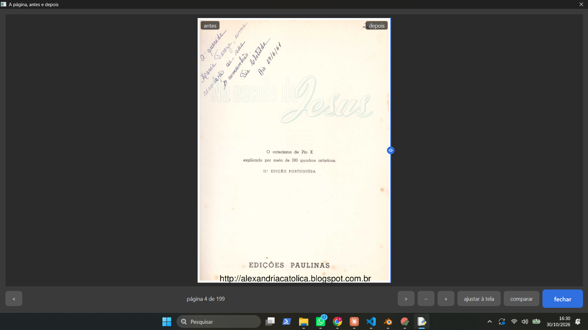 Tela cheia, página 4, linha na direita (aparece o antes, cru).
- 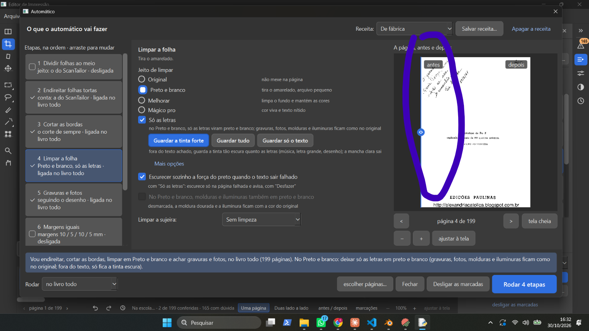 (print 2 dele) Janela, P&B + Só as letras, linha toda à esquerda: debaixo do rótulo "antes" aparece o depois (P&B). Ele circulou esse lado.
- 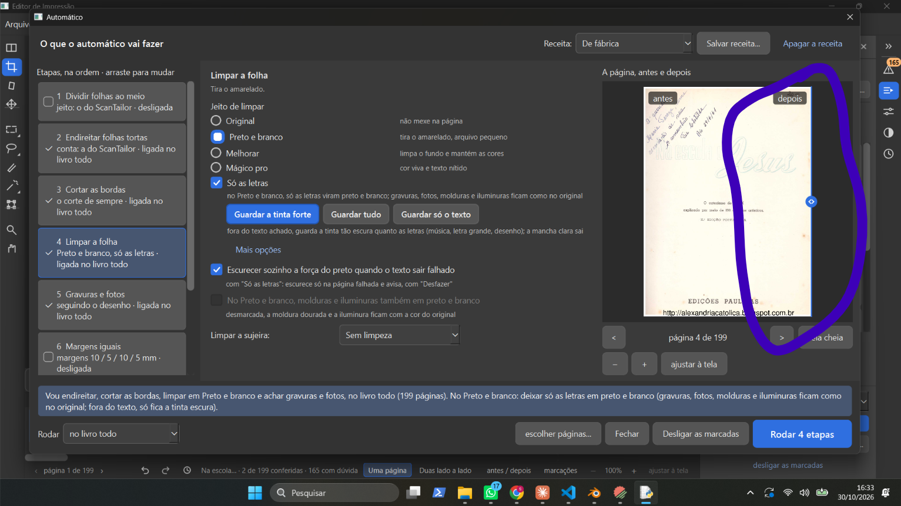 (print 3 dele) Linha toda à direita: debaixo do rótulo "depois" aparece o antes (cru). Ele circulou esse lado.
- 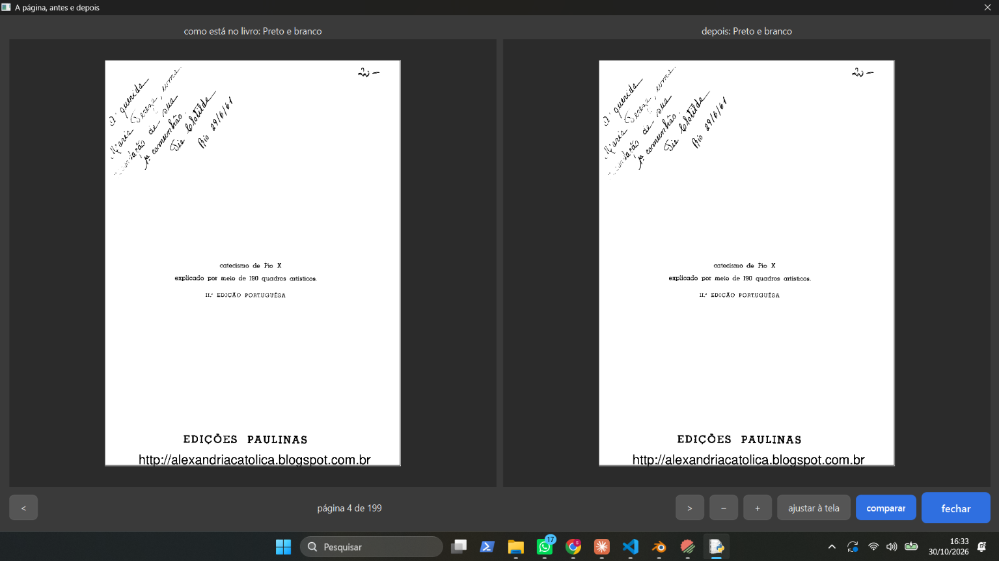 (print 4 dele) "comparar": "como está no livro: Preto e branco" × "depois: Preto e branco".
- 1 (zoom com a roda): conferido no código; `VistaAntesDepoisComZoom` (ui/automatico.py) não trata a roda (só os botões); o Visualizador da área de trabalho trata (`ui/widgets/visualizador.py`, `wheelEvent`). Vai para o construtor.
- 2: sugestão da gerente (os rótulos andam colados na linha) → ele: "não gostei da sugestão, eu quero que a faixa seja de acordo com a direção do antes e depois, se ela está embaixo do depois ela está aparecendo o depois se está embaixo do antes ela está no antes."
- Gerente: os rótulos ficam parados (antes à esquerda, depois à direita); linha toda à direita (embaixo de "depois") → a página inteira mostra o depois; linha toda à esquerda (embaixo de "antes") → a página inteira mostra o antes; linha no meio → à esquerda dela o depois, à direita o antes. "Hoje é o contrário [...] É isso? Responda sim ou não." → ele: "sim".
- Gerente: "Esse mesmo quadro com a linha também aparece no "antes / depois" da área de trabalho [...] Muda lá também, para funcionar igual nos dois lugares? Responda sim ou não." → ele: "sim".
- 3 (opções no comparar): proposta da gerente (cada tela com uma aba das opções do "Limpar a folha"; a esquerda começa como está no livro, a direita com a escolha da janela; ao "Rodar" vale o lado direito) → ele: "não, eu quero poder mudar dos dois lados, todas as opções."
- Gerente: "Qual dos dois lados vale? Minha sugestão: cada lado tem um botão "usar este". Apertando, as opções daquele lado passam para a janela do Automático, e o "Rodar" usa essas opções. Pode ser assim?" → ele: "ok, não gostei do nome, mas vamos ficar com esse por enquanto."
- Fica (3): no "comparar" da tela cheia, cada lado tem uma aba que abre e fecha com todas as opções do Automático (etapas e opções); cada lado muda à parte; cada lado tem "usar este" (nome provisório), que passa as opções daquele lado para a janela; o "Rodar" usa as da janela. Ordem: primeiro a roda do mouse e a linha (em construção), ele testa, depois esta.
- Ele (30/10): "conseguimos botar o 8 e o 9 para fazer ao mesmo tempo que está fazendo as outras questões?" → gerente: lembrou a D-576 (uma coisa por vez); o 8 espera ele escolher o desenho A/B/C (Central, aba "Não gostei"); máximo 3 agentes. Sugestão: o 9 começa agora, em paralelo, numa cópia separada; o 8, assim que ele escolher. → ele: "sim". (Ele continua testando um de cada vez, conforme fica pronto.)
- Item 9 (D-589), pergunta do construtor (P1): as outras etapas desmarcadas também continuam ligadas ("Margens iguais", "Gravuras e fotos"). Depois de três explicações ("não entendi", "explica melhor esse item 2", "rapaz não entendi nada mesmo agora"), a versão curta: "conserto essas duas também, do mesmo jeito que os cadernos?" → ele: "Sim, se algo não está marcado, não é para fazer , certo?"
- Linha do antes e depois no terceiro lugar ("Filtro da página" → tela cheia → "Comparar com o Original"), que mudou junto: "Pode ficar do jeito novo lá também?" → ele: "Sim".
- "Dividir" desmarcada: a gerente sugeriu que não junte as folhas já divididas. Ele: "como assim desligar as marcadas? fica em qual aba essa opção?, se quiser juntar as folhas de novo deveria ter uma opção mais clara né". A gerente explicou o "Desligar as marcadas" (rodapé da janela grande, link no painel) e o "não dividir esta" (ferramenta Dividir, uma folha por vez), e sugeriu: "na ferramenta Dividir, ao lado de "não dividir esta", um botão "juntar todas", que junta todas as folhas do livro de uma vez (o Ctrl+Z desfaz). E desmarcar "Dividir" no Automático não junta nada. Pode ser assim?" → ele: "pode ser assim". Vira a D-590.

## Respostas na Central, 31/10 (aba "O que você não gostou: alternativas")
- 2-10 ver o livreto (D-574): "Opção 1: as folhas como saem da impressora, frente e verso" · "Não gostei da tela que mostra o livreto, podemos mudar depois, deixe anotado na lista de espera. vou escolher a 1, mas não gostei muito, tem como olha como outros aplicativos fazem isso porque eu não gostei muito."
- 2-10 livreto ao processar (D-575): "Uma caixinha no "Confirmar e processar" (recomendo)".
- 2-11 ver como fica no Automático (D-070): "Esperar o Laboratório inteiro da D-070" · "Nós acabamos de fazer escolhas sobre isso agora a pouco no chat. Mas ainda vai ter o laboratorio que seriam sugestões do programa para o livro."
- 2-12 aviso de memória (D-591): "Frase certa + botão "tentar de novo" (recomendo)".
- 2-8 "Ver de perto" demora (D-592): "Só passar à frente na fila" · "Isso fica anotado para que dentro do programa possamos fazer esses calculos de maneira mais rapido, porque fica tão lento? que processos estamos fazendo que não precisam ser feitos? como outros programas mais rapidos fazem isso? deixe isso anotado numa nova aba na central chamada pesquisas."
- 2-9 voltar para os livros (D-593): "Botão "‹ Livros" no canto de cima, à esquerda do menu Arquivo (recomendo)" · "Seria um botão home na barra de arquivos e não livros, só que para fazer isso tem que ter a possibilidade de abrir varias abas né."
- Item 9 (D-589), pergunta P3 do construtor (as Gravuras não religam). Pergunta de base, depois de "NÃO ENTENDI": "Pense numa página com texto e uma figura colorida. [...] "Só as letras" [...] e "Gravuras e fotos" desmarcada [...] as duas escolhas brigam [...] Minha sugestão: vale o "Só as letras", e a figura sai colorida. Responda sim ou não." → ele: "Sim, mas e essa opção gravuras e fotos sai aonde? estamos falando do deixar tudo em tons cinzas?"
- Ele: "e quando vai sair cinza ? o que eu vou ter que marcar para ela sair cinza ou simplesmente em preto e branco" → gerente explicou (colorida: "Só as letras"; cinza: sem "Só as letras" e com a etapa 5; tudo P&B: sem "Só as letras" e sem a etapa 5; exceção: figura tomada por enfeite, D-588).
- Ele: "eu vou pode escolher depois na area de trabalho para deixar só aquela pagina em tons cinza?" → gerente: painel "Filtro da página", Preto e branco, sem "Só as letras", "Respeitar as gravuras achadas" marcada, "Aplicar em: só nesta"; mesma exceção.
- Ele: "mas se ele confundiu a gravura no automatico na capa, ele não vai confundir de novo, olhando só aquela pagina?" → gerente: sim, confunde de novo; é a D-588. "Quer que esse item suba na lista? Hoje ele vem depois do 5" → ele: "sim". Ordem nova: 6 (D-577), 8 (D-574) e 9 (D-589) em andamento → D-588 → 5 (D-221).
- Pergunta do construtor (com "Só as letras", Gravuras precisa procurar e voltaria marcada sozinha) → ele: "porque ele vai estar marcado? se ele estiver marcado as figuras e fotos não vão sair preto e branco?" → gerente: com "Só as letras" a figura sai colorida com a etapa 5 marcada ou não; sugestão nova: a caixinha da etapa 5 fica como ele deixou (desmarcada); com "Só as letras", o programa procura as figuras por dentro só para deixá-las coloridas; desmarcando "Só as letras", a etapa 5 continua desmarcada e a página sai toda em P&B. → ele: "sim, mas tem que ter certeza que o programa vai procurar as figuras mesmo com a opção desmarcada e que não vai remarcar ela de novo na caixinha".
