# Automático — apontamentos do Samuel, 29/10/2026

Trabalho: uma coisa por vez, e ele testa cada uma assim que fica pronta (D-576).

| # | Palavras dele | Print | O que é |
|---|---|---|---|
| a-1 | "vamos começar com a 1" (ver como vai ficar conforme as opções, na janela do Automático; 2-11 de 28/10) | — | D-577 |
| a-2 | "um bug que acontece quando nós usamos o automatico, de vez as paginas mudarem, elas continuam iguais, mas o que aparece são as marcações feitas no pdf, de gravura e de letras, tem que ter um jeito de aparecer e desaparecer essas marcações nas paginas." · "1- print quando estamos com a opção 1 pagina selecionada 2- quando estamos com o antes e depois" | 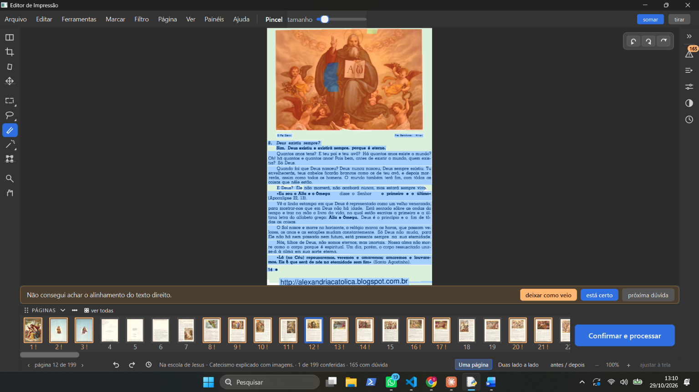 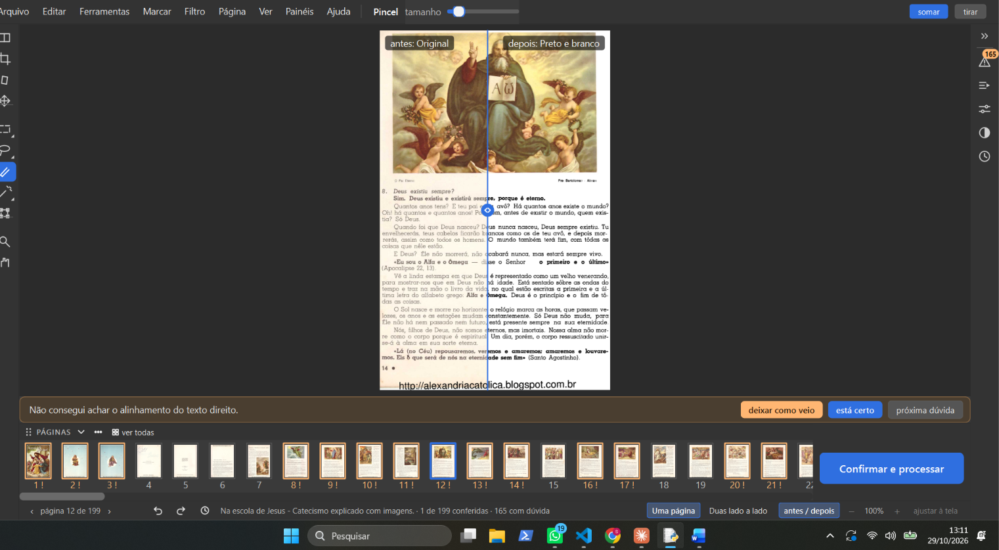 | D-578. *Na escola de Jesus*, página 12 de 199, ferramenta Pincel (marcar). No "antes / depois" a página sai certa (Preto e branco, gravura colorida); em "Uma página" aparece pintada de azul (letras), salmão (gravura) e verde (papel). |
| a-2b | "não tem nenhuma opção de marcação escolhida, está o zoom escolhido" (correção dele à explicação da gerente) | 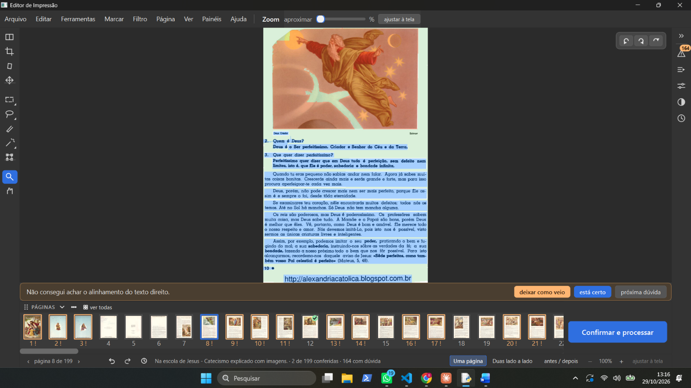 | Página 8 de 199, ferramenta Zoom: as cores aparecem também. A gerente tinha dito "só nas ferramentas de marcar": errado. Ver a causa corrigida abaixo. |
| a-3 | "Outra coisa para adicionar ai, quando usamo o automatico temos que conseguir depois de ter passado ele diminuir ou aumentar ou mudar opções, caso não tenha saido como a gente queria e dai o programa recalcula isso que mudamos, nós mudamos em uma pagina e ele faz no resto" | — | D-579 |
| a-4 | "e quando mostra para fazer os cadernos lá na parte de fazer caderno tem que ter um botão para ver como vai ficar o caderno." | — | Já era a D-574 (28/10, 2-10: "eu deveria conseguir ver o livreto pronto aqui nessa tela"); palavras de hoje acrescentadas a ela. |
| a-5 | "outra coisa para adicionar na nossa lista, eu desfiz todo o historico e continuou a marcação antiga nas paginas. acho que como eu desfiz tudo, as marcações deveriam sumir também né?" | 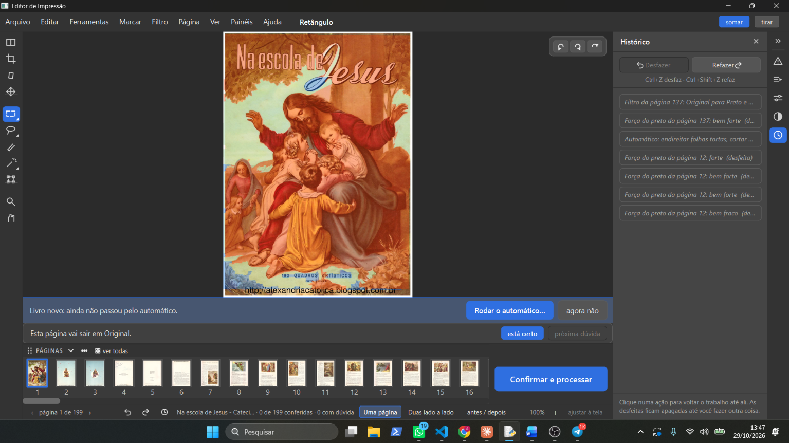 | D-581. Print: histórico com todas as ações desfeitas (inclusive "Automático: endireitar folhas tortas, cortar ..."), faixa "Livro novo: ainda não passou pelo automático" de volta. Pela D-020 (18/07, "Ctrl+Z desfaz qualquer alteração"), sim: é defeito. |
| a-6 | "depois de rodar o automatico, quando eu tento escolher outro filtro para uma folha só, ele joga o filtro em cima do filtro que já tinha sido aplicado, e quando eu escolho outro filtro ainda, ele nem mostra a mudança em tela mesmo eu estando na opção antes e depois. Precisamos da opção de jogar o filtro em cima de outro filtro ou só substituir o filtro que está colocado em cima. ou só colocar os filtros em cima das gravuras, por exemplo nesse livro eu gostaria de passa o magico pro em cima de todas as gravuras que ele achou muito bem, mas não dá." | 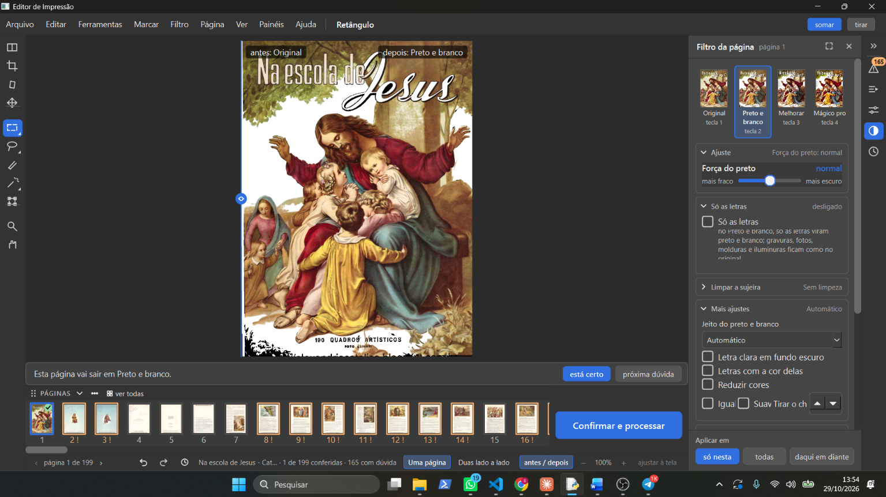 | D-582 (defeito), D-583 (empilhar ou substituir), D-221 (30/09: filtro nas áreas achadas; palavras de hoje acrescentadas). Print: capa, página 1, "antes / depois", Original × Preto e branco; a gravura sai colorida no Preto e branco com "Só as letras" desligado. |

## Causa do a-2 (lida no código da versão de teste, `obra-2026-10-26`)

Não é a página que deixa de mudar: o processamento está certo (o "antes / depois" mostra o Preto e branco). O que
acontece é que a vista da página (a mesma para o Zoom, a Mão e as ferramentas de marcar: `FERRAMENTAS_DE_NAVEGACAO` em
`ui/widgets/editor_selecao.py:95` são ferramentas do mesmo editor) pinta **sempre** toda a marcação da
página por cima da imagem, cada tipo numa cor (`ui/widgets/editor_selecao.py`, `_pintar_marcacao`, cores nas linhas
193-199: letra azul, gravura salmão, papel verde). Depois que o Automático roda a etapa de gravuras e fotos, a página
inteira fica marcada, e a imagem some debaixo das cores. A caixinha "Mostrar as áreas achadas" (D-237) só liga o
contorno laranja; não esconde o colorido. Então o conserto do a-2 e o "jeito de aparecer e desaparecer" são a mesma
coisa: um botão que mostra e esconde o colorido das marcações.

## Teste do item 1 (botão "marcações"), 29/10

- Pergunta dele: "Assim que eu abro o livro as marcações já aparecem se eu apertar no botão marcação, elas já estão feitas, acho que o programa já procura elas quando a gente abre ele né? mas se eu desmarcar elas saem." Resposta (código): o programa acha gravura, letra e papel sozinho ao desenhar uma página com filtro (`core/pipeline.garantir_selecao`); neste livro parte delas sobrou do Automático desfeito (D-581, item 2).
- Resultado dele: "deu certo, deu tudo certo, vamos para o proximo". D-578, D-580 e D-584 marcadas como testadas no Livro.

## Item 3 (D-582), investigação de 29/10
- Não é defeito de tela: a tela mostra o filtro escolhido toda vez (diferença 0,0 entre o que aparece e o desenho do filtro). O filtro não vai por cima do outro: cada escolha desenha a página de novo a partir do scan.
- O que fica "por cima" é a marcação que o Automático deixou ("Gravuras e fotos"): na capa, 82% da página virou "enfeite colorido", que guarda a cor em todos os filtros (D-144, D-127, D-128). Por isso Preto e branco, Melhorar e Mágico pro saem quase iguais (diferença 2,2 de 255) e parece que nada muda.
- Imagem da explicação: `relatorios/automatico-filtro/5-capa-nos-4-filtros-com-e-sem-a-marcacao.jpg` (ramo `automatico-filtro-2026-10-29`, commit `d4407e9`, só provas e relatório).
- Vira a pergunta D-583 ao Samuel; achado à parte na Lista de bugs (figurinhas do painel sem a marcação).
- "Só as letras" do Automático conferido em 29/10: funciona (livro, página herdada, tela, PDF, desfazer). D-585: causa achada (escrita por cima da pintura), sem conserto seguro; Samuel: "deixar como está e deixar anotado, vamos continuar para o que temos que fazer".

## Teste da caixinha "Respeitar as gravuras achadas" (D-583, D-586, D-587), 29/10
- Página 17 (pintura colorida saindo cinza no Preto e branco): é a D-147 (pintura e foto em tons de cinza). Os riscos laranja são o contorno das áreas achadas, ligado sozinho nas páginas com "!" (D-237); ele perguntou "porque estão ali, não são marcações". Pergunta da gerente (o botão "marcações" também esconder o laranja?) ficou sem resposta.
- Capa, caixinha desmarcada: "onde está a opção que deixa só cinza e branco ,essa parece que está dando um negativo". Não existe; vira a D-588.
- Resultado dele: "beleza, vamos deixar esse problema para resolver logo após terminamos os que nós propomos a fazer, o programa está mudando de efeito como deveria". D-583, D-586 e D-587 marcadas como testadas no Livro.

## Ordem da lista, 29/10 (fim do dia)
- Ele pediu a lista de novo ("acho que você está confundindo, olha a conversa e veja a lista e passa ela aqui pra mim"); a gerente repassou a de 14h59 (itens 1 a 8) com a situação de cada um.
- Ordem nova, palavras dele: "vamos deixar a 5 para depois, é mais importante fazer a 6 e a 7 e 8". Fica: D-577 (ver como vai ficar), D-579 (mudar e refazer o resto), D-574 (ver o caderno), depois D-221 (filtro nas gravuras achadas), depois D-588 (gravura em tons de cinza).

## Teste do item 6 (D-577, ver como fica na janela do Automático), 30/10
- Palavras dele: "ele não está funcionando, e não funciona em tela cheia também, como pode ver pelo print ele não muda no antes e depois conforme eu troco os filtros"
- 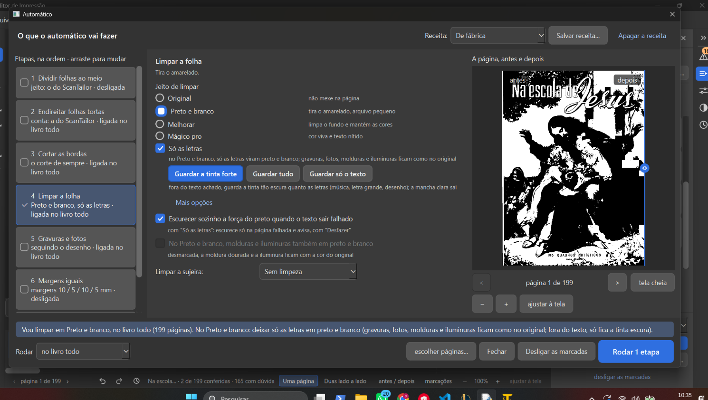 Janela do Automático, *Na escola de Jesus*, página 1 de 199 (capa), etapa 4 "Limpar a folha", Preto e branco + "Só as letras" + "Guardar a tinta forte", "Escurecer sozinho" ligado. O "depois" mostra a capa inteira em preto e branco duro (a pintura também), e não muda quando ele troca o filtro.
- 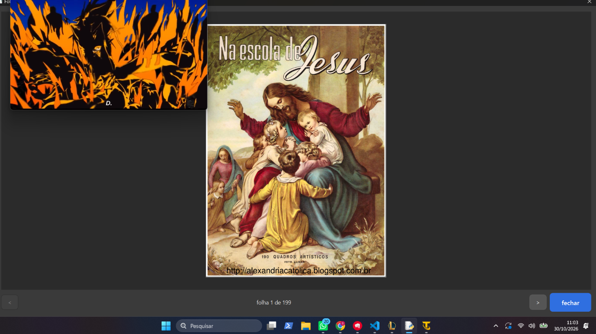 "tela cheia": mostra a folha 1 de 199 crua, colorida (sem antes e depois). No canto de cima à esquerda aparece um quadro solto com uma imagem laranja e preta (a origem ainda não foi vista).
- Situação: D-577 **não passou no teste dele**. A causa está em investigação.
- **Causa achada (30/10, na versão de teste):** a prévia supõe sempre "pular as páginas mexidas à mão" (`EstadoDoAutomatico.pedido()` com `pular_mexidas=True`; D-004). No livro de teste, a capa (página 1) e a página 17 estão marcadas como mexidas à mão no filtro (`mexida_a_mao: ['filtro']`, dos testes de 29/10). Então o Automático pula a capa, e o "depois" fica igual ao que já está no livro: a capa em 1 bit do teste da D-588. Prova numa cópia do projeto: na página 1, Preto e branco × Mágico pro dá diferença de 2,1 (de 255) pulando e muda sem pular; na página 3 (não mexida), dá 17,4 (muda). Nas páginas não mexidas a prévia funciona.
- "tela cheia" mostra a folha crua do PDF: foi escolha do construtor ("como antes", TelaCheiaDoPDF), uma das ressalvas dadas a ele.
- Pergunta da gerente: "Minha sugestão: na prévia, a página mexida à mão também mostra como ela fica com as opções escolhidas. Quando você apertar "Rodar", o programa continua perguntando se pula essas páginas. Responda sim ou não."
- Resposta dele (30/10): "ok, então quando for dar o ok, ele vai perguntar se querermos mudar as paginas que foram mudadas a mão. Mas na previa ali, ele mostra a mudança em todas as paginas mas só muda as que nós autorizarmos ( no caso as que foram mexidas a mão), segundo tem que dar para ver na previa em tela grande e poder dar zoom na previa em tela grande, terceiro - essa opção que eu mandei print, quero saber como eu posso marcar e desmarcar ela."
  - 1: a prévia mostra a mudança em todas as páginas, inclusive as mexidas à mão; ao "Rodar", a pergunta da D-004 continua decidindo.
  - 2: o antes e depois da prévia também em tela grande, com zoom (o "tela cheia" hoje mostra a folha crua).
  - 3:  a caixinha "No Preto e branco, molduras e iluminuras também em preto e branco" fica cinza porque "Só as letras" está marcada (D-168: `ui/automatico.py`, `cx_decoracao_pb.setEnabled(not (so_letras and no_pb))`). Desmarcando "Só as letras", ela volta a funcionar.
- Quarta coisa (30/10, palavras dele): "quarta coisa, quando você mexe no antes e depois, ele começa a mostrar o antes de qual pagina, parece que ele troca o antes conforme se troca os perfis dos filtros." Pela D-577, o "antes" é a página como está agora no livro e não muda com as opções. Vai para o construtor investigar e reproduzir.

## Problema do Kaique: "Montar cadernos" volta sozinho (30/10) — D-589
- Samuel: "tenho outro problema para resolver também, para ser colocado nessa lista [...] olha o arquivo world nessa pasta" (`D:\programas\EditorImpressao-arquivos\TESTES MANUAIS DO SAMUEL\kaique audio transcrição\Kaique audios.docx`, áudios 1.ogg a 3.ogg).
- Kaique, áudio 1: "Tá vendo ali na caixa de seleção, ó, ela não tá selecionada, nem ela e nem a opção de dividir, que é a primeira. É, aí na hora que gera, depois o resultado final, né, aí aplicou o filtro branco, letra preta. Aí só que ele forma os cadernos do mesmo jeito."
- Kaique, áudio 2: "Aí antes de de rodar a etapa, é, ele mostra marcado ali, tá vendo? É, depois, né, depois de rodar a etapa, aí ele volta a marcar."
- Kaique, áudio 3: "Aí eu vou lá, ajusto a etapa, né, tiro, é, a opção de montar os cadernos, aí depois ele coloca de novo sozinho."
- 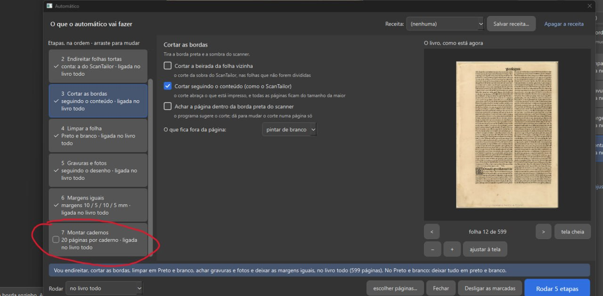 Janela do Automático (versão do Kaique, ainda com "O livro, como está agora"), livro de 599 folhas: a 7 "Montar cadernos" está desmarcada, mas o texto embaixo diz "20 páginas por caderno · ligada no livro todo"; o botão diz "Rodar 5 etapas".
- 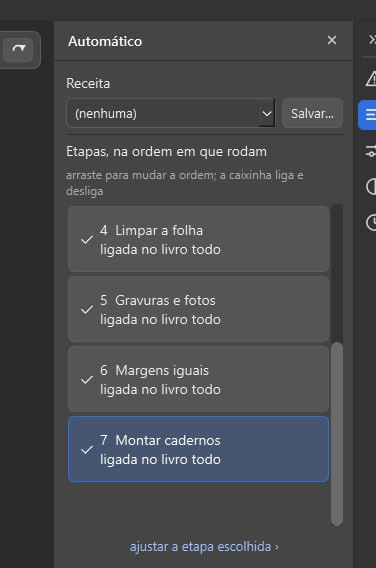 Painel Automático depois de rodar: "7 Montar cadernos · ligada no livro todo", com o ✓.

## Capa colorida na ferramenta Cortar e em preto e branco no "Ver de perto" (30/10)
- Palavras dele: "1- no primeiro print está normal 2- quando eu abro, mostra em preto e branco"
- 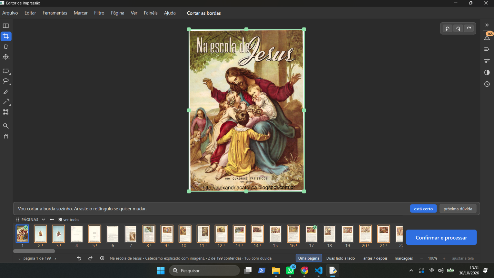 Área de trabalho, ferramenta "Cortar as bordas", capa colorida, com o retângulo verde.
- 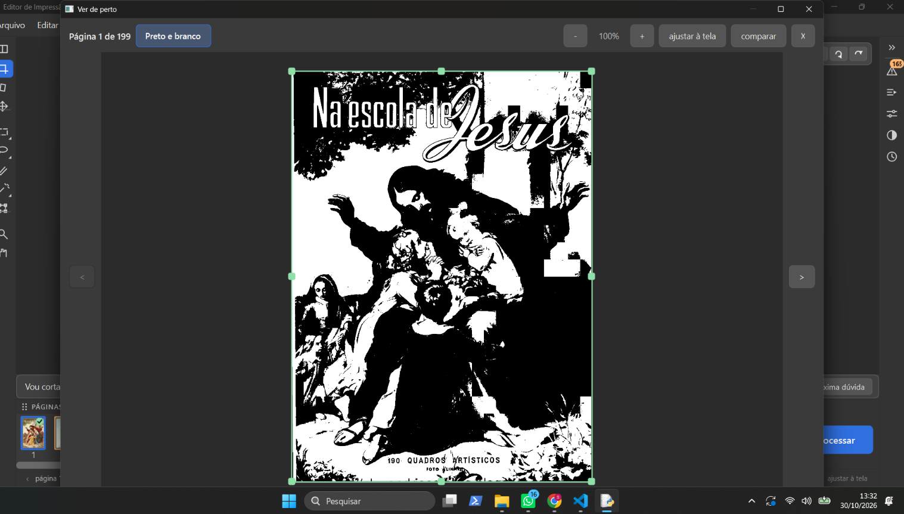 "Ver de perto" aberto da mesma ferramenta: capa em "Preto e branco", 1 bit.
- O que é (código da versão de teste): a ferramenta Cortar mostra sempre a página sem filtro, só girada e dividida (`ui/tela_conferir._atualizar_previa_para_recorte` → `core/pipeline.preparar_para_recorte`, conserto de 23/09 para o corte não "andar sozinho"). O "Ver de perto" (`ui/tela_ampliada.py`, modo Bordas) mostra a página com o filtro dela (`previas.pegar`). O filtro da capa é Preto e branco, do teste de 29/10 (D-588).

## Teste da D-577 depois do conserto (30/10, 13:33)
- Palavras dele: "1- a questão do antes e depois, ela é de acordo com o que? 2- no primeiro print mostra o antes no original e no segundo print mostra o depois no preto e branco."
- 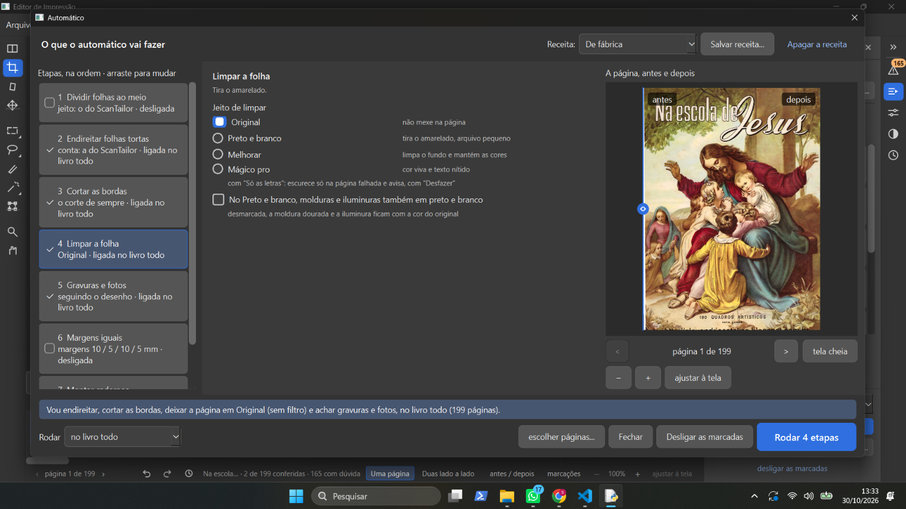 Capa, "Limpar a folha" em Original. A linha está toda à esquerda, então o que aparece é o "depois": a capa colorida (Original), como ele escolheu. Antes do conserto a capa mexida não mudava.
- 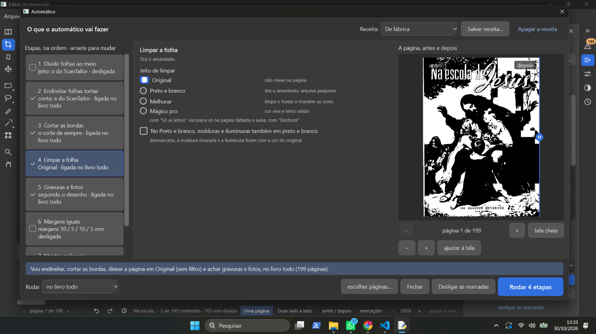 Mesma escolha, linha toda à direita: aparece o "antes", a capa como está no livro (Preto e branco 1 bit, do teste da D-588).
- Leitura da gerente: a tela está certa, e ele leu os lados trocados. Isso pode explicar a "quarta coisa" (o antes parecia mudar com o filtro).
- Sobre a capa colorida no Cortar e P&B no "Ver de perto" (30/10): "você não analisou direito os prints, leia novamente minha mensagem, na area de trabalho está aparecendo sem filtro nenhum, no caso eu estava na ferramenta de cortar, ata, entendi". Entendido por ele: a ferramenta Cortar mostra a página sem filtro. A sugestão da gerente (o "Ver de perto" do Cortar também sem filtro) ainda não foi respondida.
- Palavras dele (13:38): "aqui o filtro antes está no preto e branco, mas você pode ver que o divisor do antes e depois esta no antes e mesmo assim aparece como o filtro original que deveria ser o depois né."
- 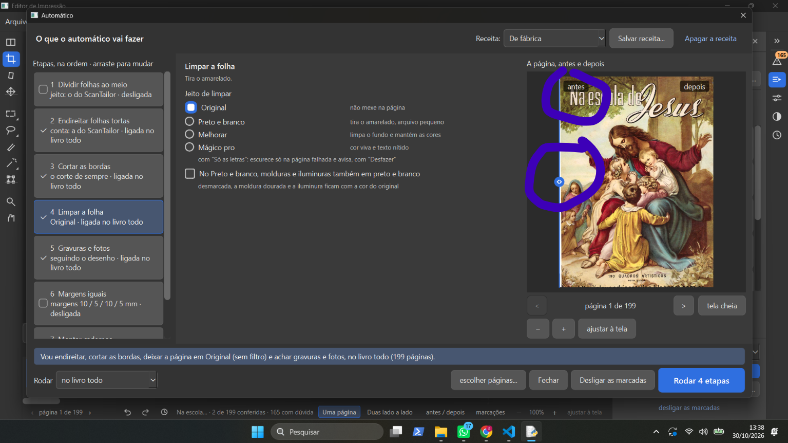 Ele circulou o rótulo "antes" e a linha encostada na esquerda. O que acontece: à direita da linha aparece o depois (Original), quase a página toda; o rótulo "antes" fica parado no canto, em cima do depois. É o mesmo visor do "antes / depois" da área de trabalho (`VistaAntesDepois`).
- Pergunta da gerente: "Minha sugestão: a palavra "antes" some quando a linha passa por cima dela, e a palavra "depois" também, do outro lado. Vale aqui e no "antes / depois" da área de trabalho. Responda sim ou não."
- Resposta dele: "está bem confuso, na verdade, porque eu já tinha colocado um filtro antes, eu acho que o antes deveria ser sempre o original e o filtro depois o que escolhemos, ai se quiser comparar faz isso na tela cheia."
  - Na prática: o "antes" da prévia do Automático passa a ser a página original (hoje é a página como está no livro, com o filtro já posto). O "depois" continua sendo o que se escolhe na janela. Comparar com o filtro que já estava: na tela cheia (o "Ver de perto" tem "comparar", `ui/tela_ampliada.py`). A sugestão dos rótulos não foi aceita nem recusada.
- Pergunta da gerente: o "antes" de uma página já cortada e endireitada: a sugestão era a página cortada e endireitada, mas sem filtro (em Original); a outra opção, a folha crua do scanner. "Pode ser a sugestão? Responda sim ou não." Sem resposta ainda.
- Ele (30/10): "na tela cheia vai ter um botão de comparação , ai vão aparecer duas telas para comparar". Na prática: a tela cheia da prévia do Automático ganha um botão de comparar que mostra duas telas lado a lado (como o "comparar" do "Ver de perto", `ui/tela_ampliada.py`). O que vai em cada tela ainda não foi dito.
- Pergunta da gerente: "à esquerda, a página como está agora no livro, com o filtro que você já tinha posto. À direita, o "depois", com o que você escolheu na janela. As duas andam juntas no zoom, como no "comparar" do "Ver de perto". Responda sim ou não."
- Resposta dele: "nessa vai ter o filtro que estava antes, seja ele original ou que foi aplicado e o filtro que está selecionado no momento". Fica: no comparar, uma tela com o filtro que a página já tinha (Original ou o aplicado) e a outra com o filtro escolhido agora na janela.
- Resposta dele à pergunta do "original": "mostra já cortada e endireitada se tiver sido feito isso." Fica: o "antes" é a página como está no livro (com o corte e o endireitar que já tiver), mas sem filtro (em Original).
- Correção dele (30/10), no lugar da resposta acima: "o antes é sem filtro e sem cortar sem nada, o depois na tela de atualizar que aplica os filtros de endireitar cortar ou fazer qualquer outra coisa para ver como iria ficar." Fica: o "antes" é a página crua do PDF (sem filtro, sem corte, sem endireitar); o "depois" é o que o Rodar faria com as etapas e opções da janela.
- Pergunta da gerente: "numa folha que vai ser dividida ao meio, o antes mostra a folha inteira ou só a metade?"
- Ele (30/10): "ela teria que ser cortada antes né, eu acho que é o que mais faz sentido, ai como fariamos isso, colocaria um aviso logo que abre o automatico?"
- Proposta da gerente: sem aviso. (1) Folha já dividida: o antes é a metade crua, e o depois é essa metade pronta. (2) Folha não dividida com "Dividir" marcado: o antes é a folha inteira crua, e o depois são as duas metades prontas, lado a lado. Ele: "mas dai se a pessoa apertar dividir ?" → gerente: marcar "Dividir" muda o depois na hora para as duas metades, e o antes continua a folha inteira crua; desmarcar volta o depois à folha inteira pronta; folha já dividida: o antes é a metade crua com "Dividir" marcado ou não. "Pode ser assim? Responda sim ou não."
- Ele: "pode".

## Item 7 (D-579), 30/10
- Ele: "não entendi a 7" → a gerente explicou com as palavras dele de 29/10 (a-3) e um exemplo (página 10 com letra fraca, aumentar a força, o programa levar ao resto).
- Ele: "sim, mas ele não pode fazer isso automaticamente né, na verdade, eu acho que não precisa dessa opção pois já podemos fazer isso em folhas individuais e jogar para o livro todo né? temos essa opção no programa já?"
- Conferido no código da versão de teste: o painel Filtro tem "Aplicar em: só nesta · todas · daqui em diante" (`ui/tela_conferir.py`, `_filtro_em_todas` e `_filtro_nas_proximas`), que leva o filtro da página e os ajustes dele (a força, "Só as letras", "Respeitar as gravuras achadas"...) para as outras páginas. Cortar e Mover têm "usar em todas".
- Gerente: "Então tiro o item 7 da lista? Responda sim ou não." → ele: "sim". D-579 descartada (já existe o "Aplicar em" do painel Filtro e o "usar em todas"). Lista: 6 (D-577, em construção) → 8 (D-574) → 5 (D-221) → D-588.
- Ele (30/10): "coloque mais uma coisa nessa lista, aquele relato do Kaique do montar cadernos que eu mandei você ler a pasta". D-589 entra na lista como item 9. Ordem: 6 (D-577) → 8 (D-574) → 5 (D-221) → D-588 → 9 (D-589).
- Gerente: "Quer que ele venha logo depois do item 6?" → ele: "não". O item 9 (D-589) fica no fim da lista.

## 3º teste da D-577 (30/10, 16:30, junção f39a37d)
- Palavras dele: "1- não consigo dar zoom com o mouse, usando o scrool 2- ainda está confuso qual o lado que é o antes e depois, o lado para onde a gente desliza a faixa de antes e depois tem que estar o nome, conseguiu entender? print 2 desse lado deveria ser o antes e está o depois . print 3 - desse lado deveria ser o depois e está o antes. 3- print 4 - seria bom se pudessemos ver as opções e mudar simutaneamente nesse comparar, tivesse uma aba de cada lado que abrisse e fechasse para mudar as opções no comparar, ao em vez de ser só o antes e depois."
- 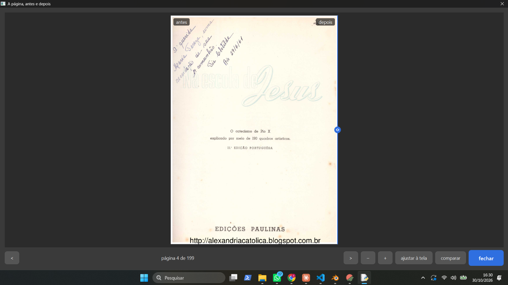 Tela cheia, página 4, linha na direita (aparece o antes, cru).
- 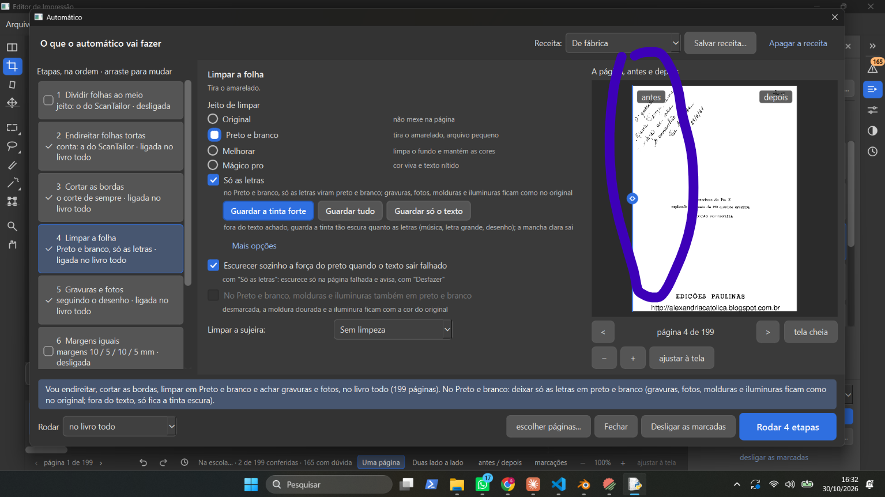 (print 2 dele) Janela, P&B + Só as letras, linha toda à esquerda: debaixo do rótulo "antes" aparece o depois (P&B). Ele circulou esse lado.
- 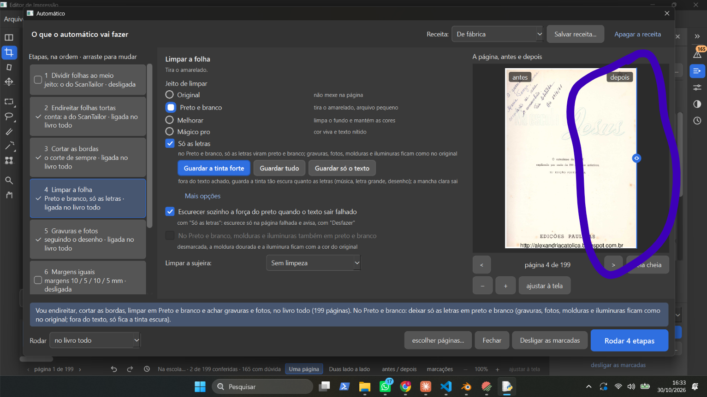 (print 3 dele) Linha toda à direita: debaixo do rótulo "depois" aparece o antes (cru). Ele circulou esse lado.
- 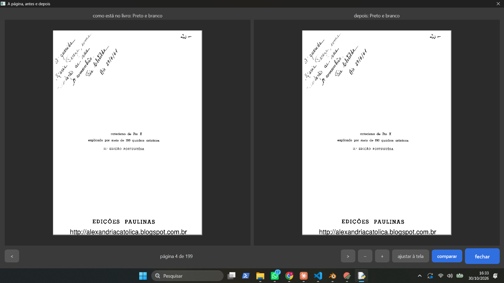 (print 4 dele) "comparar": "como está no livro: Preto e branco" × "depois: Preto e branco".
- 1 (zoom com a roda): conferido no código; `VistaAntesDepoisComZoom` (ui/automatico.py) não trata a roda (só os botões); o Visualizador da área de trabalho trata (`ui/widgets/visualizador.py`, `wheelEvent`). Vai para o construtor.
- 2: sugestão da gerente (os rótulos andam colados na linha) → ele: "não gostei da sugestão, eu quero que a faixa seja de acordo com a direção do antes e depois, se ela está embaixo do depois ela está aparecendo o depois se está embaixo do antes ela está no antes."
- Gerente: os rótulos ficam parados (antes à esquerda, depois à direita); linha toda à direita (embaixo de "depois") → a página inteira mostra o depois; linha toda à esquerda (embaixo de "antes") → a página inteira mostra o antes; linha no meio → à esquerda dela o depois, à direita o antes. "Hoje é o contrário [...] É isso? Responda sim ou não." → ele: "sim".
- Gerente: "Esse mesmo quadro com a linha também aparece no "antes / depois" da área de trabalho [...] Muda lá também, para funcionar igual nos dois lugares? Responda sim ou não." → ele: "sim".
- 3 (opções no comparar): proposta da gerente (cada tela com uma aba das opções do "Limpar a folha"; a esquerda começa como está no livro, a direita com a escolha da janela; ao "Rodar" vale o lado direito) → ele: "não, eu quero poder mudar dos dois lados, todas as opções."
- Gerente: "Qual dos dois lados vale? Minha sugestão: cada lado tem um botão "usar este". Apertando, as opções daquele lado passam para a janela do Automático, e o "Rodar" usa essas opções. Pode ser assim?" → ele: "ok, não gostei do nome, mas vamos ficar com esse por enquanto."
- Fica (3): no "comparar" da tela cheia, cada lado tem uma aba que abre e fecha com todas as opções do Automático (etapas e opções); cada lado muda à parte; cada lado tem "usar este" (nome provisório), que passa as opções daquele lado para a janela; o "Rodar" usa as da janela. Ordem: primeiro a roda do mouse e a linha (em construção), ele testa, depois esta.
- Ele (30/10): "conseguimos botar o 8 e o 9 para fazer ao mesmo tempo que está fazendo as outras questões?" → gerente: lembrou a D-576 (uma coisa por vez); o 8 espera ele escolher o desenho A/B/C (Central, aba "Não gostei"); máximo 3 agentes. Sugestão: o 9 começa agora, em paralelo, numa cópia separada; o 8, assim que ele escolher. → ele: "sim". (Ele continua testando um de cada vez, conforme fica pronto.)
- Item 9 (D-589), pergunta do construtor (P1): as outras etapas desmarcadas também continuam ligadas ("Margens iguais", "Gravuras e fotos"). Depois de três explicações ("não entendi", "explica melhor esse item 2", "rapaz não entendi nada mesmo agora"), a versão curta: "conserto essas duas também, do mesmo jeito que os cadernos?" → ele: "Sim, se algo não está marcado, não é para fazer , certo?"
- Linha do antes e depois no terceiro lugar ("Filtro da página" → tela cheia → "Comparar com o Original"), que mudou junto: "Pode ficar do jeito novo lá também?" → ele: "Sim".
- "Dividir" desmarcada: a gerente sugeriu que não junte as folhas já divididas. Ele: "como assim desligar as marcadas? fica em qual aba essa opção?, se quiser juntar as folhas de novo deveria ter uma opção mais clara né". A gerente explicou o "Desligar as marcadas" (rodapé da janela grande, link no painel) e o "não dividir esta" (ferramenta Dividir, uma folha por vez), e sugeriu: "na ferramenta Dividir, ao lado de "não dividir esta", um botão "juntar todas", que junta todas as folhas do livro de uma vez (o Ctrl+Z desfaz). E desmarcar "Dividir" no Automático não junta nada. Pode ser assim?" → ele: "pode ser assim". Vira a D-590.

## Respostas na Central, 31/10 (aba "O que você não gostou: alternativas")
- 2-10 ver o livreto (D-574): "Opção 1: as folhas como saem da impressora, frente e verso" · "Não gostei da tela que mostra o livreto, podemos mudar depois, deixe anotado na lista de espera. vou escolher a 1, mas não gostei muito, tem como olha como outros aplicativos fazem isso porque eu não gostei muito."
- 2-10 livreto ao processar (D-575): "Uma caixinha no "Confirmar e processar" (recomendo)".
- 2-11 ver como fica no Automático (D-070): "Esperar o Laboratório inteiro da D-070" · "Nós acabamos de fazer escolhas sobre isso agora a pouco no chat. Mas ainda vai ter o laboratorio que seriam sugestões do programa para o livro."
- 2-12 aviso de memória (D-591): "Frase certa + botão "tentar de novo" (recomendo)".
- 2-8 "Ver de perto" demora (D-592): "Só passar à frente na fila" · "Isso fica anotado para que dentro do programa possamos fazer esses calculos de maneira mais rapido, porque fica tão lento? que processos estamos fazendo que não precisam ser feitos? como outros programas mais rapidos fazem isso? deixe isso anotado numa nova aba na central chamada pesquisas."
- 2-9 voltar para os livros (D-593): "Botão "‹ Livros" no canto de cima, à esquerda do menu Arquivo (recomendo)" · "Seria um botão home na barra de arquivos e não livros, só que para fazer isso tem que ter a possibilidade de abrir varias abas né."
- Item 9 (D-589), pergunta P3 do construtor (as Gravuras não religam). Pergunta de base, depois de "NÃO ENTENDI": "Pense numa página com texto e uma figura colorida. [...] "Só as letras" [...] e "Gravuras e fotos" desmarcada [...] as duas escolhas brigam [...] Minha sugestão: vale o "Só as letras", e a figura sai colorida. Responda sim ou não." → ele: "Sim, mas e essa opção gravuras e fotos sai aonde? estamos falando do deixar tudo em tons cinzas?"
- Ele: "e quando vai sair cinza ? o que eu vou ter que marcar para ela sair cinza ou simplesmente em preto e branco" → gerente explicou (colorida: "Só as letras"; cinza: sem "Só as letras" e com a etapa 5; tudo P&B: sem "Só as letras" e sem a etapa 5; exceção: figura tomada por enfeite, D-588).
- Ele: "eu vou pode escolher depois na area de trabalho para deixar só aquela pagina em tons cinza?" → gerente: painel "Filtro da página", Preto e branco, sem "Só as letras", "Respeitar as gravuras achadas" marcada, "Aplicar em: só nesta"; mesma exceção.
- Ele: "mas se ele confundiu a gravura no automatico na capa, ele não vai confundir de novo, olhando só aquela pagina?" → gerente: sim, confunde de novo; é a D-588. "Quer que esse item suba na lista? Hoje ele vem depois do 5" → ele: "sim". Ordem nova: 6 (D-577), 8 (D-574) e 9 (D-589) em andamento → D-588 → 5 (D-221).
- Pergunta do construtor (com "Só as letras", Gravuras precisa procurar e voltaria marcada sozinha) → ele: "porque ele vai estar marcado? se ele estiver marcado as figuras e fotos não vão sair preto e branco?" → gerente: com "Só as letras" a figura sai colorida com a etapa 5 marcada ou não; sugestão nova: a caixinha da etapa 5 fica como ele deixou (desmarcada); com "Só as letras", o programa procura as figuras por dentro só para deixá-las coloridas; desmarcando "Só as letras", a etapa 5 continua desmarcada e a página sai toda em P&B. → ele: "sim, mas tem que ter certeza que o programa vai procurar as figuras mesmo com a opção desmarcada e que não vai remarcar ela de novo na caixinha".

## Pausa (31/10)
- Ele: "vamos pausar o trabalho". Os agentes foram mandados parar num ponto seguro e salvar.
- Situação na pausa:
  - D-577 (item 6): a roda do mouse e a linha estão juntadas na versão de teste (`53a301b`) e prontas para ele testar. Falta o "comparar" com as opções dos dois lados e o "usar este".
  - D-574 (item 8): construída no ramo `livreto-ver-2026-10-31` (ff0260f); o verificador estava conferindo quando parou.
  - D-589 (item 9) + D-590: ramo `automatico-cadernos-2026-10-30`; os cadernos e as margens estão verificados; faltam as gravuras (decisão de 31/10) e o "juntar todas"; o construtor parou.
- Perguntas abertas com ele:
  - D-574, botão de 29/10: "ao abrir a janela "Montar para imprimir", a folha já aparece sozinha, sem precisar de botão. Está bom assim, sem botão?"
  - D-574, as outras 4 do construtor: outros formatos, livreto antigo do Automático, "Folhas de/até", "Só a frente/verso".
  - D-589, P2: rodar numa página só desliga a etapa desmarcada no livro todo.
  - D-589, P3: a frase da janela e o Histórico dizem o que foi desligado?
  - D-588: como fica na tela.
  - D-593: o botão "home" e as abas.
- A fazer da Central de 31/10: D-575, D-591, D-592, a aba "Pesquisas" e a Lista de espera do livreto ("como outros aplicativos fazem").
- Depois da pausa:
  - Construtor D-589/D-590 parou em `d67933f`: gravuras com as 4 regras, "juntar todas" (P-198) e `teste_botoes` consertado. Falta: ver a rodada 41218623088 do GitHub e o verificador. Fica aberto: "Desligar as marcadas" das Gravuras não religa (já era assim).
  - Verificador D-574 parou sem parecer: as provas e os testes da impressão estão ok; falta a parte de tela. Onde parou: `.claude\worktrees\verif-livreto\relatorios\livreto-ver\verificador\ONDE-PAREI.md`.

## 4º teste da D-577 (31/10, noite, junção 53a301b)
- Antes do teste, ele (sobre a ordem do trabalho): "pera ai, mas a nossa lista de coisas para fazer" → gerente: a lista continua 6 (D-577) → 8 (D-574) → 9 (D-589/590) → D-588 → 5 (D-221); as respostas da Central de 31/10 (2-1 a 2-7) só vão para o Livro e entram depois do 5, salvo ordem dele.
- Ele, depois de testar: "ok, o zoom está funcionando bem em todos os lugares, mas  maneira como ele funciona na area de trabalho é diferente da dos outros lugares."
  - É a diferença que o verificador tinha apontado: na área de trabalho, Ctrl + roda dá zoom e a roda sozinha troca de página (D-568, 27/10); no Automático, na tela cheia e no "comparar", a roda sozinha dá zoom (D-577, 30/10).
- Gerente: "Sugiro deixar todos os lugares iguais à área de trabalho [...] Ctrl + roda dá zoom, e a roda sozinha passa a página. Pode ser assim?" → ele (sem sim/não): "mesmo assim, na area de trabalho o zoom se comporta sozinho, porque ele se direciona somente para o centro da pagina e não onde o mouse está, que é como o zoom se comporta em outros lugares no programa."
  - Defeito: na área de trabalho o zoom vai para o centro da página; nos outros lugares vai para onde está o mouse.

## Teste de 31/10, noite: Preto e branco nas gravuras
| # | Palavras dele | Print | O que é |
|---|---|---|---|
| a-19 | "olha não sei o que aconteceu, mas não está funcionando direito , só dá para colocar o preto e branco só nas letras e não mais nas gravuras." | 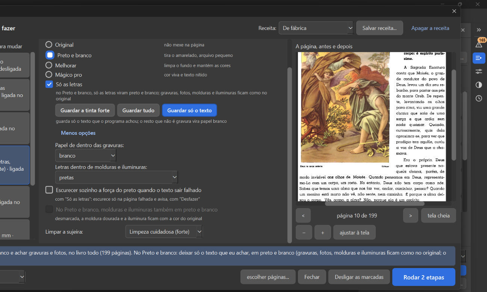 | Janela do Automático, página 10 de 199: Preto e branco + "Só as letras" + "Guardar só o texto"; a caixinha "No Preto e branco, molduras e iluminuras também em preto e branco" está cinza; na prévia a gravura de Moisés sai colorida. A investigar. |
| a-20 | (sem "Só as letras") "1- gravuras e fotos desmarcada. 2- agora com ela marcada, sai igual." · correção dele à leitura da gerente: "você está lendo a imagem errado, no print 1 saiu cinza e na imagem dois saiu igual cinza." | 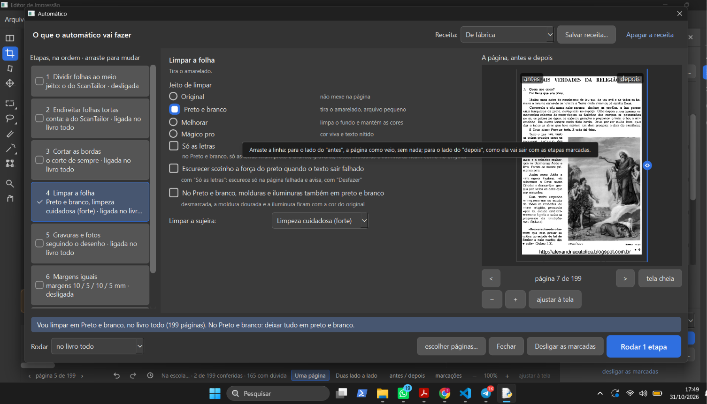 | Página 7 de 199, Preto e branco sem "Só as letras", etapa 5 desmarcada: a gravura sai em CINZA (a gerente tinha lido "tudo em preto e branco": errado). Com a etapa 5 marcada: cinza também. Pela D-589 (regra 3), sem "Só as letras" e sem Gravuras a página devia sair toda em preto e branco. Causa provável: o cartão da etapa 5 diz "ligada no livro todo" com a caixinha desmarcada; na versão de teste o Rodar/prévia não desliga etapa desmarcada (é o conserto da D-589, feito no ramo automatico-cadernos-2026-10-30, ainda não juntado). |
| a-21 | "Outra coisa, no automatico não tem opções que encontramos nos filtros da aba da area de trabalho." | — | Conferido no código da versão de teste (`ui/automatico.py` × `ui/tela_conferir.py` `_montar_aba_filtro`): faltam no Automático "Jeito do preto e branco" (os jeitos do ScanTailor e os outros), "Letra clara em fundo escuro", "Letras com a cor delas", "Reduzir cores", "Igualar a luz da página", "Suavizar as letras", "Tirar o chuvisco" e "Respeitar as gravuras achadas". Nenhuma decisão do Livro manda o Automático ter todas as opções do painel Filtro (a D-577 fala das "opções do Automático" no comparar): pedido novo, perguntar. |
| a-22 | "os tipos de preto." | 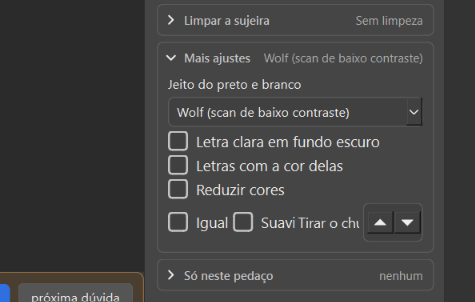 | Painel Filtro da área de trabalho, "Mais ajustes": "Jeito do preto e branco" (Wolf), "Letra clara em fundo escuro", "Letras com a cor delas", "Reduzir cores", "Igual", "Suavi", "Tirar o chu". Ele aponta os tipos de preto como o que falta no Automático. Visto no print: os nomes "Igualar a luz da página", "Suavizar as letras" e "Tirar o chuvisco" aparecem cortados (defeito de tela; vai para a Lista de bugs). |
- Gerente: "No Livro de decisões não existe pedido seu para o Automático ter todas essas opções [...] Pode entrar na lista como item 6?" → ele: "mas isso era uma coisa obvia que deveria ter". Entrou no Livro como D-594 (falha da equipe, não pedido novo).
- Gerente: "Sugiro fazer isso logo depois de terminar o que está pela metade, antes da gravura em tons de cinza. Pode ser?" → ele: "ta bom, agora que eu relatei os problemas, vamos organizar para continuar os concertos e as listas."
- Lista nova (31/10, noite): em andamento, 3 agentes: (A) D-577 comparar + "usar este" + zoom da área de trabalho para onde está o mouse; (B) verificador D-574; (C) verificador D-589/D-590 (com o caso a-20). Depois: D-594 → D-588 → D-221. Depois da lista: respostas da Central de 31/10.

## Organizar a lista (31/10, noite)
- Gerente chamou 3 agentes sem "sim"; ele: "chamar os agentes para o que? você não perguntou o que era para fazer e ignorou minha mensagem "ta bom, agora que eu relatei os problemas, vamos organizar para continuar os concertos e as listas."" → os 3 foram parados (nada mudou no programa).
- Lista mostrada (1 a 9) e "está faltando ou sobrando alguma coisa?" → respostas dele, palavra por palavra:
  - 1 (D-577 comparar + "usar este"): "mas já faça com as opções que faltam do automatico."
  - 2 (D-574, print a-23: 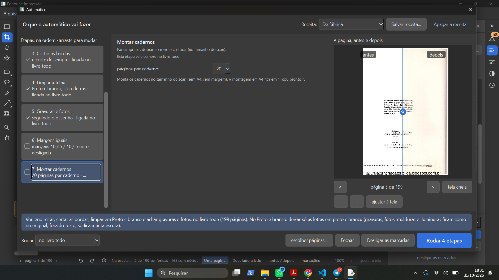, janela do Automático na etapa 7 "Montar cadernos"): "Ele vai aparecer quando estiver na aba do montar caderno como no print que eu mandei, quando a pessoa for nessa aba ela vai poder ver, tem outro lugar além do automatico hoje que dá para montar caderno e ver ele de outras formas? se não tiver pode dar sugestões."
  - 3 (D-589 + D-590): "são duas coisas diferentes, faça separadamente."
  - 4 (D-594): "Sim, podemos fazer isso junto com a tarefa 1."
  - 5 (D-588): "ok"
  - 6 (D-221): "ok aparecendo em todos os paineis de filtro, seja automatico ou em outros lugares."
  - Geral: "acredito que esteja coisa faltando, mas tudo bem, vamos fazer isso, só não pode esquecer da questão dos cadernos que o Kaique falou, de não criar caderno quando não estiver marcado."
  - Ordem para esta sessão (não é regra permanente; ele: "não era uma regra nova, era uma ordem só para agora"): "Use um agente só por vez, não quero gastar muito token. e antes de usar me diga qual claude está usando no agente."
- Gerente perguntou se usava o Sonnet 5.5 nos agentes para gastar menos → ele: "tenho medo de usar o sonnet 5.5 e ele fazer cagada." Fica o Claude Opus 5.5.
- Gerente: "mostrar as folhas do livreto nos três lugares (etapa 7 do Automático, painel "Montar cadernos" e "Montar para imprimir")?" → ele: "Sim, mas no caso, eu estou falando em tela grande, pois no painel automatico, vamos conseguir ver ele só se clicarmos na opção de montar cadernos e lá se apertarmos em ver tela grande abriremos o tela grande que já temos mas para versão de caderno."
- Construtor da tarefa 1 (D-577 comparar + D-594) entregou: ramo `automatico-ver-como-fica-2026-10-29`, `4440a17`, GitHub 41252917494 verde. Pergunta 6 dele levada ao Samuel; dúvidas dele: "como assim a caixinha some?", "que pergunta de pular, ainda estou confuso", "como assim, na pagina que eu estou" (gerente explicou com o exemplo da página 17, chuvisco 30).
- Gerente: "A outra opção é as opções novas começarem com os valores da receita escolhida no alto da janela (hoje, "De fábrica"), qualquer que seja a página em que você está. [...] Pode ser assim, pela receita?" → ele: "sim".
- 5ª rodada do construtor (receita): `3d05893`/`0c29ba4`, GitHub 41255443322 verde (parte 1 rodada de novo: teste instável p083). Ele: "não foi isso que eu pedi no comparar, reveja o meu pedido" → gerente citou as palavras dele de 30/10 e o que foi construído (cada lado com "opções" e todas as opções do Automático, os dois lados mudam à parte, a esquerda começa pelo filtro que a página tinha, a direita pela janela, "usar este") e corrigiu a frase "o lado esquerdo continua mostrando a página como está no livro" (só até mexer nele) → ele: "km" → "Você quis dizer "ok" [...]?" → "ok". Fica como foi construído.
- Verificador da tarefa 1 (entrega `0c29ba4`): CUMPRE COM RESSALVAS, 1 defeito. Parecer: `.claude\worktrees\verif-t1\relatorios\automatico-ver-como-fica\verificador\parecer-verificador-31-10.html` (.md/.pdf; prints v1-v19).
  - Defeito 1 (comparar): a aba "opções" do lado esquerdo traz as opções da página da área de trabalho, não da página mostrada; não relê ao folhear; não traz o filtro da página. Mexer numa opção faz a página perder o que já tinha (ex.: chuvisco 30). Causa: `ui/automatico.py` 960-964 (`LadoDoComparar.__init__`, `estado.pagina_atual`), `core/automatico.py` 185 (`opcoes_da_pagina`).
  - Pergunta do verificador: depois de rodar com chuvisco 40, a janela reabre em 0 (receita); rodar de novo com "Limpar a folha" volta as páginas a 0 sem perguntar. Sugestão dele: a janela lembra o último "Rodar" até trocar a receita.
- Construtor novo (Opus 5.5) chamado para o Defeito 1 do comparar (ele: "sim, desde que o contexto dele não esteja tão cheio" → gerente sugeriu construtor novo → "pode").
- Pergunta do verificador, explicada com exemplo (chuvisco 40 hoje, abrir amanhã para endireitar, a janela mostra 0 e o livro volta a 0 se "Limpar a folha" estiver marcada): "A janela abre com o que você usou da última vez?" → ele: "não entendi" → depois: "dentro de uma sessão sim, mas trocando de pdf não, entendeu?"
- Gerente: "Mesmo livro, programa aberto: lembra. Abriu outro PDF: volta para a receita. [...] você fecha o programa e amanhã abre o mesmo livro. Sugiro que volte para a receita [...]" → ele: "se abre o mesmo livro na mesma sessão então vai estar igual". Fica: a janela lembra o último "Rodar" de cada livro enquanto o programa está aberto (inclusive se ele trocar de PDF e voltar ao mesmo livro); fechado o programa, a sessão acabou e volta para a receita.
- Construtor novo consertou o Defeito 1 do comparar: `f02a621` (+ ONDE-PAREI `d0f0d72`), prova `test_d577_lado_esquerdo_comeca_pelas_opcoes_da_pagina_mostrada_e_troca_ao_folhear` (falha em `0c29ba4`, passa no novo), GitHub 41263936968 verde de primeira.
- Gerente: "O próximo passo é ele fazer a regra que você decidiu agora (a janela lembra o último Rodar de cada livro na sessão) [...] Posso mandar?" → ele: "não". Não mandado.
- Ele, corrigindo a leitura da gerente sobre "sessão": "sabe na area de trabalho quando tem os pdfs lá para serem trabalhados, não é o pdf que fica salvo, mas sim aquele trabalho no aplicativo" → gerente: "Cada trabalho guarda as opções do último "Rodar". Fechou o programa e abriu o mesmo trabalho amanhã: está igual. Um trabalho novo, de outro PDF, começa pela receita. É isso?" → "sim". (Substitui o "fechado o programa, volta para a receita" anotado antes.)
- Verificador do conserto (`d0f0d72`): CUMPRE COM RESSALVAS, nenhum defeito do conserto. Parecer: `.claude\worktrees\verif-t1\relatorios\automatico-ver-como-fica\verificador\parecer-verificador-31-10-conserto.html` (prints c1-c8, *Na escola de Jesus*).
  - Ressalva 1: o "usar este" da esquerda leva também as etapas marcadas daquele lado (já era assim).
  - Ressalva 2 (fora do conserto): no comparar, na página 21 feita à mão em Preto e branco, só ligar "Limpar a folha" do lado esquerdo faz a gravura passar de toda preta para cinza: com "Limpar a folha" ligada, a etapa Gravuras liga junto (`core/automatico.ligada_no_livro`). Mesmo assunto da D-589 ("desmarcado não é feito") e do a-20; vai para a conferência da D-589.

## Teste da tarefa 1 (01/11, junção 01a1d68)
- Central: D-497 "Concordo, fica assim" (anotada no Livro); D-548 "Ele dá o aviso só por ter algo perto da borda?" → gerente: não; só avisa quando, no "Mover e redimensionar", um pedaço do impresso sai da folha.
- Ele pediu a lista ("não esqueça daquela lista que tinha 9 coisas") → gerente repassou a lista do Automático (1 a 9) e a ordem de 31/10. Ele: "ok" para juntar a tarefa 1.
- Junção `01a1d68` no `obra-2026-10-26`: 42 provas da tarefa 1 + 28 do Automático passaram.
- Resultado dele (Limpar a folha com todas as opções do Filtro; comparar com "opções" nos dois lados; "usar este"): "está funcionando". D-577 e D-594 marcadas como testadas no Livro.

| # | Palavras dele | Print | O que é |
|---|---|---|---|
| a-24 | "eu não gostei de como ficou o layout ficou tudo muito junto, mas isso fica para se arrumar depois." | 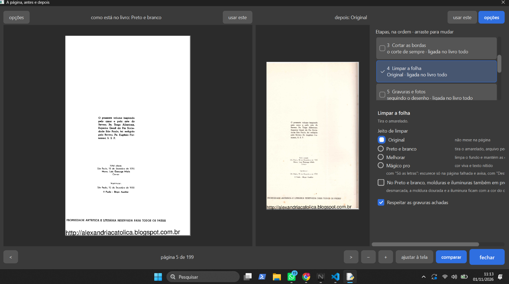 | "comparar" do Automático, página 5 de 199, lado direito com "opções" aberta (etapa 4 "Limpar a folha"): a página fica espremida e textos saem cortados ("arquivo pe", "mantém as", "também em pr"). Foi para a Lista de espera do plano (01/11), "depois da lista do Automático". |
- Lista repassada de novo (pedido dele). Ele: "sim está funcionando, mas o modo que ficava as coisas cinzas quando escolhia o preto e branco tem?" → gerente: sim, hoje existe (Preto e branco sem "Só as letras" e com "Gravuras e fotos" marcada → gravura cinza, D-147); escolher o cinza por opção é a D-588 (item 5 da lista), não construída. Agente construtor (Opus 5.5) chamado para o zoom da área de trabalho + nomes cortados: ramo `zoom-mouse-2026-11-01`, cópia `.claude\worktrees\zoom-mouse`.
- Ele, depois de tentar o cinza: "está muito confuso e não deu certo, coloque um agente para fazer isso" → D-588 (gravura em tons de cinza por escolha). O jeito na tela não estava decidido; gerente propôs a caixinha antes de chamar o agente.
- Caixinha "Gravuras em tons de cinza" (painel Filtro, tela cheia, "Limpar a folha"; marcada, toda gravura achada sai cinza, mesmo a tomada por enfeite; segue o "Aplicar em") → ele: "ok". D-588 no Livro. Construtor (Opus 5.5) chamado: ramo `gravuras-cinza-2026-11-01`, cópia `.claude\worktrees\gravuras-cinza`. Dois agentes ao mesmo tempo (zoom e cinza).
- Construtor do zoom entregou (`a6b9e02`; GitHub 41324371101 verde na 2ª tentativa, p090 instável). Escolha dele (página sai um pouco do meio para os lados; Shift + roda move página estreita) explicada → ele: "sim, coloca no programa para eu testar" (sem verificador). Junção `d6d6e6f`; 101 provas passaram. D-599 no Livro.
- Teste do zoom (junção `d6d6e6f`), palavras dele: "1- funcionando" (Uma página: Ctrl + roda vai para o mouse) · "2- funciona o zoom mas com shift para os lados não funciona ele rola as paginas para pagina, no caso troca de pagina." (Duas lado a lado: Shift + roda troca de página em vez de ir para os lados — defeito) · "3- ok" (nomes inteiros no "Mais ajustes").
- Construtor do cinza entregou (`09e47d2`; GitHub 41323846070 verde; velocidade "igual"); 4 perguntas dele (Só as letras; Respeitar desligada; lugares; gravura de traço/área à mão). Ele: "pode" juntar → junção `63fbbff`; 114 provas passaram.
- Conserto do Shift + roda no "Duas lado a lado" (construtor do zoom, `aba8c37`; causa: a roda sem Ctrl ia para o rolar padrão do Qt, que com Shift desce página por página; GitHub 41331010059 verde na 2ª, p107 instável). Junção `b43dc40`; 63 provas passaram.

## Teste do cinza (D-588) e do Shift + roda (D-599), 02/11, junção `d7483c5`
- Central lida ao abrir: nada novo (ordens abertas são de 22/10, já vistas; `respostas` todas lidas).

| # | Palavras dele | Print | O que é |
|---|---|---|---|
| a-25 | "1- não consigo trocar respeitar gravuras por gravuras em tons de cinza." | 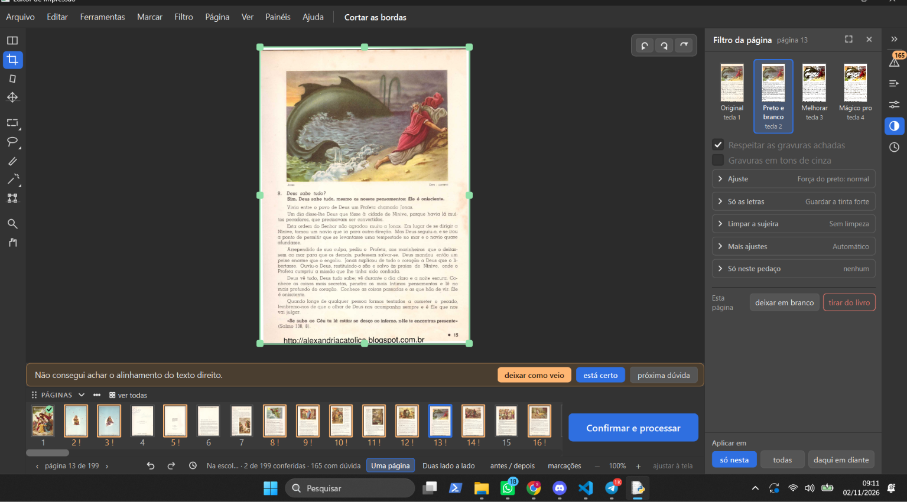 | Painel "Filtro da página", página 13 de 199 (Jonas), Preto e branco: "Respeitar as gravuras achadas" marcada, "Gravuras em tons de cinza" desmarcada. |
| a-26 | "2- para deixar as gravuras cinzas o respeitar gravuras tem que estar ligado, por gravuras em tons de cinza sozinho já deveria resolver o problema. 2 ultimos prints eu deixei explicado" | 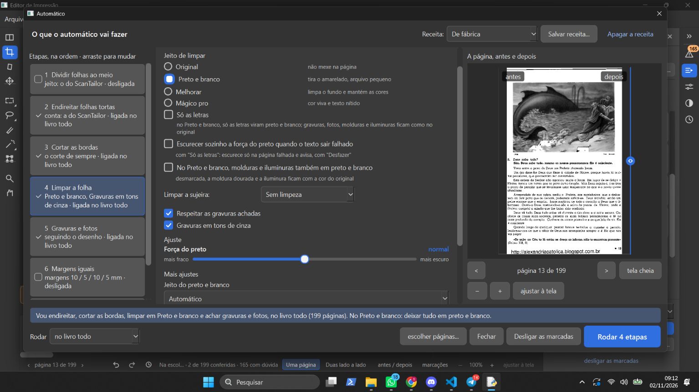 | Automático, "Limpar a folha", página 13: as duas marcadas → o "depois" sai com a gravura em cinza. |
| a-27 | (mesma frase do 2) |  | Mesma página com "Respeitar" desmarcada: a caixinha do cinza fica marcada mas apagada, e a gravura sai em preto e branco chapado. É a pergunta 2 do construtor da D-588 ("Com Respeitar desligada, a caixinha também fica cinza [...] Está bom?") → resposta dele: não. |

- "3- shift não funciona no automatico para mover para o lado. No duas paginas lado a lado está funcionando" → D-599 no "Duas lado a lado": **testado, funcionando**. O "antes e depois" do Automático não entra na D-599 (que é "na área de trabalho"): perguntar se ele quer lá também.
- Gerente propôs: "marcar só "Gravuras em tons de cinza" já basta: ela acha as gravuras sozinha e pinta de cinza, com o "Respeitar" ligado ou desligado. Chamo o agente para fazer assim?" → ele: "sim pode, e no automatico pode colocar o shift tambem, o shift tem que funcionar em todas as telas" → D-588 (conserto) e D-600 (Shift + roda em todas as telas). Dois construtores chamados: cinza no ramo `gravuras-cinza-2026-11-01`, Shift no ramo `zoom-mouse-2026-11-01`.
- Construtor do Shift deixou 2 perguntas (sem zoom; ferramentas de marcar com zoom) → Central, aba "Para responder agora" (`conferencias/agora`, ids `d600-sem-zoom` e `d600-ferramentas-marcar`, com prints). Ele, sobre a 2: "é só nesse lugar que tem esse atalho" → gerente: sim; as ferramentas de marcar só existem na área de trabalho (`ui/widgets/editor_selecao.py`, `wheelEvent`), então a roda mudando o pincel ou a tolerância só acontece ali.
- Gerente: "Com zoom e uma dessas ferramentas na mão, o Shift + roda passa a levar a página para os lados? A roda sozinha continuaria mudando o pincel. Sugestão: sim." → ele: "sim" (pergunta 2 da D-600). A pergunta 1 (sem zoom) segue aberta.
- Construtor do cinza (`00d1ddf`, esperando o GitHub): conserto feito ("Gravuras em tons de cinza" vale sem o "Respeitar"). Achado sobre o a-25: no projeto dele o *Na escola de Jesus* tem "Só as letras" ligado no livro; por isso, na página 13, as duas caixinhas ficam apagadas — é a pergunta 1 de 01/11 (sem resposta). Foi para a Central, aba "Para responder agora" (id `d588-so-as-letras`, com o a-25 e o print do conserto).
- Gerente: "sem zoom, o Shift + roda continua fazendo o mesmo que a roda sozinha de cada tela?" → ele: "1- sim" (D-600 fechada). Sobre a pergunta do cinza com "Só as letras": "2- não entendi" → gerente explicou de novo com o caso da página 13.
- Gerente explicou a pergunta do "Só as letras" dizendo que o a-25 vinha dela e "não do Respeitar" e sugeriu a B → ele: "você esta errado, olhe os meus prints de novo e o que eu falei". Gerente reconferiu: a queixa 1 e 2 dele é a do "Respeitar" (prints a-26 e a-27), e é ela que o conserto resolve; a gerente errou ao dizer que o a-25 "não era o Respeitar". Fato à parte, conferido no projeto de teste dele (`dados-teste-rodada-de-consertos\...\Na escola de Jesus...\projeto.json`): `misto_so_as_letras: true` no livro, página 13 herda (`null`).

| # | Palavras dele | Print | O que é |
|---|---|---|---|
| a-28 | "olha" | 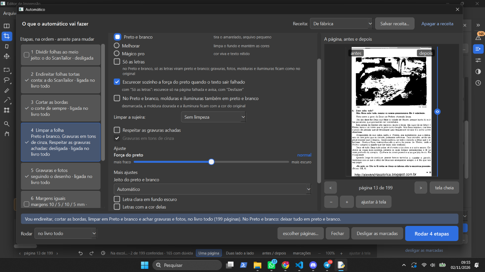 | Automático, página 13, versão de teste ainda SEM o conserto: "Só as letras" desmarcada, "Respeitar" desmarcada → cinza marcado mas apagado, gravura P&B chapada. Mostra que no Automático o "Só as letras" não tem nada a ver: o defeito é o do "Respeitar". |
| a-29 | (mesmo) | 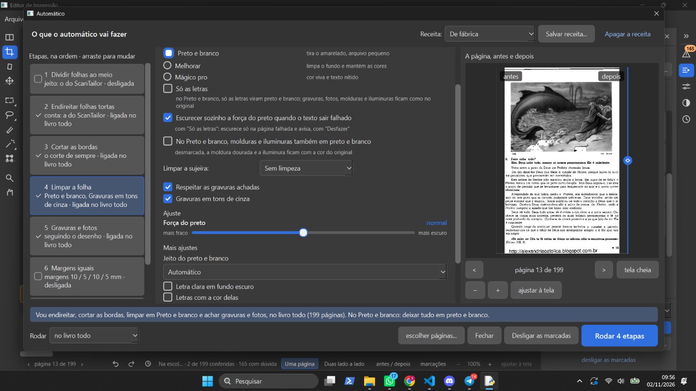 | Mesma página, "Respeitar" marcada → gravura em cinza. |
- Gerente: o conserto (`00d1ddf`, ramo `gravuras-cinza-2026-11-01`) ainda não está na versão de teste; o que ele vê é o defeito de antes.
| a-30 | (sem texto; ele riscou "Só as letras" marcada e "Gravuras em tons de cinza" apagada) | 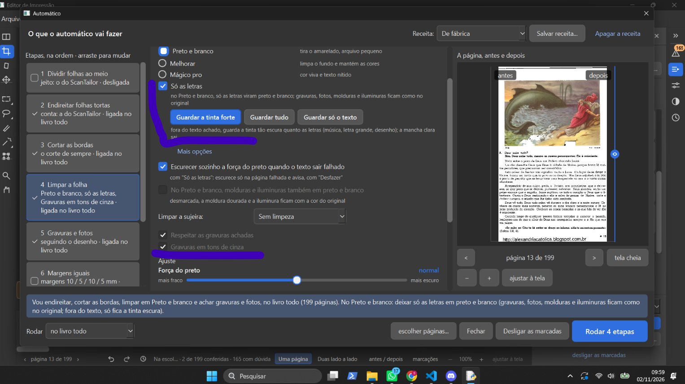 | Automático, página 13: "Só as letras" marcada ("Guardar a tinta forte") → "Respeitar" e "Gravuras em tons de cinza" ficam marcadas mas apagadas; a baleia sai colorida. É o caso da pergunta 1 da D-588 (`d588-so-as-letras`). |
- Gerente: "Como você quer que fique? A: fica assim [...] B: o cinza manda [...]" → ele: "temos um impasse aqui".
- Gerente propôs "cada caixinha cuida de uma coisa só" ("Só as letras" o texto, "Gravuras em tons de cinza" as gravuras) → ele: "Nós temos outros problemas assim no programa? isso é um erro de programação né."
- Ele (versão de teste ainda sem o conserto):

| # | Palavras dele | Print | O que é |
|---|---|---|---|
| a-31 | "1- só as letras deve respeitar tudo e deixar só as letras em preto e branco, certo? com essa opção marcada nãoo consigo clicar em respeitar gravuras e nem gravuras em tom de cinza." | 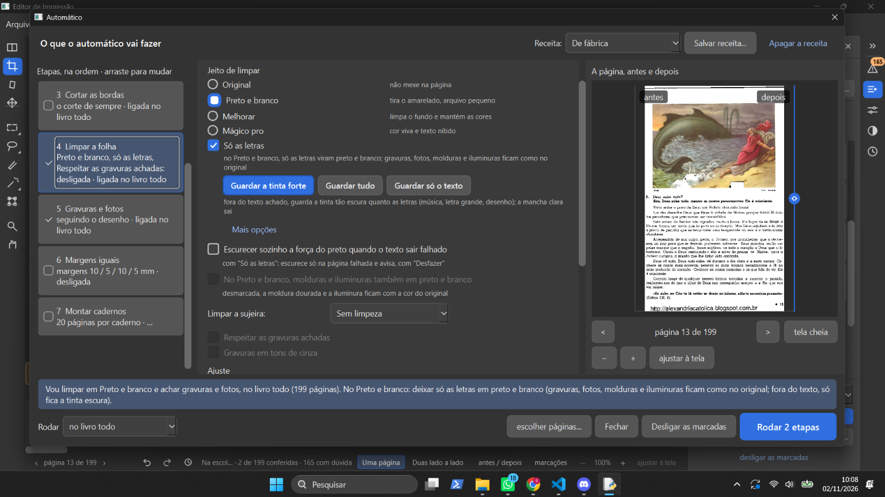 | Automático, página 13: "Só as letras" marcada → "Respeitar" e cinza apagados; baleia colorida. |
| a-32 | "2- Se eu desmarcar Só as letras eu consigo clicar em respeitar gravuras, e dai depois deixar gravuras em tons de cinza." | 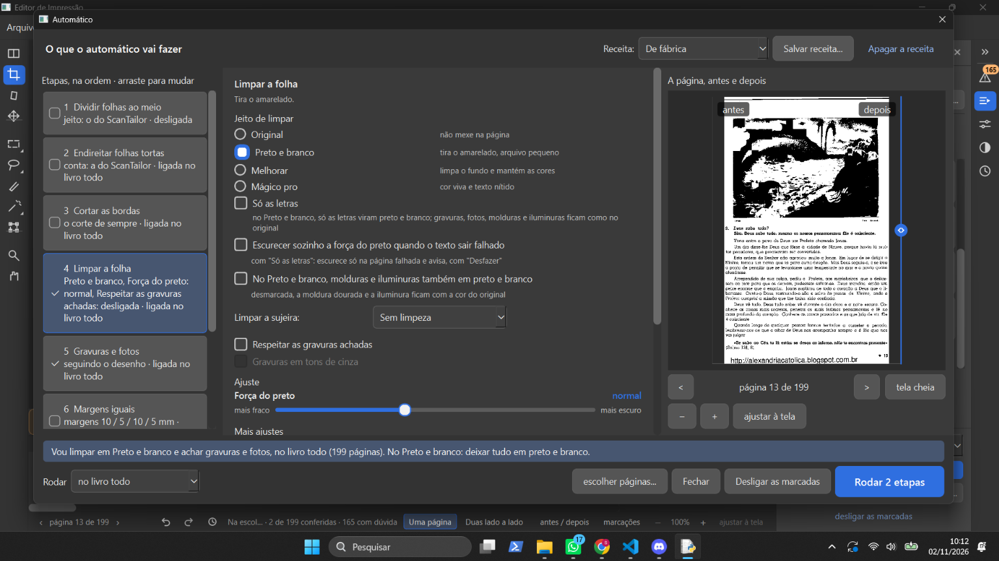 | "Só as letras" desmarcada, "Respeitar" desmarcada → cinza apagado (o defeito já consertado no ramo); baleia P&B chapada. |
| a-33 | (mesmo) | 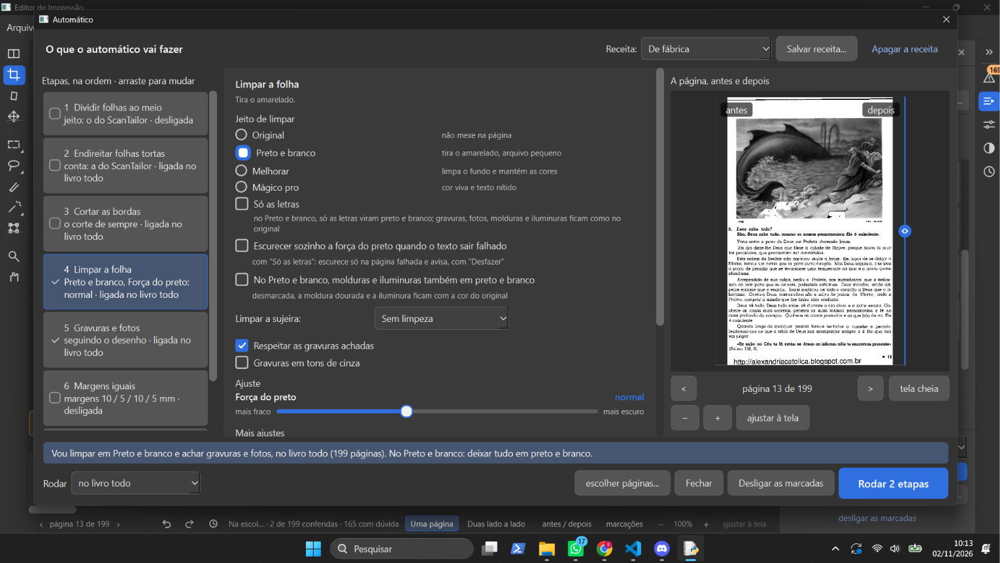 | "Respeitar" marcada → cinza clicável; baleia em cinza (cinza desmarcado aqui, D-147). |
- Gerente leu os itens 1 e 2 como resposta ("Pode ficar assim?") → ele: "eu não respondi nada, só afirmei, você olhou os prints". Gerente reolhou: no a-31, com "Só as letras" (que respeita tudo) a caixinha "Respeitar" aparece desmarcada e o resumo da etapa 4 diz "Respeitar as gravuras achadas: desligada", mas a baleia sai colorida (respeitada); no a-33, só com o "Respeitar" (cinza desmarcado) a baleia já sai cinza (D-147), então na página 13 o cinza não muda nada.
- Ele: "ata o respeitar gravuras é para quando o programa se confundir no caso?" → gerente: quase; D-583: ligado, o filtro obedece às gravuras achadas; desligado, vale na página inteira (útil quando o programa marcou errado). O cinza é para quando ele toma a gravura por enfeite.
- Construtor do Shift entregou (`cb1c5be`; GitHub 41458116491 verde). Duas escolhas dele contadas (livro aberto incluído; página estreita anda de lado no "Ver de perto" e nos "comparar") → ele: "ok" para pôr na versão de teste. Junção `293eedf`; 92 provas passaram no PC (6 arquivos).
- Ele: "mais o que temos para fazer da lista?"
- Ele, sobre a lista: "1- que cinza, já não testamos, ou fez novas mudanças desde os meus questionamentos mais recentes." · "2- vou testar agora" (Shift) · "3- coloque ele para continuar" (verificador da D-574 → chamado, cópia `verif-livreto`) · "4- já está pronto? se estiver pronto, pode juntar na versão de teste e testar com um agente clicando nos botões e vendo se deu certo" (D-589: pronto desde 31/10, GitHub 41218623088 só caiu no instável p083; ramo 57 commits atrás → construtor chamado para atualizar com a versão de teste; depois a gerente junta e um agente testa clicando) · "5- já foi feito?" (D-590: sim, no mesmo ramo da D-589) · "6- já foi feito?" (D-221: não; pela metade, só à mão pelo "Só neste pedaço"; no plano para depois da obra).
- Teste da D-600 (junção `293eedf`), palavras dele: "shift funcionando" → D-600 testada.
- Ele: "o que vai ser testado, achei que já tinhamos resolvido o cinza" → gerente explicou: decidido e feito, falta conferir no programa. Velocidade do cinza "igual" (41455635198); junção `be4b9c9` no `obra-2026-10-26`; 117 provas passaram no PC (7 arquivos).
- Construtor da D-589 (`c299ff8`, junção da versão de teste `50c0c5b`): a prova `test_d588_no_limpar_a_folha_do_automatico` falha junto com a D-589 (etapa 5 desmarcada desliga o "Procurar" e o cinza não acha gravura). Pergunta P4 dele (A: o cinza procura as figuras por dentro, como o "Só as letras" de 31/10; B: sem a etapa 5 o cinza não faz nada).
- P4 da D-589 (cinza com a etapa 5 desmarcada): gerente sugeriu A ("o cinza procura as figuras por conta própria, só para pintá-las de cinza, e a etapa 5 continua desmarcada"), citando 31/10 e 02/11 → ele: "a". Construtor da D-589 chamado para fazer.

| # | Palavras dele | Print | O que é |
|---|---|---|---|
| a-34 | "ele entortou as letras(deixou elas inclinadas), veja se isso é um erro pontual ou o endireitar e cortar estão funcionando de maneira ruim, coloque um agente para isso." | 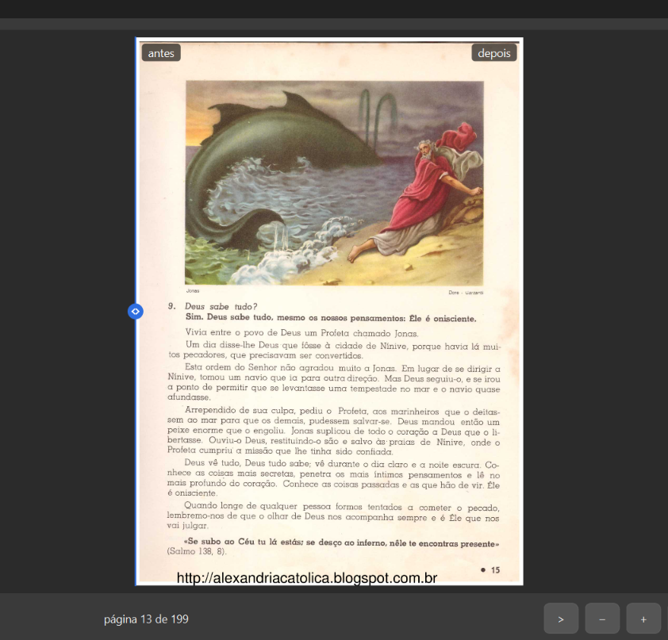 | "Antes" da página 13 (Jonas): texto reto. |
| a-35 | (mesmo) | 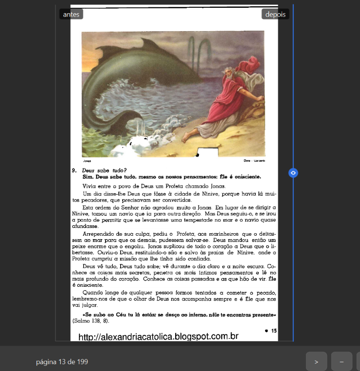 | "Depois" da mesma página (Automático): a página e as letras saem inclinadas. Agente investigador chamado (sem mudar código). |
- Teste do cinza (junção `be4b9c9`), Automático, página 13. Palavras dele: "olha os prints. é bom botar um aviso quando passa em cima da opção gravuras em cor de cinza, avisando que é quando o programa confundir"

| # | Print | O que é |
|---|---|---|
| a-36 | 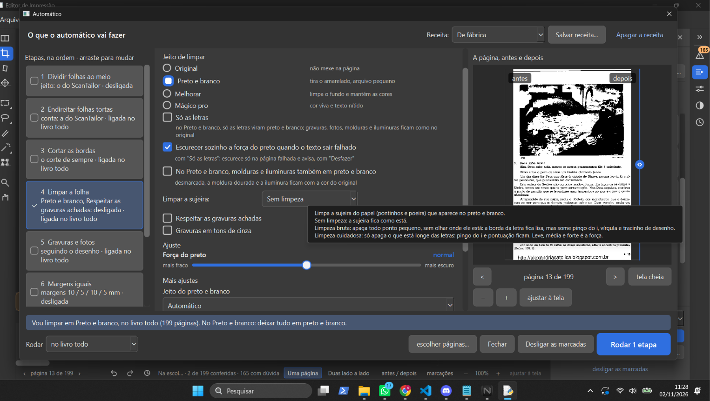 | "Respeitar" e cinza desmarcados: a caixinha do cinza agora está clicável (não apagada) com o "Respeitar" desligado; baleia P&B chapada (nenhum dos dois marcado). |
| a-37 | 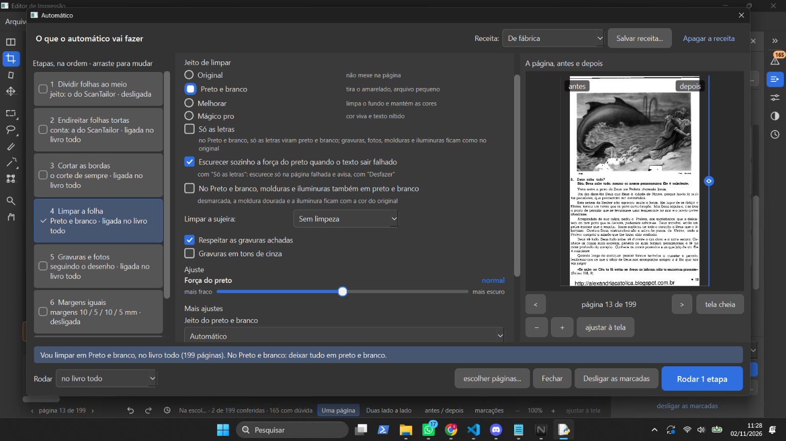 | "Respeitar" marcado, cinza desmarcado → baleia cinza (D-147). |
| a-38 |  | Os dois marcados → baleia cinza, igual ao a-37. |
| a-39 | 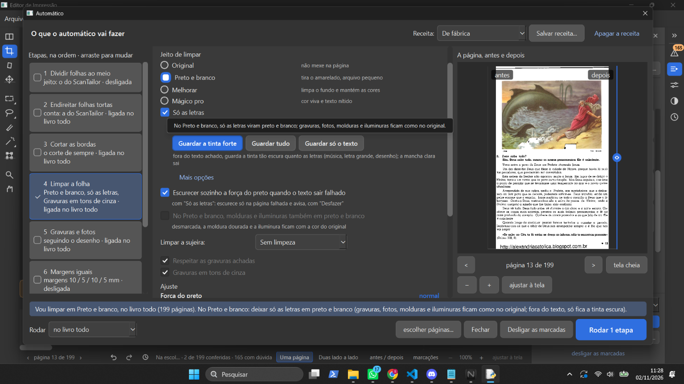 | "Só as letras" marcado → "Respeitar" e cinza apagados; baleia colorida. |
| a-40 | 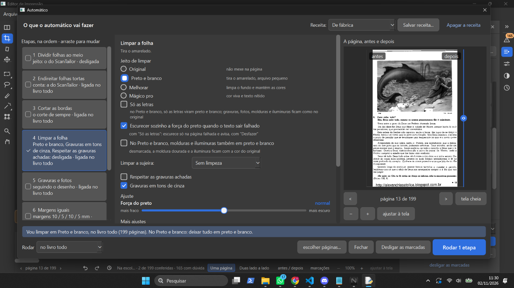 | "Respeitar" desmarcado e cinza marcado → baleia em cinza. O defeito do a-27 está consertado (D-588 testada). Ele: "olha o print". |
- Aviso ao passar o mouse no "Gravuras em tons de cinza", texto proposto pela gerente: "Para quando o programa se confundir: marcada, toda gravura que ele achou sai em tons de cinza, mesmo a que ele tomou por enfeite." → ele: "pode ser esse texto." Construtor do cinza chamado (os três lugares da caixinha).
- Achado da gerente no a-40 (não mexido): a frase de baixo do Automático diz "No Preto e branco: deixar tudo em preto e branco." mesmo com o cinza marcado.
- Verificador da D-574 entregou (parecer em `.claude\worktrees\verif-livreto\relatorios\livreto-ver\verificador\parecer.html`): CUMPRE COM RESSALVAS. Grave: no Opus Majus a janela para ~2 s a cada seta (§3). A "tela grande" de caderno (31/10) não está no ramo. 4 perguntas pequenas → Central, aba "Para responder agora" (`d574-folhas-de`, `d574-texto-enquanto-monta`, `d574-porcentagem`, `d574-o-que-vai-sair`).
- Investigador das letras inclinadas entregou (`.claude\worktrees\investiga-inclinado\relatorios\investiga-inclinado\LEIA-ME.md`): a conta do endireitar não errou; no *Na escola de Jesus* o texto foi impresso torto em relação ao papel, à gravura e ao endereço do blog; endireitando o texto (−0,50° → −0,02° na p. 13), o endereço (0° → +0,50°), a faixa preta do topo e às vezes a gravura ficam tortos. 48 páginas com o endereço inclinado ≥0,3°. Não é regressão (igual no `fase-1`). Único caso de letras realmente mais tortas: Palatino (11 de 52 páginas medidas, até 1,1°; a conta segue moldura/xilogravura), mas lá o endireitar está desligado no projeto dele. 2 perguntas (o que ele viu inclinado; texto × gravura com ângulos diferentes: A texto reto / B gravura reta / C página marcada).
- Ele: "vamos resolver esse problema do travamento agora, coloque um agente para trabalhar nisso" → construtor chamado no ramo `livreto-ver-2026-10-31` (cópia `livreto-ver`): prévia do livreto fora do processo da janela; só o travamento (perguntas do verificador e "tela grande" ficam para depois; o travamento ao gravar, antigo, não entra).
- Ele, depois da explicação do investigador: "1- olhei o endireitar e aparece estar tudo certo" → endireitar fica como está; as 2 perguntas do investigador ficam guardadas no LEIA-ME dele (`investiga-inclinado`), sem ação. Palatino (conta seguindo moldura/xilogravura, 11 de 52 páginas) anotado para a Lista de bugs.
- D-589 + D-590 + P4 entregues (`4135af1`; GitHub 41470124822 verde; velocidade 41470135392 "igual") → juntados no `obra-2026-10-26` (`6a98173`), 110 provas passaram no PC (7 arquivos). Testador clicando chamado (cópia `teste-cadernos`), pela ordem dele de antes ("se estiver pronto, pode juntar [...] e testar com um agente clicando").
- Central: ele: "precisamos ajeitar as perguntas lá da central, tem mais de 200 perguntas, preciso saber por onde começar, e tem muita pergunta que não tem print [...] poderiamos chamar um agente com gasto baixo de tokens para tirar esses prints, inclusive na questão dos botões, nomes." → gerente contou 197 abertas, 54 sem print, propôs a ordem 1-7 e o agente (Sonnet) → ele: "as regras de trabalho, deveriam ter print provando que ela funciona né?" · "na versão de teste atual né" · "ok, pode reordenar e os relatorios que estão lá que já foram respondidos coloca numa aba de respondidos." → abas reordenadas (agora, dúvidas, auditoria 1, 2, acrescentei, nomes, auditoria 5, 3, 6, 4); 12 abas todas respondidas juntadas em "Respondidos (85)" (cópia das antigas em `EditorImpressao-arquivos\central-banco\backup-conferencias-2026-11-02`); agente dos prints (Sonnet) chamado na cópia `prints-central`.
- Ele: "vamos pausar todos os trabalhos, para continuar depois" → os 4 agentes avisados para parar e escrever onde pararam: aviso do cinza (ramo `gravuras-cinza-2026-11-01`), travamento da D-574 (ramo `livreto-ver-2026-10-31`), prints da Central (cópia `prints-central`), testador clicando da D-589/D-590 (cópia `teste-cadernos`).
- Pausa: testador clicando parou antes de clicar (nada testado; livros e caminhos prontos, `teste-cadernos\relatorios\teste-cadernos\LEIA-ME.md`). Construtor da D-574 parou com o conserto do travamento pronto (`0e55f72`, ramo `livreto-ver-2026-10-31`): Opus Majus, maior parada por seta 1,5-3,0 s → 0,014 s; prova nova com reversão; PC tudo passou; falta ler o GitHub 41479852414 (suíte, a que vale), 41477464406, velocidade 41477472279. Fora: abrir o "Montar para imprimir" para ~6,7 s e o gravar trava (antigos).
- Pausa: construtor do cinza parou com o balão pronto (`d3dad39`, ramo `gravuras-cinza-2026-11-01`; prova com reversão; PC passou). GitHub 41473778845 vermelho só por instáveis (p083 na 1ª; D-148 "não aconteceu a tempo" na 2ª, instável já visto pelo verificador da D-574). Ao voltar: rodar a D-148 no PC, disparar de novo, juntar.
- Pausa: agente dos prints parou com 6 perguntas com print de menu (D-562, D-481, D-540, D-561, D-020, D-492) e 2 parciais (D-301, D-021), ainda não conferidos nem postos na Central; faltam 46 + os 20 dos nomes (`prints-central\relatorios\prints-central\ONDE-PAREI.md`, `mapa.json`). Todos os 4 agentes parados.
- Retomada ("continuar"): 19 respostas da Auditoria 2 (dadas às 11h30-12h03) no Livro (`5d84bd7`) e marcadas lidas. Agentes retomados pelo id (funcionou). Prints da Central: 42 das 54 sem print + 14 dos nomes ganharam print da versão de teste (`6a98173`); 61 imagens subidas e postas nas perguntas (legenda "Hoje (02/11, versão de teste)"). Sem print (12): D-255, D-521, D-500, D-528, D-560, D-489, D-309, D-298, D-564, D-555, D-550, D-342. GitHub da D-574 (41479852414) e do cinza (41473778845) caíram só em instáveis (p083; D-148) → disparados de novo.
- GitHub da D-574 e do cinza verdes na nova tentativa. Balão do cinza juntado (`99e7c6b`), 44 provas passaram no PC. D-574: a última mudança mexeu em `core/paginas_em_outro_processo.py` depois do filtro de velocidade → filtro novo 41533338597 (`cfde703`→`0e55f72`) antes de juntar.
- Testador clicando entregou: os 6 itens da D-589/D-590 deram certo na janela real (`teste-cadernos\relatorios\teste-cadernos\LEIA-ME.html`). Pergunta: com "Dividir" desmarcada e Rodar, a caixinha volta marcada sozinha e a frase diz "Vou dividir as folhas" (prints 36 e 36b). Pequenos: frase de baixo com o cinza; linha de "Montar cadernos" cortada na janela grande.

## Teste do Dividir (02/11, noite), Gradus Primus
- Gerente procurou livros com duas páginas por folha (1.088 PDFs): Gramática Latina (Napoleão), Gradus Primus, Key to the Greek Prose, Scientiae et Philosophia (misto). Siebmacher: folhas deitadas mas muitas com uma página só.

| # | Palavras dele | Print | O que é |
|---|---|---|---|
| a-41 | "estou aqui no dividir e não aparece a linha de divisão" | 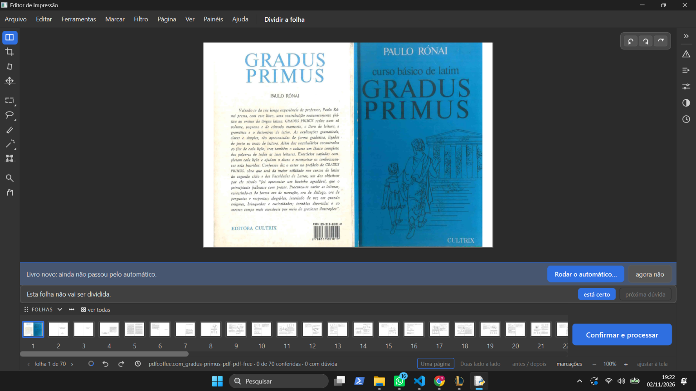 | Livro novo sem Automático: "Esta folha não vai ser dividida." (D-080: livro novo não divide). Gerente: rodar o Automático ou "dividir esta" no painel. |
| a-42 | "eu dividi a pagina não era para ela virar só uma na hora que eu dividi, como funciona no scantailor?" | 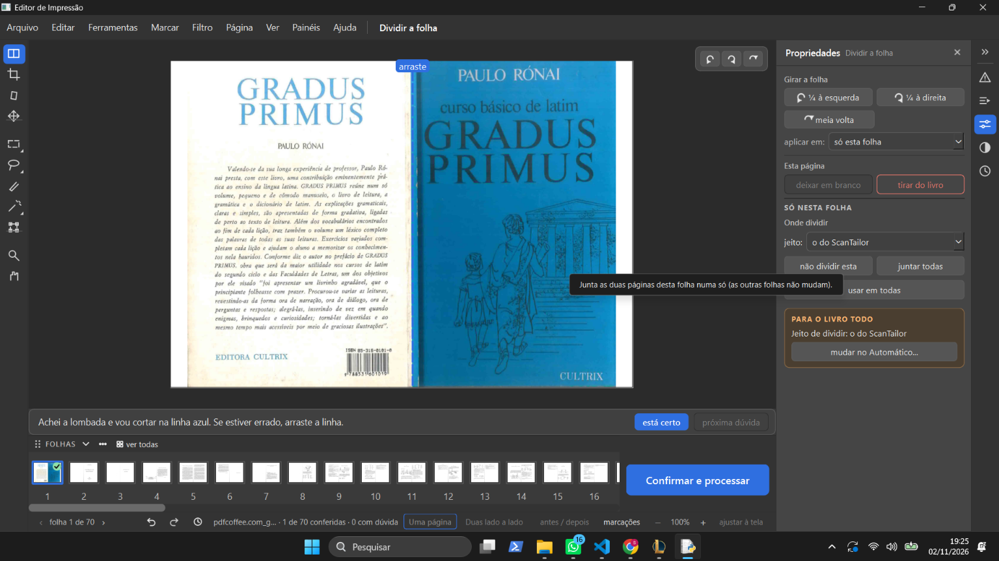 | Folha 1 dividida à mão: no Dividir a folha fica inteira com a linha azul (D-007; como o ScanTailor); nas outras ferramentas, uma página por vez. |
| a-43 | "o aviso não sai, mesmo clicando no está certo" | 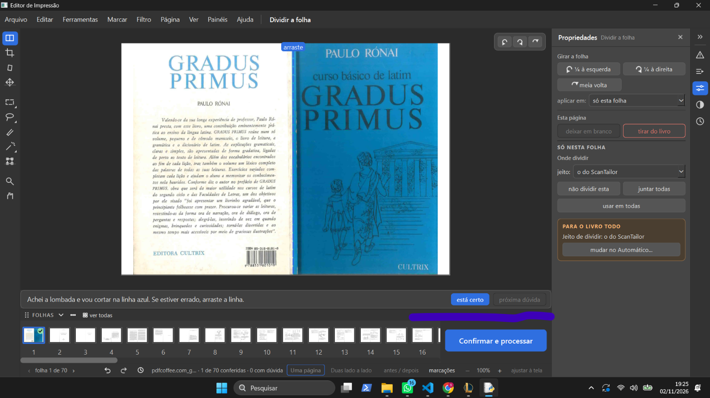 | Depois de "está certo" (tique verde, "1 de 70 conferidas") a faixa continua "Achei a lombada [...]" com "está certo". É a D-572 (31/10: "Página N conferida." e só "próxima dúvida"), **ainda não construída** (Rodada pequena das respostas, item 5). |
- Gerente: D-572 não construída; quer agente? → ele: "quero, mas eu não lembro o que escolhi para acontecer quando aperto no está certo, mas quero resolver o dividir também" · "Eu deveria conseguir cortar só uma pagina e não só no automatico." → gerente: já existe ("dividir esta" só nesta folha, foi o que ele fez no a-42); lembrou a escolha de 31/10 ("Página N conferida." e só "próxima dúvida"); perguntou o que no dividir (1: caixinha volta marcada; 2: ver uma página só ao dividir). Construtor da D-572 chamado (ramo `esta-certo-2026-11-02`, cópia `esta-certo`).
- D-574 sem travamento juntada na versão de teste (`45b8704`; velocidade 41533338597 "igual"); 91 provas passaram no PC.
- Ele (print da folha 1 do Gradus no Dividir, "Uma página" marcado embaixo; o print colado não veio como arquivo): "ele não cortou, porque como pode ver as duas paginas ainda estão juntas, deveria então aparecer só metdade da pagina que era dupla, e eu pode mudar a opção lá embaixo de uma pagina, para pagina dupla." → choca com a D-007 (26/10: "A folha inteira com a linha fica só dentro da ferramenta Dividir; dividido, o livro aparece uma página por vez") → gerente perguntou.
- D-601 no Livro (`110976f`) → ele: "ok, pode botar um agente para fazer isso" → construtor chamado (ramo `dividir-metade-2026-11-02`, cópia `dividir-metade`).
- Ele (print colado, sem arquivo: Automático do Gradus, etapa 6 "Margens iguais" 10/10/5/5 mm marcada, "A página, antes e depois" com a linha toda à direita = depois): "coloquei margem e ela não apareceu no preview." → defeito contra a D-577 ("o depois é como ela vai sair com as etapas e opções marcadas").
- Gerente perguntou o que esperar no "depois" → ele: "não lembro, eu já não tinha feito essa escolha nos relatorios, garanto que já tinha feito isso." → sim: D-329 (22/10, `b-2-margens-na-tela`: "Sim, a tela mostra igual ao que sai"), D-311 ("Todas as páginas do tamanho da maior: Sim"), D-577 (o depois é como vai sair). Gerente errou ao perguntar sem procurar. Construtor chamado (ramo `margens-depois-2026-11-02`, cópia `margens-depois`).
| a-44 | "aonde fica o ver caderno aqui?" | 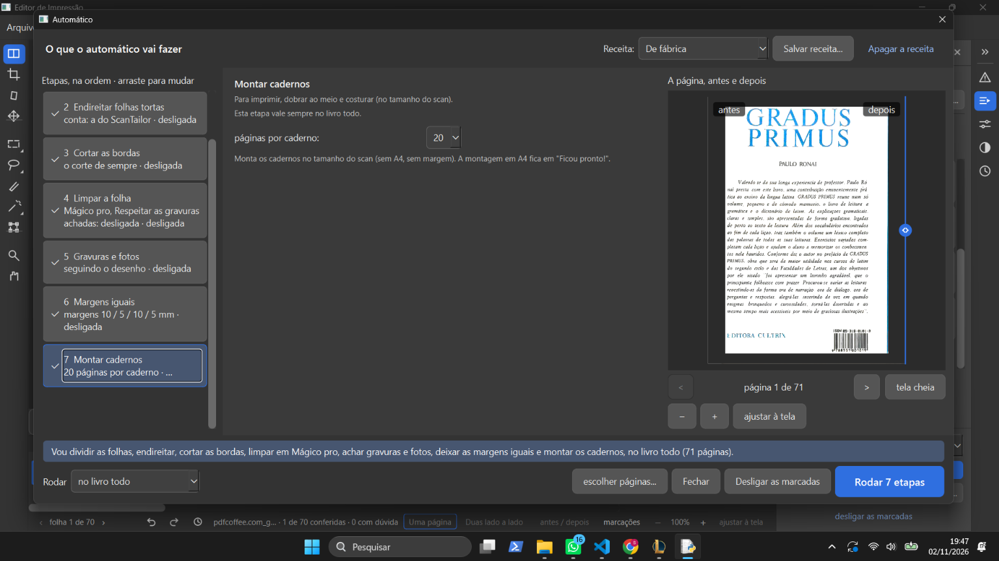 | Etapa 7 "Montar cadernos" do Automático: não há "ver o caderno". A D-574 juntada hoje (opção 1) está só no "Montar para imprimir" (depois de processar, "Ficou pronto!"); a "tela grande" de caderno na etapa 7 e no painel "Montar cadernos" (pedido de 31/10) não foi construída. |
- Ele: "ok, pode chamar" · "mas no caso ele vai fazer isso só quando a etapa 7 estiver selecionada no montar cadernos né?" → gerente: sim, só ao clicar na etapa 7 (D-574, 31/10: "vamos conseguir ver ele só se clicarmos na opção de montar cadernos"); nas outras etapas, o antes e depois de hoje. Construtor chamado (ramo `caderno-tela-grande-2026-11-02`, cópia `caderno-tela-grande`).
- Perguntas de agentes (02/11, noite): caderno na etapa 7 (P1 tamanho do scan × A4; P2 caixinha desmarcada mostra?; P3 painel "Montar cadernos" abre a janela grande na etapa 7); Dividir com a metade (frase da faixa no "Uma página"; "folha 1 de 70" nas duas metades); margens no depois (o que mostrar enquanto mede → respondida pela D-064, 22/10: bolinha com % e páginas no balão, sem frase; não perguntada de novo).
- Ele, sobre a lista das 7 perguntas: "1- eu já não tinha feito outra escolha?" → gerente leu como a pergunta do caderno (D-574 opção 1, A4) e explicou o choque com a D-314 → ele: "eu estava falando do está certo" → sim: D-572, comentário de 31/10 "Mas nas paginas que não foi dado o ok, ela vai aparecer ainda né?" → a faixa segue o "está certo" apertado, não o tique da edição à mão (respondido ao construtor). Fica aberta a do "Folha 1 conferida." no Dividir e a do caderno (A × B).
- "Está certo" (D-572): ele: "se jpa tem o certo lá embaixo nas folhas não precisa aparecer conferida, pode só desaparecer o está certo" → gerente mostrou os três jeitos → "não entendi" → "não fica nenhuma mensagem mais só o proxima duvida né?" → gerente: pelo registro, fica "Página N conferida." + "próxima dúvida"; mudar? → ele: "pode deixar do jeito que ele esta fazendo" (fica "Página N conferida."; no Dividir "Folha N conferida."). Caderno: "eu não sei qual escolher nos cadernos" → gerente explicou e ofereceu um print de cada jeito.
- Ele: "não entendi nada e abre esses prints para eu olhar ai" → gerente abriu `dividir-metade\...\depois-1` e `depois-2`, pediu ao construtor do caderno os dois prints (A4 × tamanho do scan). Ele: "quando cortar as paginas lá embaxio que foram cortadas vão aparecer como uma só e nas paginas que não foram cortadas ainda vão aparecer duplas ainda, mas para ver as paginas que foram cortadas vão ter que apertar uma folha só ali embaixo no aplicativo." → gerente confirma o que entendeu (tira de baixo).
- Ele: "isso" (tira de baixo do Dividir: folha cortada = duas miniaturas; não cortada = uma dupla) → D-601 ampliada no Livro e passada ao construtor.
- Caderno, prints A (A4) × B (tamanho do scan), Gradus dividido → ele: "mostra como no scan, pois eu vou querer ver como vai ficar impresso quando eu estiver no margens né." (D-574, etapa 7 no tamanho do scan).
- Ele: "mas deixe essa versão guardada, caso o kaique queira trocar" → versão A4 guardada em `relatorios/caderno-etapa7-versao-A4/` e na Lista de espera do plano (02/11).
- Dividir (D-601), frase da barra em "Uma página": ele: "esssa mensagem vai ficar aonde? e ela vai aparecer depois de eu fazer o que?" → gerente explicou (barra de baixo, folha cortada, "Uma página", antes do "está certo") → "ok" (frase: "Achei a lombada. Para mudar onde corta, escolha "Duas lado a lado" e arraste a linha."). "folha 1 de 70" fica como está.
- Caderno: P2 (etapa 7 clicada com a caixinha desmarcada mostra as folhas) → "1- sim"; P3 (painel "Montar cadernos" abre a janela grande na etapa 7 pelo "ajustar a etapa escolhida ›") → "2- sim".
- Margens no "depois" entregues (`831bfcc`; GitHub 41551241998 verde; velocidade "igual") → juntadas `515372b`; 63 provas passaram no PC. Primeira vez mede o livro (Gradus: 14 s dividido; ~1,5 min com Dividir/Endireitar/Cortar marcados), depois troca de margem em menos de 1,5 s.
- Caderno, P4 do construtor (etapa 6 aberta mostra as folhas?): ele: "etapa 6 e não" → não; folhas só na etapa 7.
- Caderno, P5 (etapa 7 abre sempre na folha 1?): "não, eu posso ir em qualquer pagina" → gerente: A (abre na folha da página atual) ou B (sempre folha 1, setas para qualquer folha)? → "b".
- D-572 juntada (`400f617`, Livro `20f0ab6`). D-601 entregue (`fd0b619`, GitHub 41559220935 verde) mas a junção deu conflito em `ui/tela_conferir.py` com a D-572 → desfeita na versão de teste; construtor resolve no ramo dele. Pergunta nova dele: numeração 1, 2, 3 na tira depois de dividir.
- Caderno, P6 (zoom de baixo some com as folhas; zoom no "tela cheia"): "3. sim".
- Caderno, P7 ("Folha N de M" troca na hora ao apertar a seta, na etapa 7 e no "Montar para imprimir"): "o que o que não entendi a 4" → gerente explicou com o Gradus → "já troca". (Responde também a pergunta 2 do verificador da D-574.)
- D-601, pergunta 3 (numeração das miniaturas por página depois de dividir): "que numeração?" → print depois-4 e explicação → "ok".
- D-601 juntada (`07ed5a2`), 60 provas passaram no PC. Caderno na etapa 7 entregue (`dba6af9`), esperando GitHub 41570406574 e velocidade 41565812027.
- 03/11: caderno na etapa 7 juntado (`e8b991a`; velocidade "igual"); 68 provas passaram no PC. Os quatro trabalhos da noite estão na versão de teste.

### 03/11/2026 (nova conversa)
- D-590, pergunta do testador clicando (prints 36 e 36b em `.claude\worktrees\teste-cadernos\relatorios\teste-cadernos\`): ele não tinha entendido ("não entendi isso aqui"); a gerente explicou com o print 36b → ele: "isso não tinha sido revisto em todo programa, se tinha algum item que desmarcado voltava a funcionar sozinho ou se marcava sem precisar estar marcado, sem ser uma opção já colocada para ser assim. Sim a caixinha continua desmacada. e me diga o que eu preciso testar no programa"
- Gerente, conferindo o registro: a revisão da D-589 (30-31/10) cobriu só as etapas 5 (Gravuras), 6 (Margens) e 7 (Cadernos); o Dividir ficou como exceção (D-590) e ninguém olhou a caixinha dele; as etapas 2 (Endireitar), 3 (Cortar as bordas) e 4 (Limpar a folha) não foram revistas para esse defeito. Já anotado antes (ressalva de 01/11): com "Limpar a folha" ligada, a etapa Gravuras liga junto.
- Testando o Dividir no Gradus Primus (versão de teste), prints a-45 (folha 5 em "Uma página": folha inteira sem linha, "Esta folha não vai ser dividida."), a-46 (depois do "dividir esta": só a metade, "Achei a lombada...") e a-47 ("Duas lado a lado": a linha azul "arraste"). Palavras dele: "quando eu entro no dividir não aparece a linha azul, então eu aperto dividir folha, ele já dividi automaticamente sem mostrar a linha azul, ela não aparece mais em nenhuma folha, só aparece quando eu aperto duas lado a lado. Quando eu estiver na ferramenta de dividir, o programa deveria carregar com a conta que está escolhida, e dai eu conseguir ver a linha e dai eu clicar e dividir esta, dai ele reparte, se eu apertasse para todas as folhas ele carregaria para todas as folhas, faria a leitura em todas as folhas. teve um momento também que o botão do jeito ( que eu acho um nome bem ruim, acho que o nome poderia ser motor de corte) ficou travado e não dava para mudar."
- Gerente, conferindo o Livro: a D-601 (02/11) diz que a linha azul aparece em "Duas lado a lado" e não fala de linha antes de dividir em "Uma página"; a D-080 (05/10) diz que livro novo não divide sozinho (mostrar a linha sem cortar não contraria). O "usar em todas" de hoje copia a linha desta folha para as outras (D-090), não faz a conta em cada folha. A lista "jeito:" travada é defeito novo (ainda sem causa).
- Caderno na etapa 7 (D-574), print a-48 (Gradus, "Folha 1 de 19", cada lado com dois scans inteiros de duas páginas): ele: "1- está aparecendo assim porque eu não dividi as folhas ainda né?" → gerente: sim; sem dividir, cada scan (que tem duas páginas do livro) conta como uma página do caderno, por isso aparecem quatro páginas do livro em cada lado.
- Sobre a linha antes de cortar, ele: "quando a folha for dupla, ela vai aparecer a linha de divisão ou até quando for só uma folha vai aparecer?" → gerente (conferido no código: `core/dividir_scantailor.posicao_da_divisao` devolve "uma página só" e `core/dividir.detectar_lombada` trata folha em pé como uma página): só nas folhas que o motor achar duplas; na folha de uma página só, nada de linha.
- Print a-49 (Automático: etapa 1 "Dividir" marcada, etapa 7 aberta, folhas do caderno ainda com os scans inteiros; "Vou dividir as folhas, no livro todo (73 páginas)."). Ele: "eu fui lá e apertei o botão de dividir e nos cadernos ainda aparece a folha sem divisão, era para ser com divisão, já que eu cliquei lá em cima, mesmo que eu não tenha processado ainda, pois é o preview."
- Gerente, conferindo o Livro: a D-574 (caderno na etapa 7) não diz que as folhas seguem as etapas marcadas; a D-577 (29/10) diz que o "depois" da prévia muda "conforme as opções que eu fosse escolhendo", com bolinha de carregamento; e em 02/11 (D-574) ele disse "eu vou querer ver como vai ficar impresso quando eu estiver no margens". Pedido novo: as folhas do caderno na etapa 7 seguem as etapas marcadas, antes do Rodar.
- Dividir: ele: "pode ser assim na questão do divisor." → D-602 no Livro (linha azul antes de cortar só nas folhas duplas; "dividir esta"; botão novo "dividir todas"; "jeito" vira "motor de corte"; consertar a lista travada). Pergunta do caderno seguir as etapas marcadas (a-49) continua sem resposta.
- Caderno (a-49): ele: "pode ser assim nos cadernos" → D-603 no Livro (folhas do caderno na etapa 7 seguem as etapas marcadas, antes do Rodar, com a bolinha).
- "Está certo" (D-572): ele: "3- está funcionando" → testado por ele, aprovado.
- Print a-50 (Dividir, folha 9 inteira e dupla, "Duas lado a lado", "Esta folha não vai ser dividida.", sem linha azul). Ele: "dividir - olhe o print, mesmo em duas lado a lado e com a ferramenta de dividir, não aparece a linha azul." → gerente: é o que a D-602 conserta (folha dupla ainda inteira mostra a linha, em "Uma página" e em "Duas lado a lado"); hoje a linha só aparece em folha já dividida.
- Print a-51 (Automático, etapa 6 "Margens iguais" marcada, página 11 de 73: no "depois" uma página de texto no meio de uma folha deitada, com muito branco dos lados). Ele: "não sei que conta que o margens iguais está fazendo mas parece que ficou errado, está mostrando uma folha a 4 deitada e a folha no meio." → gerente: a etapa deixa "todas as páginas do tamanho da maior" (texto da própria etapa); no Gradus só algumas folhas foram cortadas (73 páginas = 70 folhas + 3 metades), e as folhas ainda inteiras (duas páginas, deitadas) são as maiores; então cada página vai para uma folha deitada desse tamanho. Com todas as folhas divididas, a maior passa a ser uma página só, em pé.
- Print a-52 (etapa 7, "Folha 1 de 19 — frente" / "Folha 1 de 19 — verso"). Ele: "o verso da folha 1 e 19 não podem ter a numeração de folha 1 - e 19 tem que dizer a numeração que elas realmente teriam." → gerente (nada no Livro sobre isso; a D-305, numeração dos cadernos, é outra coisa e não foi construída): sugestão de mostrar as páginas do livro de cada lado, ex. "Folha 1 de 19 — frente: páginas 20 e 1" / "verso: páginas 2 e 19" (pergunta).
- Numeração das folhas do caderno (a-52): "acredito que sim" → D-604 no Livro.
- Print a-53 (depois de rodar Dividir + Margens iguais: 138 páginas, página 12 de 138 em "Duas lado a lado", miniaturas 11 e 12 deitadas, 3, 5 e 13 com "!"). Ele: "fui testar o margens iguais e o dividir e acho que deu algum erro. envestiga isso para mim" → gerente investigando.
- Ele, sobre a investigação: "o certo não seria refazer todos os passos que eu fiz no programa?" → gerente: refazer numa cópia do trabalho a partir do estado de antes do Rodar (gravado no histórico de ações, ação 22 de `acoes.jsonl`).
- Ele (print não chegou ao disco): "teve até uma folha que ficou colocada uma na outra." (página 10 de 138 em "Duas lado a lado": a página 3 do livro ao lado da folha 6 inteira).
- **Causa achada (gerente, 03/11, sem mudar código):** reproduzido numa cópia (`scratchpad/replay.py`): a medida manda dividir as folhas 6 e 7 do scan (o motor do ScanTailor acha duas páginas), mas depois de `core/automatico.aplicar` elas ficam inteiras e o livro fica com 138 páginas, igual ao dele. Em `core/automatico._dividir`, a lista das páginas "mexidas à mão" a pular (`pular`) é feita ANTES de dividir, com os números das páginas de então ([0, 1, 2, 3, 10, 11] = folhas 1, 2 e 9, que ele tinha dividido à mão). Cada folha que o Automático divide renumera as páginas seguintes (`pagina.indice = n`); depois das folhas 3, 4 e 5 divididas, as páginas das folhas 6 e 7 passam a ter os números 10 e 11 e são puladas no lugar das da folha 9. Defeito do programa: em qualquer livro com folha mexida à mão, o Automático pode pular as folhas erradas. A mesma lista `pular` é usada depois por `_ligar_na_pagina` nas outras etapas da mesma rodada (a conferir).
- Ele: "pode chamar um agente para concertar isso" → agente chamado (cópia `automatico-pular`, ramo `automatico-pular-2026-11-03`). Depois: "pode começar pelo 1 e colocar outro agente fazendo isso" (qual trabalho: perguntado) e "o que faltou ser testado?".
- Segundo agente: ele: "o problema 2" → agente da caixinha do Dividir chamado em paralelo (cópia `dividir-caixinha`), sem mexer no trecho do primeiro; também só olha Endireitar, Cortar e Limpar (o pedido dele de revisar o programa todo).
- Respostas no chat (03/11) às 2 perguntas do verificador: motor na folha juntada → "Ele deve fazer a conta novamente com o novo motor" (D-606); "juntar todas" × "mexidas à mão" → "só temos que mudar o aviso, avisar que as páginas foram juntadas e que vão ser separadas se o processar continuar." (D-607). Copiadas para a Central (`respostas`).
- Regra nova (03/11): "A partir de agora, nenhuma função nova, ou nova escolha dentro do programa pode alterar o que já está escolhido e testado, coisas novas não podem criar novos problemas, essa é uma nova regra que todos os agentes precisam ler" → D-605, `CLAUDE.md` §11.8 e as regras dos quatro agentes.
- Pergunta dos botões do painel, feita no chat (ele: "faz a pergunta aqui mesmo"): "mas a seta tem alguma ultilidade em outra ferramenta ou só no dividir?" · "quando a ferramenta está selecionada, as setas funcionam para usar ela, e quando não estão, passam as paginas?" · depois da explicação: "ok" → D-608. Sobre o defeito do Ctrl+Y: "cara, ele burlou a regra, colocou um defeito novo, concerta isso ai, pode fazer o teste no meu pc mesmo se não está dando certo no git hub".

### 04/11/2026 (testando os consertos do Dividir)
- Print a-54 (Dividir, Gradus folha 2 inteira, "Uma página", linha azul na lombada, faixa "Esta folha não vai ser dividida."): "não consigo mover a linha azul manualmente." → é a pergunta `d602-arrastar` da Central (ainda sem resposta): hoje, na folha inteira, a linha é só para ver; para mudar, "dividir esta" e arrastar em "Duas lado a lado" (D-601). Perguntado no chat.
- Pergunta: "Quer poder arrastar a linha já na folha inteira, antes de dividir, e o "dividir esta" cortar onde você deixou?" → "Sim" → D-609 (responde `d602-arrastar`).
- Teste da lista de 12 itens (04/11): 1 (linha azul e "dividir esta" corta nela): "sim" · 2 ("dividir todas", cada folha na sua linha): "aim" [sim] · 3 (lista do motor não trava): "não travou" · 4: print a-55 (Gradus folha 1 dividida, "Duas lado a lado", balão "Junta as duas páginas desta folha numa só (as outras folhas não mudam)."): "deveria ser outro outro nome ao invez de \"não dividir esta \" como opção." → perguntado no chat se troca por "juntar esta".
- Continuação da lista (04/11, print a-56: Gradus folha 1 dividida, "Duas lado a lado", "7 com dúvida", balão "As páginas em pares, como no livro aberto (a 1 sozinha, à direita)"): 5 (seta depois da lista): "ok" · 6 (seta depois de "dividir esta"): "quando eu dividir uma folha que estiver em duas lado a lado ela tem que ir para opção uma pagina, se não quando eu usar seta ela vai pular uma folha." → D-610 · 7 (tira depois do Ctrl+Z): "funciou, mas quando estiver duas lado a lado escolhido os icones embaixo tem que estar em duas folhas;." → perguntado no chat o que quer dizer · 8 (Ctrl+Y devolve os 7): "funcionou".
- "mover e dimensionar para de funcionar em algumas situações, não sei exactamente o que eu fiz, mas ele parou de funcionar, o programa está cheio de erros porque aconteceu tanto isso? pode colocar um agente para concertar isso" → registro de ações do Gradus (`acoes.jsonl` da pasta de teste): 02:27:06 "dividir todas" (70 folhas), 02:29:00 a 02:29:32 mover e diminuir a página 2 (deslocamento 0,0428; escala 1,0 → 0,88); depois disso nenhuma ação de mover gravada. `erros.log` sem erro desde 28/10. Agente chamado.
- Item 7, pergunta: "Quer dizer que, com 'Duas lado a lado' escolhido, as miniaturas embaixo também aparecem de duas em duas, juntas como no livro aberto?" → "Sim" → D-611. Também perguntou: "porque os seus testes não tem pegado esses erros?" e "o que falta arrumar?" (respondidos no chat).
- Mover parou (agente `mover-parou`, 04/11): reproduzido. O Mover não move quando a vista está em "Duas lado a lado" (escolha que fica guardada vindo do Dividir) ou com "antes / depois" ligado: aparecem os pares no lugar da ferramenta. O mesmo vale para Cortar, Endireitar e as de marcar. Nenhuma linha mudou; pergunta feita no chat com o print p2 (`.claude\worktrees\mover-parou\relatorios\mover-parou\`).
- Respostas no chat (04/11) às 2 perguntas: Mover em “Duas lado a lado” → “1 - ele tem que funcionar com paginas lado a lado também” (D-612); “dividir todas” com folhas juntadas à mão → “2- ele dá um aviso perguntando .” (D-613; copiada para a Central, `d602-juntada`).
- Teste da lista de 9 itens (04/11): 1 (motor muda a linha na folha juntada, D-606): “funcionando” · 2 (arrastar a linha na folha inteira, D-609): “ok” · 3 (dividir em Duas lado a lado vai para Uma página, D-610): “ok” · 4 (tira em pares, D-611): “não está ok coloquei no primeiro print” → print a-57 (Dividir, Gradus folha 2, “Duas lado a lado” escolhido, miniaturas 1 a 15 uma a uma) · 5 (Dividir à mão + Automático com Dividir e Margens): “ok” · 6 (desmarcar o Dividir e rodar): “rodar o que?” → explicado no chat · 7 (aviso depois do “juntar todas”, D-607): “ok” · 8 (Margens iguais na janela grande): “eu não sei mas ainda está estranho esse modo de ver, mas está funcionando, anote que tem que arrumar esse jeito de ver as margens, a visualizaçao do pdf, no caso” → Lista de bugs do plano (04/11) · 9 (caderno já dividido antes de rodar): sem resposta ainda.
- Item 9 (04/11), print a-58 (Automático do Gradus, etapa 1 Dividir marcada e escolhida, prévia da página 69 de 70, "Rodar 1 etapa"): "9 se está falando do automatico, não acontece nada" → gerente explicou no chat que o teste é clicar na etapa 7 "Montar cadernos" (D-603).
- Print a-59 (Automático, etapa Dividir escolhida, página 68 de 70, a linha toda à direita = só o "depois"): "mas quando eu estou no automatico não era para aparecer as folhas dividas quando eu estivesse na opção dividir clicada?" → conferido no Livro: D-577 (30/10, "pode"): com "Dividir" marcado, o depois mostra as duas metades lado a lado; hoje com um vão de 12 pontos (`ui/automatico.py` VAO_ENTRE_AS_METADES), quase invisível. Perguntado no chat se quer ver a separação mais clara.
- Print a-60 (o mesmo da a-59, com a etapa 1 Dividir e a prévia circuladas): "o dividir folha está escolhido era para aparecer uma folha divida ali né, e não duas folhas coladas, está errado" → muda a D-577 (30/10, "o depois mostra as duas metades lado a lado"); perguntado no chat como deve aparecer (só uma página por vez, ou as duas bem separadas).
- Sobre a prévia do Dividir no Automático (opções A, uma página por vez, e B, as duas bem separadas): “era para eu ter um preview de como vai ficar a folha separada” · “não gostei de nenhuma alternativa é para aparecer como se já tivesse sido feita a separação.” → gerente pediu um print de como fica na área de trabalho depois de dividir, para servir de modelo.
- "você já sabe como é, porque eu preciso mandar um print" → D-614: o "depois" fica igual à área de trabalho depois de dividir (D-601), uma página por vez; agente previa-dividida começou.
- Respostas no chat (04/11): Cortar, Endireitar e marcar também em “Duas lado a lado” e “antes / depois” → “1- sim” (D-612); aviso do “dividir todas” depois do “juntar todas”, sugestão “não” → “2- ok” (D-613).
- Item 9 (04/11), print a-61 (Automático, etapa 7 Montar cadernos clicada, "Folha 1 de 35", frente: página interna + contracapa; verso: capa azul + Vocabulário): "essa capa está no lugar certo?" → gerente: a montagem segue a ordem das páginas, mas a primeira folha do Gradus é a capa aberta (contracapa à esquerda, capa à direita); dividida, a contracapa vira a página 1 e a capa a página 2. Nada no Livro sobre isso; perguntado se a capa vira a página 1 e a contracapa vai para o fim.
- Print a-62 (Dividir, Gradus folha 68, tira de miniaturas circulada): "eu quero poder mover folhas para onde eu quiser dentro do app, quero poder arrastar e mover folhas, caso eu precise resolver esse problema na mão, mas qual seria o jeito para resolver esse problema sem ser na mão?" (sobre a capa no caderno, a-61). Livro conferido: nada sobre mudar a ordem das folhas à mão (só a D-527, aviso de número fora de ordem). Proposta no chat.
- Proposta (arrastar a miniatura para mudar a folha de lugar; caixinha “A 1ª folha é a capa aberta” no Dividir do Automático) → “ok” (D-615 e D-616).
- Print a-63 (Automático, prévia da página 30 de 70, contador circulado): “queria poder escrever o numero da folha aqui para ir direto.” → D-617.
- Pergunta "com antes / depois ligado, as ferramentas mexem no depois e o antes fica só para olhar?" → "1- ok" (D-612; passado ao agente mover-lado).
- Print a-64 (Automático, Gradus 140 páginas, Dividir + Endireitar + Cortar as bordas (beirada da folha vizinha) + Margens iguais marcados, bolinha girando): "quando eu escolho margens e cortar bordas, demora muito para carregar o preview, ele está fazendo o carregamento em todo livro ou só na pagina que eu vou ver?" → gerente conferiu o código: com Margens iguais a prévia mede o livro todo (conserto de 02/11, `core/automatico._medir_o_livro`), porque a margem depende de todas as páginas; a medida fica guardada, mas trocar uma opção do corte mede de novo.
- "não entendi a pergunta do mover" → o "1- ok" anterior não vale para o antes / depois; agente avisado para segurar essa parte; pergunta refeita no chat.
- Print a-65 (Pincel no Gradus, barra de cima "tamanho" e painel "Pincel: 18.2% da página" sublinhados): "no modo do pincel, quando eu giro o scrool ele fica aumentando e diminuindo o tamnho do pincel no painel direito mas no painel de cima \"tamanho\" ele não muda nada, não era para ele passar paginas girando o scrool?" → Livro: D-600 (02/11, "sim"): com as ferramentas de marcar, a roda sozinha muda o pincel; defeito: o "tamanho" da barra de cima não acompanha. Passado ao agente mover-lado.
- Pergunta refeita do antes / depois → "Ok, pode ser assim o antes e depois" (D-612: as ferramentas agem no depois).
- 04/11 ~12:50: a internet caiu ("opa, vou a intenet"); os 3 agentes pararam (ordem-folhas, previa-numero, mover-lado) e foram retomados.
- Teste da lista de 5 (04/11): 1 (aviso do "dividir todas", D-613): "ok" · 2 (Mover em Duas lado a lado, D-612): "ele funciona mas eu não gostei do tamanho que aparece a pagina quando começa a mover ela, ela deveria continuar o preview das duas do mesmo tamanho." → passado ao agente mover-lado.
- Lista de 5 (04/11), print a-66 (Retângulo, Gradus 140 páginas, "Duas lado a lado", tira: 1 sozinha, depois 2-3, 4-5, 6-7...): 3: "isso está certo? uma pagina sozinha?" → Livro: D-611 ("a 1 sozinha, à direita", "Sim" em 04/11) · 4 (prévia do Dividir, D-614): "funciona" · 5 (caixinha do Dividir desmarcada): "segundo print(olhe) depois de usar o dividir e voltar ao automatico ele está marcado de novo." → o segundo print não chegou; pedido de novo.
- Print a-67 (Automático, Gradus 140 páginas, "1 Dividir" marcado "ligada no livro todo", "4 Limpar" Preto e branco só as letras, "Rodar 2 etapas"): "aqui está o print que você pediu?" → defeito da D-590 ("a caixinha continua desmarcada"): depois de usar o Dividir, a caixinha volta marcada; agente caixinha-volta vai reproduzir todos os caminhos (dividir esta, dividir todas, juntar todas, não dividir esta).
- Print a-68 (Cortar as bordas, página 14, "Você ajustou o corte desta página."): "eu ajusto o corte daqui e dai aperto em qual botão??" → gerente: nenhum, o corte fica guardado ao soltar; "está certo" confere e passa; "usar em todas" leva a todas.
- Print a-69 (Cortar, parte "Para o livro todo" e "Qualidade da prévia"): "para o livro todo, não entendi essa mensagem, elas não deveriam ser opções para se escolher, essa opção de qualidade não deveria ser para todas as ferramentas?" → Livro: D-051 (duas partes; "Para o livro todo" só mostra e leva ao Automático, D-002), D-554 (Margens iguais também no Cortar). A Qualidade da prévia é uma só para o programa (`configuracoes` "qualidade_previa"), mas só aparece no painel do Cortar. Propostas no chat.
- Prints a-70 a a-73 (Cortar as bordas, Gradus página 14, girar ¼ numa folha dividida: o texto deitado na metade de cima, depois página branca "parece não ter nada do livro", depois o título deitado embaixo): "quando ele gira a pagina ele faz ela caber no A4, ele deveria girar o conteudo só que é da pagina cortada, mas ele gira a pagina verdadeira do scan. tanto que quando você vai girando ele cai na folha branca. Ele gira as duas folhas ao mesmo tempo, faz uma confusão com as paginas." → Livro: o giro é da folha (D-367 "Girar: só esta folha / todas as folhas"); numa folha dividida, girar a folha do scan e dividir de novo dá a confusão. D-618: numa folha dividida, o giro ¼ gira só a página. Agente girar-pagina.
- Respostas (04/11): quadro "Para o livro todo" → "1- B" (D-619); Qualidade da prévia na barra de baixo → "2- Pode" (D-620). Agente painel-livro.
- Correção (04/11): "não a folha inteira não continua girando como hoje, pois hoje quando gira a folha altera a proporção dela para girar ela, e eu não quero que aconteça isso, não sei como deveria ser a opção girar duas folhas, mas não deveria ser assim." → D-618 corrigida; proposta no chat (girar como uma foto, sem esticar nem apertar); agente girar-pagina avisado.
- Pedido novo (04/11): "Segundo eu quero um botão para desfazer ajustes em uma pagina só, por exemplo, vamos supor que eu passei o automatico e só uma pagina veio com defeito, e eu gostaria de tirar algumas etapas que foram feitas somente com ela, eu quero poder clicar e falar quais coisas eu quero que sejam tirar, porque geralmnete quando a pagina já foi dividida, ela está certa e se eu juntar uma pagina na outra, a outra pagina que está certa vai voltar a ser uma junto com a que está errada e eu vou ter que refazer o processo em duas, e eu quero fazer só em uma." → Livro: só os botões por ferramenta (D-368: "deixar como veio", "usar o corte do programa"; "não cortar esta"). Proposta no chat.
- Desfazer numa página: "não, acho que pode ser mais simples, com o botão direito clicando na pagina eu posso escolher a opção desfazer tudo, ou poderia ter uma ferramenta desfazer né? agora me de sugestões por favor" → A/B/C → "na opçaão A eu vou conseguir desselecionar coisas ou selecionar coisas?" → A1/A2 → "A2" (D-621). Agente desfazer-pagina.
- Teste da entrega final do Mover (04/11), prints a-74 a a-78: "quando eu clicar fora da folha ele desseleciona o que está selecionado, para eu selecionar de novo tenho que clicar de novo na coisa selecionada como no photoshop." (a-74: Mover em Duas lado a lado, página 9 escolhida) · 1 (pares do mesmo tamanho): "certo" · 2 (Cortar/Endireitar/Retângulo nos pares): "ele da certo, mas eu achei um erro, quando eu clico em uma pagina estado o lado a lado escolhido, ele não escolhe exatamente aquela que eu estou clicando, deveria escolher exatamente a pagina que eu estou clicando, isso confunde muito." (a-75 e a-76: Dividir, folha 6 e folha 5 na tela, a tira marca 11 e 10) · 3 (antes / depois): "você está falando das ferramentas na area de trabalho - print 4 aparece uma mensagem pedindo para escolher filtro, esse era o objetivo? print 5 - não mostra o depois mesmo movendo a pagina ou aumentando ela." (a-77: Mover, Uma página, antes/depois, "Escolha outro filtro para comparar com o Original."; a-78: 131%, parte de fora em vermelho, o depois não aparece) · 4 (pincel): "ok" · 5 (Uma página igual): "não entendi esse." · "e as perguntas, refaça elas." → agente mover-lado retomado com 2, 3 e o clicar fora (D-622).
- Respostas (04/11): "girar - sim" (D-618, folha inteira gira como foto) · "qualidade - mas vai ter as outras qualidades né se eu clicar em cima né? e isso realmente vai alterar a qualidade da previa? isso era para poder rodar mais rapido os pdf's." · "Outra coisa aquele problema de quando o pdf era grande demais, ou faltava memoria e ele cancelava a geração do pdf ou o processamento foi resolvido?" → D-591 (aviso novo + "tentar de novo") ainda "a fazer".
- Respostas (04/11): "1- Sim" (agente para a memória e a D-591) · "2- é porque o aplicativo está mal diagramado, não tem como colocar só uma setinha e quando aperta nela aparece as opções de qualidade?" (D-620: só uma setinha que abre a lista; queixa de diagramação anotada para o layout) · "3- ok" (um clique escolhe e arrasta) · "4- Sim" (cantos só na escolhida) · "5- não entendi" (ordem dos pares da tira no Dividir; refeita no chat).
- Teste (04/11, prints do caderno da etapa 7, não salvos como arquivo): "1- print 1 - é melhor colocar a numeração das paginas verdadeiras aqui" (D-604, agente caderno-numeros) · "2- mudar folhas de lugar está funcionando." (D-615) · "3- print 2 - as paginas ainda estão em lugar errado né? eu queria conseguir com botão direito apertando no meio das paginas aperece opção de adicionar folha em branco. segundo, como resolvemos esse problemas da capa, como o Kaique vai resolver isso quando isso acontecer? que é provavel que aconteça bastante." → D-623 (agente desfazer-pagina, 2ª entrega); a capa: caixinha "A 1ª folha é a capa aberta" (D-616), juntada `9d72dfb8`.
- Pergunta 5 (ordem dos pares da tira no Dividir, 11 com 12 como a tela grande): "SIm, mas tem que verificar se vai ficar assim em todo os lugares né? a miniatura corresponder com o numero real" → agente mover-lado (conferir em todas as ferramentas e vistas).
