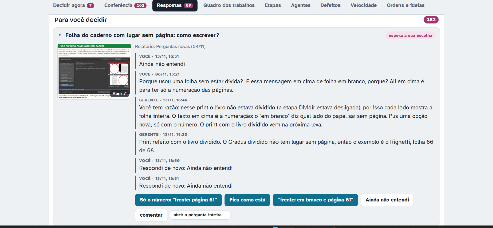

# Teste do Samuel, 13/11/2026 (sessão 6)

Prints e frases do Samuel, guardados na hora. Programa: o da versão de teste (ramo `obra-2026-10-26`, a conferir pelo agente).

## 13-01 — Preto e branco: a capa azul sai preta

- Frase dele: "1- novo problema achado no branco e preto"
- O que se vê: *Gradus Primus* (arquivo "pdfcoffee..."), página 1 de 70 (a capa aberta: quarta capa à esquerda, capa azul à direita), livro novo ("ainda não passou pelo automático"), filtro **Preto e branco**, "Respeitar as gravuras achadas" **desmarcada**, "Gravuras em tons de cinza" desmarcada, "Só as letras" desligado, ferramenta Mão. A capa azul sai quase toda preta, com manchas brancas; no alto, perto de "PAU", um retângulo branco.

## 13-02 — Quadrado branco na capa

- Frase dele: "2- quadrado branco na capa?"
- O que se vê: a mesma página, Preto e branco com **"Só as letras" ligado** ("Guardar a tinta forte", de fábrica); as caixinhas "Respeitar" e "Gravuras em tons de cinza" ficam apagadas. A capa azul sai inteira, mas há um **quadrado branco no alto**, sobre "PAULO RÓNAI" (circulado em roxo por ele).

## 13-03 — A lista de atalhos do F1 mal diagramada

- Frase dele: "1- f1 livros recentes está mal diagramado."
- O que se vê: a janela "Lista de atalhos" (F1) pequena, por cima do Gradus: os botões "fechar" e "Ocultar detalhes..." grandes e a lista espremida num quadrinho com rolagem ("Confirmar e processar —" cortado).

## 13-04 — Aplicar o filtro só em uma página

- Frase dele: "2- não tem um botão para aplicar o filtro só em uma pagina"
- O que se vê: *Na escola de Jesus*, página 1, filtro Original, painel "Filtro da página". Embaixo à direita, "Aplicar em: só nesta / todas / daqui em diante", com "só nesta" marcado em azul.
- Pergunta dele no chat: "o que tem para terminar em livros recentes?"

## Teste do "Livros recentes" (chat)

- "sobre o livros recentes, ele não trava mas demora para carregar, quando eu volto para um livro que já tinha sido aberto, ele nem carrega, como se já tivesse sido carregado, isso pesa o programa? será que o programa está deixando dois arquivos carregados?"
- Resultado: **não fecha mais** (o conserto funcionou). Resposta da gerente (pelo código, `ui/janela_principal.py` `abrir_livro`): abrir troca o livro, não deixa dois abertos. O livro já aberto antes volta rápido porque o trabalho dele está salvo no disco e não é analisado de novo; o livro novo faz a passada leve e a medida por trás. O programa guarda na memória algumas páginas já feitas (com teto, até uns 400 MB das páginas desentortadas, `core/pipeline.py`), e esse guardado não é esvaziado ao trocar de livro: a medir.

## Girar: o "aplicar em" escondido (chat)

- Ele não testou o girar com a capa aberta: "eu não testei o girar, pois não sabia como testar, nem sei onde fica esse botão girar todas".
- Depois da explicação: "Para escolher aplicar em todas tem que estar dentro de um painel de outras funções, não existe um painel do girar"
- Onde foi decidido assim: layout, rodada 12, 703 ("Quero a opção B e D": girar no painel Propriedades e nos botões do canto) e rodada 13, 803 B ("Só no painel": o "aplicar em" só no bloco do painel). Ver `ui/widgets/barra_girar.py`.
- Proposta da gerente (setinha do "aplicar em" também nos botões do canto, junto com o girar numa regra só, com print na Central) → ele: "Pode ser, e ai as opções dele apareceriam em propriedades quando fosse selecionado né?"

## Regra lembrada por ele (chat)

- "Lembre de que o agente não pode fazer gambiarras como na outra ferramenta nossa que fazia várias gambiarras e funcionava de maneira diferente em vários lugares." Repassada ao agente do "Tirar o fundo" na hora (uma regra só no código; CLAUDE.md §11.10, D-667).
- Preto e branco: o "Ok" foi lido como sim e o agente da D-700 foi aberto; ele: "Não estou falando disso, estou falando do branco e preto" · "Não quero consertar isso agora, quero saber o que estava em execução". Agente parado, D-700 suspensa.

## Teste dos três consertos juntados (chat)

- Miniatura igual ao PDF, cartões da tela cheia e quadrados do Melhorar/Mágico pro: "1- funcionando 2- funcionando 3- funcionando" · "estou falando dos testes que tinha que fazer".

## Ideia nova (chat)

- "deixe anotado, eu quero poder abrir varias abas no programa, deixe como ideia, de varios livros." → Lista de espera do plano (13/11).

## Pedido dele

"investigar esses quadrados , coloque agora um agente para pesquisar isso e ver se acontece em outros filtros ou partes do programa."

- Agente aberto em 13/11 (investigação, sem mudar o programa). Relatório dele: `relatorios/quadrados-capa-2026-11-13/` no ramo dele.

## 13-05 — Central: o comentário sumiu e a pergunta não saiu do "para decidir" (22h52 UTC)

- Frase dele: "eu comentei e coloquei ainda não entendi e não saiu do para decidir, e meu comentario sumiu, não consigo mais ver ele arrume isso"
- O que se vê: a pergunta "Folha do caderno com lugar sem página: como escrever?" na aba Respostas, com o "Ainda não entendi" dele duas vezes (18h50 e 18h51 no horário do print) e "espera a sua escolha".
- Causa: a gerente gravou a resposta com horário no futuro, e a página escondia o comentário dele. O comentário foi devolvido e os horários corrigidos.

## A Central e as regras de perguntar (chat, 22h53 a 23h30 UTC)

- 22h53: "nos para responder, não tem explicações sobre o que precisa ser respondido, tem minha ultima resposta e uma resposta que não explica do que se estava falando antes e você está motrando agora, como eu vou concatenar as coisas?"
- 22h56: "comentario também deve servir como resposta, porque se não eu tenho que colocar ainda não entendi se não querer nenhuma das opções ou se quero uma opção com adição." · "tem que ter uma opção a mais quando for só comentario"
- 23h00: "fez todas as mudanças que eu pedi" · "?"
- 23h05: "precisa ajeitar para isso como regra, consegue pegar as perguntas e respostas que tu fez que eu não entendi, ver um padrão e fazer um conjunto de regras para responder e fazer perguntas."
- 23h07: "veja os comentarios que eu fiz nessas perguntas para que tenha mais conteudo para saber por onde alinhar as regras novas"
- 23h08: "você tirou a opção de comentar e responder nos botões"
- 23h23: "Sim, pode, mas tu fez as mudanças na central? revisa as minhas respostas e perguntas porque eu não estou conseguindo entender o que você falou lá e o que eu tenho que responder, revise conforme as novas regras, e confira que todo agente que for escrever nela tenha que ver as regras para que não escreva coisas dubias, queremos as informações mais diretas lá e de forma clara e rapida."
- 23h30: "bota um agente para rever as perguntas segundo as novas regras, ver as perguntas que eu coloquei não entendi, onde eu pedi novas explicações para ele pegar a ideia, esse agente tem que ter acesso ao historico né, para ele se informar do que ele vai mudar lá nas perguntas, para todas as perguntas ficarem conforme o que fica mais facil de eu entender."
- Destino: a opção "Só comentário" e o "comentar" mantido (Central, versão 43); CLAUDE.md §11.13 e §10; o "Sim, pode" juntou o "Tirar o fundo" (D-703); 169 perguntas reescritas (`a4ed18ed`).

## Andamento (chat, 14/11)

- 00h09: "os consertos em que pé estamos?"
- 02h23: "acabou tudo?"
- 02h25: "essas 133 já foram tudo feitas?" Resposta: não; das 148 abertas, 89 funcionam, 32 funcionam com defeito, 17 são escolhas da gerente e 10 ficaram para depois. A proposta de arquivar só as 89 e as 10 espera a resposta dele.
