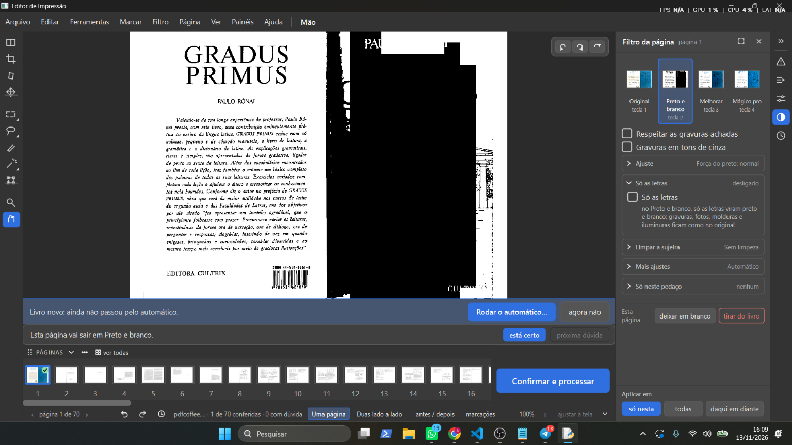
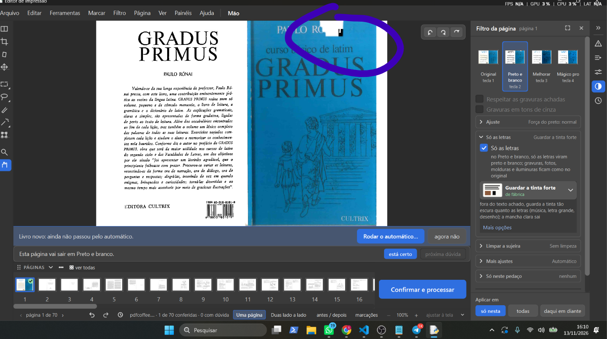
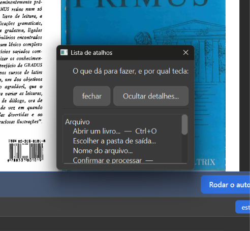
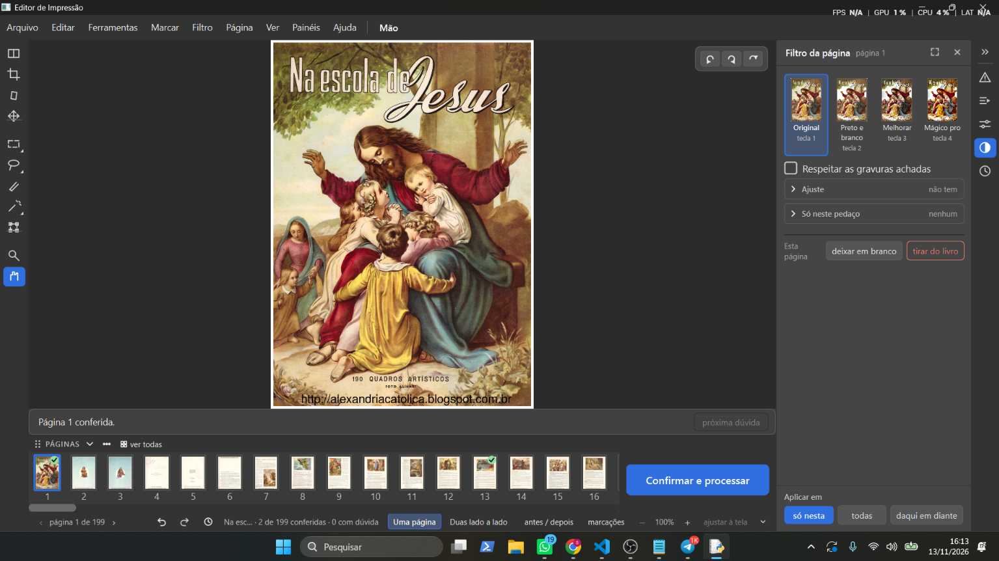

# Teste do Samuel, 13/11/2026 (sessão 6)

Prints e frases do Samuel, guardados na hora. Programa: o da versão de teste (ramo `obra-2026-10-26`, a conferir pelo agente).

## 13-01 — Preto e branco: a capa azul sai preta

- Frase dele: "1- novo problema achado no branco e preto"
- O que se vê: *Gradus Primus* (arquivo "pdfcoffee..."), página 1 de 70 (a capa aberta: quarta capa à esquerda, capa azul à direita), livro novo ("ainda não passou pelo automático"), filtro **Preto e branco**, "Respeitar as gravuras achadas" **desmarcada**, "Gravuras em tons de cinza" desmarcada, "Só as letras" desligado, ferramenta Mão. A capa azul sai quase toda preta, com manchas brancas; no alto, perto de "PAU", um retângulo branco.

## 13-02 — Quadrado branco na capa

- Frase dele: "2- quadrado branco na capa?"
- O que se vê: a mesma página, Preto e branco com **"Só as letras" ligado** ("Guardar a tinta forte", de fábrica); as caixinhas "Respeitar" e "Gravuras em tons de cinza" ficam apagadas. A capa azul sai inteira, mas há um **quadrado branco no alto**, sobre "PAULO RÓNAI" (circulado em roxo por ele).

## 13-03 — A lista de atalhos do F1 mal diagramada

- Frase dele: "1- f1 livros recentes está mal diagramado."
- O que se vê: a janela "Lista de atalhos" (F1) pequena, por cima do Gradus: os botões "fechar" e "Ocultar detalhes..." grandes e a lista espremida num quadrinho com rolagem ("Confirmar e processar —" cortado).

## 13-04 — Aplicar o filtro só em uma página

- Frase dele: "2- não tem um botão para aplicar o filtro só em uma pagina"
- O que se vê: *Na escola de Jesus*, página 1, filtro Original, painel "Filtro da página". Embaixo à direita, "Aplicar em: só nesta / todas / daqui em diante", com "só nesta" marcado em azul.
- Pergunta dele no chat: "o que tem para terminar em livros recentes?"

## Teste do "Livros recentes" (chat)

- "sobre o livros recentes, ele não trava mas demora para carregar, quando eu volto para um livro que já tinha sido aberto, ele nem carrega, como se já tivesse sido carregado, isso pesa o programa? será que o programa está deixando dois arquivos carregados?"
- Resultado: **não fecha mais** (o conserto funcionou). Resposta da gerente (pelo código, `ui/janela_principal.py` `abrir_livro`): abrir troca o livro, não deixa dois abertos. O livro já aberto antes volta rápido porque o trabalho dele está salvo no disco e não é analisado de novo; o livro novo faz a passada leve e a medida por trás. O programa guarda na memória algumas páginas já feitas (com teto, até uns 400 MB das páginas desentortadas, `core/pipeline.py`), e esse guardado não é esvaziado ao trocar de livro: a medir.

## Ideia nova (chat)

- "deixe anotado, eu quero poder abrir varias abas no programa, deixe como ideia, de varios livros." → Lista de espera do plano (13/11).

## Pedido dele

"investigar esses quadrados , coloque agora um agente para pesquisar isso e ver se acontece em outros filtros ou partes do programa."

- Agente aberto em 13/11 (investigação, sem mudar o programa). Relatório dele: `relatorios/quadrados-capa-2026-11-13/` no ramo dele.
