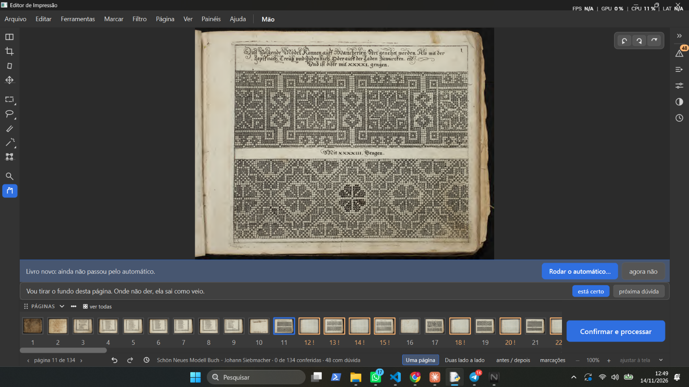
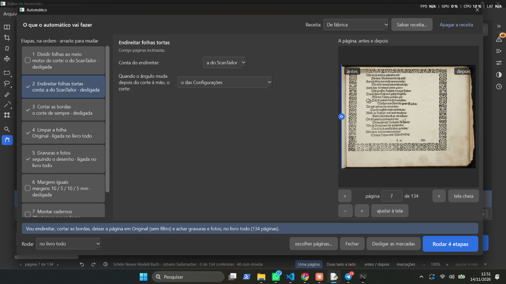

# Teste do Samuel, 14/11/2026 (sessão 7)

Prints e frases do Samuel, guardados na hora. Programa: a versão de teste (ramo `obra-2026-10-26`, ponta `c7e34fd8`), aberta pelo atalho "Editor de Impressao (rodada de consertos)", com a pasta de dados própria dele (`D:\programas\EditorImpressao-arquivos\dados-teste-rodada-de-consertos`).

Teste do dia: **teste 1, Tirar o fundo** (roteiro dado no chat às 15h, UTC). A gerente tinha mandado primeiro pelo atalho "(desenvolvimento)", que abre a versão principal, e por um cartão do Siebmacher que não existe na versão de teste ("não tem esse cartão, dá uma olhada"); o roteiro foi corrigido.

## 14-01 — Siebmacher, página 11: o fundo não saiu

- Frases dele (14/11, ~16h55 UTC):
  - "Novo problema, o programa trava quando eu abro o livro - ele demora muito para abrir o livro e demora muito para tirar o fundo."
  - "2- print 1 de algumas paginas não tirou o fundo."
  - "3- as miniaturas não mudaram, esse é um outro problema que disse que teria sido resolvido e que eu tinha testado antes e parecia resolvido, tem que ver se o agente não fez gambiarra."
  - "6- não sei onde fica o botão desfazer o tirar fundo."
- O que se vê: Siebmacher (livro novo, "ainda não passou pelo automático"), página 11 de 134, ferramenta Mão, "Uma página". A página 11 está com o papel velho (amarelado, borda escura). A faixa diz "Vou tirar o fundo desta página. Onde não der, ela sai como veio." Na tira de baixo, as miniaturas 1 a 10 estão com o papel velho; as 12, 13, 14, 15, 18, 20 e 22 têm borda laranja e "!" (dúvida). Rodapé: "0 de 134 conferidas · 48 com dúvida"; o sino mostra 48.

## 14-02 — Automático: o "antes" mostra o papel velho

- Frase dele: "4- print 2 - nas paginas que o tirar fundo funcionou o antes no automatico mostra a pagina no original ainda"
- O que se vê: janela Automático, receita "De fábrica", etapa 2 "Endireitar folhas tortas" escolhida; marcadas as etapas 2 a 5 ("Limpar a folha: Original · ligada no livro todo"; "Gravuras e fotos: seguindo o desenho · ligada no livro todo"); 1, 6 e 7 desmarcadas. À direita, "A página, antes e depois", página 7 de 134: o lado "antes" com o papel velho amarelado. Embaixo: "Vou endireitar, cortar as bordas, deixar a página em Original (sem filtro) e achar gravuras e fotos, no livro todo (134 páginas)." Botão "Rodar 4 etapas".

## Os pontos dele, numerados como ele escreveu

1. Abrir o livro demora muito e o programa trava; tirar o fundo demora muito.
2. Algumas páginas não tiraram o fundo (print 14-01).
3. As miniaturas não mudaram (continuam com o papel velho). Ele lembra que a miniatura igual ao PDF tinha sido consertada e testada ("funcionando", 13/11) e pede para ver se não houve gambiarra.
4. No Automático, o "antes" das páginas onde o fundo saiu ainda mostra o papel velho (print 14-02).
6. Não achou o botão "Desfazer o tirar o fundo". (Ele pulou o 5.)

## O que a gerente respondeu no chat

- Onde fica o botão: menu **Filtro**, último item, e no painel **Filtro da página** (menu Painéis > Filtro da página), logo abaixo das figurinhas. Ele só fica aceso numa página onde o fundo saiu.
- Pontos 1 a 4: ainda não se sabe se são defeito do programa ou efeito de uma regra antiga (a do item 1.1: "Páginas em que tudo está na camada de baixo ficam intactas" e "página duvidosa sai marcada 'conferir'"). Precisam de investigação, com prova.
