# Lista única dos problemas — 23/10/2026

Junta numa lista só tudo o que foi achado em 23/10/2026, que estava em três lugares:

- **Samuel (sessão 0)**: os achados 0-1 a 0-10 e as "Respostas do mapa" — `relatorios/testes-guiados/2026-10-23-sessao-0/sessao-0.md`.
- **mapa**: o mapa do programa, com 22 pontos confusos — `relatorios/testes-guiados/mapa-do-programa/mapa.md` (ramo `mapa-do-programa-2026-10-23`).
- **livros**: os testes com os 14 livros, 18 problemas distintos em 64 linhas — `relatorios/testes-guiados/livros/resumo.md` e um `.md` por livro (ramo `testes-livros-2026-10-23`).

Cada problema aparece **uma vez só**, mesmo quando foi achado por mais de um. A coluna "Quem achou" diz de onde veio
(Samuel 0-x / mapa nº x / livros: código da linha no relatório do livro). Está organizada pelo que importa para quem
vai usar o programa: primeiro os botões, depois as ferramentas, as funções que faltam, a imagem final e, por último,
os nomes e números. Nada foi inventado: só o que está nos três documentos. Nenhuma linha do programa mudou.

**Gravidade:** **trava o trabalho** (não dá para terminar o livro como precisa) · **atrapalha** (o livro sai com
defeito ou o Kaique se perde) · **detalhe**.

**Livros (códigos):** B = Boécio · P = Palatino · R = Righetti · S = Siebmacher · PE = Pesel · M = Matemática ·
L = ljs47 · V = Valadés · E = Escola de Jesus · C = Cursus · MA = Marial · H = Livro de Horas · G = Graduale ·
A = Antiphon_25. "La vida eterna" é o livro da sessão 0 e do mapa.

---

> ## SEGURANÇA — ler primeiro
>
> **"imprimir agora" manda o livro inteiro para a impressora sem perguntar nada** (item 5.1). Na tela "Ficou
> pronto!", um clique nesse botão manda o PDF direto para a impressora padrão do Windows: sem escolher impressora,
> sem número de cópias, sem "tem certeza?". No La vida eterna seriam **360 páginas** de uma vez. Até ser mudado:
> **não clicar em "imprimir agora"**; usar "montar para imprimir em A4" ou abrir o PDF e imprimir pelo leitor.
> (O mapa não testou o botão, de propósito.)

---

## Avisos — tudo junto (acrescentado em 26/10/2026)

Pedido do Samuel em 24/10 ("a questão dos avisos que quando clica não aparece como resolver e essas questões dos
avisos que eu tinha falado?"), resposta "oK" em 26/10. Os problemas de aviso estavam espalhados pelas seções 1 e 5;
aqui ficam juntos. **Não são itens novos**: cada um continua na sua seção, com a explicação completa e os prints.

| Nº | O que acontece com o aviso | Gravidade | Quem achou |
|---|---|---|---|
| 1.1 | Clicar "está certo" no aviso não muda nada na tela — parece que o clique não pegou | atrapalha | Samuel 0-3 · mapa |
| 1.2 | O aviso oferece "usar mais fraco", e o botão não faz nada | atrapalha | livros |
| 1.6 | Depois de desfazer, o aviso não volta (ou volta um a mais) | atrapalha | livros |
| 1.8 | O cartão do aviso no "Para revisar" não tem botão; no "Dividir a folha" não há como resolver o aviso | atrapalha | Samuel 0-7 e 0-8 |
| 5.5 | Três lugares contam as dúvidas, cada um dá um número, e os avisos de folha ficam escondidos (Escola: rodapé "1", no fim 166) | atrapalha | mapa · livros |
| 5.7 | Avisos demais e avisos falsos (Siebmacher: 128 de 134 páginas com aviso; 3 avisos numa folha branca) | atrapalha | livros |
| 5.9 | O aviso fala de "força do preto" em página feita com Mágico pro ou Melhorar, onde isso não existe | atrapalha | livros |

---

## Quadro

| Seção | Itens | Trava o trabalho | Atrapalha | Detalhe |
|---|---|---|---|---|
| 1. Botões que não funcionam ou não dão resposta | 13 | 0 | 8 | 5 |
| 2. Ferramentas que somem ou ficam escondidas | 7 | 1 | 4 | 2 |
| 3. Funções que faltam | 2 | 1 | 1 | 0 |
| 4. Defeitos na imagem final | 12 | 0 | 10 | 2 |
| 5. Nomes, textos e números que confundem | 16 | 1 | 10 | 5 |
| **Total** | **50** | **3** | **33** | **14** |

O "imprimir agora" (5.1) está contado como "trava o trabalho" por ser de segurança.

### As 5 coisas mais graves

1. **"imprimir agora" imprime o livro inteiro sem perguntar** (5.1) — segurança.
2. **Livro escaneado de lado não divide, e não há como girar antes** (3.1) — no Righetti não há caminho na janela; o
   livro saiu com as duas páginas juntas em cada folha.
3. **Mudar as caixinhas num livro já conferido não vale** (2.5) — quem esqueceu de marcar "Cortar" ou "Endireitar" não
   consegue acrescentar depois sem começar de novo (defeito aberto desde 29/09). Junto com o 2.1, é o "nem tem botão
   para cortar ou dividir".
4. **O desfazer não tira o Retângulo, e a marca sai impressa no PDF** (1.3 e 4.6) — em 11 de 11 livros onde se
   marcou; no Antiphon virou um retângulo cinza atrás do texto.
5. **Os avisos ficam escondidos e cada lugar dá um número de dúvidas** (5.5) — na Escola o rodapé dizia "1 com
   dúvida" e no fim a janela cobrou 166 páginas; o Kaique acha que terminou e não terminou.

---

## 1. Botões que não funcionam ou não dão resposta

| Nº | Problema | Gravidade | Quem achou | Onde aparece |
|---|---|---|---|---|
| 1.1 | "está certo" não muda nada na tela | atrapalha | Samuel 0-3 · mapa nº 7 e 8 | La vida eterna, folha 1, "Dividir a folha" |
| 1.2 | "usar mais fraco" não faz nada | atrapalha | livros: E-2, H-3 (problema 10) | E p. 1; H p. 4 |
| 1.3 | O desfazer não tira a marcação do Retângulo | atrapalha | livros: P-2, R-6, S-5, PE-5, L-5, V-5, E-4, MA-3, H-6, G-4, A-1 (problema 2) | 11 livros: P 74, R 99, S 37, PE 51, L 52, V 41, E 19, MA 166, H 53, G 22, A 56 |
| 1.4 | "usar o corte alargado" deixou a página **menor** | atrapalha | livros: A-2 (problema 8) | A p. 2 |
| 1.5 | "Confirmar e processar" às vezes não abre nada (a conferir) | atrapalha | livros: "A conferir" (todos os 14) | os 14 livros, depois de muito uso da tela |
| 1.6 | O desfazer não traz o aviso de volta (ou traz um a mais) | atrapalha | livros: B-1, PE-3, B-4 (problemas 11 e 18) | B p. 2 e p. 1; PE p. 1 |
| 1.7 | O desfazer desfaz uma coisa que não está à vista | atrapalha | livros: R-5 (problema 15) | R folha 99 (desfez o giro das 135 folhas) |
| 1.8 | O cartão do aviso no "Para revisar" não tem botão, e no "Dividir a folha" não há como resolver o aviso | atrapalha | Samuel 0-7 e 0-8 | La vida eterna, páginas 2, 7 e 9 (folha 4) |
| 1.9 | O Retângulo novo não aparece na tela | detalhe | livros: P-3 (problema 18) | P p. 74 |
| 1.10 | Tab ("ir para a próxima dúvida") não andou (a conferir) | detalhe | mapa nº 14 | La vida eterna, folha 2 |
| 1.11 | Esc não fecha o "ver todas" | detalhe | mapa nº 13 | tela de conferir |
| 1.12 | Menus Editar, Marcar, Filtro, Página e Painéis cinza na tela das caixinhas | detalhe | mapa nº 19 | "Marque o que você quer fazer" |
| 1.13 | A tela fica vazia ou em "Preparando a prévia..." por uns segundos | detalhe | mapa nº 21 · livros: M-4 (problema 18) | La vida eterna (Endireitar, painel Filtro); M (Cortar) |

### 1.1 "está certo" não muda nada na tela — atrapalha

Clico em "está certo" e não acontece nada: a frase é a mesma, a folha é a mesma, a miniatura não ganha marca e o
rodapé continua "0 de 360 conferidas". Só a **barra de espaço** marca e vai para a próxima.

Detalhe: o clique grava a folha como conferida, mas não mostra (`ui/tela_conferir.py:666-670`, `_marcar_revisada`
`:5065-5070`). No Dividir se confere **folha** e o rodapé conta **página**, por isso a contagem não mexe (mapa nº 8;
ver 5.4). **Diferença entre os documentos:** no Boécio (p. 15, página **com aviso**) o "está certo" funcionou e a
conta de dúvidas baixou. O que não dá resposta é o "está certo" no "Dividir a folha" (sessão 0 e mapa).

### 1.2 "usar mais fraco" não faz nada — atrapalha

Na página com o aviso "Ficou muito escura. Tente mais fraco na força do preto", clico "usar mais fraco": a página não
muda, o aviso fica na faixa, só o botão some, e a contagem de dúvidas fica igual (E: 2 → 2; H: 23 → 23).

Detalhe: aparece em páginas de Mágico pro (Escola) e Melhorar (Horas), e em quase toda página iluminada do Livro de
Horas (as pinturas são escuras de propósito). O nome "força do preto" está errado nesses filtros: ver 5.9.

Print: não há (está no `log.txt` do livro).

### 1.3 O desfazer não tira a marcação do Retângulo — atrapalha

Marco um retângulo com a ferramenta Retângulo, clico no desfazer de baixo, e a marcação **continua lá**, sem aviso.
Em todos os 11 livros onde se marcou, o número de áreas foi N → N+1 → **N+1** (ex.: Palatino 74, "Marcado: 4 de
gravura" → 5 → **5**).

Detalhe: a marca que ficou **vai para o PDF** (item 4.6).

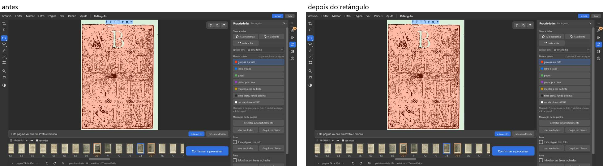

### 1.4 "usar o corte alargado" deixou a página menor — atrapalha

No aviso "O corte ... deixou de fora um pedaço impresso", o botão "usar o corte alargado" deveria pegar **mais**
página. No Antiphon p. 2 fez o contrário: a página virou uma tira estreita e perdeu a metade esquerda.

Detalhe: recorte de 40 % → 92 % da largura (do meio para a direita). No Righetti, Matemática, Marial e Graduale o mesmo
botão tirou a dúvida sem estragar.

### 1.5 "Confirmar e processar" às vezes não abre nada — atrapalha (a conferir)

Nos 14 livros, depois de muito uso da tela de conferir, o clique no botão azul "Confirmar e processar" não abriu nada
em 30 s (botão à vista, ligado, nada por cima). Num percurso curto (abrir, conferir e clicar logo) abriu na hora, três
vezes.

Detalhe: o clique pelo próprio Qt abriu sempre. O relatório dos livros **não contou como problema**: pode ser do jeito
de pilotar a janela. Pedido: o Samuel reparar se o botão às vezes precisa de um segundo clique.

Print: não há.

### 1.6 O desfazer não traz o aviso de volta (ou traz um a mais) — atrapalha

Mexo numa página que tinha aviso e desfaço: a página volta, mas **o aviso some** e a dúvida sai da lista sem eu ter
resolvido nada (B p. 2 no Endireitar: 15 → 14 dúvidas e a miniatura perde o "!"; PE p. 1 no "usar mais escuro": 37 →
36 → 36). No caminho contrário, na B p. 1, desfazer o "usar Mágico pro nesta" trouxe **um aviso a mais** que não
existia ("Texto quase sumiu", "aviso 1 de 2").

### 1.7 O desfazer desfaz uma coisa que não está à vista — atrapalha

No Righetti, arrastei a linha de dividir numa folha que não divide (não mexeu nada) e cliquei no desfazer achando que
desfazia o arrasto. O desfazer desfez **o giro das 135 folhas** (a última coisa feita de verdade), sem aviso, e o PDF
saiu todo de lado.

Detalhe: o desfazer faz o que promete (desfaz a última ação), mas para o Kaique é uma armadilha (`log.txt`: corte 0,5
→ 0,5; giro 270 → 0).

Print: não há.

### 1.8 O cartão do aviso não tem botão — atrapalha

No painel "Para revisar" há avisos ("Parece em branco", páginas 2, 7 e 9), mas não há botão para resolver nem dica de
como fazer o aviso sumir. Clicando no cartão da página 7, o programa foi para a folha 4, mas a faixa continuou com
"Achei a lombada..." e **sem os botões do aviso**.

Detalhe: clicar no cartão leva até a página; os botões ("Deixar em branco", "Tirar do livro", "está bom assim")
aparecem na faixa embaixo da página — mas **não na ferramenta "Dividir a folha"** (`core/analise.py` 140-152,
`ui/tela_conferir.py` 500-510). No pé do painel há "está bom em tudo". Nada no cartão diz isso. Conferir na sessão 1.

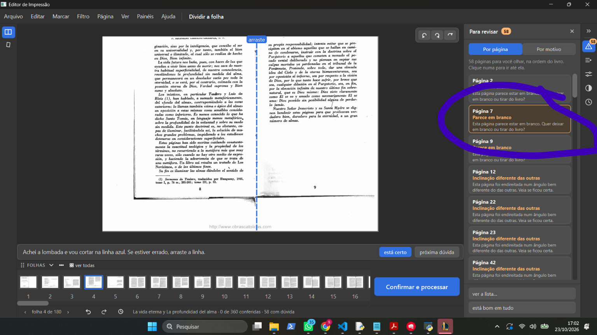

### 1.9 O Retângulo novo não aparece na tela — detalhe

Numa página que o programa já marcou quase inteira como gravura (em salmão), o retângulo que eu marco some dentro do
salmão; só o número "Marcado: 5 de gravura" mostra que houve algo. Print: o mesmo do 1.3.

### 1.10 Tab não andou — detalhe (a conferir)

A tecla Tab ("Ir para a próxima dúvida") não andou no teste do mapa (ficou na folha 2). Pode ser o lugar do foco;
conferir com o Samuel. Print: não há.

### 1.11 Esc não fecha o "ver todas" — detalhe

Na grade "ver todas" da tela de conferir, o Esc não volta; só o botão "voltar ao trabalho".

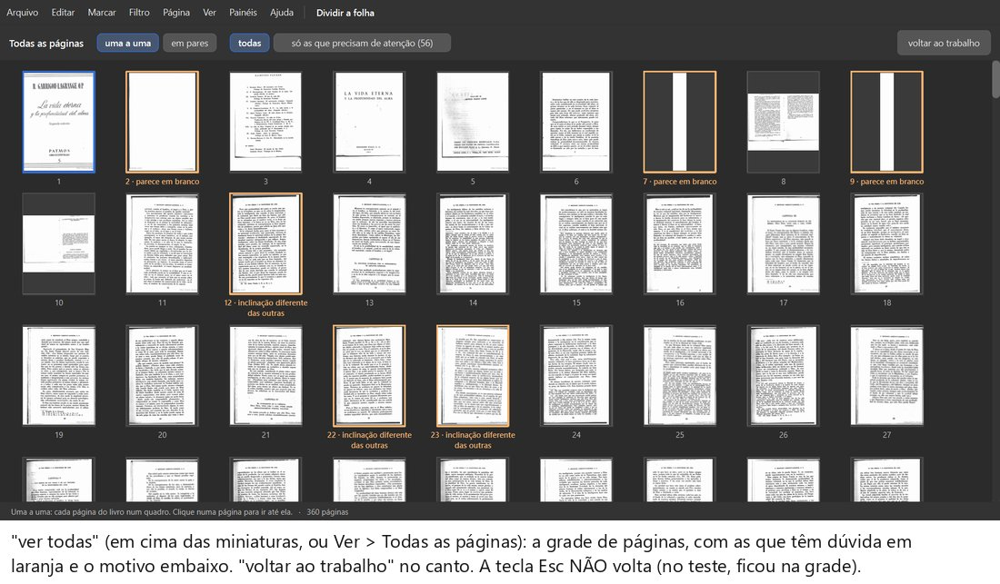

### 1.12 Menus cinza na tela das caixinhas — detalhe

Na tela "Marque o que você quer fazer" os menus do alto aparecem, mas Editar, Marcar, Filtro, Página e Painéis ficam
cinza (não abrem). Print: o do 5.11 (os menus cinza no alto).

### 1.13 A tela fica vazia ou "Preparando a prévia..." — detalhe

O painel "Filtro da página" abriu na primeira vez com os quatro quadradinhos dos filtros vazios (cinza); no
Endireitar, e no Cortar do livro de fotos (Matemática), a página mostrou só "Preparando a prévia..." por alguns
segundos. Print: não há.

---

## 2. Ferramentas que somem ou ficam escondidas

| Nº | Problema | Gravidade | Quem achou | Onde aparece |
|---|---|---|---|---|
| 2.1 | Cortar, dividir e as outras ferramentas somem conforme as caixinhas, sem aviso | atrapalha | Samuel 0-4 e 0-9 · mapa nº 3 e 11 · mapa resposta (b) | La vida eterna (só 2 ícones na coluna da esquerda) |
| 2.2 | Caixinha marcada aparece só como um tique, sem quadrado: fácil desmarcar sem querer | atrapalha | mapa nº 3 · Samuel 0-4 (causa provável) | "Marque o que você quer fazer" |
| 2.3 | Os painéis da direita começam fechados e a coluna da esquerda não tem nomes | atrapalha | Samuel 0-4 · mapa nº 11 | tela de conferir |
| 2.4 | O "automático" não é um botão | atrapalha | Samuel 0-6 · mapa nº 1 · mapa resposta (a) | tela inicial ("Rodar o automático...") e painel "Automático" |
| 2.5 | Mudar as caixinhas depois de conferir não vale (defeito de 29/09) | **trava o trabalho** | mapa nº 2 · Samuel 0-9 (resposta do mapa) · livros: R-3 | La vida eterna; R (Conferir de novo não dividiu) |
| 2.6 | A Luz some no filtro Original; a "Área" fica no fim do painel Propriedades | detalhe | mapa nº 18 | painel "Filtro da página" > "Mais ajustes"; painel Propriedades |
| 2.7 | "Margens iguais" e "Montar cadernos" só aparecem rolando | detalhe | mapa (parte 2) · livros: L-3 | "Marque o que você quer fazer" |

### 2.1 As ferramentas somem conforme as caixinhas — atrapalha

"Tá, eu quero cortar as folhas e agora como eu faço??" — a ferramenta de cortar não está na coluna da esquerda. Só
aparecem as ferramentas das caixinhas marcadas na primeira tela, e nada na tela diz isso.

Detalhe: "Dividir folhas ao meio" liga o Dividir; "Cortar as bordas" liga o Cortar; "Endireitar folhas tortas" liga o
Endireitar; "Limpar a folha" liga Retângulo, Laço, Pincel, Varinha, Mover a área, Zoom, Mão e "Os quatro filtros" —
desmarcada, **todas somem**. O caminho para voltar (Arquivo > "Voltar para as opções") não vale num livro já conferido
(2.5).

**Diferença entre os documentos:** a sessão 0 diz que o Samuel marcou "Dividir" e "Limpar a folha"; o mapa reproduziu
e concluiu que o print dele (2 ícones: Dividir e Endireitar; rodapé "58 com dúvida") bate com **Dividir + Endireitar,
com "Limpar a folha" e "Cortar" desmarcadas** — com Dividir + Limpar apareceriam 9 ícones. A própria sessão 0, em
"Respostas do mapa", já aceita a versão do mapa. Causa provável: item 2.2.

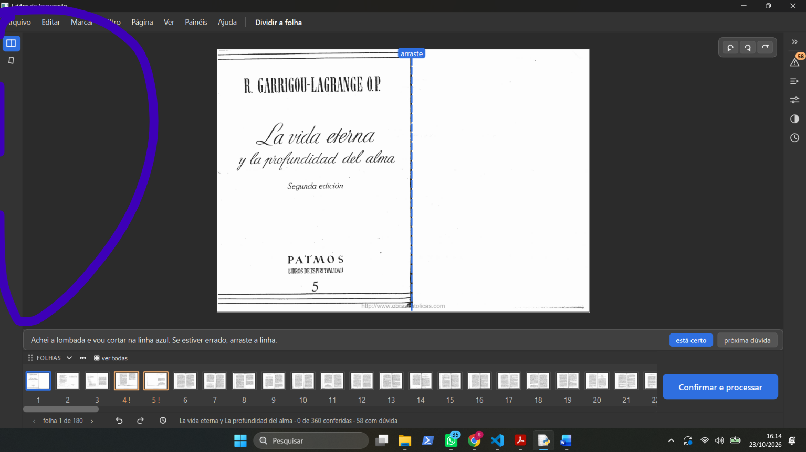

### 2.2 Caixinha marcada sem quadrado — atrapalha

Na primeira tela, a caixinha **marcada** aparece só como um tique, sem quadrado; a **desmarcada** tem quadrado vazio.
Parece que as marcadas "não têm caixa". De fábrica, "Limpar a folha", "Endireitar" e "Cortar as bordas" já vêm
marcadas: quem clica nelas achando que marca, desmarca — e somem as ferramentas (2.1).

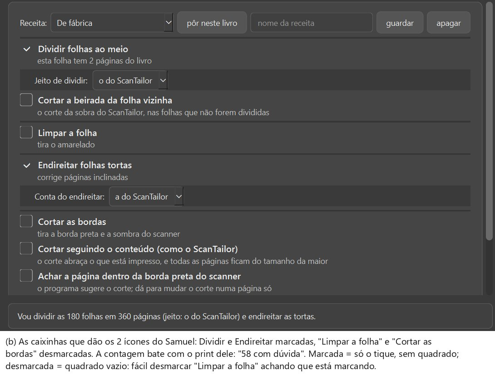

### 2.3 Painéis fechados e coluna sem nomes — atrapalha

"As opções do lado sumiram": os painéis (Para revisar, Automático, Propriedades, Filtro da página, Histórico) moram na
coluna de ícones da **direita** e começam **todos fechados** ao abrir um livro; nada diz que estão lá. Na coluna da
esquerda não há palavras: o nome da ferramenta só aparece com o mouse parado em cima.

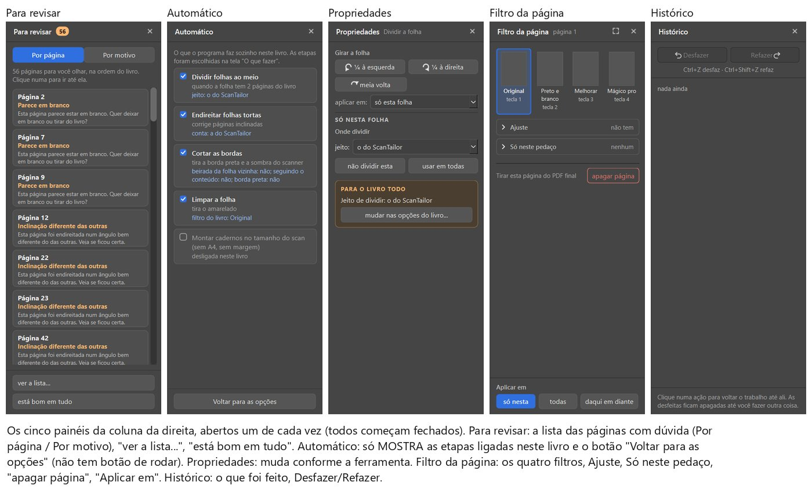

### 2.4 O "automático" não é um botão — atrapalha

"Não consegui nem achar o modo automático." Não existe botão que rode o automático. O programa trabalha sozinho
quando se clica **"Conferir"** na tela "Marque o que você quer fazer".

Detalhe: há três "automáticos" e nenhum roda nada — "Rodar o automático..." (tela inicial, livro aberto) só leva à
tela das caixinhas; o painel "Automático" (2º ícone da direita) só mostra as etapas ligadas; "Jeito do preto e branco:
Automático" é outra coisa, dentro de "Mais ajustes" (`PainelAutomatico` em `ui/widgets/paineis.py`;
`ui/tela_inicio.py:687`).

### 2.5 Mudar as caixinhas depois de conferir não vale — trava o trabalho

Num livro que já passou pelo "Conferir", voltar às opções (Arquivo > "Voltar para as opções" ou "Rodar o
automático..."), marcar mais caixinhas (ex.: Endireitar e Cortar) e clicar "Conferir" **não muda nada**: a frase de
baixo diz que vai endireitar e cortar, mas a tela de conferir volta igual, sem as ferramentas novas.

Detalhe: defeito registrado em 29/09 na Lista de bugs, ainda aberto. Só muda se o número de páginas mudar. No Righetti
(R-3), "Conferir" de novo também não dividiu. Até ser consertado: usar um livro novo ou "começar de novo" no menu do
cartão (perde o que já foi conferido). Contei como "trava" porque é o único caminho na tela para acrescentar o cortar
ou o dividir que faltou.

### 2.6 A Luz e a "Área" escondidas — detalhe

A Luz ("Igualar a luz da página", "Suavizar as letras", "Tirar o chuvisco") fica em painel "Filtro da página" > "Mais
ajustes" e **só existe** com Preto e branco, Melhorar ou Mágico pro — no Original (o de fábrica) não aparece. A "Área"
fica no fim do painel Propriedades, só com ferramenta de marcar, e precisa rolar.

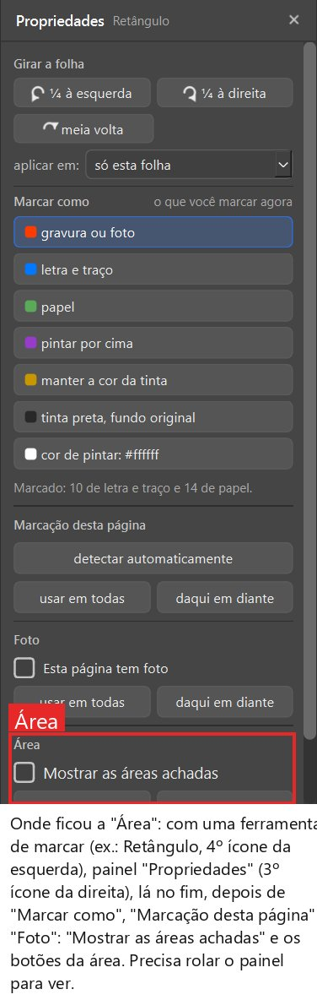

### 2.7 Caixinhas que só aparecem rolando — detalhe

As caixinhas não cabem na tela: "Margens iguais em todas as páginas" e "Montar cadernos" só aparecem rolando. No ljs47
(L-3) faltou justamente a "Margens iguais" (ver 4.8).

---

## 3. Funções que faltam

| Nº | Problema | Gravidade | Quem achou | Onde aparece |
|---|---|---|---|---|
| 3.1 | Não dá para girar o livro antes de dividir: livro escaneado de lado não divide | **trava o trabalho** | livros: R-1, R-2, R-3, R-4 (problema 1) | R, todas as 135 folhas |
| 3.2 | Girar a página vendo-a inteira, como no Photoshop | atrapalha | Samuel 0-10 | La vida eterna p. 55, Endireitar a 45° |

### 3.1 Girar o livro antes de dividir — trava o trabalho

O Righetti está escaneado de lado (livro aberto, duas páginas por folha). A tela das caixinhas **não tem como girar**
o livro. Marquei "Dividir" e a frase prometeu "135 folhas em 270 páginas" — saíram 135. Girando as folhas depois, na
conferência, o "dividir esta" fica cinza em todas. Voltar às opções e "Conferir" de novo também não divide. Não há
caminho na janela: o livro saiu com as duas páginas juntas.

Detalhe: a conta de dividir não acha a lombada com o livro de lado; depois do "Conferir" cada folha "entrou como uma
página só... aqui não dá para dividi-la".

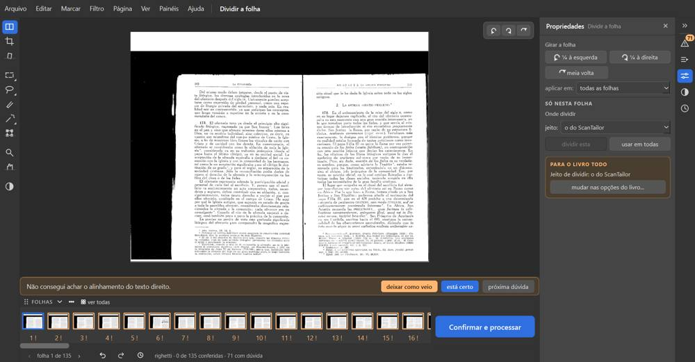

### 3.2 Girar vendo a página inteira — atrapalha

"Quando eu vou girando a folha era para ela aparecer como no Photoshop, para fora do quadrado, mas ela corta." No
Endireitar, girando a página, a imagem fica presa dentro do retângulo da página e os cantos somem.

Detalhe: a investigar se é só a tela ou se o PDF também perde os cantos.

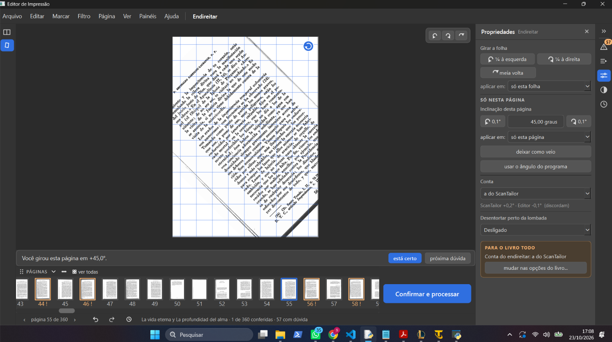

---

## 4. Defeitos na imagem final

| Nº | Problema | Gravidade | Quem achou | Onde aparece |
|---|---|---|---|---|
| 4.1 | Gravura estragada no Preto e branco, mesmo com "Achar gravuras" | atrapalha | livros: P-1, V-1, S-2 (problema 5) | P 74; V 41; S 110 |
| 4.2 | Texto comido | atrapalha | livros: M-1, M-2, C-1 (problema 6) | M 66, 92, 40, 118; C 3 |
| 4.3 | Folha branca sai cinza e manchada no Preto e branco | atrapalha | livros: B-2, MA-1, S-1 (problema 7) | B 49; MA 2; S 74 e 86 |
| 4.4 | O corte tirou um lado da moldura | atrapalha | livros: H-2 (problema 9) | H 18 |
| 4.5 | PDF pronto gigante | atrapalha | livros: PE-2, L-1, E-3, H-1, G-1, A-3 (problema 3) · mapa nº 22 | PE 208 MB; L 707 MB; E 907 MB; H 1.186 MB; G 1.040 MB; A 1.590 MB; La vida eterna 287 MB |
| 4.6 | A marca do Retângulo que o desfazer não tirou sai impressa | atrapalha | livros: A-1, P-1 (problema 2) | A 56; P 74 |
| 4.7 | Retângulos brancos por cima do cartão das pranchas | atrapalha | livros: PE-1 (problema 12) | PE 51, 59, 67, 75 |
| 4.8 | Corte "até o que está impresso": cada página de um tamanho, sem margem | atrapalha | livros: L-3, G-3 (problema 17) | L 2, 11, 52; G (todas do trecho) |
| 4.9 | Montar em A4 um livro deitado vira as páginas de lado | atrapalha | livros: S-3 (problema 16) | S (o livro todo) |
| 4.10 | A sombra da lombada fica como faixa preta na beirada | atrapalha | livros: B-6, S-1 (problemas 7 e 18) | B 2; S 74 e 86 |
| 4.11 | Mancha pequena vira ponto preto em cima da palavra | detalhe | livros: V-2 (problema 18) | V 203 |
| 4.12 | Pontinhos laranja na margem | detalhe | livros: A-5 (problema 18) | A 56 |

### 4.1 Gravura estragada no Preto e branco — atrapalha

A gravura sai pior que o original. No Palatino 74 (gravura em madeira, letras brancas em fundo escuro) o fundo virou
chuvisco preto e branco com manchas pretas grandes; no Valadés 41 (gravura em metal) o traço fino virou áreas pretas
chapadas e os rostos perderam detalhe; no Siebmacher 110, parte do risco de bordado virou mancha preta e parte sumiu.

Detalhe: aconteceu com "Achar gravuras e fotos" ligada; no Palatino o programa marcou a página como gravura e ela saiu
estragada mesmo assim. Nenhum aviso apareceu (ver 5.7).

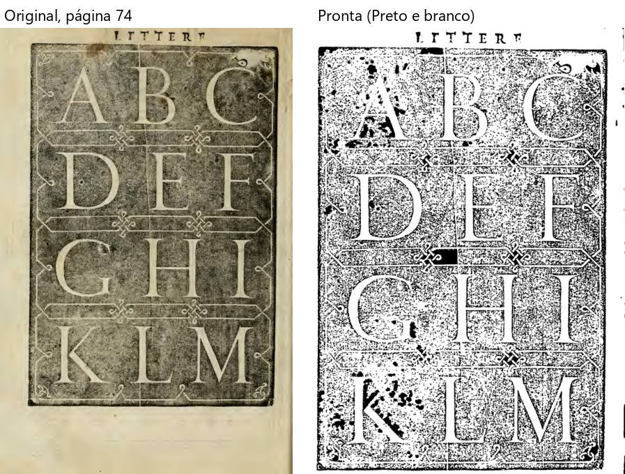

### 4.2 Texto comido — atrapalha

Partes do texto somem no PDF pronto. Matemática 66 (e 92): cada número de questão com sombreado cinza virou borrão
preto. Matemática 40 (e 118): as primeiras letras de cada linha, perto da lombada, sumiram ("Suponha que" → "~cha
que"). Cursus 3: o corte da esquerda comeu a primeira letra ou duas das linhas de baixo.

Detalhe: nenhuma dessas páginas teve aviso de "texto sumiu".

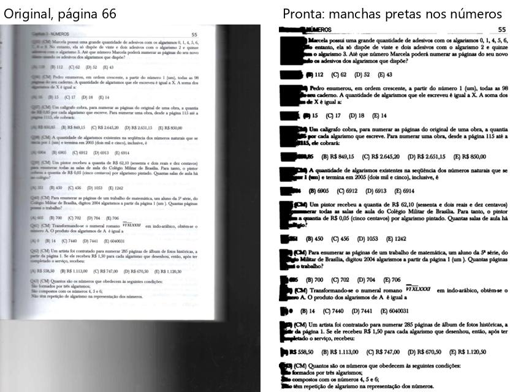

### 4.3 Folha branca sai cinza e manchada — atrapalha

Uma folha de guarda branca sai **cinza e toda manchada**: a textura e as rugas do papel viram desenho (Boécio 49,
Marial 2). No Siebmacher 74 e 86, borrões pretos espalhados. Quem imprime gasta tinta numa página feia.

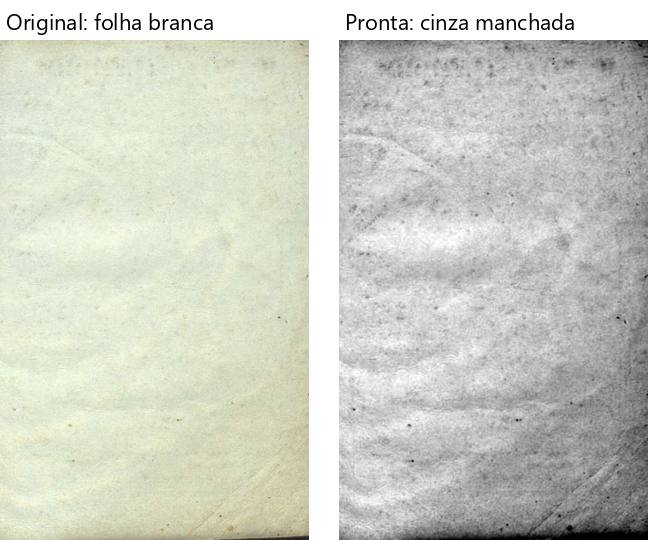

### 4.4 O corte tirou um lado da moldura — atrapalha

Livro de Horas 18 (calendário com moldura dourada): o corte tirou o lado esquerdo da moldura e deixou sobra branca do
lado direito; a página ficou torta no papel.

### 4.5 PDF pronto gigante — atrapalha

Com Mágico pro e Melhorar o PDF sai de 15 a 20 vezes maior que o original: Pesel 208 MB (92 páginas), ljs47 707 MB,
Escola 907 MB, Livro de Horas 1.186 MB (100 páginas), Graduale 1.040 MB (101 páginas), Antiphon 1.590 MB (120 páginas).
O Graduale inteiro passaria de 7 GB. Difícil de guardar, copiar e mandar para a gráfica.

Detalhe: no Preto e branco ficam leves (livros). O mapa achou 287,4 MB para 360 páginas com o filtro **Original**
(La vida eterna).

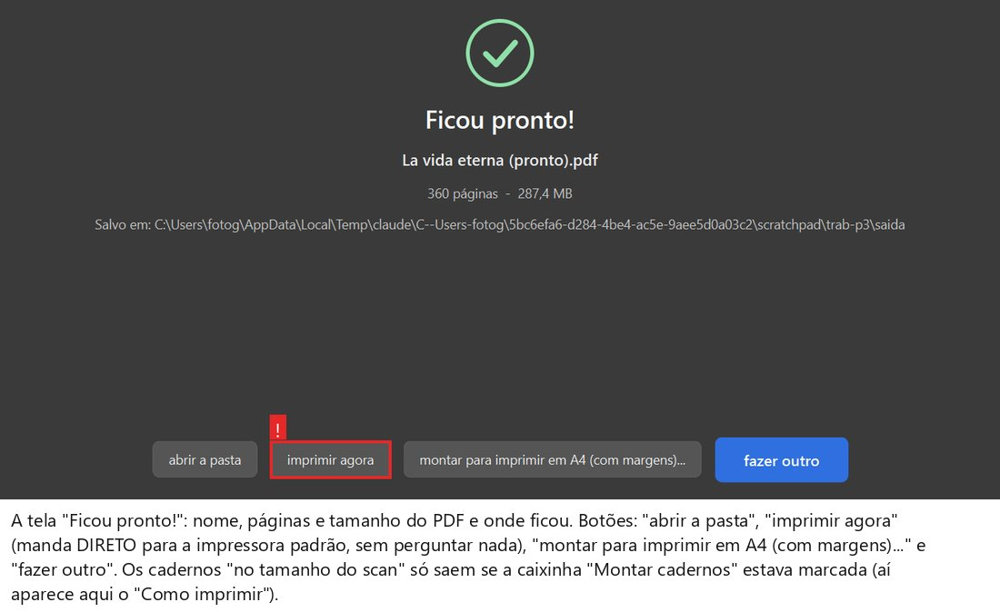

### 4.6 A marca do Retângulo sai impressa — atrapalha

A marcação que o desfazer não tirou (1.3) vai para o PDF. No Antiphon 56 ficou um **retângulo cinza** atrás de duas
linhas de texto, exatamente onde marquei. No Palatino 74 o **bloco preto** entre o D e o G também está onde marquei.

Detalhe: mesma causa do 1.3; está aqui também porque é o que aparece na página impressa.

### 4.7 Retângulos brancos nas pranchas do Pesel — atrapalha

O bordado ficou bom, mas o cartão marrom em volta virou um remendo: o título e cada bloco de texto ganharam um
retângulo branco por cima, com a letra engrossada, e sobrou uma tira branca torta na beirada esquerda (Mágico pro).

### 4.8 Cada página de um tamanho, sem margem — atrapalha

Com o corte "até o que está impresso", cada página sai de um tamanho e sem margem: no ljs47 a página 2 virou uma tira
de 21 × 11 cm, a 11 tem 25 × 34 cm, a 52 tem 22 × 36 cm; no Graduale as pautas encostam na beirada. No A4, a letra
muda de tamanho de página para página. Nada avisa; a caixinha "Margens iguais" fica escondida (2.7).

### 4.9 Livro deitado montado em A4 vira de lado — atrapalha

No Siebmacher (livro mais largo que alto), "montar para imprimir em A4" com o Livreto de fábrica põe todas as páginas
**de lado e diminuídas** na meia folha (lê-se girando 90°), e a caixa de avisos lista **mais de 120 linhas iguais**
"Página N: era deitada e foi girada de pé e diminuída para caber na página". O programa não sugere outro jeito.

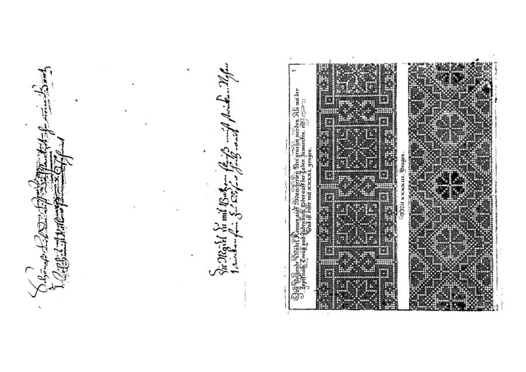

### 4.10 Faixa preta da lombada na beirada — atrapalha

A sombra da lombada não é cortada: no Boécio 2 ficou um risco preto fino em toda a beirada esquerda; no Siebmacher 74
e 86, uma faixa preta grossa, mesmo com "Achar a página dentro da borda preta" marcada.

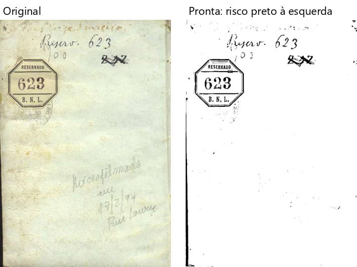

### 4.11 Mancha vira ponto preto — detalhe

Valadés 203: uma mancha marrom pequena em cima de uma palavra virou um ponto preto em cima de "Idiomate". Print: não
há.

### 4.12 Pontinhos laranja na margem — detalhe

Antiphon 56: sobraram pontinhos laranja das manchas do pergaminho na margem da direita. Print: o mesmo do 4.6.

---

## 5. Nomes, textos e números que confundem

| Nº | Problema | Gravidade | Quem achou | Onde aparece |
|---|---|---|---|---|
| 5.1 | **SEGURANÇA:** **"imprimir agora" manda o livro inteiro para a impressora sem perguntar** | **trava o trabalho** (segurança) | mapa nº 15 · sessão 0 (Respostas do mapa) | tela "Ficou pronto!" |
| 5.2 | A fila "Receita" no topo, sem explicação | atrapalha | Samuel 0-1 · mapa nº 5 e parte 5 | "Marque o que você quer fazer"; Configurações > Medidas e receitas |
| 5.3 | Caixinha cinza e marcada ("Escurecer sozinho a força do preto...") | atrapalha | Samuel 0-2 · mapa nº 6 | "Marque o que você quer fazer", com Preto e branco |
| 5.4 | Folha e página misturadas | atrapalha | mapa nº 8 e 10 · Samuel 0-3 (rodapé) | livro aberto; tela de conferir (Dividir x outras ferramentas) |
| 5.5 | Três contagens de dúvidas diferentes, e os avisos de folha escondidos | atrapalha | mapa nº 9 · livros: E-1, H-5, C-2, R-7 (problema 4) e "Já conhecido" de B, P, S, PE | todos: ex. E rodapé 1 / fim 166; R 206 / 71 / 135 |
| 5.6 | O número de dúvidas muda sozinho ao folhear | atrapalha | livros: B-3, L-4, MA-2, G-5, A-6 (problema 14) | B 17 → 15; L 44 → 57; MA 47 → 57; G 19 → 30; A 66 → 75 |
| 5.7 | Avisos demais e avisos falsos | atrapalha | livros: B-5, P-4, S-4, M-3, R-8, V-4, A-6 (problema 13) | S 128 de 134; M 126 de 144; V 201 de 446; P 4 (3 avisos numa folha branca) |
| 5.8 | Nomes "ScanTailor", "Editor" e "contas" na tela e nos avisos | atrapalha | mapa nº 20 · livros: B-5, R-8 | "Marque o que você quer fazer"; avisos em B (9 de 50), R (69 de 135), V, A, PE |
| 5.9 | O aviso fala de "força do preto" em página Mágico pro ou Melhorar | atrapalha | livros: PE-4, E-2, H-3 (problema 10) | PE 51; E 1; H 4 |
| 5.10 | Atalhos em inglês e a lista atrás de "Show Details..." | atrapalha | mapa nº 17 · sessão 0 (Respostas do mapa) | Ajuda (F1); menus ("Ctrl+Return", "Ctrl+Left", "Ctrl+Right") |
| 5.11 | "Limpar a folha" vem marcada com o Original, que não limpa nada | atrapalha | mapa nº 4 | "Marque o que você quer fazer" |
| 5.12 | Dois "montar cadernos" com nomes parecidos | detalhe | mapa nº 16 | caixinhas e "Ficou pronto!" |
| 5.13 | "Os quatro filtros" (esquerda) e "Filtro da página" (direita) com o mesmo desenho | detalhe | mapa nº 12 | tela de conferir |
| 5.14 | Nomes da Luz cortados ("Igual", "Suav", "Tirar o ch") | detalhe | mapa nº 18 | painel "Filtro da página" > "Mais ajustes" |
| 5.15 | Nome do PDF sugerido com acento ("mágico pro") | detalhe | livros: A-4 (problema 18) | A, PE, L, E, G |
| 5.16 | Nome comprido do livro cortado no cartão | detalhe | mapa (parte 1) | tela inicial |

### 5.1 "imprimir agora" imprime sem perguntar — trava o trabalho (segurança)

Na tela "Ficou pronto!", o botão "imprimir agora" manda o PDF **direto para a impressora padrão do Windows**, sem
janela de impressão: não escolhe impressora nem número de cópias e não pergunta "tem certeza?". O livro inteiro sai
com um clique (no La vida eterna, 360 páginas).

Detalhe: o mapa **não testou** o botão, de propósito; a descrição vem do que o botão faz no programa. Fica ao lado de
"montar para imprimir em A4", fácil de clicar por engano.

### 5.2 A fila "Receita" — atrapalha

"Receita automática está muito confuso, esse painel." A fila "Receita" (com "De fábrica", "pôr neste livro", "nome da
receita", "guardar", "apagar") fica no topo da tela das caixinhas, antes de tudo, e não explica o que é.

Detalhe: só guarda e repõe as caixinhas desta tela com um nome, como os perfis do ScanTailor; nada nela é automático
(`ui/tela_opcoes.py:197-223`, `core/perfis.py`, item 2.19; o código já diz "provisório até o layout"). A mesma coisa
aparece de novo nas Configurações ("Receita de todo livro novo").

### 5.3 Caixinha cinza e marcada — atrapalha

"Essa opção não dá para desativar": "Escurecer sozinho a força do preto quando o texto sair falhado" aparece
**marcada e cinza** — parece ligada e travada.

Detalhe: só vale com "Só as letras" ligado; sem ele fica cinza mas continua marcada (vem marcada de fábrica)
(`ui/tela_opcoes.py:544-553`, `:1039-1040`).

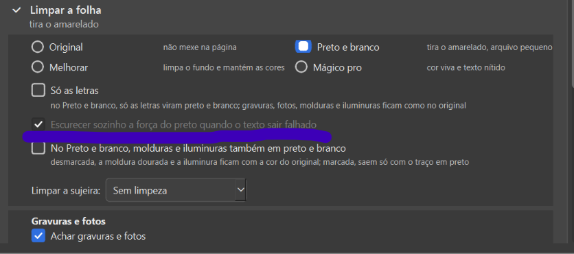

### 5.4 Folha e página misturadas — atrapalha

O livro aberto diz "360 páginas" em cima e "página 1 de 180" embaixo. Na conferência, no Dividir as miniaturas são
"FOLHAS" ("folha 1 de 180"); nas outras ferramentas viram "PÁGINAS" ("página 1 de 360"); o "Para revisar" fala sempre
em página. O rodapé conta páginas (360) enquanto o Dividir confere folhas (180): "está certo" e a barra de espaço no
Dividir não mudam "0 de 360 conferidas" (1.1).

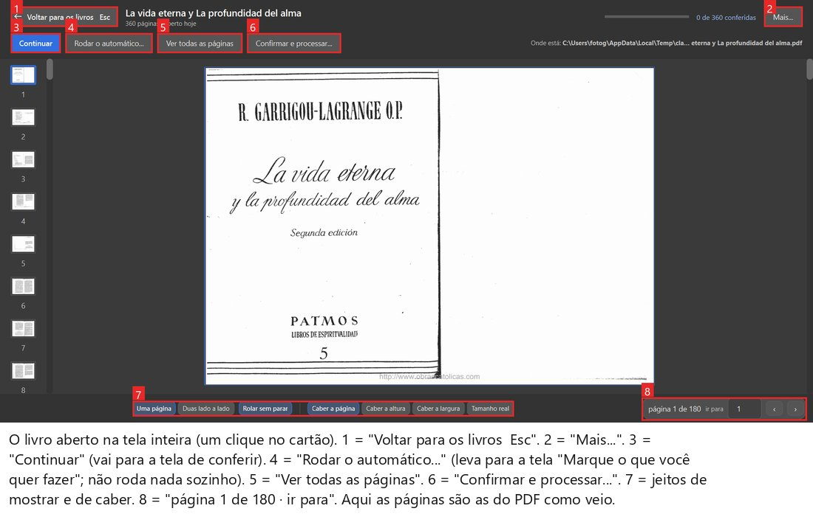

### 5.5 Três contagens de dúvidas e avisos escondidos — atrapalha

Cada lugar dá um número de dúvidas diferente. No La vida eterna: rodapé e "Para revisar" **56**, a janela "Antes de
processar" **67 páginas (69 avisos)**, o "Ver todas as páginas" do livro aberto **(0)**. Na Escola o rodapé dizia **"1
com dúvida"**, o painel 2, e no fim a janela cobrou **166 páginas**. No Righetti: alto 206, rodapé 71, fim 135 páginas
/ 225 avisos.

Detalhe (explicação dos livros): o rodapé e o "Para revisar" **não mostram os avisos de folha** ("Alinhamento
duvidoso"); só o número do alto ("N páginas para você olhar") e a janela do fim contam esses. O Kaique acha que está
tudo conferido e é surpreendido no fim.

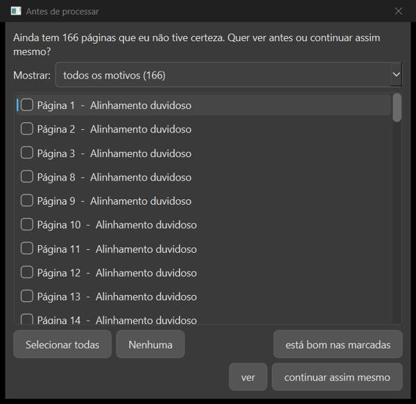

### 5.6 O número de dúvidas muda sozinho — atrapalha

Só folheando, sem resolver nada, o número de dúvidas muda: Boécio 17 → 15, ljs47 44 → 57, Marial 47 → 57, Graduale
19 → 30, Antiphon 66 → 75. Print: não há.

### 5.7 Avisos demais e avisos falsos — atrapalha

Há aviso em quase todas as páginas: de 126 a 201 páginas com dúvida (Siebmacher 128 de 134; Matemática 126 de 144;
Valadés 201 de 446). "Esta página tem cor - o preto e branco vai perder a ilustração" em 72 páginas de papel marrom
(Siebmacher) e em quase todo o livro de fotos de celular (Matemática). No Palatino 4, uma folha branca com três
avisos. "Inclinações diferentes" em folhas **sem texto** (capas, guardas). Com tanto aviso, os defeitos reais (4.1,
4.2, 4.3) passam sem aviso nenhum. Print: não há.

### 5.8 "ScanTailor", "Editor" e "contas" — atrapalha

Nomes que não dizem nada ao Kaique: "Jeito de dividir: o do ScanTailor / o do Editor", "Conta do endireitar: a do
ScanTailor", "Cortar seguindo o conteúdo (como o ScanTailor)". E o aviso "A conta do ScanTailor e a do Editor acharam
inclinações diferentes" (ou "as contas discordam") aparece em 9 das 50 páginas do Boécio e em 69 das 135 folhas do
Righetti, inclusive em folhas sem texto.

### 5.9 "Força do preto" em página Mágico pro — atrapalha

O aviso "Ficou muito escura. Tente mais fraco na força do preto" aparece em páginas Mágico pro e Melhorar, onde esse
controle não existe (no Mágico pro ele se chama "Intensidade"). O Kaique vai procurar um controle que não está ali. O
botão do mesmo aviso não faz nada (1.2). Print: não há.

### 5.10 Atalhos em inglês e a lista escondida — atrapalha

A "Ajuda" (F1) mostra só "O que dá para fazer, e por qual tecla:"; a lista fica atrás de um botão em inglês, **"Show
Details..."**. Nos menus, atalhos escritos "Ctrl+Return", "Ctrl+Left", "Ctrl+Right".

### 5.11 "Limpar a folha" que não limpa — atrapalha

"Limpar a folha" vem marcada, com o subtítulo "tira o amarelado", mas com o filtro **Original** ("não mexe na
página"): de fábrica não tira nada. A frase de baixo nem menciona a limpeza.

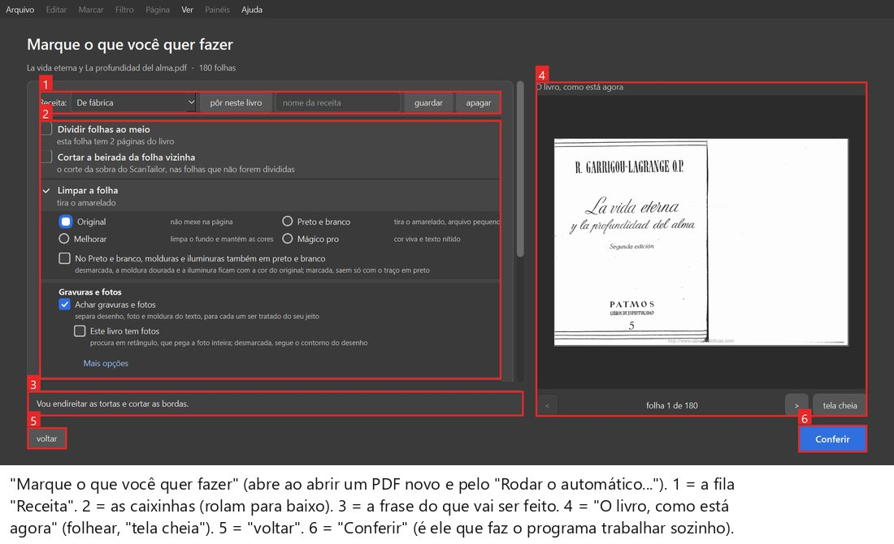

### 5.12 Dois "montar cadernos" — detalhe

A caixinha "Montar cadernos no tamanho do scan (sem A4, sem margem)" (antes) e o botão "montar para imprimir em A4 (com
margens)..." (depois) têm nomes parecidos; a "Ficou pronto!" não diz qual usar.

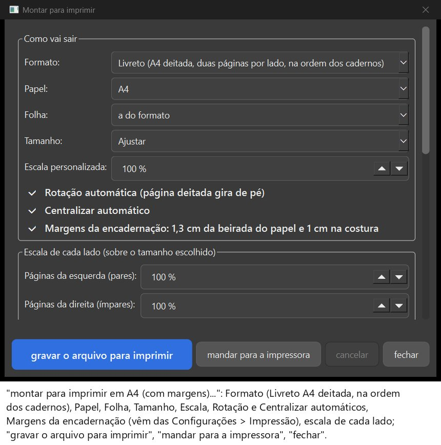

### 5.13 Duas portas para os filtros — detalhe

"Os quatro filtros" (ícone da esquerda, meia lua) e o painel "Filtro da página" (direita) têm o mesmo desenho e fazem
quase a mesma coisa.

### 5.14 Nomes da Luz cortados — detalhe

No painel, os nomes aparecem cortados: "Igual", "Suav", "Tirar o ch".

### 5.15 Nome do PDF com acento — detalhe

Nome sugerido "antiphon-trecho - mágico pro.pdf"; o mesmo "mágico pro" com acento no Pesel, ljs47, Escola e Graduale.
A regra do projeto é caminho de disco sem acento (`CLAUDE.md` §3). Print: não há.

### 5.16 Nome do livro cortado no cartão — detalhe

O nome comprido aparece cortado no cartão da tela inicial ("La vida eterna y La profu...").

---

## Onde os documentos não batem

- **Ícones do Samuel (0-4):** a sessão 0 diz que ele marcou "Dividir" e "Limpar a folha"; o mapa diz que o print dele
  só pode ser **Dividir + Endireitar** (com "Limpar" e "Cortar" desmarcadas). A própria sessão 0 já adotou a resposta
  do mapa. Ver 2.1.
- **"está certo" (0-3):** a sessão 0 e o mapa dizem que não dá resposta (no Dividir); nos livros, no Boécio p. 15 com
  aviso, ele baixou a conta. Ver 1.1.
- **Tempo do processar:** o mapa (nº 22) diz que não há tempo estimado; os livros corrigem: **há**, depois das
  primeiras páginas ("Página 110 de 120 - faltam cerca de 3 minutos"). Por isso o tempo não entrou na lista (a
  velocidade é da Fase 5). A parte do PDF grande do nº 22 está no 4.5.
- **Folha 5 do La vida eterna (0-5):** no print do Samuel a linha azul de dividir estava no meio; no mapa ela ficou
  quase na beirada esquerda, com o aviso "Não tenho certeza de onde cortar. Confira a linha."

## Fora da lista (não contados)

- **0-5, a folha 5 "jogada para cima": não é do programa.** O PDF original já tem a folha assim (conferido pela
  sessão 0 e pelo mapa).
- **Já conhecidos, só confirmados de novo pelos livros:** a mancha do verso escurece no Preto e branco (`CLAUDE.md` §9;
  muito forte no Cursus 37 e 402, também B 10 e 23, MA 166, G 1); o Boécio tem resolução baixa (§9); o endereço do site
  no pé de todas as páginas da Escola (R8: "apagar em todas as páginas um texto repetido" — ainda não existe).
- **ljs47 minimizado durante o processar:** os livros acham que não é do programa (talvez um Windows+D no PC).

## Onde estão as coisas

- Esta lista: `relatorios/testes-guiados/lista-unica-2026-10-23/lista.md` (e `.html`; o `.pdf` fica fora do git, com
  uma cópia em `D:\programas\EditorImpressao-arquivos\testes-guiados-lista-unica\`).
- Prints usados: `prints/` nesta pasta, com o nome de onde vieram (`samuel-`, `mapa-`, `livros-<livro>-`).
- Os três documentos de origem estão listados no começo.
