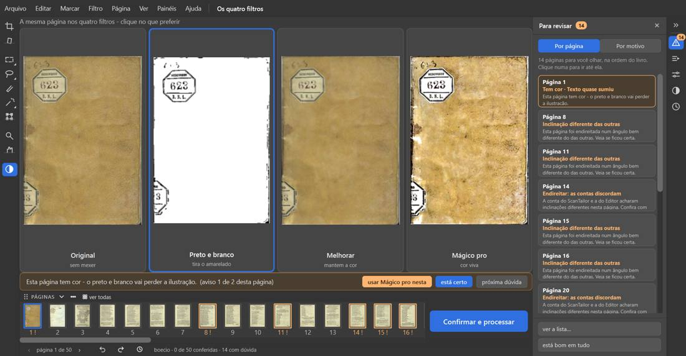
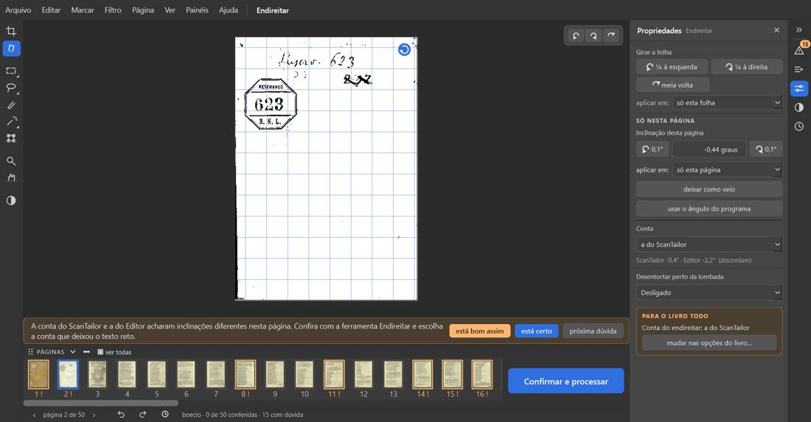

# Boécio — "Sobre a Consolação da Filosofia" (50 folhas, 4 MB)

Percurso inteiro na janela de verdade (fora da tela, pasta de dados própria), numa cópia do PDF. Programa: `fase-1`
em `1ba93cf`. Roteiro: `roteiros/percurso.py` com `roteiros/configs/boecio.json`.

**O livro:** páginas soltas (não é folha dupla), papel amarelado com a letra do verso aparecendo, um pouco torto,
capa e contracapa de pergaminho. **Caixinhas, como o Kaique pensaria:** sem "Dividir" (uma página por folha);
"Endireitar" (há páginas tortas); "Cortar as bordas" (sobra de fundo em volta); "Limpar a folha" com **Preto e
branco** (é só texto e o papel é amarelo — quer papel branco). "Achar gravuras e fotos" ficou como veio (marcada).

**Como foi:** abrir pelo "Abrir um PDF" → caixinhas → "Conferir" (1 s) → Cortar, Endireitar e "Os quatro filtros" nas
páginas 1, 2, 5, 8, 9, 10, 23 e 50 → arrastar o canto do corte e a bolinha do Endireitar, e desfazer cada um → painel
"Para revisar": páginas 1, 8 e 11, com o botão laranja de cada uma, e desfazer o primeiro → "está certo" na página 15 →
"Confirmar e processar" → "Antes de processar" (10 páginas, 11 avisos) → "continuar assim mesmo" → onde salvar →
"Processar" (**42 s**) → "Ficou pronto!" (50 páginas, 4,6 MB) → "montar para imprimir em A4" → "gravar o arquivo para
imprimir" (**20 s**: 26 páginas A4 deitadas, 13 folhas, 3 cadernos, "as 50 páginas saem na ordem certa").
**Foi até o fim.** Contagem de páginas certa (50 entraram, 50 saíram, nenhuma repetida).

## Problemas

| # | O que fiz | O que esperava | O que aconteceu | Tipo | Print | Gravidade |
|---|---|---|---|---|---|---|
| B-1 | Página 2 (com o aviso "Endireitar: as contas discordam"): girei pela bolinha azul e cliquei no desfazer de baixo | A página volta como estava, **com o aviso** | O ângulo voltou, mas o **aviso sumiu** e não voltou: a miniatura 2 perdeu o "!" e as dúvidas foram de 15 para 14 sem eu ter resolvido nada | erro |  *A miniatura 2 sem o "!" depois do desfazer* | atrapalha |
| B-2 | Processei com o aviso "Parece em branco" da página 49 ainda aberto ("continuar assim mesmo") | Folha de guarda branca sai branca no Preto e branco | Saiu **cinza, toda manchada** (a textura do papel virou desenho); quem imprime gasta tinta numa página feia | erro |  *Página 49: à esquerda o original (branca), à direita como saiu* | atrapalha |
| B-3 | Abri o livro e só passei pelas ferramentas, sem resolver nada | O número de dúvidas fica parado até eu resolver alguma | Abriu com **17** no rodapé (e **19** no alto, "19 páginas para você olhar"); depois de só olhar páginas já era **15**. O número muda sozinho enquanto se folheia. (Os números diferentes entre si são o ponto 9 do mapa; o **mudar sozinho** é novo) | confuso | — (no `log.txt` bruto) | atrapalha |
| B-4 | Página 1 (capa): cliquei "usar Mágico pro nesta" e depois desfiz | A página volta com o mesmo aviso de antes | Voltou com **um aviso a mais** que não existia: "Texto quase sumiu" ("aviso 1 de 2 desta página") | confuso |  *Faixa com "aviso 1 de 2" e o painel com "Tem cor · Texto quase sumiu"* | detalhe |
| B-5 | Olhei os avisos do livro | Avisos só onde há problema, em palavras do Kaique | **9 das 50 páginas** com "A conta do ScanTailor e a do Editor acharam inclinações diferentes", inclusive páginas **sem texto** (capa, contracapa, guarda com o carimbo: ScanTailor -0,4°, Editor -2,2°). Ele não sabe o que é "conta", "ScanTailor" nem "Editor" (ponto 20 do mapa, de novo, agora dentro de um aviso) | confuso |  *Página 2: o aviso das "contas" numa folha só com carimbo* | atrapalha |
| B-6 | Página 2 pronta | Beirada limpa | Ficou um **risco preto fino** em toda a beirada esquerda (a sombra da lombada não foi cortada) | erro |  *Página 2: original e pronta* | detalhe |

**A conferir (não conto como problema):** nas três vezes em que fiz o percurso inteiro, o clique do Windows em
"Confirmar e processar" **não abriu nada** em 30 s (o botão estava à vista e ligado, sem nada por cima). Num
percurso curto (abrir, conferir e clicar logo) o mesmo clique abriu a janela na hora. Pode ser do meu jeito de
clicar; o clique pelo próprio Qt abriu. Vale o Samuel reparar se o botão às vezes "não pega".

**Já conhecido, só confirmado:** pontinhos da letra do verso ao lado do texto no Preto e branco (páginas 10 e 23;
`CLAUDE.md` §9, mancha do verso); scan de resolução baixa (§9: Boécio); "Antes de processar" diz 10 páginas / 11
avisos enquanto o rodapé dizia 9 (ponto 9 do mapa).

**O que funcionou bem:** abrir, conferir, botão laranja de cada aviso (a dúvida some e a página fica conferida), "está
certo" com aviso (conta baixa), desfazer do corte (voltou ao corte do programa), processar rápido, montar cadernos com
as instruções de dobra certas.
