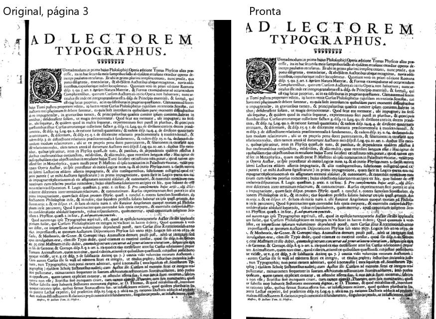
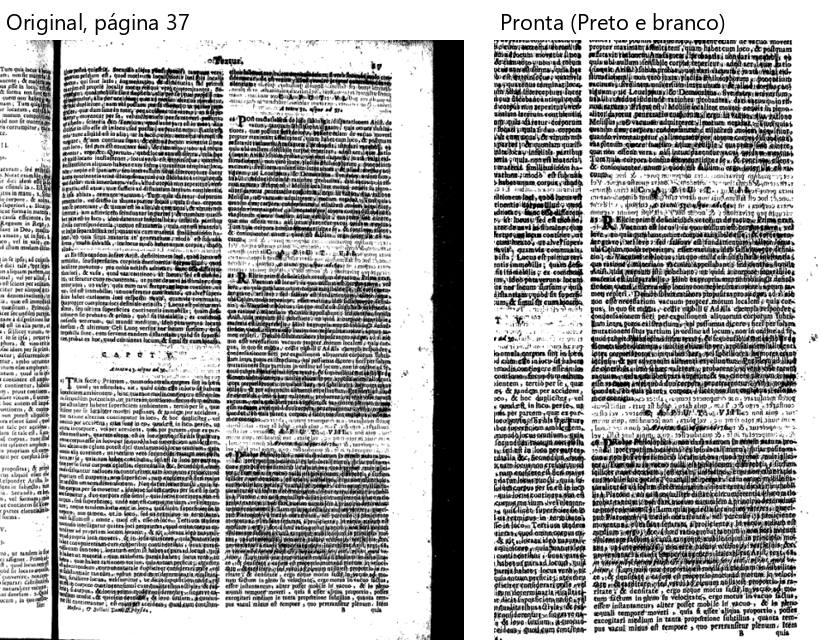

# Cursus — "Cursus philosophicus, Tomo 2" (402 folhas, 84 MB)

Percurso inteiro na janela de verdade, numa cópia do PDF (livro inteiro). `roteiros/configs/cursus.json`.

**O livro:** uma página por folha, texto miúdo em duas colunas, já quase preto e branco, com a **beirada da página
vizinha** e a sombra da lombada à vista, e a letra do verso aparecendo forte. **Caixinhas:** "Cortar a beirada da folha
vizinha" (a vizinha aparece), "Achar a página dentro da borda preta do scanner" (sombra preta da lombada),
"Endireitar", "Cortar as bordas", "Limpar a folha" com **Preto e branco**.

**Como foi:** "Conferir" (**2 min 52 s**) → Cortar, Endireitar e filtros nas páginas 1, 2, 3, 37, 183 e 402 → arrastar e
desfazer → "Para revisar" ("usar o corte alargado" e desfazer, mais dois) → "está certo" → processar (**17 min 4 s**) →
402 páginas, 113 MB → montar em A4 (2 min 17 s, 202 páginas, 21 cadernos). **Foi até o fim**; 402 entraram, 402 saíram.

## Problemas

| # | O que fiz | O que esperava | O que aconteceu | Tipo | Print | Gravidade |
|---|---|---|---|---|---|---|
| C-1 | Página 3 pronta | O texto inteiro | O corte da esquerda **comeu a primeira letra ou duas** das linhas do bloco de baixo ("ex ingenuitate" virou "o ingenuitate"), e ficou um canto cinza manchado embaixo à direita | erro |  *Página 3: original e pronta* | atrapalha |
| C-2 | Abri a conferência e fui processar | Um número de dúvidas | Rodapé **20**, alto **41**, "Antes de processar" **52 páginas / 54 avisos** (ponto 9 do mapa; ver E-1 da Escola) | confuso | — | atrapalha |
| C-3 | Processei | — | **17 min** para 402 páginas no Preto e branco, sem tempo estimado (ponto 22 do mapa) | confuso | — | detalhe |

**A conferir (de novo):** o clique do Windows em "Confirmar e processar" não abriu nada em 30 s.

**Já conhecido, aqui muito forte:** a letra do verso virou **chuvisco preto** por cima do texto na página 37 (e na 402):
partes ficaram difíceis de ler (`CLAUDE.md` §9, mancha do verso: "o Preto e branco ... escurece").

**O que funcionou bem:** a folha de rosto (página 1) saiu limpa, com a gravura do brasão boa; a beirada da vizinha e a
sombra da lombada foram tiradas nas páginas que olhei; o livro inteiro processou e montou 21 cadernos sem travar.
