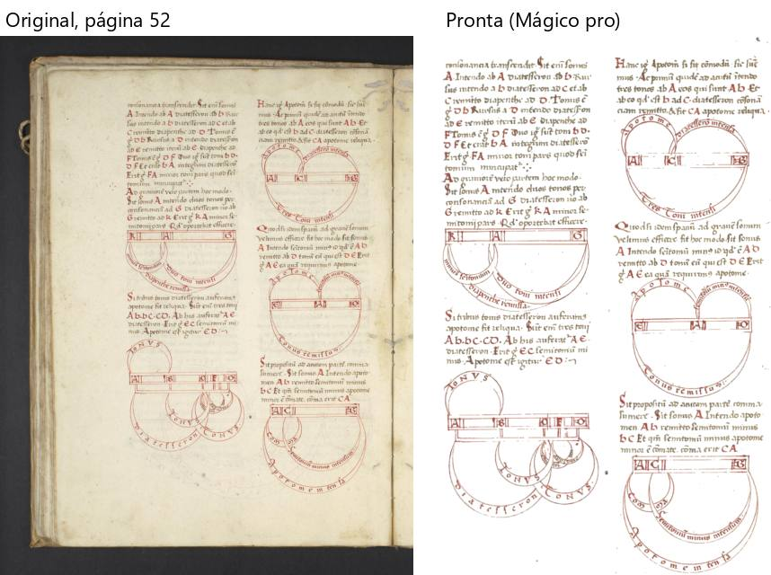

# ljs47 — manuscrito de música (113 folhas, 37 MB)

Percurso na janela de verdade, numa cópia do PDF. `roteiros/configs/ljs47.json`.

**O livro:** manuscrito medieval em pergaminho, tinta marrom com **vermelho e azul** (iniciais, diagramas de música em
vermelho), fotografado sobre fundo preto com a beirada do livro à vista. **Caixinhas:** "Achar a página dentro da borda
preta do scanner", "Endireitar", "Cortar as bordas", "Limpar a folha" com **Mágico pro** (o vermelho e o azul têm de
ficar), "Achar gravuras e fotos" (diagramas).

**Como foi:** "Conferir" (28 s) → Cortar, Endireitar e filtros nas páginas 1, 3–5, 11, 32, 52, 93 e 113 → arrastar e
desfazer → Retângulo no diagrama da página 52 → "Para revisar" ("usar o corte alargado" e desfazer, "está bom assim")
→ "está certo" → processar (**18 min 6 s**) → 113 páginas, **707 MB**. **Montar em A4 não foi feito:** durante o
processar a janela de teste apareceu **minimizada** (não sei por quê — talvez um Windows+D no PC; não parece do
programa) e o meu roteiro parou ao tirar o print da "Ficou pronto!". O PDF ficou completo (113 de 113). Montar em A4
funcionou nos outros sete livros.

## Problemas

| # | O que fiz | O que esperava | O que aconteceu | Tipo | Print | Gravidade |
|---|---|---|---|---|---|---|
| L-1 | Olhei o PDF pronto | Algo perto do original (37 MB) | **707 MB** para 113 páginas (19 vezes maior). Difícil de guardar, copiar ou mandar para a gráfica | erro | — | atrapalha |
| L-3 | Comparei o tamanho das páginas prontas | Páginas do mesmo tamanho, como no livro | Cada página saiu de um tamanho (corte "até o que está impresso"): a 2 virou uma **tira deitada** de 21 × 11 cm só com a etiqueta da biblioteca, a 11 tem 25 × 34 cm, a 52 tem 22 × 36 cm. Montando em A4 cada uma vai ser diminuída de um jeito, e a letra muda de tamanho de página para página. Nada avisa; a caixinha "Margens iguais" fica escondida lá embaixo | confuso |  *Página 52: o corte vai até a tinta, sem margem nenhuma* | atrapalha |
| L-4 | Passei pelas páginas sem resolver nada | Dúvidas paradas | **44 → 57** dúvidas só de folhear (B-3 do Boécio de novo, agora subindo) | confuso | — | atrapalha |
| L-5 | Página 52: Retângulo e desfazer | A marcação some | Áreas 10 → 11 → **11** (P-2 do Palatino de novo) | erro | — | atrapalha |

**Tempo (não conto como problema; velocidade é da Fase 5):** 18 min para 113 páginas no Mágico pro (o Palatino, 134 páginas no Preto e branco, levou 3 min 31 s). A tela mostra "faltam cerca de N minutos" depois das primeiras páginas.

**A conferir (de novo):** o clique do Windows em "Confirmar e processar" não abriu nada em 30 s.

**O que funcionou bem:** o vermelho e o azul ficaram vivos e o pergaminho ficou branco (R6); os diagramas das páginas 52,
62, 93 e 103 saíram inteiros e nítidos; o fundo preto foi tirado.
