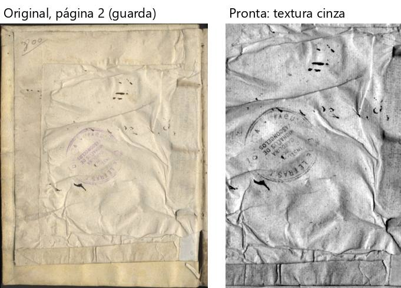

# Marial — "Marial de sermoens", Frei Balthasar Paez (907 folhas, 205 MB) — **trecho: folhas 1 a 200**

O livro inteiro passaria muito de 20 min no processar; fiz o percurso inteiro num **trecho com as folhas 1 a 200**
(cópia nova só com elas; inclui a página-gabarito 7 e a gravura do anjo da folha 166). `roteiros/configs/marial.json`.

**O livro:** uma página por folha, duas colunas, papel amarelado com manchas, notas na margem, a beirada da página
vizinha e a sombra da lombada à vista, gravuras pequenas. **Caixinhas:** "Cortar a beirada da folha vizinha", "Achar a
página dentro da borda preta do scanner", "Endireitar", "Cortar as bordas", "Limpar a folha" com **Preto e branco**,
"Achar gravuras e fotos".

**Como foi:** "Conferir" (32 s) → Cortar, Endireitar e filtros nas páginas 1, 2, 6, 7, 83, 166 e 200 → arrastar e
desfazer → Retângulo na gravura da 166 → "Para revisar" ("está bom assim" e desfazer, "usar o corte alargado" ×2) →
"está certo" → processar (**5 min 38 s**) → 200 páginas, 21 MB → montar em A4 (53 s, 100 páginas, 10 cadernos). **Foi
até o fim**; 200 entraram, 200 saíram.

## Problemas

| # | O que fiz | O que esperava | O que aconteceu | Tipo | Print | Gravidade |
|---|---|---|---|---|---|---|
| MA-1 | Página 2 (guarda de papel enrugado, só com um carimbo) no Preto e branco | Folha branca com o carimbo | Saiu **cinza, com todas as rugas do papel desenhadas** (B-2 do Boécio de novo) | erro |  *Página 2: original e pronta* | atrapalha |
| MA-2 | Folheei sem resolver nada | Dúvidas paradas | **47 → 57** dúvidas só de folhear (B-3 de novo) | confuso | — | atrapalha |
| MA-3 | Página 166: Retângulo e desfazer | A marcação some | Áreas 23 → 24 → **24** (P-2 de novo) | erro | — | atrapalha |

**A conferir (de novo):** o clique do Windows em "Confirmar e processar" não abriu nada em 30 s.

**Já conhecido:** a letra do verso vira pontinhos embaixo do texto da 166 (`CLAUDE.md` §9).

**O que funcionou bem:** a página 7 (gabarito) saiu branca e nítida; as notas da margem ficaram inteiras (23, 83, 180);
o anjo da 166 saiu bom; a beirada da vizinha e a sombra da lombada foram tiradas.
