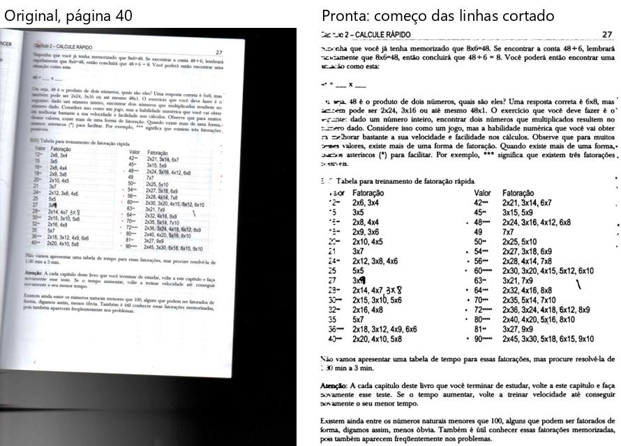

# Matemática — "Matemática para vencer" (144 folhas, 27 MB)

Percurso inteiro na janela de verdade, numa cópia do PDF. `roteiros/configs/matematica.json`.

**O livro:** livro moderno **fotografado com celular**: páginas tortas e em perspectiva, a lombada fazendo sombra e a
beirada do livro e da mesa em preto em volta; capa colorida. **Caixinhas:** "Achar a página dentro da borda preta do
scanner" (fundo preto em volta), "Endireitar" (tudo torto), "Cortar as bordas", "Limpar a folha" com **Preto e branco**
(texto moderno preto; quer papel branco e arquivo leve).

**Como foi:** "Conferir" (19 s) → Cortar, Endireitar e filtros nas páginas 1, 2, 4, 6, 14, 40, 92 e 144 → arrastar e
desfazer → "Para revisar" ("usar o corte alargado" e desfazer, "está bom assim" ×2) → "está certo" → processar (**5 min
58 s**) → 144 páginas, 9 MB → montar em A4 (38 s, 72 páginas, 8 cadernos). **Foi até o fim**; 144 entraram, 144 saíram.

## Problemas

| # | O que fiz | O que esperava | O que aconteceu | Tipo | Print | Gravidade |
|---|---|---|---|---|---|---|
| M-1 | Processei a página 66 (números das questões com um sombreado cinza atrás, perto da lombada) | Os números das questões legíveis | Cada número de questão virou um **borrão preto**: "(CM)", "Q36)" etc. sumiram debaixo de manchas pretas; o mesmo na 92 | erro |  *Página 66: original e pronta* | atrapalha |
| M-2 | Processei a página 40 (o começo das linhas fica perto da lombada, mais apagado) | O texto inteiro | As **primeiras letras de cada linha sumiram** ("Suponha que" virou "~cha que", "Capítulo" virou "Cap ~o"); o mesmo começo de linha comido na 118 | erro |  *Página 40: original e pronta* | atrapalha |
| M-3 | Abri a conferência | Avisos que ajudam | **126 de 144** páginas com dúvida (o alto dizia **159**); "Esta página tem cor - o preto e branco vai perder a ilustração" em quase todas, num livro preto no branco (o "cor" é a sombra amarelada da foto); "Antes de processar": **131 páginas / 249 avisos**. Com tanto aviso, o "Para revisar" não ajuda a achar os problemas de verdade (M-1, M-2 não tinham aviso de "texto sumiu") | confuso | — | atrapalha |
| M-4 | Passei pelas páginas no Cortar (3 s em cada) | Ver a página | Em várias apareceu só **"Preparando a prévia..."** (ponto 21 do mapa); livro de fotos grandes demora mais | confuso | — | detalhe |

**A conferir (de novo):** o clique do Windows em "Confirmar e processar" não abriu nada em 30 s.

**O que funcionou bem:** o fundo preto da mesa e a beirada do livro foram tirados; as páginas tortas ficaram retas
(14, 27, 40, 92, 144); tabelas e círculos saíram limpos; arquivo leve.
