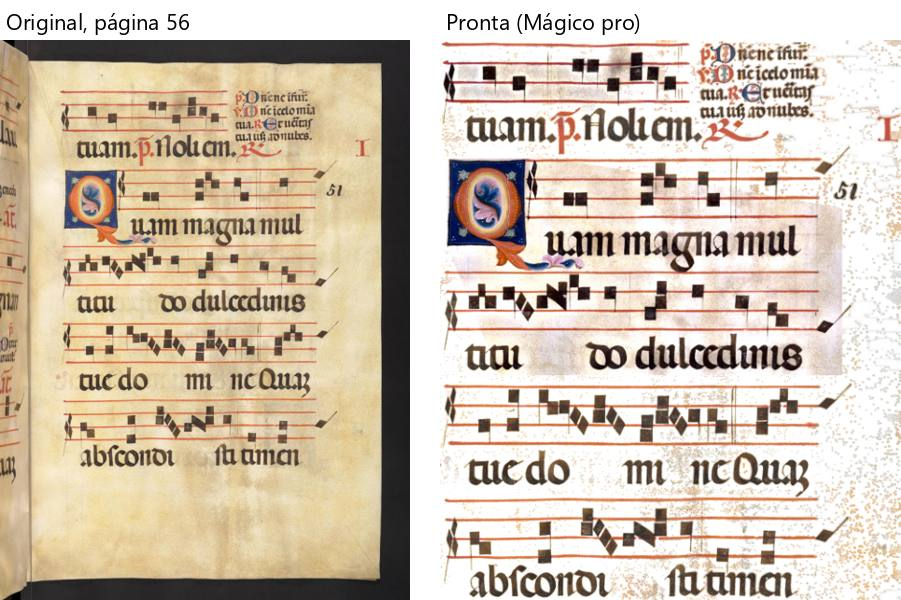
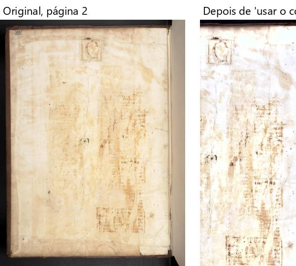
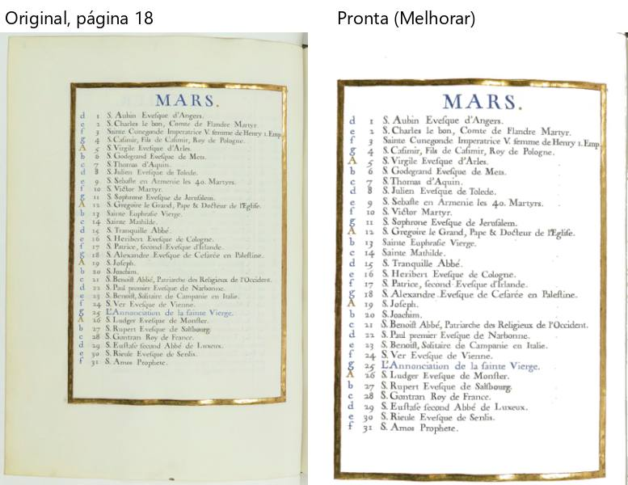
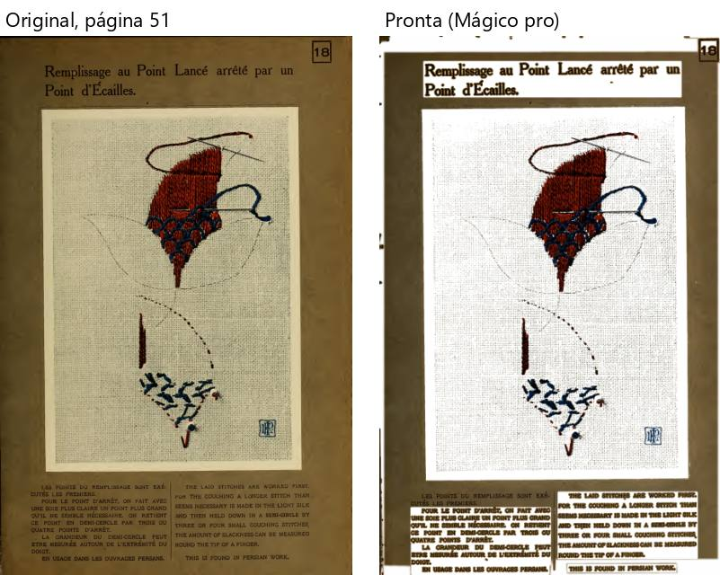

# Testes com os livros — resumo (23/10/2026)

Pedido do Samuel: "pegar os livros de testes e ir testando um por um, passando dentro do programa realmente".
Feito pelo verificador com a **janela de verdade** (`fase-1` em `1ba93cf`), fora da tela do Samuel, com uma pasta de
dados própria e uma **cópia nova** de cada PDF. Em cada livro, o caminho inteiro do Kaique: abrir pelo "Abrir um PDF" →
escolher as caixinhas que fazem sentido para aquele livro → conferir (Dividir, Cortar, Endireitar, filtros, Retângulo
quando há gravura, painel "Para revisar", botões laranja da faixa, "está certo", arrastar, desfazer) → "Confirmar e
processar" → abrir o PDF pronto e olhar páginas → "montar para imprimir em A4" (sem imprimir). Nenhuma linha do programa
mudou; nada foi consertado.

## Os 14 livros

| Livro | Folhas usadas | Filtro | Foi até o fim? | Processar | PDF pronto | Problemas |
|---|---|---|---|---|---|---|
| [Boécio](boecio.md) | 50 (todas) | Preto e branco | sim | 42 s | 4,6 MB | 6 |
| [Palatino](palatino.md) | 134 (todas) | Preto e branco | sim | 3 min 31 s | 24 MB | 4 |
| [Righetti](righetti.md) | 135 (todas) | Preto e branco | **sim, mas não dividiu** (trava) | 4 min 16 s | 22 MB | 8 |
| [Siebmacher](siebmacher.md) | 134 (todas) | Preto e branco | sim | 3 min 39 s | 7 MB | 5 |
| [Pesel](pesel.md) | 92 (todas) | Mágico pro | sim | 6 min 50 s | 208 MB | 5 |
| [Matemática](matematica.md) | 144 (todas) | Preto e branco | sim | 5 min 58 s | 9 MB | 4 |
| [ljs47](ljs47.md) | 113 (todas) | Mágico pro | processou; montar não feito (\*) | 18 min | 707 MB | 4 |
| [Valadés](valades.md) | 446 (todas) | Preto e branco | sim | 13 min 47 s | 47 MB | 4 |
| [Escola de Jesus](escola.md) | 199 (todas) | Mágico pro | sim | 11 min 7 s | 907 MB | 4 |
| [Cursus](cursus.md) | 402 (todas) | Preto e branco | sim | 17 min | 113 MB | 2 |
| [Marial](marial.md) | **1 a 200** de 907 | Preto e branco | sim | 5 min 38 s | 21 MB | 3 |
| [Livro de Horas](horas.md) | **1 a 100** de 191 | Melhorar | sim | 20 min 27 s | 1.186 MB | 5 |
| [Graduale](graduale.md) | **200 a 300** de 750 | Mágico pro | sim | 19 min 30 s | 1.040 MB | 4 |
| [Antiphon_25](antiphon.md) | **1 a 120** de 305 | Mágico pro | sim | 33 min 29 s | 1.590 MB | 6 |

**14 livros passaram pelo caminho inteiro; 13 chegaram ao fim, com o PDF pronto e os cadernos montados.** O Righetti
foi até o fim mas o livro saiu sem dividir (problema 1). (\*) No ljs47 a janela de teste apareceu minimizada durante o
processar (não sei por quê, talvez um Windows+D no PC; não parece do programa) e o meu roteiro parou antes de montar; o
PDF saiu completo. Os quatro livros grandes foram feitos num trecho, como o pedido permitia. Em todos, **nenhuma página
faltou nem repetiu** (contagem de entrada = contagem de saída) e **o programa nunca fechou nem travou**.

**Contagem por tipo (linhas das tabelas dos 14 livros): 64 — 41 erro, 22 confuso, 1 falta.** Muitas linhas são o mesmo
defeito em livros diferentes; juntando, são **18 problemas distintos**, abaixo do mais grave ao menos grave.

## Os problemas, do mais grave ao menos grave

### Trava o trabalho

**1. Livro escaneado de lado não divide (Righetti R-1 a R-4; erro + falta).** A tela das caixinhas não tem como girar
o livro; o "Conferir" não divide as folhas de lado (a frase prometia "135 folhas em 270 páginas", saíram 135); girando
depois na conferência, "dividir esta" fica cinza; voltar às opções e "Conferir" de novo também não divide. Não achei
caminho na janela. 

### Atrapalha (o livro sai com defeito ou o Kaique se perde)

**2. O desfazer não tira a marcação do Retângulo — e ela vai para o PDF (11 livros: P-2, R-6, S-5, PE-5, L-5, V-5,
E-4, MA-3, H-6, G-4, A-1; erro).** Em todos os livros em que marquei, as áreas foram N → N+1 → **N+1** depois do
desfazer, sem aviso. No Antiphon a marca que ficou saiu no PDF como um **retângulo cinza** atrás do texto; no Palatino
74, um bloco preto no mesmo lugar. 

**3. PDF pronto gigante com Mágico pro e Melhorar (Pesel, ljs47, Escola, Horas, Graduale, Antiphon; erro).** 208 MB,
707 MB, 907 MB, 1.186 MB (100 páginas), 1.040 MB (101 páginas), 1.590 MB (120 páginas) — de 15 a 20 vezes o original.
No Preto e branco ficam leves.

**4. Avisos escondidos e números que não batem (E-1, H-5, C-2, R-7 e outros; erro/confuso).** O rodapé e o painel "Para
revisar" não mostram os avisos de **folha** ("Alinhamento duvidoso"): na Escola o rodapé dizia **"1 com dúvida"**, o
painel 2, e no fim a janela "Antes de processar" cobrou **166 páginas**. É a explicação do ponto 9 do mapa (o número do
alto conta os avisos de folha; o rodapé e o painel, não). 

**5. Gravura estragada no Preto e branco, mesmo com "Achar gravuras" ligada (Palatino 74, Valadés 41, Siebmacher 110;
erro).** O fundo escuro da gravura em madeira virou chuvisco com manchas pretas; o traço fino da gravura em metal virou
áreas pretas chapadas. 

**6. Texto comido (Matemática 66 e 40, Cursus 3; erro).** O sombreado atrás dos números das questões virou borrão
preto; o começo das linhas perto da lombada sumiu; o corte comeu a primeira letra das linhas. 

**7. Folha branca sai cinza e manchada no Preto e branco (Boécio 49, Marial 2, Siebmacher 74 e 86; erro).** A textura
e as rugas do papel viram desenho; na Siebmacher, com faixa preta grossa da lombada. 

**8. "usar o corte alargado" deixou a página menor (Antiphon 2; erro).** A guarda virou uma tira estreita.

**9. Corte errado (Horas 18; erro).** Tirou o lado esquerdo da moldura dourada e deixou sobra do outro lado.

**10. O botão "usar mais fraco" não faz nada, e o aviso fala de "força do preto" em página Mágico pro/Melhorar (E-2,
H-3, PE-4; erro/confuso).** O aviso "Ficou muito escura" fica, só o botão some; aparece em quase toda página iluminada.

**11. O desfazer não traz o aviso de volta (Boécio B-1 no Endireitar, Pesel PE-3 no "usar mais escuro"; erro).** A
página volta, a dúvida some da lista.

**12. Pranchas do Pesel com retângulos brancos por cima do cartão (PE-1; erro).** 

**13. Avisos demais e avisos falsos (B-5, P-4, S-4, M-3, R-8, V-4, A-6; confuso).** "A conta do ScanTailor e a do
Editor acharam inclinações diferentes" em folhas **sem texto** (capas, guardas) e em metade das folhas de alguns livros;
"Esta página tem cor" em 72 páginas de papel marrom (Siebmacher) e em quase todo o livro de fotos de celular
(Matemática); de 126 a 201 páginas com dúvida. Com tanto aviso, os defeitos reais (5, 6, 7) passam sem aviso nenhum.

**14. O número de dúvidas muda sozinho ao folhear (B-3, L-4, MA-2, G-5, A-6; confuso).** Sem resolver nada: 17 → 15,
44 → 57, 47 → 57, 19 → 30, 66 → 75.

**15. O desfazer desfaz o que o Kaique não está vendo (Righetti R-5; confuso).** Arrastar a linha numa folha que não
divide não faz nada; o desfazer seguinte desfez o giro das 135 folhas, e o PDF saiu todo de lado.

**16. Montar em A4 um livro deitado vira as páginas de lado, com mais de 120 linhas iguais de aviso (Siebmacher S-3;
confuso).** 

**17. Corte "até o que está impresso" deixa cada página de um tamanho, sem margem (ljs47 L-3, Graduale G-3; confuso).**
A letra muda de tamanho de página para página no A4.

### Detalhe

**18. Pequenos (erro/confuso):** nome do PDF sugerido com acento ("mágico pro"; A-4; `CLAUDE.md` §3); risco preto na
beirada (B-6); mancha pequena vira ponto preto (V-2); pontinhos laranja na margem (A-5); um aviso a mais depois de
desfazer (B-4); "Preparando a prévia..." demorado no livro de fotos (M-4); no Palatino, o retângulo marcado some dentro
do salmão e só o número muda (P-3).

## A conferir (não contei como problema)

**O clique do Windows em "Confirmar e processar" não abriu nada em 30 s em todos os 14 livros**, com o botão à vista,
ligado e sem nada por cima; o clique pelo próprio Qt no mesmo botão abriu na hora. Num percurso curto (abrir, conferir e
clicar logo) o mesmo clique do Windows funcionou, três vezes. Pode ser do meu jeito de pilotar a janela, ou o botão "não
pega" depois de muito uso da tela. Vale o Samuel reparar se o botão às vezes precisa de um segundo clique.

## Correção ao mapa

O mapa (ponto 22) diz que o processar não tem tempo estimado. **Tem:** depois das primeiras páginas a tela mostra
"Página 110 de 120 - faltam cerca de 3 minutos". Por isso não contei o tempo como problema; os tempos estão em cada
livro (velocidade é da Fase 5).

## Já conhecido, só confirmado (não contei)

Mancha do verso escurecida no Preto e branco (`CLAUDE.md` §9; muito forte no Cursus 37); Boécio de resolução baixa
(§9); texto repetido do site no pé de todas as páginas da Escola (R8, ainda não existe); três números de dúvidas (ponto 9
do mapa — o item 4 acima explica de onde vem).

## O que funcionou bem

Nenhum livro fechou o programa; contagem de páginas sempre certa; cadernos montados com instruções de dobra certas;
papel branco e texto limpo no Preto e branco em Palatino, Valadés, Marial, Cursus (fora da mancha do verso); **cores
fiéis e papel branco** no Livro de Horas, Graduale, Antiphon, ljs47 e Escola (R6); fundo preto, página vizinha e sombra
da lombada tirados; "Deixar em branco" e os botões de corte funcionando.

## Onde estão as coisas

- Um relatório por livro nesta pasta (`<livro>.md`), com uma tabela por problema e os prints.
- Prints recortados (no git): `prints/<livro>/`. Prints inteiros, o registro de cada clique (`log.txt`), os PDFs prontos
  e os arquivos para imprimir (fora do git): `D:\programas\EditorImpressao-arquivos\testes-livros-saida\<livro>\`.
- Roteiros: `roteiros/percurso.py` (o caminho inteiro), `roteiros/configs/` (as caixinhas de cada livro),
  `roteiros/contorno_righetti.py`, `roteiros/base.py` (agora com todas as janelas sempre fora da tela).
- **Aviso:** nas primeiras rodadas do Boécio (17:48–18:11) a janela "Antes de processar" apareceu na tela do Samuel
  (ver `ONDE-PAREI.md`); corrigido no roteiro e testado.
