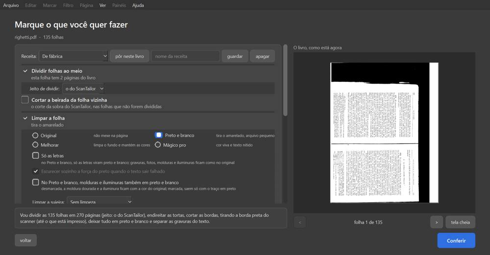
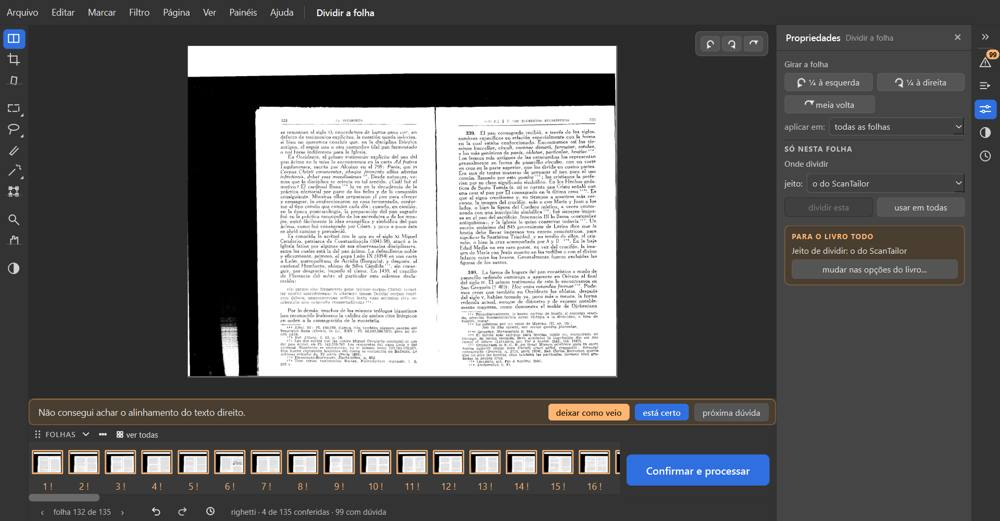

# Righetti — "Historia de la Liturgia" II-2 (135 folhas, 11 MB)

Percurso inteiro na janela de verdade, numa cópia do PDF. `roteiros/configs/righetti.json` e, para o contorno,
`roteiros/contorno_righetti.py`.

**O livro:** cada folha do PDF é o livro **aberto (duas páginas)** e **escaneado de lado** (o texto corre de cima para
baixo), com **borda preta** grande do scanner, já em preto e branco, e duas gravuras (folhas 50 e 62).
**Caixinhas, como o Kaique pensaria:** "Dividir folhas ao meio" (folha dupla), "Achar a página dentro da borda preta
do scanner" (borda preta), "Endireitar", "Cortar as bordas", "Limpar a folha" com Preto e branco. E, já na
conferência, **girar ¼ à esquerda em todas as folhas** (no bloco "Girar a folha", "aplicar em: todas as folhas"),
porque o livro está de lado e a tela das caixinhas não tem como girar.

**Como foi:** "Conferir" (44 s) → girar todas (na hora, as 135 ficaram de pé) → Dividir, Cortar, Endireitar e filtros
nas folhas 1, 8, 11, 13, 20, 99, 100, 123, 124 e 135 → arrastar a linha de dividir, o canto do corte, a bolinha →
Retângulo na folha 99 → "Para revisar" com "usar o corte alargado" (três páginas) → processar (**4 min 16 s**) → 135
páginas, 22 MB → montar em A4 (45 s, 68 páginas, 7 cadernos). **Foi até o fim, mas o livro não ficou como precisa:
saiu uma página por folha, com as duas páginas do livro juntas.**

## Problemas

| # | O que fiz | O que esperava | O que aconteceu | Tipo | Print | Gravidade |
|---|---|---|---|---|---|---|
| R-1 | Marquei "Dividir folhas ao meio" e cliquei "Conferir" | As 135 folhas viram 270 páginas, como a frase de baixo prometeu ("Vou dividir as 135 folhas em 270 páginas") | Saíram **135 páginas**: nenhuma folha foi dividida (o livro está de lado, e a conta de dividir não acha a lombada) | erro |  *A frase promete 270 páginas; à direita, a folha de lado* | **trava o trabalho** |
| R-2 | Girei todas as folhas de pé na conferência e fui ao Dividir | Agora sim, a linha azul no meio e "dividir esta" | Nenhuma linha azul, **"dividir esta" cinza** ("esta folha entrou como uma página só... aqui não dá para dividi-la") — em todas as 135 | erro |  *Folha 1 já de pé, as duas páginas à vista, e "dividir esta" apagado* | **trava o trabalho** |
| R-3 | Contorno: continuar o trabalho, girar todas de novo, Arquivo > "Voltar para as opções" e "Conferir" outra vez (72 s) | Com as folhas já de pé, o programa divide | **Continuou com 135 páginas**, giro mantido, nada dividido. Não achei caminho na janela para dividir este livro | erro |  *Depois do "Conferir" de novo: ainda uma página por folha* | **trava o trabalho** |
| R-4 | Procurei, na tela "Marque o que você quer fazer", como pôr o livro de pé antes de "Conferir" | Um "girar" junto do "O livro, como está agora" | **Não existe.** Só dá para girar depois do "Conferir", e aí já é tarde para dividir (R-2) | falta |  | **trava o trabalho** |
| R-5 | Na folha 99 arrastei a linha de dividir (não mexeu: a folha não é dividida) e cliquei no desfazer de baixo, achando que desfazia o arrasto | Nada muda (o arrasto não fez nada) | O desfazer desfez **o giro das 135 folhas**, que era a última coisa feita; nada na tela avisa, e o PDF saiu **todo de lado**. Faz o que promete (desfaz a última ação), mas para o Kaique é uma armadilha: perde um trabalho grande sem ver | confuso | — (`log.txt`: corte 0,5 → 0,5; giro 270 → 0) | atrapalha |
| R-6 | Folha 99: Retângulo e desfazer | A marcação some | Áreas 20 → 21 → **21** (P-2 do Palatino de novo) | erro | — | atrapalha |
| R-7 | Abri a conferência | Um número de dúvidas | Alto: **206** "páginas para você olhar"; rodapé **71**; "Antes de processar" **135 páginas / 225 avisos**. Todas as folhas com "Não consegui achar o alinhamento do texto direito" e o botão "deixar como veio" (ponto 9 do mapa, com números ainda mais distantes) | confuso |  *Todas as miniaturas com "!"* | atrapalha |
| R-8 | Olhei os avisos | — | 69 de 135 folhas com "as contas do ScanTailor e do Editor discordam" (B-5 do Boécio de novo) | confuso | — | atrapalha |

**A conferir (de novo):** o clique do Windows em "Confirmar e processar" não abriu nada em 30 s.

**O que funcionou:** a borda preta do scanner foi tirada (até o papel); a gravura da folha 50 saiu legível; o "usar o
corte alargado" tirou a dúvida e o desfazer dele a trouxe de volta; contagem certa para o que o programa fez (135).
