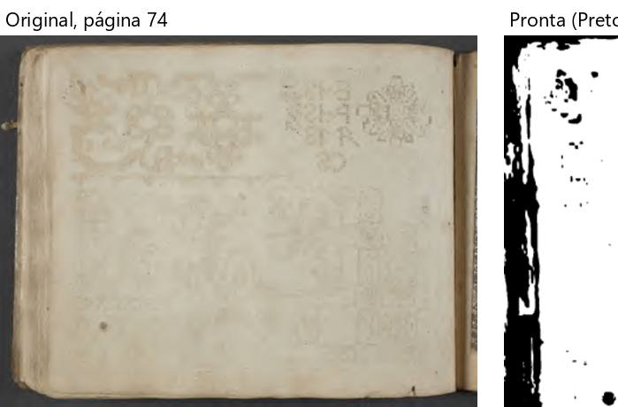
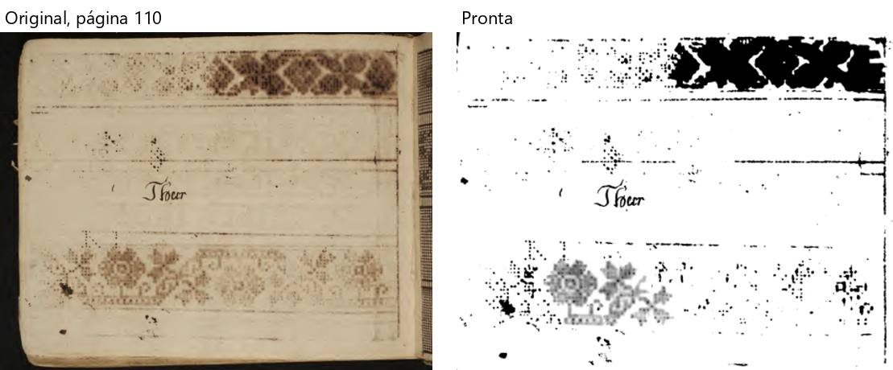

# Siebmacher — "Schön Neues Modell Buch" (134 folhas, 11 MB)

Percurso inteiro na janela de verdade, numa cópia do PDF. `roteiros/configs/siebmacher.json`.

**O livro:** livro **deitado** (mais largo que alto), uma página por folha, fotografado sobre fundo escuro (beirada do
livro e da mesa à vista), riscos de bordado em xadrez (gravuras), páginas quase brancas com o decalque marrom de
riscos, páginas escritas à mão. **Caixinhas:** sem "Dividir"; "Achar a página dentro da borda preta do scanner"
(fundo escuro em volta); "Endireitar"; "Cortar as bordas"; "Limpar a folha" com **Preto e branco** (os riscos são preto
no branco); "Achar gravuras e fotos". Ao abrir, "Este livro tem fundo separado. Quer tirar o fundo?" → "Sim".

**Como foi:** "Conferir" (45 s) → Cortar, Endireitar e filtros nas páginas 1–4, 9, 37, 74, 98, 110 e 134 → arrastar e
desfazer → Retângulo na página 37 → "Para revisar" ("usar o corte alargado" ×3, um desfeito) → "está certo" →
processar (**3 min 39 s**) → 134 páginas, 7 MB → montar em A4 (44 s, 68 páginas, 7 cadernos). **Foi até o fim**; 134
entraram, 134 saíram.

## Problemas

| # | O que fiz | O que esperava | O que aconteceu | Tipo | Print | Gravidade |
|---|---|---|---|---|---|---|
| S-1 | Processei a página 74 (folha quase branca, só o decalque claro de riscos) no Preto e branco | Papel branco, sem o decalque, beirada limpa | **Faixa preta grossa** na beirada esquerda (a lombada não foi cortada mesmo com "borda preta" marcada) e **borrões pretos** espalhados; o mesmo na 86 | erro |  *Página 74: original e pronta* | atrapalha |
| S-2 | Página 110 (risco de bordado marrom claro e a palavra "Thier") | O risco sair inteiro, mesmo que em preto | Parte do risco **virou mancha preta**, parte **sumiu**; ficou uma flor cinza solta | erro |  *Página 110: original e pronta* | atrapalha |
| S-3 | "montar para imprimir em A4" com o de fábrica (Livreto) num livro deitado | Páginas na posição de ler, ou o programa sugerir outro jeito para livro deitado | Todas as páginas **viradas de lado e diminuídas** na meia folha A4 (o livro impresso se lê girando 90°); e a caixa de avisos lista **mais de 120 linhas iguais** "Página N: era deitada e foi girada de pé e diminuída para caber na página" | confuso |  *Folha 10 do arquivo para imprimir: as páginas de lado* | atrapalha |
| S-4 | Abri a conferência | Avisos só onde importam | **128 das 134** páginas com dúvida; "Esta página tem cor - o preto e branco vai perder a ilustração" em **72** páginas (o papel é marrom, não há ilustração colorida); "as contas discordam" de novo (B-5) | confuso | — | atrapalha |
| S-5 | Página 37: Retângulo e desfazer | A marcação some | Áreas 6 → 7 → **7** (P-2 do Palatino de novo) | erro | — | atrapalha |

**A conferir (de novo):** o clique do Windows em "Confirmar e processar" não abriu nada em 30 s.

**Já conhecido:** contagens diferentes (alto 130, "Antes de processar" 127 páginas / 186 avisos; ponto 9 do mapa).

**O que funcionou bem:** os riscos em xadrez das páginas 13 e 37 e a moldura da página 9 saíram nítidos e brancos; a
escrita à mão da página 98 saiu legível; a borda escura em volta das páginas de riscos foi tirada.
