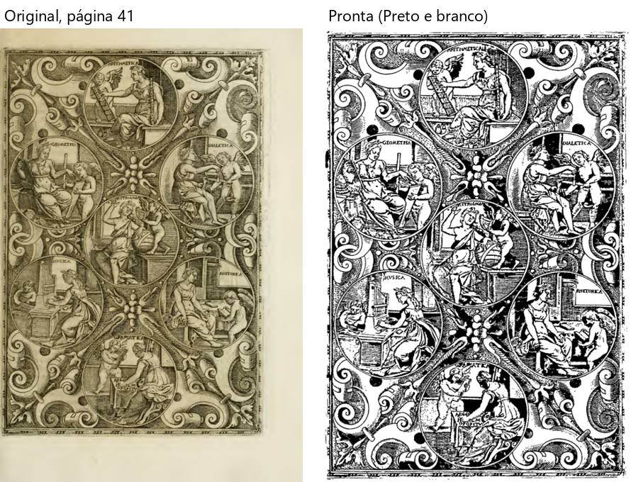

# Valadés — "Rhetorica Christiana" (446 folhas, 40 MB)

Percurso inteiro na janela de verdade, numa cópia do PDF (livro inteiro). `roteiros/configs/valades.json`.

**O livro:** uma página por folha, texto com moldura e notas na margem, papel amarelado com manchas, gravuras em
metal finas (página 41: as artes liberais em medalhões), guardas em branco. **Caixinhas:** sem "Dividir";
"Endireitar"; "Cortar as bordas"; "Limpar a folha" com **Preto e branco**; "Achar gravuras e fotos". Ao abrir, "Este
livro tem fundo separado..." → "Sim".

**Como foi:** "Conferir" (**4 min 35 s**) → Cortar, Endireitar e filtros nas páginas 1–4, 41, 163, 203 e 446 → arrastar
e desfazer → Retângulo na gravura da página 41 → "Para revisar" ("está bom assim" e desfazer, "Deixar em branco", "está
bom assim") → "está certo" → processar (**13 min 47 s**) → 446 páginas, 47 MB → montar em A4 (**2 min 1 s**: 224
páginas, 112 folhas, 23 cadernos). **Foi até o fim**; 446 entraram, 446 saíram.

## Problemas

| # | O que fiz | O que esperava | O que aconteceu | Tipo | Print | Gravidade |
|---|---|---|---|---|---|---|
| V-1 | Processei a gravura da página 41 no Preto e branco, com "Achar gravuras" ligada | "O desenho também sair perfeito" | O sombreado de traço fino virou **áreas pretas chapadas**: os fundos dos medalhões e as dobras das roupas escureceram, rostos e mãos perderam detalhe; o desenho ficou muito mais pesado que o original | erro |  *Página 41: original e pronta* | atrapalha |
| V-2 | Página 203: mancha marrom pequena em cima de uma palavra | Mancha some, palavra fica | A mancha virou um **ponto preto** em cima da palavra ("Idiomate") | erro | — | detalhe |
| V-3 | Cliquei "Conferir" | Esperar pouco | **4 min 35 s** olhando o livro, só com "Olhando o livro..." (446 folhas) | confuso | — | detalhe |
| V-4 | Abri a conferência | Avisos que ajudam | **201 de 446** com dúvida (alto **218**; "Antes de processar" **199 / 241 avisos**); "as contas discordam" de novo nas primeiras folhas (guardas sem texto) | confuso | — | atrapalha |
| V-5 | Página 41: Retângulo e desfazer | A marcação some | Áreas 16 → 17 → **17** (P-2 do Palatino de novo) | erro | — | atrapalha |

**A conferir (de novo):** o clique do Windows em "Confirmar e processar" não abriu nada em 30 s.

**O que funcionou bem:** o texto, as molduras e as notas da margem saíram limpos e brancos em todas as páginas que
olhei (82, 122, 163, 203, 284); a guarda em branco saiu branca; o livro inteiro de 446 páginas processou sem travar e
montou 23 cadernos.
